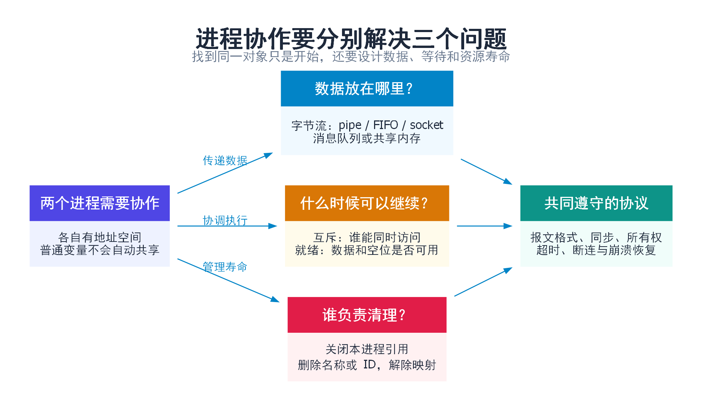
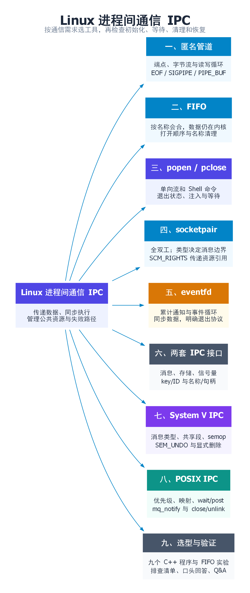

# Linux 进程间通信 IPC：从传递数据到同步与资源清理

本文解决一个问题：两个进程怎样找到对方、交换数据、等待对方完成，并在退出时正确清理通信资源。

前置知识是文件描述符、`fork()`、`read/write` 和错误码。可先看[系统编程基础](../一.基础概念/1.Linux系统编程基础.md)、[文件 I/O](../二.文件IO/1.文件IO.md)；进程共享锁的属性参见[POSIX 线程](../八.POSIX线程/1.POSIX线程.md#mutex)。本文会在使用处回顾必要知识。

两个独立进程像两间办公室：普通变量通常是各自的笔记本，给自己的变量赋值不会自动修改对方的变量。IPC 可以提供送信通道、共同使用的存储，或“已经准备好”的通知。类比之后还要分清真实对象：文件描述符、IPC ID、映射地址、名称和计数不是同一种东西。

示例面向 Linux/glibc，完整示例统一使用 C++11；Linux 专用行为会单独指出。每个完整代码块独立保存、编译。局部片段用于解释 API，不应当直接拼成程序。

## 阅读路线

| 需求 | 阅读位置 |
| --- | --- |
| 父子进程传一串数据 | [一、匿名管道](#pipe) |
| 独立启动的程序通过路径会合 | [二、FIFO](#fifo) |
| 运行固定命令并取得输出 | [三、popen](#popen) |
| 双向通信、传递文件描述符 | [四、socketpair](#socketpair) |
| 唤醒事件循环，不传业务报文 | [五、eventfd](#eventfd) |
| 对比两套消息队列、共享内存、信号量 | [六、两套 IPC 接口](#families) |
| 理解 key、ID、SEM_UNDO 和显式删除 | [七、System V IPC](#sysv) |
| 理解名称、映射、wait/post 和通知 | [八、POSIX IPC](#posix) |
| 按需求选工具、运行实验、复习 | [九、选型与验证](#review)、[Q&A](#qa) |

第一次阅读先学一至六节，再按需要选择七或八。后两节保留完整的查找、初始化、同步和退出推导；已有经验的读者可以直接定位到表格与完整实验。



<a id="pipe"></a>

## 一、匿名管道：父进程写的数据，子进程怎样读到？

### 1.1 先建立通道，再让双方持有端点

`pipe(fd)` 创建一条单向字节流通道：`fd[0]` 用来读，`fd[1]` 用来写。父进程先创建再 `fork()`，子进程继承文件描述符，双方于是能访问同一条内核管道。

常见用法是亲缘进程之间继承端点，但这不是权限上的绝对限制：也可以通过 Unix domain socket 把管道 fd 传给独立进程。真正的条件是拥有对应端点，匿名管道没有可供别人按路径打开的名字。

管道不保存消息边界。写两次不保证读两次；一次读取可能拿到半段或多段。`SOCK_STREAM` 套接字也一样，不要把所有 socket 都当成消息通道。

### 1.2 为什么不使用的一端也必须关掉？

父写子读时，父进程关闭读端，子进程关闭写端。如果子进程保留着自己的写端，即使父进程已关闭写端，内核仍然看到“还有写端存在”。子进程读完现有数据后就可能一直等待。

对于请求长度大于 0 的读取，规则是：

| 状态 | 阻塞操作 | 非阻塞操作 |
| --- | --- | --- |
| 有数据可读 | 返回实际读到的字节数，可能少于请求值 | 同样可能短读 |
| 无数据，但仍有写端 | 等待数据或端点状态变化 | `-1`，`errno=EAGAIN` |
| 无数据，且所有写端已关闭 | 返回 0，即 EOF | 同样返回 0 |
| 写入时所有读端已关闭 | 产生 SIGPIPE；若信号被忽略等，调用失败为 EPIPE | 同样要处理断开 |
| 写入空间不足 | 等待；大写入可能部分完成 | 按写入大小与可用空间返回 EAGAIN 或部分字节 |

**关闭全部写端不会丢弃尚未读取的数据。先读完剩余数据，之后才读到 EOF。** 管道最后的端点引用释放后，内核才回收管道。[pipe(7)](https://man7.org/linux/man-pages/man7/pipe.7.html)

### 1.3 容量和 PIPE_BUF 不是同一个限制

容量表示管道可以暂存多少数据，影响写端何时等待；`PIPE_BUF` 表示多个写者写入时，单次写入不与其他写者交错的大小界限。

Linux 的 `PIPE_BUF` 为 4096 字节；管道容量不应写死为 64 KiB。默认容量与页大小、内核版本和资源限制相关，可以用 `fcntl` 的 `F_GETPIPE_SZ` 查询，`F_SETPIPE_SZ` 请求调整并检查返回值。增加容量不增加 `PIPE_BUF`，也不产生消息边界。

阻塞写入且长度不超过 `PIPE_BUF` 时，空间不足会等到能完成这次写入；非阻塞时，空间不足则返回 `EAGAIN`，不会为了凑空间拆开这次小写入。超过该界限就要考虑交错和部分写入。接收者即便面对原子的小写入，仍必须按自己的协议组装数据。

### 1.4 完整实验：写完关闭，读到 EOF 后结束

保存为 `pipe_demo.cpp`。示例按实际长度输出，不假定 `read()` 会补字符串结尾；写端处理部分写入和 EINTR，父进程回收子进程。

```cpp
#include <cerrno>
#include <cstdio>
#include <cstring>
#include <csignal>
#include <sys/wait.h>
#include <unistd.h>

static bool write_all(int fd, const char* data, size_t size) {
    while (size != 0) {
        ssize_t n = write(fd, data, size);
        if (n == -1 && errno == EINTR) continue;
        if (n <= 0) return false;
        data += n;
        size -= static_cast<size_t>(n);
    }
    return true;
}

int main() {
    if (std::signal(SIGPIPE, SIG_IGN) == SIG_ERR) return 1;
    int fd[2];
    if (pipe(fd) == -1) { std::perror("pipe"); return 1; }
    pid_t child = fork();
    if (child == -1) {
        std::perror("fork"); close(fd[0]); close(fd[1]); return 1;
    }
    if (child == 0) {
        close(fd[1]);  // 子进程绝不能保留自己的写端，否则等不到 EOF。
        char buffer[128];
        for (;;) {
            ssize_t n = read(fd[0], buffer, sizeof(buffer));
            if (n == -1 && errno == EINTR) continue;
            if (n == 0) break;
            if (n == -1 || !write_all(STDOUT_FILENO, buffer,
                                     static_cast<size_t>(n))) {
                close(fd[0]); _exit(1);
            }
        }
        close(fd[0]);
        _exit(0);  // 输出直接使用 write，不依赖 stdio 刷新。
    }
    close(fd[0]);
    const char message[] = "Hello through pipe\n";
    bool ok = write_all(fd[1], message, sizeof(message) - 1);
    if (!ok) std::perror("write pipe");
    close(fd[1]);  // 最后一个写端关闭，子进程读完后得到 EOF。
    int status = 0;
    pid_t waited;
    do { waited = waitpid(child, &status, 0); }
    while (waited == -1 && errno == EINTR);
    return ok && waited == child && WIFEXITED(status) &&
           WEXITSTATUS(status) == 0 ? 0 : 1;
}
```

```bash
g++ -std=c++11 -Wall -Wextra -Wpedantic pipe_demo.cpp -o pipe_demo
./pipe_demo
```

预期输出 `Hello through pipe`。这是单写者、单读者、阻塞 I/O 示例；不是非阻塞网络发送器，多写者的报文不能仅靠 `write_all` 防止交错。实际服务还需要截止时间和取消协议。

### 1.5 Shell 管道怎样连接两个命令？

以 `ls | grep txt` 为例：Shell 建立管道，让一个子进程通过 `dup2()` 把标准输出接到写端，另一个把标准输入接到读端，然后分别执行目标程序。Shell 和子进程都要关闭无用端点，否则也会干扰 EOF。

`exec` 是替换进程当前执行的程序，并不自动关闭所有 fd；需要保留的重定向端点和应关闭的端点必须分清。多线程程序通常优先在创建时设置 close-on-exec，如 Linux 的 `pipe2(O_CLOEXEC)`，避免创建和后续设置标志之间的竞态。

<a id="fifo"></a>

## 二、FIFO：两个独立启动的程序怎样找到同一条通道？

### 2.1 路径解决会合问题，不负责保存消息

FIFO 是带文件系统名称的管道，`mkfifo()` 创建路径节点，通信双方再 `open()`。数据仍通过内核管道传递，不作为文件内容保存在磁盘。所有打开者离开后，未消费的数据不会留给下次打开；路径本身可继续存在，直到 `unlink()`。

创建权限受 umask 等规则影响。在普通权限模型下，权限由 `mode & ~umask` 限制。遇到 `EEXIST` 不能无条件忽略：路径可能属于别人，也可能根本不是 FIFO。生产程序需要可信目录及对象类型、归属检查。

### 2.2 为什么 open 本身也可能等待？

| 打开方式 | 没有对端时的结果 |
| --- | --- |
| `O_RDONLY` | 等待写端打开 |
| `O_WRONLY` | 等待读端打开 |
| `O_RDONLY | O_NONBLOCK` | 可以成功；随后读取要区分无写端的 EOF 和有写端时的 EAGAIN |
| `O_WRONLY | O_NONBLOCK` | 失败，`errno=ENXIO` |

Linux 允许 `O_RDWR` 打开 FIFO 而不等对端，但 POSIX 不保证此行为。它会让本进程同时维持读写引用，可能掩盖对方退出，因此不能仅为“让 open 不阻塞”就机械使用。[fifo(7)](https://man7.org/linux/man-pages/man7/fifo.7.html)

打开后按第一节的管道规则读写。多个读者是竞争取走字节，不是每人得到一份广播。需要双向请求响应时，可以建立两条 FIFO，但还要设计打开顺序；复杂交互通常用 Unix domain socket 更直接。

### 2.3 可复现实验：创建、通信、删除

在 Linux 的同一个 Shell 中执行。`mktemp -d` 创建专用目录，避免误用公共固定路径；命令本身就是完整实验，不需要再维护两个几乎相同的读写程序。

```bash
ipc_demo_dir=$(mktemp -d)
mkfifo -m 600 "$ipc_demo_dir/channel"
cat "$ipc_demo_dir/channel" &
reader_pid=$!
printf 'hello through FIFO\n' > "$ipc_demo_dir/channel"
wait "$reader_pid"
ls -l "$ipc_demo_dir/channel"
rm -- "$ipc_demo_dir/channel"
rmdir -- "$ipc_demo_dir"
```

预期先看到 `hello through FIFO`，随后 `ls -l` 仍显示类型为 `p` 的节点。写端关闭后，cat 读完得到 EOF 并退出，但路径没有自动消失。`unlink` 不会强制关闭已打开的 fd；若还需新的进程按名称加入，应安排好删除时机。

<a id="popen"></a>

## 三、popen / pclose：怎样读取一个外部命令的输出？

### 3.1 它封装的是单向通道和子进程管理

`popen(command, "r")` 返回 `FILE*`，当前进程从中读取命令的标准输出；`"w"` 则向命令的标准输入写入。它属于 POSIX 接口，不是 ISO C 自身规定的函数；不能依赖 `"rw"` 完成双向通信。

可用“建立管道 → 创建子进程 → 重定向 → 让 `/bin/sh -c` 执行命令”理解其效果，但不能把这个模型当作所有 glibc 版本固定使用 fork 的源码流程。

流要用 `pclose()` 结束，以关闭通道并等待对应子进程。返回值是等待状态，不是直接的退出码；先判断 `-1`，再用 `WIFEXITED`、`WEXITSTATUS` 等宏解析。别让其他 wait 逻辑抢先回收同一个子进程。[popen(3)](https://man7.org/linux/man-pages/man3/popen.3.html)

### 3.2 完整实验：读取固定命令，检查读取和退出状态

保存为 `popen_demo.cpp`：

```cpp
#include <cstdio>
#include <sys/wait.h>

int main() {
    // 固定命令，不拼接外部输入；\n 由 Shell 的 printf 解释。
    FILE* stream = popen("printf 'hello from command\\n'", "r");
    if (!stream) { std::perror("popen"); return 1; }
    char buffer[128];
    bool ok = true;
    while (std::fgets(buffer, sizeof(buffer), stream)) {
        if (std::fputs(buffer, stdout) == EOF) { ok = false; break; }
    }
    if (std::ferror(stream)) ok = false;
    int status = pclose(stream);  // 即便读取失败，也要处理子进程回收。
    if (status == -1) { std::perror("pclose"); return 1; }
    if (!WIFEXITED(status)) {
        std::fprintf(stderr, "command did not exit normally\n"); return 1;
    }
    std::printf("exit=%d\n", WEXITSTATUS(status));
    if (std::fflush(stdout) == EOF) ok = false;
    return ok && WEXITSTATUS(status) == 0 ? 0 : 1;
}
```

```bash
g++ -std=c++11 -Wall -Wextra -Wpedantic popen_demo.cpp -o popen_demo
./popen_demo
```

预期输出 `hello from command` 和 `exit=0`。这个实验命令很短且会自行结束；长时间服务需要另行设计超时、终止和回收，不能假定 `pclose` 一定很快返回。stderr 不会自动并入这个读取流。

### 3.3 为什么不能把用户输入直接拼进 command？

Shell 把 `;`、`|`、重定向等当语法。例如把文件名拼成 `ls 用户输入`，输入若是 `.; printf injected`，就不再只是查询一个文件，而会执行额外命令。这里的根因是数据变成了 Shell 程序的一部分。

需要传动态参数时，可以通过 `fork/execve` 或 `posix_spawn` 传独立的参数数组，避免 Shell 再解释；仍要检查目标程序自身的选项解析、路径和权限。不经过 Shell 并不等于任意参数都安全。读写缓冲、部分完成和子进程退出规则仍然适用。

<a id="socketpair"></a>

## 四、socketpair：一对端点怎样同时双向通信？

### 4.1 每端既能读又能写

`socketpair(AF_UNIX, SOCK_STREAM, 0, sv)` 创建一对已经连接好的本地套接字。写 `sv[0]` 从 `sv[1]` 读，反方向也成立。父子进程通常各保留一个端点；独立进程也能通过 fd 传递获得端点，不能概括为“仅限亲缘”。如果双方需要直接按名称建立连接，使用带地址的 Unix domain socket。

`SOCK_STREAM` 不保存消息边界。Linux 的 Unix domain `SOCK_DGRAM`、`SOCK_SEQPACKET` 可保存边界，但仍要处理报文长度和接收缓冲区不足。类型决定语义，不能只看 socket 这个名字。[unix(7)](https://man7.org/linux/man-pages/man7/unix.7.html)

`close()` 释放本进程的引用；若另一进程仍持有同一端点的副本，可能继续阻止对端得到 EOF。`shutdown(fd, SHUT_WR)` 则表示这个 socket 不再发送，仍可读取；它作用于 socket 本身，不只是删除一个 fd 编号。

Linux 可在创建时使用 `SOCK_CLOEXEC`、`SOCK_NONBLOCK`。非阻塞读写仍需处理 `EAGAIN`；写入已断开的对端需处理错误及 SIGPIPE，发送时可用 `MSG_NOSIGNAL` 避免该次发送产生 SIGPIPE。不是所有服务都应无条件更改整个进程的信号配置。

### 4.2 完整实验：固定长度请求和响应

保存为 `socketpair_demo.cpp`。双方约定报文恰好四字节，因此循环读满四字节；不是假设一次 read 刚好得到整条消息。

```cpp
#include <cerrno>
#include <cstdio>
#include <cstring>
#include <sys/socket.h>
#include <sys/wait.h>
#include <unistd.h>

static bool transfer(int fd, char* data, size_t size, bool sending) {
    while (size) {
        ssize_t n = sending ? send(fd, data, size, MSG_NOSIGNAL)
                            : recv(fd, data, size, 0);
        if (n == -1 && errno == EINTR) continue;
        if (n <= 0) return false;  // EOF 发生在读满前，也算报文不完整。
        data += n;
        size -= static_cast<size_t>(n);
    }
    return true;
}
int main() {
    int sv[2];
    if (socketpair(AF_UNIX, SOCK_STREAM | SOCK_CLOEXEC, 0, sv) == -1) {
        std::perror("socketpair"); return 1;
    }
    pid_t child = fork();
    if (child == -1) {
        std::perror("fork"); close(sv[0]); close(sv[1]); return 1;
    }
    if (child == 0) {
        close(sv[0]);
        char request[4];
        char reply[] = "PONG";
        bool ok = transfer(sv[1], request, 4, false) &&
                  std::memcmp(request, "PING", 4) == 0 &&
                  transfer(sv[1], reply, 4, true);
        close(sv[1]); _exit(ok ? 0 : 1);
    }
    close(sv[1]);
    char request[] = "PING";
    char reply[4];
    bool ok = transfer(sv[0], request, 4, true) &&
              transfer(sv[0], reply, 4, false) &&
              std::memcmp(reply, "PONG", 4) == 0;
    close(sv[0]);
    int status = 0;
    pid_t waited;
    do { waited = waitpid(child, &status, 0); }
    while (waited == -1 && errno == EINTR);
    if (!ok || waited != child || !WIFEXITED(status) || WEXITSTATUS(status))
        return 1;
    std::puts("reply=PONG");
    return 0;
}
```

```bash
g++ -std=c++11 -Wall -Wextra -Wpedantic socketpair_demo.cpp -o socketpair_demo
./socketpair_demo
```

预期 `reply=PONG`。这里是先请求再响应，未加入超时。双方若同时发送大量数据、都不读对方，仍可能因缓冲区满而相互等待；全双工不是免死锁保证。

### 4.3 SCM_RIGHTS：传递的是资源引用，不是整数号码

A 的 fd 5 和 B 的 fd 5 不一定指向同一对象。把数字 5 当作普通字节发过去，不会让 B 获得 A 的文件。`SCM_RIGHTS` 则通过 `sendmsg/recvmsg` 的辅助消息，请内核在接收进程的 fd 表中建立一个引用，返回的编号可能不同。

对于普通文件，这类似跨进程复制描述符：双方引用同一打开文件描述，通常共享文件偏移和文件状态标志；各自的 fd 编号及 close-on-exec 标志是另一层。发送后关闭自己的 fd，不会直接关闭对方持有的引用。

典型用途是主进程接受连接后交给工作进程，或在权限允许的本地控制通道上交付已打开文件。它不自动完成身份验证，不自动消除 fork 竞态，也不自动实现服务热升级。跨 exec 直接继承 fd 与 SCM_RIGHTS 传递是不同路径：环境变量中的数字只有在对应 fd 确实被继承时才有意义。

控制消息组织如下：

```text
msghdr
├── msg_iov：普通数据，例如一个协议标记字节
└── msg_control：辅助消息缓冲区
    └── cmsghdr：SOL_SOCKET / SCM_RIGHTS / 长度
        └── 一个或多个 fd 的表示
```

发送端用 `CMSG_SPACE` 分配含对齐空间的缓冲区，用 `CMSG_LEN` 填控制消息长度。接收端必须检查截断标志、层级、类型和长度，不能直接解引用第一条消息就假定拿到了 fd。收到后拒绝的 fd 也要关闭，防止泄漏。下面给出仅接收一个 fd 的完整受控实验。

保存为 `fd_pass.cpp`。父进程在 fork 后才打开 `/dev/null`，因此子进程只能通过辅助消息取得该引用；读取返回 0 验证它确实是一个可读的设备。这里使用保留报文边界的本地 SOCK_DGRAM，双方是受控的父子进程。

```cpp
#include <cerrno>
#include <csignal>
#include <cstdio>
#include <cstring>
#include <fcntl.h>
#include <sys/socket.h>
#include <sys/wait.h>
#include <unistd.h>

static bool send_fd(int socket, int file) {
    char marker = 'F';
    iovec payload{&marker, 1};
    alignas(cmsghdr) char control[CMSG_SPACE(sizeof(int))]{};
    msghdr message{};
    message.msg_iov = &payload;
    message.msg_iovlen = 1;
    message.msg_control = control;
    message.msg_controllen = sizeof(control);
    cmsghdr* header = CMSG_FIRSTHDR(&message);
    header->cmsg_level = SOL_SOCKET;
    header->cmsg_type = SCM_RIGHTS;
    header->cmsg_len = CMSG_LEN(sizeof(int));
    std::memcpy(CMSG_DATA(header), &file, sizeof(file));
    ssize_t n;
    do { n = sendmsg(socket, &message, MSG_NOSIGNAL); }
    while (n == -1 && errno == EINTR);
    return n == 1;
}

static int receive_fd(int socket) {
    char marker = 0;
    iovec payload{&marker, 1};
    alignas(cmsghdr) char control[CMSG_SPACE(sizeof(int))]{};
    msghdr message{};
    message.msg_iov = &payload;
    message.msg_iovlen = 1;
    message.msg_control = control;
    message.msg_controllen = sizeof(control);
    ssize_t n;
    do { n = recvmsg(socket, &message, MSG_CMSG_CLOEXEC); }
    while (n == -1 && errno == EINTR);
    if (n == -1) return -1;
    int result = -1;
    bool valid = n == 1 && marker == 'F' &&
                 !(message.msg_flags & (MSG_CTRUNC | MSG_TRUNC));
    for (cmsghdr* h = CMSG_FIRSTHDR(&message); h;
         h = CMSG_NXTHDR(&message, h)) {
        if (h->cmsg_level != SOL_SOCKET || h->cmsg_type != SCM_RIGHTS ||
            h->cmsg_len < CMSG_LEN(0)) { valid = false; continue; }
        size_t bytes = h->cmsg_len - CMSG_LEN(0);
        if (bytes % sizeof(int)) valid = false;
        for (size_t offset = 0; offset + sizeof(int) <= bytes; offset += sizeof(int)) {
            int received;
            std::memcpy(&received, CMSG_DATA(h) + offset, sizeof(received));
            if (result == -1) result = received;
            else { close(received); valid = false; } // 协议只允许一个 fd。
        }
    }
    if (!valid || result == -1) {
        if (result != -1) close(result);
        errno = EPROTO;
        return -1;
    }
    return result;
}

int main() {
    int sv[2];
    if (socketpair(AF_UNIX, SOCK_DGRAM | SOCK_CLOEXEC, 0, sv) == -1) {
        std::perror("socketpair"); return 1;
    }
    pid_t child = fork();
    if (child == -1) {
        std::perror("fork"); close(sv[0]); close(sv[1]); return 1;
    }
    if (child == 0) {
        close(sv[0]);
        int fd = receive_fd(sv[1]);
        bool ok = false;
        if (fd != -1) {
            char byte;
            ssize_t n;
            do { n = read(fd, &byte, 1); } while (n == -1 && errno == EINTR);
            ok = n == 0;
            close(fd);
        }
        close(sv[1]); _exit(ok ? 0 : 1);
    }
    close(sv[1]);
    int file = open("/dev/null", O_RDONLY | O_CLOEXEC);
    bool ok = file != -1 && send_fd(sv[0], file);
    if (file != -1) close(file);
    if (!ok) {
        // 本地 datagram 没有 stream EOF；失败时终止本例唯一子进程，避免无限等待。
        kill(child, SIGKILL);
    }
    close(sv[0]);
    int status = 0;
    pid_t waited;
    do { waited = waitpid(child, &status, 0); }
    while (waited == -1 && errno == EINTR);
    if (!ok || waited != child || !WIFEXITED(status) || WEXITSTATUS(status)) return 1;
    std::puts("passed fd reads EOF from /dev/null");
}
```

```bash
g++ -std=c++11 -Wall -Wextra -Wpedantic fd_pass.cpp -o fd_pass
./fd_pass
```

预期 `passed fd reads EOF from /dev/null`。`MSG_CMSG_CLOEXEC` 是 Linux 接收端设置新 fd 的方式。示例校验了消息格式和截断，但没有实现身份认证、通用 RPC、超时或多 fd 批量协议；用于独立客户端时需补齐这些边界。仅凭收到一个 fd，不能认为发送者可信。

<a id="eventfd"></a>

## 五、eventfd：没有业务数据时，怎样只发一个通知？

### 5.1 把通知记成数字

事件循环可能阻塞在 epoll，另一个线程把任务放入队列后，需要叫醒它。若只需要表达“有事情值得检查”，不必把任务内容再塞进管道；Linux 的 `eventfd()` 提供一个可供 poll/epoll 观察的计数器 fd。

使用八字节 `uint64_t` 写入会增加计数。默认模式读出当前非零计数并清零；`EFD_SEMAPHORE` 每次读取返回 1 并减 1。计数为 0 时阻塞读取会等待，非阻塞读取返回 `EAGAIN`。

普通用户态写入所能达到的最大计数是 `UINT64_MAX-1`。会超过这个上限的加法才需要等待或返回 `EAGAIN`；写 `UINT64_MAX` 本身非法，不能把计数说成无限累加。通常读写都传 `sizeof(uint64_t)`；写入要求八字节，读取缓冲区不能小于八字节。[eventfd(2)](https://man7.org/linux/man-pages/man2/eventfd.2.html)

### 5.2 完整实验：先通知，再读取，也不会丢失计数

保存为 `eventfd_demo.cpp`。这里故意在创建子进程前写入，证明通知会保留，不依赖子进程恰好已经开始等待。

```cpp
#include <cerrno>
#include <cstdint>
#include <cstdio>
#include <sys/eventfd.h>
#include <sys/wait.h>
#include <unistd.h>

int main() {
    int fd = eventfd(0, EFD_CLOEXEC);
    if (fd == -1) { std::perror("eventfd"); return 1; }
    uint64_t value = 3;
    ssize_t n;
    do { n = write(fd, &value, sizeof(value)); }
    while (n == -1 && errno == EINTR);
    if (n != static_cast<ssize_t>(sizeof(value))) {
        std::perror("write eventfd"); close(fd); return 1;
    }
    pid_t child = fork();
    if (child == -1) { std::perror("fork"); close(fd); return 1; }
    if (child == 0) {
        uint64_t received = 0;
        do { n = read(fd, &received, sizeof(received)); }
        while (n == -1 && errno == EINTR);
        bool ok = n == static_cast<ssize_t>(sizeof(received)) && received == 3;
        close(fd); _exit(ok ? 0 : 1);
    }
    int status = 0;
    pid_t waited;
    do { waited = waitpid(child, &status, 0); }
    while (waited == -1 && errno == EINTR);
    close(fd);
    if (waited != child || !WIFEXITED(status) || WEXITSTATUS(status)) return 1;
    std::puts("child consumed count=3");
    return 0;
}
```

```bash
g++ -std=c++11 -Wall -Wextra -Wpedantic eventfd_demo.cpp -o eventfd_demo
./eventfd_demo
```

预期 `child consumed count=3`。若改成 `EFD_SEMAPHORE`，一次读取将得到 1，必须同时修改实验的消费方式和预期，不能只换创建标志。

### 5.3 通知和任务队列要分别管理

计数器操作自身由内核协调，但这不自动保护你的任务队列。生产者需要按队列的同步规则写完任务，再通知；消费者读掉通知后，检查队列并按协议处理任务。通知次数可能合并，计数不一定等于尚未处理的任务数。

阻塞读取适合专用等待者，非阻塞模式适合事件循环；并非所有工程都必须使用 epoll，也不是边沿触发一定比水平触发好。若使用边沿触发，要处理到 `EAGAIN`，或确保主动调度剩余工作。第七节的[事件循环讨论](#sysv-section-8)会展开通知顺序和故障恢复。

**不要用另一个线程 close(fd) 来可靠地打断阻塞 read。** Linux 上正在执行的调用可能仍持有底层对象引用。退出时应通过明确的关闭状态和唤醒协议让等待者结束，然后再关闭资源。eventfd 也没有“最后一个写端关闭后读到 EOF”的管道端点模型。

<a id="families"></a>

## 六、System V 与 POSIX IPC：两套接口怎样对应？

前面的 pipe、socketpair 和 eventfd 都通过 fd 操作。消息队列、共享内存和信号量则还有两套常见接口；“POSIX IPC”在这里特指这三个组件，并不是说 pipe 不属于 POSIX。

| 目的 | System V / XSI | POSIX | 关键区别 |
| --- | --- | --- | --- |
| 传消息 | msgget / msgsnd / msgrcv / msgctl | mq_open / mq_send / mq_receive / mq_unlink | System V 按类型选择；POSIX 按优先级取消息 |
| 共享存储 | shmget / shmat / shmdt / shmctl | shm_open / ftruncate / mmap / shm_unlink | 前者返回 ID 再附着；后者取得 fd 再映射 |
| 计数与等待 | semget / semop / semctl | sem_open 或 sem_init；sem_wait / sem_post | System V 可一次原子操作多个信号量；POSIX 通常一次操作一个 |

两套 API 都不替应用设计业务事务、数据格式和故障恢复。System V 并非只能维护旧代码：如果需要 `semop` 的批量原子操作，它有明确用途。新项目也不必一律选择 POSIX IPC，可能 Unix domain socket 就更合适。

### 6.1 名字、引用和持久性

System V 的 key 用于查找，ID 用于操作，不是 fd；`IPC_PRIVATE` 表示请求新对象，不表示“只准亲缘进程使用”。`ftok` 也只是生成可能碰撞的 key，不是唯一名称服务。

POSIX 命名对象要分清 `close` 与 `unlink`：关闭自己的句柄，不等于删除公共名称。消息队列、命名信号量和共享内存都需要安排删除责任；进程正常退出也不能据此推断命名对象已消失。

这里的“内核持久性”表示对象可在创建者退出后仍存在，不是掉电持久化。System V 队列和信号量集合删除后立即失效；共享内存的删除需要结合附着或映射引用理解，后文分别说明。

### 6.2 哪些能放进 epoll？

Linux 上 pipe、FIFO、socketpair、eventfd 和 POSIX 消息队列描述符可参与相应的 poll/epoll 等待。Linux POSIX 消息队列的这项能力不是跨所有 POSIX 平台的保证。

System V IPC ID 不能传给 epoll；`sem_t*` 不是 fd；共享映射里的变量改变也不会自动产生 fd 就绪事件。需要事件循环时，可选择额外通知通道，但必须保证通知与真正的数据状态配合。

<a id="sysv"></a>

## 七、System V IPC：key、ID、共享段与信号量集合

本节定位：[对象查找](#sysv-section-2) · [消息队列](#sysv-section-3) · [共享内存](#sysv-section-4) · [信号量](#sysv-section-5) · [初始化与删除](#sysv-section-6) · [组合使用](#sysv-section-7) · [事件循环](#sysv-section-8) · [排障](#sysv-section-9) · [完整交接实验](#sysv-appendix-a)

假设你写了两个程序：A 负责接收订单，B 负责处理订单。A 收到一张订单后，怎样交给 B？B 暂时没有订单时应该做什么？如果双方同时修改一份统计数据，怎样避免算错？

XSI IPC，也就是通常所说的 System V IPC，提供了三种工具：消息队列、共享内存和信号量。它们分别处理传递数据、共享存储和协调访问的问题。

下面沿着“程序调用 API 后，内核做了什么”理解具体规则。文中的内核流程是便于理解的简化模型，不代表每个内核版本都按完全相同的代码顺序执行。

<a id="sysv-section-1"></a>

### 7.1 进程之间为什么需要 IPC

#### 7.1.1 A 修改一个变量，B 为什么通常看不到

先看一行代码：

```cpp
int order_count = 0;
```

如果 A、B 是分别启动的两个进程，它们各自有自己的地址空间。可以把地址空间理解为“程序可以使用的一套地址及其映射关系”。CPU 通过这些映射，把程序中的虚拟地址转换成实际存储位置。

两个进程里都叫 order_count 的变量，通常是两份不同的数据。即使打印出的地址数值碰巧相同，也不能说明它们访问同一份存储，因为地址要结合所属进程的映射关系才有意义。

```text
进程 A：自己的 order_count → 存储位置甲
进程 B：自己的 order_count → 存储位置乙
```

fork 后父子进程的普通内存初始内容相同，但后续修改普通私有变量，通常仍不会相互影响。Linux 使用写时复制优化：起初可以共享底层页面，真正发生私有写入时再建立分离的副本。不能因为 fork 会复制变量，就认为它自动建立了持续共享的数据区。[参考：fork(2)](https://man7.org/linux/man-pages/man2/fork.2.html)

#### 7.1.2 三个组件分别改变了什么

A 要把订单交给 B，可以让内核保存一份消息，B 再取走；也可以申请一块双方都能映射的存储，让 A 写、B 读。后一种方式还需要约定访问顺序。

| 组件 | 具体做法 | 在订单场景中的作用 |
|---|---|---|
| 消息队列 | 把消息交给内核，由接收方取走 | A 发送一张订单，B 接收一张订单 |
| 共享内存 | 将同一个共享段映射到多个进程 | A、B 访问同一批订单数据 |
| 信号量集合 | 内核维护计数并执行有条件的计数操作 | 约定何时可读、何时可写、谁可进入临界区 |

信号量不替你存订单；共享内存也不自动规定谁先写、谁后读。理解各自负责什么，才能正确组合它们。

#### 7.1.3 什么是“内核对象”

内核对象可以理解为内核管理的一份资源及其状态。一个消息队列不仅有消息，还需要保存所有者、权限、容量、当前使用量，以及正在等消息或等空位的线程等信息。

你的程序拿到的 ID 只是用来指定这份资源的编号。它不是消息本身，也不是指向内核结构的用户态指针。

| 组件 | 创建或查找 | 主要操作 | 管理或删除 |
|---|---|---|---|
| 消息队列 | `msgget()` | `msgsnd()`、`msgrcv()` | `msgctl()` |
| 信号量集合 | `semget()` | `semop()`、`semtimedop()` | `semctl()` |
| 共享内存 | `shmget()` | `shmat()`、内存访问、`shmdt()` | `shmctl()` |

<a id="sysv-section-2"></a>

### 7.2 怎样找到同一个内核对象

#### 7.2.1 key、ID 和地址，为什么要分成三个概念

假设 A、B 独立启动，双方需要使用同一段共享内存。启动前，它们还不知道内核会给这个对象分配哪个 ID，但可以事先约定一个 key，例如 `0x1234`。

```text
双方事先约定：key = 0x1234
           ↓
shmget() 查找或创建对象，返回 shmid
           ↓
shmat() 把该对象映射到本进程，返回可访问的地址
```

三个值分别回答三个问题：

| 值 | 回答的问题 | 由谁决定 |
|---|---|---|
| key | 我们约定查找哪个对象？ | 应用约定，或用 ftok 辅助生成 |
| ID | 内核把这个对象标识为什么？ | 内核在创建对象时分配 |
| 地址 | 当前进程从哪里访问这段共享内存？ | 由映射结果决定 |

因此，不要把 key 当 shmid，也不要把 shmid 强制转换成指针后直接解引用。

#### 7.2.2 IPC 命名空间：内核到哪一组对象中查找

如果两套应用都用了 key `0x1234`，怎样避免它们无意中找到对方的对象？Linux 可以让它们属于不同的 IPC 命名空间。每个空间有自己的一组 IPC 对象和查找范围。

```text
同一个 Linux 内核

IPC 命名空间 A：
    进程 P ──┐
             ├──→ 消息队列甲（key = 0x1234）
    进程 Q ──┘

IPC 命名空间 B：
    进程 R ─────→ 消息队列乙（key = 0x1234）
```

P、Q 查找 A 中的队列；R 查找 B 中的队列。两个队列的 key 相同，但不是同一个对象。

它的底层含义是：内核先根据调用进程所属的 IPC 命名空间确定查找范围，再使用 key 或 ID 查找相应类型的对象。不是先在全机器找到对象，再看到“属于另一个容器”就拒绝。即使 B 中没有队列乙，也不会因此查到 A 中的队列甲。[参考：ipc_namespaces(7)](https://man7.org/linux/man-pages/man7/ipc_namespaces.7.html)、[Linux IPC 公共实现](https://github.com/torvalds/linux/blob/v6.12/ipc/util.c)

不同类型还有各自的查找范围，所以一个消息队列和一段共享内存也可以使用相同 key。对于普通 key，可用“IPC 命名空间＋对象类型＋key”理解查找条件，但不必把它当作内核源码里的实际组合数据结构。

普通 fork 后父子进程默认属于同一个 IPC 命名空间。新空间需要通过 `unshare()`、带 `CLONE_NEWIPC` 的 `clone()` 等方式建立；加入已有空间则涉及 `setns()` 和权限检查。容器是否共享 IPC 空间取决于配置。

可以在同一台主机上比较两个进程：

```bash
readlink /proc/1234/ns/ipc
readlink /proc/5678/ns/ipc
```

将 PID 换成实际值。若输出相同，如都为 `ipc:[4026531839]`，说明属于同一个 IPC 命名空间。这个判断限于同一台主机的同一次运行环境，读取还需权限。[参考：namespaces(7)](https://man7.org/linux/man-pages/man7/namespaces.7.html)

IPC 命名空间主要隔离 System V 三个组件和 POSIX 消息队列，不代表所有通信方式都被隔离。管道、eventfd、socket 和 POSIX 共享内存还有各自的引用、地址或挂载规则。

#### 7.2.3 创建标志：不存在时怎么办，已经存在时怎么办

对普通 key，`msgget()` 等接口需要回答两个分支：

```text
查找该 key
    ├── 不存在：允许创建吗？
    └── 已存在：接受现存对象，还是要求本次必须新建？
```

这就是几个标志的含义：

| 写法 | 不存在时 | 已存在时 |
|---|---|---|
| 不带 IPC_CREAT | 失败，通常为 ENOENT | 检查参数和权限后获取 ID |
| IPC_CREAT | 尝试新建 | 检查后获取现存 ID |
| IPC_CREAT 与 IPC_EXCL 一起使用 | 尝试新建 | 失败，返回 EEXIST |

`IPC_EXCL` 的重要之处在于：由内核把“检查是否存在”和“决定新建”作为受并发保护的操作来完成。两个进程同时请求排他创建同一个普通 key 时，不能都成功创建为同一个 key 对应的两个同类型对象。胜出的进程可以负责初始化；其他进程再按约定连接。[参考：msgget(2)](https://man7.org/linux/man-pages/man2/msgget.2.html)

#### 7.2.4 IPC_PRIVATE：跳过按普通 key 复用的路径

有时 A、B 不需要事先用 key 会合。比如父进程先创建队列，再 fork，子进程自然会知道保存 ID 的变量值。此时可直接请求新建：

```cpp
int q1 = msgget(IPC_PRIVATE, 0600);
int q2 = msgget(IPC_PRIVATE, 0600);
```

两次都成功就得到两个不同队列。`IPC_PRIVATE` 是 key 参数的特殊值，含义是本次新建，不需要再加 `IPC_CREAT`。它没有附加“只有子进程才能使用”的检查。[参考：msgget(2)](https://man7.org/linux/man-pages/man2/msgget.2.html)

为什么无亲缘进程也能用？因为对象已经在内核里存在，后续操作需要的是“指定这个对象的 ID”和“符合要求的权限”，而不是证明调用者是创建者的后代。

#### 7.2.5 知道 ID，为什么仍然可能没有权限

假设用户 alice 运行的 A 创建了 ID 为 42 的队列，权限为 `0600`。队列的内核元数据保存了所有者身份和权限位；另一个进程 B 发起接收时，内核还能取得 B 的有效用户 ID、组身份等凭据。

简化后的检查过程是：

```text
B 调用 msgrcv(42, ...)
    ↓
按 B 的 IPC 命名空间及 ID 找到队列
    ↓
比较 B 的身份与队列的所有者、组和权限
    ↓
允许接收，或报告权限错误
```

若 B 也由 alice 运行，通常允许读写，即使不是 A 的子进程；若 B 由 bob 运行，没有匹配权限或相关特权，知道 42 也不能接收。

这里不是根据用户名称字符串比较，而是根据内核使用的用户、组身份及权限信息检查；Linux 的能力和安全机制还可能参与检查。这个模型解释了为什么 ID 不应当被当作密码。[参考：Linux IPC 权限实现](https://github.com/torvalds/linux/blob/v6.12/ipc/util.c)

权限参数是创建时的设置。B 获取现存对象时传入 `0666`，不会把原队列的权限修改成 `0666`。`IPC_STAT` 是查询元数据，`IPC_SET` 才用于在权限允许时修改指定属性；删除有单独的授权检查。

#### 7.2.6 fork 复制了 ID 变量，为什么队列仍只有一个

父进程创建队列后，把返回值放在变量中：

```cpp
int msqid = msgget(IPC_PRIVATE, 0600);
/* 此处假设成功，随后 fork。 */
```

fork 后，普通变量有各自的副本，但它们保存相同的编号。内核不会因为整数被复制，就再创建一个队列：

```text
父进程：msqid = 42 ──┐
                    ├──→ 内核中的同一个队列
子进程：msqid = 42 ──┘
```

子进程把自己的 msqid 改为 99，不会修改父进程的变量，也不会把原队列的 ID 改成 99；它只是忘掉了原来的编号。如果任一有删除权限的进程删除队列，其他进程保存的旧 ID 也不能继续使用原队列。复制 ID 不会“保住”对象。

#### 7.2.7 ID 和 fd 都是整数，为什么不能互换

区别在于 API 到哪里查：

```text
msgrcv(42, ...) → 查当前 IPC 命名空间中的消息队列
read(42, ...)   → 查当前进程文件描述符表的第 42 项
```

fd 表可以理解为每个进程自己的“打开资源登记表”。A 的第 42 项可能是日志文件，B 的第 42 项可能是 socket，也可能根本没有打开。

因此，把队列 ID 42 传给 `close()`，不会删除队列。如果本进程恰好有 fd 42，反而会关掉那个 fd 指向的资源。这是查错了表，不是数据类型转换能解决的问题。

告诉无亲缘进程“IPC ID 是 42”，在命名空间一致、ID 有效、权限允许时可直接用于相应 IPC API。但告诉它“我的 fd 是 42”，不会给它增加文件引用。真正传 fd，可以使用 Unix domain socket 的 `SCM_RIGHTS`：内核为接收方建立描述符条目，接收方得到的新编号可能是 7。[参考：unix(7)](https://man7.org/linux/man-pages/man7/unix.7.html)

#### 7.2.8 ftok 为什么会碰撞，参考文件又起什么作用

两个独立进程可以写死同一个普通 key，也可以根据稳定文件生成：

```cpp
key_t key = ftok("/run/myapp/ipc.key", 'Q');
if (key == (key_t)-1) {
    /* 检查并处理错误。 */
}
```

`ftok()` 读取文件身份信息，再结合项目编号生成一个有限范围的 key。它不是给内核登记一个永不重复的名字，也没有替所有应用协调编号，因此不同输入仍可能产生相同结果。项目编号只使用低 8 位，应用应使用非零值。

参考文件必须预先存在，但文件内容不是订单载荷；它只是生成 key 的参照物。删除并重新创建文件，文件身份可能变化，新的 key 也可能改变，结果是后来启动的进程找到了别的对象，旧对象却仍在。

使用稳定路径、控制参考文件的所有权，并在连接后核对协议版本和对象规模，比假设 ftok 绝不碰撞更可靠。[参考：ftok(3)](https://man7.org/linux/man-pages/man3/ftok.3.html)

<a id="sysv-section-3"></a>

### 7.3 消息队列：把一份数据交给另一个进程

#### 7.3.1 发送成功后，为什么可以修改自己的发送缓冲区

A 要发送订单编号 1001。调用 `msgsnd()` 时，传进去的是 A 的缓冲区地址，但 B 不能直接使用 A 的地址。

消息队列通过内核传递消息内容。发送成功后，消息已被内核接受，后续接收不会靠重新读取 A 原来的缓冲区来获得数据。因此，A 在调用成功返回后可以复用自己的缓冲区。

```text
A 的发送缓冲区 → 内核接管消息内容 → B 的接收缓冲区
```

这是数据流模型。内核可能把消息直接交给正在等待的接收者，不保证每条消息都先在某条链表上停留一段时间。发送成功也只说明交给了 IPC 机制，不代表 B 已处理成功，更不代表订单已写入持久化存储。[参考：Linux 消息队列实现](https://github.com/torvalds/linux/blob/v6.12/ipc/msg.c)

#### 7.3.2 mtype 和 msgsz：内核怎样理解你传来的内存

消息格式要求开头是正的 `long mtype`，后面是消息体。例如：

```cpp
struct message {
    long mtype;
    char text[128];
};
```

可以把它想成一个信封：mtype 是用于分类的标签，text 是内容。内核按接口约定，知道开头有一个 long；你还需要告诉它后面的消息体究竟有多长。

```text
传入的地址
    ↓
┌─────────────┬──────────────────────┐
│ long mtype  │ 消息体：msgsz 个字节  │
└─────────────┴──────────────────────┘
```

**msgsz 不包含 mtype，是因为这项参数被定义为消息体长度。** 如果把整个结构体长度传进去，内核仍会先处理开头的 long，再按这个错误长度读取后面的数据，就可能越过实际缓冲区。

这并不是“内核猜到了 C 结构体布局”：它只按照固定开头和指定字节数读取。复杂消息体需要自己处理布局、填充、字节序和协议版本。

#### 7.3.3 一次发送、一次接收的局部示例

下面假设 msqid 已有效获取，相关调用放在函数体中：

```cpp
struct message out{};
    out.mtype = 2;
strcpy(out.text, "order:1001");

/* 此协议约定把字符串末尾的 '\0' 一起发送。 */
if (msgsnd(msqid, &out, strlen(out.text) + 1, 0) == -1) {
    /* 处理发送失败。 */
}

struct message in;
ssize_t n = msgrcv(msqid, &in, sizeof(in.text) - 1, 2, 0);
if (n >= 0) {
    in.text[n] = '\0';
    /* 使用 in.text。 */
}
```

接收时留一个字节，是因为接口只复制消息体，不负责给字符串补 `\0`。只有知道消息体遵循字符串协议，才能按字符串解释它；任意二进制消息不能这样处理。

#### 7.3.4 队列里明明有消息，接收者为什么仍然等待

因为接收不只是“取任意一条”，还可以带筛选条件。假设类型依次为：

```text
先入队 → [类型 3] [类型 2] [类型 1] [类型 2]
```

| msgtyp 参数 | 选中的消息 |
|---|---|
| 0 | 第一条，即类型 3 |
| 2 | 第一条类型 2 |
| -2 | 类型不大于 2 的消息中，类型最小者，即类型 1 |

负数参数中的负号是“选择方式”，不是允许发送负类型。真正发送的 mtype 必须大于 0。

若 B 只接收类型 9，现有消息全部不匹配，它仍会等待。队列非空与本次请求能够完成，是两个不同条件。按类型筛选也意味着整体行为不再是简单的先入先出；小类型持续涌入，可能让其他类型长期得不到处理。

#### 7.3.5 “阻塞”究竟发生了什么

假设 B 调用阻塞接收，却没有匹配消息。简化流程是：内核记录 B 的等待条件，把执行该调用的线程安排为等待状态，让 CPU 去运行其他可运行线程。A 发送符合条件的消息后，内核可以完成相应交接并唤醒等待者。

因此，B 不是在用户代码里不停执行“有没有消息”的循环。它的调用尚未返回，但等待线程通常不会持续占用 CPU 忙查；进程里的其他线程仍可能运行。具体等待与唤醒路径可在 Linux 消息队列实现中的接收者、发送者等待结构中看到。[参考：Linux 消息队列实现](https://github.com/torvalds/linux/blob/v6.12/ipc/msg.c)

如果指定 `IPC_NOWAIT`，含义是“不满足就立即报告，让调用者自己决定下一步”，不是“让内核创建后台线程替我等待”。

| 情况 | 阻塞方式 | IPC_NOWAIT 方式 |
|---|---|---|
| 没有匹配消息 | 等待 | 返回 ENOMSG |
| 队列没有足够容量发送 | 等待 | 返回 EAGAIN |

队列容量有限，是为了控制内核资源占用。接收方处理太慢时，发送方最终需要等待或处理失败，这种压力向上游传递的现象通常称为背压。

#### 7.3.6 缓冲区过小，为什么不直接接收一半

一条消息往往是一个完整任务。B 的缓冲区装不下时，如果内核默认只交付一半，程序可能把残缺订单当成完整数据处理。

API 的默认行为是返回 `E2BIG`，消息保留在队列。应用指定 `MSG_NOERROR` 才表示接受截断，超出的部分会丢失。所以不能用原来大小的缓冲区无休止地重试，否则可能一直撞到同一条消息。

Linux 上，阻塞收发被信号处理函数中断时可返回 `EINTR`，不会因 `SA_RESTART` 自动重启；队列被删除，正在阻塞的收发可返回 `EIDRM`。这些错误代表不同状态，不能都解释为“没有消息”。普通 System V 消息收发没有统一的超时参数，需另行安排截止时间或选择其他机制。[参考：msgop(2)](https://man7.org/linux/man-pages/man2/msgop.2.html)

<a id="sysv-section-4"></a>

### 7.4 共享内存：让两个进程访问同一份存储

#### 7.4.1 为什么可以减少传递数据的拷贝

消息队列把消息内容从一个进程交给另一个进程。共享内存则让两个进程的地址映射指向同一个共享段中的内容：

```text
A 中的一段虚拟地址 ──┐
                    ├──→ 同一个共享段中的数据
B 中的一段虚拟地址 ──┘
```

A 写进去，B 在正确同步后可以从自己的映射中读到。每次访问不需要再通过一次消息发送和接收复制载荷，所以很适合共享较大数据。但创建、映射、缺页和同步都有成本，不能据此断言共享内存在每个场景中都最快。

#### 7.4.2 为什么 shmget 之后还需要 shmat

创建对象与给当前进程安排地址，是两件事。

```cpp
int shmid = shmget(key, 4096, IPC_CREAT | 0600);
/* 先检查 shmid != -1。 */

void *base = shmat(shmid, NULL, 0);
if (base == (void *)-1) {
    /* 附着失败。 */
}
```

`shmget()` 解决“段是否存在、用哪个 ID 表示”。`shmat()` 解决“在当前地址空间的哪里建立到这个段的映射”。同一段需要服务多个地址布局不同的进程，创建时不可能用一个普通用户态地址替所有进程决定访问位置。

第二参数传 NULL，是让系统为当前进程选择合适位置。`shmat()` 失败返回 `(void *)-1` 是这套 API 的约定，需要明确检查，不能沿用“指针失败都等于 NULL”的习惯。

#### 7.4.3 同一段里的指针，为什么到另一个进程就可能失效

假设 A 把共享段映射到 `0x70000000`，B 映射到 `0x50000000`。同一段中偏移 128 字节的位置，对应：

| 进程 | 段首地址 | 同一数据在本进程中的地址 |
|---|---|---|
| A | 0x70000000 | 0x70000080 |
| B | 0x50000000 | 0x50000080 |

如果 A 把指针值 `0x70000080` 写进共享区，B 读取这个整数后并不会自动把它翻译成自己的 `0x50000080`。CPU 只会把它当作 B 地址空间中的地址，可能访问失败，也可能读到别的内容。

因此，常见做法是保存偏移 128。使用时由各进程计算“自己的段首＋偏移”，并检查偏移与数据长度没有越界。[参考：shmop(2)](https://man7.org/linux/man-pages/man2/shmop.2.html)

#### 7.4.4 创建时清零，为什么仍然需要初始化

新建共享段的内容为零，但零不一定是业务要求的初值。比如互斥信号量应为 1，环形缓冲区需要设置容量，协议头需要设置版本。

复用一个旧段时，也不能假设它再次被清零；它可能保留上一个实例的数据。对象存在，仅说明有这份存储，不能证明当前应用可以直接使用它。[参考：shmget(2)](https://man7.org/linux/man-pages/man2/shmget.2.html)

#### 7.4.5 为什么共享内存不会自动保护 counter++

假设共享计数器为 10，A、B 各执行一次 `counter++`。这个表达式通常包含读取、加一、写回，可能交错为：

| 步骤 | A | B |
|---|---|---|
| 1 | 读到 10 | |
| 2 | | 读到 10 |
| 3 | 算出 11，写回 | |
| 4 | | 算出 11，写回 |

执行了两次加一，最终却是 11。共享内存保证双方访问同一份数据，没有把整段业务操作变成不可分割的一步。

##### 7.4.5.1 volatile 为什么不能代替锁

可以把共享计数器想成两个人共同修改的一本账。两人都能看到同一本账，并不意味着他们不会同时记下旧余额，然后各自算出新余额，把对方的修改覆盖掉。`volatile` 也没有给这本账加上“只能一人修改”的规则。

即使写成：

```cpp
volatile int counter;
```

`counter++` 在逻辑上仍包含“读取旧值 → 加一 → 写回新值”。`volatile` 对编译器如何处理访问施加约束，但不提供互斥，不保证这次读改写具有原子性，也不建立进程之间所需的同步关系。不能把它理解成“自动加锁”或“强制刷新所有 CPU 缓存”。上述交错仍可能发生。这里的三个步骤是逻辑划分，不表示编译后一定恰好有三条机器指令。

##### 7.4.5.2 加锁后，三个步骤怎样受到保护

锁相当于给账本配一把共同使用的钥匙：拿到钥匙的人才能修改，其他人必须等待。把整个操作放进同一个临界区：

```cpp
/* shared 指向共享段，mutex 已正确初始化。 */
/* 以下为成功路径片段，实际程序必须检查返回值。 */
pthread_mutex_lock(&shared->mutex);
shared->counter++;
pthread_mutex_unlock(&shared->mutex);
```

A 先拿到锁时，执行顺序变成：

1. A 加锁，读取 10，计算并写回 11。
2. B 尝试加锁，但 A 尚未解锁，因此等待。
3. A 解锁，B 随后取得锁，读取 11，计算并写回 12。

锁没有把加一改成一条机器指令，而是保证遵守同一把锁的参与者不能同时进入临界区。锁也不会自动拦截不加锁的代码：所有相关读写都必须遵守同步规则。正确使用锁后，不需要再靠 `volatile` 实现同步。

##### 7.4.5.3 为什么锁放进共享区，还要设置 PROCESS_SHARED

这里有两个不同的问题：

| 条件 | 解决的问题 | 缺少时会怎样 |
|---|---|---|
| mutex 本体位于同一共享段中 | 双方是否操作同一个锁对象 | 各自的锁只能管各自，无法互斥 |
| 使用 PTHREAD_PROCESS_SHARED 属性初始化 | 这把锁是否按跨进程方式工作 | 默认仅支持同一进程内的线程，跨进程使用不受保证 |

**共享内存决定锁放在哪里，初始化属性决定锁按什么方式工作。** 默认属性是 `PTHREAD_PROCESS_PRIVATE`，不会因为 mutex 的地址位于共享区，就自动变成进程共享属性。

从底层理解，锁除了记录“是否已占用”，还涉及竞争时如何等待、解锁时如何唤醒。Linux 上 pthread mutex 的竞争路径通常借助 futex；进程私有和进程共享的等待、唤醒方式需要正确区分。因此，“能看见相同的锁字节”只是必要条件，不等于同步机制已经配置正确。

##### 7.4.5.4 完整示例：先建立共享段，再初始化和使用锁

`struct shared_data` 只是类型定义，不会自动创建共享内存，也不会自动产生名为 `shared` 的指针。必须先用 `shmget()` 创建共享段，再用 `shmat()` 获取当前进程中的映射地址，才能访问 `shared->mutex`。

下面的完整程序面向 Linux：父进程先初始化共享锁和计数器，再 `fork()`；父子进程各加一次，父进程等待子进程退出后读取结果，预期从 10 变为 12。保存为 `xsi_mutex.cpp`。

```cpp
#define _POSIX_C_SOURCE 200809L
#include <errno.h>
#include <pthread.h>
#include <stdio.h>
#include <stdlib.h>
#include <string.h>
#include <sys/ipc.h>
#include <sys/shm.h>
#include <sys/wait.h>
#include <unistd.h>

struct shared_data {
    pthread_mutex_t mutex;
    int counter;
};

/* pthread 函数直接返回错误码，不通过 errno 报告这些错误。 */
static int check_pthread(int rc, const char *name)
{
    if (rc == 0)
        return 0;
    fprintf(stderr, "%s: %s\n", name, strerror(rc));
    return -1;
}

static int increment(struct shared_data *shared)
{
    if (check_pthread(pthread_mutex_lock(&shared->mutex),
                      "pthread_mutex_lock") == -1)
        return -1;

    shared->counter++;

    return check_pthread(pthread_mutex_unlock(&shared->mutex),
                         "pthread_mutex_unlock");
}

int main(void)
{
    pid_t child = -1;
    int parent_ok = 0;
    int status = 0;
    pid_t waited = -1;

    int result = EXIT_FAILURE;
    int shmid = -1;
    int marked = 0;
    int attr_ready = 0;
    int mutex_ready = 0;
    struct shared_data *shared = reinterpret_cast<shared_data*>(-1);
    pthread_mutexattr_t attr;

    shmid = shmget(IPC_PRIVATE, sizeof(*shared), IPC_CREAT | 0600);
    if (shmid == -1) {
        perror("shmget");
        goto cleanup;
    }

    shared = static_cast<shared_data*>(shmat(shmid, NULL, 0));
    if (shared == (void *)-1) {
        perror("shmat");
        goto cleanup;
    }

    /* 标记删除，但已有映射继续有效；最后一个映射脱离后释放。
       后面的子进程通过 fork 继承映射，不需要重新 shmat。 */
    if (shmctl(shmid, IPC_RMID, NULL) == -1) {
        perror("shmctl IPC_RMID");
        goto cleanup;
    }
    marked = 1;

    if (check_pthread(pthread_mutexattr_init(&attr),
                      "pthread_mutexattr_init") == -1)
        goto cleanup;
    attr_ready = 1;

    if (check_pthread(pthread_mutexattr_setpshared(
                          &attr, PTHREAD_PROCESS_SHARED),
                      "pthread_mutexattr_setpshared") == -1)
        goto cleanup;

    if (check_pthread(pthread_mutex_init(&shared->mutex, &attr),
                      "pthread_mutex_init") == -1)
        goto cleanup;
    mutex_ready = 1;
    shared->counter = 10;

    /* 只有父进程执行上面的初始化；子进程从 fork 返回处继续。 */
    child = fork();
    if (child == -1) {
        perror("fork");
        goto cleanup;
    }
    if (child == 0) {
        int child_result = increment(shared) == 0
                         ? EXIT_SUCCESS : EXIT_FAILURE;
        if (shmdt(shared) == -1) {
            perror("child shmdt");
            child_result = EXIT_FAILURE;
        }
        /* 子进程不销毁共享锁，父进程可能还在使用。 */
        _exit(child_result);
    }

    parent_ok = increment(shared) == 0;

    do {
        waited = waitpid(child, &status, 0);
    } while (waited == -1 && errno == EINTR);

    if (waited == -1) {
        perror("waitpid");
        /* 未确认子进程退出，不能销毁它可能仍在使用的锁。 */
        mutex_ready = 0;
        goto cleanup;
    }
    if (!parent_ok || !WIFEXITED(status) ||
        WEXITSTATUS(status) != EXIT_SUCCESS) {
        fprintf(stderr, "increment failed or child exited abnormally\n");
        /* 异常路径不假设共享锁仍处于可销毁状态。 */
        mutex_ready = 0;
        goto cleanup;
    }

    /* 子进程已退出，此时没有其他执行者再修改 counter。 */
    printf("counter = %d (expected 12)\n", shared->counter);
    if (shared->counter == 12)
        result = EXIT_SUCCESS;

cleanup:
    /* 先销毁锁，再解除承载锁的共享映射。 */
    if (mutex_ready &&
        check_pthread(pthread_mutex_destroy(&shared->mutex),
                      "pthread_mutex_destroy") == -1)
        result = EXIT_FAILURE;
    if (attr_ready &&
        check_pthread(pthread_mutexattr_destroy(&attr),
                      "pthread_mutexattr_destroy") == -1)
        result = EXIT_FAILURE;
    if (shared != (void *)-1 && shmdt(shared) == -1) {
        perror("parent shmdt");
        result = EXIT_FAILURE;
    }
    if (shmid != -1 && !marked &&
        shmctl(shmid, IPC_RMID, NULL) == -1) {
        perror("cleanup shmctl");
        result = EXIT_FAILURE;
    }
    return result;
}
```

在 Linux 中编译、运行：

```bash
g++ -std=c++11 -Wall -Wextra -Wpedantic -O2 -pthread xsi_mutex.cpp -o xsi_mutex
./xsi_mutex
```

预期输出：

```text
counter = 12 (expected 12)
```

这段代码中的几个关键关系：

- `shared` 是当前进程中的指针，指向 `shmat()` 建立的共享映射。`sizeof(*shared)` 只计算结构体大小，不会解引用尚未映射的指针。
- `attr` 是初始化时使用的配置对象，无须放入共享内存；共享的是 `shared->mutex`。销毁 attr 不会销毁 mutex。本例统一在父进程清理阶段销毁 attr。
- `fork()` 在初始化完成后执行，子进程继承共享映射，双方使用同一个锁。普通私有内存中的 mutex 不会因 fork 自动成为共享锁。
- 系统调用失败通常返回 -1 并设置 errno，因此使用 `perror()`；这里的 pthread 函数直接返回错误码，因此使用 `strerror(rc)`。
- 共享锁只能初始化一次，且必须等所有使用者结束后才能销毁；不能靠清零锁的字节或复制已初始化的锁代替初始化。

独立启动的进程还需要额外的初始化完成通知，不能仅凭 `shmget()` 成功就认为锁已经可用。第 7.6 节继续讨论“对象存在”和“对象就绪”的区别。

本例演示正常运行时的互斥及常规错误清理。`PTHREAD_PROCESS_SHARED` 不会自动处理持锁进程崩溃：如果进程持锁时被终止，另一个进程可能一直等待。需要这类故障恢复时，应另行设计 robust mutex 及共享数据恢复协议。

验证状态：已检查示例的变量声明、初始化顺序、错误处理和资源清理；当前编辑环境没有可用的 Linux/WSL，尚未实际编译运行。上面的输出为预期结果。

##### 7.4.5.5 与本章的 System V 信号量有什么关系

pthread mutex 是 POSIX 线程同步接口，不是 System V IPC 三组件之一，但正确配置后可以用于保护 System V 共享内存。另一种选择是直接使用第 7.5 节的 System V 信号量：

| 方案 | 怎样保护修改 | 需要注意 |
|---|---|---|
| System V 信号量 | 初值设为 1，进入前通过 semop 减 1，退出后加 1 | 双方使用同一个信号量；操作成功后才能继续 |
| 进程共享 pthread mutex | 将锁置于共享段并按 PROCESS_SHARED 初始化，修改前后加锁、解锁 | 只初始化一次，所有访问遵守同一把锁 |
| 明确支持进程共享的原子操作 | 使用原子加法完成一次不可分割的读改写 | 确认平台、实现和对齐要求，不能只看名称中有 atomic |

如果一次业务操作需要修改多个字段，分别对每个字段做原子操作，并不意味着整个业务操作成为原子整体。通常可以用同一把锁保护整段修改。

#### 7.4.6 只读与地址对齐，约束在哪里执行

`SHM_RDONLY` 要求建立只读映射；访问权限由虚拟内存机制执行，写入会触发保护异常，通常表现为 `SIGSEGV`。它不是靠每次写入时重新调用 shm API 检查。

显式指定附着地址还受对齐规则约束。`SHM_RND` 按 `SHMLBA` 向下取整，这个值在很多架构上与页大小相同，但不能一概等同。学习时优先使用 NULL 地址，通常可以避免自行安排地址的复杂性。[参考：shmop(2)](https://man7.org/linux/man-pages/man2/shmop.2.html)

<a id="sysv-section-5"></a>

### 7.5 信号量：让检查和占用成为一个整体

#### 7.5.1 自己放一个“锁变量”，为什么还会出错

你可能想在共享内存放一个整数：0 表示空闲，1 表示占用。程序这样操作：

```text
如果 lock == 0：
    lock = 1
    访问共享数据
```

但 A、B 可能都先读到 0，随后都把它改成 1，于是双方同时进入。问题是“检查”和“占用”被拆开了。

信号量把有条件的计数修改交给内核执行。内核提供并发控制，保证不会出现两个调用都基于同一个未占用状态成功扣走同一份资源的情况。应用不需要自己用普通读写拼出这一保证。

#### 7.5.2 初值为 1、减 1、加 1，为什么可以实现互斥

把计数解释为“剩余进入名额”，初值为 1：

```text
A 申请 -1：1 → 0，成功，进入临界区
B 申请 -1：名额不足，等待
A 归还 +1：允许等待者获得名额并继续
```

“临界区”就是访问共享状态、需要避免并发冲突的代码范围。内核保证信号量计数操作的原子性；应用负责先申请、后访问、再归还。若某个进程完全绕过申请，直接访问共享区，信号量不会自动拦截它。

System V 信号量也不强制只有申请者才能增加计数。程序错误地多执行一次 +1，可能让名额变成 2，互斥就失效。这是应用协议需要保证配对的原因。

#### 7.5.3 sem_op 三种情况怎样理解

```cpp
struct sembuf {
    unsigned short sem_num; /* 集合里第几个计数器，从 0 开始 */
    short sem_op;           /* 申请、归还或等待零 */
    short sem_flg;          /* IPC_NOWAIT、SEM_UNDO 等 */
};
```

| 操作 | 按“可用名额”解释 | 内核执行条件 |
|---|---|---|
| -2 | 一次申请两个名额 | 至少为 2 才扣减，否则等待或报告 EAGAIN |
| +2 | 增加两个名额 | 在允许范围内增加，可能让等待者继续 |
| 0 | 等待计数等于零 | 已经为零立即成功，否则等待或报告 EAGAIN |

这些计数没有固定业务含义。只有当你把它定义成“未完成任务数”，等待零才表示任务全部结束；如果它表示“可用名额”，零反而表示资源已用完。

Linux 上，`semop()` 被信号处理函数中断可返回 `EINTR`，不会自动重启。`semtimedop()` 增加相对超时，超时返回 `EAGAIN`；若中断后直接再等完整时长，会延长总等待时间，应按截止时间重新计算剩余量。[参考：semop(2)](https://man7.org/linux/man-pages/man2/semop.2.html)

##### 7.5.3.1 先区分：计数器当前的值，与本次操作的要求

把信号量想成停车场入口的“剩余车位数”。这个数字由内核保存；程序通过 `semop()` 提交请求，让内核检查条件并修改数字，而不是自己先读取、再决定是否扣减。

需要区分三个量：

| 名称 | 是什么 | 例子 |
|---|---|---|
| `sem_num` | 操作集合中的哪一个信号量，下标从 0 开始 | 0 表示第一个信号量，不表示它的值为零 |
| `semval` | 被选中的信号量当前的计数值，由内核保存 | 3 表示按当前约定还剩 3 个车位 |
| `sem_op` | 本次请求怎样操作这个计数 | -2 表示要求一次扣掉 2，不是把计数设成 -2 |

上面的 `struct sembuf` 是接口布局说明，系统头文件 `<sys/sem.h>` 已经定义了它，实际程序应包含头文件，不要再重复定义。结构体中没有 `semval` 字段，因为它描述的是“提交给内核的操作”，不是内核中的计数器本身。

例如，以下是函数体内的调用片段，假设 `semid` 已指向有效的信号量集合，第一个信号量也已初始化：

```cpp
struct sembuf op{};
    op.sem_num = 0;
    op.sem_op = -2;
    op.sem_flg = 0;

if (semop(semid, &op, 1) == -1) {
    perror("semop");
    /* 失败时不能继续执行假定已取得名额的业务代码。 */
} else {
    /* 成功后才表示这次扣减已经完成。 */
}
```

最后的 `1` 表示这次提交了一个 `struct sembuf` 操作，不是申请一个名额；申请数量由 `sem_op = -2` 决定。

##### 7.5.3.2 sem_op 为负数：够了才扣，不够就等

假设 `semval = 3`，提交 `sem_op = -2`：内核检查 3 至少为 2，于是扣减，计数变成 1，调用成功返回。

如果此时另一个进程也申请两个名额：

1. 内核发现当前只有 1，不够扣 2。
2. 若 `sem_flg = 0`，调用线程进入等待，计数仍为 1。不会先扣掉仅有的 1，再等待剩下的 1，也不会把计数变成 -1。
3. 后来有进程执行 `+1`，计数具备满足请求的条件。
4. 当这个等待请求能够完成时，内核扣掉 2，调用才成功返回。存在其他竞争者时，不应假定某个指定等待者一定先获得名额。

**负数操作的含义是“等待足够，然后扣减”，检查与扣减由内核作为原子操作完成。** 程序不应自己先查询计数，再凭查询结果判断一定能申请成功，因为查询后计数可能已被其他进程修改。

若设置 `.sem_flg = IPC_NOWAIT`，不够时就不等待：`semop()` 返回 -1，并设置 `errno = EAGAIN`，这次操作没有完成扣减。`EAGAIN` 是错误原因，不是函数直接返回的数值。

##### 7.5.3.3 sem_op 为正数：直接增加，不是在等待空位

假设 `semval = 1`，提交 `sem_op = +2`，在系统允许的范围内计数变成 3，调用成功返回。这可能使正在等待扣减的请求具备执行条件。

在“可用车位”模型里，增加通常由离开的车辆触发。但内核不知道真实停车场的容量，也不知道哪个进程此前申请过车位。程序必须自己遵守申请和归还的约定，不能随意多加。

**正数操作不会因为达到应用约定的容量而自动等待。** 例如应用约定一共 5 个车位，计数已经是 5 时再加 1，内核并不会仅因这项业务约定而拒绝；如果超过系统允许的信号量数值上限，则会报错，而不是等待“空位”。

##### 7.5.3.4 sem_op 为零：等它已经是零，不是把它改成零

这是最容易混淆的一点：`sem_op = 0` 表示提交条件“计数等于零”，不会主动清零，也不会申请或归还名额。

| 当前计数 | 提交操作 | 结果 |
|---|---|---|
| 0 | `sem_op = 0` | 条件已满足，立即成功，计数仍为 0 |
| 2 | `sem_op = 0, sem_flg = 0` | 等待其他操作把计数变成 0，本操作不改变计数 |
| 2 | `sem_op = 0, sem_flg = IPC_NOWAIT` | 立即失败，errno 为 EAGAIN，计数仍为 2 |

它和“把值设置为 0”是不同操作。设置初值属于 `semctl(..., SETVAL, ...)` 等管理操作；不能用强行清零代替正常的同步协议。

为什么相同的零会有相反的业务含义？因为内核只认识数字，不认识你的业务：

- 定义成“可用车位数”时，零表示没有空位，停车场已满。等待零是在等待车位被全部占用，绝不是在等待所有车辆离开。
- 定义成“未完成任务数”时，零表示当前没有未完成任务。例如先登记固定的 3 个任务，计数设为 3，每完成一个执行 -1；等待零的进程会在三个任务都完成后继续。

第二种用法还要求正确安排任务登记和等待顺序：如果计数最初为 0，等待者先执行等待零，会立即返回，无法替你等待将来才登记的任务。因此，“全部结束”必须建立在任务已经登记、且不会再新增这一业务约定上。

等待零成功也不会把计数锁定在零；其他进程随后仍能增加它。后续需要互斥保护时，还要另行设计同步协议。

##### 7.5.3.5 等待、中断和超时是三个不同问题

“等待”表示执行调用的线程暂时不能继续，通常由内核让它睡眠；它不是在用户代码里不停循环检查。同一进程中的其他线程仍可运行。

| 情况 | 调用结果 | 对程序意味着什么 |
|---|---|---|
| 条件不满足，未设置 IPC_NOWAIT | 调用继续等待 | 此时还没有成功取得名额或满足零条件 |
| 条件不满足，设置了 IPC_NOWAIT | 返回 -1，errno 为 EAGAIN | 本次立即失败，由程序决定下一步 |
| 等待期间被信号处理函数中断 | 返回 -1，errno 为 EINTR | 需要决定是否重新提交，不能当作操作成功 |
| semtimedop 等到超时仍不能完成 | 返回 -1，errno 为 EAGAIN | 本次等待期限已到 |

`semtimedop()` 的时间参数是“本次最多再等多久”。假设总共只想等 5 秒，已经等了 4 秒却被信号中断，如果重试时又传 5 秒，总等待就可能达到约 9 秒。正确做法是事先记录截止时间，重试时按单调时钟计算剩余时间，此时大约只剩 1 秒；7.10 节 的 `wait_ready()` 展示了这种写法。

这些例子每次只提交一个操作。一次提交多个 `sembuf` 时，还涉及整组操作的原子性，见后续说明。

#### 7.5.4 信号量集合与批量原子操作，有什么用

一个信号量集合包含多个计数器，sem_num 指定下标。假设处理订单必须同时占用 A、B 两种资源，分两次申请可能出现：

```text
进程 P：拿到 A，等待 B
进程 Q：拿到 B，等待 A
```

双方各拿一个，又都不归还，这就是死锁的一种形式。

如果这两个计数器在同一个集合，可在一次 `semop()` 中提交两个 -1。内核保证整批操作要么全部完成，要么不保留部分修改。这样，不能立刻拿齐时就不会持有其中一个资源等待。

这里的原子性只覆盖提交给 semop 的计数操作，不覆盖调用后修改订单的所有代码，也不覆盖另一个集合的操作。它能消除上述部分占用问题，不能保证任意程序都不会死锁。[参考：semop(2)](https://man7.org/linux/man-pages/man2/semop.2.html)

#### 7.5.5 SEM_UNDO：进程退出后帮它还锁，但不帮它修复数据

先记住一句话：**SEM_UNDO 可以帮退出的进程归还锁名额，但进程修改到一半的数据，需要程序自己恢复。**

下面从“忘了还锁会怎样”讲起。

##### 7.5.5.1 不使用 SEM_UNDO：进程死了，锁可能还占着

假设 A、B 两个进程都要修改共享内存里的数据，用一个初值为 1 的信号量当锁：

- **1：空闲**，允许一个进程进入修改数据。
- **0：已被占用**，其他想加锁的进程需要等待。

正常情况下，A 按下面的顺序操作：

```text
A 加锁：信号量减 1，从 1 变成 0
A 修改共享内存里的数据
A 解锁：信号量加 1，从 0 变成 1
B 就有机会加锁、修改数据
```

如果 A 还没解锁就崩溃退出了：

```text
A 加锁：1 → 0
A 修改数据
A 突然退出，来不及执行解锁的 +1
                  ↓
信号量仍然是 0
B 可能一直等下去
```

**A 已经不存在了，但它占用的那个名额没有归还。** 内核不会仅仅因为 A 退出，就自动知道这个信号量应该加回来。

##### 7.5.5.2 使用 SEM_UNDO：请内核记住“我还欠一个名额”

A 加锁时带上 `SEM_UNDO`，相当于告诉内核：

> 我这次减了 1，请记住：如果我退出时还没还，就替我加回来。

于是，执行过程变成：

```text
A 加锁成功：信号量 1 → 0
内核记账：A 退出时，应补 +1

A 突然退出，没来得及解锁
内核按账补 +1
B 就有机会取得锁
```

这就是“补名额”：把占用后没归还的那个计数补回来。如果 B 已经在等，它可能立即取得锁，使计数再次变成 0；不必要求 B 一定先观察到中间的 1。

注意，这个机制在**进程退出时**起作用。A 只是卡住、一直没退出，内核不会因此替它解锁。正常退出也会处理这笔账，并非只有崩溃才处理。

##### 7.5.5.3 正常解锁了，退出时会不会又加一次

所以，在这个“自己加锁、自己解锁”的用法中，**加锁和解锁都应带 SEM_UNDO**。

```text
加锁成功时：
    信号量 -1
    内核记账：退出时补 +1

解锁成功时：
    信号量 +1
    内核记账：退出时扣 -1

两笔账抵消：
    +1 -1 = 0
    A 退出时不用再调整
```

可以理解为：**借的时候登记，正常还的时候销账；没还就退出，内核替你还。**

这里的“账”是进程退出时还需要调整多少，叫作 `semadj`。它不是立刻执行的操作，而是留到退出时处理的记录。

如果只在加锁时带标志，解锁时不带，就会出现问题：

```text
加锁：1 → 0，内核记着退出时补 +1
解锁：0 → 1，但没有销账
退出：内核再补 +1，计数变成 2
```

这样就可能同时放进两个进程，破坏互斥。

对应的操作定义如下。假设信号量已经创建、初始化；包含 `<sys/sem.h>` 后，在函数中使用：

```cpp
struct sembuf take{};
    take.sem_num = 0;
    take.sem_op = -1;
    take.sem_flg = SEM_UNDO;
struct sembuf give_back{};
    give_back.sem_num = 0;
    give_back.sem_op = +1;
    give_back.sem_flg = SEM_UNDO;

/* 调用 semop(semid, &take, 1) 并检查成功后，才能修改数据。 */
/* 修改完成后，调用 semop(semid, &give_back, 1)，同样检查结果。 */
```

`SEM_UNDO` 写在每次操作的 `sem_flg` 中，并不是给整个信号量打开一次永久的“自动还锁开关”。只有成功执行的操作才按规则记账。

##### 7.5.5.4 为什么锁还回来了，数据却修不好

假设共享内存里保存着两个账户的余额：

```text
甲：100 元
乙：100 元
```

A 加锁后，要从甲转 10 元给乙，需要依次完成两步：

```cpp
balance_a -= 10;  /* 甲扣 10 元 */
balance_b += 10;  /* 乙加 10 元 */
```

结果第一步刚执行完，A 就崩溃退出了：

```text
甲：90 元
乙：100 元  ← 还没来得及加 10 元
```

即使加锁时带了 `SEM_UNDO`，内核也只会处理信号量：

```text
信号量：补回名额，其他进程可以取得锁

共享内存：仍然是甲 90 元、乙 100 元
```

为什么？因为内核只记着“A 对信号量减了 1”，**没有保存账户原来的余额，也不知道 A 打算进行转账。**

所以，它既不会把甲恢复成 100 元，也不会替 A 给乙加上 10 元。B 虽然能拿到锁，但看到的可能已经是错误数据。

**归还锁，解决的是“别人还能不能继续进入”；修复数据，解决的是“进去以后看到的数据对不对”。** 两件事需要分别处理。需要恢复数据时，应用还要设计日志、未完成操作的标记和恢复流程，并考虑在每一步崩溃的情况；`SEM_UNDO` 本身不是事务回滚。

##### 7.5.5.5 为什么不能给所有信号量操作都加 SEM_UNDO

前面的信号量表示“锁是否空闲”。但信号量还可以表示“有几条数据可以读取”，这种情况不能直接照搬。

假设 `ready` 初始为 0，生产者写好一条数据后执行 `ready +1`，表示可以读取一条数据。

如果这个 `+1` 也带了 `SEM_UNDO`，而消费者还没来得及读取：

```text
生产者写好一条数据
生产者执行 ready +1：0 → 1
内核记账：生产者退出时，应扣 -1

生产者正常退出
内核按账扣 -1：ready 从 1 变回 0

数据明明还在，消费者却因为 ready 为 0 而等待
```

问题在于：**数据已经交出去了，生产者退出不代表这条数据应该消失。** 撤销通知反而造成错误。

消费者也一样：如果消费时的 `ready -1` 带了 `SEM_UNDO`，它消费完退出后，内核可能又补回 `+1`，造成“数据已经没了，计数却说还有一条”。生产者和消费者各记各的账，不会因为操作同一个信号量就自动相互销账。

因此，先判断含义：

- **本进程借用、退出后应归还的名额**：可以考虑 `SEM_UNDO`，并配对处理申请和归还。
- **交给其他进程的数据或就绪通知**：不能机械地加上 `SEM_UNDO`，需要按交接流程设计。

##### 7.5.5.6 再记住几个使用边界

理解前面的例子后，再看这些规则：

- **普通 fork 不复制已有的补偿账**：父进程借的名额，不会因为子进程退出就被归还。子进程之后自己的带标志操作会产生自己的记录。
- **exec 不等于退出**：只是替换当前进程执行的程序，已有补偿记录继续保留。
- **SETVAL/SETALL 会清除相应补偿记录**：不要在其他进程还在使用时随意重置信号量。
- **以上例子假设信号量集合仍然存在，且没有被重置**。Linux 退出补偿若需要扣减但当前计数不足，会尽量扣到 0，不会产生负计数，因此它不是任何场景下都能精确撤销的事务机制。

[参考：semop(2)，SEM_UNDO、NOTES 与 BUGS](https://man7.org/linux/man-pages/man2/semop.2.html)

<a id="sysv-section-6"></a>

### 7.6 初始化与删除：对象存在不代表可以直接使用

#### 7.6.1 IPC_EXCL 为什么还不够

排他创建只能确定谁创建了对象。初始化往往是后续系统调用和普通内存写入，调度器可以在两步之间切换进程：

| 顺序 | 进程 A | 进程 B |
|---|---|---|
| 1 | 排他创建信号量集合成功 | |
| 2 | 尚未设置所需初值，被切换出去 | 获取现存集合成功 |
| 3 | | 开始使用尚未就绪的计数 |

Linux 新集合的计数为 0，但互斥名额通常需要 1，N 个空槽需要 N。内核不知道你的业务含义，所以应用应使用 SETVAL 或 SETALL 设置初值，不应把自动置零当成初始化完成。

只有首次创建者初始化，可以避免多个进程互相重置，但还需要让连接者等到初始化全部结束。

#### 7.6.2 怎样发布“初始化完成”

最简单的父子进程方案是先初始化，再 fork，子进程还没有创建时自然不可能抢先使用。

独立启动的进程则需要就绪协议。一种传统做法利用 sem_otime，即最近一次成功 semop 的时间。新集合中它为 0，SETVAL 不会把它更新成非零：

1. 创建者初始化共享数据与信号量，其他进程不进行业务 semop。
2. 全部准备好后，创建者执行一次约定的成功 semop，发布完成状态。
3. 连接者通过 IPC_STAT 检查 sem_otime，发布后才使用。

例如互斥计数初值为 1，同一次原子 `[-1, +1]` 可保持最终计数不变，并记录成功操作。[参考：semget(2)](https://man7.org/linux/man-pages/man2/semget.2.html)

这个时间戳不是万能的就绪证明。如果创建者在发布前死了，连接者需要超时和恢复；如果找到的是上次运行遗留的对象，非零时间戳也不代表协议版本正确。共享区还应有明确的版本、布局长度和实例标识。

#### 7.6.3 为什么进程退出，队列却还在

进程里的 ID 只是整数。内核不会根据“现在有多少变量保存这个整数”管理对象寿命，应用把 ID 写入文件或告诉其他进程，内核也不能据此统计所有未来使用者。

System V IPC 采用显式管理的生命周期：创建进程退出通常不自动删除对象，方便后来启动的进程接着使用，也意味着应用需要安排删除职责。这里描述的是这套接口的管理模型，并不意味着系统不能设计其他自动回收方式。

对象具有内核持久性，不是磁盘持久性；重启不会保留这些普通 IPC 对象。命名空间销毁也会清理相应对象，但命名空间 fd 等引用可让空间在成员进程退出后继续存在。[参考：namespaces(7)](https://man7.org/linux/man-pages/man7/namespaces.7.html)

#### 7.6.4 为什么共享内存删除要等，队列和信号量却不同

访问队列或信号量，每次操作都通过系统调用进入内核。删除后，内核可以阻止后续操作，并让当前等待者返回错误。

共享内存已经映射进进程地址空间，程序平时直接访问。它还有一个可以统计的状态：当前有多少附着。`IPC_RMID` 的约定保留已有映射，最后一个附着解除后才销毁段，避免把仍供现有使用者访问的存储当场撤掉。

这解释了两种访问模型与删除行为的联系。具体删除方式仍以 API 约定为准，不能仅凭“对象在内核里”推断都采用相同回收规则。

| 操作 | 具体效果 |
|---|---|
| msgctl(..., IPC_RMID, ...) | 立即移除队列，丢弃待收消息，阻塞者可收到 EIDRM |
| semctl(..., IPC_RMID) | 立即移除集合，等待者可收到 EIDRM |
| shmctl(..., IPC_RMID, ...) | 标记删除；无附着者可立即销毁，否则等最后一次脱离 |
| shmdt(base) | 只解除本进程的该次附着，不等于删除段 |

队列和信号量没有“等所有进程 close 后再删”的规则。对已删除 ID 再发起新调用，也不保证统一返回 EIDRM，可能是 EINVAL 等错误。[参考：msgctl(2)](https://man7.org/linux/man-pages/man2/msgctl.2.html)、[semctl(2)](https://man7.org/linux/man-pages/man2/semctl.2.html)

Linux 允许在段尚存时凭有效 shmid 附着一个已标记删除的段，但这不是可移植行为；也不要再依赖原 key 找到旧段。跨系统程序应先安排参与者附着，再标记删除。[参考：shmctl(2)](https://man7.org/linux/man-pages/man2/shmctl.2.html)

#### 7.6.5 fork、exec 和脱离映射怎样影响寿命

fork 后子进程继承已有共享内存附着，因此双方仍可访问同一段；exec 替换程序映像时会解除 System V 共享内存附着，进程退出也会解除。正常运行时，应用可用 shmdt 主动解除。

“解除映射”的含义是当前进程不再通过这段地址访问共享段，不会自动清空其他进程的数据。已经脱离后继续使用原指针，就是失效地址访问。[参考：shmop(2)](https://man7.org/linux/man-pages/man2/shmop.2.html)

运行中随意 SETVAL 或 SETALL 也有风险：它不仅重设计数，还清除受影响信号量的 undo 记录，破坏其他参与者正在遵守的计数关系。`semctl()` 可变参数常通过 union semun 传递；Linux/glibc 通常由程序自行声明，这是头文件接口约定，不是同步原理。[参考：semctl(2)](https://man7.org/linux/man-pages/man2/semctl.2.html)

<a id="sysv-section-7"></a>

### 7.7 组合使用：把数据、互斥和先后顺序安排清楚

#### 7.7.1 有锁为什么仍然可能读到旧数据

假设父进程读、子进程写，都先申请同一把互斥锁。锁只保证不同时进入，没有保证子进程一定先进入：

```text
父进程先拿锁 → 读取尚未更新的数据 → 释放锁
子进程后拿锁 → 写入新数据 → 释放锁
```

这个执行顺序完全满足互斥，却不满足“先写后读”。所以需要把两个需求分开：互斥控制谁能同时访问，事件同步控制什么时候才允许继续。

sleep 也不能证明完成：子进程可能被调度延迟，或者写入速度受其他因素影响。你需要等待一个明确条件，而不是猜测它已经做完。

#### 7.7.2 一次写、一次读：为什么 ready 初值为 0

令 ready 表示“可以读取的数据份数”。初值 0，因为尚无完整数据：

```text
子进程：写完整数据 → ready +1
父进程：申请 ready -1 成功 → 读取数据
```

父进程先运行也没有关系：计数为 0 时，申请会等待。子进程先运行也没关系：+1 会保存在计数里，父进程以后申请仍能成功，不要求两者恰好同时运行。

这个一次性交接只有一个写者和一个读者，成功等待后不再发生写入，故可由这个协议避免读写重叠，不需要额外加入互斥计数。ready 不是锁名额，而是就绪事件，所以不要把 SEM_UNDO 照搬进去。

7.10 节 保留完整实现，包括 5 秒等待期限、EINTR 处理、子进程回收和资源清理。先理解这个五步过程，再看完整代码：

1. 父进程创建并映射共享内存。
2. 父进程创建信号量并显式设为 0。
3. 父进程 fork 子进程，子进程继承映射与 ID 变量。
4. 子进程写完后 +1，父进程等待 -1 成功后读取。
5. 回收子进程，删除信号量，解除共享内存映射。

#### 7.7.3 反复交换一个槽位，为什么还需要 empty

若子进程连续写两张订单，即使每次都增加 ready，也可能第二张覆盖第一张，父进程来不及读取。就绪计数只能记录有几次发布，不能凭空提供第二个存储槽位。

增加 empty，表示空槽数，初值为 1；full 表示完整数据数，初值为 0：

```text
生产者：empty -1 → 写入一张订单 → full +1
消费者：full  -1 → 读取这张订单 → empty +1
```

生产者没有空槽就不能再次覆盖；消费者没有完整数据就不能读取。这才把有限存储与处理速度之间的关系表达出来。

#### 7.7.4 多槽、多生产者和消费者怎样扩展

容量 N 的环形缓冲区可以用 empty=N、full=0，再用 mutex=1 保护槽位索引等共享状态：

```text
生产者：申请 empty、mutex → 写槽位并更新索引 → 归还 mutex、增加 full
消费者：申请 full、mutex  → 读槽位并更新索引 → 归还 mutex、增加 empty
```

empty/full 控制数量，mutex 保护修改步骤，各有不同职责。同一集合中可以批量申请；如果拆开，应先等 empty/full，再申请 mutex。反过来拿着 mutex 等 full 时，生产者也可能因为拿不到 mutex 而无法产生数据。

崩溃恢复还要单独考虑：进程可能在改完索引、尚未发布计数时退出。只有计数原子性，不能保证跨多个步骤的业务操作自动恢复，需要槽位状态、提交记录或重建方案。

<a id="sysv-section-8"></a>

### 7.8 事件循环：有数据以后怎样叫醒处理线程

#### 7.8.1 epoll 为什么不能直接接收 msqid

事件循环希望同一线程处理 socket、定时器、退出通知等多个来源。epoll 通过已注册 fd 的就绪机制获知“某个对象值得处理”，不会自动轮询所有内核对象的所有状态。

System V ID 没有在当前进程的 fd 表中建立相应条目，也没有通过这套接口提供可注册的 fd。把整数传过去不能补出这种关联。普通文件即使有 fd，也通常不能加入 epoll，因为还需要相应的就绪通知支持。[参考：epoll(7)](https://man7.org/linux/man-pages/man7/epoll.7.html)

共享内存还有另一个原因：内核不知道你把哪个字段当作“订单已完整”。普通内存写入也不会每次都进入 shm 系统调用，所以不能期待 epoll 自动知道任意业务字段的变化。

#### 7.8.2 eventfd 是一只可以被 epoll 观察的计数器

可以增加一个通知通道：数据放在队列或共享区，生产者完成发布后写 eventfd，消费者从 epoll 醒来再检查数据。

```text
生产者：写好数据 → 写 eventfd
                      ↓
消费者：epoll 被唤醒 → 消费通知 → 检查实际数据
```

eventfd 返回真正的 fd。默认模式下，写入一个 8 字节的 uint64_t 值 1，会使内部计数加一；计数非零则可读，一次成功读取取出累计值并清零。非阻塞模式下，零计数读取返回 EAGAIN。

```cpp
int notify_fd = eventfd(0, EFD_NONBLOCK | EFD_CLOEXEC);
```

实际代码需包含 `<sys/eventfd.h>`、检查错误并注册 epoll。父子进程可共享继承的 eventfd 引用；独立进程可以经 SCM_RIGHTS 获得引用。各自新建一个 eventfd，即使数字碰巧相同，也不能互相通知。EFD_CLOEXEC 表示成功 exec 时关闭该描述符。[参考：eventfd(2)](https://man7.org/linux/man-pages/man2/eventfd.2.html)

pipe、Unix domain socket 也可以通知；前者传少量通知字节，后者还能按协议携带额外信息。它们都有容量与错误处理问题，并不是多加一条通道就自动可靠。

#### 7.8.3 通知次数为什么不等于待处理消息数

假设只有一个消费者，它处理队列所有消息类型，所有生产者都在入队成功后通知：

```text
生产者：msgsnd 成功 → eventfd 加 1
消费者：先读 eventfd → 反复非阻塞接收，直到 ENOMSG
```

通知表示“去检查一下”，数据是否存在以队列实际状态为准。消费者可能顺便收到了刚到的第二条消息，而第二次通知还留着；下一轮被唤醒时队列已经空了，这是可以出现的多余唤醒。

因此不能读取到计数 3，就假定接下来必须恰好成功接收三条。多个消费者或按类型分别接收时，还要重新设计各自通知谁、谁负责处理，不能直接套用这个假设。

#### 7.8.4 为什么消费通知后还需要安排剩余任务？

假设队列积压 500 条消息，消费者读取 eventfd 后，通知计数变成 0。为兼顾其他连接，它本轮最多处理 100 条，然后让出执行机会。此时还有 400 条任务，但不一定有新的通知。

如果消费者直接再次阻塞在 epoll，而生产者没有再发送，剩余任务可能一直无人处理。解决办法是将达到处理预算的队列保留为本地待处理工作，下一轮主动继续检查；也可以按约定自唤醒。不要把“这次通知已消费”误认为“队列已处理完”。

这不是要求一个事件一直占用线程直到全部清空。任务很多时可以分批处理，但要自己安排后续批次；只有确认当前没有可做的工作，并且生产者能可靠唤醒消费者时，才可以等待。

多个消费者或不同消息类型分别等待时，还要规定由谁处理哪些消息。共享一个 eventfd，不保证醒来的线程恰好能够处理当前消息；需要重新设计通知和任务归属。

#### 7.8.5 数据发送成功，但通知失败，应该重试哪一步？

生产者先 `msgsnd` 成功，再写 eventfd。第二步失败不能推导出第一步也失败。如果无条件重试整个过程，就可能重复投递任务。应保存已经完成的步骤，再分别处理：

| 通知失败原因 | 应怎样理解和处理 |
| --- | --- |
| `EINTR` | 本次 eventfd 写入未完成，按协议重试通知，不重发消息 |
| `EAGAIN` | 非阻塞加法暂时超过计数上限。对“每次加 1、单消费者、先读通知再检查队列”的合并通知协议，现存非零计数可承担提醒，不必再累计每次提示；若计数本身表示精确名额，则不能直接丢弃 |
| `EBADF` 等 | 通知通道生命周期或参数存在问题，进入恢复流程；数据可能已经被队列接受 |

计数非零不代表消费者此刻一定正在运行，它可能尚未获得调度。能否合并通知，依赖整个协议的正确性，不能仅凭 EAGAIN 就宣称任何设计都不会丢失唤醒。

生产者还可能在入队后、通知前退出，这不是重试单次系统调用能解决的问题。要求故障后继续处理时，可以增加监督、周期性检查或能够直接通知就绪的通道，并用任务 ID 等机制处理可能的重复投递。

共享内存中的普通写入仍需要正确同步。eventfd 不会保护修改一半的数据；只在“空变非空”时通知的优化，也需要正确的状态检查和唤醒握手。阻塞 msgrcv 可放在专门接收线程，再通过受保护的本地队列交给事件循环，但要管理线程退出和消息所有权。Linux 的 POSIX 消息队列支持 poll/epoll，也是可评估的选择。[mq_overview(7)](https://man7.org/linux/man-pages/man7/mq_overview.7.html)

<a id="sysv-section-9"></a>

### 7.9 排障：从现象找回原因

#### 7.9.1 有数据却不继续，先检查等待条件

| 现象 | 可能原因 | 为什么会这样 |
|---|---|---|
| 队列非空，接收仍等待 | msgtyp 不匹配 | 满足“有消息”不等于满足本次选择条件 |
| 接收总是 E2BIG | 缓冲区太小 | 默认保留超长消息，重试仍选中它 |
| 信号量一直为 0 | 初始值或归还协议错误 | 内核按计数条件执行，不知道你想表达“空闲”还是“就绪” |
| 加锁后仍读到旧内容 | 没保证写先于读 | 互斥只排除同时进入 |
| 共享区指针在 B 中崩溃 | 保存了 A 的绝对地址 | B 使用自己的地址映射解释该数字 |
| 队列有消息，epoll 却睡着 | 通知遗漏或被提前清掉 | 数据存储与通知是两个独立状态 |
| 相同 key 找不到同一对象 | 命名空间不同 | 对象查找范围不同 |
| IPC ID 传给 close 后连接断了 | 数字碰巧是一个打开的 fd | close 查的是当前进程 fd 表 |

#### 7.9.2 ENOSPC 为什么未必是磁盘满

IPC 对象也有数量和规模限制。创建失败报告 ENOSPC，可能是队列数量、信号量数量或共享内存配额等限制，并非一定在访问磁盘。

```bash
ipcs -q
ipcs -s
ipcs -m
ipcs -l
sysctl kernel.msgmax kernel.msgmnb kernel.msgmni
sysctl kernel.sem
sysctl kernel.shmmax kernel.shmall kernel.shmmni
```

这些命令在 Linux 中查询当前环境，System V 对象视图受 IPC 命名空间影响。

| 参数 | 控制什么 |
|---|---|
| msgmax | 单条消息体最大字节数 |
| msgmnb | 新建队列默认字节容量；具体队列还看 msg_qbytes |
| msgmni | 消息队列数量限制 |
| kernel.sem 第 1 项 SEMMSL | 每个集合的信号量数量 |
| kernel.sem 第 2 项 SEMMNS | 信号量总数 |
| kernel.sem 第 3 项 SEMOPM | 一次 semop 可提交的操作数 |
| kernel.sem 第 4 项 SEMMNI | 信号量集合数量 |
| shmmax | 单个共享段大小，单位字节 |
| shmall | 共享内存总量限制，单位页 |
| shmmni | 共享段数量 |

不要把默认值写死为所有系统的共同上限。Linux 也没有由 shmseg 强制执行的每进程附着段数上限，但仍受地址空间、映射和内存等条件制约。shm_rmid_forced 配置还可能改变共享段自动清理行为。[参考：proc_sys_kernel(5)](https://man7.org/linux/man-pages/man5/proc_sys_kernel.5.html)、[shmop(2)](https://man7.org/linux/man-pages/man2/shmop.2.html)

#### 7.9.3 怎样清理，为什么不能只看创建者是否退出

```bash
ipcrm -q <msqid>
ipcrm -s <semid>
ipcrm -m <shmid>
```

执行前先确认对象归属和实际使用者。创建者退出不等于无人使用，其他进程可以继续使用同一队列或共享段；创建时间很早也不能证明它是垃圾。

应用需要明确一个管理者：谁创建、谁发布就绪、谁负责异常恢复、谁在确认不再使用后删除。否则，自动脚本可能清掉仍在使用的资源，程序自己也可能互相删除对方的对象。

#### 7.9.4 阅读代码时，用六个问题检查设计

1. **对象在哪里**：参与者是否处于正确的 IPC 命名空间？
2. **怎样找到它**：使用普通 key 会合，还是通过其他通道交换 ID？
3. **何时能用**：怎样确认全部初始化已结束，而不只是对象已创建？
4. **数据怎样保持正确**：谁写、谁读，互斥与先后顺序分别由什么保证？
5. **失败以后怎么办**：中断、超时、进程退出和通知失败分别走哪条路径？
6. **谁来结束寿命**：谁解除映射，谁删除内核对象，怎样避免误删？

理解这些过程以后，API 表格就有了具体含义：每一次创建、等待、通知和删除，都在改变某个明确的内核状态或应用状态。

<a id="sysv-appendix-a"></a>

### 7.10 完整父子进程示例

#### 7.10.1 把第 7.7.2 节的协议对应到代码

正文只保留核心操作；下面补齐超时和错误处理。该示例面向 Linux/glibc，只有一个子进程写一次、一个父进程读一次。

| 代码部分 | 负责什么 | 为什么需要 |
|---|---|---|
| shmget、shmat | 建立共享段及父进程映射 | 子进程 fork 后继承映射 |
| semctl SETVAL | 将 ready 设置为 0 | 未写完之前不能让读者继续 |
| publish_ready | 写完后把 ready 加 1 | 发布数据已经完整的事件 |
| wait_ready | 等待 ready 减 1，最多约 5 秒 | 有条件地继续，避免无期限等失败写者 |
| CLOCK_MONOTONIC | 计算剩余等待时间 | 防止 EINTR 重试不断延长总期限 |
| waitpid | 检查并回收子进程 | 不把收到通知等同于所有退出工作已完成 |
| cleanup | 删除信号量并解除映射 | 显式完成资源管理 |

共享内存在父进程附着后就标记删除，fork 时继承映射；代码不依赖子进程重新附着已标记段。等双方都脱离后，段才被释放。信号量不同，仍需父进程显式删除。

#### 7.10.2 完整代码

```cpp
#ifndef _GNU_SOURCE
#define _GNU_SOURCE
#endif  // semtimedop 是 Linux 扩展。
#include <errno.h>
#include <signal.h>
#include <stdio.h>
#include <stdlib.h>
#include <sys/ipc.h>
#include <sys/sem.h>
#include <sys/shm.h>
#include <sys/wait.h>
#include <time.h>
#include <unistd.h>

// 有些系统没有预定义semun联合体，手动定义
#if defined(_SEM_SEMUN_UNDEFINED)
union semun {
    int val;                  // SETVAL使用，设置信号量初始值
    struct semid_ds *buf;     // IPC_STAT / IPC_SET 使用
    unsigned short *array;    // GETALL / SETALL 使用
};
#endif

// 共享内存里存放的数据结构，父子进程共用这块内存
struct shared_data {
    char text[256];
};

/**
 * @brief 发布就绪信号：信号量+1（V操作）
 * @param semid System V信号量集合id
 * @return 成功0，失败-1
 */
static int publish_ready(int semid)
{
    struct sembuf op{};
    op.sem_num = 0;
    op.sem_op = 1;
    op.sem_flg = 0;
    int rc;
    do {
        rc = semop(semid, &op, 1);
    // 本例对 semop 的 EINTR 重试；其他接口需要分别确认。
    } while (rc == -1 && errno == EINTR);
    return rc;
}

/**
 * @brief 等待就绪信号：信号量-1（P操作），带5s超时
 * @param semid System V信号量集合id
 * @return 成功0，超时/出错返回-1
 */
static int wait_ready(int semid)
{
    struct timespec deadline;
    // 使用单调时钟CLOCK_MONOTONIC，不受系统时间修改（NTP回拨）影响
    if (clock_gettime(CLOCK_MONOTONIC, &deadline) == -1)
        return -1;
    deadline.tv_sec += 5;  // 截止时间：当前时刻+5秒

    for (;;) {
        struct timespec now, left;
        if (clock_gettime(CLOCK_MONOTONIC, &now) == -1)
            return -1;

        // 计算剩余时间 = 截止时间 - 当前时间
        left.tv_sec = deadline.tv_sec - now.tv_sec;
        left.tv_nsec = deadline.tv_nsec - now.tv_nsec;
        // 纳秒不够减，借1秒（1s = 1e9ns）
        if (left.tv_nsec < 0) {
            --left.tv_sec;
            left.tv_nsec += 1000000000L;
        }
        // 时间耗尽，超时
        if (left.tv_sec < 0 ||
            (left.tv_sec == 0 && left.tv_nsec == 0)) {
            errno = ETIMEDOUT;
            return -1;
        }

        // P操作：sem_op=-1，信号量减1，信号量<=0时阻塞
        struct sembuf op{};
        op.sem_num = 0;
        op.sem_op = -1;
        op.sem_flg = 0;
        // semtimedop：带超时的semop，是GNU扩展
        if (semtimedop(semid, &op, 1, &left) == 0)
            return 0;
        // 被信号打断，继续循环重试
        if (errno == EINTR)
            continue;
        // semtimedop超时时返回EAGAIN，转换成ETIMEDOUT方便上层识别
        if (errno == EAGAIN)
            errno = ETIMEDOUT;
        return -1;
    }
}

int main(void)
{
    int status = 0;
    pid_t waited = -1;
    union semun arg{};

    int result = EXIT_FAILURE;        // 程序退出码，默认失败
    int shmid = -1, semid = -1;       // 共享内存id、信号量id，初始-1代表无效
    int shm_marked = 0;               // 标记：是否已经给shm打了IPC_RMID删除标记
    struct shared_data *data = reinterpret_cast<shared_data*>(-1); // 共享内存映射地址，初始无效
    pid_t child = -1;                 // 子进程pid，初始无效

    // IPC_PRIVATE 请求新建对象，不按普通 key 查找；0600 限制访问权限。
    shmid = shmget(IPC_PRIVATE, sizeof(*data), IPC_CREAT | 0600);
    if (shmid == -1) {
        perror("shmget");
        goto cleanup;
    }
    // 将共享内存段attach映射到当前进程虚拟地址空间
    data = static_cast<shared_data*>(shmat(shmid, NULL, 0));
    if (data == (void *)-1) {
        perror("shmat");
        goto cleanup;
    }

    /*
     * 重点：先attach，再IPC_RMID。
     * 父进程先附着并标记删除，子进程随后通过 fork 继承已有附着。
     * Linux独有：标记删除后凭shmid依然可以shmat，但不可移植，本代码规避该行为。
     * IPC_RMID只是打标记，不是立刻销毁；等所有进程shmdt脱离后内核才释放。
     */
    if (shmctl(shmid, IPC_RMID, NULL) == -1) {
        perror("shmctl IPC_RMID");
        goto cleanup;
    }
    shm_marked = 1;

    // 创建私有System V信号量集合，一共1个信号量，权限0600
    semid = semget(IPC_PRIVATE, 1, IPC_CREAT | 0600);
    if (semid == -1) {
        perror("semget");
        goto cleanup;
    }
    // 设置信号量初始值为0：初始没有就绪消息
    arg.val = 0;
    if (semctl(semid, 0, SETVAL, arg) == -1) {
        perror("semctl SETVAL");
        goto cleanup;
    }

    // 创建子进程
    child = fork();
    if (child == -1) {
        perror("fork");
        goto cleanup;
    }
    if (child == 0) {
        // ========== 子进程分支 ==========
        int rc = EXIT_SUCCESS;
        // 往共享内存写入字符串
        snprintf(data->text, sizeof(data->text),
                 "Hello from child %ld", (long)getpid());
        // V操作，通知父进程：数据已经写完就绪
        if (publish_ready(semid) == -1) {
            perror("child semop");
            rc = EXIT_FAILURE;
        }
        // 脱离共享内存映射
        if (shmdt(data) == -1) {
            perror("child shmdt");
            rc = EXIT_FAILURE;
        }
        _exit(rc); // 子进程退出，不用走main的cleanup
    }

    // ========== 父进程分支 ==========
    // P操作阻塞等待子进程就绪通知，最多等待5s
    if (wait_ready(semid) == -1) {
        perror("wait_ready");
        goto cleanup;
    }
    // 读取共享内存里子进程写入的数据并打印
    printf("[Parent] %s\n", data->text);

    // 阻塞等待子进程退出，EINTR则重试

    do {
        waited = waitpid(child, &status, 0);
    } while (waited == -1 && errno == EINTR);
    if (waited == -1) {
        perror("waitpid");
        goto cleanup;
    }
    child = -1; // 标记子进程已经回收
    // 校验子进程是否正常退出、返回码是否成功
    if (!WIFEXITED(status) || WEXITSTATUS(status) != EXIT_SUCCESS) {
        fprintf(stderr, "child did not exit successfully\n");
        goto cleanup;
    }
    result = EXIT_SUCCESS; // 全部流程正常，退出码置成功

cleanup:
    // 统一清理区：出错时兜底，防止子进程变成僵尸、IPC资源泄漏
    if (child > 0) {
        // 还有存活子进程，发送SIGKILL强制杀死
        if (kill(child, SIGKILL) == -1 && errno != ESRCH)
            perror("kill child");
        // 回收它的僵尸状态
        pid_t waited_cleanup;
        do {
            waited_cleanup = waitpid(child, NULL, 0);
        } while (waited_cleanup == -1 && errno == EINTR);
        if (waited_cleanup == -1)
            perror("cleanup waitpid");
    }
    // 删除信号量集合，释放内核IPC资源
    if (semid != -1 && semctl(semid, 0, IPC_RMID) == -1) {
        perror("semctl IPC_RMID");
        result = EXIT_FAILURE;
    }
    // 父进程脱离共享内存映射
    if (data != (void *)-1 && shmdt(data) == -1) {
        perror("parent shmdt");
        result = EXIT_FAILURE;
    }
    // 若前面附着或标记失败，在这里补删本次创建的共享段。
    if (shmid != -1 && !shm_marked &&
        shmctl(shmid, IPC_RMID, NULL) == -1) {
        perror("cleanup shmctl");
        result = EXIT_FAILURE;
    }
    return result;
}
```

#### 7.10.3 编译、运行与验证状态

将代码保存为 `xsi_once.cpp`，在 Linux/glibc 环境中执行：

```bash
g++ -std=c++11 -Wall -Wextra -Wpedantic -O2 xsi_once.cpp -o xsi_once
./xsi_once
```

预期输出一行包含子进程 PID 的问候。验证状态：示例已整理为 C++11，检查了声明、初始化与清理分支，尚未在 Linux 环境中实际编译和执行。

父进程若被强制终止，信号量仍可能残留。这个示例展示一次性交接及常规错误清理，不是完整的服务监督与崩溃恢复框架。

<a id="posix"></a>

## 八、POSIX IPC：消息队列、共享内存与信号量

本节定位：[名称与寿命](#posix-section-2) · [消息队列](#posix-section-3) · [共享内存](#posix-section-4) · [信号量](#posix-section-5) · [组合使用](#posix-section-6) · [事件通知](#posix-section-7) · [排障](#posix-section-8) · [消息队列实验](#posix-appendix-a) · [共享内存实验](#posix-appendix-b)

两个进程各有自己的内存。进程 A 修改普通变量，进程 B 通常看不到。如果 A 想把一张订单交给 B，就需要进程间通信，也就是 IPC。

POSIX IPC 提供三种常用工具：**消息队列负责传数据，共享内存负责让双方访问同一块存储，信号量负责安排访问顺序。** 以下接口和示例以 Linux/glibc 为运行环境。

<a id="posix-section-1"></a>

### 8.1 先分清三个组件的用途

#### 8.1.1 用“传订单”理解三者的区别

假设 A 接收订单，B 处理订单。

**使用消息队列**：A 把订单发送到队列，B 从队列取走订单。就像把信放进信箱，再由对方取走。

```text
A 的内存 → 消息队列 → B 的内存
```

**使用共享内存**：A、B 都能访问同一块存储。A 把订单写进去，B 从这块存储中读取。

```text
A ──写入──→ 同一块共享内存 ←──读取── B
```

**使用信号量**：B 不能在 A 只写了一半时读取。可以让 B 等待，A 写完后增加信号量，B 才继续读。

```text
A：写完整订单 → 通知“可以读了”
B：等待通知   → 读取订单
```

| 组件 | 负责什么 | 不会自动替你完成什么 |
|---|---|---|
| 消息队列 | 保存并传递一条条消息 | 不保证接收者一定处理成功 |
| 共享内存 | 让多个进程访问同一块存储 | 不自动加锁，也不自动通知对方 |
| 信号量 | 根据计数决定谁能继续执行 | 不保存订单，也不修复业务数据 |

#### 8.1.2 先认识常用函数

| 组件 | 创建或打开 | 使用 | 清理 |
|---|---|---|---|
| 消息队列 | `mq_open()` | `mq_send()`、`mq_receive()` | `mq_close()`、`mq_unlink()` |
| 共享内存 | `shm_open()` | `ftruncate()`、`mmap()`，然后读写内存 | `close()`、`munmap()`、`shm_unlink()` |
| 命名信号量 | `sem_open()` | `sem_wait()`、`sem_post()` | `sem_close()`、`sem_unlink()` |
| 未命名信号量 | `sem_init()` | `sem_wait()`、`sem_post()` | `sem_destroy()` |

命名信号量可以通过名字找到；未命名信号量直接放在程序提供的内存中。两者的使用操作相同，创建和清理方式不同。

POSIX IPC 和 System V IPC 是两套接口。它们都提供这三类工具，但不能把函数名直接互换。例如，System V 消息队列使用 `msgget()` 返回的 ID，POSIX 消息队列使用 `mq_open()` 返回的 `mqd_t`。

<a id="posix-section-2"></a>

### 8.2 创建、打开、关闭和删除

#### 8.2.1 名字用来找到对象，返回值用来操作对象

假设 A、B 约定使用名为 `/orders_demo` 的消息队列：

```text
A：mq_open("/orders_demo", ...) → 获得自己的队列描述符 → 发送
B：mq_open("/orders_demo", ...) → 获得自己的队列描述符 → 接收
```

双方各自打开同一个对象，得到的描述符数值不必相同。可以把名字理解为门牌号，把打开后得到的描述符或指针理解为后续操作的凭证，统称为“句柄”。

不同接口返回的句柄类型不同：

| 调用 | 成功时返回 | 失败时返回 |
|---|---|---|
| `mq_open()` | `mqd_t`，消息队列描述符 | `(mqd_t)-1` |
| `shm_open()` | `int`，文件描述符 fd | `-1` |
| `sem_open()` | `sem_t *`，信号量指针 | `SEM_FAILED` |
| `mmap()` | 映射首地址 | `MAP_FAILED` |

名称通常写成 `/名字`，例如 `/orders_demo`；为便于移植，开头保留一个斜杠，后面不再包含斜杠。它不是任意文件路径，不要写成 `/tmp/orders/demo`。

#### 8.2.2 对象不存在时创建，已存在时怎么办

创建或打开时，标志决定行为：

| 标志 | 不存在时 | 已存在时 |
|---|---|---|
| 不带 `O_CREAT` | 失败，通常为 `ENOENT` | 打开现有对象 |
| `O_CREAT` | 创建 | 打开现有对象 |
| `O_CREAT \| O_EXCL` | 创建 | 失败，错误为 `EEXIST` |

`O_CREAT | O_EXCL` 的意思是：**这次必须由我新建，不能使用已有对象。** 两个进程同时尝试创建同名对象时，可以用它区分谁负责初始化。

创建权限 `0600` 通常表示只有所有者可以读写，还会受到 `umask` 的限制。打开旧对象时传入新的权限、队列大小或信号量初值，不会把已有对象重新设置一遍。

[参考：mq_open(3)](https://man7.org/linux/man-pages/man3/mq_open.3.html)、[sem_open(3)](https://man7.org/linux/man-pages/man3/sem_open.3.html)

#### 8.2.3 close 和 unlink 为什么要分开

它们做的是两件事：

- **close：我用完了，释放我持有的引用。**
- **unlink：删掉名字，后来者不能再用这个名字打开旧对象。**

假设 A、B 已经打开同一个队列：

```text
A 执行 mq_close：A 不再使用，B 还可以继续使用

有人执行 mq_unlink：队列名字被删除
    已经打开旧队列的进程：仍可使用旧句柄
    后来才尝试打开的进程：找不到这个旧队列

名字已删除，并且所有打开引用都已释放：旧队列才被销毁
```

因此，进程退出不代表名称一定被删除。程序还需要安排谁执行 `unlink`。

共享内存还有一个单独的“映射”：`close(fd)` 关闭文件描述符，`munmap()` 解除映射，`shm_unlink()` 删除名称。这三个操作不能互相代替。

如果旧对象删除名称后，又用相同名称创建新对象，原来的句柄仍然指向旧对象。此时新旧进程可能各用各的，无法通信。因此，启动时不要不加判断地先删除同名对象。

#### 8.2.4 同名也要在同一个可见范围内

在同一台 Linux 主机上，容器配置可能让两个进程看到不同的 IPC 对象：

- POSIX 消息队列受 IPC 命名空间隔离。
- POSIX 共享内存和命名信号量通常还要看 `/dev/shm` 是否对应同一个挂载。

排查“名字明明相同，为什么不通”时，需要同时检查容器配置、用户和权限。后面的实验按同一 Linux 环境、同一用户运行。

[参考：ipc_namespaces(7)](https://man7.org/linux/man-pages/man7/ipc_namespaces.7.html)

<a id="posix-section-3"></a>

### 8.3 消息队列：一条一条地传数据

#### 8.3.1 一次接收取走一条消息

A 分两次发送 `order-A` 和 `order-B`。B 一次成功接收取走其中一条，再接收一次取走另一条，不会把两条自动拼成一条。

这叫**保留消息边界**。但每条消息里面的字段怎样排列、怎样编码，仍要由收发双方约定。

使用顺序为：

```text
创建或打开队列 → 发送 / 接收 → 关闭自己的描述符
                                       ↓
                         不再需要这个队列时，由负责人删除名称
```

#### 8.3.2 创建队列：设置“最多几条”和“每条多大”

下面是函数内的创建片段，需包含 `<mqueue.h>` 和 `<fcntl.h>`：

```cpp
struct mq_attr attr{};
    attr.mq_maxmsg = 3;
    attr.mq_msgsize = 128;

mqd_t q = mq_open("/orders_demo",
                  O_CREAT | O_EXCL | O_RDWR,
                  0600, &attr);
if (q == (mqd_t)-1) {
    /* 创建失败，不能继续使用 q。 */
}
```

逐项理解：

| 参数 | 含义 |
|---|---|
| `/orders_demo` | 队列名字 |
| `O_CREAT \| O_EXCL` | 新建；已存在就失败 |
| `O_RDWR` | 本次打开允许发送和接收 |
| `0600` | 创建权限 |
| `&attr` | 本次新建队列的容量设置 |

`mq_maxmsg=3` 不是最多 3 字节，而是最多 3 条消息。一条消息只有 10 字节，也占一个消息名额。发送 200 字节超过本例单条上限，会报错，不会自动拆成两条。

打开已有队列后，用 `mq_getattr()` 查询实际大小。`mq_setattr()` 可以调整非阻塞标志，但不能用来改变队列容量和单条大小。

#### 8.3.3 发送和接收分别传什么

下面假设 `q` 已成功打开，并且实际 `mq_msgsize` 为 128：

```cpp
/* 发送 7 字节，优先级为 1；这里不发送字符串结尾的 '\0'。 */
if (mq_send(q, "order-A", 7, 1) == -1) {
    /* 处理发送失败。 */
}

/* 接收区域为 128 字节，再多留 1 字节放字符串结束符。 */
char buf[129];
unsigned priority;
ssize_t n = mq_receive(q, buf, 128, &priority);
if (n >= 0) {
    buf[n] = '\0';
    /* n 是实际收到的字节数，priority 是这条消息的优先级。 */
} else {
    /* 处理接收失败。 */
}
```

接收缓冲区必须至少能放下队列规定的最大消息，也就是 `mq_msgsize`。即使当前消息只有 7 字节，队列上限是 128，就不能只传入 10 字节的接收空间，否则会报 `EMSGSIZE`。虽然 10 字节确实装得下这条消息，但 mq_receive() 的接口规则要求：第三个参数必须至少等于队列的 mq_msgsize。它不会因为当前这条消息比较短，就放宽这个要求。

`mq_receive()` 成功返回实际字节数，失败返回 `-1`。它不会自动补 `\0`。上面的补零方法适用于约定为字符串的消息，任意二进制数据不能直接当字符串处理。

POSIX 消息不要求开头包含 System V 使用的 `long mtype`。

#### 8.3.4 高优先级先取，同优先级先来先取

假设以下三条消息已经全部入队，B 才开始接收：

| 发送顺序 | 内容 | 优先级 |
|---|---|---|
| 1 | normal-A | 1 |
| 2 | urgent | 5 |
| 3 | normal-B | 1 |

接收顺序是：

```text
urgent → normal-A → normal-B
```

优先级数字越大，越先被取走；同优先级按入队先后取走。已经取走的消息不受后来消息影响。

`mq_receive()` 的 `priority` 参数用来**接收返回的优先级**，不能用它指定“我只收优先级 5”。如果高优先级消息一直到来，低优先级消息可能一直排不上。

[参考：mq_send(3)](https://man7.org/linux/man-pages/man3/mq_send.3.html)、[mq_receive(3)](https://man7.org/linux/man-pages/man3/mq_receive.3.html)

#### 8.3.5 队列满了或空了，程序会怎样

| 情况 | 默认阻塞方式 | 打开时加 `O_NONBLOCK` |
|---|---|---|
| 队列已满，还要发送 | 等别人取走消息，腾出位置 | 立即失败，`errno=EAGAIN` |
| 队列为空，还要接收 | 等别人发送消息 | 立即失败，`errno=EAGAIN` |

阻塞时，调用线程通常由内核安排等待，不是在不停执行查询循环。非阻塞方式则立即返回，让程序去做其他工作。收到 `EAGAIN` 后立刻无限重试，会浪费 CPU。

如果只愿意等到某个时间，可以使用 `mq_timedsend()` 或 `mq_timedreceive()`。它们接收的是**绝对截止时间**：例如“到 10:00:05 为止”，而不是数字“再等 5 秒”。超时返回 `-1`，错误为 `ETIMEDOUT`。

如果调用返回 `EINTR`，说明被信号中断，需要根据程序要求决定是否重试。重试时保留原截止时间，不能每次都重新加 5 秒。这里使用 `CLOCK_REALTIME`，系统时间调整可能影响等待时长。

#### 8.3.6 发送成功，不等于订单处理成功

```text
A 发送成功 → 消息已交给队列机制
B 接收成功 → 消息已从队列取走
B 处理完成 → 这才是业务成功
```

如果 B 取走订单后崩溃，队列不会自动把订单放回去。要求订单不丢、重复发送也不重复处理时，需要程序额外设计处理确认、重试和去重。

<a id="posix-section-4"></a>

### 8.4 共享内存：访问同一份数据

#### 8.4.1 为什么要连续调用三个函数

新建共享内存后，不能直接把 `shm_open()` 的返回值当地址使用。它只返回 fd，而且新对象大小为 0。

要能读写，需要三步：

```text
shm_open：创建共享对象，拿到 fd
    ↓
ftruncate：把对象大小设置为需要的字节数
    ↓
mmap：把共享对象映射到本进程，拿到可访问的地址
    ↓
通过这个地址读写数据
```

下面展示调用顺序。`struct shared_data` 需要事先定义；实际程序必须在每一步成功后再继续，完整错误处理见8.10 节。

```cpp
int fd = shm_open("/orders_data", O_CREAT | O_EXCL | O_RDWR, 0600);
/* 检查 fd != -1。 */

int rc = ftruncate(fd, sizeof(struct shared_data));
/* 检查 rc != -1。 */

struct shared_data *shared = static_cast<shared_data*>(mmap(
    NULL, sizeof(*shared),
    PROT_READ | PROT_WRITE, MAP_SHARED, fd, 0));
/* 检查 shared != MAP_FAILED。 */
```

`PROT_READ | PROT_WRITE` 允许读写，`MAP_SHARED` 表示共享修改，最后的 `0` 表示从对象开头映射。

另一个进程只需打开同一个已准备好的对象，再建立自己的映射。它不应随意调用 `ftruncate()` 或使用 `O_TRUNC` 改变正在使用的对象大小。映射不等于底层对象已经足够大，访问超出对象范围的页面可能触发 `SIGBUS`。

[参考：shm_open(3)](https://man7.org/linux/man-pages/man3/shm_open.3.html)、[mmap(2)](https://man7.org/linux/man-pages/man2/mmap.2.html)

#### 8.4.2 同一份数据，可以对应不同地址

```text
进程 A：地址 0x7000 ──┐
                     ├──→ 同一份共享数据
进程 B：地址 0x9000 ──┘
```

上面的地址只是示意。两个进程各有地址空间，映射首地址不必相同。

因此，共享数据里如果要记录“另一个字段在哪里”，通常保存**相对共享区开头的偏移**或数组下标。不要直接把 A 的普通指针保存进去让 B 使用，那个地址在 B 中可能指向别处。

另外，应使用 `MAP_SHARED`。`MAP_PRIVATE` 是私有写时复制映射，写入不会按这里的目的更新共享对象。

#### 8.4.3 共享不代表同时修改一定正确

假设计数初始为 10，A、B 都执行一次 `counter++`：

```text
A 读到 10
B 也读到 10
A 算出 11，写回
B 也算出 11，写回

最终是 11，但原本应该是 12
```

问题在于：`counter++` 包含读取、计算和写回，不能仅凭这条 C 语句就认为整个操作不可被打断。

解决办法是用锁保证同一时间只有一个进程修改，或者采用适合进程共享的原子同步方案。`volatile` 不能代替锁，`msync()` 也不能用来加锁或通知“订单写完了”。

如果使用 pthread mutex，它本身也必须放在共享内存里，并设置 `PTHREAD_PROCESS_SHARED`。

#### 8.4.4 用完后，分别释放什么

| 操作 | 作用 | 之后什么仍可能有效 |
|---|---|---|
| `close(fd)` | 关闭本进程的 fd | 已建立的映射仍有效 |
| `munmap(shared, size)` | 解除本进程的映射 | 其他进程的映射不因此消失 |
| `shm_unlink(name)` | 删除名称 | 已有 fd 和映射仍可使用 |

`mmap()` 成功后，即使关闭 fd，也可以继续通过映射地址访问。

父进程如果准备通过 `fork()` 让子进程继承映射，可以先映射，再删除名称，最后 fork。独立进程如果还需要按名称打开，就必须等它打开后才能删除名称。

<a id="posix-section-5"></a>

### 8.5 信号量：有名额才能继续

#### 8.5.1 先理解 wait 和 post

把信号量看成内核和库共同支持的一个非负计数。程序约定这个数字代表什么，例如空位数、待处理数据数，或者允许进入的名额数。

最常用的两个操作是：

- `sem_wait()`：**有名额就减 1，没名额就等待。**
- `sem_post()`：**增加 1 个名额，让等待者有机会继续。**

| 当前计数 | 操作 | 结果 |
|---|---|---|
| 2 | `sem_wait()` | 成功，计数变为 1 |
| 0 | `sem_wait()` | 等待有名额可取；成功取得时才减 1 |
| 0 | `sem_trywait()` | 不等待，失败并设置 `errno=EAGAIN` |
| 0 | `sem_post()` | 增加 1，可能唤醒等待者 |

如果等待者马上取走名额，计数可能很快又变成 0。

`sem_post()` 不知道应用规定的容量。例如程序只允许一个人进入，却错误地多次 post，就可能让多人同时进入。只有超过实现允许的数值上限时，才会报 `EOVERFLOW`。

[参考：sem_wait(3)](https://man7.org/linux/man-pages/man3/sem_wait.3.html)、[sem_post(3)](https://man7.org/linux/man-pages/man3/sem_post.3.html)

#### 8.5.2 初值为什么有时是 1，有时是 0

**当信号量表示“允许一个进程进入”时，初值设为 1。**

```text
wait：取走唯一名额
修改共享数据
post：归还名额
```

这叫互斥。两个进程不会同时修改，但谁先拿到名额不确定。

**当信号量表示“已经写好的数据份数”时，初值设为 0。**

```text
写者：写好数据 → post
读者：wait 成功 → 读取数据
```

这保证读者等待写者完成。即使读者先运行，也会因为计数为 0 而停下来。

**当信号量表示“空槽数”时，有 N 个空槽就设为 N。** 每占用一个空槽就 wait，每释放一个空槽就 post。

初值不是固定口诀，要先说明这个计数在程序里代表什么。

#### 8.5.3 命名信号量：双方通过名字找到同一个计数

创建者先创建一个初值为 0 的信号量。下面片段需要 `<semaphore.h>` 和 `<fcntl.h>`：

```cpp
sem_t *ready = sem_open("/orders_ready",
                        O_CREAT | O_EXCL, 0600, 0);
if (ready == SEM_FAILED) {
    /* 创建失败。 */
}
```

另一个进程在创建成功后打开它：

```cpp
sem_t *ready = sem_open("/orders_ready", 0);
if (ready == SEM_FAILED) {
    /* 打开失败。 */
}
```

两段代码分别属于两个进程。它们拿到的指针地址不必相同，但操作的是同一个信号量。

随后，写者可以在共享数据写完后调用 `sem_post(ready)`，读者调用 `sem_wait(ready)` 等待。**信号量只负责通知，数据仍要放在双方能访问的位置。**

每个进程用完后调用 `sem_close(ready)`。不再需要这个名称时，由负责人调用 `sem_unlink("/orders_ready")`。不要对 `sem_open()` 得到的对象调用 `sem_init()` 或 `sem_destroy()`。

#### 8.5.4 未命名信号量：直接把 sem_t 放在共享内存中

未命名信号量没有供别人查找的名字。要让两个进程用同一个信号量，就把它的 `sem_t` 放在双方共享的内存里：

```cpp
struct shared_data {
    sem_t ready;       /* 用来通知数据已写好 */
    char text[128];    /* 真正的数据 */
};
```

`shared` 已经通过 `MAP_SHARED` 映射，并且其他进程尚未使用时，执行：

```cpp
if (sem_init(&shared->ready, 1, 0) == -1) {
    /* 初始化失败。 */
}
```

三个参数依次表示：

| 参数 | 含义 |
|---|---|
| `&shared->ready` | 要初始化的信号量地址 |
| `1` | `pshared` 非零，表示用于进程之间 |
| `0` | 初始计数，表示还没有写好的数据 |

这里的 `1` 不是“只允许一个进程”，也不用因为有两个进程就改成 2。

进程间使用必须同时满足两个条件：**sem_t 放在共享内存中，并且 pshared 非零。** 只在普通栈或堆上定义 `sem_t`，即使设置 pshared=1，fork 后也不会自动得到所需的共享信号量。

初始化只做一次，并在其他参与者使用之前完成。不能用 `memcpy()` 把已初始化的 `sem_t` 复制成另一把等效的锁。

[参考：sem_init(3)](https://man7.org/linux/man-pages/man3/sem_init.3.html)

#### 8.5.5 进程拿到名额后退出，会自动归还吗

**不会。POSIX 信号量没有 System V 的 SEM_UNDO。**

假设把初值为 1 的信号量当锁：

```text
A 调用 wait：1 → 0
A 修改数据时崩溃，没有执行 post
B 调用 wait：计数仍为 0，只能等待
```

内核不会仅仅因为 A 退出，就替它补一次 post。

[参考：pthread_mutexattr_setrobust(3)](https://man7.org/linux/man-pages/man3/pthread_mutexattr_setrobust.3.html)

#### 8.5.6 与 System V 信号量的区别

| 操作 | System V | POSIX |
|---|---|---|
| 一次加减多个名额 | `sem_op` 可指定数量 | 一次 wait 减 1，一次 post 加 1 |
| 一次操作多个信号量，全成或全不成 | `semop()` 可提交操作数组 | 没有对应的批量原子接口 |
| 等待计数变成 0 | `sem_op=0` | 没有对应接口 |
| 退出时补偿计数 | 可选 `SEM_UNDO` | 没有 |

例如，连续调用两次 `sem_wait()` 申请两个名额，可能第一次成功、第二次阻塞。这不等于 System V 一次原子申请两个名额，需要处理只拿到一部分的情况。

也不要先 `sem_getvalue()` 查询，再认为下一次 wait 一定成功：查询后名额可能被别人抢先取走。不想等待时，直接用 `sem_trywait()`。

#### 8.5.7 等待超时和销毁

`sem_timedwait()` 可以等到指定的绝对截止时间，使用 `CLOCK_REALTIME`。失败返回 `-1`，通过 `errno` 区分原因：

| 错误 | 含义 | 处理方向 |
|---|---|---|
| `EINTR` | 被信号中断 | 按需要重试，并沿用原截止时间 |
| `ETIMEDOUT` | 等到截止时间仍未取得名额 | 进入超时处理 |

销毁未命名信号量前，必须先确认没有线程或进程还在使用或等待它：

```text
让参与者结束使用 → 确认它们已结束 → sem_destroy → 释放共享内存
```

`sem_destroy()` 不能用来通知等待者退出。命名信号量则使用 `sem_close()` 和 `sem_unlink()`。

[参考：sem_destroy(3)](https://man7.org/linux/man-pages/man3/sem_destroy.3.html)

<a id="posix-section-6"></a>

### 8.6 组合使用：先写完，再通知读取

#### 8.6.1 第一步：初始化完成后，才能让别人使用

创建成功不代表全部准备好了。例如：

```text
A 创建共享对象
B 立即打开并尝试读取
A 还没设置大小，也没初始化信号量
```

B 来得太早，就可能出错。

父子进程可以按下面的顺序避免这个问题：

```text
创建共享对象 → 设置大小 → 映射 → 初始化信号量 → fork
```

独立进程则要约定启动顺序，或通过 socket 等控制通道通知“初始化完成”。不能只看到名字存在，就开始访问里面的数据。

#### 8.6.2 只传一次：一个 ready 就够了

只有一个写者写一次、一个读者读一次时，可以这样安排：

```text
初始：ready = 0

子进程：写好 text → sem_post(ready)
父进程：sem_wait(ready) 成功 → 读取 text
```

父进程先运行：没有名额，等待子进程写完。

子进程先运行：post 增加的名额会保留下来，父进程以后 wait 仍能成功，不会因为“通知时没在等”就丢失这次计数。

这里没有第二次写入覆盖数据，因此不需要再加一把互斥锁。成功的 post/wait 交接也提供了这里需要的内存同步，不能用 `sleep()` 猜测写者已经完成。

完整代码见8.10 节。

#### 8.6.3 一个槽位反复传：还要知道它是否空闲

如果子进程写完第一条就立刻写第二条，父进程可能还没读，第一条就被覆盖了。仅有 ready 不够，还要让写者等待读者把槽位用完。

使用两个信号量：

- `empty=1`：最初有一个空槽。
- `full=0`：最初没有完整数据。

```text
生产者：wait(empty) → 写一条数据 → post(full)
消费者：wait(full)  → 读走数据   → post(empty)
```

写者先取得空槽，读者读完后归还空槽。这样写者不能提前覆盖尚未读取的数据。

#### 8.6.4 多个槽位、多个生产者和消费者

共享区有 N 个槽位时，还需要保护“下一次读哪里、写哪里”等共享索引：

| 信号量 | 初值 | 作用 |
|---|---|---|
| `empty` | N | 空槽数量 |
| `full` | 0 | 已写好数据的槽位数量 |
| `mutex` | 1 | 同一时间只允许一个进程操作受保护的槽位和索引 |

操作顺序如下；实际程序还需要检查每次调用是否成功：

```text
生产者：wait(empty) → wait(mutex) → 写数据、更新写索引
        → post(mutex) → post(full)

消费者：wait(full) → wait(mutex) → 读数据、更新读索引
        → post(mutex) → post(empty)
```

为什么要先等 empty/full，再拿 mutex？

假设队列满了，生产者却先拿到 mutex，再等 empty。消费者必须拿到 mutex 才能读走数据、腾出空槽。双方互相等，就死锁了。

如果取得空槽后，加锁失败，需要根据已经完成的步骤归还名额。如果进程在中间崩溃，还需要单独的状态检查和恢复方案。

#### 8.6.5 最后清理：先结束使用，再释放资源

每个进程关闭自己打开的句柄、解除自己的映射。删除公共名称由约定的负责人执行。

对于8.10 节 的父子进程：父进程先确认子进程已结束，再销毁共享信号量，最后解除映射。

对于长期运行的服务：只要还允许新进程按名字连接，就需要保留名字。停止接收新连接并安排现有进程退出后，再清理公共资源。

<a id="posix-section-7"></a>

### 8.7 进阶：有消息时怎样通知程序

#### 8.7.1 Linux 消息队列可以接入 epoll

如果一个线程既要处理 socket，又要处理消息队列，可以用事件循环统一等待。

Linux 的消息队列描述符可以交给 `poll/epoll`。这是 Linux 的实现特点，不是所有 POSIX 平台都保证支持。

```text
epoll 提示队列可读 → 调用非阻塞 mq_receive → 处理消息
```

“可读”不代表消息已经专门留给这个线程。其他消费者可能先取走，所以接收仍可能返回 `EAGAIN`。

使用边沿触发时，通常应一直读到 `EAGAIN`。如果每轮限制处理数量，就要主动安排剩余消息继续处理，不能指望一定再收到一次新事件。

[参考：mq_overview(7)](https://man7.org/linux/man-pages/man7/mq_overview.7.html)

#### 8.7.2 共享内存写完了，epoll 不会自动知道

共享内存里的某个整数变了，不等于某个 fd 变得可读。内核不知道你的哪个字段代表“订单完成”。

要把共享内存加入事件循环，可以另加通知工具：

```text
生产者：写好共享数据 → 用 eventfd、pipe 或 socket 发通知
消费者：收到通知 → 按同步规则检查并读取共享数据
```

通知不能代替数据同步。生产者也可能写完数据就崩溃，来不及通知，因此需要按业务要求安排定时检查或恢复流程。

`sem_t *` 不是 fd，也不能强转成整数传给 epoll。

#### 8.7.3 mq_notify 是一次通知，不是永久监听

`mq_notify()` 可以让程序在队列从空变为有消息时收到通知，但有几个规则：

- 触发一次后，注册就失效，需要重新注册。
- 同一队列同时只能有一个注册者。
- 注册时队列已经有消息，不会仅因为这些旧消息而立即通知。
- 如果已有线程正在阻塞接收，新消息会先交给接收者，这次不发通知，注册仍保留。

持续处理时，常见顺序是：

```text
首次注册 → 非阻塞接收已有消息，直到 EAGAIN → 等待通知

收到通知 → 先重新注册 → 非阻塞接收，直到 EAGAIN → 再等待
```

先注册再排空，是为了避免“刚读空、还没注册时来了新消息”，之后一直等不到通知。实际代码还需要根据采用的信号或线程通知方式，处理已经在途的通知和并发执行。

[参考：mq_notify(3)](https://man7.org/linux/man-pages/man3/mq_notify.3.html)

<a id="posix-section-8"></a>

### 8.8 常见错误与排查方法

#### 8.8.1 先确认失败在哪个调用

多数操作失败返回 `-1`，再通过 `errno` 或 `perror()` 看原因；`mq_open()`、`sem_open()`、`mmap()` 的失败值见第 8.2.1 节。

| 现象或错误 | 常见原因 | 先检查什么 |
|---|---|---|
| 创建时报 `EEXIST` | 名字已存在 | 是活跃对象，还是上次遗留对象 |
| 打开时报 `ENOENT` | 找不到对象 | 名称、启动顺序、是否已 unlink、容器环境 |
| 创建队列报 `EINVAL` | 参数不允许 | 队列容量、单条大小、系统上限 |
| 接收报 `EMSGSIZE` | 缓冲区太小 | 是否至少为实际 mq_msgsize |
| 非阻塞操作报 `EAGAIN` | 当前条件不满足 | 队列为空或满，信号量没有名额 |
| 写共享内存触发 `SIGBUS` | 底层对象大小不足 | 是否 ftruncate，是否被其他进程缩小 |
| 子进程 post，父进程仍等 | 没有操作同一个共享信号量 | sem_t 是否在共享内存中，pshared 是否非零 |
| 读到一半的数据 | 写完前就允许读取 | 信号量初值和 post 的位置 |
| 进程退出后对象名称仍在 | 没有删除名称 | 是否执行对应 unlink |
| 信号量计数越来越大 | 多次 post | 是否重复归还、错误路径是否又归还一次 |

#### 8.8.2 在 Linux 中查看名称和限制

```bash
ls -l /dev/mqueue                   # POSIX 消息队列的常见查看入口
ls -l /dev/shm                      # 共享内存和命名信号量的常见查看入口
cat /proc/sys/fs/mqueue/msg_max     # 队列消息数量的相关上限
cat /proc/sys/fs/mqueue/msgsize_max # 单条消息大小的相关上限
cat /proc/sys/fs/mqueue/queues_max  # 队列数量的相关上限
ulimit -q                          # 当前 shell 的消息队列资源限额
```

命名信号量通常在 `/dev/shm` 中表现为 `sem.*` 条目。查看结果还受挂载和命名空间配置影响；看不到 `/dev/mqueue` 目录，不足以证明内核不支持消息队列。

System V 的 `ipcs/ipcrm` 不能直接当作这些 POSIX 对象的通用管理命令。删除对象优先使用程序提供的清理操作，确认名称和归属后再处理。

[参考：mq_overview(7)](https://man7.org/linux/man-pages/man7/mq_overview.7.html)、[shm_overview(7)](https://man7.org/linux/man-pages/man7/shm_overview.7.html)、[sem_overview(7)](https://man7.org/linux/man-pages/man7/sem_overview.7.html)

#### 8.8.3 根据需求选择工具

| 需求 | 常用选择 | 还要考虑 |
|---|---|---|
| 传递一条条小消息，需要优先级 | 消息队列 | 容量和业务处理确认 |
| 多个进程频繁访问同一批数据 | 共享内存＋同步机制 | 数据布局、并发访问和故障恢复 |
| 等待数据、等待空位、限制同时进入人数 | 信号量 | 初值、wait/post 顺序和退出处理 |
| 一次原子申请多个名额或多个信号量 | System V semop | 死锁和业务恢复 |
| 需要连接管理、双向通信或传递 fd | Unix domain socket | 协议和断连处理 |

共享内存可以减少数据传递中的复制，但最终速度还受锁竞争、访问方式等影响，需要通过实际程序测量。

<a id="posix-appendix-a"></a>

### 8.9 两个独立进程通过消息队列传递消息

#### 8.9.1 实验步骤

本例让发送程序先完成，再启动接收程序，便于稳定观察优先级顺序。发送者创建最多容纳 3 条、每条最多 128 字节的队列，发送 3 条后关闭句柄并保留名称；接收者按名称打开，读到 EAGAIN 后删除名字并关闭。

发送程序和接收程序分别启动，不依赖 fork。接收程序只读取这次已经发送的消息，读空后退出并删除队列。如果需要一直等待新消息，就要改成持续接收，并另外约定退出条件。

#### 8.9.2 完整代码

将下面的完整代码复制并保存为 `mq_demo.cpp`，然后按 8.9.3 节编译运行。

```cpp
#define _POSIX_C_SOURCE 200809L
#include <errno.h>
#include <fcntl.h>
#include <mqueue.h>
#include <stdio.h>
#include <stdlib.h>
#include <string.h>
#include <unistd.h>

int main(int argc, char **argv)
{
    if (argc != 3 || (strcmp(argv[1], "send") &&
                     strcmp(argv[1], "receive") && strcmp(argv[1], "cleanup"))) {
        fprintf(stderr, "usage: %s send|receive|cleanup /queue_name\n", argv[0]);
        return EXIT_FAILURE;
    }
    const char *name = argv[2];
    if (!strcmp(argv[1], "cleanup")) {
        if (mq_unlink(name) == -1 && errno != ENOENT) {
            perror("mq_unlink");
            return EXIT_FAILURE;
        }
        return EXIT_SUCCESS;
    }

    int sender = !strcmp(argv[1], "send");
    struct mq_attr wanted{};
    wanted.mq_maxmsg = 3;
    wanted.mq_msgsize = 128;
    mqd_t q = sender
        ? mq_open(name, O_CREAT | O_EXCL | O_WRONLY | O_NONBLOCK,
                  0600, &wanted)
        : mq_open(name, O_RDONLY | O_NONBLOCK);
    if (q == (mqd_t)-1) {
        perror("mq_open");
        return EXIT_FAILURE;
    }

    int result = EXIT_FAILURE;
    char *buffer = NULL;
    if (sender) {
        const char *messages[] = { "normal-A", "urgent", "normal-B" };
        const unsigned priorities[] = { 1, 5, 1 };
        for (int i = 0; i < 3; ++i) {
            int rc;
            do {
                rc = mq_send(q, messages[i], strlen(messages[i]), priorities[i]);
            } while (rc == -1 && errno == EINTR);
            if (rc == -1) {
                perror("mq_send");
                goto cleanup;
            }
        }
        puts("sent 3 messages; queue name retained for receiver");
    } else {
        struct mq_attr actual;
        if (mq_getattr(q, &actual) == -1) {
            perror("mq_getattr");
            goto cleanup;
        }
        /* 本例面向本机受控的小队列，按实际容量分配并额外留一个字节。 */
        buffer = static_cast<char*>(malloc((size_t)actual.mq_msgsize + 1));
        if (!buffer) {
            perror("malloc");
            goto cleanup;
        }
        for (;;) {
            unsigned priority;
            ssize_t n = mq_receive(q, buffer, (size_t)actual.mq_msgsize, &priority);
            if (n == -1) {
                if (errno == EINTR)
                    continue;
                if (errno == EAGAIN)
                    break;
                perror("mq_receive");
                goto cleanup;
            }
            buffer[n] = '\0';
            printf("priority=%u message=%s\n", priority, buffer);
        }
        /* 协议约定：发送者已结束，唯一接收者读完后删除名字。 */
        if (mq_unlink(name) == -1) {
            perror("mq_unlink");
            goto cleanup;
        }
    }
    result = EXIT_SUCCESS;

cleanup:
    free(buffer);
    /* 只清理由本次发送者排他创建、但未成功交付的队列。 */
    if (sender && result != EXIT_SUCCESS && mq_unlink(name) == -1)
        perror("cleanup mq_unlink");
    if (mq_close(q) == -1) {
        perror("mq_close");
        result = EXIT_FAILURE;
    }
    return result;
}
```

#### 8.9.3 编译、运行与失败检查

在 Linux/glibc 的 shell 中执行；`-lrt` 保留对部分较旧 glibc 链接布局的兼容：

```bash
g++ -std=c++11 -Wall -Wextra -Wpedantic -O2 mq_demo.cpp -o mq_demo -lrt
name="/mq_demo_${USER}_$$"
./mq_demo send "$name"
./mq_demo receive "$name"
```

发送进程退出后，接收进程仍能读到队列消息。预期输出：

```text
sent 3 messages; queue name retained for receiver
priority=5 message=urgent
priority=1 message=normal-A
priority=1 message=normal-B
```

如果发送后没有执行接收，明确清理本次测试名称：

```bash
./mq_demo cleanup "$name"
```

可以在接收前重复 send，第二次应因 EEXIST 失败，不会覆盖第一次的队列；正常接收后再 receive，则应因名称已删除而报 ENOENT。这些实验观察创建、保留和删除的边界，不需要改动系统全局配置。

<a id="posix-appendix-b"></a>

### 8.10 共享内存与进程共享信号量的一次性交接

#### 8.10.1 父进程和子进程分别做什么

| 代码步骤 | 目的 |
|---|---|
| shm_open、ftruncate、mmap | 建立大小正确的共享对象与映射 |
| shm_unlink、close | 提前去掉名称和 fd，继续保留映射 |
| sem_init(pshared=1, value=0) | 建立进程共享的“数据未就绪”状态 |
| fork | 子进程继承已初始化的共享映射 |
| 子进程写入并 sem_post | 先写完整内容，再发布就绪 |
| 父进程 sem_timedwait | 等待发布，避免普通错误路径无限等 |
| waitpid、sem_destroy、munmap | 先结束使用者，再回收同步对象和映射 |

#### 8.10.2 完整代码

将下面的完整代码复制并保存为 `shm_sem_demo.cpp`，然后按 8.10.3 节编译运行。

```cpp
#define _POSIX_C_SOURCE 200809L
#include <errno.h>
#include <fcntl.h>
#include <semaphore.h>
#include <signal.h>
#include <stdio.h>
#include <stdlib.h>
#include <sys/mman.h>
#include <sys/stat.h>
#include <sys/wait.h>
#include <time.h>
#include <unistd.h>

struct shared_data {
    sem_t ready;
    char text[128];
};

static int wait_ready(sem_t *sem)
{
    struct timespec deadline;
    if (clock_gettime(CLOCK_REALTIME, &deadline) == -1)
        return -1;
    deadline.tv_sec += 5;
    int rc;
    do {
        /* EINTR 重试保留同一个绝对截止时间。 */
        rc = sem_timedwait(sem, &deadline);
    } while (rc == -1 && errno == EINTR);
    return rc;
}

int main(void)
{
    int status = 0;
    pid_t waited = -1;

    char name[80];
    snprintf(name, sizeof(name), "/posix_once_%ld", (long)getpid());
    int fd = -1, named = 0, initialized = 0;
    int result = EXIT_FAILURE;
    pid_t child = -1;
    struct shared_data *shared = static_cast<shared_data*>(MAP_FAILED);

    fd = shm_open(name, O_CREAT | O_EXCL | O_RDWR, 0600);
    if (fd == -1) {
        perror("shm_open");
        goto cleanup;
    }
    named = 1;
    if (ftruncate(fd, (off_t)sizeof(*shared)) == -1) {
        perror("ftruncate");
        goto cleanup;
    }
    shared = static_cast<shared_data*>(mmap(NULL, sizeof(*shared), PROT_READ | PROT_WRITE,
                  MAP_SHARED, fd, 0));
    if (shared == MAP_FAILED) {
        perror("mmap");
        goto cleanup;
    }
    /* 本例靠 fork 继承映射，无须让其他进程以后按名称打开。 */
    if (shm_unlink(name) == -1) {
        perror("shm_unlink");
        goto cleanup;
    }
    named = 0;
    if (close(fd) == -1) {
        fd = -1; /* Linux 上不盲目重试 close，以免误关复用的 fd。 */
        perror("close");
        goto cleanup;
    }
    fd = -1;

    /* pshared=1：用于进程间；初值=0：数据尚未就绪。 */
    if (sem_init(&shared->ready, 1, 0) == -1) {
        perror("sem_init");
        goto cleanup;
    }
    initialized = 1;

    child = fork();
    if (child == -1) {
        perror("fork");
        goto cleanup;
    }
    if (child == 0) {
        int child_result = EXIT_SUCCESS;
        snprintf(shared->text, sizeof(shared->text),
                 "Hello from child %ld", (long)getpid());
        if (sem_post(&shared->ready) == -1) {
            perror("child sem_post");
            child_result = EXIT_FAILURE;
        }
        if (munmap(shared, sizeof(*shared)) == -1) {
            perror("child munmap");
            child_result = EXIT_FAILURE;
        }
        _exit(child_result);
    }

    if (wait_ready(&shared->ready) == -1) {
        perror("sem_timedwait");
        goto cleanup;
    }
    printf("[Parent] %s\n", shared->text);

    do {
        waited = waitpid(child, &status, 0);
    } while (waited == -1 && errno == EINTR);
    if (waited == -1) {
        perror("waitpid");
        /* 不对状态未知的子进程 PID 继续发送信号。 */
        child = -1;
        initialized = 0;
        goto cleanup;
    }
    child = -1;
    if (!WIFEXITED(status) || WEXITSTATUS(status) != EXIT_SUCCESS) {
        fprintf(stderr, "child failed\n");
        goto cleanup;
    }
    result = EXIT_SUCCESS;

cleanup:
    /* 父进程出错时，先停止并回收本例子进程，再销毁共享信号量。 */
    if (child > 0) {
        if (kill(child, SIGKILL) == -1 && errno != ESRCH)
            perror("kill child");
        pid_t reaped;
        do {
            reaped = waitpid(child, NULL, 0);
        } while (reaped == -1 && errno == EINTR);
        if (reaped == -1) {
            perror("cleanup waitpid");
            initialized = 0;
        }
    }
    if (initialized && sem_destroy(&shared->ready) == -1) {
        perror("sem_destroy");
        result = EXIT_FAILURE;
    }
    if (shared != MAP_FAILED && munmap(shared, sizeof(*shared)) == -1) {
        perror("munmap");
        result = EXIT_FAILURE;
    }
    if (fd != -1 && close(fd) == -1) {
        perror("close");
        result = EXIT_FAILURE;
    }
    if (named && shm_unlink(name) == -1) {
        perror("cleanup shm_unlink");
        result = EXIT_FAILURE;
    }
    return result;
}
```

#### 8.10.3 编译、运行与边界

```bash
g++ -std=c++11 -Wall -Wextra -Wpedantic -O2 -pthread shm_sem_demo.cpp -o shm_sem_demo -lrt
./shm_sem_demo
```

预期输出一行，实际 PID 每次不同：

```text
[Parent] Hello from child 12345
```

可在自己的实验副本中去掉子进程的 sem_post，再运行观察父进程超时路径；恢复代码后重新编译。超时使用 realtime 绝对时间，若系统时间发生调整，实际墙上等待时长可能受影响。

共享对象的名称中包含进程 PID。如果名称已经存在，程序会报错，避免误用已有对象。进程若在 shm_unlink 前被强制终止，可能留下名称；父进程若在 fork 后被强制终止，子进程也不会因此自动结束。

<a id="review"></a>

## 九、选型、验证与面试表达

### 9.1 先问清楚要传什么、怎样找到对方

| 需求 | 常用选择 | 还要付出的代价 |
| --- | --- | --- |
| 父子进程单向传字节 | pipe | 端点关闭、协议拆包、背压 |
| 独立进程按路径会合，单向传字节 | FIFO | 打开顺序、名称归属、多写者交错 |
| 运行固定 Shell 命令并取输出 | popen | Shell 解释、单向流、等待退出与超时 |
| 双向本地通信、传递 fd | socketpair / Unix domain socket | 消息协议、身份和断连处理 |
| 只通知事件循环重新检查状态 | eventfd | 数据另存、同步和通知顺序、退出协议 |
| 一条一条传小消息，需类型或优先级 | System V / POSIX 消息队列 | 容量限制、显式清理、处理确认 |
| 多进程访问大量共同数据 | 共享内存配合同步机制 | 布局、映射、初始化、并发和崩溃恢复 |
| 计数名额、控制先后或限制并发 | 信号量 | 计数含义、归还规则、持有者退出 |
| 多个计数必须全取到或全部不取 | System V semop 操作数组 | 业务仍需恢复设计；不是完整事务 |

共享内存减少载荷传递的复制，但锁竞争、缓存访问和协议复杂度也会影响性能。eventfd 内部不只占八字节，还存在内核管理结构。没有实际测量时，不把任何机制写成“永远最快、最轻、最现代”。

### 9.2 实验环境与运行清单

目标环境为 Linux/glibc，g++ 支持 C++11。Debian/Ubuntu 可安装 `build-essential`；`ipcs`、`ipcrm` 通常随 util-linux 提供。System V IPC、POSIX 消息队列、共享内存、eventfd 的可用性还受内核配置、挂载、命名空间和权限影响。

| 完整实验 | 预期观察 | 位置 |
| --- | --- | --- |
| pipe_demo.cpp | 问候内容输出后，读端得到 EOF，父进程完成回收 | 1.4 |
| FIFO Shell 实验 | 通信结束后名称仍存在，由实验清理 | 2.3 |
| popen_demo.cpp | 输出命令内容，并解析 exit=0 | 3.2 |
| socketpair_demo.cpp | reply=PONG | 4.2 |
| fd_pass.cpp | 接收方可以读取传来的 /dev/null fd | 4.3 |
| eventfd_demo.cpp | 子进程消费提前写入的计数 3 | 5.2 |
| xsi_mutex.cpp | 两个进程各加一次，计数从 10 变为 12 | 7.4.5.4 |
| xsi_once.cpp | 共享段写完后由信号量通知，父进程读取问候 | 7.10 |
| mq_demo.cpp | 独立进程先发送再接收，按优先级输出三条消息 | 8.9 |
| shm_sem_demo.cpp | 共享内存中的进程共享信号量完成一次交接 | 8.10 |

本次整理检查了完整代码、C++11 声明、初始化顺序、等待与清理分支，以及章节、链接、配图一致性。当前环境未运行 Linux 实验，以上均为预期输出；不把 Windows 兼容库结果当成 Linux IPC 的验证。

实验建议在专用目录和自己的资源名称下运行。出现 `EEXIST` 先确认是不是上次实验的对象，不要删除不明对象；System V 对象可用 `ipcs` 查看，再只对确认属于本次实验的 ID 使用 `ipcrm`。POSIX 名称优先通过示例提供的 cleanup 或相应 unlink 接口清理。

共享锁实验没有持锁者崩溃恢复。其余教学程序也没有实现通用的业务幂等、持久化、服务重启和身份校验。带超时的实验仅限制相应等待步骤，不代表整个进程生命周期有硬性实时保证。

### 9.3 排错时依次检查六件事

1. **找的是同一个对象吗？** 检查名称、key、ID、fd 的来源，以及命名空间和挂载范围。
2. **初始化完成了吗？** 排他创建只决定创建者，不能证明锁、计数和共享布局已经准备好。
3. **等的条件是什么？** 等数据、空位、类型匹配，还是等某个计数变成零，不能混为一谈。
4. **谁还持有引用？** 多余写端可能阻止 EOF；未删除名称可能让下次运行找到旧对象。
5. **失败前哪些步骤已完成？** 数据入队成功而通知失败时，只补通知或恢复，不要无条件重发业务数据。
6. **退出后谁负责清理？** 先停止使用者，再销毁同步对象和映射；删除公共对象要有明确负责人。

### 9.4 适合口头表达的回答

> IPC 主要解决三个问题：进程如何交换数据、如何协调访问和先后顺序、如何管理公共资源的寿命。字节流通道需要自己约定报文边界，消息队列保留消息单位，共享内存让双方直接访问同一份存储，但同步需要另外安排。选择时我会先看双方怎样会合、是否需要双向通信、是否接事件循环，再检查初始化、部分读写、容量限制和异常退出。尤其要分清 fd、IPC ID 和映射地址，以及关闭自己的引用和删除公共对象，这些区别直接决定会不会一直等、误用旧对象或泄漏资源。

<a id="qa"></a>

## Q&A（常见问题与解答）

**Q1：匿名管道只能用于亲缘进程吗？**

通常靠 fork 继承，所以亲缘进程最方便。但已有端点也能通过 SCM_RIGHTS 传给独立进程；缺少的是可直接 open 的路径名，不是“无亲缘关系禁止使用”的检查。

**Q2：父进程关闭写端，子进程为什么还在等待？**

可能子进程自己或其他进程仍保留写端。读到 EOF 需要缓冲数据耗尽，并且所有写端引用都已关闭。还要检查其他程序是否通过 exec 意外继承了端点。

**Q3：写入不超过 PIPE_BUF，是否保证一次 read 读出一整条？**

不保证。PIPE_BUF 解决多写者之间的交错，不给读者建立消息边界。接收方仍要按固定长度、长度头或分隔符解析。

**Q4：FIFO 有路径名，消息是否会保存在磁盘上？**

不会。路径用于找到通道，通信数据仍由内核管道管理。路径可以在进程退出后存在，但不代表上一次未读消息还在。

**Q5：为什么 popen 成功不等于命令成功？**

成功取得流不代表命令完成。还要处理读取错误，并通过 pclose 的等待状态检查命令是否正常退出、退出码是否符合业务预期。

**Q6：传 fd 和传一个整数有什么不同？**

传整数只是传数字；SCM_RIGHTS 让内核给接收方建立资源引用，接收方拿到自己的 fd。数字可能不同，引用的打开对象可以相同。

**Q7：eventfd 读到 5，就必须处理五个任务吗？**

只有你的协议明确保证一一对应时才能这样使用。一般的合并通知方案中，任务可能已被其他消费者取走，也可能被上一次批量处理取走；应以真实队列状态为准。

**Q8：互斥锁为什么不能保证读者一定读到新数据？**

锁只保证不同时进入。读者可以先拿锁，读完旧值后写者才拿锁。需要先写后读时，还要等待明确的就绪条件，例如初值为 0 的信号量。

**Q9：共享内存放一个普通指针给另一进程使用，为什么可能崩溃？**

双方映射地址可能不同。指针数值会按接收进程自己的地址空间解释，不能自动定位同一共享字段。通常保存相对偏移或数组下标，并检查范围和布局版本。

**Q10：IPC_PRIVATE 是否意味着别人永远无法访问？**

不是。它请求新建对象，后续访问仍依靠 ID、所在命名空间和权限。对象的访问权限与“是否用普通 key 查找”是两件事。

**Q11：SEM_UNDO 能否修复进程崩溃留下的数据？**

不能。它补偿符合规则的信号量计数变化，不知道共享区哪一步只修改了一半。业务状态需要日志、版本或恢复协议；就绪消息计数也不能机械地加 SEM_UNDO。

**Q12：POSIX IPC 是否不需要显式清理？**

不是。关闭句柄不等于删除名称，未命名信号量还要在无人使用后销毁。共享内存要分别考虑 fd、映射和名称，不同操作释放不同东西。

**Q13：为什么 System V ID 不能直接交给 epoll？**

ID 不在当前进程的 fd 表中，也没有相应的 fd 就绪注册接口。即使数字碰巧是有效 fd，也会指向另一个对象。需要额外通知通道或改用可参与事件循环的接口。

**Q14：共享内存是否一定比消息队列快？**

不一定。它可以减少载荷复制，但可能增加同步、缓存争用和恢复成本。小消息或复杂所有权场景中，简单通道可能更易实现且性能足够，应按实际负载测试。

## 参考与延伸阅读

- [pipe(7)](https://man7.org/linux/man-pages/man7/pipe.7.html)、[fifo(7)](https://man7.org/linux/man-pages/man7/fifo.7.html)：端点、阻塞和原子写入。
- [popen(3)](https://man7.org/linux/man-pages/man3/popen.3.html)、[unix(7)](https://man7.org/linux/man-pages/man7/unix.7.html)：子进程流与 fd 传递。
- [eventfd(2)](https://man7.org/linux/man-pages/man2/eventfd.2.html)：通知计数和 poll 行为。
- [sysvipc(7)](https://man7.org/linux/man-pages/man7/sysvipc.7.html)、[ipc_namespaces(7)](https://man7.org/linux/man-pages/man7/ipc_namespaces.7.html)：System V 对象及查找范围。
- [mq_overview(7)](https://man7.org/linux/man-pages/man7/mq_overview.7.html)、[shm_overview(7)](https://man7.org/linux/man-pages/man7/shm_overview.7.html)、[sem_overview(7)](https://man7.org/linux/man-pages/man7/sem_overview.7.html)：POSIX 三组件。

## 思维导图总结

```text
Linux 进程间通信 IPC
├── 一、匿名管道
│   ├── 继承或传递端点；字节流需要协议
│   └── 多余端点、EOF、SIGPIPE、PIPE_BUF 与容量
├── 二、FIFO
│   ├── 名称用于会合，数据不是磁盘文件内容
│   └── open 的等待规则与名称删除
├── 三、popen / pclose
│   ├── 单向标准 I/O 流与 Shell 命令
│   └── 读取错误、等待状态、注入与退出管理
├── 四、socketpair
│   ├── 全双工；类型决定是否有消息边界
│   └── SCM_RIGHTS 交付资源引用，接收方检查并关闭
├── 五、eventfd
│   ├── 计数保留与合并；Linux 事件循环通知
│   └── 数据另存并同步；close 不是可靠唤醒
├── 六、两套 IPC 接口
│   ├── System V 的 key/ID 与 POSIX 名称/句柄
│   └── 消息、共享存储、计数与各自的生命周期
├── 七、System V IPC
│   ├── 类型筛选、共享段映射、semop 批量操作
│   └── 初始化、SEM_UNDO、通知顺序与显式删除
├── 八、POSIX IPC
│   ├── 优先级消息、shm_open/mmap、wait/post
│   └── 进程共享属性、mq_notify、close/unlink 与清理
└── 九、选型与验证
    ├── 九个完整 C++ 实验与 FIFO 命令实验
    └── 故障路径、六项排查、口头回答与 Q&A
```



[思维导图源文件](ipc-assets/mindmap.dot) · [总览图源文件](ipc-assets/overview.dot)

配图采用 Graphviz，保留 PingFang SC 字体设置，PNG 为 200 DPI；当前环境缺少该字体时使用可用中文字体回退。
