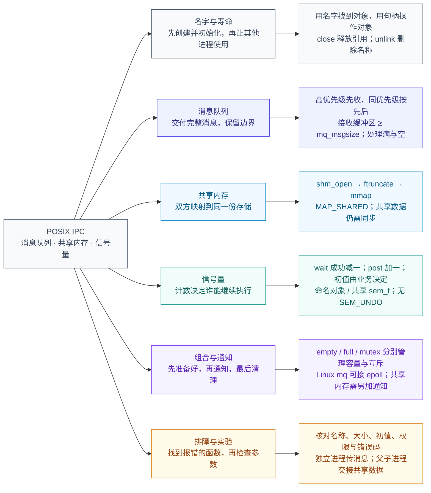

# Linux POSIX IPC：消息队列、共享内存和信号量

两个进程各有自己的内存。进程 A 修改普通变量，进程 B 通常看不到。如果 A 想把一张订单交给 B，就需要进程间通信，也就是 IPC。

POSIX IPC 提供三种常用工具：**消息队列负责传数据，共享内存负责让双方访问同一块存储，信号量负责安排访问顺序。** 以下接口和示例以 Linux/glibc 为运行环境。

## 目录

- [1. 先分清三个组件的用途](#section-1)
- [2. 创建、打开、关闭和删除](#section-2)
- [3. 消息队列：一条一条地传数据](#section-3)
- [4. 共享内存：访问同一份数据](#section-4)
- [5. 信号量：有名额才能继续](#section-5)
- [6. 组合使用：先写完，再通知读取](#section-6)
- [7. 进阶：有消息时怎样通知程序](#section-7)
- [8. 常见错误与排查方法](#section-8)
- [附录 A：消息队列完整示例](#appendix-a)
- [附录 B：共享内存与信号量完整示例](#appendix-b)
- [9. 思维导图](#section-9)

<a id="section-1"></a>

## 1. 先分清三个组件的用途

### 1.1 用“传订单”理解三者的区别

假设 A 接收订单，B 处理订单。

**使用消息队列**：A 把订单发送到队列，B 从队列取走订单。就像把信放进信箱，再由对方取走。

```text
A 的内存 → 消息队列 → B 的内存
```

**使用共享内存**：A、B 都能访问同一块存储。A 把订单写进去，B 从这块存储中读取。

```text
A ──写入──→ 同一块共享内存 ←──读取── B
```

**使用信号量**：B 不能在 A 只写了一半时读取。可以让 B 等待，A 写完后增加信号量，B 才继续读。

```text
A：写完整订单 → 通知“可以读了”
B：等待通知   → 读取订单
```

| 组件 | 负责什么 | 不会自动替你完成什么 |
|---|---|---|
| 消息队列 | 保存并传递一条条消息 | 不保证接收者一定处理成功 |
| 共享内存 | 让多个进程访问同一块存储 | 不自动加锁，也不自动通知对方 |
| 信号量 | 根据计数决定谁能继续执行 | 不保存订单，也不修复业务数据 |

### 1.2 先认识常用函数

| 组件 | 创建或打开 | 使用 | 清理 |
|---|---|---|---|
| 消息队列 | `mq_open()` | `mq_send()`、`mq_receive()` | `mq_close()`、`mq_unlink()` |
| 共享内存 | `shm_open()` | `ftruncate()`、`mmap()`，然后读写内存 | `close()`、`munmap()`、`shm_unlink()` |
| 命名信号量 | `sem_open()` | `sem_wait()`、`sem_post()` | `sem_close()`、`sem_unlink()` |
| 未命名信号量 | `sem_init()` | `sem_wait()`、`sem_post()` | `sem_destroy()` |

命名信号量可以通过名字找到；未命名信号量直接放在程序提供的内存中。两者的使用操作相同，创建和清理方式不同。

POSIX IPC 和 System V IPC 是两套接口。它们都提供这三类工具，但不能把函数名直接互换。例如，System V 消息队列使用 `msgget()` 返回的 ID，POSIX 消息队列使用 `mq_open()` 返回的 `mqd_t`。

<a id="section-2"></a>

## 2. 创建、打开、关闭和删除

### 2.1 名字用来找到对象，返回值用来操作对象

假设 A、B 约定使用名为 `/orders_demo` 的消息队列：

```text
A：mq_open("/orders_demo", ...) → 获得自己的队列描述符 → 发送
B：mq_open("/orders_demo", ...) → 获得自己的队列描述符 → 接收
```

双方各自打开同一个对象，得到的描述符数值不必相同。可以把名字理解为门牌号，把打开后得到的描述符或指针理解为后续操作的凭证，统称为“句柄”。

不同接口返回的句柄类型不同：

| 调用 | 成功时返回 | 失败时返回 |
|---|---|---|
| `mq_open()` | `mqd_t`，消息队列描述符 | `(mqd_t)-1` |
| `shm_open()` | `int`，文件描述符 fd | `-1` |
| `sem_open()` | `sem_t *`，信号量指针 | `SEM_FAILED` |
| `mmap()` | 映射首地址 | `MAP_FAILED` |

名称通常写成 `/名字`，例如 `/orders_demo`；为便于移植，开头保留一个斜杠，后面不再包含斜杠。它不是任意文件路径，不要写成 `/tmp/orders/demo`。

### 2.2 对象不存在时创建，已存在时怎么办

创建或打开时，标志决定行为：

| 标志 | 不存在时 | 已存在时 |
|---|---|---|
| 不带 `O_CREAT` | 失败，通常为 `ENOENT` | 打开现有对象 |
| `O_CREAT` | 创建 | 打开现有对象 |
| `O_CREAT \| O_EXCL` | 创建 | 失败，错误为 `EEXIST` |

`O_CREAT | O_EXCL` 的意思是：**这次必须由我新建，不能使用已有对象。** 两个进程同时尝试创建同名对象时，可以用它区分谁负责初始化。

创建权限 `0600` 通常表示只有所有者可以读写，还会受到 `umask` 的限制。打开旧对象时传入新的权限、队列大小或信号量初值，不会把已有对象重新设置一遍。

[参考：mq_open(3)](https://man7.org/linux/man-pages/man3/mq_open.3.html)、[sem_open(3)](https://man7.org/linux/man-pages/man3/sem_open.3.html)

### 2.3 close 和 unlink 为什么要分开

它们做的是两件事：

- **close：我用完了，释放我持有的引用。**
- **unlink：删掉名字，后来者不能再用这个名字打开旧对象。**

假设 A、B 已经打开同一个队列：

```text
A 执行 mq_close：A 不再使用，B 还可以继续使用

有人执行 mq_unlink：队列名字被删除
    已经打开旧队列的进程：仍可使用旧句柄
    后来才尝试打开的进程：找不到这个旧队列

名字已删除，并且所有打开引用都已释放：旧队列才被销毁
```

因此，进程退出不代表名称一定被删除。程序还需要安排谁执行 `unlink`。

共享内存还有一个单独的“映射”：`close(fd)` 关闭文件描述符，`munmap()` 解除映射，`shm_unlink()` 删除名称。这三个操作不能互相代替。

如果旧对象删除名称后，又用相同名称创建新对象，原来的句柄仍然指向旧对象。此时新旧进程可能各用各的，无法通信。因此，启动时不要不加判断地先删除同名对象。

### 2.4 同名也要在同一个可见范围内

在同一台 Linux 主机上，容器配置可能让两个进程看到不同的 IPC 对象：

- POSIX 消息队列受 IPC 命名空间隔离。
- POSIX 共享内存和命名信号量通常还要看 `/dev/shm` 是否对应同一个挂载。

排查“名字明明相同，为什么不通”时，需要同时检查容器配置、用户和权限。后面的实验按同一 Linux 环境、同一用户运行。

[参考：ipc_namespaces(7)](https://man7.org/linux/man-pages/man7/ipc_namespaces.7.html)

<a id="section-3"></a>

## 3. 消息队列：一条一条地传数据

### 3.1 一次接收取走一条消息

A 分两次发送 `order-A` 和 `order-B`。B 一次成功接收取走其中一条，再接收一次取走另一条，不会把两条自动拼成一条。

这叫**保留消息边界**。但每条消息里面的字段怎样排列、怎样编码，仍要由收发双方约定。

使用顺序为：

```text
创建或打开队列 → 发送 / 接收 → 关闭自己的描述符
                                       ↓
                         不再需要这个队列时，由负责人删除名称
```

### 3.2 创建队列：设置“最多几条”和“每条多大”

下面是函数内的创建片段，需包含 `<mqueue.h>` 和 `<fcntl.h>`：

```c
struct mq_attr attr = {
    .mq_maxmsg = 3,    /* 队列最多同时放 3 条消息 */
    .mq_msgsize = 128  /* 每条消息最多 128 字节 */
};

mqd_t q = mq_open("/orders_demo",
                  O_CREAT | O_EXCL | O_RDWR,
                  0600, &attr);
if (q == (mqd_t)-1) {
    /* 创建失败，不能继续使用 q。 */
}
```

逐项理解：

| 参数 | 含义 |
|---|---|
| `/orders_demo` | 队列名字 |
| `O_CREAT \| O_EXCL` | 新建；已存在就失败 |
| `O_RDWR` | 本次打开允许发送和接收 |
| `0600` | 创建权限 |
| `&attr` | 本次新建队列的容量设置 |

`mq_maxmsg=3` 不是最多 3 字节，而是最多 3 条消息。一条消息只有 10 字节，也占一个消息名额。发送 200 字节超过本例单条上限，会报错，不会自动拆成两条。

打开已有队列后，用 `mq_getattr()` 查询实际大小。`mq_setattr()` 可以调整非阻塞标志，但不能用来改变队列容量和单条大小。

### 3.3 发送和接收分别传什么

下面假设 `q` 已成功打开，并且实际 `mq_msgsize` 为 128：

```c
/* 发送 7 字节，优先级为 1；这里不发送字符串结尾的 '\0'。 */
if (mq_send(q, "order-A", 7, 1) == -1) {
    /* 处理发送失败。 */
}

/* 接收区域为 128 字节，再多留 1 字节放字符串结束符。 */
char buf[129];
unsigned priority;
ssize_t n = mq_receive(q, buf, 128, &priority);
if (n >= 0) {
    buf[n] = '\0';
    /* n 是实际收到的字节数，priority 是这条消息的优先级。 */
} else {
    /* 处理接收失败。 */
}
```

接收缓冲区必须至少能放下队列规定的最大消息，也就是 `mq_msgsize`。即使当前消息只有 7 字节，队列上限是 128，就不能只传入 10 字节的接收空间，否则会报 `EMSGSIZE`。虽然 10 字节确实装得下这条消息，但 mq_receive() 的接口规则要求：第三个参数必须至少等于队列的 mq_msgsize。它不会因为当前这条消息比较短，就放宽这个要求。

`mq_receive()` 成功返回实际字节数，失败返回 `-1`。它不会自动补 `\0`。上面的补零方法适用于约定为字符串的消息，任意二进制数据不能直接当字符串处理。

POSIX 消息不要求开头包含 System V 使用的 `long mtype`。

### 3.4 高优先级先取，同优先级先来先取

假设以下三条消息已经全部入队，B 才开始接收：

| 发送顺序 | 内容 | 优先级 |
|---|---|---|
| 1 | normal-A | 1 |
| 2 | urgent | 5 |
| 3 | normal-B | 1 |

接收顺序是：

```text
urgent → normal-A → normal-B
```

优先级数字越大，越先被取走；同优先级按入队先后取走。已经取走的消息不受后来消息影响。

`mq_receive()` 的 `priority` 参数用来**接收返回的优先级**，不能用它指定“我只收优先级 5”。如果高优先级消息一直到来，低优先级消息可能一直排不上。

[参考：mq_send(3)](https://man7.org/linux/man-pages/man3/mq_send.3.html)、[mq_receive(3)](https://man7.org/linux/man-pages/man3/mq_receive.3.html)

### 3.5 队列满了或空了，程序会怎样

| 情况 | 默认阻塞方式 | 打开时加 `O_NONBLOCK` |
|---|---|---|
| 队列已满，还要发送 | 等别人取走消息，腾出位置 | 立即失败，`errno=EAGAIN` |
| 队列为空，还要接收 | 等别人发送消息 | 立即失败，`errno=EAGAIN` |

阻塞时，调用线程通常由内核安排等待，不是在不停执行查询循环。非阻塞方式则立即返回，让程序去做其他工作。收到 `EAGAIN` 后立刻无限重试，会浪费 CPU。

如果只愿意等到某个时间，可以使用 `mq_timedsend()` 或 `mq_timedreceive()`。它们接收的是**绝对截止时间**：例如“到 10:00:05 为止”，而不是数字“再等 5 秒”。超时返回 `-1`，错误为 `ETIMEDOUT`。

如果调用返回 `EINTR`，说明被信号中断，需要根据程序要求决定是否重试。重试时保留原截止时间，不能每次都重新加 5 秒。这里使用 `CLOCK_REALTIME`，系统时间调整可能影响等待时长。

### 3.6 发送成功，不等于订单处理成功

```text
A 发送成功 → 消息已交给队列机制
B 接收成功 → 消息已从队列取走
B 处理完成 → 这才是业务成功
```

如果 B 取走订单后崩溃，队列不会自动把订单放回去。要求订单不丢、重复发送也不重复处理时，需要程序额外设计处理确认、重试和去重。

<a id="section-4"></a>

## 4. 共享内存：访问同一份数据

### 4.1 为什么要连续调用三个函数

新建共享内存后，不能直接把 `shm_open()` 的返回值当地址使用。它只返回 fd，而且新对象大小为 0。

要能读写，需要三步：

```text
shm_open：创建共享对象，拿到 fd
    ↓
ftruncate：把对象大小设置为需要的字节数
    ↓
mmap：把共享对象映射到本进程，拿到可访问的地址
    ↓
通过这个地址读写数据
```

下面展示调用顺序。`struct shared_data` 需要事先定义；实际程序必须在每一步成功后再继续，完整错误处理见附录 B。

```c
int fd = shm_open("/orders_data", O_CREAT | O_EXCL | O_RDWR, 0600);
/* 检查 fd != -1。 */

int rc = ftruncate(fd, sizeof(struct shared_data));
/* 检查 rc != -1。 */

struct shared_data *shared = mmap(
    NULL, sizeof(*shared),
    PROT_READ | PROT_WRITE, MAP_SHARED, fd, 0);
/* 检查 shared != MAP_FAILED。 */
```

`PROT_READ | PROT_WRITE` 允许读写，`MAP_SHARED` 表示共享修改，最后的 `0` 表示从对象开头映射。

另一个进程只需打开同一个已准备好的对象，再建立自己的映射。它不应随意调用 `ftruncate()` 或使用 `O_TRUNC` 改变正在使用的对象大小。映射不等于底层对象已经足够大，访问超出对象范围的页面可能触发 `SIGBUS`。

[参考：shm_open(3)](https://man7.org/linux/man-pages/man3/shm_open.3.html)、[mmap(2)](https://man7.org/linux/man-pages/man2/mmap.2.html)

### 4.2 同一份数据，可以对应不同地址

```text
进程 A：地址 0x7000 ──┐
                     ├──→ 同一份共享数据
进程 B：地址 0x9000 ──┘
```

上面的地址只是示意。两个进程各有地址空间，映射首地址不必相同。

因此，共享数据里如果要记录“另一个字段在哪里”，通常保存**相对共享区开头的偏移**或数组下标。不要直接把 A 的普通指针保存进去让 B 使用，那个地址在 B 中可能指向别处。

另外，应使用 `MAP_SHARED`。`MAP_PRIVATE` 是私有写时复制映射，写入不会按这里的目的更新共享对象。

### 4.3 共享不代表同时修改一定正确

假设计数初始为 10，A、B 都执行一次 `counter++`：

```text
A 读到 10
B 也读到 10
A 算出 11，写回
B 也算出 11，写回

最终是 11，但原本应该是 12
```

问题在于：`counter++` 包含读取、计算和写回，不能仅凭这条 C 语句就认为整个操作不可被打断。

解决办法是用锁保证同一时间只有一个进程修改，或者采用适合进程共享的原子同步方案。`volatile` 不能代替锁，`msync()` 也不能用来加锁或通知“订单写完了”。

如果使用 pthread mutex，它本身也必须放在共享内存里，并设置 `PTHREAD_PROCESS_SHARED`。

### 4.4 用完后，分别释放什么

| 操作 | 作用 | 之后什么仍可能有效 |
|---|---|---|
| `close(fd)` | 关闭本进程的 fd | 已建立的映射仍有效 |
| `munmap(shared, size)` | 解除本进程的映射 | 其他进程的映射不因此消失 |
| `shm_unlink(name)` | 删除名称 | 已有 fd 和映射仍可使用 |

`mmap()` 成功后，即使关闭 fd，也可以继续通过映射地址访问。

父进程如果准备通过 `fork()` 让子进程继承映射，可以先映射，再删除名称，最后 fork。独立进程如果还需要按名称打开，就必须等它打开后才能删除名称。

<a id="section-5"></a>

## 5. 信号量：有名额才能继续

### 5.1 先理解 wait 和 post

把信号量看成内核和库共同支持的一个非负计数。程序约定这个数字代表什么，例如空位数、待处理数据数，或者允许进入的名额数。

最常用的两个操作是：

- `sem_wait()`：**有名额就减 1，没名额就等待。**
- `sem_post()`：**增加 1 个名额，让等待者有机会继续。**

| 当前计数 | 操作 | 结果 |
|---|---|---|
| 2 | `sem_wait()` | 成功，计数变为 1 |
| 0 | `sem_wait()` | 等待有名额可取；成功取得时才减 1 |
| 0 | `sem_trywait()` | 不等待，失败并设置 `errno=EAGAIN` |
| 0 | `sem_post()` | 增加 1，可能唤醒等待者 |

如果等待者马上取走名额，计数可能很快又变成 0。

`sem_post()` 不知道应用规定的容量。例如程序只允许一个人进入，却错误地多次 post，就可能让多人同时进入。只有超过实现允许的数值上限时，才会报 `EOVERFLOW`。

[参考：sem_wait(3)](https://man7.org/linux/man-pages/man3/sem_wait.3.html)、[sem_post(3)](https://man7.org/linux/man-pages/man3/sem_post.3.html)

### 5.2 初值为什么有时是 1，有时是 0

**当信号量表示“允许一个进程进入”时，初值设为 1。**

```text
wait：取走唯一名额
修改共享数据
post：归还名额
```

这叫互斥。两个进程不会同时修改，但谁先拿到名额不确定。

**当信号量表示“已经写好的数据份数”时，初值设为 0。**

```text
写者：写好数据 → post
读者：wait 成功 → 读取数据
```

这保证读者等待写者完成。即使读者先运行，也会因为计数为 0 而停下来。

**当信号量表示“空槽数”时，有 N 个空槽就设为 N。** 每占用一个空槽就 wait，每释放一个空槽就 post。

初值不是固定口诀，要先说明这个计数在程序里代表什么。

### 5.3 命名信号量：双方通过名字找到同一个计数

创建者先创建一个初值为 0 的信号量。下面片段需要 `<semaphore.h>` 和 `<fcntl.h>`：

```c
sem_t *ready = sem_open("/orders_ready",
                        O_CREAT | O_EXCL, 0600, 0);
if (ready == SEM_FAILED) {
    /* 创建失败。 */
}
```

另一个进程在创建成功后打开它：

```c
sem_t *ready = sem_open("/orders_ready", 0);
if (ready == SEM_FAILED) {
    /* 打开失败。 */
}
```

两段代码分别属于两个进程。它们拿到的指针地址不必相同，但操作的是同一个信号量。

随后，写者可以在共享数据写完后调用 `sem_post(ready)`，读者调用 `sem_wait(ready)` 等待。**信号量只负责通知，数据仍要放在双方能访问的位置。**

每个进程用完后调用 `sem_close(ready)`。不再需要这个名称时，由负责人调用 `sem_unlink("/orders_ready")`。不要对 `sem_open()` 得到的对象调用 `sem_init()` 或 `sem_destroy()`。

### 5.4 未命名信号量：直接把 sem_t 放在共享内存中

未命名信号量没有供别人查找的名字。要让两个进程用同一个信号量，就把它的 `sem_t` 放在双方共享的内存里：

```c
struct shared_data {
    sem_t ready;       /* 用来通知数据已写好 */
    char text[128];    /* 真正的数据 */
};
```

`shared` 已经通过 `MAP_SHARED` 映射，并且其他进程尚未使用时，执行：

```c
if (sem_init(&shared->ready, 1, 0) == -1) {
    /* 初始化失败。 */
}
```

三个参数依次表示：

| 参数 | 含义 |
|---|---|
| `&shared->ready` | 要初始化的信号量地址 |
| `1` | `pshared` 非零，表示用于进程之间 |
| `0` | 初始计数，表示还没有写好的数据 |

这里的 `1` 不是“只允许一个进程”，也不用因为有两个进程就改成 2。

进程间使用必须同时满足两个条件：**sem_t 放在共享内存中，并且 pshared 非零。** 只在普通栈或堆上定义 `sem_t`，即使设置 pshared=1，fork 后也不会自动得到所需的共享信号量。

初始化只做一次，并在其他参与者使用之前完成。不能用 `memcpy()` 把已初始化的 `sem_t` 复制成另一把等效的锁。

[参考：sem_init(3)](https://man7.org/linux/man-pages/man3/sem_init.3.html)

### 5.5 进程拿到名额后退出，会自动归还吗

**不会。POSIX 信号量没有 System V 的 SEM_UNDO。**

假设把初值为 1 的信号量当锁：

```text
A 调用 wait：1 → 0
A 修改数据时崩溃，没有执行 post
B 调用 wait：计数仍为 0，只能等待
```

内核不会仅仅因为 A 退出，就替它补一次 post。

[参考：pthread_mutexattr_setrobust(3)](https://man7.org/linux/man-pages/man3/pthread_mutexattr_setrobust.3.html)

### 5.6 与 System V 信号量的区别

| 操作 | System V | POSIX |
|---|---|---|
| 一次加减多个名额 | `sem_op` 可指定数量 | 一次 wait 减 1，一次 post 加 1 |
| 一次操作多个信号量，全成或全不成 | `semop()` 可提交操作数组 | 没有对应的批量原子接口 |
| 等待计数变成 0 | `sem_op=0` | 没有对应接口 |
| 退出时补偿计数 | 可选 `SEM_UNDO` | 没有 |

例如，连续调用两次 `sem_wait()` 申请两个名额，可能第一次成功、第二次阻塞。这不等于 System V 一次原子申请两个名额，需要处理只拿到一部分的情况。

也不要先 `sem_getvalue()` 查询，再认为下一次 wait 一定成功：查询后名额可能被别人抢先取走。不想等待时，直接用 `sem_trywait()`。

### 5.7 等待超时和销毁

`sem_timedwait()` 可以等到指定的绝对截止时间，使用 `CLOCK_REALTIME`。失败返回 `-1`，通过 `errno` 区分原因：

| 错误 | 含义 | 处理方向 |
|---|---|---|
| `EINTR` | 被信号中断 | 按需要重试，并沿用原截止时间 |
| `ETIMEDOUT` | 等到截止时间仍未取得名额 | 进入超时处理 |

销毁未命名信号量前，必须先确认没有线程或进程还在使用或等待它：

```text
让参与者结束使用 → 确认它们已结束 → sem_destroy → 释放共享内存
```

`sem_destroy()` 不能用来通知等待者退出。命名信号量则使用 `sem_close()` 和 `sem_unlink()`。

[参考：sem_destroy(3)](https://man7.org/linux/man-pages/man3/sem_destroy.3.html)

<a id="section-6"></a>

## 6. 组合使用：先写完，再通知读取

### 6.1 第一步：初始化完成后，才能让别人使用

创建成功不代表全部准备好了。例如：

```text
A 创建共享对象
B 立即打开并尝试读取
A 还没设置大小，也没初始化信号量
```

B 来得太早，就可能出错。

父子进程可以按下面的顺序避免这个问题：

```text
创建共享对象 → 设置大小 → 映射 → 初始化信号量 → fork
```

独立进程则要约定启动顺序，或通过 socket 等控制通道通知“初始化完成”。不能只看到名字存在，就开始访问里面的数据。

### 6.2 只传一次：一个 ready 就够了

只有一个写者写一次、一个读者读一次时，可以这样安排：

```text
初始：ready = 0

子进程：写好 text → sem_post(ready)
父进程：sem_wait(ready) 成功 → 读取 text
```

父进程先运行：没有名额，等待子进程写完。

子进程先运行：post 增加的名额会保留下来，父进程以后 wait 仍能成功，不会因为“通知时没在等”就丢失这次计数。

这里没有第二次写入覆盖数据，因此不需要再加一把互斥锁。成功的 post/wait 交接也提供了这里需要的内存同步，不能用 `sleep()` 猜测写者已经完成。

完整代码见附录 B。

### 6.3 一个槽位反复传：还要知道它是否空闲

如果子进程写完第一条就立刻写第二条，父进程可能还没读，第一条就被覆盖了。仅有 ready 不够，还要让写者等待读者把槽位用完。

使用两个信号量：

- `empty=1`：最初有一个空槽。
- `full=0`：最初没有完整数据。

```text
生产者：wait(empty) → 写一条数据 → post(full)
消费者：wait(full)  → 读走数据   → post(empty)
```

写者先取得空槽，读者读完后归还空槽。这样写者不能提前覆盖尚未读取的数据。

### 6.4 多个槽位、多个生产者和消费者

共享区有 N 个槽位时，还需要保护“下一次读哪里、写哪里”等共享索引：

| 信号量 | 初值 | 作用 |
|---|---|---|
| `empty` | N | 空槽数量 |
| `full` | 0 | 已写好数据的槽位数量 |
| `mutex` | 1 | 同一时间只允许一个进程操作受保护的槽位和索引 |

操作顺序如下；实际程序还需要检查每次调用是否成功：

```text
生产者：wait(empty) → wait(mutex) → 写数据、更新写索引
        → post(mutex) → post(full)

消费者：wait(full) → wait(mutex) → 读数据、更新读索引
        → post(mutex) → post(empty)
```

为什么要先等 empty/full，再拿 mutex？

假设队列满了，生产者却先拿到 mutex，再等 empty。消费者必须拿到 mutex 才能读走数据、腾出空槽。双方互相等，就死锁了。

如果取得空槽后，加锁失败，需要根据已经完成的步骤归还名额。如果进程在中间崩溃，还需要单独的状态检查和恢复方案。

### 6.5 最后清理：先结束使用，再释放资源

每个进程关闭自己打开的句柄、解除自己的映射。删除公共名称由约定的负责人执行。

对于附录 B 的父子进程：父进程先确认子进程已结束，再销毁共享信号量，最后解除映射。

对于长期运行的服务：只要还允许新进程按名字连接，就需要保留名字。停止接收新连接并安排现有进程退出后，再清理公共资源。

<a id="section-7"></a>

## 7. 进阶：有消息时怎样通知程序

### 7.1 Linux 消息队列可以接入 epoll

如果一个线程既要处理 socket，又要处理消息队列，可以用事件循环统一等待。

Linux 的消息队列描述符可以交给 `poll/epoll`。这是 Linux 的实现特点，不是所有 POSIX 平台都保证支持。

```text
epoll 提示队列可读 → 调用非阻塞 mq_receive → 处理消息
```

“可读”不代表消息已经专门留给这个线程。其他消费者可能先取走，所以接收仍可能返回 `EAGAIN`。

使用边沿触发时，通常应一直读到 `EAGAIN`。如果每轮限制处理数量，就要主动安排剩余消息继续处理，不能指望一定再收到一次新事件。

[参考：mq_overview(7)](https://man7.org/linux/man-pages/man7/mq_overview.7.html)

### 7.2 共享内存写完了，epoll 不会自动知道

共享内存里的某个整数变了，不等于某个 fd 变得可读。内核不知道你的哪个字段代表“订单完成”。

要把共享内存加入事件循环，可以另加通知工具：

```text
生产者：写好共享数据 → 用 eventfd、pipe 或 socket 发通知
消费者：收到通知 → 按同步规则检查并读取共享数据
```

通知不能代替数据同步。生产者也可能写完数据就崩溃，来不及通知，因此需要按业务要求安排定时检查或恢复流程。

`sem_t *` 不是 fd，也不能强转成整数传给 epoll。

### 7.3 mq_notify 是一次通知，不是永久监听

`mq_notify()` 可以让程序在队列从空变为有消息时收到通知，但有几个规则：

- 触发一次后，注册就失效，需要重新注册。
- 同一队列同时只能有一个注册者。
- 注册时队列已经有消息，不会仅因为这些旧消息而立即通知。
- 如果已有线程正在阻塞接收，新消息会先交给接收者，这次不发通知，注册仍保留。

持续处理时，常见顺序是：

```text
首次注册 → 非阻塞接收已有消息，直到 EAGAIN → 等待通知

收到通知 → 先重新注册 → 非阻塞接收，直到 EAGAIN → 再等待
```

先注册再排空，是为了避免“刚读空、还没注册时来了新消息”，之后一直等不到通知。实际代码还需要根据采用的信号或线程通知方式，处理已经在途的通知和并发执行。

[参考：mq_notify(3)](https://man7.org/linux/man-pages/man3/mq_notify.3.html)

<a id="section-8"></a>

## 8. 常见错误与排查方法

### 8.1 先确认失败在哪个调用

多数操作失败返回 `-1`，再通过 `errno` 或 `perror()` 看原因；`mq_open()`、`sem_open()`、`mmap()` 的失败值见第 2.1 节。

| 现象或错误 | 常见原因 | 先检查什么 |
|---|---|---|
| 创建时报 `EEXIST` | 名字已存在 | 是活跃对象，还是上次遗留对象 |
| 打开时报 `ENOENT` | 找不到对象 | 名称、启动顺序、是否已 unlink、容器环境 |
| 创建队列报 `EINVAL` | 参数不允许 | 队列容量、单条大小、系统上限 |
| 接收报 `EMSGSIZE` | 缓冲区太小 | 是否至少为实际 mq_msgsize |
| 非阻塞操作报 `EAGAIN` | 当前条件不满足 | 队列为空或满，信号量没有名额 |
| 写共享内存触发 `SIGBUS` | 底层对象大小不足 | 是否 ftruncate，是否被其他进程缩小 |
| 子进程 post，父进程仍等 | 没有操作同一个共享信号量 | sem_t 是否在共享内存中，pshared 是否非零 |
| 读到一半的数据 | 写完前就允许读取 | 信号量初值和 post 的位置 |
| 进程退出后对象名称仍在 | 没有删除名称 | 是否执行对应 unlink |
| 信号量计数越来越大 | 多次 post | 是否重复归还、错误路径是否又归还一次 |

### 8.2 在 Linux 中查看名称和限制

```bash
ls -l /dev/mqueue                   # POSIX 消息队列的常见查看入口
ls -l /dev/shm                      # 共享内存和命名信号量的常见查看入口
cat /proc/sys/fs/mqueue/msg_max     # 队列消息数量的相关上限
cat /proc/sys/fs/mqueue/msgsize_max # 单条消息大小的相关上限
cat /proc/sys/fs/mqueue/queues_max  # 队列数量的相关上限
ulimit -q                          # 当前 shell 的消息队列资源限额
```

命名信号量通常在 `/dev/shm` 中表现为 `sem.*` 条目。查看结果还受挂载和命名空间配置影响；看不到 `/dev/mqueue` 目录，不足以证明内核不支持消息队列。

System V 的 `ipcs/ipcrm` 不能直接当作这些 POSIX 对象的通用管理命令。删除对象优先使用程序提供的清理操作，确认名称和归属后再处理。

[参考：mq_overview(7)](https://man7.org/linux/man-pages/man7/mq_overview.7.html)、[shm_overview(7)](https://man7.org/linux/man-pages/man7/shm_overview.7.html)、[sem_overview(7)](https://man7.org/linux/man-pages/man7/sem_overview.7.html)

### 8.3 根据需求选择工具

| 需求 | 常用选择 | 还要考虑 |
|---|---|---|
| 传递一条条小消息，需要优先级 | 消息队列 | 容量和业务处理确认 |
| 多个进程频繁访问同一批数据 | 共享内存＋同步机制 | 数据布局、并发访问和故障恢复 |
| 等待数据、等待空位、限制同时进入人数 | 信号量 | 初值、wait/post 顺序和退出处理 |
| 一次原子申请多个名额或多个信号量 | System V semop | 死锁和业务恢复 |
| 需要连接管理、双向通信或传递 fd | Unix domain socket | 协议和断连处理 |

共享内存可以减少数据传递中的复制，但最终速度还受锁竞争、访问方式等影响，需要通过实际程序测量。

<a id="appendix-a"></a>

## 附录 A：两个独立进程通过消息队列传递消息

### A.1 实验步骤

本例让发送程序先完成，再启动接收程序，便于稳定观察优先级顺序。发送者创建最多容纳 3 条、每条最多 128 字节的队列，发送 3 条后关闭句柄并保留名称；接收者按名称打开，读到 EAGAIN 后删除名字并关闭。

发送程序和接收程序分别启动，不依赖 fork。接收程序只读取这次已经发送的消息，读空后退出并删除队列。如果需要一直等待新消息，就要改成持续接收，并另外约定退出条件。

### A.2 完整代码

将下面的完整代码复制并保存为 `mq_demo.c`，然后按 A.3 节编译运行。

```c
#define _POSIX_C_SOURCE 200809L
#include <errno.h>
#include <fcntl.h>
#include <mqueue.h>
#include <stdio.h>
#include <stdlib.h>
#include <string.h>
#include <unistd.h>

int main(int argc, char **argv)
{
    if (argc != 3 || (strcmp(argv[1], "send") &&
                     strcmp(argv[1], "receive") && strcmp(argv[1], "cleanup"))) {
        fprintf(stderr, "usage: %s send|receive|cleanup /queue_name\n", argv[0]);
        return EXIT_FAILURE;
    }
    const char *name = argv[2];
    if (!strcmp(argv[1], "cleanup")) {
        if (mq_unlink(name) == -1 && errno != ENOENT) {
            perror("mq_unlink");
            return EXIT_FAILURE;
        }
        return EXIT_SUCCESS;
    }

    int sender = !strcmp(argv[1], "send");
    struct mq_attr wanted = { .mq_maxmsg = 3, .mq_msgsize = 128 };
    mqd_t q = sender
        ? mq_open(name, O_CREAT | O_EXCL | O_WRONLY | O_NONBLOCK,
                  0600, &wanted)
        : mq_open(name, O_RDONLY | O_NONBLOCK);
    if (q == (mqd_t)-1) {
        perror("mq_open");
        return EXIT_FAILURE;
    }

    int result = EXIT_FAILURE;
    char *buffer = NULL;
    if (sender) {
        const char *messages[] = { "normal-A", "urgent", "normal-B" };
        const unsigned priorities[] = { 1, 5, 1 };
        for (int i = 0; i < 3; ++i) {
            int rc;
            do {
                rc = mq_send(q, messages[i], strlen(messages[i]), priorities[i]);
            } while (rc == -1 && errno == EINTR);
            if (rc == -1) {
                perror("mq_send");
                goto cleanup;
            }
        }
        puts("sent 3 messages; queue name retained for receiver");
    } else {
        struct mq_attr actual;
        if (mq_getattr(q, &actual) == -1) {
            perror("mq_getattr");
            goto cleanup;
        }
        /* 本例面向本机受控的小队列，按实际容量分配并额外留一个字节。 */
        buffer = malloc((size_t)actual.mq_msgsize + 1);
        if (!buffer) {
            perror("malloc");
            goto cleanup;
        }
        for (;;) {
            unsigned priority;
            ssize_t n = mq_receive(q, buffer, (size_t)actual.mq_msgsize, &priority);
            if (n == -1) {
                if (errno == EINTR)
                    continue;
                if (errno == EAGAIN)
                    break;
                perror("mq_receive");
                goto cleanup;
            }
            buffer[n] = '\0';
            printf("priority=%u message=%s\n", priority, buffer);
        }
        /* 协议约定：发送者已结束，唯一接收者读完后删除名字。 */
        if (mq_unlink(name) == -1) {
            perror("mq_unlink");
            goto cleanup;
        }
    }
    result = EXIT_SUCCESS;

cleanup:
    free(buffer);
    /* 只清理由本次发送者排他创建、但未成功交付的队列。 */
    if (sender && result != EXIT_SUCCESS && mq_unlink(name) == -1)
        perror("cleanup mq_unlink");
    if (mq_close(q) == -1) {
        perror("mq_close");
        result = EXIT_FAILURE;
    }
    return result;
}
```

### A.3 编译、运行与失败检查

在 Linux/glibc 的 shell 中执行；`-lrt` 保留对部分较旧 glibc 链接布局的兼容：

```bash
cc -std=c11 -Wall -Wextra -O2 mq_demo.c -o mq_demo -lrt
name="/mq_demo_${USER}_$$"
./mq_demo send "$name"
./mq_demo receive "$name"
```

发送进程退出后，接收进程仍能读到队列消息。预期输出：

```text
sent 3 messages; queue name retained for receiver
priority=5 message=urgent
priority=1 message=normal-A
priority=1 message=normal-B
```

如果发送后没有执行接收，明确清理本次测试名称：

```bash
./mq_demo cleanup "$name"
```

可以在接收前重复 send，第二次应因 EEXIST 失败，不会覆盖第一次的队列；正常接收后再 receive，则应因名称已删除而报 ENOENT。这些实验观察创建、保留和删除的边界，不需要改动系统全局配置。

<a id="appendix-b"></a>

## 附录 B：共享内存与进程共享信号量的一次性交接

### B.1 父进程和子进程分别做什么

| 代码步骤 | 目的 |
|---|---|
| shm_open、ftruncate、mmap | 建立大小正确的共享对象与映射 |
| shm_unlink、close | 提前去掉名称和 fd，继续保留映射 |
| sem_init(pshared=1, value=0) | 建立进程共享的“数据未就绪”状态 |
| fork | 子进程继承已初始化的共享映射 |
| 子进程写入并 sem_post | 先写完整内容，再发布就绪 |
| 父进程 sem_timedwait | 等待发布，避免普通错误路径无限等 |
| waitpid、sem_destroy、munmap | 先结束使用者，再回收同步对象和映射 |

### B.2 完整代码

将下面的完整代码复制并保存为 `shm_sem_demo.c`，然后按 B.3 节编译运行。

```c
#define _POSIX_C_SOURCE 200809L
#include <errno.h>
#include <fcntl.h>
#include <semaphore.h>
#include <signal.h>
#include <stdio.h>
#include <stdlib.h>
#include <sys/mman.h>
#include <sys/stat.h>
#include <sys/wait.h>
#include <time.h>
#include <unistd.h>

struct shared_data {
    sem_t ready;
    char text[128];
};

static int wait_ready(sem_t *sem)
{
    struct timespec deadline;
    if (clock_gettime(CLOCK_REALTIME, &deadline) == -1)
        return -1;
    deadline.tv_sec += 5;
    int rc;
    do {
        /* EINTR 重试保留同一个绝对截止时间。 */
        rc = sem_timedwait(sem, &deadline);
    } while (rc == -1 && errno == EINTR);
    return rc;
}

int main(void)
{
    char name[80];
    snprintf(name, sizeof(name), "/posix_once_%ld", (long)getpid());
    int fd = -1, named = 0, initialized = 0;
    int result = EXIT_FAILURE;
    pid_t child = -1;
    struct shared_data *shared = MAP_FAILED;

    fd = shm_open(name, O_CREAT | O_EXCL | O_RDWR, 0600);
    if (fd == -1) {
        perror("shm_open");
        goto cleanup;
    }
    named = 1;
    if (ftruncate(fd, (off_t)sizeof(*shared)) == -1) {
        perror("ftruncate");
        goto cleanup;
    }
    shared = mmap(NULL, sizeof(*shared), PROT_READ | PROT_WRITE,
                  MAP_SHARED, fd, 0);
    if (shared == MAP_FAILED) {
        perror("mmap");
        goto cleanup;
    }
    /* 本例靠 fork 继承映射，无须让其他进程以后按名称打开。 */
    if (shm_unlink(name) == -1) {
        perror("shm_unlink");
        goto cleanup;
    }
    named = 0;
    if (close(fd) == -1) {
        fd = -1; /* Linux 上不盲目重试 close，以免误关复用的 fd。 */
        perror("close");
        goto cleanup;
    }
    fd = -1;

    /* pshared=1：用于进程间；初值=0：数据尚未就绪。 */
    if (sem_init(&shared->ready, 1, 0) == -1) {
        perror("sem_init");
        goto cleanup;
    }
    initialized = 1;

    child = fork();
    if (child == -1) {
        perror("fork");
        goto cleanup;
    }
    if (child == 0) {
        int child_result = EXIT_SUCCESS;
        snprintf(shared->text, sizeof(shared->text),
                 "Hello from child %ld", (long)getpid());
        if (sem_post(&shared->ready) == -1) {
            perror("child sem_post");
            child_result = EXIT_FAILURE;
        }
        if (munmap(shared, sizeof(*shared)) == -1) {
            perror("child munmap");
            child_result = EXIT_FAILURE;
        }
        _exit(child_result);
    }

    if (wait_ready(&shared->ready) == -1) {
        perror("sem_timedwait");
        goto cleanup;
    }
    printf("[Parent] %s\n", shared->text);

    int status;
    pid_t waited;
    do {
        waited = waitpid(child, &status, 0);
    } while (waited == -1 && errno == EINTR);
    if (waited == -1) {
        perror("waitpid");
        /* 不对状态未知的子进程 PID 继续发送信号。 */
        child = -1;
        initialized = 0;
        goto cleanup;
    }
    child = -1;
    if (!WIFEXITED(status) || WEXITSTATUS(status) != EXIT_SUCCESS) {
        fprintf(stderr, "child failed\n");
        goto cleanup;
    }
    result = EXIT_SUCCESS;

cleanup:
    /* 父进程出错时，先停止并回收本例子进程，再销毁共享信号量。 */
    if (child > 0) {
        if (kill(child, SIGKILL) == -1 && errno != ESRCH)
            perror("kill child");
        pid_t reaped;
        do {
            reaped = waitpid(child, NULL, 0);
        } while (reaped == -1 && errno == EINTR);
        if (reaped == -1) {
            perror("cleanup waitpid");
            initialized = 0;
        }
    }
    if (initialized && sem_destroy(&shared->ready) == -1) {
        perror("sem_destroy");
        result = EXIT_FAILURE;
    }
    if (shared != MAP_FAILED && munmap(shared, sizeof(*shared)) == -1) {
        perror("munmap");
        result = EXIT_FAILURE;
    }
    if (fd != -1 && close(fd) == -1) {
        perror("close");
        result = EXIT_FAILURE;
    }
    if (named && shm_unlink(name) == -1) {
        perror("cleanup shm_unlink");
        result = EXIT_FAILURE;
    }
    return result;
}
```

### B.3 编译、运行与边界

```bash
cc -std=c11 -Wall -Wextra -O2 -pthread shm_sem_demo.c -o shm_sem_demo -lrt
./shm_sem_demo
```

预期输出一行，实际 PID 每次不同：

```text
[Parent] Hello from child 12345
```

可在自己的实验副本中去掉子进程的 sem_post，再运行观察父进程超时路径；恢复代码后重新编译。超时使用 realtime 绝对时间，若系统时间发生调整，实际墙上等待时长可能受影响。

共享对象的名称中包含进程 PID。如果名称已经存在，程序会报错，避免误用已有对象。进程若在 shm_unlink 前被强制终止，可能留下名称；父进程若在 fork 后被强制终止，子进程也不会因此自动结束。

<a id="section-9"></a>

## 9. 思维导图

```text
Linux POSIX IPC
├── 三类组件
│   ├── 消息队列：交付完整消息
│   ├── 共享内存：共同访问字节
│   └── 信号量：安排访问与就绪
├── 名字与生命周期
│   ├── O_EXCL 确定创建者，存在不等于就绪
│   └── close 释放引用，unlink 删除名字
├── 消息队列
│   ├── 高优先级先收，同级按先后
│   ├── 缓冲区至少为 mq_msgsize
│   └── 满空、非阻塞、绝对超时
├── 共享内存
│   ├── shm_open → ftruncate → mmap
│   ├── MAP_SHARED 与独立的映射寿命
│   └── 共享不等于同步，地址不等于偏移
├── 信号量
│   ├── wait 减一，post 加一
│   ├── 命名对象与共享内存中的 sem_t
│   └── 无 SEM_UNDO，无多计数器原子批处理
├── 组合与通知
│   ├── 先初始化，写好后发布，再确认退出
│   ├── empty、full、mutex 各负其责
│   └── Linux mq 可接 epoll，内存需另加通知
└── 排障与实验
    ├── 从名称、大小、初值、错误码检查
    └── 独立进程队列示例与父子共享示例
```

### 9.1 文内思维导图

支持 Mermaid 的阅读器可显示下图；不支持时，可查看上面的文字树形图。


