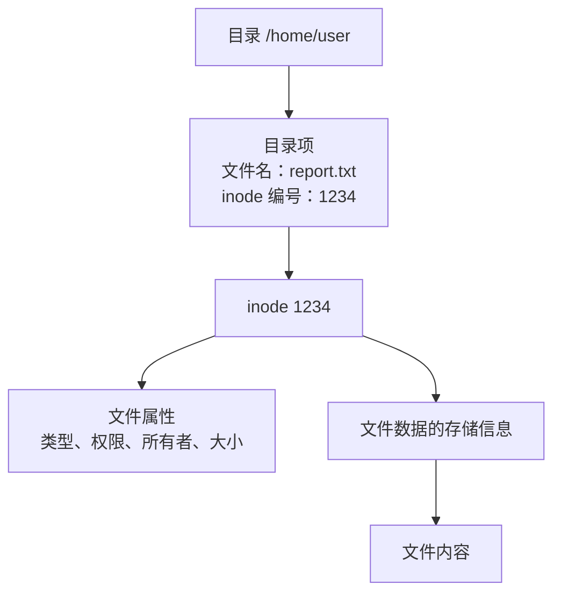
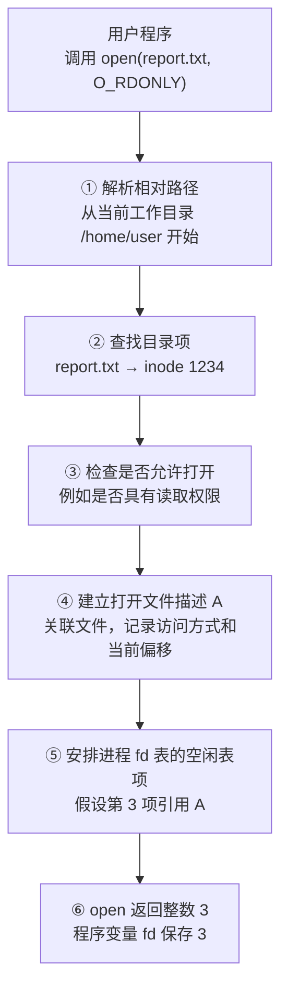
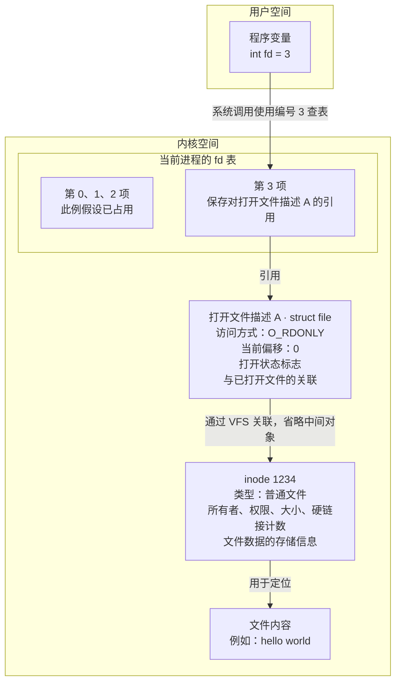
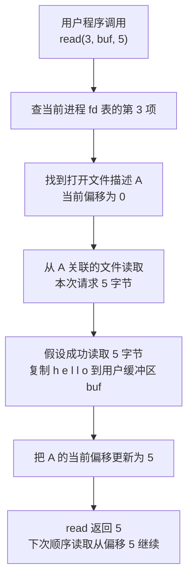
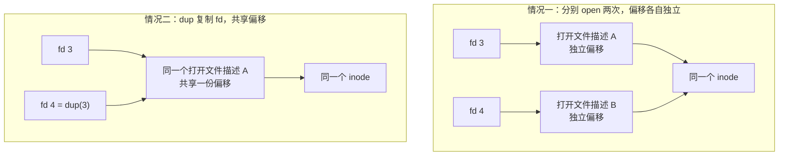
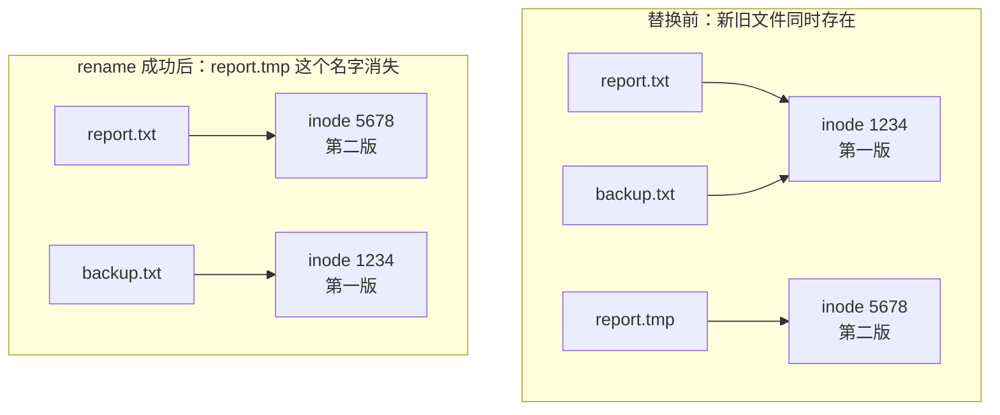
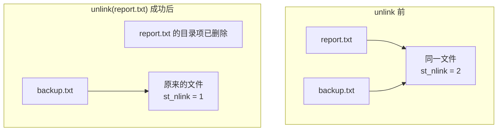
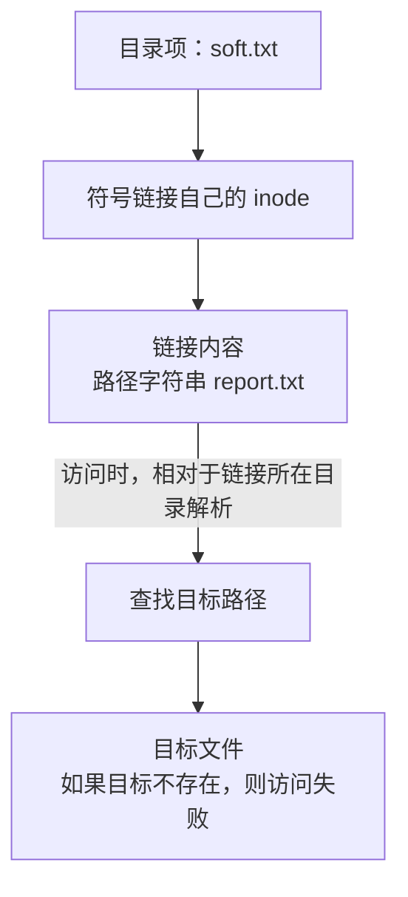
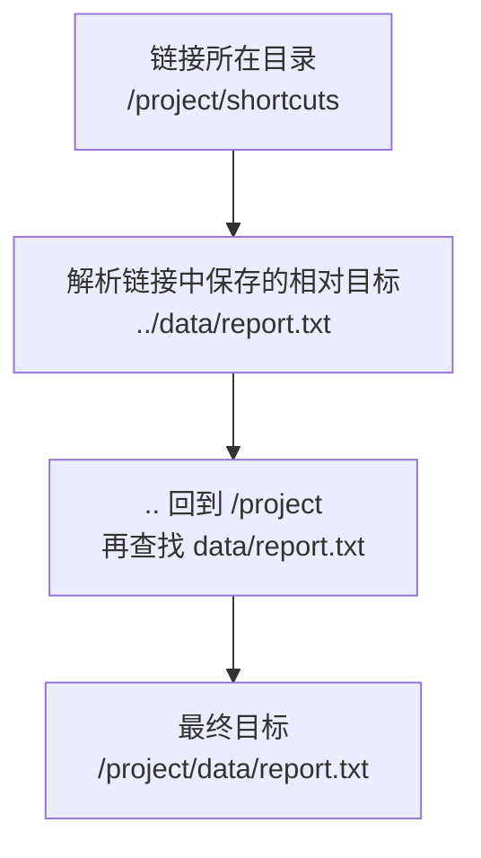
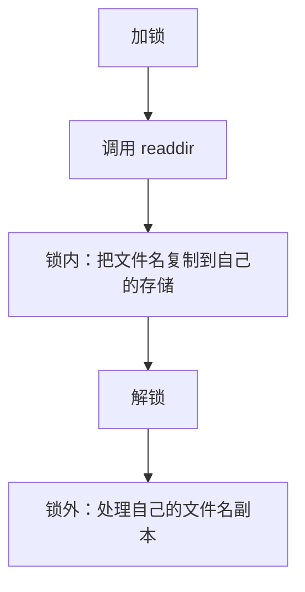

# 文件、目录与链接

在 Linux 中，文件名、文件内容和打开文件后得到的 fd，是三个不同的东西。理解它们的关系，才能弄清楚“为什么删掉文件还能读”“为什么软链接会失效”，以及“列出目录和读取文件需要什么权限”。

以下接口与示例面向 Linux/glibc。

## 目录

- [1. 先理解文件名、inode 和 fd](#foundation)
- [2. 硬链接：link 与 unlink](#hard-links)
- [3. 符号链接：symlink 与 readlink](#symbolic-links)
- [4. 目录权限、mkdir 与 rmdir](#directories)
- [5. 遍历目录：opendir、readdir 与 closedir](#read-directory)
- [6. 多线程：readdir 与 readdir_r](#threads)
- [7. 工作目录：chdir、getcwd 与 fchdir](#cwd)
- [8. 用目录 fd 操作文件：openat 等接口](#at-api)
- [9. ACL 访问控制列表](#acl)
- [10. 完整示例与实验](#examples)
- [11. 接口速查与易错点](#reference)

<a id="foundation"></a>

## 1. 先理解文件名、inode 和 fd

### 1.1 文件名是目录里的一条记录

假设存在文件 `/home/user/report.txt`。可以把它分成三个层次：



可以把目录理解为一张“按名字查文件的表”，表中的每一条记录叫作**目录项**。例如，上面的目录项记录了：文件名是 `report.txt`，对应的 inode 编号是 `1234`。

`inode（索引节点）`保存这个文件的类型、权限、所有者、大小，以及查找文件数据所需的信息。文件名由目录项保存，inode 本身不负责保存文件名。

访问 `report.txt` 时，系统先在它所在的目录中查到 inode 编号，再找到对应的 inode，取得文件属性和数据存储信息。

如果再增加一条目录项，把 `backup.txt` 也对应到 inode `1234`，就给同一个文件增加了一个名字：


这就是硬链接。两个名字地位相同，没有一个必须叫“原文件”。

inode 编号只在所属文件系统内有意义。比较两个文件是否为同一对象，通常需要同时比较 `stat` 结果中的 `st_dev` 和 `st_ino`，不能只看 inode 数字。

### 1.2 fd 是打开之后的访问入口

假设进程当前工作目录是 `/home/user`，其中有一个普通文件 `report.txt`。程序执行：

```c
int fd = open("report.txt", O_RDONLY);
```

理解这个过程，需要分清两个阶段：**open 先通过名字找到文件，并建立打开记录；之后 read 通过 fd 使用这份记录。**

#### 第一步：open 根据路径找到文件

下面假设调用成功，返回值为 3。实际返回哪个 fd，由当时可用的编号决定，不保证一定是 3。



这张图按概念说明调用结果，不代表内核源码中每个步骤都严格按图中的先后执行。中途失败时，open 返回 `-1`，程序不能把它当作有效 fd 使用。

#### 第二步：打开成功后，各部分怎样连接



图中省略了 VFS 的挂载、dentry 等中间关联，以及页缓存和具体文件系统的读取过程。这里重点看三个不同的东西：

| 对象 | 它是什么 | 主要回答什么问题 |
|---|---|---|
| fd，例如整数 3 | 当前进程 fd 表中的编号 | 这次调用使用哪个打开记录？ |
| 打开文件描述 A | 内核维护的本次打开状态；Linux 中对应 `struct file` | 以什么方式访问、接下来从哪里读写？ |
| inode | 文件自身的信息 | 这是什么文件、属性是什么、数据怎样定位？ |

**“打开文件描述”不要与“文件描述符”混淆：文件描述符是 fd 这个编号，打开文件描述是编号间接引用的内核记录。**

#### 第三步：read 使用 fd，不再根据原文件名查找

假设文件有足够的数据，没有其他共享者修改偏移：

```c
char buf[5];
ssize_t n = read(fd, buf, sizeof(buf));
```



read 实际可能返回少于请求长度的字节数；返回正数时，普通顺序读取的偏移按实际读取量推进。它也不会给 buf 自动添加字符串结束符。

这条读取路径没有重新使用字符串 `"report.txt"`。因此，后来把文件改名，或用 `unlink()` 删除这个名字，**原来的 fd 仍可引用已经打开的文件**。

`close(3)` 则移除本进程的这个 fd 表项，并释放它持有的引用。编号 3 之后可以被重新分配给别的文件，所以关闭后的旧 fd 不能继续当作原文件使用。

#### 第四步：同一个文件，不一定共享同一个打开记录



普通 fork 后，父子进程各自的 fd 表也可以引用同一个打开文件描述。关闭其中一个 fd，不代表其他引用随之失效。

因此，**文件有几个名字、程序持有几个 fd、内核有几份打开记录，是三个不同的问题**。

### 1.3 路径是一次查找过程

`/home/user/report.txt` 不是一个直接指向磁盘数据的指针。内核要逐级查找 `/`、`home`、`user`，最后找到 `report.txt`。

相对路径 `report.txt` 通常从当前工作目录开始查找；绝对路径从进程看到的根目录开始。路径中可能遇到符号链接、权限检查、挂载点，也可能在查找时被其他进程修改。

这解释了为什么“刚才检查存在，下一次打开却失败”是正常的并发情况。[参考：path_resolution(7)](https://man7.org/linux/man-pages/man7/path_resolution.7.html)

<a id="hard-links"></a>

## 2. 硬链接：link 与 unlink

### 2.1 link：给已有文件增加一个名字

```c
#include <unistd.h>

int link(const char *oldpath, const char *newpath);
```

例如，在函数内执行：

```c
if (link("report.txt", "backup.txt") == -1) {
    perror("link");
    /* 处理失败，不应假定 backup.txt 已创建。 */
}
```

成功返回 0，失败返回 -1 并设置 `errno`。它不会复制文件内容，而是创建新的目录项，让新名字指向同一个 inode。

```text
创建前：report.txt → inode 1234，硬链接计数为 1
创建后：report.txt → inode 1234 ← backup.txt，计数为 2
```

通过任一个名字直接修改文件内容，另一个名字看到的也是修改后的内容。权限和所有者也是同一份属性。

#### 为什么硬链接不能当作独立备份

假设 `report.txt` 的内容是“第一版”，创建硬链接 `backup.txt` 后：

| 名字 | 对应的 inode | 读到的内容 |
|---|---|---|
| `report.txt` | 1234 | 第一版 |
| `backup.txt` | 1234 | 第一版 |

**这里并没有两份内容，只有同一份文件的两个名字。** `backup.txt` 虽然名字里有 backup，也不会因此变成一份独立副本。

接下来，要区分两种“保存文件”的方式。

**情况一：直接修改原来的文件。**

程序打开 `report.txt`，把 inode 1234 对应文件的内容改成“第二版”。两个名字仍然对应 inode 1234，所以结果是：

| 名字 | 对应的 inode | 修改后读到的内容 |
|---|---|---|
| `report.txt` | 1234 | 第二版 |
| `backup.txt` | 1234 | 第二版 |

不是系统把修改“同步”到了 backup.txt，而是两个名字一直在访问同一份内容。如果这次误写成乱码，通过 backup.txt 读到的也会是乱码，它没有另外保存“第一版”。

**情况二：先写一个新文件，再用它替换 report.txt。**

有些编辑器保存时不直接改原文件，而是按下面的方式操作：

1. 创建临时文件 `report.tmp`，它有新的 inode，例如 5678。
2. 把“第二版”写入 `report.tmp`。此时 inode 1234 中仍是“第一版”。
3. 在同一文件系统内，用 `rename("report.tmp", "report.txt")` 将临时文件改名为 report.txt，并替换原来的同名目录项。

这里的“替换”是：**让 report.txt 这个名字改为对应新文件，而不是把新内容写进旧文件。** 其他名字不会跟着更换对应关系。



替换后，report.txt 和 backup.txt 已经对应两个不同的文件。旧文件仍然存在，是因为 backup.txt 这个目录项还指向它；原来通过 report.txt 打开的 fd，也仍引用旧文件。

此时 backup.txt 恰好保留了“第一版”，但这是**这次保存采用了替换文件的方式**所产生的结果。换一个程序直接修改原文件，就会出现情况一，旧内容不会保留。

因此，要保护旧内容，需要独立副本、快照或版本管理等备份机制，不能仅靠给同一个文件增加硬链接名称。

### 2.2 硬链接有哪些限制

| 情况 | 结果或原因 |
|---|---|
| 新名字已经存在 | 返回 `EEXIST`，不会自动覆盖 |
| 源路径不存在 | 通常返回 `ENOENT` |
| 跨文件系统或不同挂载创建 | Linux 通常返回 `EXDEV` |
| 给目录创建硬链接 | 普通 `link()` 不允许，通常返回 `EPERM` |
| 新名字所在目录没有适当权限 | 可能返回 `EACCES` |
| 文件系统只读或保护策略不允许 | 可能返回 `EROFS` 或 `EPERM` |

硬链接不是只能指向普通文件，也可以涉及其他非目录文件类型。禁止任意创建目录硬链接，有助于保持目录层次可管理，避免形成环路。

“不能跨分区”只是便于记忆的说法，更准确的是不能跨挂载文件系统。不是因为两边恰好出现了相同 inode 数字才失败，而是这种目录项关联不支持跨越该边界。

### 2.3 Linux 的 link 不跟随最后一级符号链接

假设 `alias` 本身是符号链接：

```text
alias → report.txt
```

Linux 上执行 `link("alias", "alias2")`，得到的是**符号链接文件本身的另一个硬链接**，不是 `report.txt` 的硬链接。

想明确控制是否跟随，可使用 `linkat()`：

```c
/* 需要 <fcntl.h>、<unistd.h>，实际使用时检查返回值。 */
linkat(AT_FDCWD, "alias", AT_FDCWD, "name2", 0);
/* 不跟随最后一级 alias，链接的是符号链接本身。 */

linkat(AT_FDCWD, "alias", AT_FDCWD, "name3", AT_SYMLINK_FOLLOW);
/* 跟随 alias，链接到它指向的目标。 */
```

这里讨论的是路径最后一级。如果前面的目录部分包含符号链接，仍涉及正常路径解析。不同系统的 `link()` 行为可能不同，需要精确控制时使用 `linkat()`。[参考：link(2)](https://man7.org/linux/man-pages/man2/link.2.html)

### 2.4 unlink：删除一个名字，而不是立即抹掉数据

```c
#include <unistd.h>

int unlink(const char *path);
```

例如：

```c
if (unlink("report.txt") == -1) {
    perror("unlink");
}
```

如果此前有两个硬链接：



**删除“目录项”，不等于删除“目录”。** 目录项是目录中记录“名字对应哪个文件”的一条记录。例如：

```c
unlink("/home/user/report.txt");
```

假设调用成功，它删除的是 `/home/user` 目录中名为 `report.txt` 的记录，`/home/user` 目录本身仍然存在。

**删除名字与关闭 fd 也是两件事。** 如果程序之前已成功打开 report.txt，unlink 不会替它执行 close；原来的 fd 仍可继续访问已经打开的文件。文件是否能被回收，还要看有没有其他硬链接，以及是否仍有 fd、映射等使用引用。

`unlink()` 适用于普通文件、符号链接等非目录对象，不能用它删除目录。删除**空目录**应使用：

```c
/* 两种方式任选一种；实际使用时检查返回值。 */
rmdir("/home/user/emptydir");

/* 或者：需要 <fcntl.h> 中的 AT_* 常量。 */
unlinkat(AT_FDCWD, "/home/user/emptydir", AT_REMOVEDIR);
```

这两种操作都要求目录为空，不会自动递归删除其中的文件和子目录。

删除符号链接时，删的是链接本身，不是它指向的目标。C 标准库的 `remove()` 则按对象类型采用相应的文件或目录删除方式。

### 2.5 最后一个名字删掉后，为什么还能读取

```text
1. open("report.txt") 成功，得到 fd
2. unlink("report.txt") 成功，最后一个名字消失
3. read(fd, ...) 仍能读到内容
4. 最后的使用引用释放后，文件才可被回收
```

`st_nlink` 反映目录中的硬链接数量，不反映谁还在使用文件。即使链接计数为 0，打开的 fd 或已有映射等引用仍可能保住文件。

进程退出会释放它的 fd，但如果子进程继承了 fd、其他进程也打开了文件，或者仍有有效映射，就不能认定存储已经立即回收。

这个规律常用于临时文件：创建后先 `unlink`，继续通过 fd 使用，最后关闭。它不是安全擦除，也不保证有权限查看进程 fd 的其他进程完全无法接触该文件。完整示例见第 10.2 节。[参考：unlink(2)](https://man7.org/linux/man-pages/man2/unlink.2.html)

<a id="symbolic-links"></a>

## 3. 符号链接：symlink 与 readlink

### 3.1 符号链接保存的是一段路径文字



符号链接也叫软链接。它有自己的 inode，和目标是两个对象。它记录的是“去哪里找”，不是“永远绑定当前这份文件”。

所以：

- 可以指向目录，也可以跨文件系统。
- 创建时目标可以不存在。
- 目标路径不存在时，链接仍存在，只是访问目标失败，称为悬空链接。
- 如果同一路径后来出现新文件，链接会找到新文件，不会记得原来的 inode。

### 3.2 symlink 的两个参数不要写反

```c
#include <unistd.h>

int symlink(const char *target, const char *linkpath);
```

```c
if (symlink("report.txt", "soft.txt") == -1) {
    perror("symlink");
}
```

含义是：**新建名为 soft.txt 的链接，里面保存 report.txt 这段文字。** 成功返回 0；失败返回 -1。链接名已经存在时通常报 `EEXIST`，不会覆盖它。[参考：symlink(2)](https://man7.org/linux/man-pages/man2/symlink.2.html)

### 3.3 相对目标，是相对于链接所在目录

假设目录如下：

```text
/project/
├── data/report.txt
└── shortcuts/
```

要在 `shortcuts` 中创建指向报告的链接，应保存 `../data/report.txt`：

```c
symlink("../data/report.txt", "/project/shortcuts/report");
```

访问时：



即使程序是在 `/tmp` 下创建它(程序的当前工作目录)，目标字符串也不是相对于 `/tmp` 解释。

相对链接适合整个目录树一起搬动；只移动链接本身，目标可能改变。绝对链接保存完整路径，链接自身移动通常不影响该路径，但目标目录改名后仍会失效。

### 3.4 stat、lstat、readlink 各看什么

| 接口 | 对最后一级符号链接的处理 | 用来做什么 |
|---|---|---|
| `stat(path, &st)` | 跟随链接 | 查询目标属性 |
| `lstat(path, &st)` | 不跟随链接 | 查询链接自身属性 |
| `readlink(path, buf, size)` | 读取链接内容 | 获取保存的目标路径字符串 |
| `unlink(path)` | 不跟随链接 | 删除链接名称 |

判断链接类型的片段：

```c
#include <sys/stat.h>

struct stat st;
if (lstat("soft.txt", &st) == -1) {
    perror("lstat");
} else if (S_ISLNK(st.st_mode)) {
    puts("soft.txt 本身是符号链接");
}
```

悬空链接上，`lstat()` 可以成功，`stat()` 则可能因找不到目标而失败。`readlink()` 也不要求目标存在。

**readlink 不会自动补字符串结束符。** 下面片段在空间不足时明确报错，不把截断路径当完整结果：

```c
char buf[1024];
ssize_t n = readlink("soft.txt", buf, sizeof(buf) - 1);
if (n == -1) {
    perror("readlink");
} else if ((size_t)n == sizeof(buf) - 1) {
    fprintf(stderr, "缓冲区可能不足，需要扩大后重试\n");
} else {
    buf[n] = '\0';
    printf("目标路径：%s\n", buf);
}
```

`n` 等于提供的容量时，无法仅凭结果判断是否刚好放满，应扩容重试或拒绝使用该结果。通用程序不能假定所有链接路径都不超过 1023 字节。[参考：readlink(2)](https://man7.org/linux/man-pages/man2/readlink.2.html)

### 3.5 链接权限和循环

Linux 普通符号链接通常显示为 `lrwxrwxrwx`，其 rwx 位一般不参与目标访问检查。但不能因此说“完全没有权限限制”：沿途目录需要搜索权限，目标需要相应权限，粘滞位目录和系统保护策略还可能额外限制访问或删除。

例如建立 `a → b`、`b → a`，解析会循环。Linux 限制一次路径解析可跟随的符号链接数量，超出时报 `ELOOP`，而不是永远查找下去。[参考：symlink(7)](https://man7.org/linux/man-pages/man7/symlink.7.html)

### 3.6 一张表区分软硬链接

| 问题 | 硬链接 | 符号链接 |
|---|---|---|
| 对应哪个对象 | 同一个 inode 的另一个名字 | 一个保存目标路径的独立对象 |
| 是否复制目标内容 | 否 | 否 |
| 是否增加目标硬链接计数 | 是 | 否 |
| 目标改名或某个名字被删 | 其他硬链接仍指向原对象 | 保存的路径可能失效 |
| 相同路径换成新文件 | 其他硬链接仍指向旧对象 | 之后访问可能找到新文件 |
| 能否跨文件系统 | 不支持 | 支持 |
| 能否指向目录 | 普通 link 不允许 | 可以 |
| 能否作为独立内容备份 | 不能 | 不能 |

<a id="directories"></a>

## 4. 目录权限、mkdir 与 rmdir

### 4.1 目录的 r、w、x：列名字、按名字查找、增删名字

#### 先分清：目录里保存的记录，与文件里的内容

假设有文件 `logs/app.log`，可以把它理解为两部分：

| 对象 | 里面有什么 |
|---|---|
| 目录 `logs` | 一条记录：名字 `app.log` 对应哪个文件 |
| 文件 `app.log` | 真正的日志内容，例如 `server started` |

**目录权限控制怎样使用这些名字记录；文件权限控制怎样使用文件内容。** 虽然都写作 r、w、x，但作用在不同对象上，含义就不同。

下面先讨论普通用户，没有额外 ACL、特权绕过等情况，并假设 `logs` 之前的路径都允许通过。“有 r”表示按该用户实际适用的权限规则，确实具有读取权限。

#### ① 目录的 r：允许查看“有哪些名字”

假设 `logs` 中有两个名字：

```text
app.log
error.log
```

对目录有 r 权限，就可以通过 `readdir()` 等操作读取这些名字，知道里面有哪些条目。

**它只允许列名字，不表示你能读取 app.log 的日志内容。** 就像看到一份文件清单，不等于能打开清单上的每一份文件。

目录没有 r 时，即使你恰好知道其中有 app.log，也不能因此列出整个目录。不过，能否直接打开已知名字，还要看下面的 x。

#### ② 目录的 x：允许“按一个名字找到里面的对象”

程序要执行：

```c
open("logs/app.log", O_RDONLY);
```

就必须在 `logs` 中查找名为 `app.log` 的记录。**目录的 x 就是允许这种按名字查找的权限，也叫搜索权限。**

找到文件之后，还要检查这个文件本身是否允许读取。因此，读取日志需要经过两道不同的检查：

| 检查位置 | 需要什么 | 解决什么问题 |
|---|---|---|
| `logs` 目录 | x | 能否按名字查到 app.log？ |
| `app.log` 文件 | r | 找到后，能否读取日志内容？ |

所以，**目录的 x 不表示执行里面的文件**。进入目录的 `chdir()` 也需要搜索权限；真正执行某个程序，还需要检查程序文件本身的执行权限和其他执行条件。

#### ③ 为什么“有 x、没有 r”仍可能打开文件

假设你已经知道完整名字 `logs/app.log`，并且：

```text
对 logs：有 x，没有 r
对 app.log：有 r
```

此时：

- 列出 logs 的全部名字：不允许，因为目录没有 r。
- 直接按 `logs/app.log` 打开并读取：可以，因为目录允许按名字查找，文件也允许读取。

这里不需要先列出整个目录，再打开文件。你已经给出了要查找的名字。

反过来，如果目录**只有 r，没有 x**，你可以读到名字列表，但不能通过这些名字继续查找文件、打开文件或取得完整属性。

这也解释了一个常见现象：目录名字能列出来，但 `ls -l` 获取详细属性时报权限错误。简单列名与查询每个文件的属性，是不同的操作。

#### ④ 目录的 w：允许修改“名字记录”，通常要与 x 配合

下面三种操作改变的是目录中的记录：

| 操作 | 目录发生什么变化 |
|---|---|
| 在 logs 中创建 new.log | 增加名字 new.log |
| 删除 logs/app.log | 移除名字 app.log |
| 把 logs/app.log 改名为 logs/old.log | 改变名字对应关系 |

这些操作通常都需要父目录 `logs` 的 **w 和 x**：w 允许修改目录项，x 允许在目录中按名字进行相关查找。只有 w、没有 x，不能正常完成上述按名字的操作。

如果跨两个目录改名，还要检查源目录和目标目录的相应权限。

**目录的 w 不等于里面每个文件都可写。** 修改一个已经存在的文件内容，通常需要沿途目录的 x 和该文件自己的 w，不要求父目录有 w。

例如，logs 不允许你增删文件名，但 app.log 允许你写入，那么你仍可能追加日志，却不能把 app.log 删除或改名。

#### ⑤ 文件只读，为什么还可能被删除

假设权限如下：

```text
对 logs：有 w 和 x
对 app.log：只有 r，没有 w
```

先看修改内容：

```text
把 app.log 的日志改成另一段文字
→ 要修改文件内容
→ 文件没有 w，失败
```

再看删除名字：

```text
unlink("logs/app.log")
→ 要删除 logs 中名为 app.log 的记录
→ 父目录有 w 和 x，通常允许
```

因此，**文件的“只读”主要保护内容不被直接写入，并不单独保护它的名字不被删除。** 文件是否最终回收，还取决于其他硬链接、打开的 fd 等引用。

反过来，即使文件可写，父目录不允许修改名字记录，也可能出现“能改内容，但不能删除或改名”。

#### ⑥ /tmp 的 sticky bit：允许创建自己的文件，限制删除别人的文件

`/tmp` 常见权限是 `1777`。可以拆开理解：

- 后面的 `777`：所有者、组、其他人都有 rwx，普通用户通常都能在其中创建临时文件。
- 前面的 `1`：设置 sticky bit，也就是粘滞位，对删除和改名增加限制。

如果只有 777，没有这项限制，那么在一般权限条件下，用户可能利用目录的 w 和 x 删除别人创建的名字，即使对方的文件内容是不可写的。

设置 sticky bit 后，删除或改名还要满足额外条件：操作者通常必须是**相应文件的所有者、目录的所有者，或具有相关特权**。

例如 alice 和 bob 都能在 /tmp 中创建文件，但 bob 通常不能删除 alice 的临时文件。这个位限制的是名字的删除或改名，不会自动让文件内容变成私有；内容能否读写，仍看文件本身的权限。

#### 把常见操作放在一起比较

下表假设文件已存在（创建操作除外），并且没有 sticky bit、只读挂载、不可变标志等额外限制；全部上级目录也要允许路径搜索。

| 想做什么 | 对父目录 logs 的要求 | 对 app.log 的要求 |
|---|---|---|
| 只列出其中的名字 | r | 不需要读取文件内容 |
| 查询 app.log 的普通 stat 属性 | x | 通常不要求文件本身有 r |
| 打开并读取 app.log | x | r |
| 直接写入已有的 app.log | x | w |
| 在 logs 中新建文件 | w + x | 新文件尚不存在，另行设置创建权限 |
| unlink 删除 app.log 的名字 | w + x | 不要求文件本身有 w |
| 在 logs 内给 app.log 改名 | w + x | 不要求文件本身有 w |

判断权限时，先问：**这次是在读写文件内容，还是在查找、增删目录里的名字？** 分清操作对象，再看它对应的权限。

[参考：path_resolution(7)](https://man7.org/linux/man-pages/man7/path_resolution.7.html)、[unlink(2)](https://man7.org/linux/man-pages/man2/unlink.2.html)

### 4.2 mkdir：只创建这一层目录

```c
#include <sys/stat.h>

int mkdir(const char *path, mode_t mode);
```

```c
if (mkdir("logs", 0755) == -1) {
    perror("mkdir");
}
```

成功返回 0，失败返回 -1。`0755` 前面的 0 表示八进制；没有父目录时，`mkdir("a/b", ...)` 不会自动把 a 也创建出来。命令行 `mkdir -p` 的逐层创建逻辑不是这个系统调用直接提供的。

常见错误：

| errno | 含义 |
|---|---|
| `EEXIST` | 路径已存在，可能是目录，也可能是别的对象 |
| `ENOENT` | 某一级父目录不存在 |
| `ENOTDIR` | 某一级本应是目录，实际却不是 |
| `EACCES` | 路径搜索或父目录写入权限不足 |
| `ENOSPC` | 文件系统没有足够资源创建目录 |

如果要实现“存在就使用”，不能把所有 `EEXIST` 都当成功；还要确认已有对象符合要求，并考虑确认后被替换的竞争。

### 4.3 mode 还会受到 umask 影响

父目录没有默认 ACL 时，常见权限计算为：

```text
实际 rwx 权限 = mode & ~umask

mkdir("logs", 0777)
umask = 0022
结果通常为 0755
```

umask 的位表示要去掉哪些权限，不是简单的十进制减法。它属于进程状态，普通多线程程序里临时修改也会影响其他线程创建文件。

父目录具有默认 ACL 时，创建权限还涉及 ACL 继承，不能只套这个公式；默认 ACL 仍不能突破创建时 mode 对相应权限的限制。父目录的 setgid 位也可能影响新目录所属组和继承属性。[参考：mkdir(2)](https://man7.org/linux/man-pages/man2/mkdir.2.html)

### 4.4 rmdir：只能删除空目录

```c
#include <unistd.h>

int rmdir(const char *path);
```

“空目录”是没有其他实际条目；`.` 和 `..` 不需要手动删除。只要还有隐藏文件、子目录或符号链接，就不算空。

```c
if (rmdir("logs") == -1) {
    perror("rmdir");
}
```

目录非空通常返回 `ENOTEMPTY`；路径不是目录返回 `ENOTDIR`。`rmdir()` 不递归清理内容。

递归删除需要逐个处理条目，并防止跟随符号链接进入目录树之外。先扫描发现空、再 rmdir，也可能因为别人刚创建了文件而失败，必须处理真实调用结果。

一个空目录即使被别的进程作为 cwd 或已打开，在 Linux 上也不一定因此禁止删除；不要把“有人使用”一概等同于 `EBUSY`。挂载点等情况则可能报忙。[参考：rmdir(2)](https://man7.org/linux/man-pages/man2/rmdir.2.html)

<a id="read-directory"></a>

## 5. 遍历目录：opendir、readdir 与 closedir

### 5.1 DIR 记录的是“目录遍历到了哪里”

```c
#include <dirent.h>

DIR *opendir(const char *name);
struct dirent *readdir(DIR *dirp);
int closedir(DIR *dirp);
```

使用顺序是：

```text
opendir：打开目录，建立目录流
    ↓
readdir：取下一条目录项
    ↓
再次 readdir：继续取下一条
    ↓
读到末尾 → closedir：释放目录流
```

`DIR *` 可以理解为包含“读取位置和内部缓冲区”的遍历对象。它不是文件内容，也不是 fd 数字。glibc 通常批量从内核取条目，再逐条返回，因此一次 `readdir()` 不一定对应一次系统调用。

`opendir()` 失败返回 NULL。`closedir()` 成功返回 0，并关闭目录流所使用的底层 fd。调用 `closedir()` 后，不能继续使用这个 DIR 或此前返回的内部条目指针。[参考：opendir(3)](https://man7.org/linux/man-pages/man3/opendir.3.html)、[closedir(3)](https://man7.org/linux/man-pages/man3/closedir.3.html)

### 5.2 readdir 返回的是目录项，不是文件内容

常用字段：

| 字段 | 含义 | 注意 |
|---|---|---|
| `d_name` | 文件名，如 `report.txt` | 不是完整路径，也不是文件内容 |
| `d_ino` | 目录项记录的 inode 编号 | 不是跨文件系统唯一编号 |
| `d_type` | 类型提示，如普通文件、目录、链接 | Linux 上可能为 `DT_UNKNOWN`，不能只靠它判断 |
| `d_off` | 目录读取位置相关标记 | 不要当普通文件字节偏移自行加减 |

条目顺序由文件系统决定，不保证按名字排序。隐藏文件也可能返回；“隐藏”通常只是名字以点开头，不是 readdir 自动过滤的属性。

递归遍历时跳过 `.` 和 `..`，否则可能反复访问当前目录或父目录。如果需要排序，要自己保存并排序名字，或使用 `scandir()` 等接口。

### 5.3 NULL 有两种含义：读完了，或者失败了

`readdir()` 返回非 NULL，说明读到一条；返回 NULL，既可能是末尾，也可能是出错。

下面是假设 `dir` 已成功打开的循环片段：

```c
for (;;) {
    errno = 0;                  /* 每次调用前清零 */
    struct dirent *entry = readdir(dir);

    if (entry == NULL) {
        if (errno != 0) {
            perror("readdir");
        }
        break;                  /* errno 为 0 表示正常结束 */
    }

    printf("%s\n", entry->d_name);
}
```

每次调用前都清零，是为了避免循环体里其他函数留下的 errno 被误认为 readdir 的错误。完整示例见第 10.3 节。

### 5.4 返回的指针为什么不能一直保存

`entry` 指向目录流内部管理的存储，不归调用者所有：

```text
第一次 readdir → entry 指向内部缓冲区中的一条记录
后续 readdir   → 该存储可能被覆盖或复用
```

所以不能 `free(entry)`，也不能把 `entry->d_name` 的指针交给后台线程后就继续读目录。

需要长期保存时，复制文件名，例如 `strdup(entry->d_name)`，使用结束后释放副本。不应假定 `sizeof(struct dirent)` 或固定 256 字节一定能保存所有系统上的完整条目。[参考：readdir(3)](https://man7.org/linux/man-pages/man3/readdir.3.html)

### 5.5 列出名字，不等于锁住这个文件

假设读到了 `report.txt`，其他进程随后把它删除。再查询属性或打开它，仍可能失败。

目录遍历不是整个目录的一次冻结快照。遍历过程中创建、删除或重命名文件，不能假设总能看到某个固定时刻的全部内容。

要查询当前条目的类型，可以用：

```c
/* dir 已打开，entry 来自当前 readdir；需要 <fcntl.h>、<sys/stat.h>。 */
struct stat st;
if (fstatat(dirfd(dir), entry->d_name, &st, AT_SYMLINK_NOFOLLOW) == -1) {
    /* 文件可能刚被删除，也可能没有权限；按 errno 区分。 */
} else if (S_ISDIR(st.st_mode)) {
    /* 这次查询时，它是目录。 */
}
```

这种写法不需要拼接长路径，也不依赖当前工作目录。但它仍只是这次查询的结果，不保证以后按这个名字打开时还是同一对象。


<a id="threads"></a>

## 6. 多线程：readdir 与 readdir_r

### 6.1 “readdir 非线程安全”需要说明是哪种用法

在现代 Linux/glibc 中，要区分**同一个目录路径**和**同一个目录流 DIR**：

| 情况 | 是否需要协调 |
|---|---|
| A、B 分别调用 opendir，使用不同 DIR | 可以并发调用 readdir，各有自己的读取状态 |
| A、B 共用同一个 DIR，未经同步并发读取 | 不应这样使用，需要外部同步 |
| 一个线程 readdir，另一个线程 closedir 同一 DIR | 不允许无协调执行，会涉及失效对象 |

即使两次 `opendir()` 都打开 `/data`，返回的也是两个目录流；它们会各自遍历目录，不会自动把任务一人分一半。

手册中的 `MT-Unsafe race:dirstream` 指向共享目录流的竞争，不能简化为“多线程程序一律不能调用 readdir”。[参考：readdir(3)](https://man7.org/linux/man-pages/man3/readdir.3.html)

### 6.2 为什么只锁住 readdir 调用还不够

错误顺序：

```text
线程 A：加锁 → readdir 得到 entry → 解锁
线程 B：加锁 → readdir，内部存储可能变化 → 解锁
线程 A：这时才读取 entry->d_name，内容可能已经不是原来的
```

正确顺序：



在多线程环境下共享同一个 `DIR *` 句柄调用 `readdir()` 是一个经典的并发陷阱：尽管线程 A 和线程 B 在调用 `readdir()` 时加了锁，但由于锁的保护范围仅限于函数调用瞬间，线程 A 在获取到指向 `DIR` 内部共享缓冲区的指针后便过早地释放了锁；此时若线程 B 趁机加锁并再次调用 `readdir()`，就会刷新并覆盖该共享缓冲区的内容，导致线程 A 随后读取到的 `entry->d_name` 变成了线程 B 刚读到的新数据。因此，这种“加锁-解锁-再访问”的做法无法保障返回指针生命周期的安全，多个线程可以共享同一个目录流，但必须使用同一把锁保护“读取目录项 → 复制文件名”的整个过程，不能解锁后再访问原来的目录项指针。

下面的辅助函数返回 1 表示得到名字，0 表示结束，-1 表示失败。调用者成功取得名字后负责 `free()`。同一个目录流的所有使用者必须共用同一把锁，目录流也必须保持打开。

```c
/* Linux/glibc；在源文件头部定义 _POSIX_C_SOURCE 200809L。
   需要 <dirent.h>、<pthread.h>、<errno.h>、<string.h>、<stdlib.h>。
   编译链接使用 -pthread。 */
int next_name(DIR *dir, pthread_mutex_t *lock, char **name)
{
    *name = NULL;
    int rc = pthread_mutex_lock(lock);
    if (rc != 0) {
        errno = rc;
        return -1;
    }

    errno = 0;
    struct dirent *entry = readdir(dir);
    int error = entry == NULL ? errno : 0;

    if (entry != NULL) {
        *name = strdup(entry->d_name);  /* 必须在锁内复制 */
        if (*name == NULL)
            error = errno;
    }

    rc = pthread_mutex_unlock(lock);   /* 读完、读错、复制失败都要解锁 */
    if (rc != 0 && error == 0)         /* 保留最先发生的错误 */
        error = rc;

    if (error != 0) {                  /* 统一处理错误 */
        free(*name);
        *name = NULL;
        errno = error;
        return -1;
    }
    return *name != NULL;              /* 有名字返回 1，到末尾返回 0 */
}
```

这里用 `error` 统一记录错误，执行顺序是：加锁 → 读取并复制 → 解锁 → 判断结果。

错误处理采用“保留最先发生的错误”的策略：如果读取或复制已经失败，解锁失败不能再覆盖原来的 `error`；只有前面没有错误（`error == 0`）时，才记录解锁错误。注意，`pthread_mutex_unlock()` 仍然无条件执行，条件只控制是否更新错误码。这个接口只能返回一个错误；如果还需要诊断后续的解锁失败，应另外记录解锁返回值。

- `error != 0`：读取、复制或锁操作失败，返回 -1，并通过 `errno` 告诉调用者原因。
- 没有错误且 `*name != NULL`：得到名字，返回 1。
- 没有错误且 `*name == NULL`：读到目录末尾，返回 0。

`readdir()` 返回 NULL 既可能表示结束，也可能表示失败，所以调用前清零 `errno`、返回 NULL 后检查错误这两步不能省。复制失败后也必须先解锁，才能返回。成功取得名字后，调用者负责 `free(*name)`。[参考：readdir(3)](https://man7.org/linux/man-pages/man3/readdir.3.html)、[strdup(3)](https://man7.org/linux/man-pages/man3/strdup.3.html)

这只保护目录流和名字副本，不会锁住文件系统里的那个文件。复制完成后，文件仍可能被别人改名或删除。

`closedir()` 通常安排在全部工作线程退出之后；不能因为它也加了锁，就在其他线程还会继续访问 DIR 时提前关闭。

### 6.3 更容易管理的方案：一个线程遍历，多个线程处理

如果多个线程是为了加速处理文件，可以采用：

```text
一个枚举线程：readdir → 复制文件名 → 放入线程安全任务队列
多个工作线程：取出任务 → 打开文件 → 处理 → 释放名字副本
```

这样只有枚举线程操作 DIR，目录流本身不用被多个读取线程争用。任务队列仍需要同步和容量限制；任务中的名字也不保证文件随后还存在，工作线程必须处理打开失败。

### 6.4 readdir_r 为什么不再推荐

旧接口让调用者提供输出缓冲区：

```c
int readdir_r(DIR *dirp, struct dirent *entry,
              struct dirent **result);
```

它原本用于解决可重入和缓冲区共享问题，但接口无法传入缓冲区长度，文件名最大长度又不能简单地对所有文件系统写死。遇到长文件名时，分配大小和兼容性处理容易出错。

glibc 从 2.24 起弃用 `readdir_r()`。**新代码使用 readdir；共享同一个 DIR 时加外部同步，而不是换成 readdir_r。**

维护旧代码时，注意其返回规则不同：

| 情况 | readdir_r 返回值 | result |
|---|---|---|
| 读到一条 | 0 | 指向调用者提供的条目 |
| 读到末尾 | 0 | NULL |
| 出错 | 正的错误码 | 不应当作有效结果使用 |

因此，不能用 `rc == -1` 判断它的错误，也不能直接依赖 `perror()` 读取 errno；错误原因在返回的 `rc` 中。不同线程也不能无同步地共用同一个输出缓冲区。[参考：readdir_r(3)](https://man7.org/linux/man-pages/man3/readdir_r.3.html)

<a id="cwd"></a>

## 7. 工作目录：chdir、getcwd 与 fchdir

### 7.1 当前工作目录是相对路径的起点

进程当前工作目录简称 cwd。假设 cwd 为 `/srv/app`：

```text
open("config.ini", ...) → 从 /srv/app 查找 → /srv/app/config.ini
```

如果改到 `/tmp`，相同代码就会查找 `/tmp/config.ini`。

cwd 不等于可执行文件所在目录。即使程序保存在 `/opt/bin/demo`，从 `/home/user` 启动时，它也可能继承 `/home/user` 作为 cwd。

### 7.2 chdir 修改后续相对路径的起点

```c
#include <unistd.h>

int chdir(const char *path);
```

```c
if (chdir("/srv/app") == -1) {
    perror("chdir");
    /* 失败时不能假定已经切换成功。 */
}
```

成功返回 0，失败返回 -1。目录不存在、路径某一级不是目录、缺少搜索权限都可能导致失败。

`chdir()` 不重新定位已经打开的 fd，也不把之前的 DIR 改成另一个目录：这些对象已经打开，后续相对路径查找才受 cwd 变化影响。

### 7.3 fork、exec 和线程分别有什么关系

| 场景 | cwd 的变化 |
|---|---|
| 普通 fork | 子进程继承父进程当时的 cwd；之后各自 chdir 通常互不影响 |
| exec | 替换程序，cwd 保留 |
| 普通 pthread 多线程 | 各线程共享 cwd；一个线程 chdir，会影响其他线程 |
| 子进程执行 chdir | 不会反过来改变启动它的 shell 的 cwd |

这也是 `cd` 通常作为 shell 内建命令的原因：如果只启动一个外部程序去 chdir，结束后父 shell 仍留在原目录。[参考：chdir(2)](https://man7.org/linux/man-pages/man2/chdir.2.html)

多线程中的典型错误：

```text
线程 A：chdir("/data/A")
线程 B：chdir("/data/B")
线程 A：open("result.txt") → 实际可能打开 /data/B/result.txt
```

chdir 调用本身的内部实现不会把“切换目录＋后续打开”变成一个整体。多线程服务通常使用绝对路径或目录 fd，避免靠来回 chdir 组织操作。

### 7.4 getcwd 返回当前目录路径

```c
#include <unistd.h>

char *getcwd(char *buf, size_t size);
```

成功返回 buf，失败返回 NULL。缓冲区不足时通常报 `ERANGE`，应扩大缓冲区后重试，不要把固定大小当作所有路径的上限。

Linux/glibc 也支持下面的方便写法，这是扩展用法：

```c
/* 源文件头部定义 _GNU_SOURCE，并包含 <unistd.h>、<stdlib.h>、<stdio.h>。 */
char *cwd = getcwd(NULL, 0);
if (cwd == NULL) {
    perror("getcwd");
} else {
    puts(cwd);
    free(cwd);
}
```

`getcwd()` 得到的路径不一定保留 shell 中通过符号链接进入目录时的拼写；环境变量 `PWD` 也不能当作永远准确的内核状态。

目录被删除后，进程可能仍持有 cwd，但无法再把它还原成一个有效路径，此时 getcwd 可能报 `ENOENT`。成功取得的路径也只是当时的结果，之后还可能被改名。[参考：getcwd(3)](https://man7.org/linux/man-pages/man3/getcwd.3.html)

### 7.5 用 fchdir 恢复已保存的目录

如果确实需要在单线程程序中临时切换目录，可以先打开当前目录，之后通过 fd 返回：

```c
/* 函数内片段；需要 <fcntl.h>、<unistd.h>、<stdio.h>。 */
int saved = open(".", O_RDONLY | O_DIRECTORY | O_CLOEXEC);
if (saved == -1) {
    perror("open current directory");
    return -1;
}

if (chdir("/tmp") == -1) {
    perror("chdir");
    close(saved);
    return -1;
}

/* 在这里进行需要的操作；所有退出分支都必须安排恢复。 */

if (fchdir(saved) == -1) {
    perror("fchdir");
    close(saved);
    return -1;
}
if (close(saved) == -1) {
    perror("close");
    return -1;
}
```

保存目录 fd，相当于记住“原来那个目录本身”；保存路径字符串，则只是记住“原来的地址”。如果原目录被改名，旧路径又被一个新建的目录占用，使用旧路径返回时就会进入新目录，而 `fchdir()` 可以通过保存的目录 fd 回到原目录。

不过，同一个进程中的多个线程共享当前工作目录（cwd）。一个线程临时切换目录后，其他线程如果使用相对路径打开文件，也会从切换后的目录开始查找，可能因此打开错误的文件。即使随后用 `fchdir()` 恢复原目录，也无法避免中间这段时间发生的错误。因此，“保存目录 fd → 切换目录 → 恢复目录”只能帮助我们回到原目录，不能解决多个线程共享 cwd 带来的竞争；多线程中可使用下面的 `openat()` 等接口，为每次文件操作指定起始目录，而不改变 cwd。

<a id="at-api"></a>

## 8. 用目录 fd 操作文件：openat 等接口

### 8.1 给相对路径指定起点

`openat(dirfd, "report.txt", ...)` 表示：从 dirfd 指向的目录开始查找，不从 cwd 开始。

```c
/* 函数内片段；需要 <fcntl.h>、<unistd.h>、<stdio.h>。 */
int base = open("/srv/data", O_RDONLY | O_DIRECTORY | O_CLOEXEC);
if (base == -1) {
    perror("open directory");
    return -1;
}

int fd = openat(base, "report.txt", O_RDONLY | O_CLOEXEC | O_NOFOLLOW);
if (fd == -1) {
    perror("openat");
    close(base);
    return -1;
}

/* 使用 fd；可以用 fstat(fd, ...) 查询真正打开的对象。 */
```

用完后需要分别关闭 fd 和 base。`AT_FDCWD` 表示改用当前工作目录；绝对路径通常不使用对应 dirfd 作为起点。

### 8.2 相关接口对照

| 普通接口 | 带目录 fd 的接口 | 说明 |
|---|---|---|
| `open` | `openat` | 打开目录下的文件 |
| `mkdir` | `mkdirat` | 在指定目录下创建子目录 |
| `link` | `linkat` | 源路径、新路径分别指定目录 fd |
| `symlink` | `symlinkat` | 指定新链接所在目录；target 字符串仍原样保存 |
| `unlink/rmdir` | `unlinkat` | flags 为 0 删除非目录；AT_REMOVEDIR 删除空目录 |
| `stat/lstat` | `fstatat` | AT_SYMLINK_NOFOLLOW 查询最后一级链接本身 |

#### symlinkat：链接放在哪里，与链接指向哪里，是两件事

看到 `symlinkat("../data/a", base, "shortcut")`，容易以为系统会先从 `base` 出发找到目标，再把目标的绝对路径存进链接。实际上，这里需要区分**创建链接的位置**和**链接中保存的目标字符串**。

可以把软链接想成一张“指路纸条”：`base` 决定纸条放在哪个目录，`"shortcut"` 是纸条的名字，`"../data/a"` 是纸条上原样写下的内容。这个类比只帮助区分位置与内容；实际访问时，是系统的路径解析过程读取链接内容，继续查找目标，机制与前面的[符号链接章节](#symbolic-links)相同。

假设 `base` 是打开 `/home/demo/links` 得到的有效目录文件描述符，调用成功后，目录关系如下。这里用路径推演说明参数含义，不是独立可编译的程序；目录 fd 的打开、错误检查和关闭方式见 8.1 节。

```text
/home/demo/
├── data/
│   └── a
└── links/
    └── shortcut  →  ../data/a
```

**第一步，创建时：确定链接的位置，原样保存目标字符串。**

因为第三个参数 `"shortcut"` 是相对路径，系统以 `base` 指向的目录为起点，在 `/home/demo/links/shortcut` 创建软链接。链接中保存的仍是 `../data/a`，不会自动改成 `/home/demo/data/a`。此时不需要找到目标，目标文件甚至可以尚不存在。

**第二步，以后访问时：从链接所在目录出发，解释相对目标。**

当程序打开 `/home/demo/links/shortcut` 时，系统读取其中的 `../data/a`，再按下面的过程查找：

```text
/home/demo/links/    ← 从软链接所在目录出发
..                  ← 回到 /home/demo
data/a              ← 找到 /home/demo/data/a
```

因此，在这个例子中最终访问的是 `/home/demo/data/a`。这里使用绝对路径访问 `shortcut`，所以程序当前工作目录在哪里，不影响上述结果。如果目标仍不存在，创建链接可以成功，但随后通过链接打开目标通常会报 `ENOENT`。

**为什么强调“没有自动变成绝对路径”？因为移动链接后，结果可能改变。**

假设只把软链接移动到 `/tmp/links/shortcut`，它保存的内容仍然是 `../data/a`。再次访问时，系统从新的链接所在目录 `/tmp/links` 出发，就会去找 `/tmp/data/a`。如果链接里保存的是绝对路径 `/home/demo/data/a`，仅移动链接本身就不会改变它保存的目标路径。

还要注意，`base` 是新链接路径的起点，不一定就是链接最终所在的目录。例如第三个参数改成 `"sub/shortcut"`，并且 `sub` 是已经存在的普通子目录，链接就创建在 `/home/demo/links/sub/shortcut`；此时 `../data/a` 会从 `sub` 目录出发，指向 `/home/demo/links/data/a`。第三个参数若是绝对路径，则不使用 `base` 来确定新链接位置。

可以这样口头概括：**`base` 解决“从哪个目录开始创建链接”的问题；目标字符串原样保存，等以后访问链接时才解析。相对目标从链接所在目录出发，因此只移动链接本身可能改变指向。**

### 8.3 lstat 检查过，不代表随后打开就安全

下面是“检查时”和“使用时”不同步的问题，称为 TOCTOU：

```text
A：lstat("input")，发现是普通文件
B：把 input 换成指向别处的符号链接
A：open("input")，打开了替换后的目标
```

因此，不能说“只要先 lstat 就能防止符号链接攻击”。

如果不允许最后一级是符号链接，可以在打开时加 `O_NOFOLLOW`；打开成功后，再对 fd 使用 `fstat()` 验证实际打开的对象。但 `O_NOFOLLOW` 不会禁止前面目录部分的符号链接，也不会阻止任意 `..` 跳出目录。

面对不可信的多级路径，Linux 的 `openat2()` 提供更细的解析约束，例如 `RESOLVE_BENEATH` 限制不能逃出给定目录，`RESOLVE_NO_SYMLINKS` 禁止解析符号链接。目录 fd 固定起点与限制整个路径解析，是两个不同要求。[参考：openat2(2)](https://man7.org/linux/man-pages/man2/openat2.2.html)

<a id="acl"></a>

## 9. ACL 访问控制列表

### 9.1 为什么有 rwx 还需要 ACL

传统权限只区分所有者、所属组和其他人。假设一份报告只想额外让 alice 读取，而不是让所有“其他人”读取，ACL 就可以为 alice 单独增加一条规则。

以下讨论 Linux 常用的 POSIX 风格 ACL，需要文件系统支持。`getfacl` 查看，`setfacl` 修改；部分发行版需要先安装提供这两个命令的 acl 软件包。

### 9.2 看懂一份 ACL

```text
user::rw-
user:alice:r--
group::---
mask::r--
other::---
```

| 条目 | 含义 |
|---|---|
| `user::rw-` | 文件所有者可读写 |
| `user:alice:r--` | 指定用户 alice 的权限条目 |
| `group::---` | 文件所属组的权限条目 |
| `mask::r--` | 指定用户和组类条目的有效权限上限 |
| `other::---` | 未匹配前面身份的其他用户 |

`mask` 不限制所有者条目和 other 条目。假设 alice 不是文件所有者，也没有绕过普通权限检查的特权：

```text
alice 条目为 rw-
mask 为 r--
有效权限 = rw- 与 r-- 的交集 = r--
```

所以，看到 alice 条目中有 w，不代表最终一定能写。

### 9.3 常用命令

下面操作自己的测试文件，alice 需替换为系统中已存在的非所有者用户：

```bash
printf 'example\n' > acl-demo.txt
chmod 600 acl-demo.txt

getfacl acl-demo.txt
setfacl -m u:alice:r-- acl-demo.txt  # 给 alice 读取条目
getfacl acl-demo.txt

setfacl -m u:alice:rw-,m::r-- acl-demo.txt
getfacl acl-demo.txt                # alice 的有效权限仍只有读

setfacl -x u:alice acl-demo.txt      # 删除 alice 的条目
setfacl -b acl-demo.txt             # 清除扩展 ACL，保留基本权限条目
```

`setfacl -m` 通常会重新计算 mask；希望固定它时，需要显式设置或了解 `-n` 的作用。修改 mask 会影响多个组类条目，不只影响刚添加的用户。[参考：setfacl(1)](https://man7.org/linux/man-pages/man1/setfacl.1.html)

### 9.4 ACL 不是所有权限简单相加

普通身份检查先看是否为所有者，再看是否匹配指定用户，随后考虑组身份，最后才轮到 other。

例如，alice 命中了专门的用户条目，但该条目不允许写，不能因为 other 恰好可写就再“降级试一次”。命中特定身份并不表示可以任选最宽松的规则。

扩展 ACL 存在 mask 时，`ls -l` 中的组权限位对应 mask，而不只是 `group::`。因此 `chmod g-w` 可能通过改变 mask，使某些指定用户也失去有效写权限。判断实际授权应查看 `getfacl`。

### 9.5 默认 ACL：给以后创建的子项定规则

访问 ACL 决定当前对象怎样访问；默认 ACL 只能设置在目录上，用于子项创建时继承。

```bash
mkdir acl-demo-dir
setfacl -m u:alice:r-x acl-demo-dir
setfacl -d -m u::rwx,u:alice:r-x,g::---,m::r-x,o::--- acl-demo-dir
getfacl acl-demo-dir
```

第一条授权让 alice 访问这个目录本身；第二条默认 ACL 影响以后创建的子项。它不会追溯修改已经存在的文件。

子项还受创建时 mode 限制。例如普通文件以 0666 创建，即使默认 ACL 中有 x，也不会因此自动获得有效执行权限。子目录还可以继承默认 ACL，继续影响后代。存在默认 ACL 时，不能只使用 `mode & ~umask` 推算最终结果。[参考：acl(5)](https://man7.org/linux/man-pages/man5/acl.5.html)

### 9.6 有 ACL 仍访问失败，先查目录

给 `report.txt` 增加读取权限，不会自动赋予沿途目录的搜索权限。alice 如果不能穿过 `/home/owner`，就到不了其中的文件。

同样，删除文件主要涉及父目录的权限。ACL 也不会取消 sticky bit、只读挂载或其他安全机制的限制。


<a id="examples"></a>

## 10. 完整示例与实验

### 10.1 实验：硬链接保住文件，软链接只跟着路径走

以下命令在 Linux shell 中执行，全部测试文件都放在新建的临时目录里：

```bash
demo=$(mktemp -d) || exit 1
cd "$demo" || exit 1

printf 'version one\n' > original.txt
ln original.txt hard.txt
ln -s original.txt soft.txt

ls -li original.txt hard.txt soft.txt
stat -c '%n inode=%i links=%h type=%F' original.txt hard.txt soft.txt
readlink soft.txt
```

预期观察：original.txt 与 hard.txt 的 inode 相同，硬链接计数为 2；soft.txt 是独立的符号链接，里面保存 original.txt。

接着只删除一个名字：

```bash
rm original.txt
cat hard.txt              # 仍能读到 version one
cat soft.txt              # 找不到目标，失败
ls -l soft.txt            # 链接本身仍存在
```

再创建同名的新文件：

```bash
printf 'version two\n' > original.txt
cat soft.txt              # 读到新文件的 version two
cat hard.txt              # 仍是旧文件的 version one
ls -li original.txt hard.txt
```

这时 original.txt 和 hard.txt 对应不同 inode。最后清理本次创建的文件：

```bash
rm original.txt hard.txt soft.txt
cd / || exit 1
rmdir "$demo"
```

### 10.2 完整程序：删除名字以后，fd 仍然有效

保存为 `unlinked_file.c`。程序用 `mkstemp()` 创建唯一临时文件，删除名称后继续读写，并通过 `fstat()` 查看硬链接计数。

```c
#define _POSIX_C_SOURCE 200809L
#include <errno.h>
#include <fcntl.h>
#include <inttypes.h>
#include <stdio.h>
#include <stdlib.h>
#include <sys/stat.h>
#include <unistd.h>

static int write_all(int fd, const char *buf, size_t len)
{
    while (len > 0) {
        ssize_t n = write(fd, buf, len);
        if (n == -1) {
            if (errno == EINTR)
                continue;
            return -1;
        }
        if (n == 0) {
            errno = EIO;
            return -1;
        }
        buf += n;
        len -= (size_t)n;
    }
    return 0;
}

int main(void)
{
    char path[] = "/tmp/unlinked-demo-XXXXXX";
    int fd = mkstemp(path);
    if (fd == -1) {
        perror("mkstemp");
        return EXIT_FAILURE;
    }

    int status = EXIT_FAILURE;
    int named = 1;
    printf("created: %s\n", path);

    if (unlink(path) == -1) {
        perror("unlink");
        goto cleanup;
    }
    named = 0;

    struct stat st;
    if (fstat(fd, &st) == -1) {
        perror("fstat");
        goto cleanup;
    }
    printf("after unlink: links=%ju\n", (uintmax_t)st.st_nlink);

    const char data[] = "hello through fd\n";
    if (write_all(fd, data, sizeof(data) - 1) == -1) {
        perror("write");
        goto cleanup;
    }
    if (lseek(fd, 0, SEEK_SET) == (off_t)-1) {
        perror("lseek");
        goto cleanup;
    }

    char buf[64];
    for (;;) {
        ssize_t n = read(fd, buf, sizeof(buf));
        if (n == -1) {
            if (errno == EINTR)
                continue;
            perror("read");
            goto cleanup;
        }
        if (n == 0)
            break;
        if (fwrite(buf, 1, (size_t)n, stdout) != (size_t)n) {
            fprintf(stderr, "output failed\n");
            goto cleanup;
        }
    }
    status = EXIT_SUCCESS;

cleanup:
    if (close(fd) == -1) {
        perror("close");
        status = EXIT_FAILURE;
    }
    if (named && unlink(path) == -1) {
        perror("cleanup unlink");
        status = EXIT_FAILURE;
    }
    return status;
}
```

编译运行：

```bash
cc -std=c11 -Wall -Wextra -Wpedantic -O2 unlinked_file.c -o unlinked_file
./unlinked_file
```

预期输出如下，临时文件名每次不同：

```text
created: /tmp/unlinked-demo-XXXXXX
after unlink: links=0
hello through fd
```

这里是先删除名字，再写内容；写入仍成功，说明访问依靠的是 fd，而不是已不存在的名字。`mkstemp()` 到 `unlink()` 之间仍有短暂窗口，进程若恰在这里退出，可能留下名字。Linux 支持的文件系统上，还可了解 `O_TMPFILE`，直接创建无名临时文件。

如果增加 fork，继承 fd 的子进程也能继续使用文件。exec 默认保留未设置 close-on-exec 的 fd；设置了 `FD_CLOEXEC` 或通过 `O_CLOEXEC` 打开的 fd，会在成功 exec 时关闭，不能笼统说“exec 后 fd 总有效”。

### 10.3 完整程序：列出目录项并查询类型

保存为 `list_directory.c`。程序不依赖 `d_type`，直接用 `fstatat()` 查询类型；符号链接显示为 link，不跟随到目标。

```c
#define _POSIX_C_SOURCE 200809L
#include <dirent.h>
#include <errno.h>
#include <fcntl.h>
#include <inttypes.h>
#include <stdio.h>
#include <stdlib.h>
#include <string.h>
#include <sys/stat.h>

static const char *type_name(mode_t mode)
{
    if (S_ISREG(mode))  return "file";
    if (S_ISDIR(mode))  return "directory";
    if (S_ISLNK(mode))  return "link";
    if (S_ISFIFO(mode)) return "fifo";
    if (S_ISSOCK(mode)) return "socket";
    if (S_ISCHR(mode))  return "char-device";
    if (S_ISBLK(mode))  return "block-device";
    return "other";
}

int main(int argc, char **argv)
{
    if (argc > 2) {
        fprintf(stderr, "usage: %s [directory]\n", argv[0]);
        return EXIT_FAILURE;
    }
    const char *path = argc == 2 ? argv[1] : ".";
    DIR *dir = opendir(path);
    if (dir == NULL) {
        perror("opendir");
        return EXIT_FAILURE;
    }

    int status = EXIT_SUCCESS;
    int base = dirfd(dir);
    if (base == -1) {
        perror("dirfd");
        status = EXIT_FAILURE;
        goto cleanup;
    }

    for (;;) {
        errno = 0;
        struct dirent *entry = readdir(dir);
        if (entry == NULL) {
            if (errno != 0) {
                perror("readdir");
                status = EXIT_FAILURE;
            }
            break;
        }
        if (strcmp(entry->d_name, ".") == 0 ||
            strcmp(entry->d_name, "..") == 0)
            continue;

        struct stat st;
        if (fstatat(base, entry->d_name, &st,
                    AT_SYMLINK_NOFOLLOW) == -1) {
            int saved = errno;
            fprintf(stderr, "%s: %s\n",
                    entry->d_name, strerror(saved));
            status = EXIT_FAILURE;
            continue;
        }
        printf("%-12s inode=%ju links=%ju %s\n",
               type_name(st.st_mode),
               (uintmax_t)st.st_ino,
               (uintmax_t)st.st_nlink,
               entry->d_name);
    }

cleanup:
    /* base 由 DIR 管理，不能再单独 close(base)。 */
    if (closedir(dir) == -1) {
        perror("closedir");
        status = EXIT_FAILURE;
    }
    return status;
}
```

编译运行：

```bash
cc -std=c11 -Wall -Wextra -Wpedantic -O2 list_directory.c -o list_directory
./list_directory .
./list_directory /tmp
```

输出顺序不固定。名字刚列出就被其他进程删除时，fstatat 可能失败，程序会报告该条错误并继续处理其他条目。它不递归，也不会对文件进行修改。

`dirfd(dir)` 取得的是目录流正在使用的 fd，不是新复制的 fd。`closedir()` 会关闭它。反方向的 `fdopendir(fd)` 成功后，fd 的使用和关闭也交给目录流管理；失败时仍由调用者负责清理原 fd。[参考：opendir(3)](https://man7.org/linux/man-pages/man3/opendir.3.html)、[closedir(3)](https://man7.org/linux/man-pages/man3/closedir.3.html)

<a id="reference"></a>

## 11. 接口速查与易错点

### 11.1 主要接口返回值

| 接口 | 成功 | 失败或结束 |
|---|---|---|
| link / unlink / symlink | 0 | -1，并设置 errno |
| mkdir / rmdir / chdir / fchdir | 0 | -1，并设置 errno |
| readlink | 写入缓冲区的字节数 | -1；不会补字符串结束符 |
| opendir | DIR 指针 | NULL，并设置 errno |
| readdir | 目录项指针 | NULL：可能结束，也可能出错，结合 errno 判断 |
| closedir | 0 | -1，并设置 errno |
| getcwd | 路径缓冲区指针 | NULL，并设置 errno |
| readdir_r（旧接口） | 0，结果通过 result 返回 | 正的错误码；结束时 result 为 NULL |

### 11.2 遇到现象，回到对应对象

| 现象 | 应想到什么 |
|---|---|
| 文件名删了，但程序还能读取 | fd 仍引用已打开的文件 |
| 删除一个名字后空间没释放 | 还有硬链接、fd 或映射等引用 |
| 软链接存在，打开却 ENOENT | 目标路径可能不存在 |
| 跨文件系统 link 失败 | 硬链接不能跨越该边界，使用符号链接或复制 |
| 文件只读却能被删除 | 删除主要检查父目录权限 |
| readdir 返回 NULL | 先区分正常结束与错误 |
| 多线程读取到错乱的名字 | 是否共享 DIR，是否在锁内复制数据 |
| 换成 readdir_r 仍出问题 | 旧接口有缓冲区设计问题，也不解决生命周期和文件变化 |
| chdir 后另一个线程打开错文件 | 普通线程共享 cwd |
| ACL 中有 w 但仍不能写 | 检查 mask、匹配身份、沿途目录与其他限制 |

### 11.3 五个要区分的概念

```text
名字存在 ≠ 文件仍是刚才那个对象
删除名字 ≠ 立即释放文件
共享一个目录路径 ≠ 共享一个 DIR
单个调用线程安全 ≠ 多步操作整体没有竞争
检查路径安全 ≠ 随后按该路径打开也安全
```
