# Linux 网络编程基本 API 与原理

> 本文按「总览 → 服务端/客户端完整流程 → 每个 API 的语义与内核原理 → 底层机制串讲 → 常见进阶话题」的层次展开。

---

## 目录

1. [网络编程总览](#1-网络编程总览)
   - [1.1 客户端与服务端](#11-客户端与服务端)
   - [1.2 套接字类型](#12-套接字类型)
   - [1.3 通用地址结构](#13-通用地址结构)
   - [1.4 字节序](#14-字节序byte-order)
   - [1.5 端口号](#15-端口号)
2. [核心数据结构：socket 是什么](#2-核心数据结构socket-是什么)
   - [2.1 从 fd 到内核对象的完整链路](#21-从-fd-到内核对象的完整链路)
   - [2.2 关键结论](#22-关键结论)
3. [服务端流程](#3-服务端流程)
   - [3.1 `socket()` —— 创建](#31-socket-创建)
   - [3.2 `bind()` —— 绑定本地地址](#32-bind-绑定本地地址)
   - [3.3 `listen()` —— 进入监听](#33-listen-进入监听)
   - [3.4 `accept()` —— 取出连接](#34-accept-取出连接)
4. [客户端流程](#4-客户端流程)
   - [4.1 `socket()`](#41-socket)
   - [4.2 `connect()` —— 发起连接](#42-connect-发起连接)
5. [数据传输](#5-数据传输)
   - [5.1 `send()` / `recv()`](#51-send-recv)
   - [5.2 `write()` / `read()`](#52-write-read)
   - [5.3 `sendto()` / `recvfrom()`（UDP）](#53-sendto-recvfromudp)
   - [5.4 `sendmsg()` / `recvmsg()`](#54-sendmsg-recvmsg)
6. [关闭连接](#6-关闭连接)
   - [6.1 `close()`](#61-close)
   - [6.2 `shutdown()`](#62-shutdown)
7. [底层原理串讲](#7-底层原理串讲)
   - [7.1 三次握手与四个 API 的对应关系](#71-三次握手与四个-api-的对应关系)
   - [7.2 内核缓冲区：数据到底存在哪](#72-内核缓冲区数据到底存在哪)
   - [7.3 阻塞 / 非阻塞的本质](#73-阻塞-非阻塞的本质)
   - [7.4 流量控制 vs 拥塞控制](#74-流量控制-vs-拥塞控制)
8. [进阶话题](#8-进阶话题)
   - [8.1 IO 复用：select / poll / epoll](#81-io-复用select-poll-epoll)
   - [8.2 粘包 / 拆包](#82-粘包-拆包)
   - [8.3 TCP 状态机与 TIME_WAIT](#83-tcp-状态机与-time_wait)
   - [8.4 非阻塞 + 事件驱动（Reactor）](#84-非阻塞-事件驱动reactor)
   - [8.5 性能调优](#85-性能调优)
   - [8.6 socket 选项](#86-socket-选项getsockopt-setsockopt)
9. [参考速查表](#9-参考速查表)
   - [9.1 核心 API](#91-核心-api)
   - [9.2 字节序与地址转换](#92-字节序与地址转换)
   - [9.3 常见 errno](#93-常见-errno)
10. [配套示例代码](#10-配套示例代码)
    - [10.1 服务端 `tcp_server.c`](#101-服务端-tcp_serverc)
    - [10.2 客户端 `tcp_client.c`](#102-客户端-tcp_clientc)
    - [10.3 编译与运行](#103-编译与运行)
    - [10.4 epoll 回显服务器（ET 模式）](#104-epoll-回显服务器et-模式)
11. [参考与延伸阅读](#11-参考与延伸阅读)
12. [思维导图总结](#12-思维导图总结)

---

## 1. 网络编程总览

Linux 下网络编程的核心是 **socket（套接字）**。它是一层抽象：把底层 TCP/IP 协议的复杂细节封装成类似「文件」的接口——拿到一个文件描述符（fd），对它的读写就是网络收发。socket 的设计让网络通信和读写本地文件共用同一套系统调用（`read`/`write`/`close` 都能作用于 socket），这正是「一切皆文件」理念的体现。

> **类比：把一次网络通信想象成打电话**，整个 socket 编程就是把「打电话」这套流程翻译成系统调用：
>
> - `socket()` = 买一部**电话机**（拿到一个 fd 编号）；
> - `bind()` = 去电信局**登记你的号码**（服务端要有公开号码，客户端可以不登记）；
> - `listen()` = 打开**振铃**（服务端），表示「我准备好接电话了」；
> - `connect()` = **拨号**出去；
> - `accept()` = 服务端**接起听筒**，双方开始通话；
> - `send()` / `recv()` = **说话**和**听**；
> - `close()` = **挂断**电话。
>
> 记不住各 API 顺序时，回想「买电话 → 登记号码 → 开振铃 → 拨号/接听 → 通话 → 挂断」这条主线就够了。

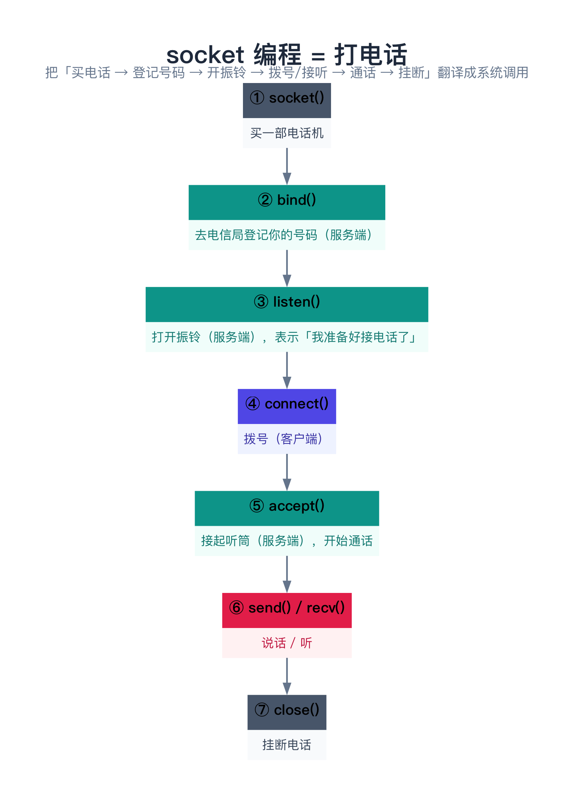

**最关键的一点：你是在跟内核打交道，不是跟对端打交道**

理解 socket 的关键不是先背 API，而是先扭转一个最常见的**错误直觉**：

- **错误直觉**：socket 是一根「连到对端的管子」，`send` 是往里塞，`recv` 是从里取。
- **正确模型**：socket 是你本地的「邮箱/柜子」，你始终在跟**内核**打交道。

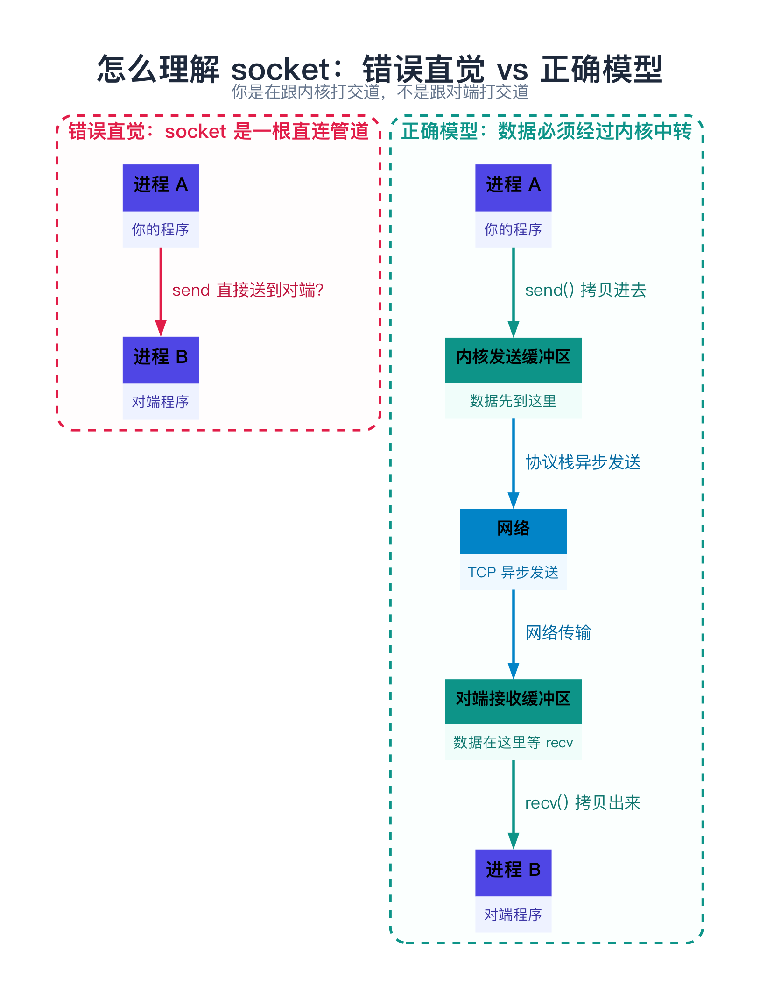

`send()` 只是把数据从你的内存**拷进内核的发送缓冲区**就返回，根本没碰网络；`recv()` 只是从内核接收缓冲区**拷出来**；真正收发、分包、重传、拥塞控制，全是**内核 TCP 协议栈在你背后异步完成**。

接受这一点后，很多现象立刻就通了：`send` 快（只是内存拷贝）、`send` 返回 ≠ 送达（数据还在内核排队）、`recv` 会阻塞（缓冲区空）、`close` 是减引用计数（fd 只是号码牌）。

**「谁拥有什么」一句话记牢**：

| 谁 | 拥有什么 |
|---|---|
| 用户态 | 一个 fd 整数 + 你自己的缓冲区 |
| 内核 | 真正的 socket：收发缓冲区、TCP 状态机、连接队列… |

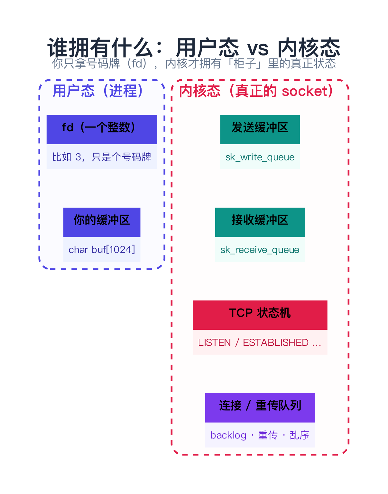

> **总纲**：socket 编程 = 你拿着号码牌（fd），跟内核的「柜子」（缓冲区 + 状态机）寄存/领取数据，网络是内核替你跑的。任何 API 都可以回到三个问题去想：**它在跟内核的哪个结构打交道？是寄存还是领取？会不会因结构空/满而阻塞？**

**动手观察**：`strace -e trace=network ./程序` 看真实系统调用序列，`ss -tan` / `ss -lnt` 看内核里 socket 的连接状态，比读十遍状态机都直观（详见 3.3、7.1）。

分层视角：

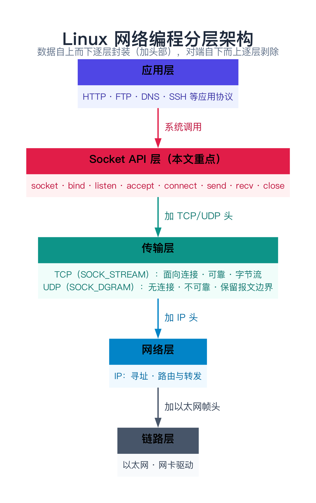

### 1.1 客户端与服务端

一次通信总是发生在两个角色之间：

- **服务端**：被动等待连接。流程 `socket → bind → listen → accept`，其中 `bind` 必须指定一个公开的 IP:Port 供客户端访问。
- **客户端**：主动发起连接。流程 `socket → connect → 收发 → close`，通常不 `bind`，源端口由内核自动分配。

### 1.2 套接字类型

| 类型 | 协议 | 特点 | 典型场景 |
|------|------|------|----------|
| `SOCK_STREAM` | TCP | 面向连接、可靠、字节流、有流量/拥塞控制 | HTTP、SSH、数据库 |
| `SOCK_DGRAM` | UDP | 无连接、不可靠、保留报文边界 | DNS、视频流、游戏 |
| `SOCK_RAW` | IP/ICMP | 原始套接字，可自组报文 | ping、抓包、自定义协议 |

本文以 TCP 的 `SOCK_STREAM` 为主线，UDP 在 5.3 节单独说明。

### 1.3 通用地址结构

所有地址相关 API（`bind`/`connect`/`sendto`/`accept`）都接受一个统一的 **`struct sockaddr`** 指针，再由具体协议解释。常见的几个：

```c
#include <sys/socket.h>
#include <netinet/in.h>

struct sockaddr {               // 通用地址（不直接用）
    sa_family_t sa_family;      // 地址族：AF_INET / AF_INET6 / AF_UNIX
    char        sa_data[14];
};

struct sockaddr_in {            // IPv4 地址（最常用）
    sa_family_t    sin_family;  // AF_INET
    in_port_t      sin_port;    // 端口，16 位，网络字节序
    struct in_addr sin_addr;    // IP 地址，32 位
    char           sin_zero[8]; // 填充，与 sockaddr 对齐，置 0
};

struct sockaddr_in6 {           // IPv6 地址
    sa_family_t     sin6_family;   // AF_INET6
    in_port_t       sin6_port;
    uint32_t        sin6_flowinfo;
    struct in6_addr sin6_addr;      // 128 位
    uint32_t        sin6_scope_id;
};

struct sockaddr_un {            // Unix 域（本地进程间通信）
    sa_family_t sun_family;     // AF_UNIX
    char        sun_path[108];  // 文件路径
};
```

因为 C 里没有继承，调用时要把具体结构**强制类型转换**成 `struct sockaddr*` 再传入，这就是代码里常见 `(struct sockaddr*)&addr` 的原因。

### 1.4 字节序（Byte Order）

计算机分**大端（big-endian，高字节在低地址）**和**小端（little-endian，低字节在低地址）**。x86 多为小端，而**网络字节序统一规定为大端**。因此端口、IP 在收发前必须转换：

| 函数 | 作用 |
|------|------|
| `htons` / `ntohs` | 16 位（端口）：主机序 ↔ 网络序 |
| `htonl` / `ntohl` | 32 位（IPv4 地址）：主机序 ↔ 网络序 |

记法：`h`=host 主机、`n`=network 网络、`s`=short(16 位)、`l`=long(32 位)。

**IP 地址的两种形态**：IP 地址在「人读」和「机器存」时是两种样子——人读的是**点分十进制字符串**（如 `"192.168.1.10"`，四个 0~255 的数字用点隔开），而 `struct sockaddr_in` 里存的是 **32 位二进制整数**。二者互转要用 `inet_pton`/`inet_ntop`：

```c
#include <arpa/inet.h>

int inet_pton(int af, const char *src, void *dst);
//  字符串 → 二进制：成功返回 1，src 不是合法地址返回 0，af 不支持返回 -1

const char *inet_ntop(int af, const void *src, char *dst, socklen_t size);
//  二进制 → 字符串：dst 是输出缓冲，size 是它的大小（IPv4 用 INET_ADDRSTRLEN）

char ip[INET_ADDRSTRLEN];
inet_pton(AF_INET, "192.168.1.10", &addr.sin_addr);   // 字符串 → 二进制
inet_ntop(AF_INET, &addr.sin_addr, ip, sizeof(ip));   // 二进制 → "192.168.1.10"
```

记法：`pton` = presentation **to** numeric（字符串转数字），`ntop` = numeric **to** presentation（数字转字符串）。相比老旧的 `inet_addr`/`inet_ntoa`，这俩**同时支持 IPv4 和 IPv6**，而且 `inet_ntop` 把结果写进你传入的缓冲区，不像 `inet_ntoa` 返回指向静态缓冲区的指针（多线程下不安全）。


### 1.5 端口号

端口是 16 位无符号整数，范围 **0～65535**：

- **0～1023**：知名端口（well-known），Linux 上需要 `CAP_NET_BIND_SERVICE`（通常就是 root）才能绑定，如 80=HTTP、443=HTTPS、22=SSH；
- **1024～49151**：注册端口（registered），如 8080、3306；
- **49152～65535**：动态/临时端口（IANA 定义的 ephemeral 范围）。

> **注意**：上面这三行是 **IANA 的划分**，而 **Linux 内核实际给客户端分配源端口时并不从 49152 开始**——默认取 `net.ipv4.ip_local_port_range = 32768 60999`（`sysctl net.ipv4.ip_local_port_range` 可查可改）。也就是说 32768～49151 这一段在 Linux 上同样会被当成临时端口用掉。

---

## 2. 核心数据结构：socket 是什么

调用 `socket()` 后，内核会分配并维护一组结构。理解这套结构是理解后面所有 API 行为（阻塞、缓冲、backlog）的基础。

### 2.1 从 fd 到内核对象的完整链路

用户态拿到的只是一个 **fd 编号**（整数），但内核里为它建立了一整条对象链：

```
fd ──▶ 进程文件描述符表 ──▶ struct file ──▶ struct socket ──▶ struct sock(tcp_sock)
```

- **进程文件描述符表**：每个进程一份，`fd → struct file*` 的映射。`socket()` 就是在表里找一个空位。
- **`struct file`**：VFS（虚拟文件系统）层的通用「文件」对象，负责文件偏移、访问模式等，socket 和普通文件在这里统一。
- **`struct socket`**：面向用户/协议无关的抽象，记录类型（stream/dgram/raw）、状态、以及指向具体协议操作的**函数指针表 `proto_ops`**（`connect`/`bind`/`sendmsg`/`recvmsg` 等操作都通过它分发）。
- **`struct sock`**：传输层（TCP 就是其子类 `tcp_sock`）的具体状态，是真正干活的重量级结构，包含：
  - 发送队列 `sk_write_queue`（待发送的数据，缓冲区大小由 `sk_sndbuf` 限制）
  - 接收队列 `sk_receive_queue`（已收到未读的数据，缓冲区大小由 `sk_rcvbuf` 限制）
  - 各种队列（连接队列、重传队列、乱序队列等）
  - 拥塞控制、超时重传定时器、窗口等状态

「一切皆文件」体现在：`read/write/close/fcntl` 这些文件系统调用都能直接作用于 socket 的 fd，因为它们在 `struct file` 这一层就已经统一了。

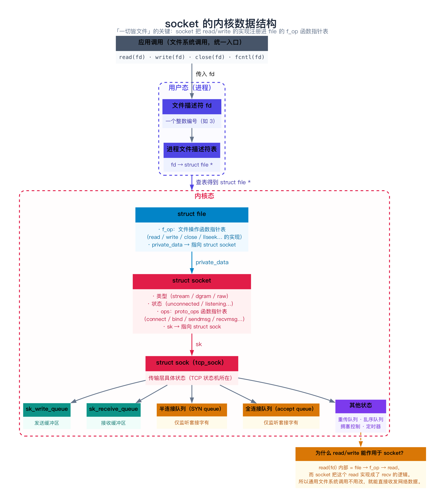

### 2.2 关键结论

- 用户态拿到的**只是一个 fd 编号**，真正的状态（缓冲、连接、TCP 状态机）**全部在内核**；
- 理解这一点，是理解 `send`/`recv` 为什么会阻塞、`listen` 的 backlog 是什么、`close` 为什么只是减引用计数的关键；
- socket 分 `struct socket`（协议无关）与 `struct sock`（协议相关）两层，是内核网络栈「抽象 + 实现」分离的经典设计。

> **类比：fd 就像存包柜的号码牌**。你（进程）把「socket 状态」寄存在内核这个大柜子里，内核给你一个小牌（fd 编号）。你以后**凭牌存取**——牌本身不是柜子，柜子里的东西（缓冲、连接、状态机）才是真的。所以 `send`/`recv` 操作的从来不是这个数字本身，而是通过这个数字找到内核里真正的那一堆数据结构。数字可以被 `dup`/`fork` 复制出多张「同一柜子的牌」，这正好解释了第 6 节 `close` 为什么要靠引用计数。

---

## 3. 服务端流程

服务端标准四步：

```c
int lfd = socket(AF_INET, SOCK_STREAM, 0); // 1. 创建
bind(lfd, (struct sockaddr*)&addr, sizeof(addr)); // 2. 绑定
listen(lfd, backlog);                       // 3. 监听
int cfd = accept(lfd, NULL, NULL);          // 4. 接受连接
```

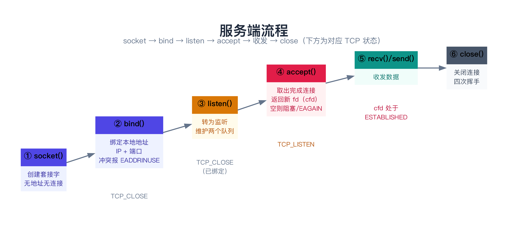

### 3.1 `socket()` —— 创建

```c
#include <sys/socket.h>
int socket(int domain, int type, int protocol);
```

三个参数：

- `domain`：地址族（协议族），决定地址格式与底层协议栈：
  - `AF_INET`：IPv4；
  - `AF_INET6`：IPv6；
  - `AF_UNIX` / `AF_LOCAL`：本机进程间通信（不走网络）；
  - `AF_PACKET`：链路层原始帧。
- `type`：套接字类型，决定通信语义：
  - `SOCK_STREAM`：字节流，面向连接（配合 TCP）；
  - `SOCK_DGRAM`：数据报，无连接（配合 UDP）；
  - `SOCK_RAW`：原始套接字，直接操作 IP 层。
- `protocol`：具体协议。通常传 `0`，让系统根据前两个参数自动选择。

常见组合（`protocol` 传 0 时的默认映射）：

| domain + type | 默认协议 | 用途 |
|---------------|----------|------|
| `AF_INET` + `SOCK_STREAM` | TCP | 最常用的可靠字节流 |
| `AF_INET` + `SOCK_DGRAM` | UDP | 无连接数据报 |
| `AF_INET6` + `SOCK_STREAM` | TCPv6 | IPv6 字节流 |
| `AF_UNIX` + `SOCK_STREAM` | — | 本机进程间通信 |

**返回值**：成功返回一个新的 fd；失败返回 `-1` 并设置 `errno`（如 `EAFNOSUPPORT` 地址族不支持、`EMFILE` 进程 fd 用尽）。

**背后原理**：

- 在进程文件描述符表中分配一个空位；
- 根据 `domain` + `type` 找到对应的协议族操作集（如 TCP 的 `tcp_prot`）；
- 依次创建 `struct file`、`struct socket`、`struct sock`，层层关联，最后把 fd 返回给用户。

注意：此时套接字**没有任何地址、没有连接**，只是「造了一个空壳」，真正的网络动作要等 `bind`/`connect` 才发生。

---

### 3.2 `bind()` —— 绑定本地地址

```c
#include <sys/socket.h>
int bind(int sockfd, const struct sockaddr *addr, socklen_t addrlen);
```

把套接字与一个**本地地址（IP + 端口）**绑定，告诉内核「我占用这个地址」。

```c
struct sockaddr_in addr;
memset(&addr, 0, sizeof(addr));
addr.sin_family      = AF_INET;
addr.sin_port        = htons(8080);            // 端口，注意字节序
addr.sin_addr.s_addr = htonl(INADDR_ANY);      // 0.0.0.0，监听所有网卡
bind(lfd, (struct sockaddr*)&addr, sizeof(addr));
```

**`sin_addr` 的几种填法**：

| 写法 | 含义 | 场景 |
|------|------|------|
| `htonl(INADDR_ANY)` | `0.0.0.0`，监听所有网卡 | 服务器默认 |
| `htonl(INADDR_LOOPBACK)` | `127.0.0.1`，只本机可访问 | 本地测试 |
| `inet_pton(AF_INET, "192.168.1.10", &sin_addr)` | 绑定具体 IP | 只收某网卡 |

**IP 字符串与二进制的互转**：

```c
#include <arpa/inet.h>
int  inet_pton(int af, const char *src, void *dst);      // "192.168.1.10" → 二进制
const char *inet_ntop(int af, const void *src, char *dst, socklen_t size); // 二进制 → 字符串
```

推荐用 `inet_pton`/`inet_ntop`（同时支持 IPv4/IPv6），而不是老旧的 `inet_addr`/`inet_ntoa`（有线程安全问题）。

**背后原理**：

- 内核检查该端口是否已被占用（冲突则返回 `EADDRINUSE`）；
- 把地址信息写入 `sock` 结构，标记套接字「已绑定」；
- 可以指定具体 IP（只收发某网卡），也可以 `INADDR_ANY`（监听全部）。

**为什么需要 bind**：让客户端知道「去哪个 IP:Port 找我」。客户端也可以 bind 固定源端口，但通常不这么做，由内核自动分配一个临时端口（ephemeral port）。

三个易错点：

- **字节序**：网络字节序是大端，主机多为小端，端口和 IP 必须用 `htons/htonl/ntohs/ntohl` 转换。
- **端口复用**：服务端重启时常见 `EADDRINUSE`，需设置 `SO_REUSEADDR` 允许 TIME_WAIT 状态下的端口复用（见 8.3 节）。
- **端口 0**：`bind` 端口传 `0` 表示「让内核随便挑一个」，之后可用 `getsockname` 查回实际端口。

---

### 3.3 `listen()` —— 进入监听

```c
#include <sys/socket.h>
int listen(int sockfd, int backlog);
```

把一个**未连接的套接字**转成**被动（监听）套接字**，表示「我准备好接受连接了」。

**这是最容易被误解的一个 API。** 关键点：

1. `listen` 之后，套接字从 `TCP_CLOSE` 转入 `TCP_LISTEN` 状态；
2. 内核为它维护**两个队列**：
   - **半连接队列（SYN queue）**：收到客户端的 SYN、已回复 SYN+ACK、但还没完成三次握手的连接；
   - **全连接队列（accept queue）**：三次握手已经完成、等待应用调用 `accept` 取走的连接；
3. `backlog` 参数：历史上（BSD）指「半连接队列 + 全连接队列」的总和；现代 Linux 内核（2.2 之后）中，**`backlog` 实际控制的是全连接队列（accept queue）的最大长度**（实际还会受系统上限 `somaxconn` 约束）；半连接队列由系统参数 `tcp_max_syn_backlog` 控制。

**这两个队列存在哪？** 它们都存放在**监听套接字的 `struct sock`** 里（TCP 层是 `inet_connection_sock` 的 `icsk_accept_queue`），**不是** `struct file`、也**不是** `struct socket`——后两者只是「文件抽象」和「协议无关外壳」，真正的 TCP 状态（收发缓冲区、TCP 状态机、以及这两个队列）全部在 `struct sock` 里。对照第 2 节的配图（图里 `struct sock` 下面那排就是它）。注意：只有**监听套接字**才有这两个队列，普通连接套接字（`cfd`）没有。

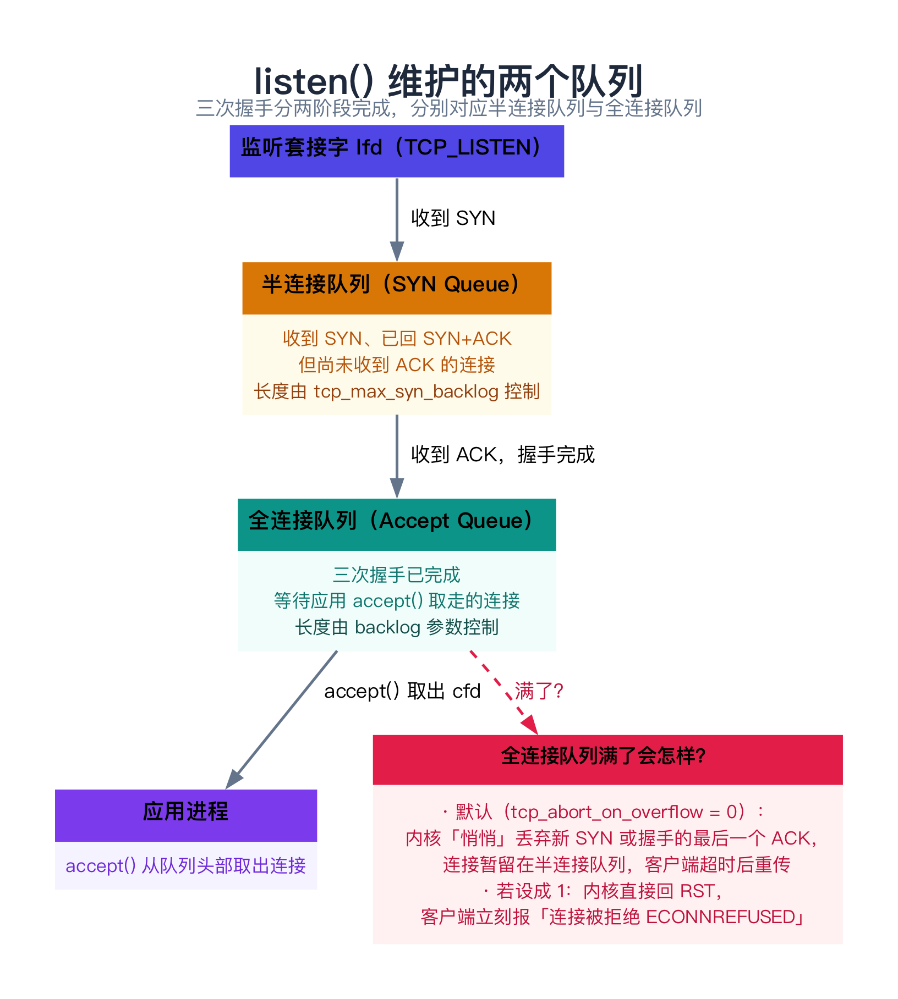

> **类比：`listen` 就像餐厅门口的叫号排队**。
>
> - **半连接队列（SYN queue）** = 顾客取了号、但人还没到齐（三次握手没走完）；
> - **全连接队列（accept queue）** = 顾客已经到齐，就等服务员（`accept`）领位入座；
> - **`backlog`** = 门口最多能站多少人等位，满了新顾客（SYN）要么被晾在门外（丢弃），要么被直接赶走（发 RST）。
>
> 所以 `backlog` 调的其实是「已到齐、等着被服务」的那队人的长度，而不是「正在取号」的人数——这正是它最容易被误解的地方。

**队列满了会怎样**：

- 默认（`tcp_abort_on_overflow = 0`）：内核「悄悄」丢弃新来的 SYN、或握手的最后一个 ACK，连接暂留在半连接队列，客户端超时后重传（表现为连接超时/反复重传）；
- 若开启 `tcp_abort_on_overflow`（设为 1）：内核直接回 RST，客户端立刻报「连接被拒绝 ECONNREFUSED」。

所以生产环境常把 `backlog` 设得较大（如 128、1024），并配合 `SO_REUSEPORT`、多进程/多线程 `accept` 来提升吞吐。

**观察队列**：可用 `ss -lnt` 查看监听套接字的 `Recv-Q`（当前全连接队列长度）和 `Send-Q`（backlog 上限）：

```bash
$ ss -lnt
State   Recv-Q  Send-Q  Local Address:Port   Peer Address:Port
LISTEN  0       128     0.0.0.0:8080         0.0.0.0:*
```

**SYN flood 攻击**：攻击者大量发送 SYN 但不完成握手，把半连接队列撑爆，使正常连接进不来。内核通过 `tcp_max_syn_backlog` 限制半连接队列长度、`tcp_syncookies`（SYN Cookie）在队列满时仍能响应合法连接来缓解。

---

### 3.4 `accept()` —— 取出连接

```c
#include <sys/socket.h>
int accept(int sockfd, struct sockaddr *addr, socklen_t *addrlen);
```

从**全连接队列**头部取出一个已完成的连接，返回一个**新的连接套接字 fd**（`cfd`），用于与这个具体客户端通信。

- `sockfd`：监听套接字（`lfd`），自始至终只负责「接客」；
- 返回值 `cfd`：真正用来收发数据的套接字；
- 后两个参数可用来获取客户端地址（IP + 端口），不需要时传 `NULL`。

**背后原理**：

- 监听套接字（`lfd`）与连接套接字（`cfd`）是**两个不同的 fd、两个不同的 socket**；
- `lfd` 永远处于 `LISTEN`，`cfd` 处于 `ESTABLISHED`；
- 每次 `accept` 只是从内核的 accept 队列里「取」一个现成的连接，**不涉及新的网络交互**（握手早已完成）。

**获取客户端地址**：

```c
struct sockaddr_in peer;
socklen_t peer_len = sizeof(peer);
int cfd = accept(lfd, (struct sockaddr*)&peer, &peer_len);

char ip[INET_ADDRSTRLEN];
inet_ntop(AF_INET, &peer.sin_addr, ip, sizeof(ip));   // 二进制 → "192.168.1.5"
int port = ntohs(peer.sin_port);                       // 网络序 → 主机序
printf("client: %s:%d\n", ip, port);
```

**阻塞语义**：若 accept 队列为空，`accept` 会阻塞，直到有新连接完成握手或出错。非阻塞模式下返回 `EAGAIN`。

**一个易忽略的坑——`EMFILE`**：当进程的 fd 已达到上限（`ulimit -n`）时，`accept` 会返回 `EMFILE`，此时新连接仍在全连接队列里。如果服务端没做处理，会因为「队列不空」而被 `epoll` 反复唤醒，陷入忙循环。常见做法是提前占位一个 fd 作为「备用」，遇到 `EMFILE` 时先关掉它、accept 再 close，保证能继续运行。

---

## 4. 客户端流程

客户端标准三步：

```c
int cfd = socket(AF_INET, SOCK_STREAM, 0);
connect(cfd, (struct sockaddr*)&server_addr, sizeof(server_addr));
// ... send / recv
close(cfd);
```

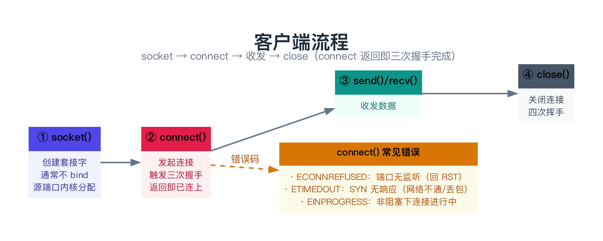

### 4.1 `socket()`

与服务端相同，创建一个空壳套接字。客户端一般**不调用 bind**，由内核自动分配源端口。

### 4.2 `connect()` —— 发起连接

```c
#include <sys/socket.h>
int connect(int sockfd, const struct sockaddr *addr, socklen_t addrlen);
```

客户端向指定服务器地址发起连接，**触发三次握手**。

```c
struct sockaddr_in server;
server.sin_family = AF_INET;
server.sin_port   = htons(8080);
inet_pton(AF_INET, "192.168.1.10", &server.sin_addr); // 字符串 IP → 二进制
connect(cfd, (struct sockaddr*)&server, sizeof(server));
```

**背后原理（阻塞模式下）**：

1. 内核发送 SYN，连接进入 `SYN_SENT` 状态；
2. 收到服务器的 SYN+ACK 后，回 ACK，连接进入 `ESTABLISHED`；
3. `connect` 返回，之后才能 `send/recv`。

**常见错误**：

- `ECONNREFUSED`：目标端口没有进程监听（内核回了 RST）；
- `ETIMEDOUT`：SYN 多次重发无响应（网络不通 / 防火墙丢包）；
- `EHOSTUNREACH` / `ENETUNREACH`：路由不可达；
- `EINPROGRESS`：非阻塞模式下，连接还没完成（见下）。

**非阻塞 connect**：套接字设了 `O_NONBLOCK` 后，`connect` 会**立即返回 `-1` + `EINPROGRESS`**（不是错误，表示「连接进行中」）。之后用 `select/poll/epoll` 监听该 fd 的**可写事件**，可写时再用 `getsockopt(SO_ERROR)` 检查是否真的连上：

```c
fcntl(cfd, F_SETFL, O_NONBLOCK);              // 设非阻塞
if (connect(cfd, &server, sizeof(server)) < 0) {
    if (errno != EINPROGRESS) die("connect");
    // 等待可写，然后：
    int err = 0; socklen_t len = sizeof(err);
    getsockopt(cfd, SOL_SOCKET, SO_ERROR, &err, &len);
    if (err != 0) { /* 连接失败，errno = err */ }
}
```

非阻塞 connect 常用于「连接多个目标时不想被其中一个卡住」，或需要给 connect 设超时的场景。

**注意**：`connect` 失败的套接字**不能再复用**（已进入不可用状态），必须 `close` 后重新 `socket` 再连。

---

## 5. 数据传输

TCP 是**字节流**，没有消息边界——发送 100 字节，对方可能分两次各收 50 字节，也可能一次收到。应用层必须自己处理「粘包/拆包」（见第 8 节）。

> **类比：TCP 像一根水管，UDP 像寄包裹**。
>
> - **TCP**：你往水管这头灌水（`send`），对方在那头接（`recv`）。水是**连续不断**的，没有「一杯一杯」的边界——你连灌两杯，对方可能一次接一大杯，也可能分好几次接。这就是「字节流无消息边界」，也是粘包/拆包的根源。
> - **UDP**：一次寄一个**独立包裹**，边界清晰，但包裹可能**丢件**（丢包）、可能后发先至（乱序）、也可能重复投递。
>
> 记住「水管 vs 包裹」这组意象，TCP 和 UDP 的几乎所有差异都源于此。

### 5.1 `send()` / `recv()`

```c
#include <sys/socket.h>
ssize_t send(int sockfd, const void *buf, size_t len, int flags);
ssize_t recv(int sockfd, void *buf, size_t len, int flags);
```

- `flags` 常用 `0`，常用选项：

| flag | 作用 |
|------|------|
| `MSG_DONTWAIT` | 本次调用临时非阻塞（不影响套接字原有属性） |
| `MSG_PEEK` | 窥探数据但不取走（下次 recv 还能读到） |
| `MSG_WAITALL` | 读满 `len` 字节才返回（除非出错/连接关闭） |
| `MSG_OOB` | 发送/接收带外数据（out-of-band） |
| `MSG_NOSIGNAL` | 发送时不触发 `SIGPIPE` 信号 |

**`send()` 背后原理（关键）**：

1. 内核把用户态 `buf` 中的 `len` 字节**拷贝**到内核的发送缓冲区（`sk_write_queue`）；
2. 拷贝多少、能装多少，取决于发送缓冲区剩余空间（`SO_SNDBUF` 可调）；
3. **返回**：返回实际拷入缓冲区的字节数。注意——**`send` 返回 ≠ 数据已到达对端**，只表示数据已进入内核、TCP 后续会负责发送（分段、重传、拥塞控制都由内核完成）；
4. **阻塞模式**：若发送缓冲区满了，`send` 会阻塞，直到有空间；
5. **非阻塞模式**：缓冲区满则立即返回 `-1`，`errno = EAGAIN/EWOULDBLOCK`。

**partial send（部分发送）的坑**：`send` 的返回值**可能小于 `len`**——比如 `len=100`，但发送缓冲区只剩 40 字节空间，`send` 就只拷进去 40 字节、返回 40。阻塞模式下 `send` 通常会把 `len` 全部发完才返回，但被信号打断时也可能只发一部分；非阻塞模式下更是随时可能只发一部分。所以严谨的写法是**循环发送**直到发完：

```c
size_t total = 0;
while (total < len) {
    ssize_t n = send(fd, buf + total, len - total, 0);
    if (n < 0) {
        if (errno == EINTR) continue;   // 被信号打断，重试
        break;                          // 真错误（EAGAIN 则等 EPOLLOUT 再试）
    }
    total += n;
}
```

同理，`recv` 也可能一次没读满 `len`、只返回部分数据——这是 TCP 字节流的正常现象，应用层要自己累积到「一条完整消息」再处理（见 8.2 粘包）。

**`recv()` 背后原理**：

1. 内核从接收缓冲区（`sk_receive_queue`）把已收到的数据**拷贝**到用户态 `buf`；
2. **返回**：实际拷贝的字节数；
3. **阻塞模式**：若接收缓冲区为空，`recv` 阻塞，直到有数据（或连接关闭）；
4. 返回值语义需牢记：

| 返回值 | 含义 |
|--------|------|
| `> 0` | 收到 n 字节数据 |
| `= 0` | 对端已关闭连接（收到 FIN）|
| `< 0` | 出错（`EAGAIN` 表示非阻塞下暂无数据）|

**`SIGPIPE` 陷阱（重要）**：向一个**已经关闭**的连接 `send`/`write` 时，内核会向进程发送 **`SIGPIPE` 信号**，而该信号的默认动作是**终止进程**！很多服务「莫名其妙退出」就是这个原因。

要注意**出错时机**：仅仅收到对端的 `FIN` 并不会让紧接着的那次 `send` 立刻失败——第一次 `send` 通常仍然「成功」（数据发了出去，但对端已经彻底关闭，于是回一个 `RST`），**真正的 `EPIPE` + `SIGPIPE` 出现在之后的写**。所以指望「写完再检查返回值」是救不了命的，必须提前把信号屏蔽掉或用 `MSG_NOSIGNAL`。解决办法：

- 用 `send(..., MSG_NOSIGNAL)` 代替 `send`，不触发信号而是返回 `-1` + `errno=EPIPE`；
- 或全局 `signal(SIGPIPE, SIG_IGN)` 忽略该信号；
- 或 `setsockopt(fd, SO_NOSIGPIPE)`（BSD/macOS 风格）。

### 5.2 `write()` / `read()`

socket 也是文件描述符，因此可直接用文件 IO：

```c
write(cfd, buf, len);  // 等价于 send(cfd, buf, len, 0)
read(cfd, buf, len);   // 等价于 recv(cfd, buf, len, 0)
```

语义完全一致，`send/recv` 只是多了 `flags` 参数，控制更细。

### 5.3 `sendto()` / `recvfrom()`（UDP）

UDP 无连接，每次发送都要指定对端地址：

```c
ssize_t sendto(int sockfd, const void *buf, size_t len, int flags,
               const struct sockaddr *dest_addr, socklen_t addrlen);
ssize_t recvfrom(int sockfd, void *buf, size_t len, int flags,
                 struct sockaddr *src_addr, socklen_t *addrlen);
```

- `sendto`：把数据发给 `dest_addr`；
- `recvfrom`：收数据，同时返回**是谁发的**（`src_addr`），便于回复。

**UDP 服务端最小示例**：

```c
int sfd = socket(AF_INET, SOCK_DGRAM, 0);

struct sockaddr_in addr = {0};
addr.sin_family      = AF_INET;
addr.sin_addr.s_addr = htonl(INADDR_ANY);
addr.sin_port        = htons(8080);
bind(sfd, (struct sockaddr*)&addr, sizeof(addr));   // UDP 服务端也要 bind

char buf[1024];
struct sockaddr_in client;
socklen_t clen = sizeof(client);
ssize_t n = recvfrom(sfd, buf, sizeof(buf), 0,
                     (struct sockaddr*)&client, &clen);
sendto(sfd, buf, n, 0, (struct sockaddr*)&client, clen);  // 回给刚才的客户端
```

**UDP 与 TCP 的差异**：

- UDP 保留**报文边界**：一次 `sendto` 对应一次 `recvfrom`，不会拆开或合并；
- UDP **不可靠**：可能丢包、乱序、重复，内核不重传；
- UDP 的 `sendto` 通常不会阻塞——UDP 也有发送缓冲区（`SO_SNDBUF` 同样适用），但数据拷进去后很快发出（不重传、不排队等待确认），缓冲区极少满，所以几乎不阻塞（真满了仍会阻塞或返回 `EAGAIN`）；`recvfrom` 在无数据时阻塞。

**UDP 也能 `connect`**：虽然 UDP 无连接，但可以对它调用 `connect`，作用是**固定对端地址**，之后就能用 `send`/`recv`（而非 `sendto`/`recvfrom`），内核也会过滤掉非对端发来的包。常用于「一对一的 UDP 通信」，比如客户端固定发给某个服务器。

### 5.4 `sendmsg()` / `recvmsg()`

最通用、功能最强的收发接口，能通过 `struct msghdr` 支持：

- **多个缓冲区**（`iovec` 数组，scatter/gather IO）；
- **辅助数据 / 控制信息**（`msg_control`，用于传递 fd、获取目标地址等）。

```c
ssize_t sendmsg(int sockfd, const struct msghdr *msg, int flags);
ssize_t recvmsg(int sockfd, struct msghdr *msg, int flags);
```

核心是 `struct msghdr` 与 `struct iovec`：

```c
struct msghdr {
    void         *msg_name;       // 目标地址（UDP 用，TCP 置 NULL）
    socklen_t     msg_namelen;
    struct iovec *msg_iov;        // 多个缓冲区（scatter/gather）
    size_t        msg_iovlen;     // iov 数组长度
    void         *msg_control;    // 辅助数据（传递 fd 等）
    size_t        msg_controllen;
    int           msg_flags;      // 接收到的标志（如 MSG_TRUNC）
};

struct iovec {
    void  *iov_base;   // 缓冲区起始地址
    size_t iov_len;    // 缓冲区长度
};
```

**scatter/gather IO（分散/聚集）**：`msg_iov` 可以指向**多个不连续的缓冲区**，一次系统调用就能收发多段数据，避免为了凑一块连续内存而多一次拷贝。典型用法是「包头 + 包体」分开放：一个 iov 放头部，另一个放正文，内核会按顺序把它们连起来发。

**辅助数据 `SCM_RIGHTS`（进程间传递 fd）**：`recvmsg` 能通过 `msg_control` 接收对端「塞」进来的文件描述符，这是 Unix 域 socket 上**在进程间传递 fd** 的标准做法（`systemd`、Nginx 热升级等都依赖它）。核心思路：发送方用 `sendmsg` 把一个 fd 的控制消息发出去，接收方 `recvmsg` 后 `cmsg` 里就多了一个指向同一内核 `struct file` 的 fd。

平时 `sendmsg`/`recvmsg` 用得少，但在高性能网络库（减少拷贝、精确控制）和 `SCM_RIGHTS` 场景是核心。

---

## 6. 关闭连接

### 6.1 `close()`

```c
#include <unistd.h>
int close(int fd);
```

**背后原理**：

- 内核为每个 socket（其实是 `struct file`）维护一个**引用计数**；
- `close` 只是把计数减 1，**只有减到 0 时才真正关闭**：
  - 发送缓冲区里未发完的数据会被尽量发完；
  - 然后发送 FIN，进入四次挥手；
- 引用计数会因为 `fork` 或 `dup` 而**增加**，这是理解「为什么连接没断」的关键：

```c
int fd = socket(...);      // 引用计数 = 1
dup(fd);                   // 引用计数 = 2（同一 socket 多了个别名）
close(fd);                 // 引用计数回到 1，socket 还没真正关闭！
```

`fork` 同理：子进程继承了父进程的 fd 表，所有 fd 的引用计数 +1。所以「父子进程都要 `close` 一次，连接才会真正断开」。

**`close` 与 `SO_LINGER`**：默认 `close` 是「优雅关闭」——立即返回，内核在后台尽力把缓冲数据发完再发 FIN。若想改变这个行为（比如立即 RST、或阻塞等待数据发完），用 `SO_LINGER`——三种取值的行为见下面的表格（8.6 节有该选项的速查条目）。

### 6.2 `shutdown()`

```c
#include <sys/socket.h>
int shutdown(int sockfd, int how);
```

- `how = SHUT_RD`：关闭读方向（之后收到的数据被丢弃）；
- `how = SHUT_WR`：关闭写方向（发送 FIN，但还能收数据）——**半关闭**；
- `how = SHUT_RDWR`：两个方向都关。

**与 `close` 的区别**：

| | `close` | `shutdown` |
|---|---|---|
| 作用对象 | 减引用计数，为 0 才关 | 立即作用于该 socket，无视引用计数 |
| 是否发 FIN | 计数为 0 才发 | `SHUT_WR`/`SHUT_RDWR` 立即发 |
| 典型场景 | 一般关闭 | 需要**半关闭**（如 HTTP：客户端 `SHUT_WR` 表示「我说完了」，但仍等待服务器响应）|

**半关闭的典型场景**：客户端发完请求后用 `shutdown(SHUT_WR)` 表示「我的数据发完了」，此时对端 `recv` 会返回 0 知道请求结束，但仍可向客户端回数据。`close` 做不到这点——它把两个方向都关了（且受引用计数影响）。

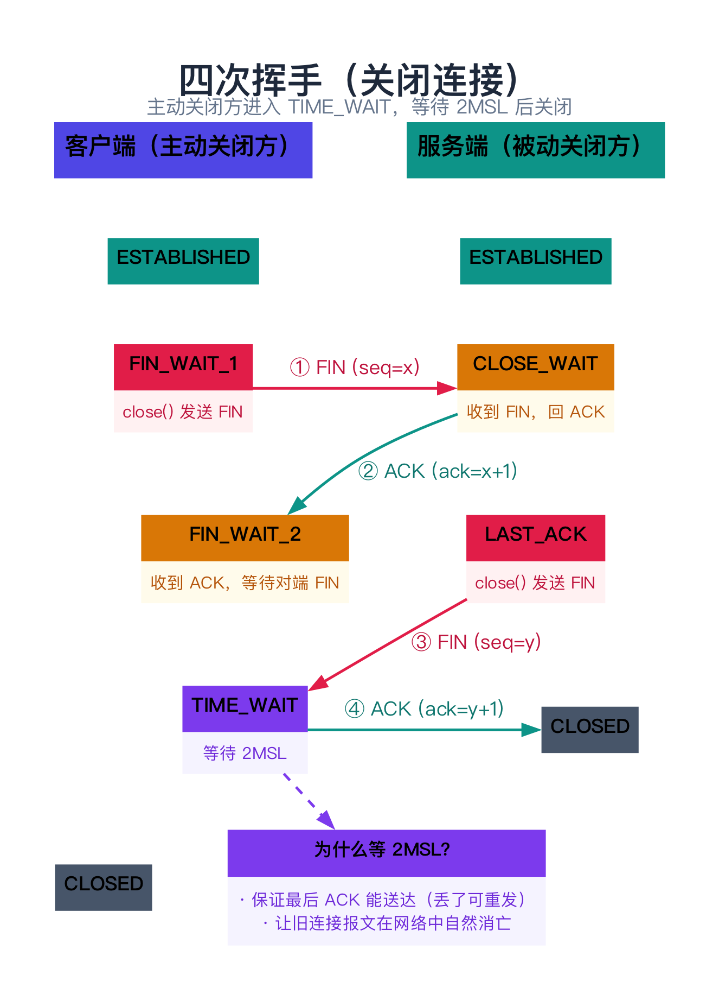

**四次挥手的四个状态跳转**（连接是**全双工**的，两个方向要各关一次）：

1. **主动关闭方**发 `FIN`，从 `ESTABLISHED` → `FIN_WAIT_1`；
2. **被动方**收到 FIN 回 `ACK`，从 `ESTABLISHED` → `CLOSE_WAIT`；主动方收到 ACK 后 → `FIN_WAIT_2`（此时「主动方→被动方」这个方向已关，但被动方可能还有数据要发）；
3. 被动方把剩余数据发完后，也发 `FIN`，→ `LAST_ACK`；
4. 主动方回 `ACK`，→ `TIME_WAIT`（等 2MSL，见 8.3）；被动方收到 ACK → `CLOSED`。

**为什么是四次而不是三次**：关闭要「两个方向各关一次」，每个方向各一个 `FIN + ACK`。而被动方的 `ACK` 和 `FIN` 通常**不能合并**——它收到 FIN 后往往还有数据要发，得先回 ACK、发完数据再发自己的 FIN，所以比三次握手多一步。若被动方确实没数据了，它的 ACK 和 FIN 可以合并成一个包，这时就成了「三次挥手」。

**`SO_LINGER` 控制 `close` 的三种行为**：

```c
struct linger {
    int l_onoff;   // 0=禁用（默认），非 0=启用
    int l_linger;  // 超时秒数
};
```

| 配置 | `close` 行为 |
|------|--------------|
| `l_onoff = 0`（默认） | 立即返回，内核后台发完剩余数据再发 FIN（优雅关闭，产生 TIME_WAIT） |
| `l_onoff = 1, l_linger = 0` | 立即发 **RST** 丢弃缓冲数据，跳过四次挥手，**不产生 TIME_WAIT**（可能丢数据） |
| `l_onoff = 1, l_linger > 0` | `close` **阻塞**最多 `l_linger` 秒，尽力发完剩余数据；超时仍未发完则返回错误 |

---

## 7. 底层原理串讲

### 7.1 三次握手与四个 API 的对应关系

把 API 和 TCP 状态机对应起来，很多疑惑就通了：

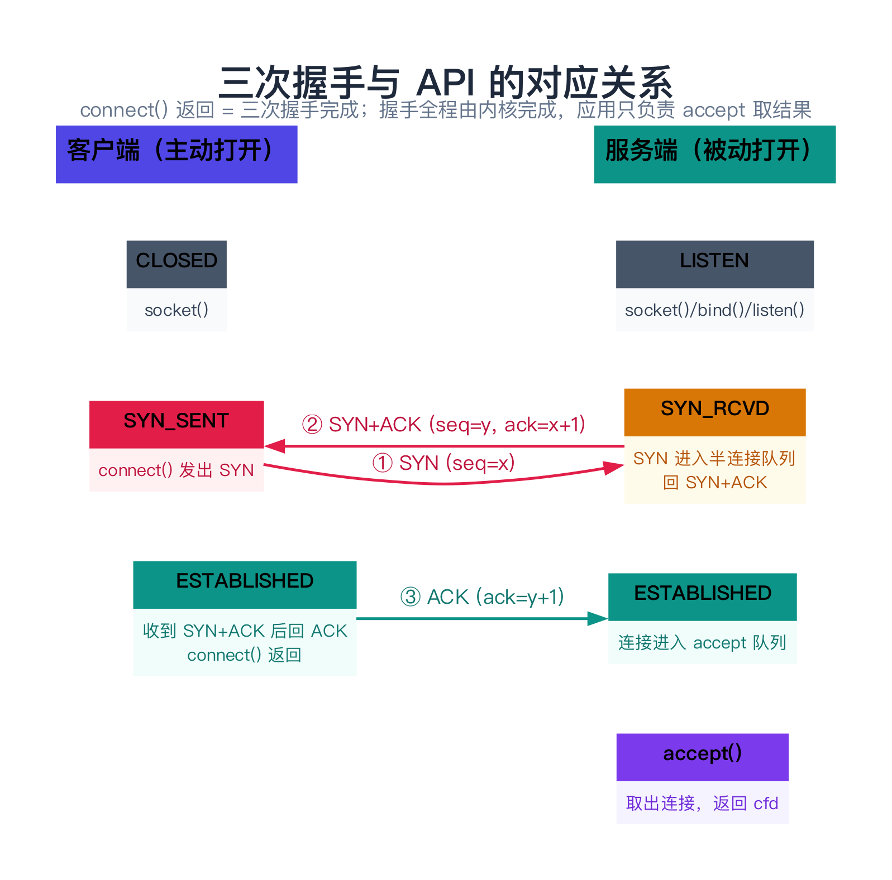

要点：

- **`connect` 返回 = 三次握手完成**；
- **`listen` 只是把连接放进队列，`accept` 才真正「拿到」连接**；
- 三次握手是内核自动完成的，**应用层不参与**，应用只负责调 `accept` 取结果。

**seq / ack 的含义**：TCP 是字节流，每个字节都有一个**序号 seq**。三次握手中双方交换各自的初始序号（ISN）：

1. 客户端 `SYN(seq=x)`：我的初始序号是 x；
2. 服务端 `SYN+ACK(seq=y, ack=x+1)`：我的初始序号是 y，已收到你的 x（期望下一个是 x+1）；
3. 客户端 `ACK(ack=y+1)`：已收到你的 y。

之后的数据传输就是「序号 + 确认号」的累进：`ack = 对端 seq + 已收字节数`。

**为什么是三次而不是两次**：本质是为了**防止已失效的连接请求报文**被服务端误认为新连接。设想两次握手：客户端发了一个 SYN 但因网络拥塞滞留，超时后客户端重发 SYN 建立连接并通信完关闭；之后那个**滞留的旧 SYN** 才姗姗来迟到达服务端，服务端若「收到 SYN 就建立连接」就会为一个早已不存在的连接白白分配资源。三次握手里，客户端还要对服务端的 SYN+ACK 回一个 ACK 确认，服务端只有收到这个 ACK 才真正建立连接，从而避免上述情况。

> **类比：三次握手就像打电话开场的「喂喂」确认**。
>
> 客户端：「喂，听得到吗？」（SYN）
> 服务端：「听得到，那你听得到我吗？」（SYN+ACK）
> 客户端：「听得到，我们开始聊吧。」（ACK）
>
> 一问一答一确认，双方都验证了「我能发、你能收、你能发、我也能收」这四条通道全部通畅，才放心进入正式通话。

**ISN 为什么是随机的**：双方初始序号（Initial Sequence Number）不是从 0 或 1 开始，而是**随机**生成的，主要为了：① 防止被攻击者猜测序号伪造报文（安全）；② 避免上次连接的「迟到旧报文」被误当成新连接的数据（可靠性）。所以握手的第一件事就是交换各自随机出的 ISN。

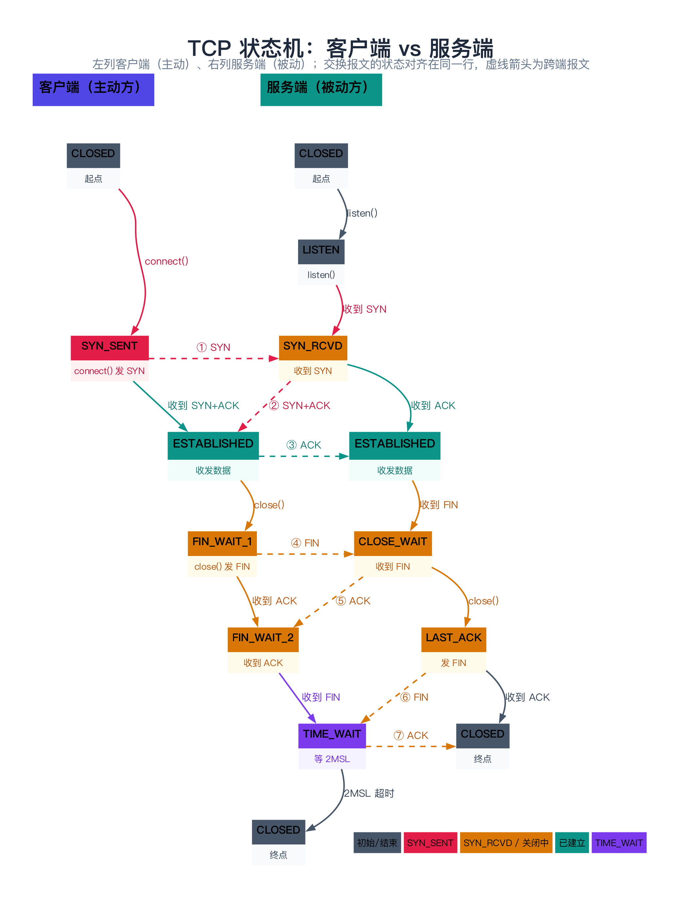

### 7.2 内核缓冲区：数据到底存在哪

这是理解网络编程的**核心模型**。每个 socket 都有两块内核缓冲区：

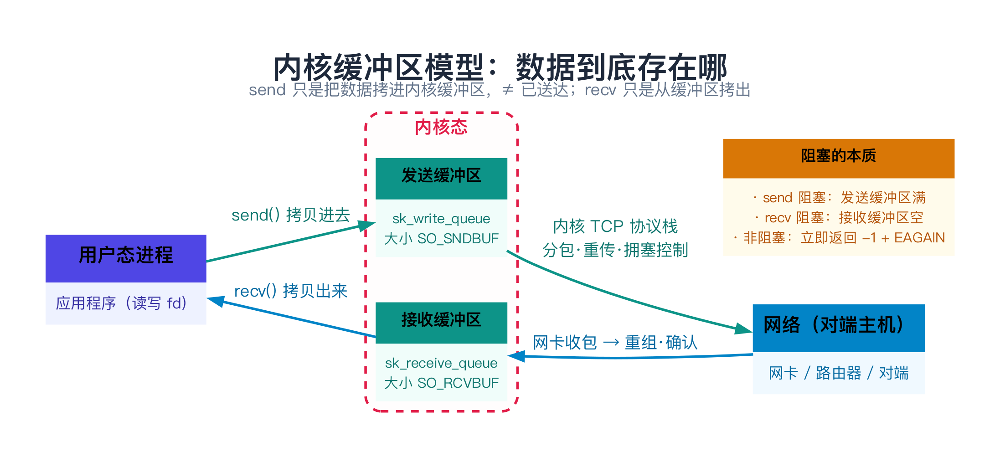

- **发送路径**：`send()` 只是把数据从用户态拷进发送缓冲区，剩下的（分包、发网卡、重传、拥塞控制）全部由内核 TCP 协议栈异步完成；
- **接收路径**：网卡收到数据 → 内核 TCP 协议栈重组、确认 → 放进接收缓冲区 → 应用 `recv()` 再拷贝出来；
- **缓冲区大小**：`SO_SNDBUF` / `SO_RCVBUF` 可查可调，内核往往会把设的值翻倍（协议栈开销）。

这个模型解释了三个常见现象：

1. **为什么 `send` 快**：只是内存拷贝，不代表已送达；
2. **为什么会阻塞**：发送缓冲区满 / 接收缓冲区空；
3. **为什么有延迟**：数据在内核缓冲区和网络中都要排队。

> **类比：内核缓冲区就像邮局的中转仓库**。`send()` 不是让你亲自把信送到对方手里，而是把信**交给楼下的邮局（内核）**就转身走了，剩下的分拣、派送、补发（分包、重传、拥塞控制）都是邮局的事——所以 `send` 快，因为它只是「交给前台」这一下。`recv()` 则是去邮局**取包裹**，包裹还没到你就得干等（阻塞），到了才拿得走。

**缓冲区大小的查看与设置**：

```c
int snd = 0; socklen_t len = sizeof(snd);
getsockopt(fd, SOL_SOCKET, SO_SNDBUF, &snd, &len);   // 查看发送缓冲区

int new_snd = 256 * 1024;                            // 256KB
setsockopt(fd, SOL_SOCKET, SO_SNDBUF, &new_snd, sizeof(new_snd));
```

注意两点：

- 内核通常会把设置的值**翻倍**（因为要留出协议栈开销），`getsockopt` 读到的往往是你设置值的两倍；
- 缓冲区也不是越大越好——太大则单连接占用内存多、且可能加剧「bufferbloat」（缓冲膨胀导致延迟升高）。

### 7.3 阻塞 / 非阻塞的本质

- **阻塞（默认）**：调用 `accept/connect/recv/send` 时，若条件不满足（没连接、没数据、缓冲区满），进程挂起睡眠，条件满足才返回；
- **非阻塞**：通过 `fcntl(fd, F_SETFL, O_NONBLOCK)` 或 `flags` 里的 `MSG_DONTWAIT` 设置，条件不满足**立即返回** `-1` + `errno=EAGAIN`；
- **IO 复用**：用 `select/poll/epoll` 同时监控多个 fd，哪个「就绪」（可读/可写）再处理哪个，是高性能服务器的标配（见下节）。

> **类比**：
>
> - **阻塞** = 你**守在电话旁**，一直等到它响才接（期间啥也干不了）；
> - **非阻塞** = 你**隔一会儿看一眼**有没有来电（没来电就 `EAGAIN`），期间还能干别的；
> - **IO 复用** = 请一个**前台**帮你同时盯几十部电话，哪部响了才叫你过去接。

**设置非阻塞的两种方式**：

```c
// 方式一：作用于整个套接字
#include <fcntl.h>
int flags = fcntl(fd, F_GETFL, 0);
fcntl(fd, F_SETFL, flags | O_NONBLOCK);

// 方式二：仅本次调用非阻塞
recv(fd, buf, len, MSG_DONTWAIT);
send(fd, buf, len, MSG_DONTWAIT);
```

**更现代的写法（避免竞态）**：上面「先 `socket` 再 `fcntl`」有两个隐患。① **`CLOEXEC` 竞态**：多线程程序里，从 `socket()` 返回到 `fcntl(F_SETFD, FD_CLOEXEC)` 之间如果另一个线程 `fork` + `exec`，子进程会意外继承这个 fd。② **`O_NONBLOCK` 是「文件状态标志」**：它属于 `struct file`（open file description），会被 `dup`/`fork` 出来的所有别名**共享**——你在一个 fd 上改成非阻塞，等于把它的所有副本都改了，可能连带影响别的线程/进程。

Linux 提供了带 `CLOEXEC`/`NONBLOCK` 的现代接口，把「创建 + 设置属性」一步原子完成：

```c
// socket 创建时直接非阻塞 + close-on-exec
int fd = socket(AF_INET, SOCK_STREAM | SOCK_NONBLOCK | SOCK_CLOEXEC, 0);

// accept 时直接非阻塞 + close-on-exec（代替 accept + fcntl 两步）
int cfd = accept4(lfd, NULL, NULL, SOCK_NONBLOCK | SOCK_CLOEXEC);

// epoll 实例创建时直接 close-on-exec
int epfd = epoll_create1(EPOLL_CLOEXEC);
```

`CLOEXEC` 表示 `fork`+`exec` 后自动关闭这个 fd（防止子进程意外继承监听 fd 等），`NONBLOCK` 表示非阻塞。生产代码里 `accept4`/`epoll_create1`/带 `SOCK_NONBLOCK` 的 `socket` 更推荐。

**Unix 五种 IO 模型**（`recv` 为例）：

| 模型 | 说明 |
|------|------|
| 阻塞 IO | 一直等，直到数据到达才返回 |
| 非阻塞 IO | 反复轮询，没数据就 `EAGAIN`，直到有数据 |
| IO 复用 | `select/poll/epoll` 等「数据就绪」事件，再调用 `recv` |
| 信号驱动 IO | 数据就绪时内核发 `SIGIO` 信号通知 |
| 异步 IO | `aio_read`/`io_uring`，内核直接完成「等待 + 拷贝」再通知 |

前四种里，数据从内核到用户态的**拷贝这一步仍是阻塞/同步**的；只有异步 IO 才是真正「全程不阻塞」。Linux 下最主流的是「IO 复用 + 非阻塞」的组合（即 Reactor 模型）。

### 7.4 流量控制 vs 拥塞控制

这两个概念常被混为一谈，本质是**管的对象不同**：

- **流量控制（flow control）**：点对点的，防止**发送方把接收方一个人淹没**。手段是滑动窗口——接收方通过 TCP 头的 `window` 字段告诉发送方「我还能收多少」。
- **拥塞控制（congestion control）**：全局性的，防止**把整条网络压垮**。手段是发送方自己维护一个「拥塞窗口 cwnd」，根据网络状况（丢包、往返时延 RTT）动态调整发送速率。

**滑动窗口与流量控制**：接收缓冲区的大小决定了接收方「能收多少」，这个值通过 TCP 头里的**窗口字段（window）**通告给发送方。发送方「已发送但未确认」的数据量不能超过对端窗口，从而防止快发送方压垮慢接收方——这就是**流量控制**。窗口会随接收缓冲区的消耗动态收缩/扩大，像一扇「滑动的窗」。

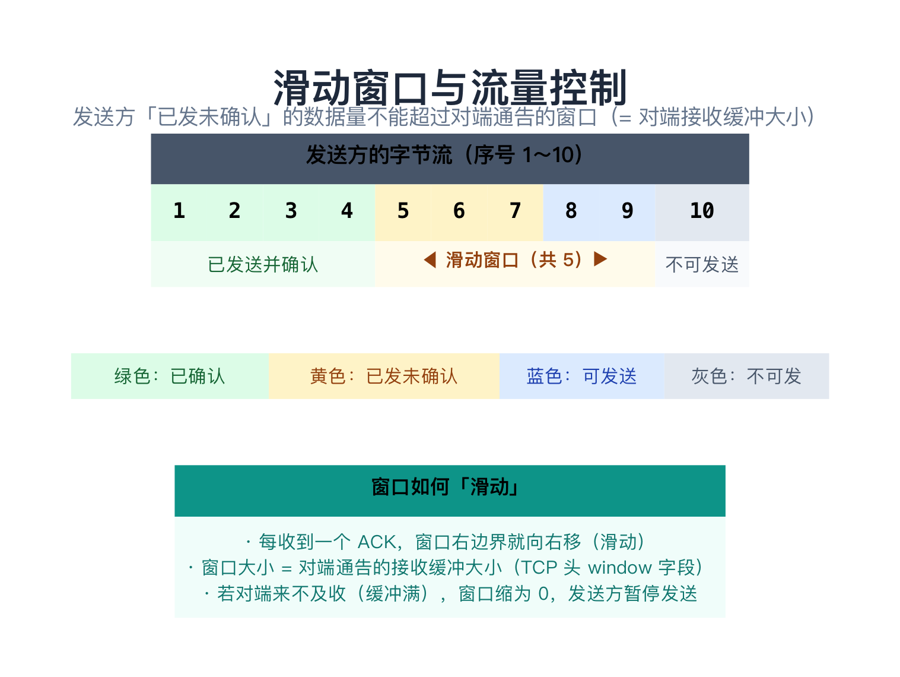

拥塞控制的核心算法（由慢到快、一丢包就降速）：

1. **慢启动（Slow Start）**：cwnd 从 1 个 MSS 左右开始，**每个 RTT 翻一倍**——具体做法是每收到一个 ACK 就把 cwnd 增加 1 个 MSS，于是一个 RTT 内累积的 ACK 让 cwnd 正好翻倍（1→2→4→8…）。注意「翻倍」是**每个 RTT** 的效果，**不是每收到一个 ACK 就翻倍**；
2. **拥塞避免（Congestion Avoidance）**：cwnd 超过阈值 `ssthresh` 后改为**线性增长**（每 RTT +1 个 MSS），谨慎逼近上限；
3. **快重传（Fast Retransmit）**：连续收到 3 个重复 ACK，说明有个包丢了，**不等超时**立刻重传；
4. **快恢复（Fast Recovery）**：重传后不退回慢启动，而是把 cwnd 减半后继续拥塞避免。

> **类比：拥塞控制就像在高速上开车**。慢启动 = 刚上高速先慢慢踩油门试探路况；拥塞避免 = 路况好就匀速一点点提速；发现前面堵车（丢包 / 重复 ACK）就立刻松油门降速（快重传 / 快恢复）。TCP 靠这套「踩油门—刹车」机制，在「尽量快」和「不把网络堵死」之间找平衡点。

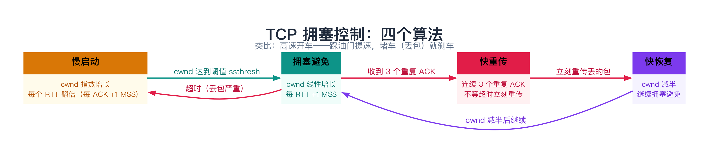

---

## 8. 进阶话题

掌握基本 API 后，往这几个方向深入：

### 8.1 IO 复用：select / poll / epoll

阻塞模型下一个进程只能处理一个连接（`accept`/`recv` 会一直挂起），高并发必须用 **IO 复用**：用一组系统调用同时监控多个 fd，哪个「就绪」了再处理哪个。

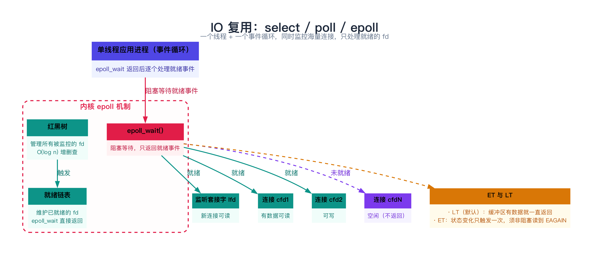

**先想清楚：什么算「就绪」？内核怎么判断一个 fd 有事件？**

IO 复用要回答的核心问题是「哪个 fd 有事件」，也就是「哪个 fd 现在就绪」。**就绪 = 现在对这个 fd 做一次读/写操作，能立刻得到结果，不会被挂起**。它正好是**阻塞的反面**（见 7.3 节）：7.2 节说过，接收缓冲区**空**会让 `recv` 阻塞、发送缓冲区**满**会让 `send` 阻塞——反过来说，缓冲区「不空」「不满」时操作就不会阻塞，也就是「就绪」。

回到第 7.2 节的「邮局仓库」模型，就绪判断其实很直观：

**可读（`EPOLLIN` / `POLLIN`）= 你现在去邮局取包裹，柜台立刻有东西给你**，而不是让你干等。哪些情况算「立刻有结果」？

- **有包裹可拿**：接收缓冲区里已经有数据，`recv` 一拿就有；
- **邮局递给你一张「对方已停寄」的通知**：对端关闭连接发来 FIN，`recv` 会立刻返回 `0`（EOF）——注意，这**仍然是「立刻有结果」**，只是结果是「没了」，而不是一直伸着手等下一个字节；
- **接待处有人排队**（仅监听 socket）：全连接队列里有已完成三次握手的连接，`accept` 一领就领走一个，不用等。

**可写（`EPOLLOUT` / `POLLOUT`）= 你现在去邮局寄东西，柜台立刻有空位收下**，而不是让你等到有人取走包裹、腾出空位。也就是**发送缓冲区没满**（`sk_sndbuf` 还有空闲）。

一句话抓住本质：**「可读」不是「一定有新数据」，而是「`recv` 立刻有结果」（有数据 / EOF / 出错都算）；「可写」不是「一定能送达」，而是「`send` 立刻塞得进」**。想通这一层，就不会被「收到 FIN 也算可读」这种反直觉的点绕晕。

那内核是**怎么知道**一个 fd 就绪的？答案是：内核给每个 fd 规定了一个统一的「问就绪」接口——**`poll` 方法**。

内核要监控的 fd 五花八门（socket、管道、eventfd、设备文件……），不可能为每种都写一套判断逻辑。所以内核把它们统一抽象成「文件」，每个文件的操作表 `file_operations` 里都有一个 `poll` 函数指针，专门回答「你现在就绪吗」。select / poll / epoll 只需调用这个统一接口，不用关心 fd 具体是什么。

对 socket 来说，这个 `poll` 指向 `sock_poll()`，它再转到 TCP 协议栈的 `tcp_poll()`。`tcp_poll()` 先看 socket 状态，分两种情况：

- **监听 socket（`TCP_LISTEN`）**：查**全连接队列** `icsk_accept_queue` 是否非空 → 非空就报 `POLLIN`，也就是「`accept` 不会阻塞，立刻能领走一个连接」。
- **已连接 socket（`TCP_ESTABLISHED`）**：
  - 查**接收队列** `sk_receive_queue` 是否非空 → 非空就报 `POLLIN`（可读）；
  - 查**发送缓冲区** `sk_sndbuf` 是否还有空闲 → 有就报 `POLLOUT`（可写）；
  - 查**连接状态**（收到 FIN、连接关闭等）→ 报 `POLLIN` / `POLLHUP` 等。

最后把结果打包成一个位掩码返回。完整调用链：

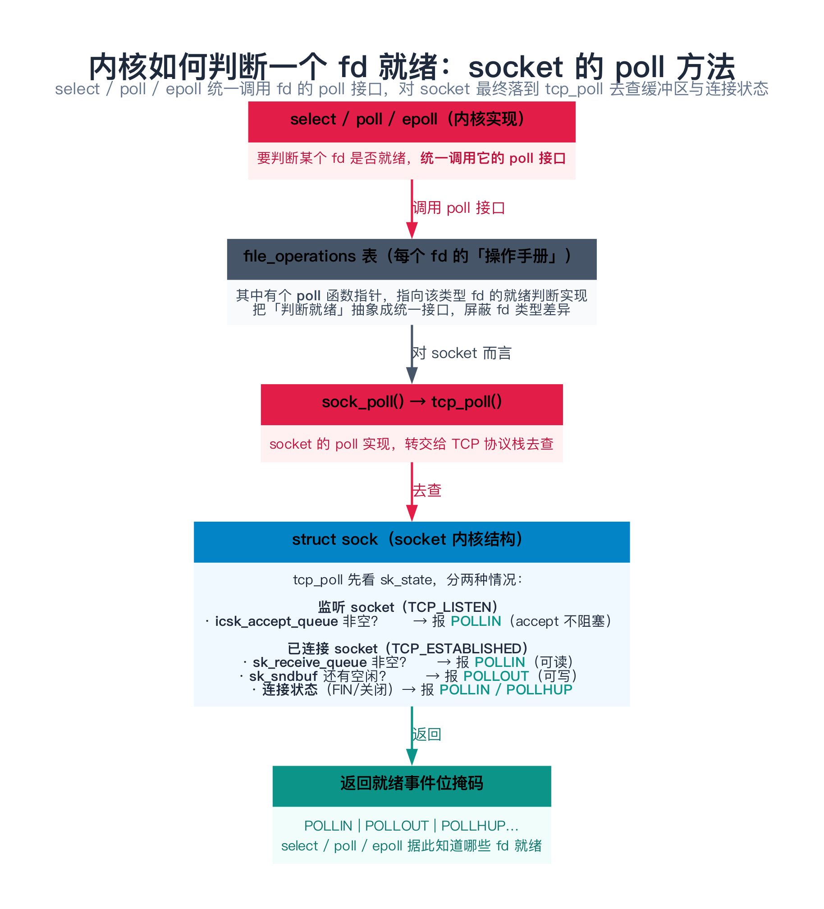

所以 select / poll / epoll 判断就绪的**本质都是调用 socket 的 `poll` 方法去查缓冲区状态**。三者的区别，只在「什么时候、怎么调用这个 poll」：

- `select` / `poll`：每次调用时**主动遍历所有 fd**，逐个调它们的 `poll` 方法（O(n) 主动扫）；
- `epoll`：`epoll_ctl(ADD)` 时**注册回调**，之后数据到达、内核**被动触发**回调，回调里再查一次就绪并把 fd 挂进就绪链表（事件驱动）。

**epoll 的「被动触发」到底是怎么实现的？** 它需要**两样东西**：

**第一样：一个「通知我」的登记处——socket 的等待队列（wait queue）**

每个 socket 身上都挂着一个等待队列（`wait_queue_head_t`），本质是个「通知名单」。`epoll_ctl(ADD)` 时，epoll 把自己的回调函数 `ep_poll_callback` 登记到这个名单上。之后数据一到、内核放进接收缓冲区，就会 `wake_up` 这个等待队列，**按名单逐个调用登记的回调**——「被动通知」就这么来了。

**第二样：一个「记下谁就绪了」的地方——epoll 的就绪链表（`rdllist`）**

回调 `ep_poll_callback` 被唤醒后，查一次这个 fd 是否就绪（还是调 `poll` 方法），就绪就把它挂进 eventpoll 自己的**就绪链表**。`epoll_wait` 干的事很简单：去就绪链表里取走现成的就绪 fd。

所以这两条链表分工不同：**等待队列在 socket 上，是「通知入口」；就绪链表在 eventpoll 上，是「结果出口」**。

> **类比**：等待队列像快递柜上的「到件请通知我」登记表（挂在柜子上），就绪链表像你手上的「已到件」清单。快递员放件后照登记表打电话（通知入口），你接到电话把「某柜到件」记进清单（结果出口），最后照清单取货。select/poll 则是干脆不登记，每隔十分钟自己挨个开柜子看。

完整数据路径：数据进接收缓冲区 → 内核 `wake_up` 等待队列 → 回调 `ep_poll_callback` 查就绪、挂进就绪链表 → `epoll_wait` 从就绪链表取走返回。

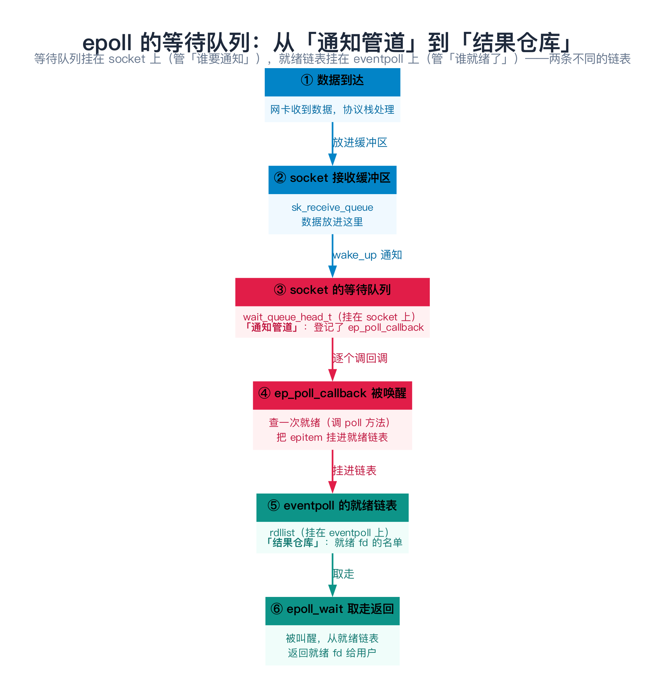

**`select()`**

```c
#include <sys/select.h>
int select(int nfds, fd_set *readfds, fd_set *writefds,
           fd_set *exceptfds, struct timeval *timeout);
```

`fd_set` 本质是一个**位图**，用 `FD_ZERO / FD_SET / FD_CLR / FD_ISSET` 操作：

```c
fd_set rfds;
FD_ZERO(&rfds);
FD_SET(lfd, &rfds);
int maxfd = lfd;

while (1) {
    fd_set tmp = rfds;                 // select 会修改集合，必须每次重新赋值
    int n = select(maxfd + 1, &tmp, NULL, NULL, NULL);
    if (FD_ISSET(lfd, &tmp)) { /* 有新连接，accept */ }
}
```

缺点：`FD_SETSIZE` 默认只有 1024；每次调用都要把整个集合在用户态/内核态之间来回拷贝；返回后仍需 `O(n)` 遍历判断哪个 fd 就绪。

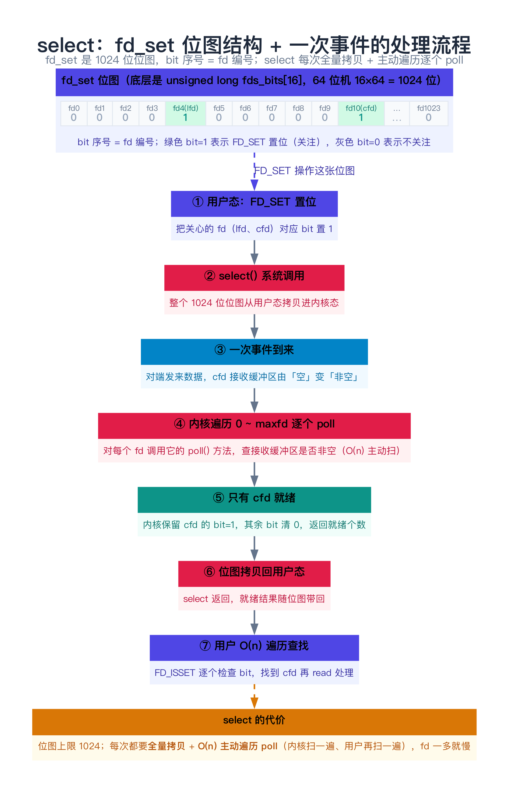

**`poll()`**

```c
#include <poll.h>
int poll(struct pollfd *fds, nfds_t nfds, int timeout);

struct pollfd {
    int   fd;
    short events;   // 关心的：POLLIN / POLLOUT
    short revents;  // 实际发生的（由内核回填）
};
```

用数组代替位图，**突破了 1024 上限**，但仍是每次全量拷贝 + `O(n)` 遍历，高并发下效率同样不行。

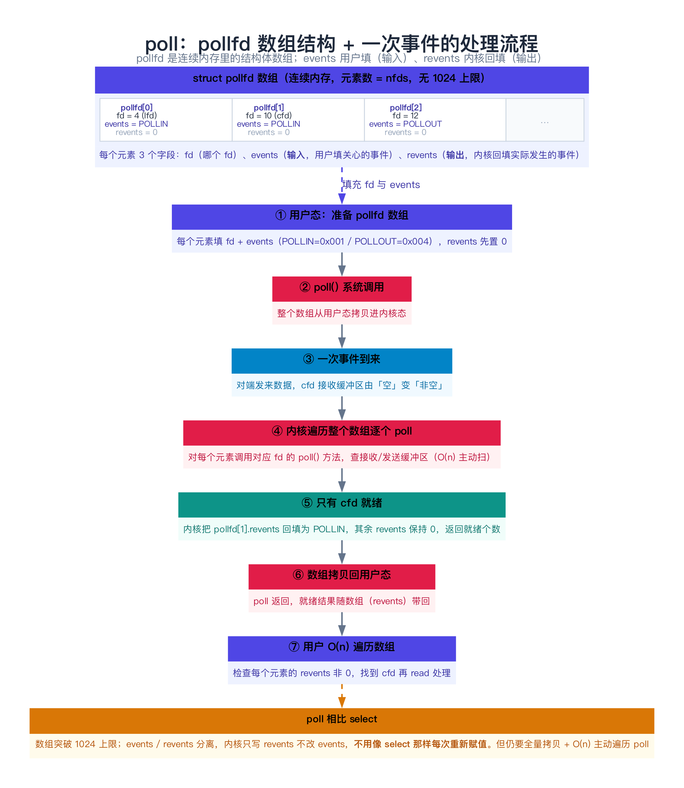

**`epoll()`**（Linux 高性能服务器核心）

```c
#include <sys/epoll.h>
int epoll_create(int size);   // size 已忽略，传 >0 即可
int epoll_ctl(int epfd, int op, int fd, struct epoll_event *event);   // ADD/MOD/DEL
int epoll_wait(int epfd, struct epoll_event *events, int maxevents, int timeout);
```

核心机制：内核用**红黑树**管理所有被监控的 fd，用**就绪链表**维护已就绪的 fd。`epoll_wait` 只返回「就绪」的事件，不需要遍历全部 fd，复杂度接近 `O(1)`。

> **类比：`select`/`poll` 像挨个打电话问，`epoll` 像有个前台**。
>
> - `select`/`poll`：你每次都得把「我关心的人」**抄一份名单**交给内核，内核再逐个问「这人有消息吗」，回头你还得逐个查一遍——人一多，抄名单 + 逐个问都累。
> - `epoll`：你直接把名单**登记在前台一次**（红黑树），有消息的人会被前台**记在小本子**上（就绪链表），你每次只问「小本子上现在有谁」，直接去处理就完事。
>
> 一句话：epoll 把「每次全量排查」变成了「一次登记 + 按需通知」，所以连接越多优势越明显。

**epoll 内核实现细节（底层原理）**

把前面几段串起来，看 epoll 一次完整的工作链路。内核里关键有三样东西：`eventpoll`（epoll 实例）、`epitem`（每个被监控的 fd 一个）、以及每个 socket 自带的**等待队列**。

**1. `epoll_create` —— 创建 `eventpoll` 对象**

内核分配一个 `eventpoll` 结构，里面装了几样：

- `rbr`：**红黑树根**，管理所有被监控的 fd（增删查 O(log n)）；
- `rdllist`：**就绪链表头**，放已经就绪的 fd（返回时 O(1) 取走）；
- `wq`：**一个等待队列**，供 `epoll_wait` 睡眠用——没有就绪事件时，调用它的进程就挂在这里睡。

注意这里一共涉及**三个**队列/链表，别搞混：`rdllist`（就绪链表）存「哪些 fd 就绪了」；`wq`（eventpoll 自己的等待队列）存「哪些进程在等 `epoll_wait`」；再加上前面讲的 socket 上的等待队列，存「谁在等这个 socket 有数据」。回调把 fd 挂进 `rdllist` 后，还要顺手 `wake_up` 这个 `wq`，把睡着的进程叫醒，让它去 `rdllist` 取结果。

`epoll_create` 返回的 `epfd` 指向这个 `eventpoll` 对象，之后所有操作都凭这个 fd 找到它。

**2. `epoll_ctl(ADD)` —— 把 fd 登记进 epoll**

对一个 fd 做 `epoll_ctl(ADD)`，内核干两件事：

1. 为它创建一个 `epitem`，通过 `rbn` 字段**挂进红黑树**（排序键是 `(struct file *, fd)` 组合，见内核 `ep_cmp_ffd()`，不是单纯按 fd 号排）；
2. 往这个 fd **自己的等待队列**里插入一个 `wait_queue_entry`，回调设为 `ep_poll_callback`。

红黑树负责「记住监控了哪些 fd」，等待队列负责「数据来了通知我」，两者由同一个 `epitem` 串起来（见前面的 epitem 图）。细节：ADD 前会先在红黑树里查这个 fd 是否已存在，重复 ADD 返回 `EEXIST`。

**3. 数据到达 —— 被动回调，把 fd 挪进就绪链表**

这是 epoll 和 select/poll 的分水岭。数据到达的完整路径：

1. 网卡收到数据 → 协议栈处理 → 放进该 socket 的接收缓冲区 `sk_receive_queue`；
2. 协议栈调用 `sk_data_ready()` → `wake_up()`，**遍历这个 socket 的等待队列**，逐个调用登记过的回调；
3. 回调 `ep_poll_callback()` 被唤醒后，调 `ep_item_poll()` 再查一次这个 fd 是否真的就绪（底层还是调 socket 的 `poll` 方法）；
4. 就绪就把这个 `epitem` 通过 `rdllink` 字段**挂进 `eventpoll` 的就绪链表**（已在链表里就跳过，避免重复挂）；
5. 最后唤醒 `eventpoll` 自己的等待队列——也就是叫醒正在 `epoll_wait` 里睡眠的进程。

关键：就绪检测是在**数据到达的那一刻被协议栈被动触发**完成的，不是 `epoll_wait` 时才去扫描。

**4. `epoll_wait` —— 只去就绪链表「取货」**

`epoll_wait` 的逻辑非常简单：检查 `rdllist` 非空就把就绪事件逐个拷给用户、返回；空就挂到 `eventpoll` 的等待队列上**睡眠**，等第 3 步来叫醒。

所以 epoll 的 O(1) 不是「判断就绪 O(1)」（判断就绪早在第 3 步顺手做完了），而是「**返回就绪事件 O(1)**」——`epoll_wait` 不遍历所有 fd，直接从就绪链表里取现成的结果。这正是 epoll 效率与连接总数无关的根源。

**更深一层：epitem 是怎么同时挂在红黑树和就绪链表里的？** 每个被监控的 fd 在内核里对应一个 `epitem`，它内部有**两根链子**——`rbn`（红黑树节点，永远挂树）和 `rdllink`（就绪链表节点，就绪时才挂链表）。这是**同一个对象的两处链接，不是两份数据**：被监控时它在红黑树里；就绪时再通过 `rdllink` 额外挂进就绪链表；处理完只从链表摘掉，仍留在树里。

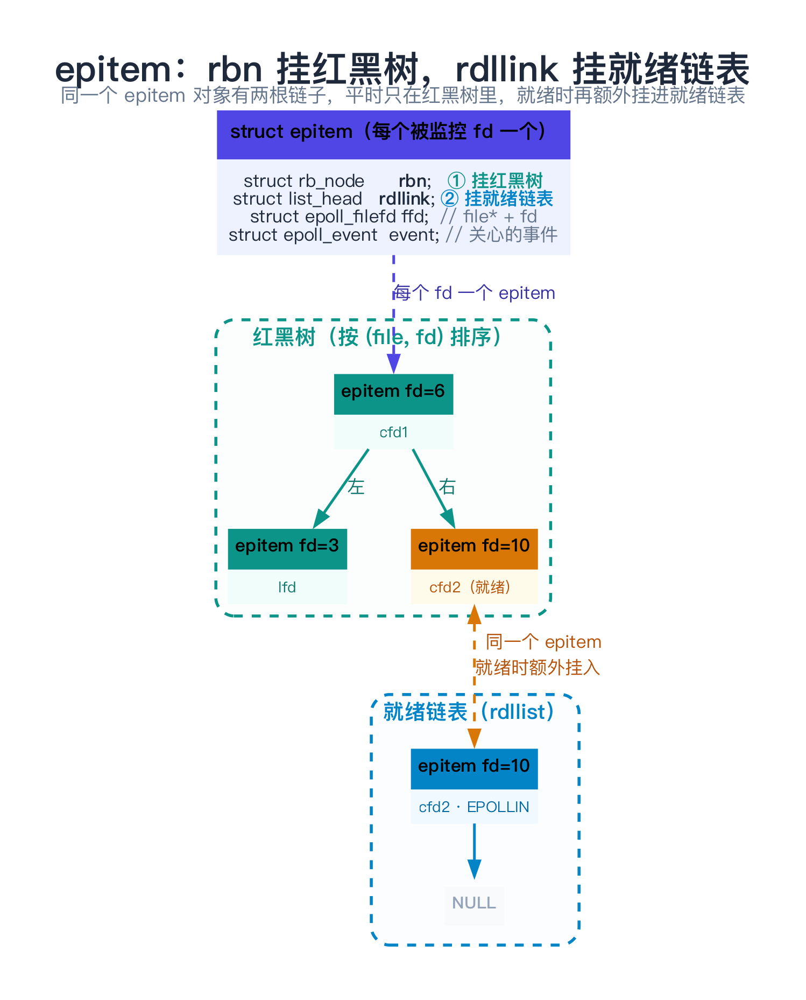

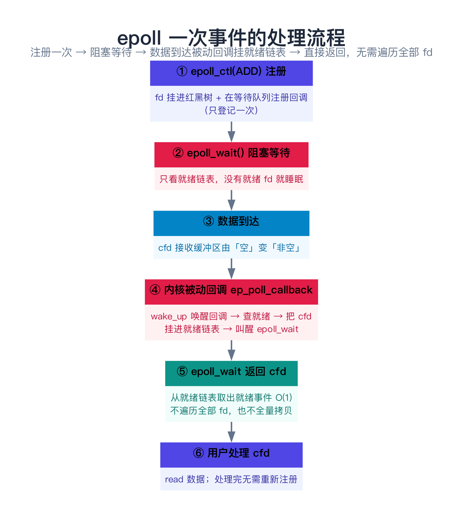

```c
int epfd = epoll_create(1);
struct epoll_event ev, events[MAX_EVENTS];
ev.events = EPOLLIN;
ev.data.fd = lfd;
epoll_ctl(epfd, EPOLL_CTL_ADD, lfd, &ev);

while (1) {
    int n = epoll_wait(epfd, events, MAX_EVENTS, -1);
    for (int i = 0; i < n; i++) {
        int fd = events[i].data.fd;
        if (fd == lfd) {
            int cfd = accept(lfd, NULL, NULL);      // 新连接，也加入 epoll
            ev.events = EPOLLIN; ev.data.fd = cfd;
            epoll_ctl(epfd, EPOLL_CTL_ADD, cfd, &ev);
        } else if (events[i].events & EPOLLIN) {
            // 读数据、处理、必要时 EPOLL_CTL_MOD 改监听可写
        }
    }
}
```

**epoll 常用事件位速查**：

| 事件位 | 含义 | 触发场景 |
|---|---|---|
| `EPOLLIN` | 可读 | 有数据可读 / 收到 FIN / 监听 socket 有新连接 |
| `EPOLLOUT` | 可写 | 发送缓冲区有空闲 |
| `EPOLLERR` | 出错 | 连接发生错误（如收到 RST） |
| `EPOLLHUP` | 挂断 | 连接被挂起（对端关闭了连接） |
| `EPOLLRDHUP` | 对端半关闭 | 对端调了 `shutdown(SHUT_WR)` 或 `close`，即对端不再发数据（常用于判断「对端已发完请求」） |
| `EPOLLET` | 边缘触发 | 配合上面标志使用 |
| `EPOLLONESHOT` | 一次性触发 | 触发一次后自动摘除，需 `EPOLL_CTL_MOD` 重新武装（防止多线程重复处理同一 fd） |

注意两点：① `EPOLLERR` 和 `EPOLLHUP` 是内核**自动**添加的，不必在 `epoll_ctl` 的 `events` 里显式设置，但处理时要注意检查；② `EPOLLRDHUP`（Linux 2.6.17+）需显式设置，它能优雅区分「对端半关闭（`shutdown(SHUT_WR)`，只是不再发数据）」和「整个连接断开」，是 HTTP 这类「请求—响应」协议的利器。

**ET 与 LT（重点，务必理解）**

`epoll` 有两种触发模式，由 `epoll_event.events` 里是否带 `EPOLLET` 标志决定：不带是 **LT（Level Triggered，水平触发，默认）**，带上就是 **ET（Edge Triggered，边缘触发）**。

**名字的由来（底层概念）**：这两个词来自数字电路/信号处理——

- **水平触发（Level）**：看的是「电平」，也就是**当前的状态**。只要电平为高（缓冲区里有数据），就一直触发。
- **边缘触发（Edge）**：看的是「边沿」，也就是状态的**跳变**。只在**上升沿**——从 0 跳到 1（缓冲区由「空」变「有」）的那一瞬间触发一次。

> **类比：水位报警器 vs 门铃**。
>
> - **LT = 水位报警器**：水一旦没过警戒线，报警器就**一直响**，直到你把水舀到警戒线以下才停。你哪怕只舀走一瓢，水还在线上，它就继续响——**漏处理没关系，它还会提醒你**。
> - **ET = 门铃**：客人到了按一下，门铃只**响一声**。你开门一看，门口可能已经**站了好几个人**（缓冲区里积了一批数据），你必须**一次把所有人都请进来**。要是只请进来一个就关门，剩下的人不会自己再按门铃（除非下一批新客人到），他们就被晾在门外了。

把类比翻译回 socket：**「门口的人」= 缓冲区里的数据，「一次全请进来」= 循环 `read`/`recv` 直到返回 `EAGAIN`**。

**两者行为对比（关键场景）**：对端一次发来 4KB，你第一次只 `recv` 读走 2KB，缓冲区还剩 2KB：

| | LT（水平触发，默认） | ET（边缘触发） |
|---|---|---|
| 第 1 次 `epoll_wait` | 返回该 fd（有数据） | 返回该 fd（有数据，**仅此一次**） |
| 你只读 2KB，剩 2KB | 下次 `epoll_wait` **仍然返回**该 fd | 下次 `epoll_wait` **不再返回**，剩 2KB 被「遗忘」 |
| 必须非阻塞 + 读到 `EAGAIN`？ | 不要求（漏读安全） | **必须**，否则丢事件、丢数据 |
| 优点 | 编程简单、健壮，不易丢事件 | 同一批数据只通知一次，唤醒次数少、性能高 |
| 缺点 | 可能反复唤醒（一直不读就忙等） | 写错容易丢事件、丢数据 |

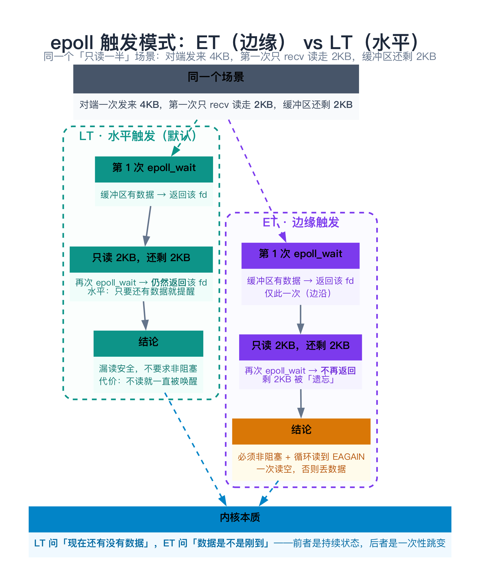

**为什么 ET 必须「非阻塞 + 循环读到 EAGAIN」？**

ET 只在**新数据到达的那个瞬间**通知一次。如果这次收到通知、你**只读了一部分数据，没把缓冲区全部读完**，剩下的旧数据**不会再产生新的 epoll 事件**——除非再来新数据，才会顺带再通知一次。旧数据就卡在缓冲区里没人管了。

**1. 为什么必须循环读，直到 EAGAIN？**

假设 socket 缓冲区一次性收到 1000 字节，`epoll_wait` 返回可读事件（ET 模式）：

- 你调用 `recv`，只读了 400 字节，缓冲区还剩 600；
- **ET 不会再次通知你「还有 600 字节」**；
- 剩下 600 字节永远留在缓冲区，不会再触发 epoll 事件，程序永远不会再去读它 → 数据丢失 / 卡死。

所以：收到 ET 可读事件，**必须循环 `recv`，一次性把缓冲区全部掏空**，读到没数据为止，才退出本次事件处理。

**2. 为什么必须是非阻塞 `O_NONBLOCK`？**

循环读需要一个「停止信号」——也就是「缓冲区已经空了、可以停了」。两种模式对「读空」的反应截然不同：

- **① fd 是阻塞（默认）**：缓冲区读完之后，`recv` 会**阻塞等待新数据**，线程停住、事件循环卡死，你根本跳不出循环：

  ```c
  while (1) {
      n = recv(fd, buf, sizeof(buf), 0);
      // 缓冲区读空后，recv 阻塞挂起，一直等新数据 → 卡死，无法退出循环
  }
  ```

- **② fd 是非阻塞（`O_NONBLOCK`）**：缓冲区一空，`recv` **立刻返回 `-1`**、`errno = EAGAIN`。注意 `EAGAIN` 不是错误，它是「现在没数据了」的哨兵——你收到它，就知道「读空了，可以停」。

一句话：**「非阻塞」让「读空」从「卡住」变成一个明确的返回值（EAGAIN），循环才有终点；「循环读」则保证在这一次通知里把数据读干净、不丢。** 两者缺一不可。所以 ET 的固定写法是：

```c
// 注册时带 EPOLLET，且 fd 必须已设为非阻塞
ev.events = EPOLLIN | EPOLLET;
ev.data.fd = fd;
epoll_ctl(epfd, EPOLL_CTL_ADD, fd, &ev);

// 处理可读事件时，必须循环读到 EAGAIN
while (1) {
    ssize_t n = recv(fd, buf, sizeof(buf), 0);
    if (n > 0) {
        /* 处理这批数据 */
    } else if (n == 0) {
        /* 对端关闭 */
        close(fd); break;
    } else {
        if (errno == EAGAIN || errno == EWOULDBLOCK) break;  /* 读空了，停 */
        /* 真正的错误，处理并关闭 */
    }
}
```

**内核实现原理（为什么会这样）**：回到 8.1 讲过的 epoll 内核结构——红黑树 + 就绪链表：

1. 数据到达 → socket 接收缓冲区由「空」变「非空」→ 内核在这个 fd 的等待队列上触发回调 `ep_poll_callback`，把该 fd **挂进就绪链表**；
2. `epoll_wait` 把就绪链表里的 fd 一个个拷给用户（这一步 LT 和 ET 一样）；
3. **LT 的关键**：`epoll_wait` 返回前，会对每个 fd 再检查一次「现在还有没有数据」（`ep_item_poll`）。如果还有（没读完），就**再把它放回就绪链表**——所以下次 `epoll_wait` 还会返回它；
4. **ET 的关键**：fd 一旦返回一次，就**从就绪链表摘掉**，不再因为「还有数据」放回。只有等**新数据到达**（`sk_data_ready` → `wake_up` 再次触发回调）才会把它挂回就绪链表；注意这里**不要求缓冲区已被读空**——缓冲区里还有旧数据时又来新数据，同样会再通知一次。

一句话总结：**LT 问的是「现在还有没有数据」，ET 问的是「数据是不是刚到」**——前者是持续的状态，后者是一次性的跳变。

**怎么选**：默认用 LT（`muduo` 库、绝大多数场景都用它，简单不易错）；只有当你明确需要极致性能、且愿意承担 ET 的复杂度时（如 `nginx`），才用 ET。ET 的价值在于：海量连接下，同一批数据只唤醒一次，避免被反复打断。

三者对比：

| | `select` | `poll` | `epoll` |
|---|---|---|---|
| fd 上限 | `FD_SETSIZE`（1024） | 无 | 无 |
| 数据结构 | 位图 | 数组 | 红黑树 + 就绪链表 |
| 用户/内核拷贝 | 每次全量 | 每次全量 | 只拷贝就绪事件 |
| 查询复杂度 | `O(n)` | `O(n)` | `O(1)` |
| 适用场景 | 少量连接 | 中量连接 | 海量高并发 |

### 8.2 粘包 / 拆包

TCP 是**字节流**，没有消息边界。连续发送两条消息 "hello" 和 "world"，对端可能一次收到 `helloworld`（粘包），也可能拆成 `hel` + `loworld`（拆包）。应用层必须自己定义「一条消息的边界」。

> **类比：往一根管子里倒水，怎么让对面知道「我一共倒了几杯」？** 你倒两杯水进去，对面流出来的是一股连续的水流，分不清哪段属于哪杯。要还原出「一杯杯」，只能自己约法三章（对应下面三种方案）：
>
> - 约定**每杯固定容量**（定长消息）；
> - 约定**两杯之间放一个标记**（分隔符）；
> - 约定**倒之前先喊一声「这杯有 N 毫升」**（长度前缀）。

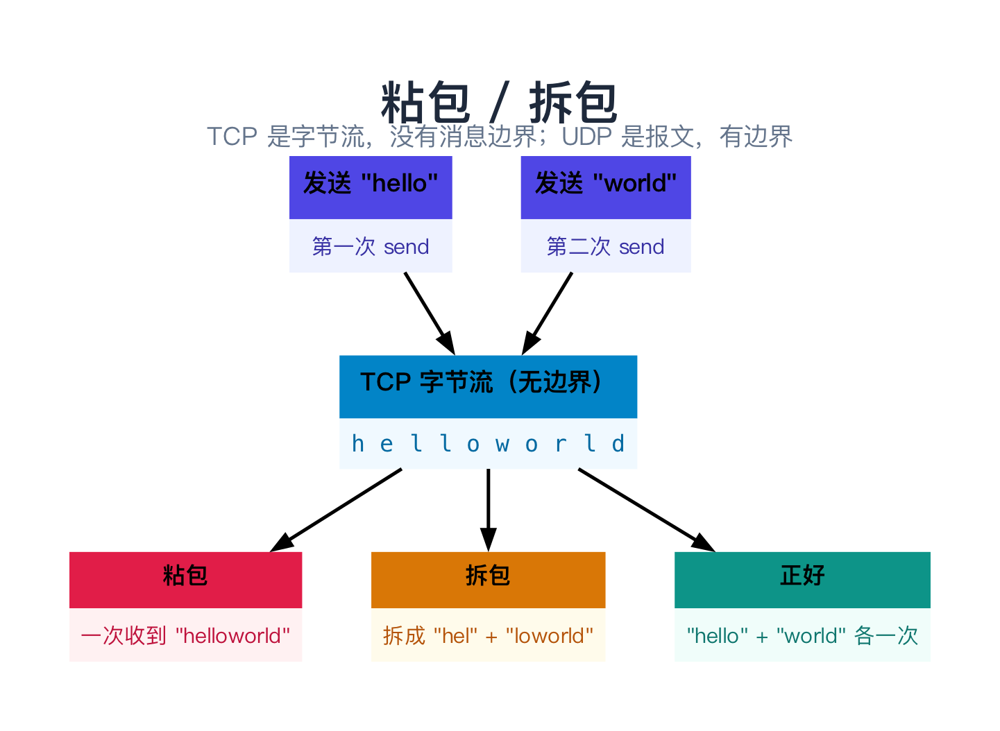

三种常见方案：

1. **定长消息**：每条消息固定 N 字节，不足补零。简单但浪费空间。
2. **分隔符**：用特殊字符（如 `\r\n`）切分消息，HTTP 头、Redis 协议即如此。缺点是要处理数据里出现分隔符的转义。
3. **长度前缀**（最常用、最健壮）：消息头带固定长度字段（如 4 字节大端整数），表示 body 长度。

长度前缀示例：

```c
/* 发送：先发 4 字节长度，再发数据 */
uint32_t n = htonl(len);
send(fd, &n, 4, 0);
send(fd, buf, len, 0);

/* 接收：先读 4 字节长度，再循环读够 len 字节 */
uint32_t n;
readn(fd, &n, 4);          // readn：循环 read 直到读满 4 字节
n = ntohl(n);
readn(fd, buf, n);
```

关键点：`recv` 一次不一定读满你要求的字节数，所以需要一个「读满 N 字节」的辅助函数（常叫 `readn` / `read_full`），循环 `recv` 直到读够为止。

### 8.3 TCP 状态机与 TIME_WAIT

完整状态机见第 7.1 节配图。这里重点讲最常踩坑的 **TIME_WAIT**。

**谁进入 TIME_WAIT**：**主动关闭方**（先发 `FIN` 的一方，通常是先调 `close`/`shutdown(SHUT_WR)` 的那边），收到对端 FIN 并回最后一个 ACK 后进入，持续 **2MSL**。

**为什么是 2MSL，而不是 1MSL？** 先明确 MSL（Maximum Segment Lifetime）= 一个报文在网络里最多能存活的时间。Linux 上 MSL = 30s，所以 TIME_WAIT 持续 2MSL = 60s。**2MSL 的本质是「一个报文的最坏往返时间」**——发出去最多 1 个 MSL，对方回应回来最多又 1 个 MSL。下面两个原因，正好各对应这一个来回：

**原因一：确保最后一个 ACK 能送达**

主动关闭方发出最后一个 ACK 后，如果这个 ACK 在网络里丢了，对端（处于 LAST_ACK）迟迟等不到，会**重发 FIN**。重发的 FIN 从对端走到我们这里，最坏要 **1 个 MSL**；我们收到后再回一个 ACK，从我们走回对端，最坏又要 **1 个 MSL**。也就是说，最坏情况下「FIN 重传 + ACK 响应」这整整一个来回要 **2MSL** 才能尘埃落定。如果我们只等 1MSL 就关闭，可能恰好撞上重传的 FIN 到达——此时连接已经没了，我们只能回 RST，对端就会误以为连接是异常中断的。

**原因二：让旧连接的报文彻底消亡**

一个报文最多能在网络里存活 **1 个 MSL**。连接关闭后，同一个四元组（源 IP + 源端口 + 目的 IP + 目的端口）可能很快被一条新连接复用。如果旧连接的某个「迟到报文」还在路上，它可能在新连接建立后到达，被误当成新连接的数据——串线了。所以要等满 2MSL，让旧连接两个方向上可能残留的报文都死透，保证新连接干干净净地开始。

> **类比**：挂电话前，你说了「再见」（FIN），对方回「好的再见」（FIN），你最后补一句「嗯」（ACK）。你得多等一会儿再离开——一是怕对方没听到你那声「嗯」会再问一遍（原因一），二是怕刚才的话音还在电话线里没散尽、串到下一通电话（原因二）。这个「多等一会儿」的长度，正好是「一句话传过去 + 对方回应传回来」，也就是 2 个 MSL。

**TIME_WAIT 堆积的问题与解法**：服务器若作为主动关闭方大量关连接（如反向代理），会堆积大量 TIME_WAIT，占用 fd 和内存。常见对策：

- `SO_REUSEADDR`：允许在 TIME_WAIT 状态下重新绑定端口，主要解决**重启时报 `EADDRINUSE`**；
- `SO_LINGER`（`l_onoff=1, l_linger=0`）：`close` 时直接发 `RST` 异常关闭，跳过四次挥手、**不产生 TIME_WAIT**，但可能丢弃未发送数据；
- `tcp_tw_reuse`：客户端侧复用 TIME_WAIT 连接（内核参数）。
- 注意：`tcp_tw_recycle` 在 Linux 4.12 已**移除**（NAT 下会误伤），不要再依赖它。

**`SO_REUSEADDR` 与 `SO_REUSEPORT` 的区别**：

- `SO_REUSEADDR`：允许 TIME_WAIT 端口复用 / 绑定相同地址（主要给服务器重启用）；
- `SO_REUSEPORT`（Linux 3.9+）：**多个 socket 绑定同一个端口**，内核按连接哈希**负载均衡**，多进程/多线程 accept 的利器。

### 8.4 非阻塞 + 事件驱动（Reactor）

**阻塞模型的瓶颈**：传统「一连接一线程」里，线程会阻塞在 `recv`/`accept` 上，连接一多线程开销、上下文切换就成了灾难。

**Reactor（反应堆）模型**：一个 `epoll` 事件循环统一监听所有 fd，事件就绪后分发（dispatch）给对应的 handler 处理，是高性能服务器的主流架构。

三种形态：

1. **单 Reactor 单线程**：一个线程既做 `accept` 又做读写还做业务。实现最简单，但任一 handler 阻塞会拖垮所有连接（Redis 早期即此模型）。
2. **单 Reactor 多线程**：Reactor 线程只负责 `accept` + 读写 + 分发，业务逻辑丢给**线程池**执行，避免业务阻塞事件循环。
3. **主从 Reactor（多 Reactor 多线程）**：主 Reactor 只负责 `accept` 新连接，然后分给多个**从 Reactor**（每个从 Reactor 独占一个线程，即「one loop per thread」）负责已建立连接的读写。`muduo` 采用的就是这种。

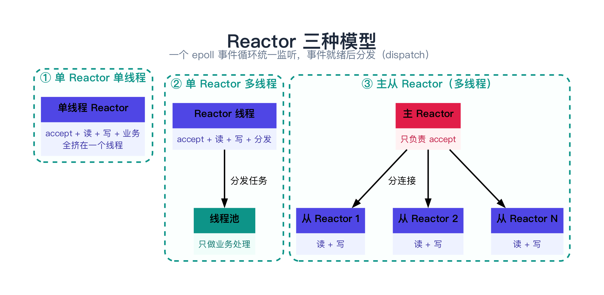

相关概念与框架：

- **Proactor**：与 Reactor 相对，由**内核/OS 异步完成 IO** 后通知应用（应用不用自己 `read`/`write`），如 Windows 的 IOCP、Linux 的 `io_uring`。
- **框架**：`libevent`（老牌事件库）、`libuv`（Node.js 底层）、`muduo`（陈硕的 C++ Reactor 网络库）。

### 8.5 性能调优

| 选项/参数 | 作用 |
|---|---|
| `SO_SNDBUF` / `SO_RCVBUF` | 调大内核收发缓冲区，适合大流量；内核常把设置值翻倍 |
| `TCP_NODELAY` | 禁用 **Nagle 算法**，降低小包延迟（交互式应用如 SSH、游戏必开） |
| `SO_REUSEPORT` | 多进程/多线程绑定同端口，内核负载均衡 |
| `SO_KEEPALIVE` | 开启 TCP keepalive，探测死连接 |

**Nagle 算法（底层原理）**：TCP 每个报文都有几十字节的头开销，如果「一个字节也发一个包」，网络会被海量小包淹没。Nagle 的规则是——**只要还有「已发送但未确认」的数据在途，就先攒着后续的小数据，等 ACK 到了再一起发**。好处是省包、省带宽；坏处是交互式场景（敲一个字符发一个字符）会被拖慢，所以 SSH、游戏这类低延迟应用都要开 `TCP_NODELAY` 关掉它。

> **类比**：Nagle 像快递员**攒件**——「上一单还没签收，我就先不单独跑，等你签收了我把几件一起送」，省油但慢。`TCP_NODELAY` 就是「别攒了，来一件送一件」，快但费油。

**延迟确认（Delayed ACK）**：接收方收到数据后**不立即回 ACK**，而是故意等一会儿（Linux 默认约 40ms，历史 BSD 实现可达 200ms），希望能「顺便」把要回给对方的数据一起捎上（捎带确认），从而减少纯 ACK 报文的数量。

**两个机制叠加的坑**：Nagle 在「等 ACK 才发下一批」，Delayed ACK 在「等数据才回 ACK」——当两端同时开启且正好对上了，就会**互相干等**，产生经典的 40ms 级延迟。解决办法通常是发送方开 `TCP_NODELAY`。

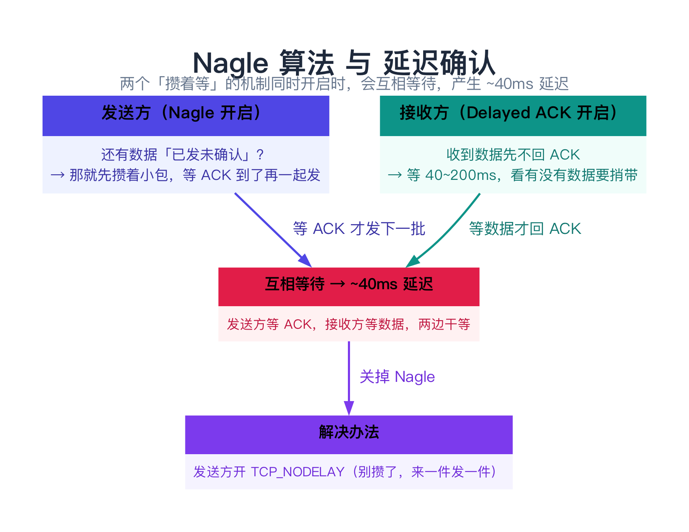

**keepalive 三个内核参数**：`tcp_keepalive_time`（空闲多久开始探测）、`tcp_keepalive_intvl`（探测间隔）、`tcp_keepalive_probes`（探测次数）。

### 8.6 socket 选项：getsockopt / setsockopt

```c
#include <sys/socket.h>
int getsockopt(int sockfd, int level, int optname, void *optval, socklen_t *optlen);
int setsockopt(int sockfd, int level, int optname, const void *optval, socklen_t optlen);
```

- `level`：选项所属层次，常用 `SOL_SOCKET`（通用）、`IPPROTO_TCP`（TCP 层）、`IPPROTO_IP`（IP 层）。

常用选项速查：

| 选项 | `level` | 说明 |
|---|---|---|
| `SO_REUSEADDR` | `SOL_SOCKET` | TIME_WAIT 端口复用 |
| `SO_REUSEPORT` | `SOL_SOCKET` | 多 socket 绑定同端口 |
| `SO_SNDBUF` / `SO_RCVBUF` | `SOL_SOCKET` | 收发缓冲区大小 |
| `SO_KEEPALIVE` | `SOL_SOCKET` | 开启 keepalive |
| `SO_LINGER` | `SOL_SOCKET` | 控制 `close` 行为（优雅/RST） |
| `TCP_NODELAY` | `IPPROTO_TCP` | 禁用 Nagle |
| `TCP_KEEPIDLE` | `IPPROTO_TCP` | keepalive 空闲时间 |

---

## 9. 参考速查表

### 9.1 核心 API

| API | 作用 | 关键点 |
|-----|------|--------|
| `socket()` | 创建套接字 | 返回 fd，无地址无连接 |
| `bind()` | 绑定本地地址 | 端口冲突报 `EADDRINUSE` |
| `listen()` | 转为监听 | 维护半连接/全连接两个队列，`backlog` 控制 accept 队列 |
| `accept()` | 取已完成连接 | 返回新的 `cfd`，队列空则阻塞 |
| `connect()` | 客户端发起连接 | 触发三次握手，返回即已连上 |
| `send()` | 发送 | 拷入内核发送缓冲区 ≠ 已送达 |
| `recv()` | 接收 | 返回 0 表示对端关闭 |
| `sendto/recvfrom` | UDP 收发 | 每次指定对端，保留报文边界 |
| `sendmsg/recvmsg` | 通用收发 | 支持 scatter/gather、传递 fd |
| `close()` | 关闭 | 引用计数为 0 才真正关 |
| `shutdown()` | 半关闭 | 立即生效，无视引用计数 |
| `fcntl(fd, F_SETFL, O_NONBLOCK)` | 设非阻塞 | 条件不满足返回 `EAGAIN` |

### 9.2 字节序与地址转换

| 函数 | 作用 |
|------|------|
| `htons` / `ntohs` | 16 位（端口）主机序 ↔ 网络序 |
| `htonl` / `ntohl` | 32 位（IPv4）主机序 ↔ 网络序 |
| `inet_pton` | 字符串 IP → 二进制 |
| `inet_ntop` | 二进制 IP → 字符串 |
| `getsockname` | 获取本端地址 |
| `getpeername` | 获取对端地址 |

### 9.3 常见 errno

每个 errno 都对应一个具体场景。按「**哪个调用在什么情况下产生它**」来记最清楚：

**`bind()` 阶段**

- `EADDRINUSE`：要绑定的 `IP:port` 已被占用——别的进程已经 bind 了，或有 TIME_WAIT 连接还占着这个端口。**服务端重启时最常见**。解决：bind 前设 `SO_REUSEADDR`。
- `EADDRNOTAVAIL`：绑定的 IP 不是本机任何一块网卡的地址（比如把别人的 IP 当本地地址 bind）。

**`connect()` 阶段**

- `ECONNREFUSED`：目标端口**没有进程监听**，内核回了 RST。比如去连一个没开服务的端口。（另一来源：`tcp_abort_on_overflow=1` 时 accept 队列满也会回 RST。）
- `ETIMEDOUT`：SYN 重发多次仍无响应——网络不通、或防火墙把 SYN 丢了。
- `EINPROGRESS`：非阻塞 connect 的「进行中」信号，**不是错误**，表示连接还在建立，之后用 `poll/epoll` 监听可写事件确认。

**`socket()` / `accept()` 阶段**

- `EMFILE`：**本进程**的 fd 数达到上限（`ulimit -n`）。`accept` 报 EMFILE 时新连接仍留在队列里，会触发 epoll 忙循环，见 3.4 的坑。
- `ENFILE`：**整个系统**的 fd 数达到上限（全局限制，少见）。
- `EAGAIN`：非阻塞 `accept`，但 accept 队列为空（没有已完成握手的连接）。

**`recv()` / `read()` 阶段**

- `EAGAIN` / `EWOULDBLOCK`：非阻塞读，但**接收缓冲区空**（没有数据可读）。注意这不是错误，是「暂时没数据，稍后再试」。
- `ECONNRESET`：对端**异常关闭**（发了 RST），比如对端进程崩溃、或对端收到了发给已关闭 socket 的数据。此时连接已被对端硬生生掐断。
- `EINTR`：阻塞等待数据时**被信号打断**。通常应该重试一次（除非你明确想让它退出）。

**`send()` / `write()` 阶段**

- `EAGAIN` / `EWOULDBLOCK`：非阻塞写，但**发送缓冲区满**（对端收得太慢，缓冲区塞不下）。
- `EPIPE`：向**已经关闭的连接**写数据（对端已发 RST；如果只是收到 FIN，则第一次写通常仍会成功，出错的是随后的写，见 5.1 节）。会触发 `SIGPIPE` 信号、默认直接杀死进程——所以要么 `signal(SIGPIPE, SIG_IGN)`，要么用 `send(..., MSG_NOSIGNAL)`。
- `ECONNRESET`：对端 RST 之后你还在继续写。
- `ENOTCONN`：TCP socket **还没 `connect` 就 `send`**（比如客户端忘了 connect，或服务端在未 accept 的连接上发数据）。

**通用**

- `EBADF` / `ENOTSOCK`：对**无效的 fd**（已 close、或根本不是 socket）调用 socket 操作。

> 速记口诀：**绑定看 ADDR（EADDRINUSE/EADDRNOTAVAIL），连接看 CONN/TIME（ECONNREFUSED/ETIMEDOUT/EINPROGRESS），读写看 AGAIN/RESET/PIPE（EAGAIN/ECONNRESET/EPIPE）**。`EAGAIN` 是「非阻塞下暂时没货」的哨兵，其余多数是真错误。

---

## 10. 配套示例代码

一个可编译运行的 TCP 回显（echo）服务：客户端发送一行文本，服务端原样返回。

### 10.1 服务端 `tcp_server.c`

```c
#include <stdio.h>
#include <stdlib.h>
#include <string.h>
#include <unistd.h>
#include <errno.h>
#include <signal.h>
#include <arpa/inet.h>
#include <sys/socket.h>

#define PORT 8080
#define BACKLOG 128
#define BUF_SIZE 1024

static void die(const char *msg) {
    perror(msg);
    exit(1);
}

int main(void) {
    int lfd, cfd;
    struct sockaddr_in addr, client_addr;
    socklen_t client_len;
    char buf[BUF_SIZE];
    ssize_t n;

    /* 见 5.1 节：向已被对端关闭的连接写会触发 SIGPIPE，而它的默认动作是
     * 终止进程。这里直接忽略该信号，让 send 返回 -1 + errno=EPIPE 交给代码处理。 */
    signal(SIGPIPE, SIG_IGN);

    /* 1. 创建监听套接字 */
    lfd = socket(AF_INET, SOCK_STREAM, 0);
    if (lfd < 0) die("socket");

    /* 允许端口在 TIME_WAIT 状态下复用，避免重启时报 EADDRINUSE */
    int opt = 1;
    if (setsockopt(lfd, SOL_SOCKET, SO_REUSEADDR, &opt, sizeof(opt)) < 0)
        die("setsockopt");

    /* 2. 绑定本地地址（0.0.0.0:8080） */
    memset(&addr, 0, sizeof(addr));
    addr.sin_family      = AF_INET;
    addr.sin_addr.s_addr = htonl(INADDR_ANY); /* 监听所有网卡 */
    addr.sin_port        = htons(PORT);        /* 注意字节序转换 */
    if (bind(lfd, (struct sockaddr *)&addr, sizeof(addr)) < 0)
        die("bind");

    /* 3. 进入监听：backlog 控制全连接队列长度 */
    if (listen(lfd, BACKLOG) < 0)
        die("listen");

    printf("server listening on 0.0.0.0:%d\n", PORT);

    while (1) {
        /* 4. 从全连接队列取出一个已完成握手的连接。
         *    client_len 是「传入缓冲区容量、传出实际地址长度」，每次 accept 前都要重置 */
        client_len = sizeof(client_addr);
        cfd = accept(lfd, (struct sockaddr *)&client_addr, &client_len);
        if (cfd < 0) {
            if (errno == EINTR) continue;   /* 被信号打断，重试 */
            perror("accept");
            continue;
        }

        char peer[INET_ADDRSTRLEN];
        inet_ntop(AF_INET, &client_addr.sin_addr, peer, sizeof(peer));
        printf("connection from %s:%d\n", peer, ntohs(client_addr.sin_port));

        /* 5. 收发循环：回显（echo）服务 */
        while ((n = recv(cfd, buf, sizeof(buf), 0)) > 0) {
            /* 阻塞模式下 send 一般会把 n 字节全部发完，但仍然检查返回值 */
            if (send(cfd, buf, n, 0) < 0) {
                perror("send");
                break;
            }
        }

        /* recv 返回 0 表示对端正常关闭；ECONNRESET 表示对端异常断开（RST），也不算错误 */
        if (n < 0 && errno != ECONNRESET)
            perror("recv");
        printf("connection closed\n");

        /* 6. 关闭这个连接，继续等待下一个 */
        close(cfd);
    }

    close(lfd);
    return 0;
}
```

### 10.2 客户端 `tcp_client.c`

```c
#include <stdio.h>
#include <stdlib.h>
#include <string.h>
#include <unistd.h>
#include <errno.h>
#include <signal.h>
#include <arpa/inet.h>
#include <sys/socket.h>

#define PORT 8080
#define BUF_SIZE 1024

static void die(const char *msg) {
    perror(msg);
    exit(1);
}

int main(int argc, char *argv[]) {
    const char *server_ip = (argc > 1) ? argv[1] : "127.0.0.1";

    int cfd;
    struct sockaddr_in server_addr;
    char buf[BUF_SIZE];
    ssize_t n = -1;

    /* 服务端若已关闭，send 会返回 EPIPE；先屏蔽 SIGPIPE，避免进程被信号杀死 */
    signal(SIGPIPE, SIG_IGN);

    /* 1. 创建套接字（客户端通常不 bind，源端口由内核自动分配） */
    cfd = socket(AF_INET, SOCK_STREAM, 0);
    if (cfd < 0) die("socket");

    /* 2. 连接服务器，触发三次握手；返回即表示已连上 */
    memset(&server_addr, 0, sizeof(server_addr));
    server_addr.sin_family = AF_INET;
    server_addr.sin_port   = htons(PORT);
    if (inet_pton(AF_INET, server_ip, &server_addr.sin_addr) != 1)
        die("inet_pton");

    if (connect(cfd, (struct sockaddr *)&server_addr, sizeof(server_addr)) < 0)
        die("connect");

    printf("connected to %s:%d\n", server_ip, PORT);

    while (1) {
        /* 3. 从标准输入读一行，发给服务器 */
        printf("> ");
        fflush(stdout);
        if (fgets(buf, sizeof(buf), stdin) == NULL)
            break; /* Ctrl-D 退出 */

        size_t len = strlen(buf);
        if (send(cfd, buf, len, 0) < 0)
            die("send");

        /* 4. 接收服务器的回显并打印。TCP 是字节流，一次 recv 不保证把一条消息读完，
         *    这里以 '\n' 作为「一条消息」的边界，循环读到换行为止（见 8.2 粘包/拆包）。 */
        size_t got = 0;
        while (got < sizeof(buf) - 1) {
            n = recv(cfd, buf + got, sizeof(buf) - 1 - got, 0);
            if (n < 0 && errno == EINTR) continue;   /* 被信号打断，重试 */
            if (n <= 0) break;
            got += (size_t)n;
            buf[got] = '\0';
            if (memchr(buf, '\n', got) != NULL) break;
        }
        if (n <= 0) {
            if (n == 0)
                printf("server closed connection\n");
            else
                perror("recv");
            break;
        }
        printf("echo: %s", buf);
    }

    close(cfd);
    return 0;
}
```

### 10.3 编译与运行

```bash
cc -Wall -Wextra -O2 -o tcp_server tcp_server.c
cc -Wall -Wextra -O2 -o tcp_client tcp_client.c

# 终端 A
./tcp_server

# 终端 B
./tcp_client 127.0.0.1
# 输入任意文字回车，即可收到服务端回显；Ctrl-D 退出
```

### 10.4 epoll 回显服务器（ET 模式）

上面的 `tcp_server` 是阻塞模型，一次只能处理一个连接。下面是基于 **epoll 边缘触发（ET）** 的高并发版本，演示第 7.3 节「IO 复用 + 非阻塞」和第 8.1 节 epoll 的用法：

```c
#include <stdio.h>
#include <stdlib.h>
#include <string.h>
#include <unistd.h>
#include <errno.h>
#include <signal.h>
#include <fcntl.h>
#include <stdint.h>
#include <arpa/inet.h>
#include <sys/socket.h>
#include <sys/epoll.h>

#define PORT 8080
#define MAX_EVENTS 1024
#define BUF_SIZE 1024

static void die(const char *msg) {
    perror(msg);
    exit(1);
}

static void set_nonblocking(int fd) {
    int flags = fcntl(fd, F_GETFL, 0);
    if (flags < 0) die("fcntl(F_GETFL)");
    if (fcntl(fd, F_SETFL, flags | O_NONBLOCK) < 0) die("fcntl(F_SETFL)");
}

/* 把一个 fd 注册进 epoll（事件位见 8.1 节的事件位速查表） */
static void epoll_add(int epfd, int fd, uint32_t events) {
    struct epoll_event ev;
    ev.events  = events;
    ev.data.fd = fd;
    if (epoll_ctl(epfd, EPOLL_CTL_ADD, fd, &ev) < 0)
        die("epoll_ctl(ADD)");
}

/* 处理一个已连接 fd 的可读事件（ET 模式）。
 * 返回 0 表示连接可以继续，返回 -1 表示上层应当关闭这个连接。 */
static int handle_read(int fd, char *buf, size_t bufsz) {
    while (1) {                        /* ET：必须循环读，直到 EAGAIN */
        ssize_t r = recv(fd, buf, bufsz, 0);
        if (r > 0) {
            /* 非阻塞 send 可能只写出去一部分，必须循环把 r 字节发完（见 5.1 节） */
            ssize_t off = 0;
            while (off < r) {
                ssize_t w = send(fd, buf + off, (size_t)(r - off), MSG_NOSIGNAL);
                if (w > 0) {
                    off += w;
                } else if (w < 0 && errno == EINTR) {
                    continue;                                /* 被信号打断，重试 */
                } else if (w < 0 && (errno == EAGAIN || errno == EWOULDBLOCK)) {
                    /* 发送缓冲区满：这里简化处理，直接放弃剩余数据。
                     * 生产代码应把剩余数据挂到应用层发送缓冲、注册 EPOLLOUT，
                     * 等可写事件到了再补发（见 8.1 节的 EPOLL_CTL_MOD）。 */
                    break;
                } else {
                    return -1;                               /* EPIPE / ECONNRESET 等 */
                }
            }
        } else if (r == 0) {
            return -1;                                       /* 对端关闭（EOF） */
        } else {
            if (errno == EINTR) continue;                    /* 被信号打断，重试 */
            if (errno == EAGAIN || errno == EWOULDBLOCK) return 0;  /* 读空了 */
            return -1;                                       /* 真错误 */
        }
    }
}

int main(void) {
    int lfd = socket(AF_INET, SOCK_STREAM, 0);
    if (lfd < 0) die("socket");

    int opt = 1;
    setsockopt(lfd, SOL_SOCKET, SO_REUSEADDR, &opt, sizeof(opt));

    struct sockaddr_in addr = {0};
    addr.sin_family      = AF_INET;
    addr.sin_addr.s_addr = htonl(INADDR_ANY);
    addr.sin_port        = htons(PORT);
    if (bind(lfd, (struct sockaddr *)&addr, sizeof(addr)) < 0) die("bind");
    if (listen(lfd, 128) < 0) die("listen");

    /* 监听 fd 也设成非阻塞：这样下面的 accept 循环才能靠 EAGAIN 收尾。
     * 注意：监听 fd 用默认的 LT 就够了，ET 只用在「已连接 fd」上。 */
    set_nonblocking(lfd);

    int epfd = epoll_create1(EPOLL_CLOEXEC);
    if (epfd < 0) die("epoll_create1");

    /* 监听 fd 注册 LT：有新连接就返回，配合 while(accept) 直到 EAGAIN */
    epoll_add(epfd, lfd, EPOLLIN);

    printf("epoll server on 0.0.0.0:%d\n", PORT);

    struct epoll_event events[MAX_EVENTS];
    char buf[BUF_SIZE];

    while (1) {
        int n = epoll_wait(epfd, events, MAX_EVENTS, -1);
        if (n < 0) {
            if (errno == EINTR) continue;      /* 被信号打断，重试 */
            die("epoll_wait");
        }

        for (int i = 0; i < n; i++) {
            int fd = events[i].data.fd;
            uint32_t ev = events[i].events;

            /* EPOLLERR / EPOLLHUP 是内核自动上报的，必须处理，
             * 否则这个 fd 会被反复唤醒（LT 下就成了忙循环） */
            if (ev & (EPOLLERR | EPOLLHUP)) {
                epoll_ctl(epfd, EPOLL_CTL_DEL, fd, NULL);
                close(fd);
                continue;
            }

            if (fd == lfd) {                   /* 新连接：循环 accept 到 EAGAIN */
                while (1) {
                    int cfd = accept(lfd, NULL, NULL);
                    if (cfd < 0) {
                        if (errno == EAGAIN || errno == EWOULDBLOCK) break;  /* 取完了 */
                        if (errno == EINTR) continue;                        /* 重试 */
                        perror("accept");   /* 含 EMFILE/ENFILE：本轮先放弃，别忙等 */
                        break;
                    }
                    set_nonblocking(cfd);
                    /* 已连接 fd 用 ET：同一批数据只通知一次，所以上面必须循环读到 EAGAIN。
                     * 想区分「对端半关闭」可以再加 EPOLLRDHUP（见 8.1 节事件位速查表）。 */
                    epoll_add(epfd, cfd, EPOLLIN | EPOLLET);
                }
            } else if (ev & EPOLLIN) {         /* 可读 */
                if (handle_read(fd, buf, sizeof(buf)) < 0) {
                    epoll_ctl(epfd, EPOLL_CTL_DEL, fd, NULL);
                    close(fd);
                }
            }
        }
    }

    close(lfd);
    return 0;
}
```

编译运行：

```bash
cc -Wall -Wextra -O2 -o epoll_server epoll_server.c
./epoll_server            # 可同时用多个 tcp_client 连接，服务端并发处理
```

> 说明：这个示例里 **监听 fd 用 LT、已连接 fd 用 ET**（工程上最常见的组合）——监听 fd 用 LT 配合 `while(accept)` 直到 `EAGAIN`，逻辑最直观；已连接 fd 用 ET 减少同一批数据的重复唤醒，代价就是必须「非阻塞 + 循环读到 `EAGAIN`」。
>
> 另外它只是**演示用的骨架**：真实工程里 `send` 遇到 `EAGAIN` 时不能丢数据，要把剩余数据挂到应用层的发送缓冲区并注册 `EPOLLOUT`（即 `handle_read` 注释里提到的那种做法），否则慢客户端会丢包。

---

## 11. 参考与延伸阅读

**man 手册（最权威的一手资料）**

- 套接字基础：`man 2 socket`、`man 2 bind`、`man 2 listen`、`man 2 accept`、`man 2 connect`、`man 2 send`、`man 2 recv`、`man 2 shutdown`、`man 2 close`
- 选项与行为：`man 7 socket`（`SO_SNDBUF` / `SO_RCVBUF` / `SO_REUSEADDR` / `SO_LINGER` / `SO_KEEPALIVE`）、`man 7 tcp`（`TCP_NODELAY` / `TCP_KEEPIDLE`）、`man 7 ip`（`ip_local_port_range`）
- IO 复用与现代接口：`man 7 epoll`、`man 2 epoll_create1`、`man 2 epoll_ctl`、`man 2 epoll_wait`、`man 2 accept4`、`man 2 fcntl`
- Unix 域与传 fd：`man 7 unix`

**RFC**

- RFC 793（TCP）、RFC 768（UDP）、RFC 791（IP）
- [RFC 5681](https://www.rfc-editor.org/rfc/rfc5681.txt)：TCP 拥塞控制——7.4 节的慢启动 / 拥塞避免 / 快重传 / 快恢复就出自这里（慢启动的准确表述是「每个 ACK 最多 +1 个 SMSS」）
- RFC 6298（重传定时器 RTO 的计算）、RFC 1122（主机要求，含延迟确认）

**内核源码（讲原理时对照着看最有效）**

- `net/ipv4/tcp.c`：`tcp_sendmsg` / `tcp_recvmsg`——5.1 节那套「拷贝进缓冲区就返回」的内核侧实现
- `net/ipv4/tcp_input.c`、`net/ipv4/tcp_ipv4.c`：三次握手、状态机、`tcp_v4_conn_request`（半连接队列与 SYN Cookie）
- `net/ipv4/inet_connection_sock.c`：`inet_csk_accept`——3.3 节的全连接队列、backlog 与 `somaxconn`
- `net/core/sock.c`：`sock_poll`、`sk_sndbuf` / `sk_rcvbuf`
- `fs/eventpoll.c`：`eventpoll` / `epitem` / `ep_poll_callback` / `ep_send_events`——8.1 节的红黑树 + 就绪链表
- 在线交叉引用：[elixir.bootlin.com](https://elixir.bootlin.com/linux/latest/source)、[github.com/torvalds/linux](https://github.com/torvalds/linux)

**内核文档**

- `Documentation/networking/ip-sysctl.rst`：`tcp_max_syn_backlog`、`tcp_abort_on_overflow`、`tcp_tw_reuse`、`ip_local_port_range` 的默认值与语义

**书**

- W. Richard Stevens，《UNIX 网络编程 卷 1：套接字联网 API》——本文所有 API 语义的权威出处
- W. Richard Stevens，《TCP/IP 详解 卷 1：协议》——报文格式、状态机、流量控制与拥塞控制
- 陈硕，《Linux 多线程服务端编程：使用 muduo C++ 网络库》——Reactor 模型的工程实践

**同仓库关联阅读**

- [TCP / UDP / IP 协议详解](TCP_UDP_IP协议详解.md)：报文格式、三次握手/四次挥手、流量控制与拥塞控制的完整版
- [Reactor 模式交互图](reactor-interactive.html)：Event Handle / Demultiplexer / Reactor / Handler 四个角色的动画演示

---

## 12. 思维导图总结

```text
Linux 网络编程基本 API 与原理
├── 本质：跟内核打交道
│   ├── 你是在跟内核打交道，不是跟对端打交道
│   ├── fd 只是号码牌，真正的状态全在内核
│   └── 对象链：fd → struct file → struct socket → struct sock
├── 服务端流程（socket → bind → listen → accept）
│   ├── bind：绑定 IP:Port；INADDR_ANY / 端口 0 / SO_REUSEADDR
│   ├── listen：维护半连接队列 + 全连接队列，backlog 管的是后者
│   └── accept：从全连接队列取现成连接，返回新的 cfd
├── 客户端流程（socket → connect）
│   ├── connect 返回 = 三次握手完成
│   ├── 非阻塞 connect：EINPROGRESS → 等可写 → getsockopt(SO_ERROR)
│   └── connect 失败后必须 close 重建，不能复用
├── 数据传输
│   ├── send/recv 只是和内核缓冲区做内存拷贝，返回 ≠ 送达
│   ├── 短写、短读是常态 → 循环发送 + 应用层自己定消息边界
│   └── SIGPIPE 陷阱：只收到 FIN 不致命，之后的写才致命 → MSG_NOSIGNAL
├── 关闭连接
│   ├── close 是减引用计数，fork/dup 会让连接「关不掉」
│   ├── shutdown 半关闭，不受引用计数影响
│   └── SO_LINGER：优雅关闭 / 立即 RST / 阻塞等待
├── 底层原理
│   ├── 三次握手防历史 SYN；ISN 随机防伪造与串线
│   ├── 内核收发缓冲区：阻塞、延迟、缓冲区大小的根源
│   ├── 阻塞 vs 非阻塞：条件不满足就睡，或返回 EAGAIN
│   └── 流量控制（接收方窗口）vs 拥塞控制（cwnd：慢启动 → 拥塞避免 → 快重传 → 快恢复）
├── 进阶话题
│   ├── 就绪 = 立刻有结果；内核统一走 file_operations->poll
│   ├── select / poll / epoll：位图 → 数组 → 红黑树 + 就绪链表
│   ├── ET 必须非阻塞 + 循环读到 EAGAIN；LT 是默认的稳妥选择
│   ├── 粘包/拆包：定长 / 分隔符 / 长度前缀 + readn 读满
│   └── TIME_WAIT（2MSL 的两条原因）与 Reactor 的三种形态
└── 实战代码
    ├── tcp_server.c / tcp_client.c：阻塞回显，编译即跑
    └── epoll_server.c：ET + 非阻塞 + 循环读到 EAGAIN + 循环发送
```

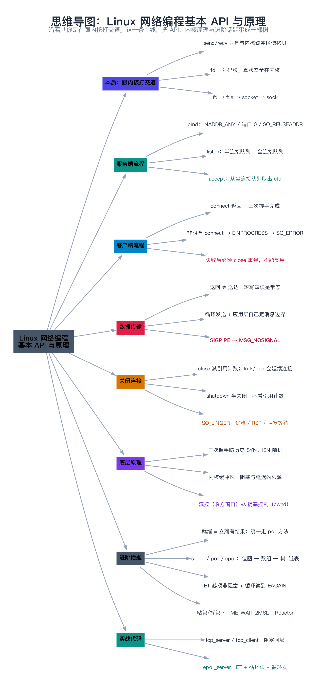
