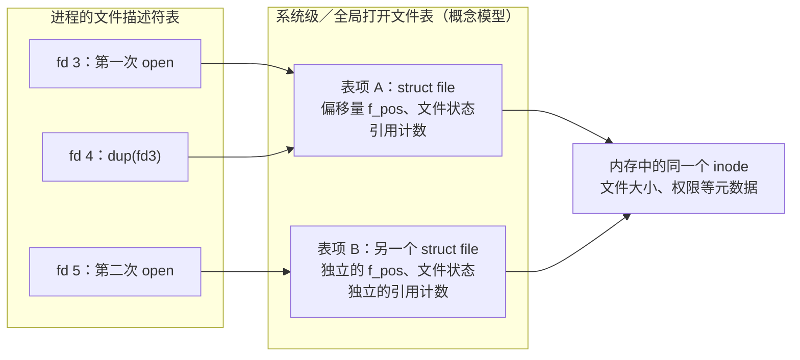

# Linux 文件 I/O：从 open、read、write、close 到 lseek

在 Linux 中，读取配置文件、写入日志、复制数据和修改文件内容，都可以从五个接口开始：`open`、`read`、`write`、`close` 和 `lseek`。

它们的函数原型并不复杂，真正容易出错的是几个隐藏的问题：文件描述符代表什么？读写从哪里开始？一次调用是否一定完成全部操作？函数返回成功后，数据究竟在内存里还是已经落盘？

本文以 **Linux/POSIX、C 语言和普通磁盘文件**为背景，沿着一次文件操作的过程，解释这五个接口的使用方式、底层原理和面试考点。管道、终端与 socket 的特殊行为会单独指出。

在五个基础接口之外，文章还沿着同一模型展开 fd 复制、`fcntl` 标志管理、stdio 缓冲和直接 I/O：它们分别回答“谁共享打开状态”“怎样修改状态”“数据先存在哪里”和“怎样选择数据传输路径”。

## 一、理解文件描述符，才能理解文件操作

程序不能把一个路径直接交给 `read()`。它通常要先调用 `open()`，让内核找到文件、检查访问权限，并建立后续操作所需的状态。

`open()` 返回一个非负整数，称为**文件描述符**，简称 fd：

```c
int fd = open("data.txt", O_RDONLY);
```

fd 是进程文件描述符表中的索引，并不是文件内容，也不是磁盘地址。它在当前进程中有意义：两个进程都拥有 fd 3，不代表它们打开的是同一个文件。

通常，进程启动时已经有三个描述符：

| 描述符 | 标准名称 | 常用宏 |
| --- | --- | --- |
| 0 | 标准输入 | `STDIN_FILENO` |
| 1 | 标准输出 | `STDOUT_FILENO` |
| 2 | 标准错误 | `STDERR_FILENO` |

因此，新打开文件常得到 fd 3。不过，`open()` 返回的是当前最小的可用非负描述符；如果 0 已经被关闭，下次打开文件就可能返回 0。判断失败应写成 `fd == -1`，不能写成 `fd <= 0`。

### 1.1 内核中有三个不同层次

假设 `data.txt` 已存在，下面的调用全部成功，返回的描述符编号恰好依次为 3、4、5，且两次路径查找指向同一个文件：

```c
int fd3 = open("data.txt", O_RDWR);  // 假设返回 3：创建打开文件描述 A
int fd4 = dup(fd3);                  // 假设返回 4：增加对 A 的引用
int fd5 = open("data.txt", O_RDWR);  // 假设返回 5：创建打开文件描述 B
```

这里还需要明确“表与表项”的关系：**打开文件描述，就是系统级（全局）打开文件表中的一个表项。** 进程的文件描述符表保存对这些表项的引用，多个进程也可以引用同一个表项。

因此，这个例子是 **进程描述符表中的 3 个 fd → 系统级打开文件表中的 2 个表项 → 1 个文件 inode**：



箭头表示引用关系，图中省略了路径与目录项等辅助结构。`dup()` 不创建新的系统级打开表项：fd 3 和 fd 4 都引用 A。第二次 `open()` 则创建 B；A 和 B 是两个对象，保存的偏移量和文件状态相互独立，但关联同一个文件。

“全局”表示这些打开对象由内核在系统范围内管理，可以被不同进程引用，**不表示一个文件只能有一个打开表项**。例如 `fork()` 后，子进程继承的对应 fd 仍引用 A、B，并不为每个继承的 fd 新建打开表项。[参考：open(2)](https://man7.org/linux/man-pages/man2/open.2.html)

实现上，进程的描述符表也位于内核空间。“系统级打开文件表”是描述全系统打开文件对象及其共享关系的概念模型；Linux 使用动态分配的 `struct file` 等结构管理这些对象，不应把示意图理解成必须存在一个固定、连续的全局数组。[参考：Linux VFS 文档](https://docs.kernel.org/filesystems/vfs.html)

例如，在没有其他操作干扰时，`lseek(fd3, 100, SEEK_SET)` 会把 A 的偏移量改成 100，所以通过 fd 4 查询位置也会得到 100；B 的偏移量仍为 0。若通过任一可写 fd 截断文件，改变的却是同一文件的大小，其他 fd 也会观察到这一变化。

**文件描述符表**回答“这个 fd 对应哪个打开对象”；**打开文件描述**保存当前偏移量和文件状态，Linux 中通常对应 `struct file`；**inode**代表文件系统中的文件对象，保存类型、权限、大小等元数据。文件名通过目录项与 inode 关联。

由此可知：分别两次 `open()` 同一个文件，偏移量独立；通过 `dup()` 复制描述符，则共享偏移量。`fork()` 继承的对应描述符也引用原有打开文件描述，因此父子进程可以影响彼此的读写位置。

需要再区分一层：`O_APPEND` 等文件状态标志属于打开文件描述；`FD_CLOEXEC` 属于描述符本身。[参考：open(2)](https://man7.org/linux/man-pages/man2/open.2.html)、[dup(2)](https://man7.org/linux/man-pages/man2/dup.2.html)

### 1.2 dup、dup2 与 fcntl(F_DUPFD)：复制的是引用

这组接口为已有打开文件描述建立另一个 fd 引用，不复制文件内容，也不新建独立的文件偏移量。

```c
#include <unistd.h>
#include <fcntl.h>

int dup(int oldfd);
int dup2(int oldfd, int newfd);
// fcntl 是可变参数接口，下面展示 F_DUPFD 的调用形式：
// int newfd = fcntl(oldfd, F_DUPFD, minfd);
```

| 接口 | 新 fd 如何选择 | 已占用的编号如何处理 |
| --- | --- | --- |
| `dup(oldfd)` | 当前最小可用非负编号 | 跳过已占用编号 |
| `dup2(oldfd, newfd)` | 精确使用指定的 `newfd` | 必要时关闭原目标并替换其引用 |
| `fcntl(oldfd, F_DUPFD, minfd)` | 大于等于 `minfd` 的最小可用编号 | 跳过已占用编号，不替换它们 |

成功都返回新 fd，失败返回 `-1` 并设置 `errno`。例如 `fcntl(fd, F_DUPFD, 100)` 的结果可能是 100，也可能是 101 或更大，取决于可用编号，不能把它当成指定编号的 `dup2()`。[参考：dup(2)](https://man7.org/linux/man-pages/man2/dup.2.html)、[F_DUPFD](https://man7.org/linux/man-pages/man2/F_DUPFD.2const.html)

复制后，两个 fd 共享偏移量、访问模式和 `O_APPEND`、`O_NONBLOCK` 等文件状态。关闭其中一个，只释放这一项引用，另一个通常仍能继续访问；相关打开对象要到最后的引用释放后才回收，不能把引用计数理解成某个进程中可见 fd 数量的简单同义词。

#### dup2 为什么适合重定向？

将标准输出改到已经打开的日志文件，核心操作是：

```c
// 前提：log_fd 是有效、可写的描述符。
if (dup2(log_fd, STDOUT_FILENO) == -1) {
    perror("dup2");
    // 调用方处理错误；此时不能按重定向成功继续。
}
```

成功后，fd 1 引用 `log_fd` 的打开文件描述。若 `log_fd != STDOUT_FILENO`，可以关闭多余的 `log_fd` 引用；若二者相同，就不能再关闭它，否则会关闭标准输出。若此前使用过 `printf` 等，应在改变 fd 1 前刷新并检查 `stdout`，避免旧缓冲内容被送到新目标。

`dup2()` 将“释放目标 fd 的旧引用”和“让目标 fd 引用新对象”作为原子步骤处理。不要用 `close(newfd); dup(oldfd);` 模拟，否则线程或信号处理程序可能在两步之间占用目标编号。

两个边界也要记住：`oldfd` 无效时，不会先关闭目标；`oldfd == newfd` 且有效时，不执行替换，直接返回该 fd。被替换目标的关闭错误不会通过 `dup2()` 报告，不能靠重定向验证旧输出是否已可靠保存。[参考：dup(2)](https://man7.org/linux/man-pages/man2/dup.2.html)

#### 复制 fd 与 close-on-exec

普通 `dup()`、`F_DUPFD` 创建的新 fd 不保留原 fd 的 `FD_CLOEXEC` 设置；`dup2()` 在两个编号不同时，新目标的该标志也会被清除。`dup2(fd, fd)` 是不做操作的特例，原标志保持不变。

需要在复制时同时设置关闭标志，可使用 `fcntl(fd, F_DUPFD_CLOEXEC, minfd)`；Linux 还提供 `dup3(oldfd, newfd, O_CLOEXEC)`。`dup3()` 在两个编号相同时返回 `EINVAL`。这些接口避免“先复制，再设置标志”的并发窗口，但仍共享原有的打开文件描述。[参考：F_DUPFD](https://man7.org/linux/man-pages/man2/F_DUPFD.2const.html)、[dup(2)](https://man7.org/linux/man-pages/man2/dup.2.html)

## 二、open：建立一次文件访问

```c
#include <fcntl.h>

int open(const char *pathname, int flags, ... /* mode_t mode */);
```

成功返回 fd，失败返回 `-1` 并设置 `errno`。第三个参数不是固定必填：使用 `O_CREAT` 时必须提供新文件权限；Linux 的 `O_TMPFILE` 也要求它。

### 2.1 三种访问模式与常用标志

访问模式选择一种：

| 模式 | 含义 |
| --- | --- |
| `O_RDONLY` | 只读 |
| `O_WRONLY` | 只写 |
| `O_RDWR` | 可读可写 |

不能把 `O_RDONLY | O_WRONLY` 当成读写模式，`O_RDONLY` 的值通常为 0。其他标志可以按位或组合：

| 标志 | 作用 |
| --- | --- |
| `O_CREAT` | 文件不存在时创建 |
| `O_EXCL` | 配合 `O_CREAT`，文件已存在则失败 |
| `O_TRUNC` | 对以写权限打开的普通文件，将长度截断为 0 |
| `O_APPEND` | 每次写入时定位到文件末尾 |
| `O_CLOEXEC` | 成功执行 `exec` 时关闭该描述符 |
| `O_NONBLOCK` | 对支持的对象启用非阻塞模式；普通磁盘文件通常不因此变成非阻塞 I/O |

几种常见写法：

```c
// 只读打开现有文件。
int fd = open("data.txt", O_RDONLY | O_CLOEXEC);

// 以下为其他独立示例，不要连续执行后覆盖原 fd。
// 写入新内容：已有文件会被清空。
// int fd = open("data.txt", O_WRONLY | O_CREAT | O_TRUNC, 0644);

// 追加日志：保留旧内容。
// int fd = open("app.log", O_WRONLY | O_CREAT | O_APPEND, 0644);

if (fd == -1) {
    perror("open");
    // 处理错误，不继续使用这个 fd。
}
```

`O_CLOEXEC` 很适合长期运行、多线程或会启动子程序的应用。直接在 `open()` 时设置它，还能避免“打开后再设置关闭标志”期间，另一个线程执行 `fork` / `exec` 导致的描述符泄漏。

### 2.2 创建权限还会受到 umask 影响

在不涉及目录默认 ACL 的常见情况下：

```text
实际创建权限 = mode & ~umask

mode  = 0666
umask = 0022
结果  = 0644，即 rw-r--r--
```

权限前面的 `0` 表示八进制。第三个参数影响新文件的权限，不会把已经存在的文件改成这个权限。

从内核角度看，`open()` 主要经历路径解析、权限检查、必要的创建或截断、建立打开文件描述，以及分配 fd。打开文件通常不意味着把整个文件读入内存。[参考：open(2)](https://man7.org/linux/man-pages/man2/open.2.html)

### 2.3 O_TRUNC 与 O_APPEND 可以共存，但不会互相抵消

这组标志在普通可写文件上可以使用，但含义是“打开时清空，此后追加”，并非“保留旧内容并追加”：

```c
// 反例：如果目的是保留历史日志，就不应该带 O_TRUNC。
int fd = open("app.log", O_WRONLY | O_CREAT | O_TRUNC | O_APPEND, 0644);
```

`O_TRUNC` 在打开时改变文件大小；`O_APPEND` 决定后续每次写入的位置。它们生效于不同阶段。

假设两个进程都用这组标志打开同一个日志文件：

| 时刻 | 操作 | 文件内容 |
| --- | --- | --- |
| T1 | 进程 A 打开文件，触发截断 | 空 |
| T2 | A 写入一条日志 | A 的日志 |
| T3 | 进程 B 打开同一文件，再次触发截断 | 空，A 的日志已被清掉 |
| T4 | B 追加一条日志 | B 的日志 |

这不是追加定位的原子性失效，而是另一项操作直接截断了文件。`O_APPEND` 不阻止其他进程执行截断，也不会恢复被清掉的内容。

保留历史的追加日志通常使用 `O_WRONLY | O_CREAT | O_APPEND`。只有明确要覆盖旧内容、并已协调好初始化或并发访问时，才使用 `O_TRUNC`。即使只有一个写入者，也要先确认清空旧内容符合业务意图。

还要注意：截断影响同一文件的大小，却不会把其他已打开描述所保存的偏移量一起归零。若其他写入者没有设置 `O_APPEND`，可能继续在旧位置写入并形成空洞；这与后文 `ftruncate()` 的机制相通。[参考：open(2)](https://man7.org/linux/man-pages/man2/open.2.html)、[ftruncate(2)](https://man7.org/linux/man-pages/man2/ftruncate.2.html)

### 2.4 fcntl(F_GETFL/F_SETFL)：正确设置 O_NONBLOCK

`fcntl()` 可以查询或修改某些文件状态。给已有 fd 设置非阻塞模式，应先取得当前标志，再修改目标位，保留其他状态：

```c
#include <fcntl.h>

int enable_nonblocking(int fd)
{
    int flags = fcntl(fd, F_GETFL);
    if (flags == -1) {
        return -1;
    }
    return fcntl(fd, F_SETFL, flags | O_NONBLOCK);
}
```

恢复阻塞模式时，重新查询当前标志，再提交 `flags & ~O_NONBLOCK`。直接 `fcntl(fd, F_SETFL, O_NONBLOCK)` 可能清掉本应保留的 `O_APPEND` 等状态。查询再设置不是原子的位更新，多线程同时修改同一打开文件描述的标志时，还需要协调。[参考：F_GETFL / F_SETFL](https://man7.org/linux/man-pages/man2/F_GETFL.2const.html)

这里有两套容易混淆的命令：

| 命令 | 操作对象 | 典型标志 | 是否影响 dup 后的其他 fd |
| --- | --- | --- | --- |
| `F_GETFL` / `F_SETFL` | 打开文件描述的文件状态 | `O_NONBLOCK`、`O_APPEND` | 会，因为共享同一个打开对象 |
| `F_GETFD` / `F_SETFD` | 某一个 fd 的描述符标志 | `FD_CLOEXEC` | 不会，标志按 fd 分别保存 |

`F_GETFL` 还返回访问模式，可以用 `flags & O_ACCMODE` 取得它。`F_SETFL` 不能把只读 fd 改成可写 fd，也不能事后执行 `O_CREAT`、`O_TRUNC`，Linux 上也不能借它切换 `O_SYNC` / `O_DSYNC`。[参考：F_GETFL](https://man7.org/linux/man-pages/man2/F_GETFL.2const.html)、[F_GETFD](https://man7.org/linux/man-pages/man2/F_GETFD.2const.html)

#### 非阻塞模式在哪些对象上有意义？

- **普通磁盘文件：** `O_NONBLOCK` 通常不改变读写等待存储的行为。标志设置成功，不等于磁盘 I/O 已变成异步。
- **管道与流式 socket：** 暂时不能读写时通常返回 `EAGAIN` / `EWOULDBLOCK`，应用应保留当前进度，等待就绪后继续。读取返回 0 通常表示 EOF 或对端有序关闭，不能与“暂时没有数据”混淆。
- **FIFO：** 标志还影响打开过程。非阻塞只读打开可立即返回；非阻塞只写打开在没有读端时会失败，通常是 `ENXIO`。[参考：open(2)](https://man7.org/linux/man-pages/man2/open.2.html)、[fifo(7)](https://man7.org/linux/man-pages/man7/fifo.7.html)

普通文件上的这一限制，不能解释成“内核没有异步缓存机制”。Linux 已有异步预读和后台回写；同步读写仍可能等待所需数据、文件系统资源或锁。这里的关键是：`O_NONBLOCK` 没有为普通文件的 `read/write` 提供通用的“不等待”语义。[参考：Linux 内核预读机制](https://docs.kernel.org/core-api/mm-api.html#readahead)、[open(2)](https://man7.org/linux/man-pages/man2/open.2.html)

需要区分另外两类机制：`preadv2()` 的 `RWF_NOWAIT` 可在支持的路径上请求不等待，未能读取任何数据时可返回 `EAGAIN`，已完成一部分则返回实际读取量；原生 AIO、`io_uring` 则支持异步提交和随后获取完成结果。部分文件系统的 `O_DIRECT` 路径可结合这些非阻塞提交或异步机制使用，具体支持取决于接口、操作、内核和文件系统；**仅给普通文件设置 `O_DIRECT | O_NONBLOCK`，不能据此保证普通 `read/write` 不阻塞或异步完成**。这些能力也并非统一从 Linux 6.x 才开始出现，例如原生 AIO 的 `RWF_NOWAIT` 支持早在 Linux 4.14 就已加入。[参考：preadv2 / RWF_NOWAIT](https://man7.org/linux/man-pages/man2/readv.2.html)、[io_submit(2)](https://man7.org/linux/man-pages/man2/io_submit.2.html)、[io_uring(7)](https://man7.org/linux/man-pages/man7/io_uring.7.html)

`epoll` 报告就绪，不会自动把 fd 设为非阻塞，也不保证其他线程没有抢先消耗数据。使用边沿触发 `EPOLLET` 时，常用的处理方式是让 fd 非阻塞，持续处理到 `EAGAIN`；若已经遇到 EOF、其他错误或待发送数据耗尽，则按相应状态处理。否则可能在事件回调中阻塞，或留下数据却等不到预期的新边沿。[参考：epoll(7)](https://man7.org/linux/man-pages/man7/epoll.7.html)

## 三、read：读取的是实际字节数

```c
#include <unistd.h>

ssize_t read(int fd, void *buf, size_t count);
```

这表示尝试读取**最多** `count` 字节。返回值有三种情况：

| 返回值 | 含义 |
| --- | --- |
| 大于 0 | 实际读取的字节数 |
| 等于 0 | 当 `count > 0` 且对象是普通文件时，表示当前位置已到或超过 EOF |
| 等于 -1 | 失败，检查 `errno` |

`count` 使用无符号的 `size_t`；返回值使用有符号的 `ssize_t`，以便表示 `-1`。不要直接把返回值存进 `size_t`，否则错误值会变成一个很大的正数。

### 3.1 短读不等于错误

假设文件只有 100 字节，要求读取 4096 字节，返回 100 完全正常。对于管道、终端等对象，当前可用数据或信号中断也可能使本次读取提前结束。

读取普通文件时，成功返回 `n` 字节后，偏移量通常前进 `n`。再次调用会从新位置继续，而不是重新从文件头读取。

`read()` 不会补上字符串结束符。如果想把数据按 C 字符串处理，需要自己预留空间：

```c
char buf[1024];
ssize_t n;

do {
    n = read(fd, buf, sizeof(buf) - 1);
} while (n == -1 && errno == EINTR);

if (n == -1) {
    perror("read");
} else {
    buf[n] = '\0';
    // 这里可以按字符串处理，但原始数据仍可能包含内嵌的 '\0'。
}
```

图片、压缩包等二进制数据应始终按返回的字节数处理，不能通过 `strlen()` 推断读取长度。

### 3.2 EOF 不是文件里的特殊字符

对于普通文件，EOF 是“当前位置已经没有更多数据”的状态。文件稍后增长，或程序重新定位后，后续读取仍可能得到新数据。

`count == 0` 的读取也可能返回 0，因此不能脱离参数判断 EOF。管道暂时没有数据但仍有写端时，阻塞读取通常等待，非阻塞读取通常返回 `EAGAIN`；只有缓冲数据耗尽且所有写端关闭时，才读到 EOF。

底层上，普通文件的缓冲读取通常先查 Page Cache。命中时从内存复制到用户缓冲区；未命中时，需要经过文件系统及存储层把数据读入缓存。一次 `read()` 并不必然对应一次磁盘访问。[参考：read(2)](https://man7.org/linux/man-pages/man2/read.2.html)

## 四、write：写入成功，仍要看写了多少

```c
#include <unistd.h>

ssize_t write(int fd, const void *buf, size_t count);
```

`write()` 尝试从用户缓冲区写入 `count` 字节，返回实际写入量。它同样可能发生短写，例如请求 1000 字节，本次只完成 600 字节。

正确的后续操作是从 `buf + 600` 继续写剩余的 400 字节；如果再次传入原缓冲区和原长度，就可能重复写入前面的内容。后文完整程序提供了处理短写的循环。

对于普通文件，写入默认从当前偏移量开始，成功后偏移量增加实际写入量。写入通常是**覆盖或扩展**，不会自动将原有内容向后挪动：

```text
原内容：abcdef
定位到偏移量 2，写入 XY
新内容：abXYef
```

### 4.1 EINTR、EAGAIN 与部分完成

`read/write` 返回 `-1` 且 `errno == EINTR` 时，通常可以重试。如果调用已经完成一部分传输后才被信号打断，可能直接返回正的字节数，必须先计算已完成量。

非阻塞对象上的 `EAGAIN` / `EWOULDBLOCK` 表示当前不能继续，应等待可读或可写事件，通常结合 `poll` / `epoll`，而不是紧密循环空转。

其他错误也不意味着此前的操作被回滚。例如循环先写入 600 字节，后一次因为磁盘空间不足失败，前面的 600 字节仍可能已经生效。[参考：write(2)](https://man7.org/linux/man-pages/man2/write.2.html)

### 4.2 追加写为什么要用 O_APPEND？

下面两步之间存在并发窗口：

```c
lseek(fd, 0, SEEK_END);
write(fd, data, len);
```

假设两个进程分别打开同一文件，都定位到旧的文件末尾，然后先后写入，就可能发生覆盖。`O_APPEND` 让“定位到当前末尾”和“本次写入”按追加语义一起完成。

但它不保证多次 `write()` 组成的业务记录整体原子，也不保证数据已经持久化。循环补齐短写时，其他写入者还可能在两次调用之间追加内容。NFS 等文件系统也存在额外限制，不能把本地文件系统的追加保证直接推广到所有环境。[参考：open(2)](https://man7.org/linux/man-pages/man2/open.2.html)

### 4.3 write 成功不等于落盘

普通缓冲写入通常是：

```text
用户数据 → write() → 内核 Page Cache 中的脏数据 → 回写 → 存储设备
```

`write()` 可能在数据只进入缓存时就返回。需要持久化时，要考虑 `fsync()` 或 `fdatasync()`：前者同步文件数据和相关元数据，后者可以省去部分非必要元数据，但仍同步正确读取数据所必需的信息，例如扩展后的文件大小。

`open()` 还提供几个容易混淆的标志：

| 标志 | 关注的问题 |
| --- | --- |
| `O_SYNC` | 每次写入都要求数据及相关文件元数据同步完成 |
| `O_DSYNC` | 每次写入要求数据及读取必需的元数据同步完成 |
| `O_DIRECT` | 请求绕过文件数据的 Page Cache，改变缓存路径；自身不等于同步落盘 |

同步保证仍需建立在返回成功和存储系统正确实现语义的基础上，也不等于事务原子性。新建或重命名文件后，如果还要求目录项持久化，通常需要同步父目录。[参考：fsync(2)](https://man7.org/linux/man-pages/man2/fsync.2.html)、[open(2)](https://man7.org/linux/man-pages/man2/open.2.html)

### 4.4 fsync 报错后，为什么不能“重试成功就当没发生过”？

写入与错误报告可能发生在不同时间：`write()` 先把数据交给页缓存，后台回写时才发生设备错误，随后由 `fsync()` 报告。同步调用因此既是等待点，也是发现先前写回失败的机会。

Linux 的 `errseq_t` 等机制会记录错误，并让观察者检查“自上次检查以来有没有新错误”。一次错误被观察并推进检查位置后，后续没有新错误的检查可以返回成功；这不代表此前失败的数据已被重新写好，不能简单理解成一个永久保留的全局错误标志。[参考：Linux 内核 errseq_t 文档](https://docs.kernel.org/core-api/errseq.html)

更关键的是，某些操作系统或文件系统的写回错误路径可能不再保留可重试的脏数据。于是可能出现：

```text
write 成功 → 后台写回失败 → fsync 报错
                                ↓
                       再次 fsync 返回成功
                                ↓
             仍不能据此确认先前失败的数据已经恢复
```

PostgreSQL 对 `data_sync_retry` 的文档明确说明了这种风险：默认对数据文件同步失败采用 PANIC 处理，并通过 WAL 恢复流程处理，而不是仅依靠下一次同步的成功返回。[参考：PostgreSQL 错误处理配置](https://www.postgresql.org/docs/18/runtime-config-error-handling.html#GUC-DATA-SYNC-RETRY)

工程上应保存并上报首次错误，把受影响写入标记为**持久性未确认**，根据业务执行重新生成、从可靠副本恢复、事务恢复或停止相关写入等处理。单纯重新打开文件、重新 `fsync()`，都不能替代数据恢复。

这也不意味着所有 `fsync()` 失败都证明文件已经损坏。`EINTR` 通常可按信号中断策略重试；`EBADF`、`EINVAL` 应检查描述符和接口使用；`EIO` 等写回错误则不能被后续成功掩盖。先区分失败原因，再决定恢复策略。[参考：fsync(2)](https://man7.org/linux/man-pages/man2/fsync.2.html)

### 4.5 O_DIRECT 的对齐：地址、偏移、长度都要检查

直接 I/O 往往对三个量提出要求：用户缓冲区的起始地址、文件偏移量，以及本次传输长度。**不能把规则简化成“缓冲区有 4096 字节就够了”，也不能假定所有文件统一按 4 KB 对齐。**

具体限制取决于文件系统、文件、设备和内核，某些路径甚至没有同样的约束；不满足要求时，可能返回 `EINVAL`，也可能回退到缓冲 I/O。因此，调用成功本身不能证明走了预期的直接 I/O 路径。[参考：open(2) 的 O_DIRECT 说明](https://man7.org/linux/man-pages/man2/open.2.html)

从 Linux 6.1 起，可在支持的环境下通过 `statx()` 请求 `STATX_DIOALIGN`，查询目标文件的要求。必须检查返回的 `stx_mask` 是否确实包含该信息，再解释字段：

| 字段 | 含义 |
| --- | --- |
| `stx_dio_mem_align` | 用户缓冲区地址的对齐要求 |
| `stx_dio_offset_align` | 文件偏移量和 I/O 段长度的对齐要求 |

若该信息有效且两个字段均为 0，表示该文件不支持直接 I/O；若根本没有返回对应 mask，表示没有获得这些信息，不能把默认的零值当成查询结论。较新环境还可能通过 `STATX_DIO_READ_ALIGN` 返回较宽松的读取偏移／长度要求，地址要求仍需单独满足。[参考：statx(2)](https://man7.org/linux/man-pages/man2/statx.2.html)

设查询到的地址要求为 M、偏移及长度要求为 A，典型约束是：

```text
buffer_address % M == 0
file_offset    % A == 0
io_length      % A == 0
```

`char buf[4096]` 只保证数组长度，不保证起始地址满足直接 I/O 对齐。普通 `malloc()` 也不能直接当作满足这些额外要求。可以使用 `posix_memalign()` 分配对齐内存；其 alignment 参数本身还必须是 2 的幂且为 `sizeof(void *)` 的倍数。

下面仅演示内存分配，**假设已确认目标需要的地址对齐为 4096 字节**：

```c
#include <stdlib.h>
#include <stdio.h>
#include <string.h>

// 以下片段放在调用方函数内；posix_memalign 需要相应 POSIX 声明。
void *buf = NULL;
int err = posix_memalign(&buf, 4096, 4096);
if (err != 0) {
    // 它直接返回错误码，不通过 errno 报告错误。
    fprintf(stderr, "posix_memalign: %s\n", strerror(err));
} else {
    memset(buf, 0, 4096);
    // 读写时还须保证 offset 和 length 满足各自要求。
    // 若提交异步 I/O，必须等请求完成后才能释放缓冲区。
    free(buf);
}
```

此接口分配的内存可以用 `free()` 释放。[参考：posix_memalign(3)](https://man7.org/linux/man-pages/man3/posix_memalign.3.html)

尾部数据不足一个对齐单位时，需要明确业务和文件格式允许的处理方式，不能随意补零扩大文件或覆盖相邻内容。短读短写之后继续传输，也要重新检查剩余地址、偏移和长度是否仍对齐。直接 I/O 仍不提供自动落盘保证，同一文件上的直接 I/O、普通缓冲 I/O 和文件映射混用还会增加一致性与性能问题。[参考：open(2)](https://man7.org/linux/man-pages/man2/open.2.html)

## 五、lseek：改变下一次读写的位置

```c
#include <unistd.h>

off_t lseek(int fd, off_t offset, int whence);
```

成功返回新的偏移量，失败返回 `(off_t)-1`。偏移量以字节为单位，应使用 `off_t` 保存。

| whence | 新位置的计算方式 |
| --- | --- |
| `SEEK_SET` | 文件开头 + offset |
| `SEEK_CUR` | 当前偏移量 + offset |
| `SEEK_END` | 文件当前大小 + offset |

```c
off_t pos = lseek(fd, 0, SEEK_CUR);  // 查询当前位置
off_t begin = lseek(fd, 0, SEEK_SET); // 回到开头
off_t end = lseek(fd, 0, SEEK_END);   // 定位到末尾
// 实际使用时检查每次结果是否为 (off_t)-1。
```

`lseek()` 主要调整打开文件描述里的逻辑偏移量，不是命令磁盘磁头移动，也不会因为定位就读取或写入文件内容。

### 5.1 文件大小与当前偏移量是两份状态：用 ftruncate 理解

文件大小通常对应 inode 中的 `i_size`；当前偏移量通常对应打开文件描述中的 `f_pos`。前者描述“这个文件有多长”，后者描述“这次打开的顺序读写进行到哪里”。它们分别存储，不能把其中一个当成另一个。

`lseek()` 可以只改变偏移量；`ftruncate()` 则可以直接改变文件大小：

```c
#include <unistd.h>

int ftruncate(int fd, off_t length);
```

对支持该操作的普通文件，fd 必须可写，长度不能为负。调用成功返回 0，失败返回 `-1` 并设置 `errno`。文件较大时丢弃超出目标长度的内容；文件较小时扩展，新增部分读取为零。**这两种情况都不改变当前文件偏移量。** 某些文件系统不支持通过该接口扩展文件，仍需检查结果。[参考：ftruncate(2)](https://man7.org/linux/man-pages/man2/ftruncate.2.html)

下面假设没有并发访问、fd 可读写且未设置 `O_APPEND`，所有操作都成功：

| 操作 | 文件大小 | 当前偏移量 | 结果 |
| --- | --- | --- | --- |
| 初始状态 | 1000 | 200 | 大小和位置各自保存 |
| `ftruncate(fd, 100)` | 100 | 200 | 文件变短，位置仍在新 EOF 之后 |
| `read(fd, buf, 1)` | 100 | 200 | 返回 0，不读取数据 |
| `write(fd, "X", 1)` | 201 | 201 | 在偏移量 200 写入，100–199 区间读取为零 |

若截断前偏移量是 50，截断到 100 后下一次读写仍从 50 开始。缩短后再扩大文件，也不会恢复先前被截掉的内容。

“两份状态独立”指它们存放在不同对象中、可以分别修改，并非所有操作都只影响一个：例如越过原 EOF 的顺序写入，就会同时推进偏移量并增大文件。文件大小变化还会被其他打开同一文件的描述符观察到，而它们各自的偏移量不因此自动重置。

### 5.2 定位超过 EOF，与稀疏文件

对普通文件，可以定位到 EOF 之后；仅仅定位不会扩大文件。随后在新位置写入，才会扩展文件，中间未写入的区域读取为零。

例如一个新建空文件：

```c
if (lseek(fd, 1024 * 1024, SEEK_SET) == (off_t)-1) {
    perror("lseek");
    // 停止后续写入。
} else {
    ssize_t n = write(fd, "X", 1);
    if (n == -1) {
        perror("write");  // 生产代码还应处理 EINTR。
    } else if (n != 1) {
        fputs("write made no progress\n", stderr);
    }
}
```

两步都成功后，文件逻辑大小为 1 MiB + 1 字节。在支持稀疏文件的文件系统上，中间零区域可以由空洞表示，不必分配同等大小的磁盘块，所以逻辑大小与实际磁盘占用可能不同。

### 5.3 三个定位陷阱

第一，管道、FIFO 和 socket 不支持这种随机访问，`lseek()` 通常报 `ESPIPE`。

第二，设置了 `O_APPEND` 后，即使先定位到文件头，下一次 `write()` 仍追加到末尾。

第三，通过 `lseek(fd, 0, SEEK_END)` 获取文件大小会改变共享偏移量。如果只是查询普通文件大小，通常更适合使用 `fstat()`。[参考：lseek(2)](https://man7.org/linux/man-pages/man2/lseek.2.html)

### 5.4 pread / pwrite 与 Linux 的 O_APPEND 偏差

多个线程共享一个打开文件描述时，“先 `lseek` 再 `read/write`”也不是不可分割的操作。需要指定位置且不改变共享偏移量，可以使用：

```c
ssize_t pread(int fd, void *buf, size_t count, off_t offset);
ssize_t pwrite(int fd, const void *buf, size_t count, off_t offset);
```

这两个接口仍需处理短读短写，也不自动解决同一区域的并发修改。

Linux 的一个特殊行为尤其值得记住：**打开文件描述设置了 `O_APPEND` 时，`pwrite()` 会忽略用于指定起点的 offset，仍把数据追加到文件末尾。** POSIX 则要求 `O_APPEND` 不影响 `pwrite()` 的写入起点，Linux 手册将该差异列在 BUGS 一节。

例如文件已有 `abc`，在设置了 `O_APPEND` 的 fd 上调用 `pwrite(fd, "X", 1, 0)`，成功且没有并发修改时，Linux 上的结果是 `abcX`，而非 `Xbc`。这种写入仍不推进打开文件描述的当前偏移量；“写入起点”和“是否更新共享偏移量”要分别理解。

因此，在 Linux 上用普通 `pwrite()` 实现按位置写入时，应使用未设置 `O_APPEND` 的打开文件描述。`dup()` 不能隔离这个标志，因为副本共享文件状态；临时清除标志再恢复，也可能干扰共享该打开文件描述的其他线程或进程。需要同时支持追加与按位置写入时，应明确分开打开方式，并协调对相同数据区域的访问。[参考：pread(2)](https://man7.org/linux/man-pages/man2/pread.2.html)、[dup(2)](https://man7.org/linux/man-pages/man2/dup.2.html)

## 六、close：释放描述符，不是删除文件

```c
#include <unistd.h>

int close(int fd);
```

成功返回 0，失败返回 `-1`。内核释放该描述符持有的引用；相关对象何时真正回收，还取决于是否存在其他引用。

```c
if (close(fd) == -1) {
    perror("close");
}
fd = -1;
```

关闭后，原来的整数编号可以立即被新的 `open()` 复用。因此，继续使用旧 fd，不一定只是得到 `EBADF`，还可能操作另一个刚被打开的文件。设成 `-1` 有助于减少误用，但不能处理其他线程或变量中保存的副本。

### 6.1 不要忽略错误，也不要盲目重试

某些写入错误可能延迟到 `close()` 才报告，尤其在网络文件系统等环境下，因此应该检查返回值。

但在 Linux 上，不应像重试 `read/write` 那样盲目重试 `close()`，包括遇到 `EINTR` 时。描述符通常已在较早阶段被释放；重试可能关闭另一个线程刚复用该编号的文件。这条处理方式具有平台差异，跨平台代码需要核对目标系统规定。

`close()` 本身也没有与 `fsync()` 等价的持久化保证。有要求时，应在关闭前显式同步，并处理同步失败。[参考：close(2)](https://man7.org/linux/man-pages/man2/close.2.html)

### 6.2 为什么文件删除后还能继续读写？

`close()` 释放描述符；`unlink()` 删除目录中的名称链接。两者操作的层次不同。

删除一个名称后，不能再通过该目录项找到原文件，但其他硬链接、已经打开的 fd 等访问途径可能仍然存在。之后重新创建同名文件，通常会得到另一个文件对象，原 fd 不会自动转向它。

常见普通文件场景下，硬链接计数降为 0，且最后的打开引用释放后，文件才满足删除回收条件。但严格来说，**“最后一个 fd 关闭”并不总等于“最后一个引用消失”**：文件映射等也可能保留引用，`mmap()` 建立后关闭 fd，并不会自动撤销映射。因此应区分名称、描述符和文件对象的生命周期，避免把它们视为同一件事。[参考：unlink(2)](https://man7.org/linux/man-pages/man2/unlink.2.html)、[mmap(2)](https://man7.org/linux/man-pages/man2/mmap.2.html)

运维中“删了日志，但磁盘空间没释放”经常是因为服务仍在向已删除文件写入。可以检查硬链接数为 0、但仍被打开的文件：

```sh
# 需要 lsof；足够的权限才能查看相关进程。
lsof +L1
```

`+L1` 按链接计数筛选，比匹配输出中的 `deleted` 字符串更直接。结合 PID、FD 和大小信息定位进程后，优先使用服务支持的日志重新打开或轮转机制，让它关闭旧文件、打开新文件；必要时再按运维流程重启。仅删除路径或重新创建同名日志，不能解除旧引用。[参考：lsof(8)](https://man7.org/linux/man-pages/man8/lsof.8.html)

## 七、完整示例：创建、写入、定位、读取、关闭

下面的程序把五个接口串起来。它要求传入一个尚不存在的文件路径，使用 `O_EXCL` 避免覆盖已有内容；写入时处理短写和 `EINTR`，读取时循环到 EOF。

示例面向 Linux/POSIX。这里演示读写过程，不强制做持久化同步。标准输出统一使用 stdio，目标文件统一使用 fd 接口。

<!-- io_demo.c begin -->
```c
#define _POSIX_C_SOURCE 200809L

#include <errno.h>
#include <fcntl.h>
#include <limits.h>
#include <stdio.h>
#include <unistd.h>

// 用于阻塞描述符。失败前可能已经写入部分数据，不提供回滚。
static int write_all(int fd, const void *buf, size_t len)
{
    const unsigned char *p = buf;

    while (len > 0) {
        size_t count = len;
        if (count > (size_t)SSIZE_MAX) {
            count = (size_t)SSIZE_MAX;
        }

        ssize_t n = write(fd, p, count);
        if (n > 0) {
            p += n;
            len -= (size_t)n;
        } else if (n == -1 && errno == EINTR) {
            continue;
        } else {
            if (n == 0) {
                errno = EIO;  // 没有进展，避免无限循环。
            }
            return -1;
        }
    }
    return 0;
}

int main(int argc, char *argv[])
{
    if (argc != 2) {
        fprintf(stderr, "Usage: %s <new-file>\n", argv[0]);
        return 1;
    }

    int fd = open(argv[1], O_RDWR | O_CREAT | O_EXCL | O_CLOEXEC, 0600);
    if (fd == -1) {
        perror("open");
        return 1;
    }

    int result = 1;
    const char message[] = "Hello, Linux file I/O!\n";
    char buf[128];

    if (write_all(fd, message, sizeof(message) - 1) == -1) {
        perror("write");
        goto out;
    }

    // 写完后偏移量在末尾，先回到开头才能读到刚写入的内容。
    if (lseek(fd, 0, SEEK_SET) == (off_t)-1) {
        perror("lseek");
        goto out;
    }

    for (;;) {
        ssize_t n = read(fd, buf, sizeof(buf));
        if (n > 0) {
            // 按字节数输出，不要求 buf 以 '\0' 结尾。
            if (fwrite(buf, 1, (size_t)n, stdout) != (size_t)n) {
                perror("fwrite");
                goto out;
            }
        } else if (n == 0) {
            break;
        } else if (errno != EINTR) {
            perror("read");
            goto out;
        }
    }

    if (fflush(stdout) == EOF) {
        perror("fflush");
        goto out;
    }
    result = 0;

out:
    if (close(fd) == -1) {
        perror("close");
        result = 1;  // Linux 下不盲目重试 close。
    }
    return result;
}
```
<!-- io_demo.c end -->

保存为 `io_demo.c` 后，在 Linux 中编译运行：

```sh
cc -std=c11 -Wall -Wextra io_demo.c -o io_demo
./io_demo sample.txt
```

成功时输出：

```text
Hello, Linux file I/O!
```

再次使用同一路径运行，会因文件已经存在而失败。换一个未存在的文件名即可重新练习。

这个程序也说明了一个容易遗漏的细节：**同一个 fd 的读取和写入共用偏移量。** 写完直接 `read()`，通常已经在文件末尾，因而返回 0；需要先定位回去。

## 八、stdio：FILE * 在 fd 之上增加了什么？

对于通常的磁盘文件流，`FILE *` 是 C 标准库管理的用户态对象，内部关联 fd，并维护缓冲区、缓冲位置、EOF 和错误指示器等状态。它与内核的 `struct file` 分属不同层次，名字相似并不表示是同一个对象。

```text
fread / fwrite / fprintf
          ↓
FILE *：用户态缓冲、流位置和状态
          ↓ 底层 read / write
fd → 内核打开文件描述 struct file → 文件系统
```

### 8.1 fopen 模式、fdopen 与关闭责任

```c
#include <stdio.h>

FILE *fopen(const char *path, const char *mode);
FILE *fdopen(int fd, const char *mode);  // POSIX 接口
```

`fopen()` 成功返回流指针，失败返回 `NULL`。常用模式与底层打开意图的对应关系如下：

| 模式 | 访问意图 | 文件不存在时 | 文件已存在时 |
| --- | --- | --- | --- |
| `"r"` | 只读 | 失败 | 保留内容 |
| `"r+"` | 读写 | 失败 | 保留内容 |
| `"w"` / `"w+"` | 只写 / 读写 | 创建 | 截断为 0 |
| `"a"` / `"a+"` | 追加写 / 可读且追加写 | 创建 | 保留内容，写入追加到末尾 |

Linux/POSIX 上 `"b"` 通常不改变行为；跨平台处理二进制文件时仍应使用合适的二进制模式。

`fdopen()` 包装已有 fd，要求模式与 fd 的访问权限相容；它不会复制 fd，`"w"` 模式也不会像 `fopen("w")` 那样再次截断文件。包装成功后，通常由 `fclose(fp)` 关闭底层 fd；`fdopen()` 失败则仍由调用者负责原 fd。

`fileno(fp)` 只是取得流关联的 fd，不会转移关闭责任，也不会刷新缓冲。若确需保留一个独立负责关闭的描述符，可先 `dup()` 再 `fdopen()`；但它们仍共享打开文件描述和偏移量。[参考：fopen(3)](https://man7.org/linux/man-pages/man3/fopen.3.html)、[fileno(3)](https://man7.org/linux/man-pages/man3/fileno.3.html)

### 8.2 fread / fwrite 返回的是元素数

```c
size_t fread(void *ptr, size_t size, size_t nmemb, FILE *stream);
size_t fwrite(const void *ptr, size_t size, size_t nmemb, FILE *stream);
```

它们的成功返回量按**完整元素个数**计，不一定等于字节数。`fread(buf, 4, 10, fp)` 返回 3，表示成功读取了 3 个完整的 4 字节元素；不能由此假定底层一定只消费了 12 字节，因为还有不完整元素的情况。处理字节流时，常用 `size = 1`：

```c
unsigned char buf[1024];
size_t n = fread(buf, 1, sizeof(buf), fp);

// 先处理本次实际返回的 n 字节，包括随后遇到 EOF 或错误的情况。
if (n < sizeof(buf)) {
    if (ferror(fp)) {
        // 读取发生错误，不能把它当作正常 EOF。
    } else if (feof(fp)) {
        // 本次读取触及文件末尾。
    }
}
```

不能用 `while (!feof(fp))` 预判下一次读取是否成功：EOF 指示器由已经发生的读取更新。即使某次恰好读满最后一块，通常仍要再读取一次才能观察到 EOF。`fread()` 不负责补字符串终止符，`fwrite()` 满额返回也只代表库接受了这些元素，并不保证数据已持久化。[参考：fread(3)](https://man7.org/linux/man-pages/man3/fread.3.html)

### 8.3 缓冲、重定向与 fflush

| 缓冲方式 | 常见默认场景 | 输出提交时机举例 |
| --- | --- | --- |
| 全缓冲 | 普通文件，重定向到文件的 `stdout` | 缓冲区满、显式刷新、关闭流等 |
| 行缓冲 | 连接终端的 `stdout` | 换行、缓冲区满、显式刷新等 |
| 无缓冲 | Linux/glibc 默认的 `stderr` | 不为批量输出而积攒数据 |

所以 `printf("hello\n")` 在终端通常及时可见，改成 `./a.out > log.txt` 后，换行就未必触发提交。缓冲区大小不是固定的 4 KB 或 8 KB，可以在首次 I/O 前用 `setvbuf()` 配置模式，并检查返回值。[参考：setbuf(3)](https://man7.org/linux/man-pages/man3/setbuf.3.html)

**为什么常见到 4096 字节？** 以 glibc 的普通文件流默认分配逻辑为例：先以 `BUFSIZ` 为候选大小（当前源码中为 8192），查询文件属性成功且 `0 < st_blksize < BUFSIZ` 时，再采用 `st_blksize`。因此，当文件报告的 `st_blksize` 为 4096 时，默认缓冲区就常是 4096 字节；它并不是无条件等于 `BUFSIZ`，也不是所有 stdio 实现的统一规则。[参考：glibc 缓冲区分配源码](https://raw.githubusercontent.com/bminor/glibc/master/libio/filedoalloc.c)、[glibc BUFSIZ 定义](https://raw.githubusercontent.com/bminor/glibc/master/libio/stdio.h)

`st_blksize` 表示建议的高效 I/O 块大小，不应直接当作设备扇区大小、内存页大小或 `O_DIRECT` 对齐要求。显式配置缓冲、其他 C 库实现以及不同文件类型，也可能采用不同策略。[参考：inode(7)](https://man7.org/linux/man-pages/man7/inode.7.html)

对输出流，`fflush(fp)` 提交尚未输出的用户态数据，成功返回 0，失败返回 `EOF`；`fflush(NULL)` 刷新所有打开的输出流。它不会提供 `fsync()` 的内核与存储同步保证。普通文件使用 stdio 且需要持久化时，应检查每一步：`fwrite()` → `fflush()` → `fsync(fileno(fp))`，最后再 `fclose()`。[参考：fflush(3)](https://man7.org/linux/man-pages/man3/fflush.3.html)

从 `main` 返回或调用 `exit()` 正常终止时会刷新 stdio 流；`_exit()` 和异常终止不提供同样的刷新流程。`fork()` 后用户态缓冲也可能被复制，若父子进程都正常退出，先前积攒的内容可能输出两次；这与它们共享内核打开文件描述是两个层次的问题，可以在 `fork()` 前按需要刷新并检查结果。[参考：exit(3)](https://man7.org/linux/man-pages/man3/exit.3.html)、[_exit(2)](https://man7.org/linux/man-pages/man2/_exit.2.html)

### 8.4 混用接口与读写方向切换

对同一打开文件描述，先 `fwrite("A", ...)` 再 `write(fd, "B", 1)`，A 可能仍在用户缓冲中，B 却先提交。读取时，`fread()` 的预读也可能让底层偏移量领先于应用已经消费的位置。仅仅取得 `fileno(fp)`，不能解决这些问题。

优先统一使用一套读写接口。若必须从 stdio 输出切换到底层 fd 操作，先 `fflush()` 并检查；涉及预读、定位及切回流时，还需要遵守流与描述符的同步规则，不能把“刷新一下”当成通用方案。Linux/POSIX 的 `fflush()` 对可定位输入流有特定语义，也不能直接推广成所有 C 平台上“清空 stdin”的办法。[参考：fflush(3)](https://man7.org/linux/man-pages/man3/fflush.3.html)

即使完全使用 stdio，在 `r+`、`w+` 等更新流上改变读写方向也有规则：输出后转输入，需要先刷新或定位；输入后转输出，需要先定位，除非上次输入已遇到 EOF。`fseek()` / `fseeko()` 等定位操作同样要检查结果。[参考：fopen(3)](https://man7.org/linux/man-pages/man3/fopen.3.html)

## 九、面试中如何把这些知识讲清楚

**1. 文件描述符和 `FILE *` 有什么区别？**

fd 是内核接口使用的整数索引；`FILE *` 是标准 I/O 库管理的流对象，通常封装 fd，同时维护用户态缓冲、错误标志、EOF 状态等。`read/write` 不经过 stdio 缓冲，但普通文件读写仍可能经过 Page Cache。[参考：stdio(3)](https://man7.org/linux/man-pages/man3/stdio.3.html)

**2. 两次打开同一个文件，会共享读写位置吗？**

分别 `open()` 通常不共享；`dup()` 或 `fork()` 继承的对应描述符共享打开文件描述，也就共享偏移量。问题的关键在于是否引用同一个打开文件描述。

**3. 为什么一次 `read/write` 不一定完成全部数据？**

接口返回的是实际传输量。数据可用量、容量限制、信号和对象类型等都会影响本次操作。程序必须用返回值推进指针和剩余长度。

**4. `write()` 返回成功后，断电还会丢数据吗？**

可能。普通缓冲写入可能只进入了内核缓存，需要根据持久化要求使用同步接口或同步写入标志；如果还经过 stdio，应先刷新用户态缓冲。

**5. `lseek()` 超过文件末尾，会立刻扩大文件吗？**

不会。定位只是修改偏移量；随后在新位置写入才扩展文件，中间区域读取为零，并可能形成稀疏文件。

**6. `O_APPEND` 能否保证日志记录永不交错？**

不能直接这样保证。它处理本次追加的位置，不会把多次写入合成事务；一条记录如果分多次提交，其他写入者可能插入其间。

**7. `close()` 失败后为什么不能统一重试？**

因为在 Linux 上 fd 通常已经释放，编号可能被复用。应报告错误、检查此前的同步策略，而不是不加区分地再次关闭同一个整数。

**8. 多线程共享 fd 时，怎样读取文件的不同位置？**

使用 `pread()` 显式给出偏移量，避免依赖共享的当前位置。若线程同时修改相同数据区域，还需要额外的并发协调。

**9. `ftruncate(fd, 100)` 后，偏移量原来是 200，会变成多少？**

仍是 200。文件大小变成 100，偏移量不动；后续正常读取遇到 EOF，未设置 `O_APPEND` 的顺序写入则从 200 开始，可能扩展文件并产生中间零区域。

**10. `O_TRUNC | O_APPEND` 能否保护已有日志？**

不能。打开时先清空，后续写入再追加；另一个进程再次带 `O_TRUNC` 打开，会删除之前已经写入的内容。追加原子性不提供防截断保护。

**11. `fsync()` 先报 `EIO`、后成功，能否把首次错误忽略？**

不能。后续成功不证明首次失败的写入已经恢复。应保留错误并确认受影响数据的持久性；这与仅因 `EINTR` 中断而重试不同。

**12. `dup2(fd, 100)` 与 `fcntl(fd, F_DUPFD, 100)` 一样吗？**

不一样。前者精确替换 100；后者找大于等于 100 的最小空闲编号。两者得到的 fd 都共享原打开文件描述。

**13. 对 dup 出来的 fd 设置 O_NONBLOCK，会影响原 fd 吗？**

会，它修改的是共享的文件状态。修改 `FD_CLOEXEC` 则只影响那个描述符；对应命令分别是 `F_SETFL` 和 `F_SETFD`。

**14. fread 返回 10，是否就是读到了 10 字节？**

只有元素大小为 1 时才能这样理解。它返回完整元素数，短读还要通过 `feof()` / `ferror()` 区分结束与错误。

**15. O_DIRECT 只要申请一个 4 KB 缓冲区就能用吗？**

不能。缓冲区地址、文件偏移和传输长度都可能有要求，应查询或确认目标文件的实际约束；内存大小与地址对齐也是两个不同概念。

## 十、延伸：减少数据搬运与批量提交 I/O

掌握基础接口后，可以根据实际瓶颈继续学习下面这些工具。它们分别优化数据路径和请求提交方式，仍然需要正确处理字节数、偏移量、错误和持久化。

### 10.1 sendfile、copy_file_range 与 splice

典型的 `read()` 加 `write()` 复制，会让数据从内核进入用户缓冲区，再从用户缓冲区返回内核。若应用不需要检查或修改内容，可以考虑内核内的数据传递接口：

| 接口 | 常见用途 | 使用边界 |
| --- | --- | --- |
| `sendfile()` | 从文件发送数据到 socket 等输出对象 | 适用的输入、输出对象有约束；需检查实际发送量。[手册](https://man7.org/linux/man-pages/man2/sendfile.2.html) |
| `copy_file_range()` | 普通文件之间复制指定范围 | 内核或文件系统可采用复制卸载、共享数据块等优化；支持范围依赖文件系统和内核。[手册](https://man7.org/linux/man-pages/man2/copy_file_range.2.html) |
| `splice()` | 在管道与其他支持的 fd 之间转移数据 | 至少一端必须是管道，常用管道连接两段传输。[手册](https://man7.org/linux/man-pages/man2/splice.2.html) |

这些接口通常可以避免应用层 `read/write` 循环中数据经过用户缓冲区的往返，但不能统一表述为“都直接传递页面，保证全程零拷贝”。是否还能消除内核内部复制，取决于接口实现、文件系统、设备和具体路径。

它们也可能只完成部分传输，仍需按返回量推进操作。返回成功不额外承诺目标文件已经持久化。

### 10.2 io_uring：把提交和完成分开

`io_uring` 提供共享的提交队列和完成队列：应用准备请求，内核处理后通过完成记录报告结果。它支持批量提交，并允许多个 I/O 请求同时处于执行过程中，从而有机会减少逐次系统调用和串行等待的开销。

需要特别理解三点：

- 提交成功不等于 I/O 已完成；读取结果或复用请求依赖的缓冲区前，要确认对应完成事件。
- 完成顺序不应默认等于提交顺序。有依赖关系的操作，需要显式表达或协调；异步写入完成也不自动等于持久化。
- 完成记录通常通过结果字段报告字节数或负的错误码，不能照搬同步调用中“返回 `-1` 再读 `errno`”的判断方式。

实际收益取决于负载、队列深度、存储能力和所用模式；`io_uring` 不是自动零拷贝，也不保证每个场景都更快。适合在分析出提交或并发方面的瓶颈后，再引入这一模型。[参考：io_uring(7)](https://man7.org/linux/man-pages/man7/io_uring.7.html)

## 十一、实际编程时的检查顺序

拿到一个文件 I/O 需求，可以依次确认五件事：访问方式是读取、覆盖还是追加；文件是否允许被创建或截断，大小与偏移量如何变化；读写是否正确处理实际字节数；是否存在共享偏移量、并发写入或尚未释放的引用；需要的是数据已经提交、已经可见，还是已经持久化，以及失败后如何恢复。

这五个问题分别连接着 `open` 的标志、`read/write` 的返回值、`lseek` 的位置管理和 `close` 前的同步与清理。把它们连起来，才能从“会调用函数”走到“能解释程序为什么这样运行”。
