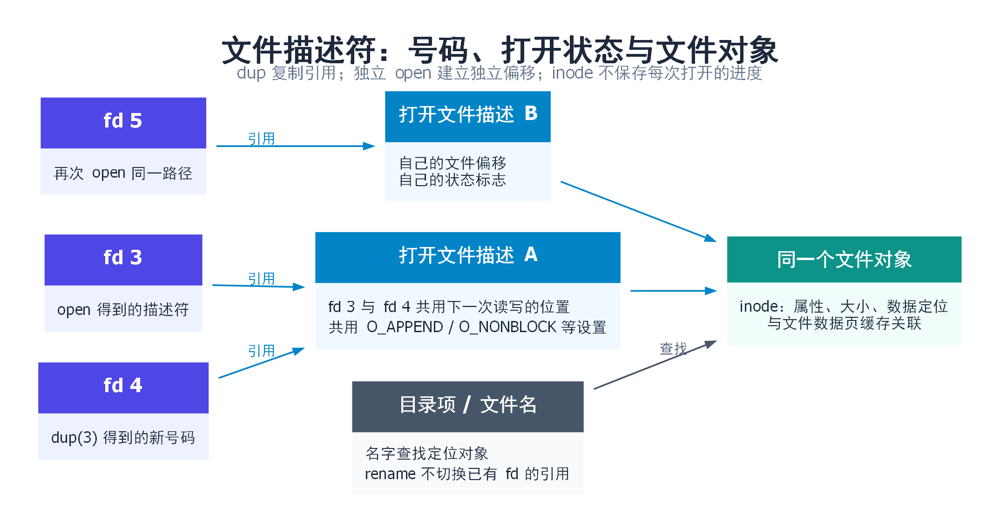
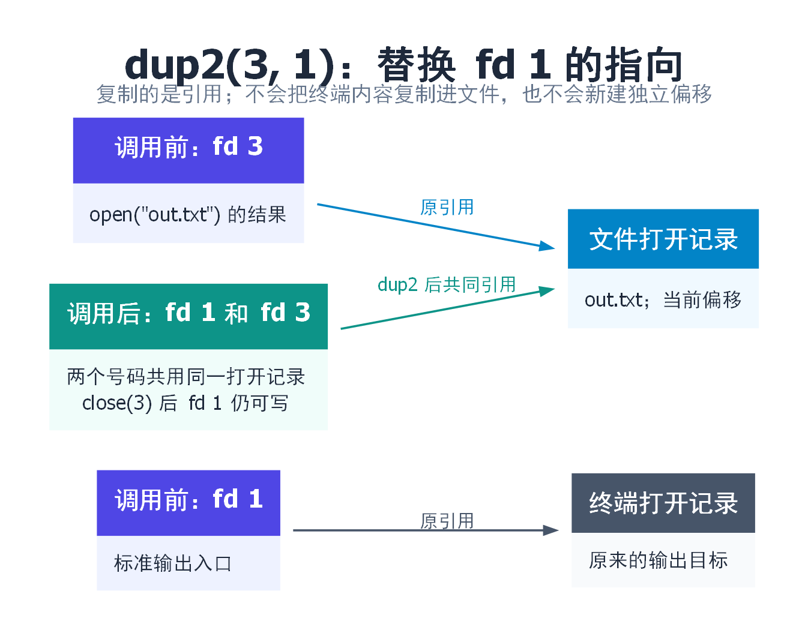
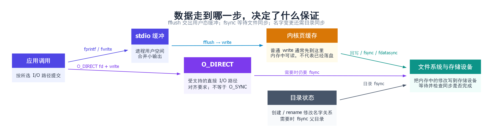
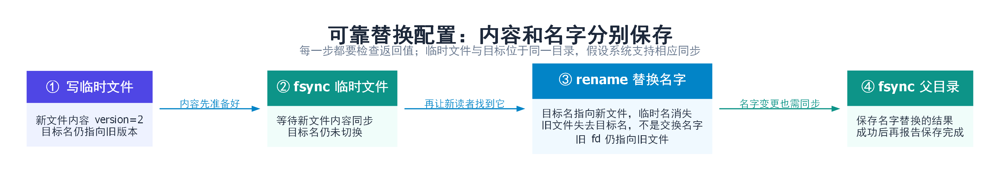
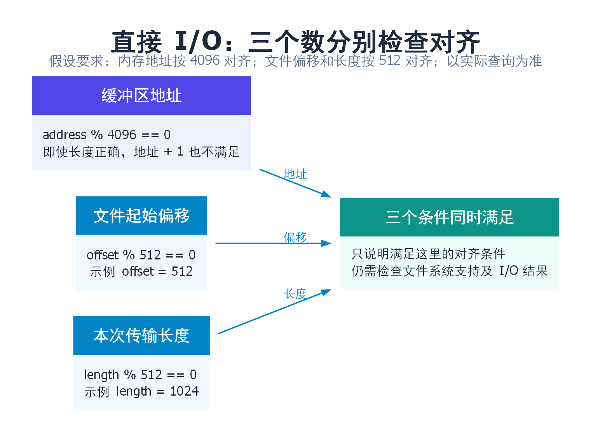

# Linux 文件 I/O：从文件描述符到持久化

本文解决一个问题：怎样正确读写文件，理解数据经过哪些缓冲区，并根据并发、持久化和性能需求选择合适的 I/O 接口。

读本文前，了解 C++ 数组、指针和局部变量的作用域，以及进程和线程的基本区别即可。比如，函数里的局部数组会在函数返回时销毁；如果读写操作仍在使用这块内存，就不能提前结束它的生命周期。

保存文件时，`write()` 返回成功后，数据可能还在内核的内存里。此时别的程序已经能读到新内容，但机器突然断电，新内容仍可能丢失。让数据在断电重启后还能读回来，就是这里说的“持久化”。[第七节](#durability)用更新配置文件的例子说明怎样做到这一点。

程序通过系统调用请求内核执行文件操作。例如，`read()` 的缓冲区由程序提供，但从哪个文件、哪个位置读取，由内核维护相应状态。可回顾[系统调用与 C 库函数](../一.基础概念/1.Linux系统编程基础.md#buffering)。涉及线程同步时，参见[POSIX 线程笔记](../八.POSIX线程/1.POSIX线程.md)；涉及目录、硬链接和访问控制列表（ACL）时，参见[文件、目录与链接](../三.文件、目录与链接/1.文件、目录与链接.md)。本文会在需要时回顾相关知识，不要求先读完这些文章。

**快速阅读：** 先读一至四节，建立 fd、偏移、短读写的概念；再读六、七节，区分“写入成功”和“持久化成功”；最后看十二、十三节及 Q&A。

**深入学习：** 按顺序阅读，逐个运行完整实验，再结合 `strace` 观察系统调用。不要一开始就把 `O_DIRECT` 或零拷贝当成更快的通用替代品。

| 提纲中的主题 | 本文位置 |
| --- | --- |
| open/read/write/close/lseek；fd、打开文件表、inode | [一、对象关系](#objects)、[二、基础读写](#basic) |
| fcntl、O_NONBLOCK、dup/dup2 与重定向 | [三、文件控制与复制](#control) |
| readv/writev | [四、分散聚集 I/O](#vector) |
| pread/pwrite 与“原子”边界 | [五、指定偏移读写](#positioned) |
| 内核缓冲、stdio 缓冲 | [六、两层缓冲](#buffers) |
| fsync/fdatasync/sync、O_DIRECT | [七、持久化](#durability)、[八、直接 I/O](#direct) |
| stat/fstat、权限、umask | [九、文件元信息](#metadata) |
| mmap/munmap、共享与私有映射 | [十、文件内存映射](#mapping) |
| sendfile/splice/tee | [十一、零拷贝](#zerocopy) |

## 先用一次“打开、读取、保存”串起全文

假设 `notes.txt` 中保存着 `ABCDE`，你要读取前两个字节，再修改文件。先把这几件事分开：

1. **找到文件**：`open("notes.txt", ...)` 根据名字找到文件，并返回一个号码，例如 fd 3。没有把整份文件塞进你的数组。
2. **记住进度**：这次打开有一份自己的记录，起初偏移为 0。偏移是“下次从哪里开始”，不是文件里的内容。
3. **读取内容**：`read(3, buf, 2)` 成功返回 2 时，`buf` 的前两字节是 `AB`，这份打开记录的偏移变成 2。
4. **修改内容**：普通 `write()` 通常先把修改交给内核的内存缓存。函数返回成功与掉电后仍能恢复，是两种不同程度的完成。
5. **确认保存并结束使用**：需要可靠保存时，按业务要求同步文件及必要的目录；`close()` 负责结束对这个 fd 的使用。

后面的接口都在解决这条路上的某个具体问题：`dup` 改变号码和打开记录的关系；`pread` 把位置放进单次请求；`writev` 描述多块缓冲区；`mmap` 改变程序访问文件数据的方式；`sendfile` 减少文件转发时经过应用缓冲区的次数。先定位它解决哪一步，再记名字，会容易得多。

本文中的小型数字例子都假定文件没有被其他人同时修改。图中的 4 KiB、字节数和返回次序用于说明机制，不是所有机器的固定参数或实测结果。

## 实验环境与阅读约定

完整程序使用 **C++11、Linux/glibc**。基础接口按 POSIX 标准规定的行为讲解；`sendfile`、`splice`、`tee` 的调用方式则按 Linux 说明，Windows 不能原样照用。建议在 Linux 6.1 及以上、GCC 11 及以上的学习环境运行；直接 I/O 的对齐查询还需要文件系统支持，不能只看内核版本。

Debian/Ubuntu 的安装和工作目录准备如下。每个代码块按文中名称保存为独立文件，不要把多个 `main()` 拼在一起：

```bash
sudo apt install build-essential strace
mkdir -p ~/file-io-lab
cd ~/file-io-lab
uname -r
g++ --version
ldd --version
```

运行示例时使用这个专用目录。程序会创建或截断文中指定的实验文件，不能把业务数据文件改名后代入实验。编译统一带 `-D_FILE_OFFSET_BITS=64`，便于在适用的 32 位 glibc 环境使用 64 位文件偏移；64 位平台通常本来就有 64 位 `off_t`。

多数系统调用失败时返回 `-1`，错误原因在 `errno` 中；只有发现失败后，才据此判断本次错误。本文的 `die()` 使用 `perror()` 打印原因，然后结束整个实验进程，便于先看清主要流程。

正式服务通常不能因为一个请求失败就结束整个进程，而应把失败交给调用方处理，并释放这个请求已经申请的资源。例如，打开了两个文件后，第三步失败，也要关闭前两个文件。C++ 常用 RAII 完成这类清理：让一个对象持有 fd，在对象析构时自动关闭。后文示例简化了这部分工程处理，会另行指出各自的限制。下文列出的输出是**预期结果**；实际验证范围在第十二节单独记录。

<a id="objects"></a>

## 一、文件名、fd、打开文件表和 inode，为什么要分开？

### 1.1 用“书、借阅记录和取书号码”建立直觉

同一个文件可以被打开多次，也可以被多个线程使用。如果“文件”和“正在读到哪里”是同一个东西，那么所有人读同一文件都会互相改变进度。操作系统因此将这些状态分开。

可以把文件内容看成一本书，打开文件描述看成借阅记录，fd 看成手中的取书号码：同一本书可以有多份独立借阅记录；复制号码则可以让两个号码指向同一份记录。这只是帮助理解引用关系，真实文件不是为每个读者复制一本书。

对应到程序，**文件偏移就是下一次普通 read/write 从文件的哪个字节开始**。比如偏移为 10，表示从距文件开头 10 字节的位置开始。**文件状态标志**则记录“是否追加写”“是否非阻塞”等设置。内核把这些状态放在一次打开所对应的记录中，这份记录的标准名称是“打开文件描述”，下文简称 OFD。

| 层次 | 保存什么 | 重要边界 |
| --- | --- | --- |
| 路径、目录项 | 目录里记录名字与文件对象的对应关系，按路径逐级查找 | 文件可以改名，同一个名字以后也可能指向另一个文件 |
| inode（索引节点） | 文件类型、权限、大小，以及怎样找到文件数据等信息 | 不记录某个读者读到哪里；文件名通常保存在目录项中 |
| 打开文件描述（open file description，OFD） | 当前偏移、追加/非阻塞等状态，以及它对应哪个文件 | 普通 `open()` 每次新建一份记录；`dup()` 让新 fd 指向已有记录 |
| 进程的 fd 表项 | 用 fd 这个小整数找到 OFD；另存“执行新程序时是否关闭”等设置 | fd 是进程内的号码，关闭后这个号码可能被分给另一个文件 |

后文说“fd 引用某个 OFD”，就是指内核能通过这个 fd 找到那份打开记录。不要把这里的“引用”与 C++ 的引用变量混为一谈。

文件里实际存放的文字、图片等叫“文件数据”；大小、权限、所有者等描述文件的信息叫“元数据”。后面讨论同步落盘时，会区分这两类信息。

POSIX 规定这些记录之间应有什么关系，Linux 内核通常用 `struct file` 等结构实现。教材把所有打开记录统称为“系统打开文件表”，是为了画图方便，不意味着内核必须把它们放进一张固定大小的全局数组。[open(2)](https://man7.org/linux/man-pages/man2/open.2.html) · [inode(7)](https://man7.org/linux/man-pages/man7/inode.7.html)



**用一个具体值把四层关系连起来。** 假设 `open("notes.txt", O_RDONLY)` 返回 3：

- `notes.txt` 是给人和路径查找使用的名字。同一目录里的这个名字只能对应当前的那个目录项，但以后可以被改名或替换。
- fd 表的第 3 项是当前进程的一张“入口卡”。`read(3, ...)` 先通过它找到这次打开的记录。
- 打开记录保存偏移，例如当前为 2。另一位独立打开同一文件的读者可以仍停在 0，所以进度不能存在大家共用的 inode 中。
- 打开记录再关联文件对象。文件系统根据这个对象找到数据和属性；fd 3 不是磁盘上的第三块数据，也不是 inode 号 3。

为什么读文件时不用每次重新传路径？打开后就有稳定的对象引用，不需要每次重新沿目录查找，而且即使名字改了，已经打开的读者仍能继续访问原来的文件。这个“稳定”指对象关系，不保证别人不能修改内容。

### 1.2 两次 open 与一次 open 后 dup，有什么区别？

```text
fd 3（第一次 open）─┐
                   ├→ 打开记录 A：偏移 0 ─┐
fd 4（dup(3)）─────┘                       ├→ 同一个文件 inode
fd 5（再次 open）────→ 打开记录 B：偏移 0 ─┘

从 fd 3 读 2 字节：A 的偏移前进到 2，fd 4 也从这里继续读。
fd 5 使用 B，偏移仍是 0。
```

同一进程的 POSIX 线程通常共享 fd 表；一个线程关闭某个 fd，会影响其他线程继续使用这个号码。`fork()` 后父子进程拥有各自的 fd 表，但继承的对应表项仍引用同一 OFD，因而可能共享偏移。更多生命周期细节见[进程管理笔记](../五.进程管理与控制/1.进程管理与控制.md)。

例如，关闭 fd 3 后，fd 4 仍能找到打开记录 A，所以仍然可以读文件。`unlink()` 删除的是目录中的名字，已经打开的 fd 仍可以访问原文件。只有文件没有剩余的硬链接，也没有 fd、映射等继续使用它时，文件系统才能回收它占用的空间。若有人后来又创建了一个同名文件，再按路径 open 得到的就是这个新文件，原来的 fd 不会自动改指向它。

<a id="basic"></a>

## 二、基础读写：为什么调用成功也可能没有读写完？

### 2.1 打开文件时，先明确“我要怎样使用它”

`open()` 不只是查找名字，还要说明准备怎样使用文件。`O_RDONLY` 表示只读，`O_WRONLY` 表示只写，`O_RDWR` 表示可读可写，这三种访问模式选一种。其他选项用 `|` 组合，例如 `O_WRONLY | O_CREAT` 表示“只写打开，不存在就创建”。

读取现有标志时，不要用 `flags & O_RDONLY` 判断是否只读，因为 Linux 的 O_RDONLY 为 0，这个按位与表达式总是 0。应先用 `flags & O_ACCMODE` 取出访问模式，再与 O_RDONLY 比较。

| 选项 | 为什么需要它 | 容易误解的地方 |
| --- | --- | --- |
| `O_CREAT` | 文件不存在时创建 | 需要提供第三个 `mode` 参数；已有文件不会因此重设权限 |
| `O_EXCL` 与 `O_CREAT` | 只在名字尚不存在时创建；已经存在就失败 | 不要先查“不存在”再普通创建，因为两步之间别的程序可能已经创建了同名文件 |
| `O_TRUNC` | 把可写打开的普通文件截成 0 字节 | 会破坏已有内容；实验只用于专用文件 |
| `O_APPEND` | 每次写入从当时的文件末尾开始 | 一条记录若拆成多次写，仍可能被别人的写入穿插；也不保证已经落盘 |
| `O_CLOEXEC` | 当前进程以后成功执行 exec 时，自动关闭这个 fd | 创建 fd 时就设置好，避免其他线程在事后补设之前已经启动新程序；下面解释这个时间差 |
| `O_NONBLOCK` | 对支持的对象，不因暂时无数据或无空间而等待 | 对 Linux 普通文件通常不能消除磁盘 I/O 等待；它不是普通文件的异步开关 |

这里的 **exec** 是用新程序替换当前进程正在运行的程序，不是另外创建一个进程。进程已经打开的 fd 默认可能继续交给新程序使用。设置 `FD_CLOEXEC`，就是要求成功 exec 时自动关闭这个 fd；open 的 `O_CLOEXEC` 可以在创建 fd 的同时完成这项设置。

为什么不等 open 后再设？假设线程 A 刚打开一个文件，尚未补设 FD_CLOEXEC；线程 B 恰好 fork 出子进程并执行了新程序，这个 fd 就可能被意外带过去。O_CLOEXEC 让 fd 从创建出来起就带有设置，避免这个时间差。它只控制 exec 时的关闭，不表示一 fork 就关闭，也不影响普通线程使用这个 fd。

再看追加写：假设文件原来有 100 字节，A、B **各自独立 open 同一个文件**，因此各有一份偏移。如果两者都先 lseek 到末尾，再分别写入，两份偏移可能都停在旧位置 100，导致后一次写入覆盖前一次。O_APPEND 把“找到当时的末尾”和“本次写入”作为一个步骤处理，避免这种竞争。

如果一条日志拆成“写时间、写正文”两次调用，其他线程可能在两次调用之间追加自己的日志。至于写入的数据何时能在断电后保留，见[第七节](#durability)。

**两台电脑同时追加 NFS 日志时，为什么可能互相覆盖？** NFS 文件保存在服务器上。客户端模拟追加时，会先取得文件长度，再指定从哪个偏移写入。假设 A 看到文件长 100 字节，准备从偏移 100 写。A 的写入生效前，B 也看到了同样的长度，也从偏移 100 写。两次写入的位置重叠，后写的数据就可能覆盖先写的数据。即使两台电脑各自只调用一次 `write()` 写整行日志，也可能出现这种情况。[Linux `open(2)` 手册](https://man7.org/linux/man-pages/man2/open.2.html)

### 2.2 五个接口各自改变什么？

| 接口 | 成功结果 | 应检查的边界 |
| --- | --- | --- |
| `open(path, flags, mode)` | 返回非负 fd | `0` 也是合法 fd，不能用 `fd <= 0` 判断失败 |
| `read(fd, buf, n)` | 返回实际读入字节数；请求非零长度时返回 0 通常表示已到文件末尾（EOF） | 不保证一次填满缓冲区；不会自动添加字符串结尾 `\0` |
| `write(fd, buf, n)` | 返回实际接受的字节数 | 可能短写；成功不等于落盘 |
| `lseek(fd, off, whence)` | 返回新的文件偏移 | 不搬运数据；管道、socket 不支持定位，通常报 `ESPIPE` |
| `close(fd)` | 返回 0 | 关闭这个号码，不等于确认数据落盘；先前写入的问题也可能到关闭时才报告，不能忽略返回值 |

`lseek()` 的 SEEK_SET 从文件头算，SEEK_CUR 从当前读写位置算，SEEK_END 从文件末尾算。例如，`lseek(fd, 10, SEEK_SET)` 把位置设为 10，`lseek(fd, -2, SEEK_END)` 把位置设为文件末尾之前 2 字节。

还可以把位置设到末尾之后。假设文件只有 100 字节，把位置设为 1000，文件此时仍是 100 字节；之后在这个位置写 1 字节，文件才增长到 1001 字节。中间没有写过的部分读出来是零字节。文件系统可能不为这段全零内容实际分配存储块，这类区域称为“空洞”。因此，文件显示的长度与实际占用的磁盘空间可能不同。[lseek(2)](https://man7.org/linux/man-pages/man2/lseek.2.html)

#### 一次 read 从进入函数到返回，发生了什么？

继续使用 `ABCDE`：当前偏移为 2，调用 `read(fd, buf, 2)`。对于普通文件的常规缓冲读取，可以按下面的顺序理解：

1. 内核通过 fd 找到打开记录，确认它允许读取，知道本次应从偏移 2 开始。
2. 文件中的字节区间是 `[2, 4)`，也就是 `CD`。区间右端不包括在内。
3. 内核查看相应文件数据是否已在页缓存中。缓存中有，就可以直接取；没有，可能需要文件系统向存储设备发出读取，并等待数据到内存。
4. 将实际读到的两个字节复制进程序提供的 `buf`。这一步之后，程序才能在自己的数组里访问它们。
5. 成功返回 2，这份打开记录的偏移由 2 前进到 4。


这解释了三个现象：缓存命中时依然可能有一次到用户数组的复制；`open()` 没有读入全文；设备慢时 `read()` 可能等待。图展示的是正常路径，权限、地址或设备出错时应按返回值处理。

**EOF 也不是文件里藏着一个特殊字符。** 文件只有五字节，偏移已经到 5 时，再请求非零字节就没有现成数据可取，普通文件的 `read()` 返回 0。它不会等别人以后追加内容。文件以后增长了，程序可以再次尝试读取，但那是新的调用。

### 2.3 短读、短写、EOF、EINTR 和 EAGAIN，不是一回事

想搬 100 箱货，搬运工本次只接了 40 箱，不代表已经搬完，也不代表一次都没搬。`read/write` 返回正数时，这个数就是本次已经完成的进度，下一次必须从剩余部分继续。

| 返回情况 | 正确理解 | 下一步 |
| --- | --- | --- |
| 正数但小于请求长度 | 已处理一部分 | 下一次从尚未处理的位置继续，例如写了 40 字节后用 `buf + 40` 写剩下的部分 |
| `read` 返回 0，请求长度大于 0 | 普通文件达到当前 EOF；管道所有写端关闭且数据读完也返回 0 | 结束本次读取；普通文件以后仍可能增长 |
| `-1` 且 `errno == EINTR` | 这次调用被信号打断 | 若仍需要完成原来的读写，可以重试；若信号表示程序应该退出，则按退出流程处理。本文选择重试 |
| `-1` 且为 `EAGAIN/EWOULDBLOCK` | 非阻塞操作目前无法继续 | 记住已经完成多少，等可以读写时再试；马上不停重试会白白消耗 CPU |
| 其他错误 | 如权限、坏 fd、空间不足、设备错误 | 报告失败；不要把所有错误当成可重试 |

如果信号打断调用时已经传输了部分数据，返回值会告诉你这次完成了多少字节。例如，请求写 10 字节，返回 `4` 就表示前 4 字节已经写入，下次从 `buf + 4` 继续写剩下的 6 字节。调用返回 `-1` 时，再查看 `errno` 判断失败原因。[read(2)](https://man7.org/linux/man-pages/man2/read.2.html) · [write(2)](https://man7.org/linux/man-pages/man2/write.2.html)

在 Linux 上，假设 `close(3)` 返回 `-1`，且 `errno` 为 `EINTR`。此时编号 `3` 已经释放。另一个线程如果正好打开文件并拿到 `3`，再次调用 `close(3)` 就可能关掉它刚打开的文件。因此，遇到这个错误应记录或报告，避免用原来的编号重试。其他 UNIX 系统遇到 `EINTR` 时可能保留原描述符，移植时要查目标系统的手册。[Linux close(2) 手册](https://man7.org/linux/man-pages/man2/close.2.html)

如果要求文件内容在断电重启后还能读到，先写完全部数据，趁 `fd` 仍有效时调用 `fsync(fd)` 并检查结果，再调用 `close(fd)` 并检查结果。`close()` 成功时，数据仍可能留在内核缓存里。若 `fsync()` 失败，仍要关闭描述符，同时向调用方报告保存失败。新建或替换文件名时需要同步目录的情况见[第七节](#durability)。

#### 为什么“重试一次”还不够，必须保存已经完成的进度？

假设要把 `ABCDEFGH` 八字节写入一个阻塞输出，某次只成功写了三个字节。返回 3 的意思是 `ABC` 已经交出去了，而不是失败后什么都没做。

| 阶段 | 要传入的起始地址 | 还要传的长度 | 已完成内容 |
| --- | --- | --- | --- |
| 第一次调用 | `buf` | 8 | 暂无 |
| 返回 3 后 | `buf + 3` | 5 | `ABC` |
| 第二次又返回 2 后 | `buf + 5` | 3 | `ABCDE` |
| 再返回 3 后 | 不再调用 | 0 | `ABCDEFGH` |


只减少长度、不移动地址，下一次可能又发 `ABC...`；只移动地址、不减少长度，又可能读到缓冲区之外。因此循环里保存的是“从哪里继续”和“还剩多少”，两者必须一起更新。

普通 `write()` 成功时，内核会推进打开记录的文件偏移；应用需要推进的是自己缓冲区的指针。不要把这两个不同的位置混为一谈。第五节使用 `pwrite()` 时，本次文件位置也由应用显式给出，补写时要连同它一起增加。

上表是一组假定的返回值，用来手算循环；不是说八字节普通文件写入必然分成三次。真实短写可能由资源、信号、设备或非阻塞空间限制等情况造成。

### 2.4 完整实验：写完、重新定位、再读到 EOF

保存为 `basic_io.cpp`。缓冲区故意只有 4 字节，让“分批读取”容易观察；程序不使用非阻塞 fd，因此遇到 `EAGAIN` 会作为错误处理。

```cpp
#include <fcntl.h>
#include <unistd.h>
#include <cerrno>
#include <cstdio>
#include <cstdlib>

static void die(const char* what) { std::perror(what); std::exit(EXIT_FAILURE); }

static void write_all(int fd, const char* data, size_t size) {
    while (size != 0) {
        ssize_t n = ::write(fd, data, size);
        if (n > 0) {
            data += n;  // 已写部分不能重发，否则内容会重复。
            size -= static_cast<size_t>(n);
        } else if (n < 0 && errno == EINTR) {
            continue;
        } else {
            if (n == 0) errno = EIO;  // 防止没有进度时无限循环。
            die("write");
        }
    }
}

int main() {
    int fd = ::open("basic.txt", O_RDWR | O_CREAT | O_TRUNC | O_CLOEXEC, 0600);
    if (fd == -1) die("open");
    const char text[] = "hello Linux\n";
    write_all(fd, text, sizeof(text) - 1);  // 不把末尾的字符串终止符写进文件。
    if (::lseek(fd, 0, SEEK_SET) == -1) die("lseek");

    char buffer[4];
    for (;;) {
        ssize_t n = ::read(fd, buffer, sizeof(buffer));
        if (n > 0) {
            // buffer 不保证以 '\0' 结束，必须按实际字节数输出，不能用 %s。
            write_all(STDOUT_FILENO, buffer, static_cast<size_t>(n));
        } else if (n == 0) {
            break;
        } else if (errno != EINTR) {
            die("read");
        }
    }
    if (::close(fd) == -1) die("close");  // 只关闭一次；本例没有调用 fsync 确认落盘。
}
```

```bash
g++ -std=c++11 -D_FILE_OFFSET_BITS=64 -Wall -Wextra -pedantic basic_io.cpp -o basic_io
./basic_io
strace -e trace=openat,read,write,lseek,close ./basic_io
```

预期终端显示 `hello Linux`，并换行。`strace` 还会记录动态加载器的操作，不能把所有 `openat/read` 都算成 `main()` 中的调用。系统调用封装可能使用 `openat` 实现源码中的 `open`，也不代表示例写错了。

<a id="control"></a>

## 三、fcntl 和 dup：修改的是 fd，还是它指向的打开状态？

### 3.1 F_GETFL/F_SETFL 为什么要先读旧值？

假设一个线程轮流处理多个网络连接，这种反复等待事件、处理事件的循环叫“事件循环”。处理连接 A 时，如果 A 暂时没有数据，线程需要先去处理 B，而不是一直卡在 A 的 read 中。因此可以把连接设为非阻塞，让 read 在暂时无数据时返回 `EAGAIN`。

设置方法是：先用 `fcntl(fd, F_GETFL)` 读取现有状态标志，再用 `F_SETFL` 加上 `O_NONBLOCK`。

正确思路是“读取旧标志 → 保留原位并加入 `O_NONBLOCK` → 写回”。若直接设置成 `O_NONBLOCK`，可能意外清除原有的 `O_APPEND` 等可修改状态。非阻塞 socket 与事件循环的配合属于网络编程主题，本文不展开。

`F_SETFL` 只允许修改规定的状态位，不能把只读 fd 变成读写 fd，也不能事后补做创建或截断文件的操作。状态标志保存在打开记录中，所以如果 fd 3 和 fd 4 是通过 dup 得到的一组号码，通过 fd 3 设置非阻塞后，fd 4 也会受影响。

多个线程若同时修改这些标志，还要防止互相覆盖：A、B 可能先读到同一份旧值，然后各加一个标志，最后写回的那一份却没有包含另一个线程的修改。需要修改同一份设置时，应由一个线程负责，或用锁保护“读取旧值到写回新值”的整段操作。[F_GETFL(2const)](https://man7.org/linux/man-pages/man2/F_GETFL.2const.html)

| fcntl 命令 | 管理哪一层 | 常见用途 |
| --- | --- | --- |
| `F_GETFL / F_SETFL` | OFD 的文件状态标志 | `O_NONBLOCK`、`O_APPEND` 等；只允许修改规定的位 |
| `F_GETFD / F_SETFD` | 单个 fd 的设置 | 读取或设置 `FD_CLOEXEC`，决定成功 exec 时是否自动关闭它 |
| `F_DUPFD / F_DUPFD_CLOEXEC` | 新建一个指向同一打开记录的 fd | 分配不小于指定下限的可用号码；后一种还让新 fd 带有 `FD_CLOEXEC` |
| `F_GETLK / F_SETLK / F_SETLKW` | 传统 POSIX 记录锁，归进程持有 | 分别用于查询冲突、尝试加锁、等待加锁 |
| `F_OFD_GETLK / F_OFD_SETLK / F_OFD_SETLKW` | Linux OFD 记录锁，归打开文件描述持有 | 分别用于查询冲突、尝试加锁、等待加锁 |

多个程序读写同一个文件时，可以用记录锁协调对某段字节的访问，例如先锁住前 100 字节，再修改这段数据。`pthread_mutex` 则让使用同一把 mutex 的线程轮流进入临界区。这里的记录锁属于建议性锁，普通 `read()` 和 `write()` 仍能直接访问文件。因此，参与的程序都要约定先对相应范围加锁，读写完成后再解锁。

假设 `fd` 是用 `O_RDWR` 打开的文件描述符，要给文件前 100 字节加写锁，可以先这样填写参数：

```cpp
struct flock lock{};       // <fcntl.h>
lock.l_type = F_WRLCK;     // 写锁；读锁用 F_RDLCK
lock.l_whence = SEEK_SET;  // 从文件开头计算位置
lock.l_start = 0;          // 起始偏移
lock.l_len = 100;          // 锁定前 100 字节
```

- `fcntl(fd, F_GETLK, &lock)` 查询有没有冲突。返回 `0` 后看 `lock.l_type`，如果是 `F_UNLCK`，表示查询时没有冲突。这一步不会加锁，查询结果写回 `lock`，再次加锁前要填回原来的请求参数。
- `fcntl(fd, F_SETLK, &lock)` 立即尝试加锁。返回 `0` 后可以访问这段数据；如果有锁冲突，会立即返回 `-1`，`errno` 为 `EACCES` 或 `EAGAIN`。
- `fcntl(fd, F_SETLKW, &lock)` 会等待冲突解除。返回 `0` 才表示拿到了锁，返回 `-1` 时要检查 `errno`，例如等待被信号打断时会得到 `EINTR`。

实际使用时，按是否愿意等待选择 `F_SETLK` 或 `F_SETLKW` 即可。读写完成后，把 `lock.l_type` 改成 `F_UNLCK`，再调用 `fcntl(fd, F_SETLK, &lock)` 并检查结果，就能解锁指定范围。

假设同一个进程对 `data.txt` 调用两次 `open()`，得到 `fd1` 和 `fd2`，然后用 `fd1` 锁住前 100 字节。这时关闭 `fd2`，锁还在吗？

- **用 `F_SETLK` 加的传统记录锁会释放。** 锁记在进程名下。这个进程关闭任意一个指向该文件的 fd，就会释放它在该文件上的全部传统记录锁，即使 `fd1` 还开着。
- **用 `F_OFD_SETLK` 加的 OFD 锁会保留。** 两次 `open()` 建立了两份打开记录。锁挂在 `fd1` 引用的打开记录上，关闭 `fd2` 不会释放这份记录。

如果 `fd2` 是通过 `dup(fd1)` 得到的，两个 fd 就共用一份打开记录。用 `fd1` 加 OFD 锁后，即使先关闭 `fd1`，`fd2` 仍然引用这份记录，锁也会保留。除了主动解锁，等最后一个引用这份打开记录的 fd 关闭时，内核才会自动释放这把锁。[Linux 文件记录锁手册](https://man7.org/linux/man-pages/man2/F_GETLK.2const.html)

### 3.2 dup/dup2 怎样完成重定向？

进程约定 `0/1/2` 分别作为标准输入、标准输出和标准错误。输出到 `1` 本身不意味着屏幕，而是写到 fd 1 当前引用的对象。

`dup(fd)` 分配一个可用的新号码，让它指向同一份打开记录。`dup2(fd, 1)` 则明确要求使用号码 1：如果 1 原来指向终端，就关闭它对终端的那条引用，再让它指向 fd 所对应的文件。以后写标准输出，就是写这个文件。

`dup2()` 把“替换号码 1 的旧用途”作为一次不可分割的操作完成。不能简单用 `close(1); dup(fd);` 替代：在两次调用之间，另一个线程可能 open 了一个文件，恰好拿走刚空出来的号码 1；随后 dup 得到的就不再是 1，重定向也就没有按预期完成。

如果 oldfd 有效，`dup2(oldfd, oldfd)` 什么也不改。复制到另一个号码时则要注意：新 fd 虽然共享原来的偏移和 O_APPEND 等文件状态，却不会自动继承原 fd 的 FD_CLOEXEC 设置。因为 FD_CLOEXEC 属于每个号码自己的设置，不在共用的打开记录里。

如果希望新号码从创建起就带有 FD_CLOEXEC，可使用 Linux 的 `dup3(..., O_CLOEXEC)` 或 `F_DUPFD_CLOEXEC`，而不是复制完后再单独补设。[dup(2)](https://man7.org/linux/man-pages/man2/dup.2.html)

#### 重定向前后，变的究竟是哪一条连接？

假设 fd 1 原来指向终端，`open("out.txt", ...)` 返回 fd 3。执行 `dup2(3, 1)` 后，fd 1 和 fd 3 都指向 out.txt 的同一份打开记录，终端并没有被改造成文件。



再关闭 fd 3，标准输出仍能使用 out.txt，因为 fd 1 的引用还在。反过来，如果要恢复终端，应在替换前用 `dup(1)` 保留旧引用，之后再用 `dup2(保存的号码, 1)` 恢复。

如果同时使用 `printf()`，别忘了它前面还有 stdio 缓冲。重定向前没有刷出的文字，之后刷新时可能写到新的目标，所以示例在切换前调用 `fflush(stdout)`。**dup2 改的是内核 fd 表，不会替你重新安排已经积攒在用户态的文字。**

### 3.3 完整实验：共享偏移与标准输出重定向

保存为 `fd_alias.cpp`。这里用固定的 6 字节普通文件，读取函数仍检查实际返回值，避免把一次 `read()` 当成保证读满。

```cpp
#include <fcntl.h>
#include <unistd.h>
#include <cerrno>
#include <cstdio>
#include <cstdlib>
#include <string>

static void die(const char* s) { std::perror(s); std::exit(EXIT_FAILURE); }
static void put(int fd, const char* p, size_t left) {
    while (left) {
        ssize_t n = ::write(fd, p, left);
        if (n > 0) { p += n; left -= static_cast<size_t>(n); }
        else if (n < 0 && errno == EINTR) continue;
        else { if (n == 0) errno = EIO; die("write"); }
    }
}
static std::string take(int fd, size_t count) {
    std::string result;
    while (result.size() < count) {
        char ch;
        ssize_t n = ::read(fd, &ch, 1);
        if (n == 1) result.push_back(ch);
        else if (n == 0) break;
        else if (errno != EINTR) die("read");
    }
    return result;
}
static void close_one(int fd) { if (::close(fd) == -1) die("close"); }

int main() {
    int a = ::open("alias.txt", O_RDWR | O_CREAT | O_TRUNC | O_CLOEXEC, 0600);
    if (a == -1) die("open a");
    put(a, "abcdef", 6);
    if (::lseek(a, 0, SEEK_SET) == -1) die("lseek");
    int b = ::dup(a);  // b 和 a 共用偏移。
    if (b == -1) die("dup");
    int c = ::open("alias.txt", O_RDONLY | O_CLOEXEC);  // c 有自己的偏移。
    if (c == -1) die("open c");
    std::string x = take(a, 2), y = take(b, 2), z = take(c, 2);
    std::printf("a=%s b=%s c=%s\n", x.c_str(), y.c_str(), z.c_str());
    // 重定向 fd 前刷出 stdio 里尚未输出的数据，否则旧输出可能进新文件。
    if (std::fflush(stdout) == EOF) die("fflush");

    int saved = ::dup(STDOUT_FILENO);
    if (saved == -1) die("save stdout");
    int out = ::open("redirect.txt", O_WRONLY | O_CREAT | O_TRUNC | O_CLOEXEC, 0600);
    if (out == -1) die("open output");
    if (::dup2(out, STDOUT_FILENO) == -1) die("dup2 redirect");
    if (out != STDOUT_FILENO) close_one(out);  // fd 1 已保留一份引用。
    put(STDOUT_FILENO, "redirected\n", 11);
    if (::dup2(saved, STDOUT_FILENO) == -1) die("restore stdout");
    close_one(saved);
    close_one(c); close_one(b); close_one(a);
}
```

```bash
g++ -std=c++11 -D_FILE_OFFSET_BITS=64 -Wall -Wextra -pedantic fd_alias.cpp -o fd_alias
./fd_alias
cat redirect.txt
```

预期依次显示 `a=ab b=cd c=ab`、`redirected`。程序假定启动时标准输出有效；它演示进程级重定向，不能让多个线程一边输出、一边随意改 fd 1。正式程序还要确保重定向失败后恢复原输出状态。

<a id="vector"></a>

## 四、readv/writev：头和正文不连续，为什么仍能一起读写？

### 4.1 为什么把两块内存的位置告诉内核，就能省掉拼接？

假设程序已经有头部 `HEAD` 和正文 `hello`，它们在两块不相邻的内存中。要输出 `HEADhello`，有三种办法：

| 方法 | 程序先做什么 | 要付出的工作 |
| --- | --- | --- |
| 拼成一块再 write | 申请或借用九字节缓冲区，把两段复制进去 | 先做一次用户态拼接，再请求写入 |
| 两次 write | 先写四字节头，再写五字节正文 | 两次请求，中间可能插入别的写入 |
| 一次 writev | 列出“第一段地址和长度、第二段地址和长度” | 内核按列表顺序取数据，不必先拼出连续数组 |

这个列表的每一项叫 `iovec`：`iov_base` 是起点，`iov_len` 是长度。列表本身很小，它不是把正文又复制了一遍，只是描述正文在哪里。内核依次从这些位置取字节，所以输出仍然按 `HEAD`、`hello` 的顺序连接。


反过来，`readv()` 按顺序填缓冲区：先填第一块，有剩余数据才填第二块。它不会识别协议头，也不会根据内容自动判断哪里是正文。例如第一块容量为 4、第二块为 5，总共只返回 6，就只有第一块四字节和第二块前两字节有效。

网络库可以把“已有接收缓冲区的剩余空间”放在第一项，“额外的临时空间”放在第二项；数据较少时先用已有空间，数据较多时继续填临时空间。返回后仍要按实际字节数管理内容。`readv/writev` 省的是应用拼接和调用次数，不承诺省去普通 I/O 路径中的全部复制。

### 4.2 短写可能停在某个缓冲区的中间

假设 `iov[0]` 指向 `HEAD`，`iov[1]` 指向 `hello`。第一次调用 `writev(fd, iov, 2)` 时，内核按 `HEADhello` 的顺序取字节。看返回值，就知道下次该从哪里接着写。

| 第一次写了多少 | 已写出的内容 | 下次还要传哪些项 |
| --- | --- | --- |
| 2 字节 | `HE` | `AD` 和 `hello`，共 2 项 |
| 6 字节 | `HEADhe` | `llo`，共 1 项 |

以写了 6 字节为例。`iov[0]` 已经写完，直接跳过。`iov[1]` 还指向 `hello` 的开头，所以把它的地址向后移 2 字节，让它指向 `llo`，再把长度从 5 改成 3。

```cpp
iov[1].iov_base = static_cast<char*>(iov[1].iov_base) + 2;
iov[1].iov_len -= 2;
ssize_t n = writev(fd, iov + 1, 1);  // 从 iov[1] 开始，只传剩下的 1 项
```

`iov + 1` 表示从 `iov[1]` 开始，最后一个参数 `1` 表示只用这一项。原数组还是 2 项。`writev()` 只返回本次写出的字节数，数组里地址和长度的调整由程序完成。如果第二次还没写完，就按新的返回值继续更新进度。完整循环见下一节。

一次向量操作仍受 fd 类型、请求长度和错误约束。pipe 中不交错的保证要结合总字节数是否不超过 `PIPE_BUF`；TCP 仍是字节流，接收方不会因为发送方调用一次 `writev()` 就恰好收到一条完整消息。循环补写分成多个调用后，更不能把整个循环当成不可分割的事务。[readv(2)](https://man7.org/linux/man-pages/man2/readv.2.html) · [pipe(7)](https://man7.org/linux/man-pages/man7/pipe.7.html)

### 4.3 完整实验：向量写完，按两个缓冲区读回

保存为 `vector_io.cpp`。示例只使用两个非空缓冲区。正式实现还要检查：缓冲区数量是否超过接口允许的上限 `IOV_MAX`，长度相加是否超出整数范围，以及总请求是否超过返回类型能表示的最大长度 `SSIZE_MAX`。如果用于非阻塞网络发送，还要记下“写到第几个缓冲区、其中写了多少”，下次可写时从剩余部分继续。

```cpp
#include <sys/uio.h>
#include <fcntl.h>
#include <unistd.h>
#include <cerrno>
#include <cstdio>
#include <cstdlib>
#include <vector>

static void die(const char* s) { std::perror(s); std::exit(EXIT_FAILURE); }
static void advance(std::vector<iovec>& v, size_t& first, size_t n) {
    while (n && first < v.size()) {
        if (n >= v[first].iov_len) {
            n -= v[first].iov_len;
            ++first;  // 这个缓冲区已处理完，下次不用再传。
        } else {
            v[first].iov_base = static_cast<char*>(v[first].iov_base) + n;
            v[first].iov_len -= n;  // 保留当前缓冲区未完成的尾部。
            n = 0;
        }
    }
}
static void transfer(int fd, std::vector<iovec> v, bool writing) {
    size_t first = 0;
    while (first < v.size()) {
        int count = static_cast<int>(v.size() - first);
        ssize_t n = writing ? ::writev(fd, v.data() + first, count)
                            : ::readv(fd, v.data() + first, count);
        if (n > 0) advance(v, first, static_cast<size_t>(n));
        else if (n < 0 && errno == EINTR) continue;
        else {
            // 本例知道文件应有 9 字节；提前 EOF 属于实验数据不完整。
            if (n == 0) errno = EIO;
            die(writing ? "writev" : "readv/unexpected EOF");
        }
    }
}
int main() {
    int fd = ::open("vector.txt", O_RDWR | O_CREAT | O_TRUNC | O_CLOEXEC, 0600);
    if (fd == -1) die("open");
    char header[] = "HEAD", body[] = "hello";
    transfer(fd, {{header, 4}, {body, 5}}, true);
    if (::lseek(fd, 0, SEEK_SET) == -1) die("lseek");
    char h[5] = {}, b[6] = {};  // 多留一个置零字节，便于以字符串打印。
    transfer(fd, {{h, 4}, {b, 5}}, false);
    std::printf("header=%s body=%s\n", h, b);
    if (::close(fd) == -1) die("close");
}
```

```bash
g++ -std=c++11 -D_FILE_OFFSET_BITS=64 -Wall -Wextra -pedantic vector_io.cpp -o vector_io
./vector_io
```

预期 `header=HEAD body=hello`。数据仍会在常规文件 I/O 路径中经过用户缓冲区和页缓存，不能把 `writev()` 直接称为零拷贝。

<a id="positioned"></a>

## 五、pread/pwrite：解决共享偏移竞争，不代表整段数据“绝对原子”

### 5.1 为什么 lseek 加 read 在多线程中会读错位置？

假设两个线程共用一个 fd，A 要读第 100 字节，B 要读第 200 字节：

```text
A：lseek(fd, 100, SEEK_SET)
B：lseek(fd, 200, SEEK_SET)
A：read(fd, ...) → 使用的是被 B 改过的偏移 200
```

每个系统调用都正确，不等于它们组合后的逻辑正确。`pread(fd, buf, n, offset)` 把本次位置作为参数传入，读取时不依赖、也不修改 OFD 的当前偏移；`pwrite()` 同理。好比直接告诉管理员“取第 100 页”，而不是先移动共享书签，再让管理员按书签读。

提纲中的“带偏移原子读写”，可以理解为：**直接在一次调用中说明位置，不必先移动共享书签，再按书签读写。** 它解决的是上面 A 被 B 改掉读取位置的问题。

但它不能保证所有事情都一次做完。比如请求从偏移 100 写入 20 字节，却只返回 8，下一次要从偏移 108 写剩余 12 字节。两个线程如果都写同一区域，仍可能互相覆盖；如果操作是“先读余额、加上收入、再写回”，仍要防止别的线程在中间修改余额。断电时能否完整恢复整条记录，也要另外设计日志或事务机制，不能由 pwrite 的名字推断出来。

Linux 上还要避开一个已记录的行为差异：对带 `O_APPEND` 的 fd，`pwrite()` 可能忽略指定写入位置而追加到末尾，这与 POSIX 的位置要求不同。要明确指定位置时，用不带 `O_APPEND` 的 fd。[pread(2)](https://man7.org/linux/man-pages/man2/pread.2.html)

#### 把共享书签拿出这次操作，为什么就不怕别人移动？

`lseek + read` 的问题在于：A 先把一个共享状态改成 100，然后过一会儿才使用这个状态。中间 B 有机会把它改成 200。`pread(..., 100)` 直接把 100 交给这次读取，不需要借助那个共享状态。


假设 OFD 原来的偏移是 50：A 执行 `pread(..., 100)`，B 执行 `pread(..., 200)`；两次都完成后，共享偏移仍然是 50。以后一次普通 `read()` 仍从 50 开始。这比“定位和读取是原子的”更准确，因为它解释了为什么两次请求不争同一个书签。

但文件中的数据还是同一份。A、B 都向区间 `[100, 120)` 写入，即使位置参数各自独立，也是在改同一批字节。要分清“共享偏移不再竞争”和“数据区域没有冲突”，后者靠分区或同步解决。

### 5.2 完整实验：两个线程写不同区域，当前偏移保持不变

保存为 `positioned_io.cpp`。两个线程写不重叠的 4 字节区域，主线程 join 后读取。这里通过任务分区避免数据冲突，而不是指望 pwrite 自动为整个文件加锁。

```cpp
#include <fcntl.h>
#include <unistd.h>
#include <pthread.h>
#include <cerrno>
#include <cstdio>
#include <cstdlib>

static void die(const char* s) { std::perror(s); std::exit(EXIT_FAILURE); }
static void thread_check(int err) { if (err) { errno = err; die("pthread"); } }
struct Job { int fd; off_t offset; const char* text; };
static void* work(void* arg) {
    const Job& job = *static_cast<Job*>(arg);
    size_t done = 0;
    while (done < 4) {
        ssize_t n = ::pwrite(job.fd, job.text + done, 4 - done,
                             job.offset + static_cast<off_t>(done));
        if (n > 0) done += static_cast<size_t>(n);
        else if (n < 0 && errno == EINTR) continue;
        else { if (n == 0) errno = EIO; die("pwrite"); }
    }
    return nullptr;
}
int main() {
    int fd = ::open("position.txt", O_RDWR | O_CREAT | O_TRUNC | O_CLOEXEC, 0600);
    if (fd == -1) die("open");
    if (::ftruncate(fd, 8) == -1) die("ftruncate");
    if (::lseek(fd, 3, SEEK_SET) == -1) die("lseek");
    Job jobs[2] = {{fd, 0, "AAAA"}, {fd, 4, "BBBB"}};
    pthread_t ts[2];
    for (int i = 0; i < 2; ++i)
        thread_check(::pthread_create(&ts[i], nullptr, work, &jobs[i]));
    for (pthread_t t : ts) thread_check(::pthread_join(t, nullptr));
    char result[9] = {};
    size_t done = 0;
    while (done < 8) {
        ssize_t n = ::pread(fd, result + done, 8 - done, static_cast<off_t>(done));
        if (n > 0) done += static_cast<size_t>(n);
        else if (n < 0 && errno == EINTR) continue;
        else { if (n == 0) errno = EIO; die("pread/unexpected EOF"); }
    }
    off_t current = ::lseek(fd, 0, SEEK_CUR);
    if (current == -1) die("query offset");
    std::printf("data=%s offset=%lld\n", result, static_cast<long long>(current));
    if (::close(fd) == -1) die("close");
}
```

```bash
g++ -std=c++11 -D_FILE_OFFSET_BITS=64 -Wall -Wextra -pedantic -pthread positioned_io.cpp -o positioned_io
./positioned_io
```

预期 `data=AAAABBBB offset=3`。若把两项任务的 `offset` 都设为 0，写入位置将重叠，不能再期待固定内容。若用锁保护 `lseek + read/write`，也能解决位置竞争，但会串行化这段操作；各线程独立 `open` 可分离偏移，却仍不能避免同一区域的数据冲突。

<a id="buffers"></a>

## 六、两层缓冲：printf 已执行，为什么文件里还看不到？

### 6.1 用户空间缓冲和内核页缓存不是同一层

**stdio** 是 C 标准输入输出库，常见函数有 printf、fopen、fread、fwrite。它用 `FILE` 对象管理一次流操作的状态，包括缓冲区和读写位置；这比直接传一个 fd 多了一层管理。

把写文件想成寄信：先把信放进自己桌上的待寄盒，再交给邮局，最后送达。写进 stdio 缓冲区类似“先放在自己桌上”，调用 write 类似“交给邮局”。交出去不代表已经送达，同样，write 返回成功也不代表数据已经写进掉电后仍能保留的存储。下面按真实的数据流说明这几步。

```text
fprintf / fwrite
    ↓
stdio 的 FILE 缓冲区（进程用户空间）
    ↓ 缓冲满、fflush、正常 fclose 等触发底层写入
write 系统调用
    ↓
内核页缓存（常规缓冲文件 I/O）
    ↓ 后台回写、fsync/fdatasync 等
文件系统 / 块层 / 设备缓存 / 持久介质
```



**第一层是程序自己的缓冲。** 例如连续输出 100 个字符，stdio 可以先把它们放在内存中，再一起调用 write，减少进入内核的次数。

**第二层是内核的页缓存。** 内核按“页”这样的固定大小单位管理内存，把文件的部分内容保存在其中。再次读取这些内容时，可以直接从内存取，不必重新读取存储设备，这叫“缓存命中”。内核还可能提前读取接下来可能用到的内容，称为“预读”。

普通 `read()` 即使命中页缓存，通常仍需把数据复制到程序提供的缓冲区。普通 `write()` 则通常先修改页缓存；**已经修改、但尚未写回存储的数据页叫脏页**。内核稍后把这些修改写回设备，这个过程叫“回写”。

有缓存也不代表 write 永远立即返回。如果脏页积累得太多，内核可能先让写入线程等一等，等设备写出一部分再继续；内存不足时，也可能需要先腾出内存。因此，“写缓存”通常减少设备等待，但不能保证每次调用都不等待。

#### 两个进程读同一个文件，是不是各有一份内核页缓存？

常规缓冲 I/O 下，页缓存按文件及文件内的位置组织，不是每次 open 都重新复制一整份。A、B 独立打开同一个文件，可以有不同的文件偏移，却使用同一文件内容的缓存页。**独立的是读取进度，不是自动独立的数据副本。**

假设文件某页已缓存，A 用 `write()` 修改其中几个字节并成功返回。B 随后按所需同步关系读取，可能直接从这个缓存页取得新内容，根本没有再访问设备。这就是“B 已读到新值，但还没有确认掉电可恢复”能够同时成立的原因。

这里又有一个容易混淆的词：**页缓存不是 CPU 的 L1/L2/L3 缓存。** 页缓存是内核拿来保存文件内容的内存；CPU 高速缓存则是处理器加速内存访问的硬件机制。`fsync` 要解决的是文件状态向存储设备同步，不是“把 CPU 的所有缓存清空”。

#### 用三处位置跟踪同一句 hello

| 刚完成的步骤 | hello 可能还停在哪里 | 如果此刻只终止进程，会怎样？ |
| --- | --- | --- |
| `fprintf`，尚未触发底层写入 | 当前进程的 stdio 缓冲 | `_exit` 或异常退出可能让尚未交出的文字消失 |
| `fflush` 成功，底层 write 已接受 | 内核页缓存，或部分已写向设备 | 进程消失不等于内核也消失，内核仍可能继续回写 |
| `fsync` 成功 | 已按接口要求完成同步 | 对普通文件持久化有了明确确认，但新名字还要考虑目录 fsync 文件成功 ≠ 这个文件名能在目录里被找到。文件名属于目录的数据，不属于文件本身的 inode |

因此，`kill -9` 一个写文件程序与整机掉电不是同一种测试：前者内核还在，页缓存还可能继续被写出。想证明掉电恢复，需要测试文件系统和设备的故障恢复行为，不能只看结束进程后还能 `cat` 到内容。

### 6.2 stdio 三种缓冲方式与刷新边界

| 方式 | 行为 | 常见场景与注意 |
| --- | --- | --- |
| 全缓冲 `_IOFBF` | 收集一批数据再交给底层 | 普通文件流常用；换行不等于立即刷新 |
| 行缓冲 `_IOLBF` | 输出换行通常触发刷新，缓冲满也会刷新 | glibc 中连接终端的 stdout 通常采用此方式 |
| 无缓冲 `_IONBF` | 不依赖 stdio 块缓冲积累输出 | glibc 的 stderr 通常无缓冲；不代表绕过内核页缓存 |

`setvbuf()` 用来选择缓冲方式，应在流打开后、尚未用它读写时设置。如果把自己的数组作为缓冲区交给它，那么在流关闭前，这个数组都必须有效，不能让数组所在的函数先返回。

`fread/fwrite` 返回的是“完整读写了多少个元素”，而不总是字节数。例如，每个元素 4 字节，返回 3 表示完成了 3 个完整元素；本文把元素大小设为 1，返回值才可以直接当作字节数。读取数量不足时，用 `feof()` 判断是否到达文件末尾，用 `ferror()` 判断是否发生错误。[setbuf(3)](https://man7.org/linux/man-pages/man3/setbuf.3.html)

`fflush()` 把输出流中的用户态缓冲交给底层，不保证内核缓存已持久化。`fclose()` 会刷新并关闭，但也不是 `fsync()`。Linux 的 `_exit()` 不负责刷新 stdio；`fork()` 复制的用户态缓冲若被父子进程分别刷新，可能出现重复输出。与之相对，内核 OFD 是共享引用，不是把文件偏移各自复制一份。[fflush(3)](https://man7.org/linux/man-pages/man3/fflush.3.html)

### 6.3 完整实验：明确区分 fflush 和 fsync

保存为 `stdio_sync.cpp`。这不是用“马上读到数据”证明持久化，而是展示正确的调用顺序；断电恢复需要专门的故障测试。

```cpp
#include <unistd.h>
#include <cerrno>
#include <cstdio>
#include <cstdlib>

static void die(const char* s) { std::perror(s); std::exit(EXIT_FAILURE); }
int main() {
    FILE* stream = std::fopen("stdio.txt", "w");
    if (!stream) die("fopen");
    char buffer[4096];  // fclose 之前一直有效。
    if (std::setvbuf(stream, buffer, _IOFBF, sizeof(buffer)) != 0) {
        std::fprintf(stderr, "setvbuf failed\n");
        return 1;
    }
    const char message[] = "buffered hello\n";
    if (std::fwrite(message, 1, sizeof(message) - 1, stream) != sizeof(message) - 1)
        die("fwrite");
    // 不假定 fwrite 此刻一定没触发 write；实现可以提前输出。
    // fflush 成功后，才能确认此前的输出没有继续留在 stdio 缓冲里。
    if (std::fflush(stream) == EOF) die("fflush");
    int fd = ::fileno(stream);
    if (fd == -1) die("fileno");
    while (::fsync(fd) == -1) {
        if (errno != EINTR) die("fsync");
    }
    // stream 管理这个 fd，不应先 close(fd) 再 fclose(stream)。
    if (std::fclose(stream) == EOF) die("fclose");
    std::puts("stdio flushed; file fsync completed");
}
```

```bash
g++ -std=c++11 -D_FILE_OFFSET_BITS=64 -Wall -Wextra -pedantic stdio_sync.cpp -o stdio_sync
strace -e trace=write,fsync,close ./stdio_sync
cat stdio.txt
```

预期文件内容为 `buffered hello` 加换行，跟踪能看到对文件的写入发生在 `fsync` 之前。这个例子没有同步新建文件的父目录，因此不承诺新文件名在崩溃后一定存在；下一节补全目录持久化。

混用 `FILE*` 和底层 fd 容易让“程序以为读到哪里”和“内核实际读到哪里”不一致。例如，`fread()` 为了提高效率，可能一次从内核预读 4096 字节，只交给调用者前 10 字节，剩下的留在 stdio 缓冲区。此时底层 fd 的偏移可能已经到 4096；若马上绕过 stdio 调用 read，就不会从第 10 字节接着读。

因此，简单程序最好一直使用 stdio，或者一直使用 read/write。确实要混用时，需要根据输入、输出和定位操作分别刷新或重新定位，按 POSIX 对这两类接口的配合要求处理。前面例子只是借 `fileno()` 找到 fd 做 fsync，没有绕过 stdio 继续读写内容，不涉及这种位置切换。

<a id="durability"></a>

## 七、持久化：怎样让“保存成功”有清楚的含义？

### 7.1 可见、原子替换、持久化，是三个不同问题

另一个进程能读到新内容，可能只是因为它从内核页缓存读到了刚写入的数据；机器此刻断电，这些数据仍可能丢失。另一方面，把配置文件名一次切换到新版本，只能说明读者不会遇到名字切换到一半的过程，也不表示新内容和新名字都已经保存到设备上。

| 性质 | 问的是什么 | 常见机制 |
| --- | --- | --- |
| 可见性 | 其他线程或进程什么时候能读到新内容？ | 先确认写入完成，再通知读取者；还要遵守所用文件系统的读写规则 |
| 原子性 | 操作进行到一半时，其他人能否看到中间状态？ | 同一文件系统中的 rename 可以一次替换名字；多步业务更新还需事务或日志 |
| 持久性 | 系统崩溃或掉电后，哪些内容和名字还能恢复？ | 写完后按顺序同步文件与目录，并准备失败后的恢复方法 |

不要用 `pwrite` 的显式偏移保证来回答断电原子性，也不要用“read 已读到”证明 fsync 可以省略。

### 7.2 fsync、fdatasync、sync 的区别

#### 它们都会等待吗？

**在现代 Linux 上，`fsync()`、`fdatasync()` 和 `sync()` 都会等待相关写回完成。** 这里的“同步等待”是说：调用这些函数的线程需要等这次同步操作结束，才能执行函数后面的代码，并不是把写回请求交给内核后就立刻继续。它们主要区别在于“同步哪些内容、范围有多大”，而不是“一个等待、另一个不等待”。

例如，程序先调用 `write()` 写配置。普通 `write()` 成功返回时，数据可能还在内核的内存缓存里。接着调用 `fsync(fd)`，程序就要等待这个文件按要求完成同步；只有它返回 `0`，才能把这次同步判断为成功。如果返回 `-1`，应检查 `errno` 并处理错误，不能因为“函数返回了”就认为保存成功。

**`fdatasync()` 也会等待，它不是异步版的 `fsync()`。** 它只是可以少同步一部分与正确读回文件内容无关的元数据。`sync()` 则把范围扩大到整个系统的文件系统缓存；Linux 会等待相关 I/O 完成，但它没有返回值，无法通过它获知某个文件的同步是否成功。

| 调用 | 作用范围 | 能表达的保证与限制 |
| --- | --- | --- |
| `fsync(fd)` | 指定文件的数据与相关元数据 | 等待设备报告同步完成；目录项另有同步需求，检查返回值 |
| `fdatasync(fd)` | 数据，以及后续正确读回数据所必需的元数据 | 同样等待同步完成；例如文件长度仍需同步；成功返回 0，失败返回 -1 |
| `sync()` | 系统范围的文件系统缓存 | Linux 会等待相关写出完成；这个接口没有返回值，不能据此判断某个文件是否同步成功 |
| `syncfs(fd)` | fd 所在文件系统 | Linux 接口，同样等待；范围比单个文件大，可返回错误 |
| `O_SYNC / O_DSYNC` | 打开时设置，让每次 write 按相应要求同步后再返回 | O_SYNC 同步数据及相关元数据；O_DSYNC 侧重数据与读回数据所必需的元数据。每次都等待，可能降低每秒能完成的写入量 |

例如，文件从 100 字节写到了 200 字节，如果只保存后面的数据，却没保存新的文件长度，重启后就可能无法按正确长度读回文件。因此，fdatasync 仍要同步文件长度这类必要信息；访问时间等不影响正确读回内容的信息，则可能不必同步。能节省多少 I/O，取决于文件系统和实际修改了什么。

**注意 Linux 实现与 POSIX 要求的区别：** POSIX 对 `sync()` 只要求安排写回，不要求返回前等待写回完成；Linux 提供了等待完成的行为。因此，不能把 Linux 上 `sync()` 的等待行为直接套用到所有 UNIX 系统。[fsync(2)](https://man7.org/linux/man-pages/man2/fsync.2.html) · [sync(2)](https://man7.org/linux/man-pages/man2/sync.2.html)

普通 write 配合 fsync，可以由程序决定“先写完一批数据，再统一同步”。设置 O_SYNC/O_DSYNC 后，则要求每次 write 都按相应要求完成同步。如果业务允许先积累一批再保存，批量同步可能减少等待次数；如果每次更新都必须确认保存后才能继续，就不能为了速度随意延后。

硬盘或 SSD 内部也可能有缓存，其中一部分缓存断电后会丢失数据。因此，**数据送到了设备，并不一定代表已经保存到断电后仍能保留数据的位置。**

`fsync()` 会等待设备报告同步完成。正常情况下，设备应先把数据保存到断电后不会丢失的位置，再报告完成。如果设备错误地提前报告完成，就可能出现“`fsync()` 返回成功，断电后数据却丢了”的情况。

有些设备带有掉电保护，例如利用备用电力，在突然断电时把缓存中的数据保存下来。没有掉电保护的设备，也可以先完成实际写入，再报告同步成功。**并不是没有掉电保护就不能安全保存数据，关键是设备不能把仍可能因断电丢失的数据报告为已经同步完成。**

反过来，`fsync()` 失败也不表示“之前的数据一点都没写出去”，可能只有一部分同步失败。因此，程序不能直接重新执行整个业务操作。例如，“给余额加 100”不能在保存结果不确定时再加一次，而应根据日志或记录编号判断此前做到了哪一步。

#### 从 version=1 更新到 version=2，为什么要分四步？

直接 `O_TRUNC` 打开正式文件，会先把旧内容清空，再开始写新内容。如果中途失败，读者可能只剩半份配置。可以先保持旧版本不动，在旁边完成一个新文件，然后切换名字。



1. **写临时文件**：正式名字仍指向旧版本。写到一半失败，不必用半成品覆盖原文件。
2. **fsync 临时文件**：确认新内容已经按要求保存。若这一步失败，就不要继续切换正式名字。
3. **rename 替换正式名字**：让以后按这个名字打开的人得到新文件。同一文件系统内的替换不会暴露“正式名字先消失、过一会儿才出现”的中间过程。
4. **fsync 父目录**：确认名字与文件之间的对应关系也已按要求保存。目录中存的是这种名字记录，所以只同步文件还不够。

#### 替换后，原来叫 config.txt 的旧文件去了哪里？

这里的旧文件，就是替换前叫 `config.txt`、保存旧内容的那个文件。**文件名和文件本身是两回事**：可以把文件名理解成贴在文件上的标签。实际的文件系统中，目录记录文件名与文件的对应关系；文件内容并不存放在这个名字里。

假设正式文件是 `config.txt`，新内容写在同一目录的 `config.tmp` 中。执行下面的调用并成功返回后：

```cpp
rename("config.tmp", "config.txt");  // 演示名字关系；完整错误检查见 7.3 节
```

名字关系发生这样的变化：

```text
替换前：
    config.txt ──→ 旧文件（旧内容）
    config.tmp ──→ 新文件（新内容）

替换后：
    config.txt ──→ 新文件（新内容）
    config.tmp     这个名字已不存在
    旧文件         失去了 config.txt 这个名字
```

**普通 `rename()` 是替换，不是交换两个文件的名字。旧文件不会被改名成 `config.tmp`，也不会自动留下备份。** 不需要先删除原来的 `config.txt`；在本例中，`rename()` 会直接完成名字替换，其他程序不会看到 `config.txt` 暂时不存在的空隙。

旧文件失去名字后，何时回收它占用的空间，还要看有没有其他引用：

- **没有其他硬链接名字，也没有程序继续引用它**：系统可以回收旧文件占用的空间。硬链接是同一个文件的另一个名字；只移除其中一个名字，不会让其他名字失效。
- **还有程序持有旧文件的 fd**：该 fd 仍然访问旧文件，程序仍可读取旧内容。等这些 fd 全部关闭，且旧文件没有其他硬链接或内存映射等引用后，系统才可以回收它。

因此，替换后重新 `open("config.txt", ...)` 的程序得到新文件；替换前已经打开旧文件的程序，仍通过原来的 fd 访问旧文件。`rename()` 改变的是目录中的名字关系，不会把已经打开的 fd 自动改为指向新文件。

#### 这四步还没有解决哪些问题？

上面的四步演示的是：**一个程序更新一个配置文件，四步全部成功后，再告诉用户新版本已经保存。** 以下情况需要单独处理：

- **两个文件需要一起更新**：例如主配置和校验文件必须配套。第一次 `rename()` 成功后，第二次还没执行就断电，可能留下“一个是新版、另一个是旧版”。分别替换两个文件，不能保证它们一起成功。
- **两个程序同时更新同一个文件**：程序 A 刚替换好的内容，可能马上又被程序 B 替换。本例假设只有一个更新者；多个程序更新时，需要用锁等办法协调。如果两个程序还共用同一个临时文件名，它们甚至可能在替换前就互相干扰，所以也要避免共用临时文件。
- **替换成功，但同步目录失败**：当前运行的系统中，`config.txt` 已经指向新文件，但这次名字变更是否能在断电后保留下来，还不能确认。此时不能告诉用户“已经可靠保存”，也不能认为“一点都没改动”。重试前要先检查当前文件内容，确认上一次更新进行到了哪里。

**如果中途断电，重启后看到哪个版本，要看断电发生在哪一步，以及文件系统已经保存了哪些变化。** 尤其在最后一次目录同步成功之前，不能仅凭 `rename()` 已经成功，就认定新版本一定能在断电后保留下来。

### 7.3 完整实验：先写临时文件，再可靠替换配置名

下面把上面的四步落实到代码。临时文件和正式文件都放在当前目录 `.` 中，因此先打开这个目录，替换名字后对目录 fd 调用 `fsync()`。

保存为 `durable_replace.cpp`。只在自己控制的实验目录中运行，并且同一时间只有这一个程序更新 `config.txt`。正式程序还需要防止目录或文件名被别的程序替换；若有多个更新者，要决定谁的版本应该保留；替换旧文件时还要考虑是否保留原权限和 ACL，以及失败后怎样清理临时文件。

```cpp
#include <fcntl.h>
#include <unistd.h>
#include <cerrno>
#include <cstdio>
#include <cstdlib>

static void die(const char* s) { std::perror(s); std::exit(EXIT_FAILURE); }
static void write_all(int fd, const char* p, size_t left) {
    while (left) {
        ssize_t n = ::write(fd, p, left);
        if (n > 0) { p += n; left -= static_cast<size_t>(n); }
        else if (n < 0 && errno == EINTR) continue;
        else { if (n == 0) errno = EIO; die("write"); }
    }
}
static void sync_one(int fd) {
    while (::fsync(fd) == -1) if (errno != EINTR) die("fsync");
}
int main() {
    int dir = ::open(".", O_RDONLY | O_DIRECTORY | O_CLOEXEC);
    if (dir == -1) die("open directory");
    char name[] = ".config.tmp.XXXXXX";
    int fd = ::mkstemp(name);  // 唯一临时名，初始权限通常为 0600（仍受创建规则限制）。
    if (fd == -1) die("mkstemp");
    const char data[] = "version=2\n";
    write_all(fd, data, sizeof(data) - 1);
    sync_one(fd);  // 先确保新文件内容完成同步，再让正式名字引用它。
    if (::close(fd) == -1) die("close temp");
    if (::rename(name, "config.txt") == -1) die("rename");
    sync_one(dir);  // rename 修改的是目录中的名字关系，也需要同步。
    if (::close(dir) == -1) die("close directory");
    std::puts("config replaced and synchronized");
}
```

```bash
g++ -std=c++11 -D_FILE_OFFSET_BITS=64 -Wall -Wextra -pedantic durable_replace.cpp -o durable_replace
./durable_replace
cat config.txt
```

预期先显示确认消息，再看到 `version=2`。`rename` 必须在同一文件系统中完成这里需要的名字原子替换，跨文件系统会失败而不是自动变成同样原子的复制。

| 失败发生的位置 | 应怎样理解 |
| --- | --- |
| rename 之前 | 正式名字尚未切换；可能留下临时文件 |
| rename 已成功，目录 fsync 尚未成功 | 现在打开正式文件名能找到新文件，但此刻掉电，重启后能否保留这个名字变化还不能确认 |
| 目录 fsync 成功之后 | 文件内容和名字变化都已完成同步；它们能否在故障后恢复，仍依赖文件系统和设备正确履行同步要求 |

已有读者若一直持有旧 fd，仍引用旧 inode，不会被 rename 自动切换到新版本；需要重新打开名字，或采用应用自己的版本切换机制。[rename(2)](https://man7.org/linux/man-pages/man2/rename.2.html)

<a id="direct"></a>

## 八、O_DIRECT：绕过页缓存为什么不一定更快？

### 8.1 加上 O_DIRECT 后，read、write 到底变了什么？

前面使用普通文件 I/O 时，程序可以请求“从文件第 1 字节的位置开始，读 100 字节”。内核负责处理页缓存和底层设备的读写细节，程序通常不用关心缓冲区地址是否是某个数字的倍数。

**`O_DIRECT` 是打开文件时使用的标志。它要求文件数据的读写尽量绕过内核页缓存。启用后仍然使用 `read()`、`write()`，但不能再随意选择缓冲区地址、读写长度和文件偏移。** 具体限制由文件系统、内核和设备决定。

下面是接口用法片段，完整的分配内存、错误检查和运行步骤见 8.3 节：

```cpp
int fd = open("data.bin", O_RDWR | O_DIRECT);
// 必须先检查 fd 是否为 -1，再进行后续操作。
// 启用 O_DIRECT 后，仍然是这些接口：
// read(fd, buffer, count);
// write(fd, buffer, count);
// 但 buffer、count 和文件当前偏移需要满足直接 I/O 的要求。
```

#### 先看数据经过哪里

普通文件读写会用到内核页缓存。这是内核用内存暂存文件数据的地方；重复读取时，如果数据已经在缓存中，就可能不必再次访问设备。直接 I/O 则尝试跳过这层缓存。

```text
普通文件 I/O：
    程序的缓冲区 ←→ 内核页缓存 ←→ 存储设备

O_DIRECT 文件 I/O（简化路径）：
    程序的缓冲区 ←────────────→ 存储设备
```

图中省略了文件系统和驱动等环节。**绕过页缓存不等于绕过内核，也不等于直接操作裸磁盘**：程序仍然通过系统调用读写文件，内核仍负责权限检查、定位文件数据、提交设备请求等工作。

| 对比项 | 普通文件 I/O | 使用 O_DIRECT 的文件 I/O |
| --- | --- | --- |
| 调用哪些函数 | `read/write`，或 `pread/pwrite` | 仍然是这些函数 |
| 文件数据是否经过内核页缓存 | 通常经过 | 尽量绕过 |
| 地址、长度、偏移 | 通常没有直接 I/O 的额外对齐限制 | 可能要求分别满足指定的倍数关系 |
| 是否自动变成异步接口 | 否 | 否；普通 `read/write` 仍然等待本次调用返回 |
| 写入成功是否就能保证断电不丢 | 普通 `write` 不能保证 | 单独使用 `O_DIRECT` 也不能保证 |

#### 为什么有人愿意接受这些额外限制？

例如，数据库会把常用数据放在自己管理的内存中，通常叫作缓冲池。若使用普通读取，数据可能先进入内核页缓存，再复制到数据库缓冲池。同一批数据在两处都保留时，就会占用两份内存。有些数据库因此选择直接 I/O，减少这类重复缓存。

但普通程序未必有自己的缓存。绕过页缓存后，反复读取同一段内容可能需要反复访问设备，小而零散的请求也需要程序自己整理。因此，`O_DIRECT` 适合有相应缓存和读写设计的程序，不是给 `open()` 加上就一定更快。

另外，存储设备内部仍可能有缓存。**`O_DIRECT` 管的是文件数据是否经过内核页缓存；`O_SYNC`、`fsync()` 等机制处理的是保存完成的要求。** 需要保证断电后仍能保留数据时，不能用 `O_DIRECT` 代替上一节的同步步骤。[open(2)：O_DIRECT](https://man7.org/linux/man-pages/man2/open.2.html)

### 8.2 read、write 的哪三个参数或条件受限制？

先把一次写入拆开看：

```cpp
write(fd, buffer, count);
```

- `buffer`：从程序内存的哪个地址取数据。
- `count`：这次准备写多少字节。
- **文件当前偏移**：这些字节写到文件的哪个位置。它没有显式出现在 `write()` 的参数中，但调用仍会用到它。

`read()` 对应的是把数据读入 `buffer`，`count` 是最多读取的字节数。使用 `pread/pwrite` 时，文件位置由显式传入的 `offset` 指定。**改成 `pread/pwrite` 也不会免除直接 I/O 的对齐要求。**

#### “对齐”就是某个数必须是指定数值的整数倍

假设某文件的直接 I/O 要求如下。这里只用一组假设值讲解，不能把它们写死在通用程序中：

| 检查什么 | 假设要求 | 符合要求的例子 | 不符合的例子 |
| --- | --- | --- | --- |
| `buffer` 指向的内存地址 | 地址是 4096 的倍数 | 地址 `0x10000`，即十进制 65536 | `0x10001` |
| 文件起始偏移 | 偏移是 512 的倍数 | 0、512、1024 | 1、100 |
| 请求长度 `count` | 长度是 512 的倍数 | 512、1024、4096 | 100、513 |

表中的内存地址只是数值示意，**不能直接把 `0x10000` 当成可访问的指针**；程序必须先分配真实可用的内存。



假设 `buffer` 已经指向分配成功的、按 4096 对齐的内存，并且至少有 1024 字节可用，文件也以 `O_DIRECT` 打开。下面只比较参数是否满足上述假设，完整程序见 8.3 节：

```cpp
// 缓冲区地址满足要求，长度 1024 是 512 的倍数，偏移 512 也是。
ssize_t n = pwrite(fd, buffer, 1024, 512);
// 这只说明对齐正确；仍需检查 n 是否为 -1 或小于 1024。
```

现在每次只改一个条件，就能看出三个要求各自的作用：

| 改动 | 为什么不符合上述假设 |
| --- | --- |
| 把 `buffer` 改成 `buffer + 1`（假设 buffer 为 char 指针） | 起始地址向后移了 1 字节，不再是 4096 的倍数 |
| 把长度 `1024` 改成 `100` | 100 不是 512 的倍数 |
| 把文件偏移 `512` 改成 `1` | 1 不是 512 的倍数 |

**只把长度凑成 4096 字节并不够，三个条件要分别检查。** 同样，`char buffer[4096]` 或 `new char[4096]` 只说明分配了多大的空间，不保证空间的起始地址按 4096 对齐。可以使用 `posix_memalign()` 按指定对齐要求分配内存，8.3 节会展示具体写法。

#### 为什么普通读写能处理 100 字节，直接 I/O 却可能不行？

文件系统和设备处理数据时，有自己的块大小和传输要求。普通 I/O 中，内核页缓存可以充当中间缓冲。例如，程序只修改某个块中的 100 字节，内核可以把修改合入缓存中的数据，再安排底层写入。

直接 I/O 不走这层常规缓存，请求需要符合底层直接传输路径的要求，所以文件系统可能要求程序提供对齐的地址、偏移和长度。这里解释的是限制的来源；**不能因此推断“所有设备都要求 4096 对齐”或“所有文件系统的三项要求都一样”。**

如果业务只想改 100 字节，也不能随便补零后写 512 字节：多写的部分可能覆盖原有内容。要么使用适合这类细小访问的缓冲 I/O，要么由应用设计完整的数据块读写，在保留其余内容的同时处理并发修改问题。

#### 实际要求从哪里获取？失败时会怎样？

Linux 6.1 起提供 `statx()` 的 `STATX_DIOALIGN` 查询机制。程序需要检查返回结果是否包含相应信息，再读取内存地址以及偏移、长度的对齐要求。内核有这个接口，不代表每个文件系统都支持查询；查不到时，应按目标文件系统文档确认，或者像下一节示例一样跳过实验，不能随便猜 512 或 4096。

不满足对齐要求时，调用可能返回 `-1` 并设置 `errno = EINVAL`；某些文件系统或路径也可能改用缓冲 I/O。因此，`open()` 成功不代表后面的每一次请求都符合要求，也不能凭调用成功就断言一定走了直接 I/O。

即使对齐正确，仍可能遇到空间不足、设备错误或短读写。短写后若把指针直接向后移动已写字节数，剩余请求可能不再对齐，不能不加检查地套用普通 `write_all` 循环。下一节先演示“一次写入一个符合要求的数据块”，遇到短写就报告失败，避免把复杂处理藏起来。[open(2) 的对齐说明](https://man7.org/linux/man-pages/man2/open.2.html) · [statx(2)](https://man7.org/linux/man-pages/man2/statx.2.html)

### 8.3 完整实验：查询对齐要求后写入一个数据块

保存为 `direct_io.cpp`。编译时，头文件要提供 STATX_DIOALIGN 等声明；运行时，内核和文件系统还要真的支持查询，只有声明也不够。本例面向 Linux 6.1+，查不到可用的对齐要求时就打印 SKIP 并跳过，不猜一个数字强行写入。

程序只写一个符合要求的数据块。如果意外只写出一部分，它会报告失败，不会直接拿剩余部分重试，因为剩余地址、偏移或长度可能不再对齐。正式实现还需要把剩余数据整理成符合要求的请求。

```cpp
#ifndef _GNU_SOURCE
#define _GNU_SOURCE
#endif
#include <sys/stat.h>
#include <fcntl.h>
#include <unistd.h>
#include <cerrno>
#include <cstdio>
#include <cstdlib>
#include <cstring>

static void die(const char* s) { std::perror(s); std::exit(EXIT_FAILURE); }
int main() {
#ifndef STATX_DIOALIGN
    std::puts("SKIP: headers have no STATX_DIOALIGN");
    return 0;
#else
    int fd = ::open("direct.bin", O_RDWR | O_CREAT | O_TRUNC | O_CLOEXEC | O_DIRECT, 0600);
    if (fd == -1) die("open O_DIRECT (check filesystem support)");
struct statx sx{};
    
    // 1. 使用 statx 查询文件描述符 fd 的扩展状态
    // 参数说明：
    // - fd: 已打开的文件描述符
    // - "": 空路径字符串，配合 AT_EMPTY_PATH 使用时，表示直接操作 fd 本身，而不是通过路径名查找
    // - AT_EMPTY_PATH: 允许 pathname 为空字符串，直接基于 fd 查询
    // - STATX_DIOALIGN: 告知内核我们只关心“直接 I/O 对齐参数”（Direct I/O alignment）
    // - &sx: 传出参数，用于接收查询结果
    if (::statx(fd, "", AT_EMPTY_PATH, STATX_DIOALIGN, &sx) == -1) {
        die("statx");
    }

    // 2. 校验内核是否成功返回了直接 I/O 对齐信息
    // - sx.stx_mask & STATX_DIOALIGN: 检查内核驱动/文件系统是否支持并返回了该字段
    // - stx_dio_mem_align: 内存缓冲区地址对齐要求（例如必须是 512 或 4096 的倍数）
    // - stx_dio_offset_align: 文件偏移量和传输长度对齐要求
    if (!(sx.stx_mask & STATX_DIOALIGN) || sx.stx_dio_mem_align == 0 ||
        sx.stx_dio_offset_align == 0) {
        std::puts("SKIP: usable direct-I/O alignment was not reported");
        if (::close(fd) == -1) die("close");
        return 0; // 如果当前文件系统（如某些旧版本 tmpfs 或特殊文件系统）不支持直接 I/O 对齐报告，安全退出
    }

    // 3. 处理内存对齐值
    size_t alignment = sx.stx_dio_mem_align;
    // posix_memalign 的硬性接口要求之一：对齐值不能小于指针本身的大小（64位系统上通常为 8 字节）
    if (alignment < sizeof(void*)) {
        alignment = sizeof(void*);
    }

    // 4. 验证对齐值是否为 2 的幂次
    // 原理：如果 alignment 是 2 的幂，那么 (alignment & (alignment - 1)) 必然等于 0
    // 例如：4096 (1000000000000b) & 4095 (0111111111111b) == 0
    if ((alignment & (alignment - 1)) != 0) {
        std::fprintf(stderr, "unsupported alignment for this teaching example\n");
        return 1;
    }

    // 5. 确定分配长度（通常采用文件系统建议的传输长度对齐值）
    size_t length = sx.stx_dio_offset_align;
    void* buffer = nullptr;

    // 6. 使用 posix_memalign 分配满足硬件直接 I/O 对齐要求的内存缓冲区
    // 参数：
    // - &buffer: 输出分配好的内存地址指针
    // - alignment: 对齐字节数（必须是 2 的幂且是 sizeof(void*) 的倍数）
    // - length: 要分配的字节数
    int err = ::posix_memalign(&buffer, alignment, length);
    if (err) { 
        errno = err; // posix_memalign 失败时直接返回错误码（不设置全局 errno），这里手动赋值以便 die() 打印
        die("posix_memalign"); 
    }

    // 7. 初始化分配好的对齐内存缓冲区，填充字符 'D'（代表 Direct I/O）
    std::memset(buffer, 'D', length);
    ssize_t n;
    do { n = ::pwrite(fd, buffer, length, 0); } while (n < 0 && errno == EINTR);
    if (n < 0) die("direct pwrite");
    if (static_cast<size_t>(n) != length) {
        // 不能简单把剩余地址和长度继续提交，它们可能已经不满足对齐约束。
        std::fprintf(stderr, "short direct write: recovery needs alignment handling\n");
        std::free(buffer);
        ::close(fd);
        return 1;
    }
    while (::fsync(fd) == -1) if (errno != EINTR) die("fsync");
    std::printf("direct_bytes=%zu file_synced=yes\n", length);
    std::free(buffer);
    if (::close(fd) == -1) die("close");
#endif
}
```

```bash
g++ -std=c++11 -D_FILE_OFFSET_BITS=64 -Wall -Wextra -pedantic direct_io.cpp -o direct_io
./direct_io
```

预期要么显示本次写入的块长度及同步成功，要么打印跳过原因或平台错误；不同机器上的块长度不一定相同。

同一段文件数据如果一会儿用直接 I/O，一会儿用普通读写或 mmap，就需要确认缓存里的副本与设备上的内容怎样保持一致，性能也可能因此下降。一般不要在没有明确安排的情况下混用。

还要注意 fork：如果直接 I/O 使用 malloc 等分配的私有内存作为缓冲区，Linux 要求避免在请求尚未完成时并发 fork。fork 对这类内存的处理可能与正在进行的直接 I/O 冲突。应先等相关请求结束，再创建子进程；特殊共享映射等情况的例外需查 O_DIRECT 文档，不能自行假定适用。

<a id="metadata"></a>

## 九、stat、fstat、权限和 umask：读到的是哪个文件的属性？

### 9.1 路径会变化，已打开的 fd 更适合检查实际对象

`stat(path, &st)` 按当前路径查找目标；`fstat(fd, &st)` 查询已经打开的对象；`lstat()` 则用于查看符号链接本身。程序若先 stat 路径、再 open，两个操作之间名字可能被替换，不能保证检查和使用的是同一个文件。

因此，通常先打开文件，再用 fstat 检查这个 fd 对应的文件。这样就算名字后来被换掉，检查的仍是自己已经打开的那一个文件。

但“检查的是同一个文件”不等于“文件内容不会变”。其他线程或进程仍可能修改或截短它，所以 `st_size` 只说明查询时看到的大小，不保证下一次 read 一定能读到这么多数据。如果目录由不可信的其他用户控制，还要防止路径被替换或经符号链接指向意外位置，可结合目录 fd 和 `openat/openat2` 的限制选项。具体见[文件、目录与链接](../三.文件、目录与链接/1.文件、目录与链接.md)。

#### 先分清：stat 是查属性，struct stat 是装结果的容器

假设你在写文件复制程序：开始复制前，要确认目标是不是普通文件；显示进度时，要知道它有多大；排查磁盘占用时，又要知道它实际分配了多少空间。这些问题分别由不同字段回答。

可以把 `struct stat` 想成文件的“信息卡”：类型、长度、所有者等各占一栏。`struct stat st{};` 创建这张卡，`fstat(fd, &st)` 请求内核填写它；调用返回 0 后，才能把 `st.st_size` 等字段当作有效查询结果。返回 -1 时应检查 `errno`。这里的 `st` 是程序自己起的变量名，`st_size` 才是结构体成员名。它们属于操作系统接口，不是 C++ 标准库提供的文件属性。

下面按实际要回答的问题解释。字段含义以 Linux 为准，9.3 节提供同一文档内可复制运行的完整 C++11 示例。

#### ① st_mode：这是什么类型的文件，设置了哪些权限？

`st_mode` 是一个整数，但不同二进制位分别存放不同信息：一部分表示文件类型，一部分表示所有者、同组用户、其他用户的读写执行权限，另外还有 set-user-ID、set-group-ID、sticky 等特殊位。因此，不能把整个 `st_mode` 直接当成 `0644` 这样的权限值。

`S_ISREG(st.st_mode)` 和 `S_ISDIR(st.st_mode)` 是检查类型的宏，结果非零分别表示“普通文件”和“目录”。**它们只检查类型，不检查是否有读写权限。** 普通文件既可以存文本，也可以存图片或程序；“普通”不是“纯文本”的意思。

底层做法是先用类型掩码 `S_IFMT` 取出类型位，再与某个类型值比较。例如，`S_ISREG(st.st_mode)` 所表达的判断是 `(st.st_mode & S_IFMT) == S_IFREG`。不要只写 `st.st_mode & S_IFREG` 来判断，因为类型值是编码，不是每种类型各占一个独立开关位。

普通读写执行权限则用 `st.st_mode & 0777` 提取，按八进制打印。例如得到 `0644`，表示所有者可读写，同组用户和其他用户只读，具体位的含义见 9.2 节。这里只提取了九个普通权限位；需要连同特殊权限位查看时用 `07777`。

文件名是目录里保存的名字，类型是文件自身的属性。把普通文件 `notes.txt` 改名为 `notes.jpg`，不会把内容变成图片，也不会改变它的普通文件类型。一个名叫 `report.txt` 的目录，`S_ISDIR` 仍会判定为目录。对于符号链接，还要先问“查询的是谁”：`stat` 跟随链接查看目标，`lstat` 才查看链接自身，可用 `S_ISLNK` 判断。

#### ② st_size：从文件开头到结尾，一共有多少字节？

对普通文件，`st_size` 表示**逻辑长度，单位是字节**。比如长度是 1000，文件中的字节位置为 0～999，位置 1000 就到了文件末尾。在文件未被并发修改的前提下，这个值适合用来估计复制进度。

“逻辑”强调的是程序看到的长度，不是磁盘上实际分配的空间。可以把稀疏文件想成一本已经编到第 100 万页、但许多空白页暂时没有印出来的书：页码范围很大，实际用纸却很少。类比对应到文件系统，就是只记录长度和有数据的区间，空洞区间不必分配数据块；程序读取空洞时，文件系统返回零字节值，而不是提前返回文件末尾。

例如对一个新建的空文件执行 `ftruncate(fd, 1048576)`，成功后逻辑长度为 1 MiB（1,048,576 字节）。在支持稀疏文件的文件系统上，通常不需要为这一整段零数据分配磁盘块。注意：**空洞不是“存了很多零”的同义词**，实际写入一大段零也可能分配空间。

上述长度解释针对普通文件。目录的 `st_size` 不能当作“目录下所有文件大小之和”。某些虚拟文件（例如 `/proc` 下的文件）即使报告大小为 0，也可能读出动态生成的内容，不能用此值断定它们无内容。

**软链接的大小要先分清：查的是链接自身，还是它指向的文件？** 符号链接就是软链接，它自身保存一段目标路径字符串。用 `lstat` 查询软链接时，`st_size` 表示这段路径字符串的字节数，不包含结尾的空字符 `\0`；用 `stat` 查询同一路径时，则跟随软链接，返回目标对象的属性。若目标是普通文件，得到的就是目标文件的逻辑长度。

例如软链接保存的路径为 `/tmp/data.txt`，这段字符串有 13 个字节。无论目标文件是 100 字节还是 1 MiB，`lstat` 查询链接自身时，`st_size` 都是 13。即使目标不存在，软链接仍可存在，`lstat` 仍能查询它自身；但 `stat` 跟随链接查找目标会失败。这里数的是路径的**字节数**，路径包含中文等多字节字符时，不能直接按字符个数计算。

**这条“大小等于目标路径字符串长度”的解释只适用于软链接，不适用于硬链接。** 硬链接不保存一段指向原文件名的路径，而是为同一个文件对象增加另一个目录项名字。因此，对于普通文件的硬链接，`stat` 和 `lstat` 都查询这个普通文件对象，`st_size` 都是文件内容的逻辑长度，不是硬链接名字的长度。`lstat` 并不是“专门查询所有链接的函数”，它与 `stat` 的关键区别是：当路径最后一项是软链接时，不跟随它。

| 查询对象与方式 | `st_size` 的含义 |
| --- | --- |
| `lstat` 查询软链接自身 | 链接保存的目标路径字符串的字节数，不含结尾 `\0` |
| `stat` 通过软链接查询普通文件 | 目标普通文件的逻辑长度；目标不存在则查询失败 |
| `stat` 或 `lstat` 查询普通文件的硬链接 | 同一个普通文件对象的逻辑长度，与这个名字有多长无关 |

#### ③ st_blocks：文件系统给这个文件记了多少已分配空间？

Linux 的 `st_blocks` 按 **512 字节为一个计数单位**。例如返回 8，对应的已分配空间计量是 `8 × 512 = 4096` 字节。这不表示磁盘的物理扇区一定是 512 字节，也不表示文件系统每次只分配 512 字节。

这个 512 字节是 Linux `stat` 接口对 `st_blocks` 的计量约定，属于兼容性语义。**POSIX 没有规定 `st_blocks` 必须使用 512 字节单位**；其他系统或文件系统可能采用不同单位，甚至不提供同样的字段语义。移植程序不能只因为系统有 `st_blocks` 字段，就假设乘以 512 得到跨平台通用的占用字节数。[Linux inode(7)](https://man7.org/linux/man-pages/man7/inode.7.html)

因此，一个逻辑长度只有 1 字节的小文件，也可能占用一个 4096 字节的数据块；一个逻辑长度为 1 MiB 的稀疏文件，则可能只分配少量块甚至没有数据块。两种现象都说明 `st_size` 与 `st_blocks` 不是同一件事。

#### 为什么计量单位是 512 字节，文件系统却常按更大的块分配？

这里容易把三个“块”混成一个概念：`st_blocks` 的计量单位、文件系统的数据分配单位、磁盘设备的扇区大小。它们各自回答不同问题。

Linux 保留 512 字节这个固定计量单位，方便接口用统一尺度报告分配量。假设文件系统给一个文件分配了一个 4096 字节的数据块，`st_blocks` 可以报告 8，因为 `8 × 512 = 4096`。这个数值不说明设备有 512 字节物理扇区，也不说明文件系统以 512 字节为粒度分配或读写。许多文件系统常见的数据块大小是 4096 字节，但实际值取决于文件系统及其格式化参数，不能把 4 KiB 当作所有 Linux 文件系统的规定。

#### 为什么逻辑长度和分配量可能相差很大？

小文件是一个常见例子。文件只写入 1 字节时，`st_size` 是 1；文件系统可能仍为它分配一个最小数据块。若该块是 4096 字节，Linux 上可能看到 `st_blocks = 8`。这说明一个字节的文件内容可以对应更大的分配记录。具体分配量取决于文件系统、文件布局和元数据策略，不能保证每个小文件都恰好占 4096 字节；目录项、inode 等元数据是否计入 `st_blocks`，也不能按一种文件系统的结果推广。

稀疏文件则呈现相反现象。假设把文件长度扩展到 1 MiB，却没有向其中写入数据，支持稀疏文件的文件系统可以只记录长度，不为未写入的区间分配数据块；这时 `st_size` 是 1,048,576，`st_blocks` 可能是 0。若分别向首尾写入一个字节，这些位置通常需要分配数据块，因此 `st_blocks` 通常不再是 0，中间大段空洞仍可能不分配。`st_blocks` 还可能因文件系统实现、压缩、共享 extent 等特性而不同。稀疏文件读取空洞时，应用得到零值；但“读到零”并不能判断该区间是空洞还是实际写入的零。

#### 为什么删掉文件后，不能把 `st_blocks × 512` 当成确定释放量？

这个乘积表示 Linux 报告的该文件分配量，是观察单个文件的线索，不是“删除操作的空间回收承诺”。首先，多个硬链接指向同一 inode，删除其中一个名字只减少链接数；只要还存在其他名字，文件数据仍需保留。即便删掉最后一个名字，如果进程仍持有 fd 或映射，文件对象及其数据也要等最后的使用引用释放后才可能回收。

其次，支持写时复制和快照的文件系统可能让多个文件、克隆或快照共享数据块。删除一个引用并不意味着共享的数据块已经无人使用。最后，文件系统还维护 inode、目录、位图、日志等元数据；挂载状态、延迟回收、压缩和其他实现细节也会让“单文件字段的乘积”与整个文件系统可用空间的变化不完全一致。因此，清理程序可以用它估算和排序候选文件，却不应把估算值承诺成删除后必然腾出的空间；回收效果应观察文件系统整体的可用空间，并按实际文件系统验证。

跨平台代码也要遵守这一边界：Linux 上可以按 Linux 手册把 `st_blocks × 512` 解释为报告的分配量；POSIX 对 `st_blocks` 单位没有统一规定，其他 Unix 系统、网络文件系统和特殊文件系统的行为可能不同。程序若需要跨平台展示“占用空间”，应针对目标平台和文件系统明确定义含义与换算方式，不能硬编码一个未经验证的系数。

#### ④ st_blksize：普通读写时，可以参考多大的传输块？

名字中也有 `blk`，但 `st_blksize` 不是上面 `st_blocks` 的乘数。它的单位是字节，表示文件系统为高效 I/O 提供的建议块大小。可以把它理解为搬运时参考的“每箱容量”，而 `st_blocks` 是已分配空间的记账数量，两者用途不同。

假设查询得到以下数值（仅为解释字段而设定，不是实测结果）：

| 查询结果 | 应怎样读 |
| --- | --- |
| `st_size = 1000` | 文件逻辑长度为 1000 字节 |
| `st_blocks = 8` | 已分配空间的计量为 `8 × 512 = 4096` 字节 |
| `st_blksize = 4096` | 文件系统建议参考 4096 字节的 I/O 块大小 |

**第一层：为什么不能用一个字段算出另外两个？**

它们回答的是三个不同问题：`st_size` 问“文件逻辑上延伸到哪里”，`st_blocks` 问“文件系统给它记了多少已分配空间”，`st_blksize` 问“为了高效 I/O，可以参考多大的传输块”。特别要注意，逻辑长度包括空洞，不能解释成“实际写入了多少有效数据”；Linux 的 `st_blocks` 按 512 字节单位记账，也不是在数硬盘上真正有几个物理扇区。

因此，不存在通用的 `st_blocks = st_size / st_blksize` 换算公式。上表中，1000 字节的文件可以分配 4096 字节空间，`st_blocks` 是 8，而不是 `1000 / 4096`；稀疏文件则可能逻辑长度很大，却没有分配数据块。能够直接换算的是 Linux 的 `st_blocks × 512` 所表示的分配字节数，而不是从逻辑长度推算实际分配情况。

**第二层：普通缓冲 I/O 为什么可以只读 100 字节？**

这里的“缓冲 I/O”指普通文件通过内核页缓存进行的读写，不等同于 C 标准库的 `FILE` 缓冲。普通 `read` 已经可以利用页缓存；`fread` 则通常还在它上面增加一层用户态缓冲。两层缓冲的关系见本文第六节。

对于未启用 `O_DIRECT` 的普通文件，只要 `buf` 指向足够大的可写内存，程序就可以用 `read(fd, buf, 100)` 请求 100 字节，不要求缓冲区地址、文件偏移或长度是 `st_blksize` 的整数倍。内核根据文件偏移找到相应的缓存页：数据在缓存中时复制所需范围；不在时先安排读取，再把所需数据交给应用。一次请求跨过缓存页边界，也由内核处理。应用请求的长度不必等于底层设备实际传输的长度。

这只是说“请求 100 字节是合法的”，不表示“一定返回 100 字节”。程序仍需检查实际返回值，处理短读、文件末尾和错误，写入时也要处理短写；完整读写循环见本文基础读写一节。

`O_DIRECT` 则可能对缓冲区地址、文件偏移和请求长度分别提出对齐要求，单个 `st_blksize` 无法回答这三个问题。应按照前一节的办法，在内核与文件系统支持时查询 `statx` 的直接 I/O 对齐信息，并检查返回的有效字段标记；不支持时查具体文件系统文档。[statx(2)](https://man7.org/linux/man-pages/man2/statx.2.html)

**第三层：为什么建议大小不一定是应用的最佳缓冲区大小？**

`st_blksize` 是文件系统给出的效率提示，不是对程序性能的承诺。4096 字节（4 KiB）是可能遇到的值，但不能假定所有文件系统都返回它，也不能简单解释为“这个大小一定能减少磁盘寻道”。SSD 没有机械寻道，文件系统的建议还可能与小块操作导致的读改写等开销有关。[inode(7)](https://man7.org/linux/man-pages/man7/inode.7.html)

应用的性能还受下面这些因素影响：

| 因素 | 为什么会改变合适的缓冲区大小 |
| --- | --- |
| 顺序访问还是随机访问 | 顺序扫描通常容易把相邻数据合并成大请求；随机查询若每次只需很少数据，盲目扩大范围可能读入大量用不到的内容 |
| 系统调用开销 | 每次 `read/write` 都有进入内核、检查参数等固定开销；在总数据量不变时，适当增大每次传输量可以减少调用次数 |
| 缓存命中情况 | 数据已在页缓存中时，更可能受复制和调用开销影响；数据不在缓存中时，还要等待存储读取 |
| 存储和并发条件 | 机械硬盘、SSD、网络文件系统的延迟与吞吐特征不同；同时在途的请求数量也会影响设备利用率 |
| 内存和响应时间要求 | 缓冲区越大、并发请求越多，占用的内存通常越多；等待凑够大批数据再处理也可能增加业务延迟 |

例如，顺序读取 1 GiB 文件，假设每次都读满请求长度：每次读 4 KiB，需要 `1 GiB / 4 KiB = 262144` 次数据读取调用；每次读 128 KiB，则需要 8192 次，调用次数缩小到原来的 1/32。这里没有计入最后探测 EOF 的调用，也没有计入短读重试。这是调用次数的算术推导，**不是吞吐量一定提高 32 倍的实测结论**；若瓶颈在设备或内存复制，减少调用带来的收益可能有限。使用 `fread` 时，库还可能合并底层读取，不能把每次 `fread` 直接算作一次系统调用。

实际选型时，可以把 4 KiB、64 KiB、128 KiB、1 MiB 等作为候选值，而不是固定答案。按以下步骤比较，具体测量方法见本文第十二节：

1. 固定文件、访问顺序、并发数和同步要求，记录系统、文件系统及存储环境，只改变缓冲区大小。
2. 区分数据已在页缓存中的测试与需要从存储读取的测试，避免把第二次运行的缓存收益误认为缓冲区收益。
3. 多次测量吞吐量、耗时、CPU 使用和内存占用；有响应时间要求时同时观察尾延迟，写入测试则说明是否包含 `fsync` 等待。
4. 选择在业务约束下表现合适的大小。若吞吐量已不再改善，就没有必要仅为了“块更大”继续增加内存占用。

所以，`st_blksize` 可以作为选择的参考起点；是否适合当前程序，需要用实际工作负载验证，不能把它当成性能最优保证。

#### ⑤ st_dev 和 st_ino：两个名字是否指向同一个文件对象？

文件名更像通讯录中的称呼，inode 则是文件系统用来记录一个文件对象的结构。目录项保存“名字 → inode”的对应关系，因此两个不同名字可以通过硬链接指向同一个 inode。更完整的原理见[文件、目录与链接](../三.文件、目录与链接/1.文件、目录与链接.md)。

`st_ino` 是 inode 编号，但编号只在所在文件系统内区分对象。就像两所学校都可以有“1001 号学生”，只比较 1001 不够，还要比较学校。`st_dev` 标识文件所在的设备/文件系统，通常用二元组 **`(st_dev, st_ino)`** 判断两个引用是否指向同一文件对象。这里是“两个字段分别相等”，不是把它们做加法。

例如两个已打开的普通文件分别查询得到 `(2049, 12345)` 和 `(2049, 12345)`，通常说明它们是同一对象；若是 `(2049, 12345)` 和 `(2050, 12345)`，则不能因为 inode 编号相同就认作同一个文件。内容完全相同的两个副本，也不因此成为同一对象。

为什么不能把这个二元组当成永久身份证？原文件删除、对象最终释放后，inode 编号可能被新文件复用。把今天的编号存下来，过几个月再比较，不能证明文件一直没被替换。需要稳定操作当前对象时，应保留打开的 fd；它绑定对象，但不阻止别的进程修改对象内容。

#### ⑥ st_uid、st_gid、st_nlink：谁拥有它，有几个名字指向它？

`st_uid` 是所有者的用户 ID，`st_gid` 是所属组的组 ID，存放的是数字，不是用户名和组名。查看工具可以通过系统用户/组数据库把 ID 转换成名字。它们配合 `st_mode` 参与权限判断，但不独自决定某次访问能否成功：路径目录权限、ACL、进程身份等也会影响结果。

`st_nlink` 是硬链接数。对普通文件，可以先理解为“有多少个目录项名字指向这个文件对象”。新建普通文件通常是 1；为它再创建一个硬链接后是 2；删除其中一个名字后回到 1。符号链接只是保存目标路径，不增加目标的硬链接数。

`open` 增加的是打开引用，不是目录中的名字，因此把文件打开十次也不会让 `st_nlink` 加十。若删除最后一个名字，但还有 fd 打开着这个文件，再通过该 fd 调用 `fstat`，可以看到 `st_nlink == 0`，仍然能够读写。文件系统需要等这些使用引用也释放后，才能回收对象；映射等引用也可能延长其生命周期。目录的硬链接计数还有目录结构相关规则，不能拿它当作目录中的文件数量。

#### ⑦ mtime、ctime、atime：到底是哪一种变化发生了？

这三个是不同事件的时间记录，不是三个名字相近的“创建时间”。下面先以普通文件说明：

| 名称与秒级字段 | 记录的事件 | 具体例子 |
| --- | --- | --- |
| mtime：`st_mtime` | 文件内容最后一次修改 | 写入内容、截短文件会更新它；不要求文件长度一定变化 |
| ctime：`st_ctime` | 文件状态最后一次变更 | 改权限、改所有者、改变硬链接数会更新它；写内容通常也会更新它 |
| atime：`st_atime` | 文件最后一次访问 | 读取内容可能触发更新，但是否立即更新受策略影响 |

例如对一个已有文件执行 `chmod` 改权限，内容并没有改，所以会更新 ctime，而不会因此更新 mtime。反过来，向文件中写入数据，既涉及内容修改，也涉及 inode 状态更新，因此不能把 ctime 理解成“只记录权限变更”。仅调用 `stat` 查询属性，本身不等于读取文件内容，不会因此更新文件的 atime。

ctime 的 c 是 **change**，不是 create。Linux 的传统 `struct stat` 没有通用的创建时间字段；需要创建时间时，可用 `statx` 请求 `STATX_BTIME`，并检查返回的 `stx_mask` 是否包含该位，确认支持后再使用 `stx_btime`。[statx(2)](https://man7.org/linux/man-pages/man2/statx.2.html)

#### atime 为什么没有在每次读取后都立即变化？

传统的严格访问时间策略会在文件被读取后更新 atime。这样做有实际用途，例如判断文件自上次修改后是否被读过；但也有成本：读取数据之外还要更新 inode 元数据。若工作负载反复读取大量文件，这些元数据更新会增加文件系统和存储设备的工作，也可能让原本只读的访问引入写入。是否造成明显性能影响，取决于文件系统、挂载选项、缓存和负载；不应把它夸大成每次读都必然同步写一次硬盘，或必然显著缩短 SSD 寿命。

Linux 提供几种 atime 策略：

| 策略 | 读取时怎样处理 atime | 适用边界 |
| --- | --- | --- |
| `strictatime` | 按传统方式在访问后更新 atime | 需要较完整访问时间记录时；仍不等于每次都同步落盘 |
| `relatime` | 只在满足条件时更新，减少重复元数据更新 | Linux 自 2.6.30 起的默认内核行为，除非挂载配置另有指定 |
| `noatime` | 不因读取而更新 atime | 不需要访问时间记录时；依赖 atime 的程序将失去这条信息 |

Linux 的 `relatime` 在旧 atime 不晚于 mtime 或 ctime 时更新；即文件内容或状态变更后再访问，可以记录一次新访问时间。即便这两个条件不成立，如果 atime 距离上次更新已超过 24 小时，也会更新。这样既避免短时间内重复读文件造成频繁更新，也保留了“文件修改后是否被读过”及长期访问的大致信息。[mount(8)](https://man7.org/linux/man-pages/man8/mount.8.html)

**例子：** 昨天 10:00 读取文件，atime 更新为 10:00；今天 09:00 再读时，距上次更新还不到一天，而且假设 mtime、ctime 都早于 10:00，那么 `relatime` 通常不会更新 atime。今天 10:01 再读，超过 24 小时，就会触发更新。反过来，若文件刚被修改，mtime 或 ctime 晚于旧 atime，那么随后一次读取也会触发更新，不必等满一天。

还有一个容易忽略的区别：**内存中的时间变化与时间戳已写到存储设备不是一回事。** 即使访问触发了 atime 更新，内核也可能先修改内存中的 inode，再按回写时机写出；启用 `lazytime` 时，内存时间可以更新而磁盘上的时间戳暂不更新，直到其他写回条件满足。因此，紧接着读取 `stat` 得到的时间、重启后磁盘上保留的时间，不能简单当作同一层面的观察。`fsync` 等同步也不应被拿来制造可审计的“谁在何时读过”日志。

`noatime` 是关闭这类访问时间更新，`relatime` 是减少更新频率；两者并非“性能一定更高”的万能开关。需要核实某个文件实际所在挂载点的选项时，可运行 `findmnt -no TARGET,OPTIONS --target 路径`，并结合 `/proc/mounts`、文件系统和系统配置判断。不同挂载点、容器或网络文件系统可能有不同策略。

所以，“读过一次”不保证“马上看到一个新 atime”：当前挂载可能使用 `noatime`；若使用 `relatime`，这次读取可能没有达到更新条件；即使触发更新，落盘也可能延后。`atime` 适合在策略允许时提供粗略访问线索，不能用于精确、实时的读取审计。审计需求应由专门日志或审计机制满足。

Linux 还通过 `st_atim`、`st_mtim`、`st_ctim` 提供秒与纳秒两个部分，其中 `tv_sec` 是秒，`tv_nsec` 是不足一秒的部分。但结构体能表达纳秒，不代表文件系统实际精度达到纳秒；连续两次操作也可能读到相同时间值。时间戳适合做变更线索，不能单凭相等就证明内容完全没变。这些类型、空间与时间字段的详细语义可查 [inode(7)](https://man7.org/linux/man-pages/man7/inode.7.html)。

**面试时可以这样串起来：** stat 系列接口用于查询文件属性，fstat 能检查已经打开的对象。类型和权限从 st_mode 分别提取；逻辑长度看 st_size，Linux 已分配空间按 st_blocks 乘 512 计量，st_blksize 只是 I/O 大小建议。判断当前文件对象通常比较设备号与 inode 编号；硬链接数统计名字，不统计打开次数。三个时间分别反映内容修改、状态变更和访问，其中 ctime 不是创建时间。查询结果也有时效性，不能用一次查询代替并发同步。

如果另一个进程正在修改文件属性，一次 stat 返回的多个字段也不一定都对应同一个瞬间。例如，可能读到修改前的权限，却读到修改后的所有者。因此，一次 stat 不能保证“这些属性曾在某个时刻同时成立”，也不能代替程序之间的同步。[stat(2)](https://man7.org/linux/man-pages/man2/stat.2.html)

### 9.2 umask 为什么是按位屏蔽，而不是减法？

新建文件时，程序提供“愿意授予的权限”，umask 再删掉其中不允许默认授予的位。没有父目录默认 ACL 时，可写成：

```text
最终权限 = 请求的 mode & ~umask
请求 0666，umask 0022 → 0644
请求 0600，umask 0022 → 0600，而不是算术相减得到的值
```

普通文件通常请求 `0666`，不默认授予执行位；目录通常请求 `0777`，因为目录的 `x` 表示搜索/穿越目录项。已有文件不会因为再次 `open(..., O_CREAT, mode)` 就被改权限，修改权限用 chmod/fchmod。

如果父目录有默认 ACL，创建权限按 ACL 继承并受请求 mode 限制，不能机械套上面单一公式。umask 是进程级属性，多线程中临时改它会影响其他线程创建文件；需要特定权限时尽量在创建模式中直接限制，避免“先过宽创建、再缩小”的暴露窗口。[umask(2)](https://man7.org/linux/man-pages/man2/umask.2.html)

#### rwx 的三个数字怎样读，umask 又在删哪几个许可？

`0644` 的后三位分别是“所有者、同组用户、其他用户”。每位由读 `r=4`、写 `w=2`、执行 `x=1` 相加得到，所以 6 是读写、4 是只读。前导 0 表示这里按八进制记数。

| 对象 | r | w | x |
| --- | --- | --- | --- |
| 普通文件 | 读取内容 | 修改内容 | 允许按可执行文件方式执行，还受格式等其他条件限制 |
| 目录 | 读取目录中的名字列表 | 修改目录项，通常还需 x 配合 | 按名字查找或穿过这个目录 |

因此，“文件本身可读”仍不保证路径能打开：还需要能穿过路径中的目录。删除文件主要改变父目录中的名字记录，不能只看被删文件自己的写权限；粘滞位、ACL 等还会影响结果。

umask 的每个 1 表示“不要默认授予这一位”，不是减去一个数。请求 0666、掩码 0022 时，去掉组写和其他人写，得到 0644；请求 0600 时，那两位本来就没授予，删除后仍是 0600。此解释对应无父目录默认 ACL 的普通创建规则。

### 9.3 完整实验：创建时的 mode 与实际属性

环境为 Linux、GCC/g++，使用 C++11；Debian/Ubuntu 若缺少编译器，可安装 `build-essential`。保存为 `metadata.cpp`。`mkstemp` 避免覆盖已有名字，`fchmod` 明确设置实验权限；这也演示修改权限与初始 umask 是两种操作。程序打印前面解释的各类字段，并在删除名字后再次查询硬链接数。

```cpp
#include <sys/stat.h>
#include <unistd.h>
#include <cstdio>
#include <cstdlib>

static void die(const char* s) { std::perror(s); std::exit(EXIT_FAILURE); }
int main() {
    char path[] = "metadata.XXXXXX";
    int fd = ::mkstemp(path);
    if (fd == -1) die("mkstemp");
    if (::fchmod(fd, 0600) == -1) die("fchmod");
    if (::ftruncate(fd, 8192) == -1) die("ftruncate");
    struct stat st{};
    if (::fstat(fd, &st) == -1) die("fstat");
    std::printf("regular=%s size=%lld mode=%03o\n",
                S_ISREG(st.st_mode) ? "yes" : "no",
                static_cast<long long>(st.st_size),
                static_cast<unsigned>(st.st_mode & 0777));
    std::printf("blocks=%lld allocated_bytes=%lld io_hint=%lld\n",
                static_cast<long long>(st.st_blocks),
                static_cast<long long>(st.st_blocks) * 512,
                static_cast<long long>(st.st_blksize));
    std::printf("dev=%llu ino=%llu uid=%llu gid=%llu nlink=%llu\n",
                static_cast<unsigned long long>(st.st_dev),
                static_cast<unsigned long long>(st.st_ino),
                static_cast<unsigned long long>(st.st_uid),
                static_cast<unsigned long long>(st.st_gid),
                static_cast<unsigned long long>(st.st_nlink));
    // 为便于观察，这里只打印从 Unix 纪元起算的整数秒。
    std::printf("mtime=%lld ctime=%lld atime=%lld\n",
                static_cast<long long>(st.st_mtime),
                static_cast<long long>(st.st_ctime),
                static_cast<long long>(st.st_atime));
    // 删除最后一个名字，但 fd 仍引用文件，可以继续查询其属性。
    if (::unlink(path) == -1) die("unlink");
    if (::fstat(fd, &st) == -1) die("fstat after unlink");
    std::printf("after_unlink: nlink=%llu size=%lld\n",
                static_cast<unsigned long long>(st.st_nlink),
                static_cast<long long>(st.st_size));
    if (::close(fd) == -1) die("close");
}
```

```bash
g++ -std=c++11 -D_FILE_OFFSET_BITS=64 -Wall -Wextra -pedantic metadata.cpp -o metadata
./metadata
```

预期程序第一行显示 `regular=yes size=8192 mode=600`，最后一行显示 `after_unlink: nlink=0 size=8192`。中间的设备号、inode 编号、用户/组 ID、时间和空间分配量随运行环境而变，不应照抄成固定输出。支持稀疏文件的文件系统上，可能看到 `blocks=0`，这与 `size=8192` 并不矛盾：扩展了逻辑长度，还没有写入数据。

若 `mkstemp` 报 `Permission denied`，检查当前目录是否可写；在 Windows 原生编译环境中缺少这些 POSIX 接口时，应改用 Linux 或 WSL 的 Linux 环境。

这个教学程序假定没有其他进程干预刚创建的文件。为突出字段含义，失败时直接退出，可能留下临时文件；实际程序应补上 RAII 资源管理及错误路径清理。示例也没有通过等待或修改时间来断言时间戳变化，避免把文件系统精度和挂载策略当成固定条件。

<a id="mapping"></a>

## 十、文件内存映射：为什么访问一个指针也能读文件？

### 10.1 mmap 建立地址关系，不是立即把整个文件读入内存

先看两种方式让程序拿到文件字节的路径。`read()` 由程序给出缓冲区和长度，内核从文件对应的页缓存取得数据，再把本次结果复制到应用缓冲区；之后程序访问自己的缓冲区。设备读取、页缓存未命中等情况会增加其他步骤，但不能简单说每次 `read()` 都固定发生“磁盘到内核缓冲区、再到用户缓冲区”两次复制：数据可能已在页缓存里，底层设备传输也可能采用 DMA 等机制。

`mmap()` 则把文件的一段区间关联到进程的虚拟地址，程序可以像访问数组一样读取它。这样通常省掉了 `read()` 把数据再复制到应用缓冲区的那一步；程序不必自己维护“文件偏移与缓冲区内容”的对应关系。但它并不省掉访问文件数据本身的工作，也不是所有路径都完全没有复制。

| 访问方式 | 程序怎样拿数据 | 常见优势 | 需要留意 |
| --- | --- | --- | --- |
| `read/pread` | 把指定范围读进应用缓冲区，再处理缓冲区 | 顺序读可以使用大块请求；短读、错误和缓冲区生命周期由显式返回值管理 | 应用要维护文件偏移或请求区间；通常有页缓存到应用缓冲区的复制 |
| `mmap` | 访问映射地址，由缺页机制按需建立页面映射 | 随机访问时可直接用偏移计算地址，避免应用自行搬运和维护窗口 | 缺页可能等待 I/O；要管理映射边界、文件并发截短、页表和映射生命周期 |

这张表是在比较编程模型，不是性能结论。若反复随机查询，`mmap` 往往能让访问代码更直接；若从头到尾顺序处理，大块 `read/pread` 通常已经能有效使用页缓存和预读，`mmap` 未必更快。工作集大小、缓存是否命中、访问稀疏程度、系统调用成本、缺页成本和错误处理方式都会影响结果。可以结合本文第十二节的验证方法，用同一工作负载比较，而不要只根据“少一次复制”推断谁更快。

可以把 mmap 理解成给文件各页分配了“门牌地址”：访问这个地址，就对应访问文件的那一部分。但拿到地址不等于数据已经全部读进物理内存。

CPU 通过“页表”查询程序地址对应哪块物理内存。如果程序首次访问某页时，页表中还没有可以直接使用的对应关系，CPU 就暂停当前访问，让内核处理，这叫“缺页”。若文件数据已在页缓存里，内核可以直接补好映射；否则可能先从存储设备读取数据，等读好后再让程序继续。因此，即使源码只是 `p[0]`，也可能因为需要读设备而等待。

常规文件 mmap 通常仍使用页缓存，和 O_DIRECT 不同。它能让程序直接通过映射地址访问文件页，省去复制到另一块 read 缓冲区的步骤，但并不是没有成本：内核需要维护页表、处理缺页，CPU 也要查询地址对应关系。CPU 用 TLB 缓存常用的地址转换结果，映射很多页面时还可能增加这部分缓存的压力。

例如，处理一个大文件的所有字节时，可以按较大的缓冲区循环 `read`，顺序预读和批量处理都很自然；反复查询索引指定的多个偏移时，映射后可用 `p[offset]` 访问对应位置，省去应用维护多段读缓存的工作。如果随机查询只取少量字节、文件远大于内存，映射仍会带来大量缺页，甚至因访问分布而频繁等待；此时 `pread`、应用缓存或按需窗口映射也值得比较。选哪种接口取决于实际访问模式和测量结果。

| 参数/返回值 | 应如何理解 |
| --- | --- |
| `addr = nullptr` | 让内核选择映射起始地址；不要随意用 MAP_FIXED 覆盖现有区域 |
| `length` | 映射区长度必须大于 0；映射不自动扩大文件 |
| `PROT_READ/PROT_WRITE` | 对虚拟地址允许的访问；还要与打开文件的方式兼容 |
| `MAP_SHARED / MAP_PRIVATE` | 选择写入是否影响共享文件映射 |
| `offset` | 文件中起始位置，通常要求为系统页大小的整数倍 |
| 返回 `MAP_FAILED` | 映射失败；不能只与 nullptr 比较 |
| `munmap(addr, length)` | 撤销地址映射；之后不能再用该地址访问数据 |

`mmap` 成功后可以关闭原 fd，映射不会因此消失；但若还需 fsync、查询属性或其他 fd 操作，就应保留所需引用。这里说的“截短”是其他进程对**映射所对应的磁盘文件**调用 `truncate()` 或 `ftruncate()`，把文件逻辑长度缩小；它不是把进程的映射地址范围自动缩小。映射长度仍是原来建立的长度，但其中超出文件当前长度的部分已没有对应的文件内容支撑。进程访问这类失效映射页时，可能收到 `SIGBUS`。因此，不能仅凭最初 fstat 一次就保证映射一直安全；共享映射的使用者需要协调文件截短与访问。[mmap(2)](https://man7.org/linux/man-pages/man2/mmap.2.html)

#### 跟着 p[5000] 走一遍：为何没有 read，也可能等设备？

假设页大小为 4096，文件至少有 8192 字节，`mmap()` 把文件开头 8192 字节映射成地址 `p`。这建立的是“这段虚拟地址对应文件哪一段”的关系，不是承诺两个页面已经驻留内存。

读取 `p[5000]` 时，对应第二页里的第 904 字节，因为 `5000 = 4096 + 904`。CPU 先尝试通过现有地址转换找到内存：

1. 如果该页已有可用映射，直接按权限访问对应内存。
2. 如果没有，产生缺页异常，当前访问交给内核处理。这里的“缺页”并不等于程序写错了。
3. 内核从映射记录知道：这不是普通未分配地址，而是文件的第二页。若相应数据已经在页缓存中，可补上页表关系；否则先安排从设备读入。
4. 数据和映射准备好后，CPU 重新执行刚才那次访问，程序得到需要的字节。


所以 mmap 把部分工作从显式 `read()` 调用推迟到了实际访问地址的时候。源码少了一次 read，不代表等待和 I/O 凭空消失。反过来，缺页也不都需要磁盘 I/O：数据已在内存时可能只需补映射；写时复制还会产生另一类缺页处理。

这也是为什么 mmap 难以像普通返回值那样处理某些读取问题：例如文件被别的进程截短，访问已越过文件范围的页面可能触发 SIGBUS，而不是让 `p[5000]` 返回 `-1`。必须事先管理文件版本和映射的有效范围。

### 10.2 MAP_PRIVATE 与 MAP_SHARED：写入归谁、别人能否看到？

先固定场景：进程 A 和进程 B 都把同一个普通文件映射到内存，并且映射区间有重叠。现在 A 执行 `p[0] = 'X'`，关键问题是 **X 属于谁、B 会不会读到 X、文件本身会不会变**。`mmap` 的 `flags` 参数里，`MAP_PRIVATE` 和 `MAP_SHARED` 就是在回答这个问题。

| 映射方式 | A 写入映射地址时，写入归谁？ | B 的另一个映射能否看到？ | 会不会通过映射改文件？ |
| --- | --- | --- | --- |
| `MAP_PRIVATE` | A 得到私有修改；内核通常在首次写到某页时为 A 准备私有副本 | B 不会因为 A 的这次私有写入而看到 X | 这次私有写入不写回原文件 |
| `MAP_SHARED` | 写入作用于文件的共享映射页 | 其他映射同一区域的进程可以观察到更新；并发读写仍须同步 | 修改会成为文件内容的修改，但不代表已经持久化到存储设备 |

把它记成两个问题会更清楚：**PRIVATE 是“我的映射写入归我”；SHARED 是“大家映射的是共享文件内容”。** 这个选择谈的是映射写入的共享属性，不是“是否立刻从磁盘读入整份文件”，也不是“是否每次写都同步落盘”。`MAP_PRIVATE` 首次写入某页时，内核通常才为该页建立私有副本；读取时仍可使用文件页缓存。复制粒度通常是页，不是整个文件，也不是单个字符。

#### 用同一个字节看两种映射

假设文件开头原来是字符 `A`，A、B 都以读写权限映射了包含该字节的区域。A 把映射地址的首字节改成 `X`：

- 若 A 使用 `MAP_PRIVATE`，A 从自己的映射读回 `X`；B 的映射和文件不会因为 A 这次私有写入而变成 `X`。
- 若 A 使用 `MAP_SHARED`，写入针对文件的共享映射页；B 映射同一区域时可以观察到更新，文件内容也被修改。

`MAP_SHARED` 的“共享”不等于“自动排好顺序”。若 A 要把“姓名”和“余额”两个字段作为一笔业务更新，B 仍可能在 A 只改完姓名时读到一半的新状态。多线程要用互斥锁等线程同步工具；多个进程则需使用进程间共享的同步机制，并约定所有参与者都遵守同一协议。否则，多个写入者同时修改同一数据仍会互相覆盖或读到不完整状态。

#### 看到共享修改，和数据已经落盘是两回事

`MAP_SHARED` 说明映射修改属于共享文件内容，但内核可以先让脏页留在页缓存中，稍后再回写。若应用需要等待指定映射区间同步，可调用 `msync(addr, length, MS_SYNC)`；它会等待该区间按接口要求同步完成。`msync` 不会加锁，也不会把多条普通内存写入合成一个不可分割的事务。需要文件数据及相关元数据持久化保证时，还要结合文件同步接口和具体文件系统语义设计。

`munmap(addr, length)` 只解除这段虚拟地址映射，不能用来代替 `msync`。反过来，`msync` 完成后，映射仍然存在，仍需在适当时候 `munmap`。因此，选映射类型、协调并发访问、要求修改落盘，是三个分别作出的决定。[mmap(2)](https://man7.org/linux/man-pages/man2/mmap.2.html) · [msync(2)](https://man7.org/linux/man-pages/man2/msync.2.html)


最后记住边界：`MAP_PRIVATE` 保证的是**本进程通过该映射所做的修改不写回原文件**，不是创建文件内容的永久快照。可以把它理解为“隔离我写出去的修改”，而不是“冻结别人写进来的修改”。

假设文件有两页，进程 A 用 `MAP_PRIVATE` 映射它，只修改第一页。第一页发生私有写时复制后，A 的修改保存在自己的私有页里；第二页如果仍未被 A 私有修改，就不能因为使用了 `MAP_PRIVATE` 而认定它已经被冻结。另一个进程若通过普通写入或共享映射改动底层文件，A 之后怎样观察到这项改动，不能由 `MAP_PRIVATE` 提供快照保证。Linux 的实际表现还会受到页缓存和页面是否已建立映射等因素影响，程序不能依赖某种固定的新旧内容结果。

因此，若更新者直接改写同一个文件，读取者可能在不同时间读到不同版本的内容，甚至把文件中分别更新的区域拼成前后不一致的组合。`MAP_PRIVATE` 不会替多个字段建立事务，也不会给读取者一个修改开始时刻的整文件快照。

#### 真正需要稳定版本时，怎样安排文件更新？

一种常用办法是**写新文件，再原子替换名字**：更新者把完整的新内容写入同一文件系统中的临时文件，按需要同步文件内容，再用 `rename()` 把正式文件名切换到新文件。切换前已经打开旧文件或映射旧文件的读者继续引用旧文件对象；切换后重新按正式路径打开的读者拿到新对象。这样读者可以一直读完旧版本，不会因路径切换而突然改指新版本。具体的临时文件、同步和目录更新步骤见[第七章的可靠替换流程](#durability)。注意，原地修改旧文件仍会影响已有读者；需要让旧版本继续可读时，更新者必须创建新文件对象，不能只覆盖旧文件内容。

另一种办法是使用文件系统提供的快照或克隆能力，例如相应配置下的 Btrfs、ZFS 或 LVM 快照。它们具体提供什么一致性和持久化保证，取决于工具、文件系统及快照时机；数据库等应用仍可能需要先协调写入或使用自身快照协议。选择哪种方案，都要明确谁负责发布版本、读者何时切换，以及崩溃后要保留什么状态。[mmap(2)](https://man7.org/linux/man-pages/man2/mmap.2.html)

### 10.3 完整实验：私有改动不写回，共享改动可写回

保存为 `mapping.cpp`。只创建一个固定大小、没有其他修改者的文件，避免并发截断造成 SIGBUS。文件先扩展到 4096 字节，再映射其中的字节；这里 4096 是实验文件大小，不是宣称所有平台页大小都为 4096，映射偏移为 0 满足页对齐要求。

```cpp
#include <sys/mman.h>
#include <fcntl.h>
#include <unistd.h>
#include <cerrno>
#include <cstdio>
#include <cstdlib>

static void die(const char* s) { std::perror(s); std::exit(EXIT_FAILURE); }
static void set_first(int fd, char c) {
    ssize_t n;
    do { n = ::pwrite(fd, &c, 1, 0); } while (n < 0 && errno == EINTR);
    if (n != 1) { if (n == 0) errno = EIO; die("pwrite"); }
}
static char get_first(int fd) {
    char c = 0;
    ssize_t n;
    do { n = ::pread(fd, &c, 1, 0); } while (n < 0 && errno == EINTR);
    if (n != 1) { if (n == 0) errno = EIO; die("pread"); }
    return c;
}
int main() {
    const size_t length = 4096;
    int fd = ::open("mapping.bin", O_RDWR | O_CREAT | O_TRUNC | O_CLOEXEC, 0600);
    if (fd == -1) die("open");
    if (::ftruncate(fd, static_cast<off_t>(length)) == -1) die("ftruncate");
    set_first(fd, 'A');
    void* region = ::mmap(nullptr, length, PROT_READ | PROT_WRITE, MAP_PRIVATE, fd, 0);
    if (region == MAP_FAILED) die("mmap private");
    char* p = static_cast<char*>(region);
    p[0] = 'P';  // 本进程的私有改动，不改原文件。
    std::printf("private=%c file=%c\n", p[0], get_first(fd));
    if (::munmap(region, length) == -1) die("munmap private");

    region = ::mmap(nullptr, length, PROT_READ | PROT_WRITE, MAP_SHARED, fd, 0);
    if (region == MAP_FAILED) die("mmap shared");
    p = static_cast<char*>(region);
    p[0] = 'S';  // 修改共享文件页。
    while (::msync(region, length, MS_SYNC) == -1)
        if (errno != EINTR) die("msync");
    std::printf("shared=%c file=%c\n", p[0], get_first(fd));
    if (::munmap(region, length) == -1) die("munmap shared");
    if (::close(fd) == -1) die("close");
}
```

```bash
g++ -std=c++11 -D_FILE_OFFSET_BITS=64 -Wall -Wextra -pedantic mapping.cpp -o mapping
./mapping
```

预期两行：`private=P file=A`、`shared=S file=S`。这验证数据可见性差别，不是断电试验，也没有为新建文件名补做父目录同步。

<a id="zerocopy"></a>

## 十一、零拷贝：为什么没有 read/write 也能转发数据？

### 11.1 “零”通常省掉哪段路径？

假设服务器要把一张图片原样发给客户端。普通做法是先 read 到程序的缓冲区，再调用 write/send 把它交给内核发送。图片内容没有改变，却先从内核复制到程序，再从程序交回内核。sendfile 等接口就是为了省掉这种中转。

```text
普通转发：文件数据 → 内核页缓存 → 用户缓冲区 → 内核发送路径 → 网卡
sendfile：文件数据 → 内核安排文件数据的发送 → 网卡
```

这里的“零拷贝”主要是说：文件数据不必先搬进应用缓冲区，再搬回内核。有些实现还能让后续步骤直接使用已有的数据页，进一步减少复制；但不能据此断言任何环境中都完全没有 CPU 复制。

这里的 **CPU 复制**，是指 CPU 执行 load/store、`memcpy` 或内核中的等效代码，把一段数据的字节从一块内存区域读出，再写到另一块内存区域。例如普通转发时，`read()` 常把页缓存中的文件数据复制到应用缓冲区；随后 `write()`/`send()` 又把应用缓冲区的数据复制到内核的发送缓冲区。这两段内存间的复制就是 CPU 复制。它说的是“谁执行字节复制、是否复制到另一块内存”，不是 CPU 缓存之间的数据一致性操作，也不等于磁盘到内存、内存到网卡的所有数据移动。

采用 `sendfile()` 等路径时，应用不再接收这份数据，内核可以减少或避免上述“页缓存 → 应用缓冲区 → 内核发送缓冲区”的中转。在支持相应路径的系统和设备上，数据页还可能交给网卡通过 DMA 读取。具体复制步骤取决于内核、文件系统、网卡驱动和协议路径；若需要修改数据、做校验或遇到不支持的路径，仍可能发生 CPU 复制。因此，“零拷贝”是减少应用参与的复制和中转的技术类别，不是保证 CPU 完全不复制数据的字面承诺。

设备还可能通过 **DMA（直接内存访问）** 搬运数据，由设备按配置访问内存，而不用 CPU 逐字节复制。不过，数据仍然要经过内存总线、设备和网络，“不由 CPU 搬”不等于“搬运不花时间”。

#### 沿着一张图片，数清楚省掉哪两次中转

假设图片已在页缓存中，程序不需要压缩、加水印或修改正文，只想原样发送：

1. 普通 `read()` 把图片字节从文件缓存复制到应用数组。
2. 普通 `send()` 又把应用数组中的字节交给内核的 socket 发送路径。
3. 网络设备按发送路径安排把数据送出去。远端是否接收、是否处理，是后面的事情。

`sendfile()` 让内核直接安排“这个文件区间 → 这个输出对象”，应用不用先获得正文副本再交回去。具体路径可能传递页引用，也可能在某些环节复制，因此不用死记“所有系统都是固定四次或两次拷贝”。


如果必须在用户态修改图片，应用就需要访问并产生新内容，原样转发接口不能替它完成这项工作。若远端读取很慢，内核发送空间仍会耗尽，sendfile 也可能部分完成或等待。**减少复制不等于取消流量限制，更不等于对方业务已经收到并保存。**

### 11.2 三个接口分别把哪些 fd 接在一起？

先把 **fd** 当作“内核对象的接口号码”，把 **pipe（管道）**当作一段有读端、写端的内核字节队列。三个函数的差别，可以先看它们允许的数据路径：

```text
sendfile：普通文件 fd ─────────────→ socket fd（或 Linux 支持的输出 fd）

splice：  普通文件 fd → pipe 写端 ... pipe 读端 → socket fd
          socket fd → pipe 写端 ... pipe 读端 → 普通文件 fd

tee：     pipe A 读端 ─────────────→ pipe B 写端
          （复制可读数据，pipe A 中原数据仍留着）
```

因此，`sendfile` 适合把文件内容直接交给输出端；`splice` 用管道作为中转，至少一端必须是 pipe；`tee` 只连接两个管道，把一段数据复制到另一条管道，并保留源管道中的数据。**只有 `tee` 特意保留源管道数据；`splice` 从管道读出数据时会把已经传走的字节从该管道消耗掉。**

| 接口 | 最容易记住的连接 | 调用后的数据状态 |
| --- | --- | --- |
| `sendfile(out_fd, in_fd, &offset, count)` | 文件 → 输出 fd，常见是文件 → socket | 返回传输字节数；文件偏移由传入的 `offset` 更新，或在 `offset == nullptr` 时使用并推进输入 fd 的当前偏移 |
| `splice(in_fd, ..., out_fd, ..., count, flags)` | 文件/ socket ↔ pipe；两个端点中至少一个是 pipe | 正数返回多少，就有多少字节从输入端转移到输出端；从 pipe 读出的这些字节被消耗 |
| `tee(pipe_in, pipe_out, count, flags)` | pipe A → pipe B | 正数返回多少，pipe B 就多出多少可读字节；这些字节仍留在 pipe A，可稍后再读或转发 |

#### 例子：把同一份数据同时送去存档和网络

假设 `pipe A` 中当前有 `ABCDEF`。`tee(pipeA_read, pipeB_write, 3, 0)` 若返回 3，状态是：pipe A 仍有 `ABCDEF`，pipe B 有 `ABC`。接下来可以分别从两个管道读取或用 `splice` 转发。若还没从 pipe A 消耗 `ABC` 就再次调用 `tee`，下次仍可能复制到 pipe A 开头的 `ABC`，所以程序要记录每条路径已处理的进度。遇到部分完成时，也必须按真实返回值推进，不能假设一次处理完请求长度。

反过来，若先用 `splice` 把 pipe A 的 `ABC` 转到 socket，pipe A 中这三个字节就已经被取走；后续再读取 pipe A 会从剩余的 `DEF` 开始。这个“转移并消耗”与 `tee` 的“复制但保留”是两者最关键的区别。

#### 为什么 splice 中间要放管道？

例如文件到 socket 的路径可以拆成两步：先 `splice(file_fd, ..., pipe_write, ..., count, ...)` 把文件数据放进管道；再 `splice(pipe_read, ..., socket_fd, ..., count, ...)` 从管道转到 socket。第二步若只转走一部分，剩余字节仍在管道中；若 socket 暂时发不动，管道空间最终会用满，上游也必须暂停或处理暂不可用。这是**背压**：下游慢会限制上游继续产生数据。应用仍要检查每次返回值、处理 `EINTR` 和暂时不可用，并管理管道两端的关闭时机。

接口参数还有几个边界：`splice` 对 pipe 端的 offset 参数必须传空指针；非 pipe 文件端可以使用偏移参数。`tee` 的输入和输出必须是管道端，不能直接拿普通文件 fd 代替。`SPLICE_F_MOVE` 是提示，不能保证内核一定移动整页；`SPLICE_F_NONBLOCK` 也不保证整条路径都绝不等待。[sendfile(2)](https://man7.org/linux/man-pages/man2/sendfile.2.html) · [splice(2)](https://man7.org/linux/man-pages/man2/splice.2.html) · [tee(2)](https://man7.org/linux/man-pages/man2/tee.2.html)

### 11.3 完整实验：sendfile 循环复制普通文件

保存为 `sendfile_copy.cpp`。面向 Linux 2.6.33+ 对普通文件输出的支持，教学环境建议使用前述 Linux 6.1+。输出要求不存在，避免误覆盖输入或已有文件；输入文件在复制期间不被其他程序修改。

```cpp
#include <sys/sendfile.h>
#include <sys/stat.h>
#include <fcntl.h>
#include <unistd.h>
#include <cerrno>
#include <cstdio>
#include <cstdlib>

static void die(const char* s) { std::perror(s); std::exit(EXIT_FAILURE); }
int main(int argc, char** argv) {
    if (argc != 3) { std::fprintf(stderr, "usage: %s INPUT NEW_OUTPUT\n", argv[0]); return 1; }
    int in = ::open(argv[1], O_RDONLY | O_CLOEXEC);
    if (in == -1) die("open input");
    struct stat st{};
    if (::fstat(in, &st) == -1) die("fstat");
    if (!S_ISREG(st.st_mode)) { std::fprintf(stderr, "input must be regular\n"); return 1; }
    int out = ::open(argv[2], O_WRONLY | O_CREAT | O_EXCL | O_CLOEXEC, 0600);
    if (out == -1) die("create new output");
    off_t offset = 0;
    while (offset < st.st_size) {
        off_t left = st.st_size - offset;
        size_t count = left > 1024 * 1024 ? 1024 * 1024 : static_cast<size_t>(left);
        // 内核会推进 offset；正数返回后不要再手动 offset += n。
        ssize_t n = ::sendfile(out, in, &offset, count);
        if (n > 0) continue;
        if (n < 0 && errno == EINTR) continue;
        if (n == 0) errno = EIO;  // 输入被截短，不能假装复制成功。
        die("sendfile");
    }
    if (::close(out) == -1) die("close output");
    if (::close(in) == -1) die("close input");
    std::printf("copied=%lld\n", static_cast<long long>(offset));
}
```

```bash
g++ -std=c++11 -D_FILE_OFFSET_BITS=64 -Wall -Wextra -pedantic sendfile_copy.cpp -o sendfile_copy
printf 'hello\n' > sendfile-input.txt
./sendfile_copy sendfile-input.txt sendfile-output.txt
cmp sendfile-input.txt sendfile-output.txt
```

首次运行预期 `copied=6`，`cmp` 成功且无输出。再次使用同一个输出名会报 `File exists`，这是防覆盖设计，换一个新名字即可。此例验证数据复制，不保留原权限、时间戳或空洞布局，也不承诺持久化；有持久化要求需补第七节的同步流程。

如果输出是非阻塞 socket，sendfile 返回 EAGAIN 时，要保留当前 offset，等连接再次可写后继续，不能从头重发。对端关闭时，还要处理写入错误，以及 SIGPIPE 可能使进程退出的问题。

如果发送前必须由程序压缩、修改或加密内容，应用就需要参与处理，不能直接假定仍能按“原样发送文件”的方式使用 sendfile。另外，有些发送方式会暂时继续使用文件中的原数据页；在接收方尚未消费这些数据前，不能随意修改对应文件区域，以免待发送内容发生变化。[sendfile(2)](https://man7.org/linux/man-pages/man2/sendfile.2.html)

<a id="verify"></a>

## 十二、怎样选型、验证和排错？

### 12.1 先确定问题，再选择接口

| 具体需求 | 优先评估 | 为什么，以及代价 |
| --- | --- | --- |
| 简单配置、顺序日志、小工具 | stdio 或普通 read/write | 实现直接，较容易换到其他 UNIX 系统；仍需处理短写，并决定是否必须落盘 |
| 同一文件中并行访问不同区间 | pread/pwrite | 不争共享偏移；区间重叠和事务规则由应用管理 |
| 协议头和正文分散存放 | writev/readv | 减少拼接或调用；短传输进度更复杂 |
| 大文件反复随机读取 | mmap 与 pread 对照测试 | mmap 编程方便；缺页、页表及并发截断风险需要管理 |
| 静态文件转发 | sendfile，必要时 splice/tee | 减少数据经过应用缓冲区的次数；要确认 fd 类型受支持，并处理内容需修改或接收方过慢的情况 |
| 自己维护缓存的存储引擎 | 有依据地评估 O_DIRECT | 控制缓存策略；必须处理对齐、小 I/O 合并与持久化 |

POSIX 基础接口跨 UNIX 生态更普遍；Linux 专有接口在 Linux 服务中很常见，但迁移时需要替代实现。这里比较的是机制，不给出脱离硬件和负载的吞吐排名。

### 12.2 怎样给性能结论提供证据？

先弄清时间花在哪里：是频繁进入内核，是复制了太多数据，是数据不在内存里要读设备，还是请求已经在设备前排队？异步处理多个请求时，这些步骤可能同时进行，例如 A 等磁盘时，CPU 正在处理 B，因此不能把各阶段平均耗时简单相加当成程序总时间。

大致估算时，N 字节的数据每次搬 B 字节，需要约 `ceil(N/B)` 次读，再加上对应的写；ceil 表示向上取整。例如，10 KiB 每次搬 4 KiB，至少需要 3 次读取。这个估算假定每次都读够剩余数据或一个完整块；短读写会增加调用次数。

writev 可以少做一次缓冲区拼接，但传输 N 字节本身的工作仍然存在，慢设备也不会仅因换接口就变快。

一次可信比较至少记录以下条件：

1. 内核、glibc、编译器、文件系统、挂载选项、设备型号和数据集大小。
2. 顺序还是随机、块大小、读写比例、并发请求数，以及数据是否预先分配。
3. 数据是否已在缓存中。首次读取、需要访问设备的情况通常称为冷缓存；重复读取已缓存数据称为热缓存。反复读取同一小文件，测到的可能主要是内存和复制速度，不能当成设备读取速度。
4. 是否包含 fsync。比较“仅写入页缓存”和“每次都等持久化”，不是同一种工作。
5. 吞吐（每秒完成多少数据或请求）、CPU 占用、实际字节数，以及中位数和 p95/p99 延迟。p99 为 20 毫秒，表示约 99% 的测量请求在 20 毫秒内完成，仍有约 1% 更慢。这些较慢请求的等待情况常称为“尾延迟”。
6. 正确性校验、重复次数和误差。必须先确认内容一致，再讨论速度。

`strace` 用来观察调用行为，通常会扰动耗时，不把带跟踪的时间直接作为生产性能。不要为了所谓冷缓存随意清理共享机器的全局缓存；在隔离实验环境设计缓存条件。本文没有性能基准数据，不把机制推断写成实测提升百分比。

### 12.3 示例检查表和实际验证范围

| 程序 | 核心预期 | 应验证的关系 |
| --- | --- | --- |
| `basic_io` | `hello Linux` | 短读写循环、重新定位、EOF |
| `fd_alias` | `a=ab b=cd c=ab`；重定向文件有内容 | dup 共享偏移，独立 open 不共享偏移 |
| `vector_io` | `header=HEAD body=hello` | 多缓冲区顺序与剩余部分推进 |
| `positioned_io` | `data=AAAABBBB offset=3` | 显式偏移、不重叠任务、join 后读取 |
| `stdio_sync` | `buffered hello` 写入文件 | 先刷新 stdio，再同步文件 |
| `durable_replace` | `config.txt` 内容为 `version=2` | 临时文件、rename、目录同步顺序 |
| `direct_io` | 实际块长度，或明确跳过/报告不支持 | 查询对齐，不把假定写成平台保证 |
| `metadata` | `regular=yes size=8192 mode=600` | 查询打开对象，区分长度和权限 |
| `mapping` | 私有 `P/A`，共享 `S/S` | 私有修改与共享文件页的区别 |
| `sendfile_copy` | 测试输入时 `copied=6`，cmp 一致 | 正确推进显式 offset，检测输入变短 |

验证记录（2026-11-09，2026-11-11 补充原理与配图检查）：本文在 Windows 工作区编写；本机 WSL 未配置可用的 Linux 环境。已按 Linux/POSIX 文档核对关键语义，并检查 Markdown 链接、代码块、示例名称及配图。**这些 Linux 示例尚未在 Linux/glibc 上编译运行，表中输出均为预期，不是实测记录。** 未进行断电恢复、故障注入或性能对比测试。

配图 `.dot` 指定 `PingFang SC`、200 DPI，并保留可再生成的源文件。当前 Windows 环境未安装 PingFang SC，PNG 渲染需要使用可用的中文字体回退；在安装该字体和 Graphviz 的环境中，从本文所在目录运行以下 Bash 命令，可重新生成全部配图。

```bash
for source in file-io-assets/*.dot; do
    dot -Tpng -Gdpi=200 "$source" -o "${source%.dot}.png"
done
```

### 12.4 看到异常时先检查什么？

| 现象 | 优先检查 | 背后的原因 |
| --- | --- | --- |
| 文件输出少一截或重复一段 | 是否按实际字节数推进缓冲区和偏移 | 请求长度不等于完成长度 |
| read 后打印乱码、越界 | 是否误用 `%s`，是否补终止符或按长度处理 | read 不添加 `\0` |
| 设置非阻塞后仍卡在普通文件读取 | fd 类型、页缓存命中、设备 I/O | O_NONBLOCK 不是磁盘异步开关 |
| dup 后读取位置互相影响 | 是否共享同一 OFD | 复制 fd 没有复制偏移 |
| pwrite 总写到末尾 | fd 是否带 O_APPEND | Linux 的已记录行为差异 |
| fflush 后断电丢数据 | 是否 fsync 文件、是否同步名字所在目录 | 用户态刷新与持久化不是一层 |
| O_DIRECT 返回 EINVAL | 地址、长度、偏移与文件系统支持 | 对齐和支持要求不满足 |
| mmap 访问触发 SIGBUS | 文件是否过短或被其他进程截短 | 有映射不等于背后一直有有效文件页 |
| 权限与 mode 不一致 | umask、父目录默认 ACL、是否为已有文件 | 创建权限不是只看 open 的第三参数 |
| close 错误后程序关闭了无关资源 | 是否盲目重试同一个 fd 数字 | Linux 可能已经释放并复用 fd |

### 12.5 写一个 I/O 函数前的操作清单

- 明确 fd 指向普通文件、管道还是设备；确认该对象支持哪些读写操作，以及调用可能阻塞还是返回暂时不可用。
- 标出 fd、OFD、缓冲区和请求的所有者；谁关闭，谁等待完成，谁能改变偏移或状态标志。
- 分开处理正数进度、EOF、EINTR、EAGAIN 和其他失败；记录部分成功，避免重放重复写入。
- 对共享数据区间设计锁或分区规则，不把 pread、mmap 或 O_APPEND 当作完整事务。
- 明确怎样才算“保存成功”：其他线程能读到就行，还是要求掉电后也能恢复？文件名的创建或替换是否也需要同步？失败后从哪一步恢复？
- 最后再选批量、映射、直接 I/O、零拷贝或异步方案，并用实际负载验证收益。

## 十三、面试时怎样用自己的话讲清楚？

**文件描述符与共享偏移：**

> fd 是进程里的一个小整数，内核用它查找一份打开记录。读到哪里、是否追加等状态保存在这份记录中。dup 出来的两个 fd 指向同一份记录，所以一个读了数据，另一个的读取起点也会变化；独立 open 则各有自己的进度。多个线程需要指定位置时，我会用 pread/pwrite 直接传入偏移，但仍要防止它们同时修改同一区域，也要另外考虑数据怎样落盘。

**缓冲与保存：**

> 写文件可能经过两层内存缓冲：stdio 先替程序收集小输出，fflush 再把它交给底层 write；write 通常又先写进内核页缓存。因此，write 成功不代表掉电后还能恢复。需要可靠保存时，我会检查 fsync/fdatasync 的结果；新建或替换名字，还要同步父目录。更新配置时，可以先写好并同步临时文件，再替换正式名字并同步目录，避免原文件先被截断后只写了一半，代价是多做一些 I/O 和等待。

**性能接口的选择：**

> 我会先看时间花在哪里。头和正文已经分开存放时，writev 可以省去先拼成一个大缓冲区的步骤；反复访问文件不同位置时，可以比较 mmap 和 pread；文件要原样发出去时，可以考虑 sendfile；应用自己管理缓存时，再评估 O_DIRECT。这些接口省掉的工作不同，也有各自的限制，所以要在实际数据和访问方式下测试，而不是只看名字选一个“高级接口”。

## Q&A（常见问题与解答）

**Q1：fd 就是文件在磁盘上的编号吗？**

不是。fd 是进程查找打开记录时使用的号码，不是磁盘地址；不同进程的 fd 3 可以指向完全不同的文件。inode 号用于在一个文件系统内识别文件，不同文件系统又可能出现相同 inode 号，所以也不能只凭一个 inode 数字跨文件系统判断是否为同一个文件。

**Q2：为什么 close 一个 dup 出来的 fd，另一个还能用？**

例如 fd 3 和 fd 4 都指向打开记录 A，关闭 fd 3，只是让号码 3 不再指向 A。fd 4 仍能找到 A，因而可以继续操作文件。两者尚未关闭时，通过其中一个改变读写位置或追加等状态，另一个也会受影响。

**Q3：一次 write 返回请求长度，能证明数据在磁盘上吗？**

不能。它只报告这次写入的接受进度。普通缓冲 I/O 的数据可能还在页缓存中；需要持久化时采用相应同步接口并检查结果。

**Q4：为什么不能简单把 pread/pwrite 称为“原子读写”？**

它们让程序直接指定本次位置，避免“先 lseek、再读写”之间被别的线程改掉位置。但一次仍可能只读写部分数据；“读取余额、计算、写回”仍是多个步骤，其他线程可能插进来；断电后也不保证任意大小的记录都完整保留。所以需要说明解决的是哪一种问题，不能把“原子”当成什么都安全的总保证。

**Q5：为什么已有 O_APPEND 还可能需要日志锁？**

O_APPEND 让每次写入从当时的末尾开始，但一条日志可能分成多次写，别人的日志仍可能夹在中间。如果要求一条日志完整写完后才能写下一条，可以让单个线程统一负责写日志，或用锁保护整个写入过程；还要规定怎样识别一条完整记录，以及写到一半失败后怎样处理。

**Q6：read 返回 0，与 EAGAIN 有什么区别？**

请求非零长度时，普通文件的 0 表示当前 EOF；管道读完且所有写端关闭也为 0。EAGAIN 表示当前暂时无法继续，未来仍可能有数据，通常应等事件而不是关闭连接。

**Q7：readv/writev 能解决 TCP 粘包吗？**

不能。发送方一次 writev 的数据，接收方可能分几次才读全；发送方分几次写的数据，接收方也可能一次读到。接收方仍要靠消息长度、分隔符或固定长度等约定，判断哪里是一条消息的结束。

**Q8：fdatasync 是异步的吗？为什么还可能写元数据？**

不是。`fdatasync()` 和 `fsync()` 一样会等待同步完成，区别在于同步的内容。如果没有正确文件长度等信息，数据写入设备后也无法被正确读回，因此这类必要元数据仍要同步。它可以省的是与正确恢复数据无关的某些元数据更新，而不是省掉等待。

**Q9：已经 fsync 文件，为什么还要 fsync 目录？**

文件内容和目录中的名字记录是两件事。例如，新文件的内容已经写到设备上，但“config.txt 指向这个新文件”还只保存在内存里，掉电后仍可能找不到预期的新版本。因此，需要保存创建、改名或删除的结果时，还要同步被修改的目录。

**Q10：O_DIRECT、O_SYNC、O_NONBLOCK 可以当成同一类提速开关吗？**

不能。O_DIRECT 主要决定文件数据是否绕过内核页缓存；O_SYNC 要求每次写入按同步要求完成后才返回；O_NONBLOCK 则让支持它的对象在暂时读写不了时返回错误，而不是继续等。它们解决的是三个不同问题，不能换上其中一个就推断获得了另外两个的效果。

**Q11：mmap 后关闭 fd，指针是否失效？**

不会仅因关闭原 fd 而失效，映射保留自己的文件引用。munmap 后地址失效；文件被截短也可能让某些访问触发 SIGBUS，必须分别管理映射和文件内容的生命周期。

**Q12：MAP_PRIVATE 能不能拿来做文件的一致快照？**

不能。MAP_PRIVATE 只隔离本进程通过这份映射写出的修改，不保证冻结其他进程对底层文件的修改。要让读者稳定地读完旧版本，可以采用“写临时文件、同步、rename 替换”的版本发布方式：已有 fd 和映射继续引用旧文件对象，新打开者得到新对象；也可以按应用一致性要求使用文件系统快照。直接原地覆盖文件不能提供同样的版本隔离。

**Q13：sendfile 的 offset 指针传空和非空有什么区别？**

空指针使用并推进输入文件的当前偏移；非空指针从指定位置读取并更新该变量，不改变输入 OFD 的偏移。应用不能在内核已更新 offset 后再重复加上返回字节数。

**Q14：tee 完成后，输入管道的数据是不是已经转走？**

没有。tee 只是让另一条管道也能读到这段内容，原管道里的内容仍然保留。之后要用 read 或 splice 取走原管道中对应的字节，才能继续处理后面的数据；否则下一次 tee 可能又复制了同一段。还要按它实际返回的字节数安排后续操作。

**Q15：为什么示例错误时直接退出，正式服务却不能照搬？**

独立教学程序退出后，内核会回收它的进程资源，代码可以先集中展示主要操作。服务则还要处理其他请求，不能靠结束整个进程来收尾。它需要记住这次请求做到了哪一步，关闭不再使用的 fd，等待或取消尚未完成的 I/O，并处理只写了一半的数据。RAII 可以帮助自动释放资源，但“半条业务记录怎样恢复”仍要由应用设计。

**Q16：read 与 mmap 都用页缓存，为什么行为还不一样？**

普通 read 把请求内容复制到应用给出的数组，并通过返回值报告本次结果。mmap 建立地址与文件区间的关系，实际访问时通过页表找到文件页面；尚未建立可用映射时可能发生缺页处理。它减少了复制到另一块 read 数组的需要，但引入映射、缺页和文件被截短后的访问风险，不能只看“少一次 read”。

**Q17：kill -9 后文件还在，能证明掉电也不会丢吗？**

不能。终止进程后内核仍在运行，已经交给页缓存的数据仍可能继续回写。整机掉电会影响内核内存及设备易失缓存，需要按文件与目录同步协议验证恢复行为。

**Q18：短写后，为什么同时修改 buf、剩余长度和某些接口的位置参数？**

buf 决定从内存哪里继续取，剩余长度决定还有多少要交出去；pwrite 之类接口的显式偏移决定写到文件哪里。三者含义不同。普通 write 会由内核推进 OFD 偏移，pwrite 则由应用在下一次调用中传入正确位置。

**Q19：页缓存和 CPU 缓存是不是同一块缓存？**

不是。页缓存由内核用内存保存文件数据，CPU 缓存由处理器加速访问内存。理解文件 I/O 时，先分清 stdio 用户缓冲、内核页缓存、设备缓存，再另外理解硬件缓存一致性，不要把 fsync 当成清空所有缓存的指令。

**Q20：为什么 st_size 是 1 MiB，st_blocks 却可能是 0？st_blksize 又是什么？**

逻辑长度描述文件从开头到末尾的范围；稀疏文件可以用空洞表示尚未分配数据块的区间，读取时返回零值，所以长度大不代表已分配空间多。Linux 的已分配空间按 `st_blocks × 512` 字节计量；`st_blksize` 是高效 I/O 的建议块大小，不参与这个乘法，也不保证满足 O_DIRECT 的所有对齐要求。

**Q21：文件还开着，为什么 st_nlink 能变成 0？**

它统计硬链接，也就是指向普通文件的目录项名字，不统计 fd。删除最后一个名字后，名字计数归零，但已打开的 fd 仍引用文件对象，可以继续读写；需要等使用引用也释放后，才能回收对象。

**Q22：ctime 能判断文件是什么时候创建的吗？时间戳没变就说明没改过吗？**

都不能。ctime 记录状态变更，改权限或写内容都可能使它更新；创建时间需另查受支持的 `statx` birth time。时间戳有精度限制，atime 还受访问时间策略影响，因此时间相等不足以证明没有发生操作，更不能代替内容校验或并发同步。

**Q23：我刚用程序读了文件，为什么 `stat` 看到的 atime 没变化？**

先检查文件所在挂载点的 atime 选项。`noatime` 不更新；Linux 常见的 `relatime` 仅在旧 atime 不晚于 mtime/ctime，或距上次更新时间超过 24 小时时更新；`strictatime` 才请求传统的完整更新行为。此外，内存中更新的 atime 可能尚未写回存储。因此 atime 不是精确访问日志，需要审计读取行为时应使用专门的审计机制。

## 参考与延伸阅读

正文各节的链接对应具体结论，进一步学习可从下列入口展开：

- [POSIX open 规范](https://pubs.opengroup.org/onlinepubs/9799919799/functions/open.html)、[POSIX read 规范](https://pubs.opengroup.org/onlinepubs/9799919799/functions/read.html)、[POSIX write 规范](https://pubs.opengroup.org/onlinepubs/9799919799/functions/write.html)：区分可移植接口保证与 Linux 行为。
- [Linux open](https://man7.org/linux/man-pages/man2/open.2.html)、[fcntl](https://man7.org/linux/man-pages/man2/fcntl.2.html)、[dup](https://man7.org/linux/man-pages/man2/dup.2.html)：描述符、OFD 和标志共享。
- [readv](https://man7.org/linux/man-pages/man2/readv.2.html)、[pread](https://man7.org/linux/man-pages/man2/pread.2.html)：向量 I/O 和指定偏移接口。
- [fflush](https://man7.org/linux/man-pages/man3/fflush.3.html)、[fsync](https://man7.org/linux/man-pages/man2/fsync.2.html)、[sync](https://man7.org/linux/man-pages/man2/sync.2.html)：不同缓冲层和同步范围。
- [stat](https://man7.org/linux/man-pages/man2/stat.2.html)、[umask](https://man7.org/linux/man-pages/man2/umask.2.html)、[statx](https://man7.org/linux/man-pages/man2/statx.2.html)：元信息、创建权限和直接 I/O 对齐查询。
- [mmap](https://man7.org/linux/man-pages/man2/mmap.2.html)、[msync](https://man7.org/linux/man-pages/man2/msync.2.html)：文件映射与同步。
- [sendfile](https://man7.org/linux/man-pages/man2/sendfile.2.html)、[splice](https://man7.org/linux/man-pages/man2/splice.2.html)、[tee](https://man7.org/linux/man-pages/man2/tee.2.html)：内核转发路径与限制。

## 思维导图总结

```text
Linux 文件 I/O：从文件描述符到持久化
├── 一、对象关系
│   ├── 路径找 inode；fd 引用打开文件描述
│   └── dup/fork 可共享偏移；独立 open 通常独立偏移
├── 二、基础读写
│   ├── read 从页缓存取数据，必要时先等设备；各接口有自己的返回规则
│   └── 短写推进指针和剩余长度；区分 EOF、EINTR、EAGAIN
├── 三、文件控制与复制
│   ├── F_GETFL/F_SETFL 保留旧状态，FD_CLOEXEC 属于 fd
│   └── dup2 重定向：复制引用，不复制文件内容
├── 四、分散聚集 I/O
│   ├── iovec 组织多块内存，readv/writev 按顺序处理
│   └── 没传完就从剩余缓冲区继续；TCP 仍需自己判断消息结束
├── 五、指定偏移读写
│   ├── pread/pwrite 不改变 OFD 当前偏移
│   └── 不等于完整事务或断电原子性
├── 六、两层缓冲
│   ├── stdio 用户缓冲 → 内核页缓存 → 存储设备
│   └── fflush 不等于 fsync；混用 FILE 与 fd 要处理缓冲和位置差异
├── 七、持久化
│   ├── fsync/fdatasync/sync 在 Linux 上都会等待，同步范围不同
│   └── 临时文件同步 → rename → 父目录同步
├── 八、直接 I/O
│   ├── O_DIRECT 仍用 read/write；地址、长度、偏移可能需要对齐
│   └── 绕页缓存不等于更快，也不等于持久化
├── 九、文件元信息
│   ├── stat 看路径，fstat 看已打开对象
│   └── mode、umask、默认 ACL 共同决定创建权限
├── 十、文件内存映射
│   ├── mmap 缺页时补映射，未必读设备；PRIVATE 写时复制页面，SHARED 仍需同步
├── 十一、零拷贝
│   ├── sendfile/splice 减少用户态中转
│   └── tee 保留原管道数据；没传完要继续，接收方慢时要等待
├── 十二、选型与验证
│   ├── 环境、缓存、块大小、并发请求数、持久化要求
│   └── 检查实际字节数、吞吐和尾延迟，不编造验证结果
└── 十三、面试表达与 Q&A
    ├── 解决问题 → 核心机制 → 关键取舍
    └── 用边界和失败路径解释接口为何这样使用
```


[思维导图 PNG](file-io-assets/mindmap.png) · [Graphviz 源文件](file-io-assets/mindmap.dot)
