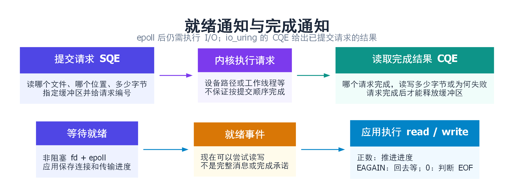
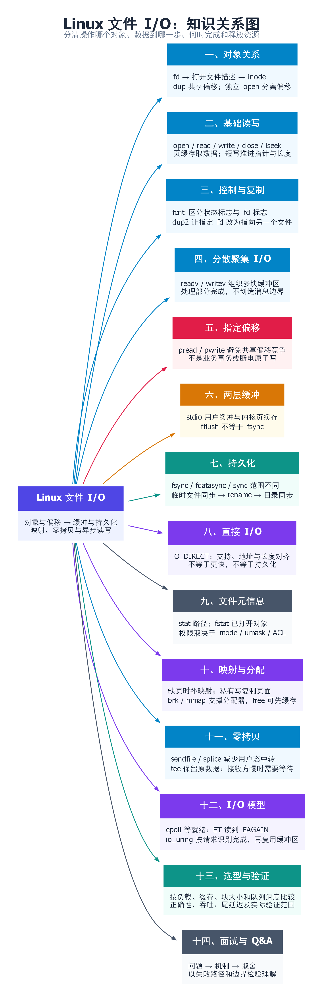

# Linux 文件 I/O：从文件描述符到持久化与异步读写

本文解决一个问题：怎样正确读写文件，理解数据经过哪些缓冲区，并根据并发、持久化和性能需求选择合适的 I/O 接口。

阅读前需要了解 C++ 指针、数组、对象什么时候创建和销毁，以及进程与线程的基本概念。后文的“对象生命周期”，就是对象从创建到销毁这段时间；“持久化”，是指把数据保存到磁盘等掉电后仍能保留数据的存储中，而不只是暂存在内存里。怎样确认保存完成、能承受哪些故障，在第七节说明。

程序通过系统调用请求内核执行文件操作。例如，`read()` 的缓冲区由程序提供，但从哪个文件、哪个位置读取，由内核维护相应状态。可回顾[系统调用与 C 库函数](../一.基础概念/1.Linux系统编程基础.md#buffering)。涉及线程同步时，参见[POSIX 线程笔记](../八.POSIX线程/1.POSIX线程.md)；涉及目录、硬链接和访问控制列表（ACL）时，参见[文件、目录与链接](../三.文件、目录与链接/1.文件、目录与链接.md)。本文会在需要时回顾相关知识，不要求先读完这些文章。

**快速阅读：**先读一至四节，建立 fd、偏移、短读写的概念；再读六、七节，区分“写入成功”和“持久化成功”；最后看十三、十四节及 Q&A。

**深入学习：**按顺序阅读，逐个运行完整实验，再结合 `strace` 观察系统调用。不要一开始就把 `O_DIRECT`、零拷贝或 io_uring 当成更快的通用替代品。

| 提纲中的主题 | 本文位置 |
| --- | --- |
| open/read/write/close/lseek；fd、打开文件表、inode | [一、对象关系](#objects)、[二、基础读写](#basic) |
| fcntl、O_NONBLOCK、dup/dup2 与重定向 | [三、文件控制与复制](#control)、[十二、I/O 模型](#models) |
| readv/writev | [四、分散聚集 I/O](#vector) |
| pread/pwrite 与“原子”边界 | [五、指定偏移读写](#positioned) |
| 内核缓冲、stdio 缓冲 | [六、两层缓冲](#buffers) |
| fsync/fdatasync/sync、O_DIRECT | [七、持久化](#durability)、[八、直接 I/O](#direct) |
| stat/fstat、权限、umask | [九、文件元信息](#metadata) |
| mmap/munmap、共享与私有映射、brk/sbrk/ptmalloc | [十、内存映射与分配](#mapping) |
| sendfile/splice/tee | [十一、零拷贝](#zerocopy) |
| 阻塞、非阻塞、多路复用、信号驱动、AIO、io_uring | [十二、I/O 模型](#models) |

## 实验环境与阅读约定

完整程序使用 **C++11、Linux/glibc**。基础接口按 POSIX 标准规定的行为讲解；`epoll`、`sendfile`、`splice`、`tee`、io_uring 的调用方式则按 Linux 说明，Windows 不能原样照用。建议在 Linux 6.1 及以上、GCC 11 及以上的学习环境运行；直接 I/O 的对齐查询还需要文件系统支持，不能只看内核版本。

Debian/Ubuntu 的安装和工作目录准备如下。每个代码块按文中名称保存为独立文件，不要把多个 `main()` 拼在一起：

```bash
sudo apt install build-essential strace liburing-dev
mkdir -p ~/file-io-lab
cd ~/file-io-lab
uname -r
g++ --version
ldd --version
```

运行示例时使用这个专用目录。程序会创建或截断文中指定的实验文件，不能把业务数据文件改名后代入实验。编译统一带 `-D_FILE_OFFSET_BITS=64`，便于在适用的 32 位 glibc 环境使用 64 位文件偏移；64 位平台通常本来就有 64 位 `off_t`。

多数系统调用失败时返回 `-1`，错误原因在 `errno` 中；只有发现失败后，才据此判断本次错误。本文的 `die()` 使用 `perror()` 打印原因，然后结束整个实验进程，便于先看清主要流程。

正式服务通常不能因为一个请求失败就结束整个进程，而应把失败交给调用方处理，并释放这个请求已经申请的资源。例如，打开了两个文件后，第三步失败，也要关闭前两个文件。C++ 常用 RAII 完成这类清理：让一个对象持有 fd，在对象析构时自动关闭。后文示例简化了这部分工程处理，会另行指出各自的限制。下文列出的输出是**预期结果**；实际验证范围在第十三节单独记录。

<a id="objects"></a>

## 一、文件名、fd、打开文件表和 inode，为什么要分开？

### 1.1 用“书、借阅记录和取书号码”建立直觉

同一个文件可以被打开多次，也可以被多个线程使用。如果“文件”和“正在读到哪里”是同一个东西，那么所有人读同一文件都会互相改变进度。操作系统因此将这些状态分开。

可以把文件内容看成一本书，打开文件描述看成借阅记录，fd 看成手中的取书号码：同一本书可以有多份独立借阅记录；复制号码则可以让两个号码指向同一份记录。这只是帮助理解引用关系，真实文件不是为每个读者复制一本书。

对应到程序，**文件偏移就是下一次普通 read/write 从文件的哪个字节开始**。比如偏移为 10，表示从距文件开头 10 字节的位置开始。**文件状态标志**则记录“是否追加写”“是否非阻塞”等设置。内核把这些状态放在一次打开所对应的记录中，这份记录的标准名称是“打开文件描述”，下文简称 OFD。

| 层次 | 保存什么 | 重要边界 |
| --- | --- | --- |
| 路径、目录项 | 目录里记录名字与文件对象的对应关系，按路径逐级查找 | 文件可以改名，同一个名字以后也可能指向另一个文件 |
| inode（索引节点） | 文件类型、权限、大小，以及怎样找到文件数据等信息 | 不记录某个读者读到哪里；文件名通常保存在目录项中 |
| 打开文件描述（open file description，OFD） | 当前偏移、追加/非阻塞等状态，以及它对应哪个文件 | 普通 `open()` 每次新建一份记录；`dup()` 让新 fd 指向已有记录 |
| 进程的 fd 表项 | 用 fd 这个小整数找到 OFD；另存“执行新程序时是否关闭”等设置 | fd 是进程内的号码，关闭后这个号码可能被分给另一个文件 |

后文说“fd 引用某个 OFD”，就是指内核能通过这个 fd 找到那份打开记录。不要把这里的“引用”与 C++ 的引用变量混为一谈。

文件里实际存放的文字、图片等叫“文件数据”；大小、权限、所有者等描述文件的信息叫“元数据”。后面讨论同步落盘时，会区分这两类信息。

POSIX 规定这些记录之间应有什么关系，Linux 内核通常用 `struct file` 等结构实现。教材把所有打开记录统称为“系统打开文件表”，是为了画图方便，不意味着内核必须把它们放进一张固定大小的全局数组。[open(2)](https://man7.org/linux/man-pages/man2/open.2.html) · [inode(7)](https://man7.org/linux/man-pages/man7/inode.7.html)


### 1.2 两次 open 与一次 open 后 dup，有什么区别？

```text
fd 3（第一次 open）─┐
                   ├→ 打开记录 A：偏移 0 ─┐
fd 4（dup(3)）─────┘                       ├→ 同一个文件 inode
fd 5（再次 open）────→ 打开记录 B：偏移 0 ─┘

从 fd 3 读 2 字节：A 的偏移前进到 2，fd 4 也从这里继续读。
fd 5 使用 B，偏移仍是 0。
```

同一进程的 POSIX 线程通常共享 fd 表；一个线程关闭某个 fd，会影响其他线程继续使用这个号码。`fork()` 后父子进程拥有各自的 fd 表，但继承的对应表项仍引用同一 OFD，因而可能共享偏移。更多生命周期细节见[进程管理笔记](../五.进程管理与控制/1.进程管理与控制.md)。

例如，关闭 fd 3 后，fd 4 仍能找到打开记录 A，所以仍然可以读文件。`unlink()` 删除的是目录中的名字，已经打开的 fd 仍可以访问原文件。只有文件没有剩余的硬链接，也没有 fd、映射等继续使用它时，文件系统才能回收它占用的空间。若有人后来又创建了一个同名文件，再按路径 open 得到的就是这个新文件，原来的 fd 不会自动改指向它。

<a id="basic"></a>

## 二、基础读写：为什么调用成功也可能没有读写完？

### 2.1 打开文件时，先明确“我要怎样使用它”

`open()` 不只是查找名字，还要说明准备怎样使用文件。`O_RDONLY` 表示只读，`O_WRONLY` 表示只写，`O_RDWR` 表示可读可写，这三种访问模式选一种。其他选项用 `|` 组合，例如 `O_WRONLY | O_CREAT` 表示“只写打开，不存在就创建”。

读取现有标志时，不要用 `flags & O_RDONLY` 判断是否只读，因为 Linux 的 O_RDONLY 为 0，这个按位与表达式总是 0。应先用 `flags & O_ACCMODE` 取出访问模式，再与 O_RDONLY 比较。

| 选项 | 为什么需要它 | 容易误解的地方 |
| --- | --- | --- |
| `O_CREAT` | 文件不存在时创建 | 需要提供第三个 `mode` 参数；已有文件不会因此重设权限 |
| `O_EXCL` 与 `O_CREAT` | 只在名字尚不存在时创建；已经存在就失败 | 不要先查“不存在”再普通创建，因为两步之间别的程序可能已经创建了同名文件 |
| `O_TRUNC` | 把可写打开的普通文件截成 0 字节 | 会破坏已有内容；实验只用于专用文件 |
| `O_APPEND` | 每次写入从当时的文件末尾开始 | 一条记录若拆成多次写，仍可能被别人的写入穿插；也不保证已经落盘 |
| `O_CLOEXEC` | 当前进程以后成功执行 exec 时，自动关闭这个 fd | 创建 fd 时就设置好，避免其他线程在事后补设之前已经启动新程序；下面解释这个时间差 |
| `O_NONBLOCK` | 对支持的对象，不因暂时无数据或无空间而等待 | 对 Linux 普通文件通常不能消除磁盘 I/O 等待，十二节解释 |

这里的 **exec** 是用新程序替换当前进程正在运行的程序，不是另外创建一个进程。进程已经打开的 fd 默认可能继续交给新程序使用。设置 `FD_CLOEXEC`，就是要求成功 exec 时自动关闭这个 fd；open 的 `O_CLOEXEC` 可以在创建 fd 的同时完成这项设置。

为什么不等 open 后再设？假设线程 A 刚打开一个文件，尚未补设 FD_CLOEXEC；线程 B 恰好 fork 出子进程并执行了新程序，这个 fd 就可能被意外带过去。O_CLOEXEC 让 fd 从创建出来起就带有设置，避免这个时间差。它只控制 exec 时的关闭，不表示一 fork 就关闭，也不影响普通线程使用这个 fd。

再看追加写：假设文件原来有 100 字节，A、B **各自独立 open 同一个文件**，因此各有一份偏移。如果两者都先 lseek 到末尾，再分别写入，两份偏移可能都停在旧位置 100，导致后一次写入覆盖前一次。O_APPEND 把“找到当时的末尾”和“本次写入”作为一个步骤处理，避免这种竞争。

但如果一条日志拆成“写时间、写正文”两次调用，中间仍可能插入其他线程的日志；它也不保证数据已经落盘。另外，网络文件系统 NFS 可能由客户端模拟追加，不能直接套用本地文件系统的保证。持久化问题在第七节展开。

### 2.2 五个接口各自改变什么？

| 接口 | 成功结果 | 应检查的边界 |
| --- | --- | --- |
| `open(path, flags, mode)` | 返回非负 fd | `0` 也是合法 fd，不能用 `fd <= 0` 判断失败 |
| `read(fd, buf, n)` | 返回实际读入字节数；请求非零长度时返回 0 通常表示已到文件末尾（EOF） | 不保证一次填满缓冲区；不会自动添加字符串结尾 `\0` |
| `write(fd, buf, n)` | 返回实际接受的字节数 | 可能短写；成功不等于落盘 |
| `lseek(fd, off, whence)` | 返回新的文件偏移 | 不搬运数据；管道、socket 不支持定位，通常报 `ESPIPE` |
| `close(fd)` | 返回 0 | 关闭这个号码，不等于确认数据落盘；先前写入的问题也可能到关闭时才报告，不能忽略返回值 |

`lseek()` 的 SEEK_SET 从文件头算，SEEK_CUR 从当前读写位置算，SEEK_END 从文件末尾算。例如，`lseek(fd, 10, SEEK_SET)` 把位置设为 10，`lseek(fd, -2, SEEK_END)` 把位置设为文件末尾之前 2 字节。

还可以把位置设到末尾之后。假设文件只有 100 字节，把位置设为 1000，文件此时仍是 100 字节；之后在这个位置写 1 字节，文件才增长到 1001 字节。中间没有写过的部分读出来是零字节。文件系统可能不为这段全零内容实际分配存储块，这类区域称为“空洞”。因此，文件显示的长度与实际占用的磁盘空间可能不同。[lseek(2)](https://man7.org/linux/man-pages/man2/lseek.2.html)

### 2.3 短读、短写、EOF、EINTR 和 EAGAIN，不是一回事

想搬 100 箱货，搬运工本次只接了 40 箱，不代表已经搬完，也不代表一次都没搬。`read/write` 返回正数时，这个数就是本次已经完成的进度，下一次必须从剩余部分继续。

| 返回情况 | 正确理解 | 下一步 |
| --- | --- | --- |
| 正数但小于请求长度 | 已处理一部分 | 下一次从尚未处理的位置继续，例如写了 40 字节后用 `buf + 40` 写剩下的部分 |
| `read` 返回 0，请求长度大于 0 | 普通文件达到当前 EOF；管道所有写端关闭且数据读完也返回 0 | 结束本次读取；普通文件以后仍可能增长 |
| `-1` 且 `errno == EINTR` | 这次调用被信号打断 | 若仍需要完成原来的读写，可以重试；若信号表示程序应该退出，则按退出流程处理。本文选择重试 |
| `-1` 且为 `EAGAIN/EWOULDBLOCK` | 非阻塞操作目前无法继续 | 记住已经完成多少，等可以读写时再试；马上不停重试会白白消耗 CPU |
| 其他错误 | 如权限、坏 fd、空间不足、设备错误 | 报告失败；不要把所有错误当成可重试 |

如果已经传输了部分数据，Linux 通常返回正的字节数，而不是要求程序猜信号发生前做了多少。只有调用返回 `-1` 时，`errno` 才用于解释该次失败。[read(2)](https://man7.org/linux/man-pages/man2/read.2.html) · [write(2)](https://man7.org/linux/man-pages/man2/write.2.html)

**Linux 上不要像重试 read 一样盲目重试 close。** Linux 通常会先释放 fd 号码，再在后续步骤发现错误；另一个线程可能已经复用了这个号码，重试会关闭别人的资源。此处是 Linux 行为说明，跨 UNIX 的 `close(EINTR)` 规则需要按目标系统确认。重要写入应在关闭前明确同步并检查错误，关闭失败则记录和报告，不把重新关闭当成修复。[close(2)](https://man7.org/linux/man-pages/man2/close.2.html)

### 2.4 完整实验：写完、重新定位、再读到 EOF

保存为 `basic_io.cpp`。缓冲区故意只有 4 字节，让“分批读取”容易观察；程序不使用非阻塞 fd，因此遇到 `EAGAIN` 会作为错误处理。

```cpp
#include <fcntl.h>
#include <unistd.h>
#include <cerrno>
#include <cstdio>
#include <cstdlib>

static void die(const char* what) { std::perror(what); std::exit(EXIT_FAILURE); }

static void write_all(int fd, const char* data, size_t size) {
    while (size != 0) {
        ssize_t n = ::write(fd, data, size);
        if (n > 0) {
            data += n;  // 已写部分不能重发，否则内容会重复。
            size -= static_cast<size_t>(n);
        } else if (n < 0 && errno == EINTR) {
            continue;
        } else {
            if (n == 0) errno = EIO;  // 防止没有进度时无限循环。
            die("write");
        }
    }
}

int main() {
    int fd = ::open("basic.txt", O_RDWR | O_CREAT | O_TRUNC | O_CLOEXEC, 0600);
    if (fd == -1) die("open");
    const char text[] = "hello Linux\n";
    write_all(fd, text, sizeof(text) - 1);  // 不把末尾的字符串终止符写进文件。
    if (::lseek(fd, 0, SEEK_SET) == -1) die("lseek");

    char buffer[4];
    for (;;) {
        ssize_t n = ::read(fd, buffer, sizeof(buffer));
        if (n > 0) {
            // buffer 不保证以 '\0' 结束，必须按实际字节数输出，不能用 %s。
            write_all(STDOUT_FILENO, buffer, static_cast<size_t>(n));
        } else if (n == 0) {
            break;
        } else if (errno != EINTR) {
            die("read");
        }
    }
    if (::close(fd) == -1) die("close");  // 只关闭一次；本例没有调用 fsync 确认落盘。
}
```

```bash
g++ -std=c++11 -D_FILE_OFFSET_BITS=64 -Wall -Wextra -pedantic basic_io.cpp -o basic_io
./basic_io
strace -e trace=openat,read,write,lseek,close ./basic_io
```

预期终端显示 `hello Linux`，并换行。`strace` 还会记录动态加载器的操作，不能把所有 `openat/read` 都算成 `main()` 中的调用。系统调用封装可能使用 `openat` 实现源码中的 `open`，也不代表示例写错了。

<a id="control"></a>

## 三、fcntl 和 dup：修改的是 fd，还是它指向的打开状态？

### 3.1 F_GETFL/F_SETFL 为什么要先读旧值？

假设一个线程轮流处理多个网络连接，这种反复等待事件、处理事件的循环叫“事件循环”。处理连接 A 时，如果 A 暂时没有数据，线程需要先去处理 B，而不是一直卡在 A 的 read 中。因此可以把连接设为非阻塞，让 read 在暂时无数据时返回 `EAGAIN`。

设置方法是：先用 `fcntl(fd, F_GETFL)` 读取现有状态标志，再用 `F_SETFL` 加上 `O_NONBLOCK`。

正确思路是“读取旧标志 → 保留原位并加入 `O_NONBLOCK` → 写回”。若直接设置成 `O_NONBLOCK`，可能意外清除原有的 `O_APPEND` 等可修改状态。十二节的 `epoll_pipe.cpp` 给出完整实现。

`F_SETFL` 只允许修改规定的状态位，不能把只读 fd 变成读写 fd，也不能事后补做创建或截断文件的操作。状态标志保存在打开记录中，所以如果 fd 3 和 fd 4 是通过 dup 得到的一组号码，通过 fd 3 设置非阻塞后，fd 4 也会受影响。

多个线程若同时修改这些标志，还要防止互相覆盖：A、B 可能先读到同一份旧值，然后各加一个标志，最后写回的那一份却没有包含另一个线程的修改。需要修改同一份设置时，应由一个线程负责，或用锁保护“读取旧值到写回新值”的整段操作。[F_GETFL(2const)](https://man7.org/linux/man-pages/man2/F_GETFL.2const.html)

| fcntl 命令 | 管理哪一层 | 常见用途 |
| --- | --- | --- |
| `F_GETFL / F_SETFL` | OFD 的文件状态标志 | `O_NONBLOCK`、`O_APPEND` 等；只允许修改规定的位 |
| `F_GETFD / F_SETFD` | 单个 fd 的设置 | 读取或设置 `FD_CLOEXEC`，决定成功 exec 时是否自动关闭它 |
| `F_DUPFD / F_DUPFD_CLOEXEC` | 新建一个指向同一打开记录的 fd | 分配不小于指定下限的可用号码；后一种还让新 fd 带有 `FD_CLOEXEC` |
| `F_GETLK / F_SETLK / F_SETLKW` | 给文件中的某段字节加记录锁 | 分别用于查询、尝试加锁、等待加锁；其他程序也要遵守先加锁再访问的约定，否则仍可直接读写 |

这里的文件记录锁与 pthread mutex 不是同一种锁。例如，传统 POSIX 记录锁由进程持有；该进程关闭任何一个指向这个文件的 fd，都可能释放它在这个文件上的全部传统记录锁，而不只是关闭“当初用于加锁的那个 fd”才有影响。Linux 的 OFD 锁则与打开记录关联，释放时机不同。使用记录锁前，要先选定锁类型，并规定各参与进程怎样加锁、访问和关闭文件。[fcntl(2)](https://man7.org/linux/man-pages/man2/fcntl.2.html)

### 3.2 dup/dup2 怎样完成重定向？

进程约定 `0/1/2` 分别作为标准输入、标准输出和标准错误。输出到 `1` 本身不意味着屏幕，而是写到 fd 1 当前引用的对象。

`dup(fd)` 分配一个可用的新号码，让它指向同一份打开记录。`dup2(fd, 1)` 则明确要求使用号码 1：如果 1 原来指向终端，就关闭它对终端的那条引用，再让它指向 fd 所对应的文件。以后写标准输出，就是写这个文件。

`dup2()` 把“替换号码 1 的旧用途”作为一次不可分割的操作完成。不能简单用 `close(1); dup(fd);` 替代：在两次调用之间，另一个线程可能 open 了一个文件，恰好拿走刚空出来的号码 1；随后 dup 得到的就不再是 1，重定向也就没有按预期完成。

如果 oldfd 有效，`dup2(oldfd, oldfd)` 什么也不改。复制到另一个号码时则要注意：新 fd 虽然共享原来的偏移和 O_APPEND 等文件状态，却不会自动继承原 fd 的 FD_CLOEXEC 设置。因为 FD_CLOEXEC 属于每个号码自己的设置，不在共用的打开记录里。

如果希望新号码从创建起就带有 FD_CLOEXEC，可使用 Linux 的 `dup3(..., O_CLOEXEC)` 或 `F_DUPFD_CLOEXEC`，而不是复制完后再单独补设。[dup(2)](https://man7.org/linux/man-pages/man2/dup.2.html)

### 3.3 完整实验：共享偏移与标准输出重定向

保存为 `fd_alias.cpp`。这里用固定的 6 字节普通文件，读取函数仍检查实际返回值，避免把一次 `read()` 当成保证读满。

```cpp
#include <fcntl.h>
#include <unistd.h>
#include <cerrno>
#include <cstdio>
#include <cstdlib>
#include <string>

static void die(const char* s) { std::perror(s); std::exit(EXIT_FAILURE); }
static void put(int fd, const char* p, size_t left) {
    while (left) {
        ssize_t n = ::write(fd, p, left);
        if (n > 0) { p += n; left -= static_cast<size_t>(n); }
        else if (n < 0 && errno == EINTR) continue;
        else { if (n == 0) errno = EIO; die("write"); }
    }
}
static std::string take(int fd, size_t count) {
    std::string result;
    while (result.size() < count) {
        char ch;
        ssize_t n = ::read(fd, &ch, 1);
        if (n == 1) result.push_back(ch);
        else if (n == 0) break;
        else if (errno != EINTR) die("read");
    }
    return result;
}
static void close_one(int fd) { if (::close(fd) == -1) die("close"); }

int main() {
    int a = ::open("alias.txt", O_RDWR | O_CREAT | O_TRUNC | O_CLOEXEC, 0600);
    if (a == -1) die("open a");
    put(a, "abcdef", 6);
    if (::lseek(a, 0, SEEK_SET) == -1) die("lseek");
    int b = ::dup(a);  // b 和 a 共用偏移。
    if (b == -1) die("dup");
    int c = ::open("alias.txt", O_RDONLY | O_CLOEXEC);  // c 有自己的偏移。
    if (c == -1) die("open c");
    std::string x = take(a, 2), y = take(b, 2), z = take(c, 2);
    std::printf("a=%s b=%s c=%s\n", x.c_str(), y.c_str(), z.c_str());
    // 重定向 fd 前刷出 stdio 里尚未输出的数据，否则旧输出可能进新文件。
    if (std::fflush(stdout) == EOF) die("fflush");

    int saved = ::dup(STDOUT_FILENO);
    if (saved == -1) die("save stdout");
    int out = ::open("redirect.txt", O_WRONLY | O_CREAT | O_TRUNC | O_CLOEXEC, 0600);
    if (out == -1) die("open output");
    if (::dup2(out, STDOUT_FILENO) == -1) die("dup2 redirect");
    if (out != STDOUT_FILENO) close_one(out);  // fd 1 已保留一份引用。
    put(STDOUT_FILENO, "redirected\n", 11);
    if (::dup2(saved, STDOUT_FILENO) == -1) die("restore stdout");
    close_one(saved);
    close_one(c); close_one(b); close_one(a);
}
```

```bash
g++ -std=c++11 -D_FILE_OFFSET_BITS=64 -Wall -Wextra -pedantic fd_alias.cpp -o fd_alias
./fd_alias
cat redirect.txt
```

预期依次显示 `a=ab b=cd c=ab`、`redirected`。程序假定启动时标准输出有效；它演示进程级重定向，不能让多个线程一边输出、一边随意改 fd 1。正式程序还要确保重定向失败后恢复原输出状态。

<a id="vector"></a>

## 四、readv/writev：头和正文不连续，为什么仍能一起读写？

### 4.1 省掉的是拼接与调用，不是所有复制

发送一条“协议头 + 正文”时，两段数据可能在不同内存区域。先复制到大缓冲区再 `write()`，会增加一次用户态拼接；分别 `write()`，又增加调用次数。

`iovec` 描述一个缓冲区的起始地址 `iov_base` 和长度 `iov_len`。`writev()` 按数组顺序读取这些区域，好像把它们串起来；`readv()` 则把连续输入依次填入这些区域，前一个满了再填下一个。

```text
writev：[头部缓冲区][正文缓冲区] → 连续输出字节流
readv ：连续输入字节流 → [先填缓冲区 0][再填缓冲区 1]
```

网络库可以把内部缓冲区剩余空间放在第一个 iovec，把额外临时缓冲区放在第二个，减少为了接收数据而提前扩容的次数。但返回值仍是总字节数，程序必须判断哪些缓冲区实际得到数据。

### 4.2 短写可能停在某个缓冲区的中间

假设头部 4 字节、正文 5 字节，`writev()` 返回 6：头部已全部写出，正文只写了前 2 字节。下一次应从正文剩下的 3 字节继续，不能重新发送整个数组。

一次向量操作仍受 fd 类型、请求长度和错误约束。pipe 中不交错的保证要结合总字节数是否不超过 `PIPE_BUF`；TCP 仍是字节流，接收方不会因为发送方调用一次 `writev()` 就恰好收到一条完整消息。循环补写分成多个调用后，更不能把整个循环当成不可分割的事务。[readv(2)](https://man7.org/linux/man-pages/man2/readv.2.html) · [pipe(7)](https://man7.org/linux/man-pages/man7/pipe.7.html)

### 4.3 完整实验：向量写完，按两个缓冲区读回

保存为 `vector_io.cpp`。示例只使用两个非空缓冲区。正式实现还要检查：缓冲区数量是否超过接口允许的上限 `IOV_MAX`，长度相加是否超出整数范围，以及总请求是否超过返回类型能表示的最大长度 `SSIZE_MAX`。如果用于非阻塞网络发送，还要记下“写到第几个缓冲区、其中写了多少”，下次可写时从剩余部分继续。

```cpp
#include <sys/uio.h>
#include <fcntl.h>
#include <unistd.h>
#include <cerrno>
#include <cstdio>
#include <cstdlib>
#include <vector>

static void die(const char* s) { std::perror(s); std::exit(EXIT_FAILURE); }
static void advance(std::vector<iovec>& v, size_t& first, size_t n) {
    while (n && first < v.size()) {
        if (n >= v[first].iov_len) {
            n -= v[first].iov_len;
            ++first;  // 这个缓冲区已处理完，下次不用再传。
        } else {
            v[first].iov_base = static_cast<char*>(v[first].iov_base) + n;
            v[first].iov_len -= n;  // 保留当前缓冲区未完成的尾部。
            n = 0;
        }
    }
}
static void transfer(int fd, std::vector<iovec> v, bool writing) {
    size_t first = 0;
    while (first < v.size()) {
        int count = static_cast<int>(v.size() - first);
        ssize_t n = writing ? ::writev(fd, v.data() + first, count)
                            : ::readv(fd, v.data() + first, count);
        if (n > 0) advance(v, first, static_cast<size_t>(n));
        else if (n < 0 && errno == EINTR) continue;
        else {
            // 本例知道文件应有 9 字节；提前 EOF 属于实验数据不完整。
            if (n == 0) errno = EIO;
            die(writing ? "writev" : "readv/unexpected EOF");
        }
    }
}
int main() {
    int fd = ::open("vector.txt", O_RDWR | O_CREAT | O_TRUNC | O_CLOEXEC, 0600);
    if (fd == -1) die("open");
    char header[] = "HEAD", body[] = "hello";
    transfer(fd, {{header, 4}, {body, 5}}, true);
    if (::lseek(fd, 0, SEEK_SET) == -1) die("lseek");
    char h[5] = {}, b[6] = {};  // 多留一个置零字节，便于以字符串打印。
    transfer(fd, {{h, 4}, {b, 5}}, false);
    std::printf("header=%s body=%s\n", h, b);
    if (::close(fd) == -1) die("close");
}
```

```bash
g++ -std=c++11 -D_FILE_OFFSET_BITS=64 -Wall -Wextra -pedantic vector_io.cpp -o vector_io
./vector_io
```

预期 `header=HEAD body=hello`。数据仍会在常规文件 I/O 路径中经过用户缓冲区和页缓存，不能把 `writev()` 直接称为零拷贝。

<a id="positioned"></a>

## 五、pread/pwrite：解决共享偏移竞争，不代表整段数据“绝对原子”

### 5.1 为什么 lseek 加 read 在多线程中会读错位置？

假设两个线程共用一个 fd，A 要读第 100 字节，B 要读第 200 字节：

```text
A：lseek(fd, 100, SEEK_SET)
B：lseek(fd, 200, SEEK_SET)
A：read(fd, ...) → 使用的是被 B 改过的偏移 200
```

每个系统调用都正确，不等于它们组合后的逻辑正确。`pread(fd, buf, n, offset)` 把本次位置作为参数传入，读取时不依赖、也不修改 OFD 的当前偏移；`pwrite()` 同理。好比直接告诉管理员“取第 100 页”，而不是先移动共享书签，再让管理员按书签读。

提纲中的“带偏移原子读写”，可以理解为：**直接在一次调用中说明位置，不必先移动共享书签，再按书签读写。** 它解决的是上面 A 被 B 改掉读取位置的问题。

但它不能保证所有事情都一次做完。比如请求从偏移 100 写入 20 字节，却只返回 8，下一次要从偏移 108 写剩余 12 字节。两个线程如果都写同一区域，仍可能互相覆盖；如果操作是“先读余额、加上收入、再写回”，仍要防止别的线程在中间修改余额。断电时能否完整恢复整条记录，也要另外设计日志或事务机制，不能由 pwrite 的名字推断出来。

Linux 上还要避开一个已记录的行为差异：对带 `O_APPEND` 的 fd，`pwrite()` 可能忽略指定写入位置而追加到末尾，这与 POSIX 的位置要求不同。要明确指定位置时，用不带 `O_APPEND` 的 fd。[pread(2)](https://man7.org/linux/man-pages/man2/pread.2.html)

### 5.2 完整实验：两个线程写不同区域，当前偏移保持不变

保存为 `positioned_io.cpp`。两个线程写不重叠的 4 字节区域，主线程 join 后读取。这里通过任务分区避免数据冲突，而不是指望 pwrite 自动为整个文件加锁。

```cpp
#include <fcntl.h>
#include <unistd.h>
#include <pthread.h>
#include <cerrno>
#include <cstdio>
#include <cstdlib>

static void die(const char* s) { std::perror(s); std::exit(EXIT_FAILURE); }
static void thread_check(int err) { if (err) { errno = err; die("pthread"); } }
struct Job { int fd; off_t offset; const char* text; };
static void* work(void* arg) {
    const Job& job = *static_cast<Job*>(arg);
    size_t done = 0;
    while (done < 4) {
        ssize_t n = ::pwrite(job.fd, job.text + done, 4 - done,
                             job.offset + static_cast<off_t>(done));
        if (n > 0) done += static_cast<size_t>(n);
        else if (n < 0 && errno == EINTR) continue;
        else { if (n == 0) errno = EIO; die("pwrite"); }
    }
    return nullptr;
}
int main() {
    int fd = ::open("position.txt", O_RDWR | O_CREAT | O_TRUNC | O_CLOEXEC, 0600);
    if (fd == -1) die("open");
    if (::ftruncate(fd, 8) == -1) die("ftruncate");
    if (::lseek(fd, 3, SEEK_SET) == -1) die("lseek");
    Job jobs[2] = {{fd, 0, "AAAA"}, {fd, 4, "BBBB"}};
    pthread_t ts[2];
    for (int i = 0; i < 2; ++i)
        thread_check(::pthread_create(&ts[i], nullptr, work, &jobs[i]));
    for (pthread_t t : ts) thread_check(::pthread_join(t, nullptr));
    char result[9] = {};
    size_t done = 0;
    while (done < 8) {
        ssize_t n = ::pread(fd, result + done, 8 - done, static_cast<off_t>(done));
        if (n > 0) done += static_cast<size_t>(n);
        else if (n < 0 && errno == EINTR) continue;
        else { if (n == 0) errno = EIO; die("pread/unexpected EOF"); }
    }
    off_t current = ::lseek(fd, 0, SEEK_CUR);
    if (current == -1) die("query offset");
    std::printf("data=%s offset=%lld\n", result, static_cast<long long>(current));
    if (::close(fd) == -1) die("close");
}
```

```bash
g++ -std=c++11 -D_FILE_OFFSET_BITS=64 -Wall -Wextra -pedantic -pthread positioned_io.cpp -o positioned_io
./positioned_io
```

预期 `data=AAAABBBB offset=3`。若把两项任务的 `offset` 都设为 0，写入位置将重叠，不能再期待固定内容。若用锁保护 `lseek + read/write`，也能解决位置竞争，但会串行化这段操作；各线程独立 `open` 可分离偏移，却仍不能避免同一区域的数据冲突。

<a id="buffers"></a>

## 六、两层缓冲：printf 已执行，为什么文件里还看不到？

### 6.1 用户空间缓冲和内核页缓存不是同一层

**stdio** 是 C 标准输入输出库，常见函数有 printf、fopen、fread、fwrite。它用 `FILE` 对象管理一次流操作的状态，包括缓冲区和读写位置；这比直接传一个 fd 多了一层管理。

把写文件想成寄信：先把信放进自己桌上的待寄盒，再交给邮局，最后送达。写进 stdio 缓冲区类似“先放在自己桌上”，调用 write 类似“交给邮局”。交出去不代表已经送达，同样，write 返回成功也不代表数据已经写进掉电后仍能保留的存储。下面按真实的数据流说明这几步。

```text
fprintf / fwrite
    ↓
stdio 的 FILE 缓冲区（进程用户空间）
    ↓ 缓冲满、fflush、正常 fclose 等触发底层写入
write 系统调用
    ↓
内核页缓存（常规缓冲文件 I/O）
    ↓ 后台回写、fsync/fdatasync 等
文件系统 / 块层 / 设备缓存 / 持久介质
```


**第一层是程序自己的缓冲。** 例如连续输出 100 个字符，stdio 可以先把它们放在内存中，再一起调用 write，减少进入内核的次数。

**第二层是内核的页缓存。** 内核按“页”这样的固定大小单位管理内存，把文件的部分内容保存在其中。再次读取这些内容时，可以直接从内存取，不必重新读取存储设备，这叫“缓存命中”。内核还可能提前读取接下来可能用到的内容，称为“预读”。

普通 `read()` 即使命中页缓存，通常仍需把数据复制到程序提供的缓冲区。普通 `write()` 则通常先修改页缓存；**已经修改、但尚未写回存储的数据页叫脏页**。内核稍后把这些修改写回设备，这个过程叫“回写”。

有缓存也不代表 write 永远立即返回。如果脏页积累得太多，内核可能先让写入线程等一等，等设备写出一部分再继续；内存不足时，也可能需要先腾出内存。因此，“写缓存”通常减少设备等待，但不能保证每次调用都不等待。

### 6.2 stdio 三种缓冲方式与刷新边界

| 方式 | 行为 | 常见场景与注意 |
| --- | --- | --- |
| 全缓冲 `_IOFBF` | 收集一批数据再交给底层 | 普通文件流常用；换行不等于立即刷新 |
| 行缓冲 `_IOLBF` | 输出换行通常触发刷新，缓冲满也会刷新 | glibc 中连接终端的 stdout 通常采用此方式 |
| 无缓冲 `_IONBF` | 不依赖 stdio 块缓冲积累输出 | glibc 的 stderr 通常无缓冲；不代表绕过内核页缓存 |

`setvbuf()` 用来选择缓冲方式，应在流打开后、尚未用它读写时设置。如果把自己的数组作为缓冲区交给它，那么在流关闭前，这个数组都必须有效，不能让数组所在的函数先返回。

`fread/fwrite` 返回的是“完整读写了多少个元素”，而不总是字节数。例如，每个元素 4 字节，返回 3 表示完成了 3 个完整元素；本文把元素大小设为 1，返回值才可以直接当作字节数。读取数量不足时，用 `feof()` 判断是否到达文件末尾，用 `ferror()` 判断是否发生错误。[setbuf(3)](https://man7.org/linux/man-pages/man3/setbuf.3.html)

`fflush()` 把输出流中的用户态缓冲交给底层，不保证内核缓存已持久化。`fclose()` 会刷新并关闭，但也不是 `fsync()`。Linux 的 `_exit()` 不负责刷新 stdio；`fork()` 复制的用户态缓冲若被父子进程分别刷新，可能出现重复输出。与之相对，内核 OFD 是共享引用，不是把文件偏移各自复制一份。[fflush(3)](https://man7.org/linux/man-pages/man3/fflush.3.html)

### 6.3 完整实验：明确区分 fflush 和 fsync

保存为 `stdio_sync.cpp`。这不是用“马上读到数据”证明持久化，而是展示正确的调用顺序；断电恢复需要专门的故障测试。

```cpp
#include <unistd.h>
#include <cerrno>
#include <cstdio>
#include <cstdlib>

static void die(const char* s) { std::perror(s); std::exit(EXIT_FAILURE); }
int main() {
    FILE* stream = std::fopen("stdio.txt", "w");
    if (!stream) die("fopen");
    char buffer[4096];  // fclose 之前一直有效。
    if (std::setvbuf(stream, buffer, _IOFBF, sizeof(buffer)) != 0) {
        std::fprintf(stderr, "setvbuf failed\n");
        return 1;
    }
    const char message[] = "buffered hello\n";
    if (std::fwrite(message, 1, sizeof(message) - 1, stream) != sizeof(message) - 1)
        die("fwrite");
    // 不假定 fwrite 此刻一定没触发 write；实现可以提前输出。
    // fflush 成功后，才能确认此前的输出没有继续留在 stdio 缓冲里。
    if (std::fflush(stream) == EOF) die("fflush");
    int fd = ::fileno(stream);
    if (fd == -1) die("fileno");
    while (::fsync(fd) == -1) {
        if (errno != EINTR) die("fsync");
    }
    // stream 管理这个 fd，不应先 close(fd) 再 fclose(stream)。
    if (std::fclose(stream) == EOF) die("fclose");
    std::puts("stdio flushed; file fsync completed");
}
```

```bash
g++ -std=c++11 -D_FILE_OFFSET_BITS=64 -Wall -Wextra -pedantic stdio_sync.cpp -o stdio_sync
strace -e trace=write,fsync,close ./stdio_sync
cat stdio.txt
```

预期文件内容为 `buffered hello` 加换行，跟踪能看到对文件的写入发生在 `fsync` 之前。这个例子没有同步新建文件的父目录，因此不承诺新文件名在崩溃后一定存在；下一节补全目录持久化。

混用 `FILE*` 和底层 fd 容易让“程序以为读到哪里”和“内核实际读到哪里”不一致。例如，`fread()` 为了提高效率，可能一次从内核预读 4096 字节，只交给调用者前 10 字节，剩下的留在 stdio 缓冲区。此时底层 fd 的偏移可能已经到 4096；若马上绕过 stdio 调用 read，就不会从第 10 字节接着读。

因此，简单程序最好一直使用 stdio，或者一直使用 read/write。确实要混用时，需要根据输入、输出和定位操作分别刷新或重新定位，按 POSIX 对这两类接口的配合要求处理。前面例子只是借 `fileno()` 找到 fd 做 fsync，没有绕过 stdio 继续读写内容，不涉及这种位置切换。

<a id="durability"></a>

## 七、持久化：怎样让“保存成功”有清楚的含义？

### 7.1 可见、原子替换、持久化，是三个不同问题

另一个进程能读到新内容，可能只是因为它从内核页缓存读到了刚写入的数据；机器此刻断电，这些数据仍可能丢失。另一方面，把配置文件名一次切换到新版本，只能说明读者不会遇到名字切换到一半的过程，也不表示新内容和新名字都已经保存到设备上。

| 性质 | 问的是什么 | 常见机制 |
| --- | --- | --- |
| 可见性 | 其他线程或进程什么时候能读到新内容？ | 先确认写入完成，再通知读取者；还要遵守所用文件系统的读写规则 |
| 原子性 | 操作进行到一半时，其他人能否看到中间状态？ | 同一文件系统中的 rename 可以一次替换名字；多步业务更新还需事务或日志 |
| 持久性 | 系统崩溃或掉电后，哪些内容和名字还能恢复？ | 写完后按顺序同步文件与目录，并准备失败后的恢复方法 |

不要用 `pwrite` 的显式偏移保证来回答断电原子性，也不要用“read 已读到”证明 fsync 可以省略。

### 7.2 fsync、fdatasync、sync 的区别

| 调用 | 作用范围 | 能表达的保证与限制 |
| --- | --- | --- |
| `fsync(fd)` | 指定文件的数据与相关元数据 | 等待设备报告同步完成；目录项另有同步需求，检查返回值 |
| `fdatasync(fd)` | 数据，以及后续正确读回数据所必需的元数据 | 例如文件长度仍需同步；不是“任何元数据都不写” |
| `sync()` | 系统范围的文件系统缓存 | Linux 会等待相关写出完成；这个接口没有返回值，不能据此判断某个文件是否同步成功 |
| `syncfs(fd)` | fd 所在文件系统 | Linux 接口，范围比单个文件大，可返回错误 |
| `O_SYNC / O_DSYNC` | 打开时设置，让每次 write 按相应要求同步后再返回 | O_SYNC 同步数据及相关元数据；O_DSYNC 侧重数据与读回数据所必需的元数据。每次都等待，可能降低每秒能完成的写入量 |

例如，文件从 100 字节写到了 200 字节，如果只保存后面的数据，却没保存新的文件长度，重启后就可能无法按正确长度读回文件。因此，fdatasync 仍要同步文件长度这类必要信息；访问时间等不影响正确读回内容的信息，则可能不必同步。能节省多少 I/O，取决于文件系统和实际修改了什么。

表中 sync 会等待的说法特指 Linux；其他 UNIX 系统的行为需查对应文档。[fsync(2)](https://man7.org/linux/man-pages/man2/fsync.2.html) · [sync(2)](https://man7.org/linux/man-pages/man2/sync.2.html)

普通 write 配合 fsync，可以由程序决定“先写完一批数据，再统一同步”。设置 O_SYNC/O_DSYNC 后，则要求每次 write 都按相应要求完成同步。如果业务允许先积累一批再保存，批量同步可能减少等待次数；如果每次更新都必须确认保存后才能继续，就不能为了速度随意延后。

`fsync()` 会等待设备报告同步完成。这里依赖设备正确执行要求：例如，设备不能把仍只保存在易失缓存中的数据谎报为已经可靠保存。需要应对掉电的系统，还要确认设备是否正确处理缓存刷新、是否有掉电保护，并实际测试重启后能恢复到什么状态。

反过来，`fsync()` 失败也不表示“之前的数据一点都没写出去”，可能只有一部分同步失败。因此，程序不能直接重新执行整个业务操作。例如，“给余额加 100”不能在保存结果不确定时再加一次，而应根据日志或记录编号判断此前做到了哪一步。

### 7.3 完整实验：先写临时文件，再可靠替换配置名

直接截断原配置再写，进程中途崩溃可能只剩空文件或半份配置。下面在同一目录中写临时文件，文件同步成功后用 `rename()` 替换名字，再同步父目录。

为什么目录也要同步？文件保存“配置内容是什么”，父目录保存“config.txt 这个名字指向哪个文件”。rename 改动的是后一份记录。只同步新文件的内容，却没有确认名字的修改也保存完成，重启后仍可能找不到预期的新版本。示例中的父目录就是当前目录 `.`，所以先把它打开，最后对目录 fd 调用 fsync。

保存为 `durable_replace.cpp`。只在自己控制的实验目录中运行，并且同一时间只有这一个程序更新 `config.txt`。正式程序还需要防止目录或文件名被别的程序替换；若有多个更新者，要决定谁的版本应该保留；替换旧文件时还要考虑是否保留原权限和 ACL，以及失败后怎样清理临时文件。

```cpp
#include <fcntl.h>
#include <unistd.h>
#include <cerrno>
#include <cstdio>
#include <cstdlib>

static void die(const char* s) { std::perror(s); std::exit(EXIT_FAILURE); }
static void write_all(int fd, const char* p, size_t left) {
    while (left) {
        ssize_t n = ::write(fd, p, left);
        if (n > 0) { p += n; left -= static_cast<size_t>(n); }
        else if (n < 0 && errno == EINTR) continue;
        else { if (n == 0) errno = EIO; die("write"); }
    }
}
static void sync_one(int fd) {
    while (::fsync(fd) == -1) if (errno != EINTR) die("fsync");
}
int main() {
    int dir = ::open(".", O_RDONLY | O_DIRECTORY | O_CLOEXEC);
    if (dir == -1) die("open directory");
    char name[] = ".config.tmp.XXXXXX";
    int fd = ::mkstemp(name);  // 唯一临时名，初始权限通常为 0600（仍受创建规则限制）。
    if (fd == -1) die("mkstemp");
    const char data[] = "version=2\n";
    write_all(fd, data, sizeof(data) - 1);
    sync_one(fd);  // 先确保新文件内容完成同步，再让正式名字引用它。
    if (::close(fd) == -1) die("close temp");
    if (::rename(name, "config.txt") == -1) die("rename");
    sync_one(dir);  // rename 修改的是目录中的名字关系，也需要同步。
    if (::close(dir) == -1) die("close directory");
    std::puts("config replaced and synchronized");
}
```

```bash
g++ -std=c++11 -D_FILE_OFFSET_BITS=64 -Wall -Wextra -pedantic durable_replace.cpp -o durable_replace
./durable_replace
cat config.txt
```

预期先显示确认消息，再看到 `version=2`。`rename` 必须在同一文件系统中完成这里需要的名字原子替换，跨文件系统会失败而不是自动变成同样原子的复制。

| 失败发生的位置 | 应怎样理解 |
| --- | --- |
| rename 之前 | 正式名字尚未切换；可能留下临时文件 |
| rename 已成功，目录 fsync 尚未成功 | 现在打开正式文件名能找到新文件，但此刻掉电，重启后能否保留这个名字变化还不能确认 |
| 目录 fsync 成功之后 | 文件内容和名字变化都已完成同步；它们能否在故障后恢复，仍依赖文件系统和设备正确履行同步要求 |

已有读者若一直持有旧 fd，仍引用旧 inode，不会被 rename 自动切换到新版本；需要重新打开名字，或采用应用自己的版本切换机制。[rename(2)](https://man7.org/linux/man-pages/man2/rename.2.html)

<a id="direct"></a>

## 八、O_DIRECT：绕过页缓存为什么不一定更快？

### 8.1 数据库为什么有时不希望内核再缓存一份？

数据库可能已经把常用数据缓存在自己的内存中，并且自己决定内存满时丢掉哪些缓存、什么时候读写设备。如果内核页缓存又保存相同数据，就可能为同一份内容占用两份内存；内核何时回写，也未必符合数据库希望的安排。

在支持它的文件系统上，`O_DIRECT` 让文件数据读写尽量绕过内核页缓存，由应用更多地管理缓存和读写时机。这就是一些数据库或存储引擎使用它的原因。

但普通程序依赖页缓存获得预读、合并和重复读取命中的收益。绕开它之后，小而零散的访问可能变慢；应用还要承担对齐、缓存和批量处理工作。因此，“用于某些高性能存储设计”不等于“加上标志就提速”。

**绕过内核页缓存，不代表绕过设备自己的缓存。** `O_DIRECT` 写入的数据仍可能停留在设备的易失缓存中，也就是掉电会丢失的缓存。因此，需要确认数据可靠保存时，仍要使用合适的 fsync、O_SYNC 等机制。O_DIRECT 管的是数据怎样经过缓存，O_SYNC 管的是写操作要等到什么程度才算完成，两者用途不同。O_DIRECT 也不保证整个过程中完全没有 CPU 复制。

### 8.2 为什么地址、长度、偏移都可能需要对齐？

设备通常按块处理数据，因此直接 I/O 可能要求三件事：缓冲区起始地址符合规定，文件中的起始位置符合规定，读写长度也符合规定。这些要求叫“对齐”。

例如，假设某文件要求偏移和长度都是 4096 的倍数，那么从偏移 0 写 4096 字节符合这两项要求，从偏移 1 写 100 字节就不符合。缓冲区地址还可能有单独要求；`new char[]` 只满足普通对象分配的对齐要求，不保证满足直接 I/O 的额外要求。这里的 4096 只是举例，实际限制必须查询或按目标文件系统文档确认。

不能把 512 或 4096 写成所有文件系统的固定规则。Linux 6.1 起提供 `statx` 的 `STATX_DIOALIGN` 查询机制，但文件系统是否实现、实际返回哪些字段仍需检查。若不满足要求，可能报 `EINVAL`，某些路径也可能回退为缓冲 I/O，不能只看 open 成功就断言所有请求都走了直接路径。[open(2) 的 O_DIRECT 说明](https://man7.org/linux/man-pages/man2/open.2.html) · [statx(2)](https://man7.org/linux/man-pages/man2/statx.2.html)

### 8.3 完整实验：查询对齐要求后写入一个数据块

保存为 `direct_io.cpp`。编译时，头文件要提供 STATX_DIOALIGN 等声明；运行时，内核和文件系统还要真的支持查询，只有声明也不够。本例面向 Linux 6.1+，查不到可用的对齐要求时就打印 SKIP 并跳过，不猜一个数字强行写入。

程序只写一个符合要求的数据块。如果意外只写出一部分，它会报告失败，不会直接拿剩余部分重试，因为剩余地址、偏移或长度可能不再对齐。正式实现还需要把剩余数据整理成符合要求的请求。

```cpp
#ifndef _GNU_SOURCE
#define _GNU_SOURCE
#endif
#include <sys/stat.h>
#include <fcntl.h>
#include <unistd.h>
#include <cerrno>
#include <cstdio>
#include <cstdlib>
#include <cstring>

static void die(const char* s) { std::perror(s); std::exit(EXIT_FAILURE); }
int main() {
#ifndef STATX_DIOALIGN
    std::puts("SKIP: headers have no STATX_DIOALIGN");
    return 0;
#else
    int fd = ::open("direct.bin", O_RDWR | O_CREAT | O_TRUNC | O_CLOEXEC | O_DIRECT, 0600);
    if (fd == -1) die("open O_DIRECT (check filesystem support)");
    struct statx sx{};
    if (::statx(fd, "", AT_EMPTY_PATH, STATX_DIOALIGN, &sx) == -1) die("statx");
    if (!(sx.stx_mask & STATX_DIOALIGN) || sx.stx_dio_mem_align == 0 ||
        sx.stx_dio_offset_align == 0) {
        std::puts("SKIP: usable direct-I/O alignment was not reported");
        if (::close(fd) == -1) die("close");
        return 0;
    }
    size_t alignment = sx.stx_dio_mem_align;
    if (alignment < sizeof(void*)) alignment = sizeof(void*);
    // posix_memalign 自身要求对齐值为 2 的幂，并且是 sizeof(void*) 的倍数。
    if ((alignment & (alignment - 1)) != 0) {
        std::fprintf(stderr, "unsupported alignment for this teaching example\n");
        return 1;
    }
    size_t length = sx.stx_dio_offset_align;
    void* buffer = nullptr;
    int err = ::posix_memalign(&buffer, alignment, length);
    if (err) { errno = err; die("posix_memalign"); }
    std::memset(buffer, 'D', length);
    ssize_t n;
    do { n = ::pwrite(fd, buffer, length, 0); } while (n < 0 && errno == EINTR);
    if (n < 0) die("direct pwrite");
    if (static_cast<size_t>(n) != length) {
        // 不能简单把剩余地址和长度继续提交，它们可能已经不满足对齐约束。
        std::fprintf(stderr, "short direct write: recovery needs alignment handling\n");
        std::free(buffer);
        ::close(fd);
        return 1;
    }
    while (::fsync(fd) == -1) if (errno != EINTR) die("fsync");
    std::printf("direct_bytes=%zu file_synced=yes\n", length);
    std::free(buffer);
    if (::close(fd) == -1) die("close");
#endif
}
```

```bash
g++ -std=c++11 -D_FILE_OFFSET_BITS=64 -Wall -Wextra -pedantic direct_io.cpp -o direct_io
./direct_io
```

预期要么显示本次写入的块长度及同步成功，要么打印跳过原因或平台错误；不同机器上的块长度不一定相同。

同一段文件数据如果一会儿用直接 I/O，一会儿用普通读写或 mmap，就需要确认缓存里的副本与设备上的内容怎样保持一致，性能也可能因此下降。一般不要在没有明确安排的情况下混用。

还要注意 fork：如果直接 I/O 使用 malloc 等分配的私有内存作为缓冲区，Linux 要求避免在请求尚未完成时并发 fork。fork 对这类内存的处理可能与正在进行的直接 I/O 冲突。应先等相关请求结束，再创建子进程；特殊共享映射等情况的例外需查 O_DIRECT 文档，不能自行假定适用。

<a id="metadata"></a>

## 九、stat、fstat、权限和 umask：读到的是哪个文件的属性？

### 9.1 路径会变化，已打开的 fd 更适合检查实际对象

`stat(path, &st)` 按当前路径查找目标；`fstat(fd, &st)` 查询已经打开的对象；`lstat()` 则用于查看符号链接本身。程序若先 stat 路径、再 open，两个操作之间名字可能被替换，不能保证检查和使用的是同一个文件。

因此，通常先打开文件，再用 fstat 检查这个 fd 对应的文件。这样就算名字后来被换掉，检查的仍是自己已经打开的那一个文件。

但“检查的是同一个文件”不等于“文件内容不会变”。其他线程或进程仍可能修改或截短它，所以 `st_size` 只说明查询时看到的大小，不保证下一次 read 一定能读到这么多数据。如果目录由不可信的其他用户控制，还要防止路径被替换或经符号链接指向意外位置，可结合目录 fd 和 `openat/openat2` 的限制选项。具体见[文件、目录与链接](../三.文件、目录与链接/1.文件、目录与链接.md)。

| 字段/宏 | 用来判断什么 | 常见误区 |
| --- | --- | --- |
| `st_mode`、`S_ISREG/S_ISDIR` | 类型和权限位 | 类型不是靠扩展名决定 |
| `st_size` | 普通文件逻辑字节数 | 空洞文件占用磁盘可能更少 |
| `st_blocks` | Linux 下按 512 字节单位计的已分配块数 | 不等于 `st_size / st_blksize` |
| `st_blksize` | 建议 I/O 块大小 | 不是 O_DIRECT 所有对齐约束的通用答案 |
| `st_dev + st_ino` | 在相应时间点识别文件系统中的对象 | 单独 inode 号不能跨文件系统唯一标识文件 |
| `st_uid/st_gid/st_nlink` | 所有者、组、硬链接数 | 链接数不是打开 fd 数量 |
| `mtime/ctime/atime` | 内容修改、状态变更、访问时间 | `ctime` 不是创建时间；精度及更新受系统策略影响 |

如果另一个进程正在修改文件属性，一次 stat 返回的多个字段也不一定都对应同一个瞬间。例如，可能读到修改前的权限，却读到修改后的所有者。因此，一次 stat 不能保证“这些属性曾在某个时刻同时成立”，也不能代替程序之间的同步。[stat(2)](https://man7.org/linux/man-pages/man2/stat.2.html)

### 9.2 umask 为什么是按位屏蔽，而不是减法？

新建文件时，程序提供“愿意授予的权限”，umask 再删掉其中不允许默认授予的位。没有父目录默认 ACL 时，可写成：

```text
最终权限 = 请求的 mode & ~umask
请求 0666，umask 0022 → 0644
请求 0600，umask 0022 → 0600，而不是算术相减得到的值
```

普通文件通常请求 `0666`，不默认授予执行位；目录通常请求 `0777`，因为目录的 `x` 表示搜索/穿越目录项。已有文件不会因为再次 `open(..., O_CREAT, mode)` 就被改权限，修改权限用 chmod/fchmod。

如果父目录有默认 ACL，创建权限按 ACL 继承并受请求 mode 限制，不能机械套上面单一公式。umask 是进程级属性，多线程中临时改它会影响其他线程创建文件；需要特定权限时尽量在创建模式中直接限制，避免“先过宽创建、再缩小”的暴露窗口。[umask(2)](https://man7.org/linux/man-pages/man2/umask.2.html)

### 9.3 完整实验：创建时的 mode 与实际属性

保存为 `metadata.cpp`。`mkstemp` 避免覆盖已有名字，`fchmod` 明确设置实验权限；这也演示修改权限与初始 umask 是两种操作。

```cpp
#include <sys/stat.h>
#include <unistd.h>
#include <cstdio>
#include <cstdlib>

static void die(const char* s) { std::perror(s); std::exit(EXIT_FAILURE); }
int main() {
    char path[] = "metadata.XXXXXX";
    int fd = ::mkstemp(path);
    if (fd == -1) die("mkstemp");
    if (::fchmod(fd, 0600) == -1) die("fchmod");
    if (::ftruncate(fd, 8192) == -1) die("ftruncate");
    struct stat st{};
    if (::fstat(fd, &st) == -1) die("fstat");
    std::printf("regular=%s size=%lld mode=%03o\n",
                S_ISREG(st.st_mode) ? "yes" : "no",
                static_cast<long long>(st.st_size),
                static_cast<unsigned>(st.st_mode & 0777));
    // 打开期间删除名字后，fd 仍引用原文件；本例读者可自行增加 fstat 观察。
    if (::unlink(path) == -1) die("unlink");
    if (::close(fd) == -1) die("close");
}
```

```bash
g++ -std=c++11 -D_FILE_OFFSET_BITS=64 -Wall -Wextra -pedantic metadata.cpp -o metadata
./metadata
# 用独立临时目录观察创建权限。若环境有默认 ACL，先用 getfacl 检查。
lab_dir=$(mktemp -d)
( umask 022; printf x > "$lab_dir/mode.txt"; stat -c '%a %s' "$lab_dir/mode.txt" )
```

预期程序显示 `regular=yes size=8192 mode=600`；无默认 ACL 的目录中，最后一条命令显示 `644 1`。子 shell 中设置 umask 不会改变当前交互 shell 的掩码。若使用 `getfacl` 而命令不存在，Debian/Ubuntu 安装 `acl` 包即可。

<a id="mapping"></a>

## 十、mmap 与内存分配：为什么访问一个指针也能读文件？

### 10.1 mmap 建立地址关系，不是立即把整个文件读入内存

普通 `read()` 的流程是“请求一段数据 → 复制到缓冲区 → 访问缓冲区”。如果需要反复随机访问一个文件，程序还要自己计算和维护缓冲范围。`mmap()` 让一段虚拟地址对应文件区间，程序像访问数组一样读取它。

可以把 mmap 理解成给文件各页分配了“门牌地址”：访问这个地址，就对应访问文件的那一部分。但拿到地址不等于数据已经全部读进物理内存。

CPU 通过“页表”查询程序地址对应哪块物理内存。如果程序首次访问某页时，页表中还没有可以直接使用的对应关系，CPU 就暂停当前访问，让内核处理，这叫“缺页”。若文件数据已在页缓存里，内核可以直接补好映射；否则可能先从存储设备读取数据，等读好后再让程序继续。因此，即使源码只是 `p[0]`，也可能因为需要读设备而等待。

常规文件 mmap 通常仍使用页缓存，和 O_DIRECT 不同。它能让程序直接通过映射地址访问文件页，省去复制到另一块 read 缓冲区的步骤，但并不是没有成本：内核需要维护页表、处理缺页，CPU 也要查询地址对应关系。CPU 用 TLB 缓存常用的地址转换结果，映射很多页面时还可能增加这部分缓存的压力。

如果只是从头到尾读一遍，大块 read 已经很有效，mmap 未必更快；如果反复访问不同位置，mmap 可以省去应用自己安排读缓冲区的麻烦。应按实际访问方式比较。

| 参数/返回值 | 应如何理解 |
| --- | --- |
| `addr = nullptr` | 让内核选择映射起始地址；不要随意用 MAP_FIXED 覆盖现有区域 |
| `length` | 映射区长度必须大于 0；映射不自动扩大文件 |
| `PROT_READ/PROT_WRITE` | 对虚拟地址允许的访问；还要与打开文件的方式兼容 |
| `MAP_SHARED / MAP_PRIVATE` | 选择写入是否影响共享文件映射 |
| `offset` | 文件中起始位置，通常要求为系统页大小的整数倍 |
| 返回 `MAP_FAILED` | 映射失败；不能只与 nullptr 比较 |
| `munmap(addr, length)` | 撤销地址映射；之后不能再用该地址访问数据 |

`mmap` 成功后可以关闭原 fd，映射不会因此消失；但若还需 fsync、查询属性或其他 fd 操作，就应保留所需引用。其他进程若把映射文件截短，访问已经越过文件末尾的映射页可能触发 `SIGBUS`。因此，不能仅凭最初 fstat 一次就保证映射一直安全。[mmap(2)](https://man7.org/linux/man-pages/man2/mmap.2.html)

### 10.2 MAP_PRIVATE 与 MAP_SHARED 到底共享什么？

| 方式 | 修改映射后的含义 | 不能推出的结论 |
| --- | --- | --- |
| `MAP_PRIVATE` | 当程序写入某页时，为这次私有修改准备自己的页面；修改不写回原文件，这叫“写时复制” | mmap 时不会立即复制整个文件；也不能据此认为外部文件的所有变化都已被冻结 |
| `MAP_SHARED` | 修改的是文件对应的共享页，其他共享使用者可以看到，并可写回文件 | 修改多个字段仍是多步操作；还需要协调谁先读写，且看到修改不代表已经落盘 |

例如，A 要把映射中的“姓名”和“余额”一起更新，B 不能在 A 只改完姓名时就把两项都读走。共享映射不会自动阻止这种情况。线程之间需要锁等同步措施；进程之间也要约定何时允许访问，例如使用设置为进程共享的互斥锁。

`msync(..., MS_SYNC)` 做的是把指定共享映射区间的修改同步到文件，并等待完成。它不会替 A、B 加锁，也不会把修改两个字段自动合成一步。`munmap()` 只撤销地址映射，同样不能代替同步落盘。[msync(2)](https://man7.org/linux/man-pages/man2/msync.2.html)

### 10.3 完整实验：私有改动不写回，共享改动可写回

保存为 `mapping.cpp`。只创建一个固定大小、没有其他修改者的文件，避免并发截断造成 SIGBUS。文件先扩展到 4096 字节，再映射其中的字节；这里 4096 是实验文件大小，不是宣称所有平台页大小都为 4096，映射偏移为 0 满足页对齐要求。

```cpp
#include <sys/mman.h>
#include <fcntl.h>
#include <unistd.h>
#include <cerrno>
#include <cstdio>
#include <cstdlib>

static void die(const char* s) { std::perror(s); std::exit(EXIT_FAILURE); }
static void set_first(int fd, char c) {
    ssize_t n;
    do { n = ::pwrite(fd, &c, 1, 0); } while (n < 0 && errno == EINTR);
    if (n != 1) { if (n == 0) errno = EIO; die("pwrite"); }
}
static char get_first(int fd) {
    char c = 0;
    ssize_t n;
    do { n = ::pread(fd, &c, 1, 0); } while (n < 0 && errno == EINTR);
    if (n != 1) { if (n == 0) errno = EIO; die("pread"); }
    return c;
}
int main() {
    const size_t length = 4096;
    int fd = ::open("mapping.bin", O_RDWR | O_CREAT | O_TRUNC | O_CLOEXEC, 0600);
    if (fd == -1) die("open");
    if (::ftruncate(fd, static_cast<off_t>(length)) == -1) die("ftruncate");
    set_first(fd, 'A');
    void* region = ::mmap(nullptr, length, PROT_READ | PROT_WRITE, MAP_PRIVATE, fd, 0);
    if (region == MAP_FAILED) die("mmap private");
    char* p = static_cast<char*>(region);
    p[0] = 'P';  // 本进程的私有改动，不改原文件。
    std::printf("private=%c file=%c\n", p[0], get_first(fd));
    if (::munmap(region, length) == -1) die("munmap private");

    region = ::mmap(nullptr, length, PROT_READ | PROT_WRITE, MAP_SHARED, fd, 0);
    if (region == MAP_FAILED) die("mmap shared");
    p = static_cast<char*>(region);
    p[0] = 'S';  // 修改共享文件页。
    while (::msync(region, length, MS_SYNC) == -1)
        if (errno != EINTR) die("msync");
    std::printf("shared=%c file=%c\n", p[0], get_first(fd));
    if (::munmap(region, length) == -1) die("munmap shared");
    if (::close(fd) == -1) die("close");
}
```

```bash
g++ -std=c++11 -D_FILE_OFFSET_BITS=64 -Wall -Wextra -pedantic mapping.cpp -o mapping
./mapping
```

预期两行：`private=P file=A`、`shared=S file=S`。这验证数据可见性差别，不是断电试验，也没有为新建文件名补做父目录同步。

### 10.4 brk/sbrk 与 malloc：为什么申请内存不总有系统调用？

`malloc()` 需要给应用很多大小不同的对象。如果每次小分配都向内核申请独立映射，调用和元数据成本会很高。glibc 的分配器因此先获取较大的内存区域，再把它切成块交给应用，释放后常常留着复用。

`brk()` 调整传统堆区的 program break，也就是数据段末端边界；`sbrk()` 是按增量调整的库接口，返回旧边界，失败是 `(void*)-1`。这两个接口是理解历史机制的重要概念，不是现代可移植 C++ 程序应直接管理的内存 API。应用自行修改 break，可能破坏 malloc 已维护的堆结构。[brk(2)](https://man7.org/linux/man-pages/man2/brk.2.html)

glibc 的 malloc 源自 ptmalloc 家族。以下用 glibc 2.26 及之后的常见实现说明它怎样找内存；具体大小限制、缓存数量和管理方式会随版本及配置变化：

1. 先看看有没有能再次使用的空闲块。例如，一个线程刚释放一小块内存，下次申请相同大小时可能直接拿来用。glibc 2.26 引入的 **tcache（线程缓存）**为线程保留一部分这样的空闲块，减少每次都向共同管理区申请的次数。
2. 线程缓存不满足时，再到 **arena（分配区）**中寻找、拆分或合并内存块。一个 arena 维护一组内存区域及其分配记录；使用多个 arena，可以减少所有线程争用同一套管理数据和内部锁的情况。
3. 已管理的内存不够时，才需要向操作系统再申请。主 arena 可能用 brk 扩大传统堆区，也可能使用 mmap；其他 arena 常用 mmap 获得内存。
4. 某些大块申请可以直接建立匿名 mmap 映射，也就是不关联普通文件的内存映射。多大算“大块”可能动态调整，不能死记“超过 128 KiB 就必然 mmap”。

`free()` 之后，这块内存可能只是回到分配器手里，等下次申请时复用，未必立即还给操作系统。独立 mmap 的块可能直接 munmap；传统堆区顶部满足条件时也可能收缩，但中间夹着仍在使用的块时，不能随意把整段内存归还。

所以，释放对象后，进程的 **RSS（当前驻留在物理内存中的大小）**不一定马上下降，原因可能是缓存或碎片，而不一定是泄漏。是否泄漏，要看已经不需要的对象是否仍然被错误保留，不能只看一次 RSS 数值。[glibc malloc 源码](https://github.com/bminor/glibc/blob/glibc-2.39/malloc/malloc.c) · [mallopt(3)](https://man7.org/linux/man-pages/man3/mallopt.3.html)

保存为 `allocation.cpp`，用 strace 观察这次 malloc 到底有没有调用 brk 或 mmap。程序会在每页写一个字节，让这些页实际被访问；只调用 malloc 拿到地址，还不能说明整段内存都已经分配了可用的物理页面。

```cpp
#include <unistd.h>
#include <cstdio>
#include <cstdlib>
int main() {
    const size_t size = 8 * 1024 * 1024;
    long page = ::sysconf(_SC_PAGESIZE);
    if (page <= 0) return 1;
    void* memory = std::malloc(size);
    if (!memory) return 1;
    volatile unsigned char* p = static_cast<unsigned char*>(memory);
    // volatile 仅用于保留实验访问，不承担线程同步作用。
    for (size_t i = 0; i < size; i += static_cast<size_t>(page)) p[i] = 1;
    std::puts("allocated and touched 8 MiB");
    std::free(memory);
}
```

```bash
g++ -std=c++11 -Wall -Wextra -pedantic allocation.cpp -o allocation
strace -e trace=brk,mmap,munmap ./allocation
```

预期程序打印分配和触碰完成，跟踪中的具体系统调用依赖 glibc 配置及此前分配状态；加载器也会 mmap 共享库。不能要求每台机器输出同一地址或完全相同调用序列。`malloc` 的映射多是匿名内存，前面的文件 mmap 则关联文件，两者共享虚拟内存机制但用途不同。

<a id="zerocopy"></a>

## 十一、零拷贝：为什么没有 read/write 也能转发数据？

### 11.1 “零”通常省掉哪段路径？

假设服务器要把一张图片原样发给客户端。普通做法是先 read 到程序的缓冲区，再调用 write/send 把它交给内核发送。图片内容没有改变，却先从内核复制到程序，再从程序交回内核。sendfile 等接口就是为了省掉这种中转。

```text
普通转发：文件数据 → 内核页缓存 → 用户缓冲区 → 内核发送路径 → 网卡
sendfile：文件数据 → 内核安排文件数据的发送 → 网卡
```

这里的“零拷贝”主要是说：文件数据不必先搬进应用缓冲区，再搬回内核。有些实现还能让后续步骤直接使用已有的数据页，进一步减少复制；但不能据此断言任何环境中都完全没有 CPU 复制。

设备还可能通过 **DMA（直接内存访问）**搬运数据，由设备按配置访问内存，而不用 CPU 逐字节复制。不过，数据仍然要经过内存总线、设备和网络，“不由 CPU 搬”不等于“搬运不花时间”。

### 11.2 sendfile、splice、tee 分别连接什么？

| 接口 | 数据路径 | 关键边界 |
| --- | --- | --- |
| `sendfile(out, in, &offset, count)` | 常见为普通文件到 socket，也可用于支持的其他输出对象 | 传入 `&offset` 时，函数会把这个变量改为下次应读取的位置，但不改输入文件打开记录中的偏移；没传完仍需继续调用 |
| `splice(in, ..., out, ..., count, flags)` | 至少一端是 pipe，在内核中转移数据 | pipe 端的偏移参数必须为空；不是任意两个 fd 都能直连 |
| `tee(pipe_in, pipe_out, count, flags)` | 让另一个 pipe 也能读到这段数据；实现通常让两边指向同一批数据页，避免复制内容 | 原 pipe 中的数据仍保留。复制后还要通过 read/splice 取走原数据，否则下次可能复制同一段 |

`splice` 的 `SPLICE_F_MOVE` 只是历史上的提示，不能据此认定实现一定移动整页；`SPLICE_F_NONBLOCK` 也不保证涉及的所有文件端永不阻塞。`tee()` 的源和目标都要是合适的管道端，不能把一个普通文件 fd 直接代入。[splice(2)](https://man7.org/linux/man-pages/man2/splice.2.html) · [tee(2)](https://man7.org/linux/man-pages/man2/tee.2.html)

例如，原管道里有 `ABCDEF`，需要同时送去存档和网络。如果 tee 本次只把 `ABC` 复制到了第二条管道，就应记录“已复制 3 字节”，然后从原管道取走对应的 `ABC` 送往另一路。若还没取走就再次 tee，复制的可能仍是 `ABC`，而不是后面的 `DEF`。

还要考虑慢的一路。假设网络一直发不出去，相关管道最终会被填满，上游就不能无限继续放数据，只能等下游腾出空间。这种“下游处理慢，迫使上游减速或等待”的现象叫**背压**。程序需要分别记录两路已经处理到哪里，并在能够继续时接着传。

### 11.3 完整实验：sendfile 循环复制普通文件

保存为 `sendfile_copy.cpp`。面向 Linux 2.6.33+ 对普通文件输出的支持，教学环境建议使用前述 Linux 6.1+。输出要求不存在，避免误覆盖输入或已有文件；输入文件在复制期间不被其他程序修改。

```cpp
#include <sys/sendfile.h>
#include <sys/stat.h>
#include <fcntl.h>
#include <unistd.h>
#include <cerrno>
#include <cstdio>
#include <cstdlib>

static void die(const char* s) { std::perror(s); std::exit(EXIT_FAILURE); }
int main(int argc, char** argv) {
    if (argc != 3) { std::fprintf(stderr, "usage: %s INPUT NEW_OUTPUT\n", argv[0]); return 1; }
    int in = ::open(argv[1], O_RDONLY | O_CLOEXEC);
    if (in == -1) die("open input");
    struct stat st{};
    if (::fstat(in, &st) == -1) die("fstat");
    if (!S_ISREG(st.st_mode)) { std::fprintf(stderr, "input must be regular\n"); return 1; }
    int out = ::open(argv[2], O_WRONLY | O_CREAT | O_EXCL | O_CLOEXEC, 0600);
    if (out == -1) die("create new output");
    off_t offset = 0;
    while (offset < st.st_size) {
        off_t left = st.st_size - offset;
        size_t count = left > 1024 * 1024 ? 1024 * 1024 : static_cast<size_t>(left);
        // 内核会推进 offset；正数返回后不要再手动 offset += n。
        ssize_t n = ::sendfile(out, in, &offset, count);
        if (n > 0) continue;
        if (n < 0 && errno == EINTR) continue;
        if (n == 0) errno = EIO;  // 输入被截短，不能假装复制成功。
        die("sendfile");
    }
    if (::close(out) == -1) die("close output");
    if (::close(in) == -1) die("close input");
    std::printf("copied=%lld\n", static_cast<long long>(offset));
}
```

```bash
g++ -std=c++11 -D_FILE_OFFSET_BITS=64 -Wall -Wextra -pedantic sendfile_copy.cpp -o sendfile_copy
printf 'hello\n' > sendfile-input.txt
./sendfile_copy sendfile-input.txt sendfile-output.txt
cmp sendfile-input.txt sendfile-output.txt
```

首次运行预期 `copied=6`，`cmp` 成功且无输出。再次使用同一个输出名会报 `File exists`，这是防覆盖设计，换一个新名字即可。此例验证数据复制，不保留原权限、时间戳或空洞布局，也不承诺持久化；有持久化要求需补第七节的同步流程。

如果输出是非阻塞 socket，sendfile 返回 EAGAIN 时，要保留当前 offset，等连接再次可写后继续，不能从头重发。对端关闭时，还要处理写入错误，以及 SIGPIPE 可能使进程退出的问题。

如果发送前必须由程序压缩、修改或加密内容，应用就需要参与处理，不能直接假定仍能按“原样发送文件”的方式使用 sendfile。另外，有些发送方式会暂时继续使用文件中的原数据页；在接收方尚未消费这些数据前，不能随意修改对应文件区域，以免待发送内容发生变化。[sendfile(2)](https://man7.org/linux/man-pages/man2/sendfile.2.html)

<a id="models"></a>

## 十二、I/O 模型：通知“可以做”，还是通知“已经做完”？

### 12.1 先把等待数据和搬运数据分开

去餐厅取餐，“叫号后自己去窗口拿”和“服务员已经把餐送到桌上”不是同一件事。对应到读取数据，也要分清两种通知：

- **就绪通知：**告诉你“现在可以尝试读了”，程序还要自己调用 read，才能拿到数据。
- **完成通知：**你先提交“把这些数据读进这个缓冲区”的请求，随后收到结果，得知实际读了多少字节，或者为什么失败。

这个类比只帮助区分通知的含义；不同文件和设备怎样准备数据、怎样传输，还取决于具体实现。

| 模型 | 应用怎样等待 | 收到结果后谁执行实际读写 | 主要代价与边界 |
| --- | --- | --- | --- |
| 阻塞 I/O | 调用 read/write 时可能等待 | 当前调用完成数据传输后返回 | 代码直接；并发多时需考虑线程与调度成本 |
| 非阻塞 I/O | 暂时无法进行就返回 EAGAIN | 应用稍后重试实际 I/O | 单独反复轮询会浪费 CPU |
| I/O 多路复用 | select/poll/epoll 一次等一组 fd 就绪 | 应用收到就绪后调用 read/write | 通知是“可尝试”，不是完整消息已到达或操作已完成 |
| 信号驱动 I/O | 指定接收信号的进程或线程，设置 O_ASYNC，收到 SIGIO 等通知 | 应用仍要执行实际 I/O | 多次通知可能合并；信号处理函数能安全调用的函数有限 |
| POSIX AIO / Linux 原生 AIO | 提交请求后查询或等待完成 | 由实现执行请求，应用取得结果 | 两者是不同接口，执行请求的方式也不一样，见 12.4 节 |
| io_uring | 把读写请求放进提交队列，之后从完成队列取结果 | 由内核处理，必要时可能交给工作线程 | 必须记住每个请求对应哪个缓冲区，并保持它在请求完成前有效 |

**非阻塞 read 和异步读的主要区别，是结果在什么时候交给你。** 非阻塞 read 返回时，要么已经读到一些字节，要么告诉你现在读不了；暂时读不了时，之后仍由你再次调用 read。异步读则先接受一个请求，之后再通过完成结果告诉你读了多少字节或发生了什么错误。

异步接口把“交任务”和“拿结果”分开，让应用有机会在中间做其他事。但提交请求、管理队列以及等待结果仍可能花时间，不能理解成所有相关调用都保证立即返回。



### 12.2 epoll 为什么常与 O_NONBLOCK 配套？

一个事件循环管理多个连接。如果处理连接 A 时使用阻塞 read，并且数据已被另一个消费者取走，整个循环就可能停在 A，无法服务其他连接。非阻塞 fd 会返回 `EAGAIN`，让循环继续处理其他事件。

以读数据为例，**水平触发（LT）**可以在缓冲区里仍有数据时反复提醒你；**边缘触发（ET）**主要提醒“就绪状态有了变化”。如果收到一次 ET 通知后只读一小部分，剩下的数据可能不会再产生新的通知，程序却又回去等，就可能一直不处理它。

因此，ET 下通常要循环读取，直到 read 返回 EAGAIN，确认当前已经没有可继续读取的数据；也要处理读到 EOF 或遇到错误的情况。“被通知可读”也不代表数据已留给当前线程：另一个读取者可能先把它取走，所以仍需检查实际 read 的结果。[epoll(7)](https://man7.org/linux/man-pages/man7/epoll.7.html)

**不要把“非阻塞 socket + epoll”的做法直接搬到普通磁盘文件。** 在 Linux 上，普通文件设置 O_NONBLOCK 后，read 如果需要从设备读取数据，通常仍可能等待，不会因此自动改为返回 EAGAIN。把普通文件加入 epoll 通常也会报 `EPERM`。

即使 poll/select 把普通文件报告为可读，也不表示接下来访问的每一页都已经在内存里。若不希望文件读取卡住处理网络连接的线程，可以把它交给专门的工作线程，或者使用适合文件的异步接口。[poll(2)](https://man7.org/linux/man-pages/man2/poll.2.html)

### 12.3 完整实验：fcntl 设置非阻塞，用 epoll 等管道数据

保存为 `epoll_pipe.cpp`。用一个 pipe 模拟“暂时没有数据”的输入；两个固定字节由生产线程写入，读端采用 ET。管道机制可回顾[匿名管道笔记](../七.进程间通信%20IPC/1.pipe匿名管道%28亲缘进程%29.md)。关闭唯一写端后，读端读完剩余内容会获得 EOF。

```cpp
#include <sys/epoll.h>
#include <fcntl.h>
#include <unistd.h>
#include <pthread.h>
#include <cerrno>
#include <cstdio>
#include <cstdlib>
#include <string>

static void die(const char* s) { std::perror(s); std::exit(EXIT_FAILURE); }
static void thread_check(int e) { if (e) { errno = e; die("pthread"); } }
static void nonblock(int fd) {
    int old = ::fcntl(fd, F_GETFL);
    if (old == -1) die("F_GETFL");
    if (::fcntl(fd, F_SETFL, old | O_NONBLOCK) == -1) die("F_SETFL");
}
static void* produce(void* arg) {
    int fd = *static_cast<int*>(arg);
    const char* text = "AB";
    size_t done = 0;
    while (done < 2) {
        ssize_t n = ::write(fd, text + done, 2 - done);
        if (n > 0) done += static_cast<size_t>(n);
        else if (n < 0 && errno == EINTR) continue;
        else { if (n == 0) errno = EIO; die("producer write"); }
    }
    if (::close(fd) == -1) die("close writer");
    return nullptr;
}
int main() {
    int p[2];
    if (::pipe(p) == -1) die("pipe");
    nonblock(p[0]);
    // 此时写端仍开着但没有数据：不是 EOF，而是 EAGAIN。
    char byte;
    ssize_t initial;
    do { initial = ::read(p[0], &byte, 1); } while (initial < 0 && errno == EINTR);
    if (initial != -1 || (errno != EAGAIN && errno != EWOULDBLOCK)) {
        std::fprintf(stderr, "unexpected initial read\n"); return 1;
    }
    std::puts("initial=EAGAIN");
    int ep = ::epoll_create1(EPOLL_CLOEXEC);
    if (ep == -1) die("epoll_create1");
    epoll_event event{};
    event.events = EPOLLIN | EPOLLET;
    event.data.fd = p[0];
    if (::epoll_ctl(ep, EPOLL_CTL_ADD, p[0], &event) == -1) die("epoll_ctl");
    pthread_t producer;
    thread_check(::pthread_create(&producer, nullptr, produce, &p[1]));
    std::string result;
    bool eof = false;
    while (!eof) {
        int n = ::epoll_wait(ep, &event, 1, -1);
        if (n < 0) { if (errno == EINTR) continue; die("epoll_wait"); }
        // 本例只注册一个读端。HUP 也可能伴随剩余数据，不能看到 HUP 就直接丢弃。
        if (!(event.events & (EPOLLIN | EPOLLHUP | EPOLLERR))) continue;
        for (;;) {
            char buffer[16];
            ssize_t got = ::read(p[0], buffer, sizeof(buffer));
            if (got > 0) result.append(buffer, static_cast<size_t>(got));
            else if (got == 0) { eof = true; break; }
            else if (errno == EINTR) continue;
            else if (errno == EAGAIN || errno == EWOULDBLOCK) break;
            else die("consumer read");
        }
    }
    thread_check(::pthread_join(producer, nullptr));
    std::printf("received=%s eof=yes\n", result.c_str());
    if (::close(p[0]) == -1) die("close reader");
    if (::close(ep) == -1) die("close epoll");
    // p[1] 已由生产线程关闭；同一进程线程共享 fd 表，主线程不能再关闭一次。
}
```

```bash
g++ -std=c++11 -D_FILE_OFFSET_BITS=64 -Wall -Wextra -pedantic -pthread epoll_pipe.cpp -o epoll_pipe
./epoll_pipe
```

预期 `initial=EAGAIN`、`received=AB eof=yes`。epoll 唤醒几次可能不同，但最后拼出的数据都是 `AB`。本例只处理一条管道；真正的服务器还需要拆分网络消息、暂存没发完的数据、设置超时，并安排每个连接什么时候创建和关闭。相应内容见[网络 API 与原理](../九.网络编程/Linux网络编程基本API与原理.md)。

### 12.4 信号驱动、POSIX AIO、Linux 原生 AIO，不能混称一种异步

信号驱动通常先通过 `F_SETOWN` 指定由谁接收信号，再设置 `O_ASYNC`，适用于支持这种通知的终端、管道、socket 等。收到 SIGIO，只表示应该检查一下能否读写，并不表示数据已放进应用缓冲区。

此外，多次信号可能合并为一次，不能靠数信号来数有多少条数据。信号处理函数还可能打断正在执行的库函数，因此不能随意在里面调用 printf、malloc 等函数。通常只在处理函数里用允许的方式留下提醒，再由主循环等正常代码执行真正的 I/O。细节见[信号笔记](../六.信号/1.信号.md)。

**POSIX AIO** 用 `aio_read/aio_write` 提交任务，用 `aio_error` 查询是否完成，用 `aio_return` 取得完成结果；需要等待时可以用 `aio_suspend`。请求控制块是保存 fd、偏移、缓冲区等信息的结构体。在请求完成前，这个结构体和缓冲区都不能提前销毁，也不能被随意拿去处理别的请求。

在 Linux 上，glibc 的 POSIX AIO 通常通过用户态工作线程执行底层读写。对调用者而言任务是异步完成的，但内部可能是另一个线程在调用普通 I/O，并非直接使用下面的 Linux 原生 AIO 接口。[aio(7)](https://man7.org/linux/man-pages/man7/aio.7.html)

**Linux 原生 AIO** 指 `io_setup/io_submit/io_getevents` 等另一套接口，常通过 libaio 使用。它历史上主要面向直接文件 I/O；某些缓冲 I/O 路径可能在提交阶段阻塞，不能把“接口叫异步”理解成所有设备、文件系统和请求都得到相同执行方式。工程中还需留意 libaio 包装与原始系统调用的错误返回约定。[io_submit(2)](https://man7.org/linux/man-pages/man2/io_submit.2.html)

### 12.5 io_uring 的 SQ/CQ 到底省了什么？

Linux 5.1 引入 io_uring，后续版本继续扩展功能。可以把它理解成应用和内核共用两本登记簿：应用在一本上写“请做什么”，内核在另一本上写“做完了，结果是什么”。实际实现使用两个共享的环形队列：

- **SQ（提交队列）**保存待处理的任务，其中每条请求叫 **SQE**。例如“从 fd 3 的偏移 100 开始，读 20 字节到缓冲区 A”。
- **CQ（完成队列）**保存已完成请求的结果，其中每条结果叫 **CQE**。例如“编号 7 的请求读到了 20 字节”，或者“编号 7 失败了”。

“环形”表示队列中的位置可以在处理完后循环使用，并不是无限增长。应用通常使用 liburing 来准备请求、提交请求和读取结果，避免自己直接处理共享队列的更新顺序。

```text
应用准备缓冲区，并给请求分配一个便于识别的编号
  → 填 SQE：读哪个 fd、哪个偏移、多少字节、写进哪个缓冲区
  → 提交；此后不要提前释放或复用仍在使用的缓冲区
  → 内核执行：可能直接完成，也可能等待设备或交给工作线程处理
  → CQE：哪个请求完成了，实际处理多少字节，或发生什么错误
  → 应用读取结果；没读写完就继续申请，完成后才能释放相关资源
```

如果每次交一个任务都要进入内核，固定开销会重复很多次。io_uring 可以把一批请求一起提交，再成批读取完成结果，减少这部分开销。同时保持多个尚未完成的请求，也可能让设备并行处理更多工作。性能测试中的“队列深度”，常用于描述同时还有多少请求等待完成。

不过，队列里共享的主要是“做什么、结果是什么”这些信息，不代表文件数据本身不需要复制。普通读请求仍要把数据写进应用提供的缓冲区。让内核专门轮询提交队列的 SQPOLL 模式、提前登记缓冲区等优化，都需要额外设置，本例不启用。

多个请求不保证按提交顺序完成。例如，先提交“写数据”，再提交“同步文件”，不能只凭提交顺序就认定同步一定发生在全部数据写完之后。最容易理解的做法是：先等写请求完成，检查是否还有没写完的部分，全部写完后再提交 fsync。io_uring 也有把请求按依赖关系连接起来的功能，但使用时还要处理失败和短写，不能把它当作自动完成整笔业务的事务。[io_uring(7)](https://man7.org/linux/man-pages/man7/io_uring.7.html)

### 12.6 完整实验：通过 liburing 逐次读取一个普通文件

保存为 `uring_read.cpp`。依赖 liburing 2.x 开发包，使用基础 READ 操作，目标 Linux 建议 6.1+。程序每次提交一个读请求，等它完成并处理好结果后，再提交下一个。这是为了看清缓冲区什么时候可以再次使用；它没有同时提交一批请求，不能用来证明异步批量读的性能优势。

```cpp
#include <liburing.h>
#include <fcntl.h>
#include <unistd.h>
#include <cerrno>
#include <cstdio>
#include <cstdlib>
#include <cstring>
#include <cstdint>

static void die(const char* s) { std::perror(s); std::exit(EXIT_FAILURE); }
static void ring_error(const char* s, int result) {
    std::fprintf(stderr, "%s: %s\n", s, std::strerror(-result));
    std::exit(EXIT_FAILURE);
}
static void output(const char* p, size_t left) {
    while (left) {
        ssize_t n = ::write(STDOUT_FILENO, p, left);
        if (n > 0) { p += n; left -= static_cast<size_t>(n); }
        else if (n < 0 && errno == EINTR) continue;
        else { if (n == 0) errno = EIO; die("stdout write"); }
    }
}
int main(int argc, char** argv) {
    if (argc != 2) { std::fprintf(stderr, "usage: %s FILE\n", argv[0]); return 1; }
    int fd = ::open(argv[1], O_RDONLY | O_CLOEXEC);
    if (fd == -1) die("open");
    io_uring ring{};
    int rc = ::io_uring_queue_init(8, &ring, 0);  // 不启用 SQPOLL 等额外模式。
    if (rc < 0) ring_error("queue_init", rc);
    char buffer[4096];
    std::uint64_t offset = 0;
    for (;;) {
        io_uring_sqe* sqe = ::io_uring_get_sqe(&ring);
        if (!sqe) { std::fprintf(stderr, "submission queue full\n"); return 1; }
        ::io_uring_prep_read(sqe, fd, buffer, sizeof(buffer), offset);
        ::io_uring_sqe_set_data64(sqe, 1);  // 本例只等待一个请求；多请求程序用编号区分结果属于谁。
        rc = ::io_uring_submit(&ring);
        if (rc < 0) ring_error("submit", rc);
        if (rc != 1) { std::fprintf(stderr, "request not submitted\n"); return 1; }
        io_uring_cqe* cqe = nullptr;
        do { rc = ::io_uring_wait_cqe(&ring, &cqe); } while (rc == -EINTR);
        if (rc < 0) ring_error("wait_cqe", rc);
        int result = cqe->res;  // 这是读请求结果，不是 wait_cqe 的返回值。
        ::io_uring_cqe_seen(&ring, cqe);  // 告诉库这个结果已读完，队列位置可以复用；不再访问 cqe。
        if (result == -EINTR) continue;  // 重新准备请求，offset 不前进。
        if (result < 0) ring_error("read completion", result);
        if (result == 0) break;  // 普通文件 EOF。
        output(buffer, static_cast<size_t>(result));
        offset += static_cast<std::uint64_t>(result);
        // 正数短读也继续从实际完成的位置读；buffer 到完成后才被下一轮复用。
    }
    ::io_uring_queue_exit(&ring);  // 本例所有请求都已完成，结果也已处理，可以销毁队列。
    if (::close(fd) == -1) die("close");
}
```

```bash
g++ -std=c++11 -D_FILE_OFFSET_BITS=64 -Wall -Wextra -pedantic uring_read.cpp -o uring_read -luring
printf 'uring hello\n' > uring-input.txt
./uring_read uring-input.txt
```

预期输出 `uring hello` 加换行。`queue_init` 报 `EPERM` 可能与容器 seccomp 或系统禁用策略有关，`ENOSYS` 可能是内核不支持或环境拦截，不能一律认为程序少了 root 权限。`liburing.h` 缺失则先检查开发包；运行时某操作不支持还需检查 CQE 的负错误码。

这段代码在请求完成前，一直保留 fd 和缓冲区；遇到无法处理的错误就结束进程。真正的服务器还要继续处理其他任务，不能照搬这种退出方式。例如，某个连接出错时，要先确认它尚未完成的读写已经结束，或已经被成功取消，再释放缓冲区，否则内核可能仍在使用那块内存。

还要处理队列已经放满、本次只成功提交一部分请求，以及多个结果以不同顺序返回的情况。通常需要为每个请求记录 fd、缓冲区、已经完成的字节数和当前处理阶段。[io_uring_prep_read(3)](https://man7.org/linux/man-pages/man3/io_uring_prep_read.3.html) · [io_uring_submit(3)](https://man7.org/linux/man-pages/man3/io_uring_submit.3.html)

<a id="verify"></a>

## 十三、怎样选型、验证和排错？

### 13.1 先确定问题，再选择接口

| 具体需求 | 优先评估 | 为什么，以及代价 |
| --- | --- | --- |
| 简单配置、顺序日志、小工具 | stdio 或普通 read/write | 实现直接，较容易换到其他 UNIX 系统；仍需处理短写，并决定是否必须落盘 |
| 同一文件中并行访问不同区间 | pread/pwrite | 不争共享偏移；区间重叠和事务规则由应用管理 |
| 协议头和正文分散存放 | writev/readv | 减少拼接或调用；短传输进度更复杂 |
| 多连接网络事件循环 | 非阻塞 fd + epoll | 一个线程处理多个连接；要记住各连接读写到哪里，并处理发送过慢、超时和关闭 |
| 大文件反复随机读取 | mmap 与 pread 对照测试 | mmap 编程方便；缺页、页表及并发截断风险需要管理 |
| 静态文件转发 | sendfile，必要时 splice/tee | 减少数据经过应用缓冲区的次数；要确认 fd 类型受支持，并处理内容需修改或接收方过慢的情况 |
| 自己维护缓存的存储引擎 | 有依据地评估 O_DIRECT | 控制缓存策略；必须处理对齐、小 I/O 合并与持久化 |
| 大量可并行的文件请求 | io_uring 或限制线程数的工作线程池 | 一个请求等待设备时可处理其他请求；要限制同时处理的数量，并管理请求和缓冲区 |

POSIX 基础接口跨 UNIX 生态更普遍；Linux 专有接口在 Linux 服务中很常见，但迁移时需要替代实现。这里比较的是机制，不给出脱离硬件和负载的吞吐排名。

### 13.2 怎样给性能结论提供证据？

先弄清时间花在哪里：是频繁进入内核，是复制了太多数据，是数据不在内存里要读设备，还是请求已经在设备前排队？异步处理多个请求时，这些步骤可能同时进行，例如 A 等磁盘时，CPU 正在处理 B，因此不能把各阶段平均耗时简单相加当成程序总时间。

大致估算时，N 字节的数据每次搬 B 字节，需要约 `ceil(N/B)` 次读，再加上对应的写；ceil 表示向上取整。例如，10 KiB 每次搬 4 KiB，至少需要 3 次读取。这个估算假定每次都读够剩余数据或一个完整块；短读写会增加调用次数。

writev 可以少做一次缓冲区拼接，io_uring 可以少做一些单次提交，但传输 N 字节本身的工作仍然存在，慢设备也不会仅因换接口就变快。

一次可信比较至少记录以下条件：

1. 内核、glibc、编译器、文件系统、挂载选项、设备型号和数据集大小。
2. 顺序还是随机、块大小、读写比例、线程数、队列深度，以及数据是否预先分配。
3. 数据是否已在缓存中。首次读取、需要访问设备的情况通常称为冷缓存；重复读取已缓存数据称为热缓存。反复读取同一小文件，测到的可能主要是内存和复制速度，不能当成设备读取速度。
4. 是否包含 fsync。比较“仅写入页缓存”和“每次都等持久化”，不是同一种工作。
5. 吞吐（每秒完成多少数据或请求）、CPU 占用、实际字节数，以及中位数和 p95/p99 延迟。p99 为 20 毫秒，表示约 99% 的测量请求在 20 毫秒内完成，仍有约 1% 更慢。这些较慢请求的等待情况常称为“尾延迟”。
6. 正确性校验、重复次数和误差。必须先确认内容一致，再讨论速度。

`strace` 用来观察调用行为，通常会扰动耗时，不把带跟踪的时间直接作为生产性能。不要为了所谓冷缓存随意清理共享机器的全局缓存；在隔离实验环境设计缓存条件。本文没有性能基准数据，不把机制推断写成实测提升百分比。

### 13.3 示例检查表和实际验证范围

| 程序 | 核心预期 | 应验证的关系 |
| --- | --- | --- |
| `basic_io` | `hello Linux` | 短读写循环、重新定位、EOF |
| `fd_alias` | `a=ab b=cd c=ab`；重定向文件有内容 | dup 共享偏移，独立 open 不共享偏移 |
| `vector_io` | `header=HEAD body=hello` | 多缓冲区顺序与剩余部分推进 |
| `positioned_io` | `data=AAAABBBB offset=3` | 显式偏移、不重叠任务、join 后读取 |
| `stdio_sync` | `buffered hello` 写入文件 | 先刷新 stdio，再同步文件 |
| `durable_replace` | `config.txt` 内容为 `version=2` | 临时文件、rename、目录同步顺序 |
| `direct_io` | 实际块长度，或明确跳过/报告不支持 | 查询对齐，不把假定写成平台保证 |
| `metadata` | `regular=yes size=8192 mode=600` | 查询打开对象，区分长度和权限 |
| `mapping` | 私有 `P/A`，共享 `S/S` | 私有修改与共享文件页的区别 |
| `allocation` | 分配并触碰 8 MiB | 通过跟踪观察本机 malloc 路径 |
| `sendfile_copy` | 测试输入时 `copied=6`，cmp 一致 | 正确推进显式 offset，检测输入变短 |
| `epoll_pipe` | 初始 EAGAIN，最终 AB 和 EOF | 非阻塞、ET 读空、写端关闭 |
| `uring_read` | 输出输入文件内容 | 提交与完成分开，完成后才复用缓冲区 |

验证记录（2026-11-09）：本文在 Windows 工作区编写；本机 WSL 未配置可用的 Linux 环境。已按 Linux/POSIX 与 liburing 文档核对关键语义，并检查 Markdown 链接、代码块、示例名称及配图。**这些 Linux 示例尚未在 Linux/glibc 上编译运行，表中输出均为预期，不是实测记录。** 未进行断电恢复、故障注入或性能对比测试。

配图 `.dot` 指定 `PingFang SC`、200 DPI，并保留可再生成的源文件。当前 Windows 环境未安装 PingFang SC，PNG 渲染需要使用可用的中文字体回退；在安装该字体的环境重新运行下列命令，可恢复指定字体外观。

```bash
dot -Tpng -Gdpi=200 file-io-assets/fd-relations.dot -o file-io-assets/fd-relations.png
dot -Tpng -Gdpi=200 file-io-assets/buffers.dot -o file-io-assets/buffers.png
dot -Tpng -Gdpi=200 file-io-assets/io-models.dot -o file-io-assets/io-models.png
dot -Tpng -Gdpi=200 file-io-assets/mindmap.dot -o file-io-assets/mindmap.png
```

### 13.4 看到异常时先检查什么？

| 现象 | 优先检查 | 背后的原因 |
| --- | --- | --- |
| 文件输出少一截或重复一段 | 是否按实际字节数推进缓冲区和偏移 | 请求长度不等于完成长度 |
| read 后打印乱码、越界 | 是否误用 `%s`，是否补终止符或按长度处理 | read 不添加 `\0` |
| 设置非阻塞后仍卡在普通文件读取 | fd 类型、页缓存命中、设备 I/O | O_NONBLOCK 不是磁盘异步开关 |
| epoll ET 后再也收不到剩余数据 | 是否一直读到 EAGAIN；是否看到 HUP 就丢掉了剩余数据 | 已通知过但尚未读走的数据，不一定再次触发提醒 |
| dup 后读取位置互相影响 | 是否共享同一 OFD | 复制 fd 没有复制偏移 |
| pwrite 总写到末尾 | fd 是否带 O_APPEND | Linux 的已记录行为差异 |
| fflush 后断电丢数据 | 是否 fsync 文件、是否同步名字所在目录 | 用户态刷新与持久化不是一层 |
| O_DIRECT 返回 EINVAL | 地址、长度、偏移与文件系统支持 | 对齐和支持要求不满足 |
| mmap 访问触发 SIGBUS | 文件是否过短或被其他进程截短 | 有映射不等于背后一直有有效文件页 |
| 权限与 mode 不一致 | umask、父目录默认 ACL、是否为已有文件 | 创建权限不是只看 open 的第三参数 |
| close 错误后程序关闭了无关资源 | 是否盲目重试同一个 fd 数字 | Linux 可能已经释放并复用 fd |
| io_uring 收到负结果或输出异常 | 分清提交返回值、CQE res、缓冲区寿命 | 提交成功不代表请求成功完成 |

### 13.5 写一个 I/O 函数前的操作清单

- 明确 fd 指向普通文件、管道还是 socket；它是否可定位、可阻塞、可注册到所选事件机制。
- 标出 fd、OFD、缓冲区和请求的所有者；谁关闭，谁等待完成，谁能改变偏移或状态标志。
- 分开处理正数进度、EOF、EINTR、EAGAIN 和其他失败；记录部分成功，避免重放重复写入。
- 对共享数据区间设计锁或分区规则，不把 pread、mmap 或 O_APPEND 当作完整事务。
- 明确怎样才算“保存成功”：其他线程能读到就行，还是要求掉电后也能恢复？文件名的创建或替换是否也需要同步？失败后从哪一步恢复？
- 最后再选批量、映射、直接 I/O、零拷贝或异步方案，并用实际负载验证收益。

## 十四、面试时怎样用自己的话讲清楚？

**文件描述符与共享偏移：**

> fd 是进程里的一个小整数，内核用它查找一份打开记录。读到哪里、是否追加等状态保存在这份记录中。dup 出来的两个 fd 指向同一份记录，所以一个读了数据，另一个的读取起点也会变化；独立 open 则各有自己的进度。多个线程需要指定位置时，我会用 pread/pwrite 直接传入偏移，但仍要防止它们同时修改同一区域，也要另外考虑数据怎样落盘。

**缓冲与保存：**

> 写文件可能经过两层内存缓冲：stdio 先替程序收集小输出，fflush 再把它交给底层 write；write 通常又先写进内核页缓存。因此，write 成功不代表掉电后还能恢复。需要可靠保存时，我会检查 fsync/fdatasync 的结果；新建或替换名字，还要同步父目录。更新配置时，可以先写好并同步临时文件，再替换正式名字并同步目录，避免原文件先被截断后只写了一半，代价是多做一些 I/O 和等待。

**性能接口的选择：**

> 我会先看时间花在哪里。头和正文已经分开存放时，writev 可以省去先拼成一个大缓冲区的步骤；反复访问文件不同位置时，可以比较 mmap 和 pread；文件要原样发出去时，可以考虑 sendfile；应用自己管理缓存时，再评估 O_DIRECT。这些接口省掉的工作不同，也有各自的限制，所以要在实际数据和访问方式下测试，而不是只看名字选一个“高级接口”。

**I/O 模型：**

> epoll 通知我哪个 fd 可以尝试读写，真正的数据仍要由后面的 read/write 取得，暂时读不了就处理 EAGAIN。io_uring 则让我先提交具体请求，之后再拿完成结果，因此等待一个请求时还能处理其他工作。代价是必须记住每个请求用了哪块缓冲区，在完成前不能释放它，也不能假定请求按提交顺序完成。任务少时先用简单方式，确实需要并行处理更多请求时再增加复杂度。

## Q&A（常见问题与解答）

**Q1：fd 就是文件在磁盘上的编号吗？**

不是。fd 是进程查找打开记录时使用的号码，不是磁盘地址；不同进程的 fd 3 可以指向完全不同的文件。inode 号用于在一个文件系统内识别文件，不同文件系统又可能出现相同 inode 号，所以也不能只凭一个 inode 数字跨文件系统判断是否为同一个文件。

**Q2：为什么 close 一个 dup 出来的 fd，另一个还能用？**

例如 fd 3 和 fd 4 都指向打开记录 A，关闭 fd 3，只是让号码 3 不再指向 A。fd 4 仍能找到 A，因而可以继续操作文件。两者尚未关闭时，通过其中一个改变读写位置或追加等状态，另一个也会受影响。

**Q3：一次 write 返回请求长度，能证明数据在磁盘上吗？**

不能。它只报告这次写入的接受进度。普通缓冲 I/O 的数据可能还在页缓存中；需要持久化时采用相应同步接口并检查结果。

**Q4：为什么不能简单把 pread/pwrite 称为“原子读写”？**

它们让程序直接指定本次位置，避免“先 lseek、再读写”之间被别的线程改掉位置。但一次仍可能只读写部分数据；“读取余额、计算、写回”仍是多个步骤，其他线程可能插进来；断电后也不保证任意大小的记录都完整保留。所以需要说明解决的是哪一种问题，不能把“原子”当成什么都安全的总保证。

**Q5：为什么已有 O_APPEND 还可能需要日志锁？**

O_APPEND 让每次写入从当时的末尾开始，但一条日志可能分成多次写，别人的日志仍可能夹在中间。如果要求一条日志完整写完后才能写下一条，可以让单个线程统一负责写日志，或用锁保护整个写入过程；还要规定怎样识别一条完整记录，以及写到一半失败后怎样处理。

**Q6：read 返回 0，与 EAGAIN 有什么区别？**

请求非零长度时，普通文件的 0 表示当前 EOF；管道读完且所有写端关闭也为 0。EAGAIN 表示当前暂时无法继续，未来仍可能有数据，通常应等事件而不是关闭连接。

**Q7：readv/writev 能解决 TCP 粘包吗？**

不能。发送方一次 writev 的数据，接收方可能分几次才读全；发送方分几次写的数据，接收方也可能一次读到。接收方仍要靠消息长度、分隔符或固定长度等约定，判断哪里是一条消息的结束。

**Q8：fdatasync 为什么还可能写元数据？**

如果没有正确文件长度等信息，数据写入设备后也无法被正确读回，因此这类必要元数据仍要同步。它可以省的是与正确恢复数据无关的某些元数据更新。

**Q9：已经 fsync 文件，为什么还要 fsync 目录？**

文件内容和目录中的名字记录是两件事。例如，新文件的内容已经写到设备上，但“config.txt 指向这个新文件”还只保存在内存里，掉电后仍可能找不到预期的新版本。因此，需要保存创建、改名或删除的结果时，还要同步被修改的目录。

**Q10：O_DIRECT、O_SYNC、O_NONBLOCK 可以当成同一类提速开关吗？**

不能。O_DIRECT 主要决定文件数据是否绕过内核页缓存；O_SYNC 要求每次写入按同步要求完成后才返回；O_NONBLOCK 则让支持它的对象在暂时读写不了时返回错误，而不是继续等。它们解决的是三个不同问题，不能换上其中一个就推断获得了另外两个的效果。

**Q11：mmap 后关闭 fd，指针是否失效？**

不会仅因关闭原 fd 而失效，映射保留自己的文件引用。munmap 后地址失效；文件被截短也可能让某些访问触发 SIGBUS，必须分别管理映射和文件内容的生命周期。

**Q12：MAP_PRIVATE 能不能拿来做文件的一致快照？**

不能。MAP_PRIVATE 保证的是“你通过这份映射做的私有修改不会写回原文件”，并没有保证“今后读到的内容永远停留在 mmap 那一刻”。如果需要一个之后不再变化的版本，可以使用文件系统快照，或让程序保留并只读取一个不再修改的文件版本。

**Q13：free 后 RSS 不降，就一定泄漏了吗？**

不是。分配器可能缓存空闲块，arena 中也可能存在无法整体归还的碎片。要结合仍存活对象、分配记录和长期趋势判断；反过来，RSS 稳定也不自动证明没有逻辑泄漏。

**Q14：sendfile 的 offset 指针传空和非空有什么区别？**

空指针使用并推进输入文件的当前偏移；非空指针从指定位置读取并更新该变量，不改变输入 OFD 的偏移。应用不能在内核已更新 offset 后再重复加上返回字节数。

**Q15：tee 完成后，输入管道的数据是不是已经转走？**

没有。tee 只是让另一条管道也能读到这段内容，原管道里的内容仍然保留。之后要用 read 或 splice 取走原管道中对应的字节，才能继续处理后面的数据；否则下一次 tee 可能又复制了同一段。还要按它实际返回的字节数安排后续操作。

**Q16：epoll 返回可读，为什么 read 还可能 EAGAIN？**

例如，线程 A 收到可读通知，但在它真正调用 read 前，线程 B 已经把数据读走了。A 的非阻塞 read 就可能返回 EAGAIN，表示现在没有数据可读。A 应继续等下一次机会，而不是认为通知一来就一定能读到数据。

**Q17：io_uring 提交成功后，可以立即复用读缓冲区吗？**

不可以。提交后，内核可能还没有读完，仍可能向这块缓冲区写入数据。如果程序已经释放它，或者拿它存另一个请求的内容，就会出错。应先取得并处理这个读请求的完成结果，再决定是否重新使用缓冲区；发出取消请求后也要确认原请求已经结束，不能立刻释放内存。

**Q18：为什么示例错误时直接退出，正式服务却不能照搬？**

独立教学程序退出后，内核会回收它的进程资源，代码可以先集中展示主要操作。服务则还要处理其他请求，不能靠结束整个进程来收尾。它需要记住这次请求做到了哪一步，关闭不再使用的 fd，等待或取消尚未完成的 I/O，并处理只写了一半的数据。RAII 可以帮助自动释放资源，但“半条业务记录怎样恢复”仍要由应用设计。

## 参考与延伸阅读

正文各节的链接对应具体结论，进一步学习可从下列入口展开：

- [POSIX open 规范](https://pubs.opengroup.org/onlinepubs/9799919799/functions/open.html)、[POSIX read 规范](https://pubs.opengroup.org/onlinepubs/9799919799/functions/read.html)、[POSIX write 规范](https://pubs.opengroup.org/onlinepubs/9799919799/functions/write.html)：区分可移植接口保证与 Linux 行为。
- [Linux open](https://man7.org/linux/man-pages/man2/open.2.html)、[fcntl](https://man7.org/linux/man-pages/man2/fcntl.2.html)、[dup](https://man7.org/linux/man-pages/man2/dup.2.html)：描述符、OFD 和标志共享。
- [readv](https://man7.org/linux/man-pages/man2/readv.2.html)、[pread](https://man7.org/linux/man-pages/man2/pread.2.html)：向量 I/O 和指定偏移接口。
- [fflush](https://man7.org/linux/man-pages/man3/fflush.3.html)、[fsync](https://man7.org/linux/man-pages/man2/fsync.2.html)、[sync](https://man7.org/linux/man-pages/man2/sync.2.html)：不同缓冲层和同步范围。
- [stat](https://man7.org/linux/man-pages/man2/stat.2.html)、[umask](https://man7.org/linux/man-pages/man2/umask.2.html)、[statx](https://man7.org/linux/man-pages/man2/statx.2.html)：元信息、创建权限和直接 I/O 对齐查询。
- [mmap](https://man7.org/linux/man-pages/man2/mmap.2.html)、[msync](https://man7.org/linux/man-pages/man2/msync.2.html)、[glibc 2.39 malloc 源码](https://github.com/bminor/glibc/blob/glibc-2.39/malloc/malloc.c)：映射、同步和具体分配器实现。
- [sendfile](https://man7.org/linux/man-pages/man2/sendfile.2.html)、[splice](https://man7.org/linux/man-pages/man2/splice.2.html)、[tee](https://man7.org/linux/man-pages/man2/tee.2.html)：内核转发路径与限制。
- [epoll](https://man7.org/linux/man-pages/man7/epoll.7.html)、[POSIX AIO](https://man7.org/linux/man-pages/man7/aio.7.html)、[liburing 项目与示例](https://github.com/axboe/liburing)、[io_uring 手册](https://man7.org/linux/man-pages/man7/io_uring.7.html)：就绪与完成模型，以及随版本发展的接口能力。

## 思维导图总结

```text
Linux 文件 I/O：从文件描述符到持久化与异步读写
├── 一、对象关系
│   ├── 路径找 inode；fd 引用打开文件描述
│   └── dup/fork 可共享偏移；独立 open 通常独立偏移
├── 二、基础读写
│   ├── open/read/write/close/lseek 各有返回规则
│   └── 处理短读写、EOF、EINTR、EAGAIN；Linux close 不盲目重试
├── 三、文件控制与复制
│   ├── F_GETFL/F_SETFL 保留旧状态，FD_CLOEXEC 属于 fd
│   └── dup2 重定向：复制引用，不复制文件内容
├── 四、分散聚集 I/O
│   ├── iovec 组织多块内存，readv/writev 按顺序处理
│   └── 没传完就从剩余缓冲区继续；TCP 仍需自己判断消息结束
├── 五、指定偏移读写
│   ├── pread/pwrite 不改变 OFD 当前偏移
│   └── 不等于完整事务或断电原子性
├── 六、两层缓冲
│   ├── stdio 用户缓冲 → 内核页缓存 → 存储设备
│   └── fflush 不等于 fsync；混用 FILE 与 fd 要处理缓冲和位置差异
├── 七、持久化
│   ├── fsync/fdatasync/sync 范围不同
│   └── 临时文件同步 → rename → 父目录同步
├── 八、直接 I/O
│   ├── O_DIRECT 需要文件系统支持与对齐
│   └── 绕页缓存不等于更快，也不等于持久化
├── 九、文件元信息
│   ├── stat 看路径，fstat 看已打开对象
│   └── mode、umask、默认 ACL 共同决定创建权限
├── 十、映射与分配
│   ├── mmap 缺页加载；PRIVATE 写时复制，SHARED 仍需同步
│   └── brk/mmap 为分配器提供内存；malloc/free 常先复用缓存
├── 十一、零拷贝
│   ├── sendfile/splice 减少用户态中转
│   └── tee 保留原管道数据；没传完要继续，接收方慢时要等待
├── 十二、I/O 模型
│   ├── 阻塞、非阻塞、复用、信号驱动：区分就绪与操作
│   └── AIO/io_uring：先提交再取结果，请求结束前不能释放缓冲区
├── 十三、选型与验证
│   ├── 环境、缓存、块大小、队列深度、持久化要求
│   └── 检查实际字节数、吞吐和尾延迟，不编造验证结果
└── 十四、面试表达与 Q&A
    ├── 解决问题 → 核心机制 → 关键取舍
    └── 用边界和失败路径解释接口为何这样使用
```



[思维导图 PNG](file-io-assets/mindmap.png) · [Graphviz 源文件](file-io-assets/mindmap.dot)
