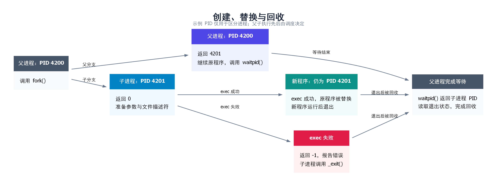
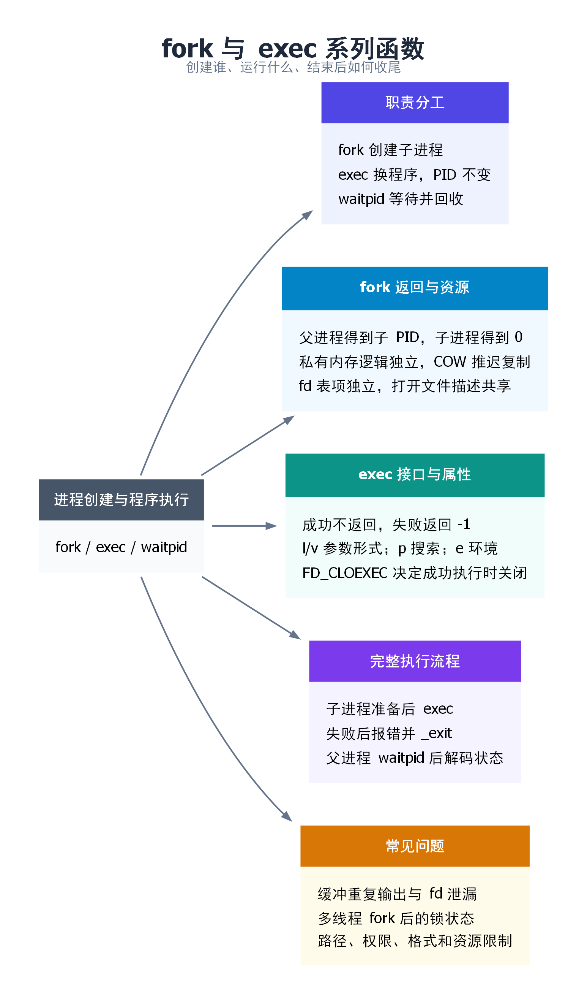

# 进程管理：从 fork、exec 到终端与时间

在 Bash 里运行 `ls -l /tmp`，列完文件又会出现提示符。列目录的是 `ls`，接收下一条命令的是 Bash。它们怎样配合？只要会在终端运行命令、能看懂 C 的 `if` 分支，就可以从这个例子读起。

程序运行起来，系统就为这次运行分配一个编号，叫**进程 ID（PID）**。假设 Bash 的 PID 是 4200。它启动一条前台外部命令时，常见过程如下。

1. **创建子进程。** Bash 调用 `fork()`。成功后，父子进程都从调用处往下执行。父进程拿到子进程的 PID（假设是 4201），子进程拿到 0。同一个 `if` 根据返回值把两者分开。
2. **子进程运行命令。** 4201 调用 `exec` 系列函数，把正在运行的程序换成 `ls`，并传入 `-l` 和 `/tmp`。程序换了，PID 仍是 4201。
3. **父进程等结果。** 4200 调用 `waitpid()`。如果 4201 还在运行，4200 就等待。等 4201 退出，4200 取走退出状态，内核便可释放为它保留的记录。这叫**回收子进程**。Bash 随后显示提示符。

想动手，可以直接运行[第六章的小启动器](#workflow)。想弄清原理，先看 [fork 后哪些数据会共享](#fork)，再看 [exec 怎样传参数](#exec)。

<details>
<summary>展开完整目录（含底层原理、排错和实验）</summary>

1. [进程基础：PID、内存、参数与环境](#basics)
2. [创建、执行与回收的职责分工](#roles)
3. [fork 与 COW](#fork)
4. [vfork 与 clone](#vfork-clone)
5. [exec 与 FD_CLOEXEC](#exec)
6. [fork → exec → waitpid 完整流程](#workflow)
7. [进程终止与回收](#termination-wait)
8. [system 与命令注入](#system)
9. [setjmp / longjmp](#nonlocal-jump)
10. [进程关系与终端](#terminal)
11. [时间与休眠](#time)
12. [常见陷阱与错误排查](#pitfalls)
13. [完整示例与验证路径](#examples)
14. [面试口头回答](#interview)
15. [Q&A（常见问题与解答）](#qa)
16. [思维导图总结](#mindmap)

</details>

本文以 Linux、glibc 为主要环境；POSIX 接口语义与 Linux 特有实现分别说明。编程示例默认 C++11；`setjmp/longjmp` 示例使用 C11，以免把 C 的跳转机制误当成 C++ 异常处理。所有示例都是教学用途，运行方法与限制见[第十三章](#examples)。

<a id="basics"></a>

## 一、进程基础：程序运行起来以后，系统在管理什么？

### 1.1 PID：给一次运行编号，不是给可执行文件编号

假设 Bash 的 PID 是 4200，它创建的子进程是 4201。子进程调用 `getpid()` 得到 4201，调用 `getppid()` 得到 4200。只要 Bash 还在，子进程换成 `ls` 后再查，仍是这两个数。

| 接口或编号 | 含义 | 容易混淆之处 |
| --- | --- | --- |
| `getpid()` | 当前进程的 PID | Linux 同一线程组内各线程得到相同结果 |
| `getppid()` | 当前父进程的 PID | 父进程退出后，收养关系可能使它改变 |
| Linux TID | 内核标识一个线程的编号 | 主线程的 TID 等于该进程的 PID，其他线程不同 |
| 容器内外看到的 PID | 容器可以有自己的一套进程编号，这叫 PID 命名空间 | 例如，容器里的第一个进程编号为 1，在宿主机上看，同一个进程的编号可能是 4201 |

PID 会复用。因此“保存一个 PID，过很久再发信号”可能误操作后来占用该编号的进程。需要稳定跟踪时，可以研究 Linux `pidfd`；它是扩展机制，不是 POSIX 的普通整数 PID 保证。[参考：getpid(2)](https://man7.org/linux/man-pages/man2/getpid.2.html)、[pid_namespaces(7)](https://man7.org/linux/man-pages/man7/pid_namespaces.7.html)

### 1.2 虚拟内存布局：地址像房间号，还要看属于哪栋楼

两栋楼都可以有 301 室。类似地，两个进程打印出相同的地址，也可能读到不同的数据。程序使用的是**虚拟地址**。CPU 查当前进程的**页表**，才知道这个地址对应哪一页物理内存。

常见 Linux ELF 程序会涉及以下区域，但这不是 C++ 标准规定的固定排列：

| 区域 | 常见内容 | 为什么需要区分 |
| --- | --- | --- |
| 代码与只读映射 | 指令、只读常量 | 可限制写入，合适的页面可共享 |
| 已初始化可写数据 | 非零初始化的全局、静态变量 | 文件提供初始内容，运行时可修改 |
| BSS | 常见的零初始化全局、静态数据 | 文件不必为大量零逐字节保存内容 |
| 堆 | 分配器管理的动态对象 | `malloc/new` 不保证每次都调用内核；大分配也可能使用 `mmap` |
| 映射区域 | 共享库、文件映射、匿名映射 | 可设置私有或共享关系及访问权限 |
| 线程栈 | 调用帧、部分自动变量 | 每个线程通常有独立栈，优化后变量也可能在寄存器中 |

在常见的 x86-64 Linux 上，栈向低地址增长。启用地址空间布局随机化（ASLR）时，同一程序运行两次，栈等区域的起始地址可能不同。Linux 通常把启动参数和环境字符串放在初始栈上，之后调用 `setenv()` 新增的字符串则可能存放在别处。

虚拟地址空间大小也不等于已占用的物理内存：映射可以尚未触碰，页可以共享，也可能被换出。观察 `/proc/PID/maps` 看映射，观察 `/proc/PID/status` 的 `VmSize`、`VmRSS` 看不同统计；这些是快照，不能把 RSS 简单相加当作全系统独占物理内存。[参考：proc_pid_maps(5)](https://man7.org/linux/man-pages/man5/proc_pid_maps.5.html)

### 1.3 命令行参数与 environ：启动时传入的两份字符串列表

启动一个程序时，既要告诉它“处理哪个文件”，又可能要告诉它“用哪个语言环境”。前者常放在参数中，后者常放在环境变量中。它们最终都是字符串，而不是 Shell 中那行文本的原样副本。

运行 `./demo "hello world"` 时，Shell 会把引号里的两个词作为一个参数传给程序，引号本身不会传进去。`main(int argc, char* argv[])` 收到的 `argc` 是 2，`argv` 里有以下三项。

| 下标 | 存的内容 |
| --- | --- |
| `argv[0]` | 指向字符串 `"./demo"`。这一项通常是程序名，由调用者填写，不能用来验证程序身份。 |
| `argv[1]` | 指向字符串 `"hello world"`，这是最后一个参数。 |
| `argv[2]` | 空指针，表示参数列表到此结束。 |

**`argc` 只数参数，不包括末尾的空指针。** 这里有两个参数，`argv` 还专门留了第三个位置放结束标记，所以读取 `argv[argc]`（这里是 `argv[2]`）不会越界。

假设你在 Bash 里写了 `MODE=dev`。Bash 自己能读到它，随后启动的程序也能读到吗？在 Linux 的 Bash 里运行下面几行。`printenv MODE` 会打印它自己收到的 `MODE` 值。

```bash
unset MODE               # 从没有 MODE 的状态开始
MODE=dev
echo "$MODE"             # 输出 dev，Bash 知道这个值
printenv MODE            # 没有输出，MODE 还没有导出
export MODE
printenv MODE            # 输出 dev，导出后才传给这个程序
MODE=test printenv MODE  # 输出 test，只给这次命令用
echo "$MODE"             # 仍然输出 dev
```

**子进程改了值，父进程会怎样？** 假设 Bash 已经导出 `MODE=dev`。它用 `fork()` 创建子进程时，子进程起初也有 `MODE=dev`。如果子进程用 `setenv()` 把值改成 `test`，它自己用 `getenv("MODE")` 就会读到 `test`。父进程保留着自己的那份，读到的仍是 `dev`。删除变量（`unsetenv()`）也只影响调用它的进程。

**子进程接着运行新程序，新程序会收到什么？** 这取决于调用哪个 exec 函数。环境变量按 `NAME=value` 排成一张表，表的末尾是空指针。

- 用 `execvp()` 时，新程序沿用调用者当前的环境表（`environ`）。在上例中，新程序收到的是子进程刚改好的 `MODE=test`，其他环境变量也一起传过去。
- 用 `execve()` 时，你用第三个参数 `envp` 指定交给新程序的**整张表**。如果表里只放 `MODE=test`，新程序就只有这一项，连原先的 `PATH` 也不会自动补上。想全部保留，可以直接传 `environ`。

排查时可以像上面那样只查看关心的变量。整张环境表可能含有密码或令牌，把它打印到日志会泄露这些值。[environ(7)](https://man7.org/linux/man-pages/man7/environ.7.html) · [第十三章的环境变量观察程序](#examples)

<a id="roles"></a>

## 二、为什么要把创建进程和运行程序分开？

运行 `ls -l /tmp`，你会在终端看到文件列表。如果改成 `ls -l /tmp > list.txt`，执行成功后，屏幕上只会重新出现 Bash 的提示符。打开当前目录下的 `list.txt`，才能看到刚才的文件列表。这里的 `>` 是给 Bash 的指示，意思是把这条命令的标准输出写进文件。

Bash 怎样只改这一次命令的输出去向？它先用 `fork()` 创建子进程。子进程起初也向终端输出，但还没开始运行 `ls`。它先打开 `list.txt`，把自己的标准输出指向这个文件，然后用 `exec` 换成 `ls`。这样，`ls` 照常往标准输出写，列表就进了文件。父进程一直连着终端，等子进程退出后，照常显示提示符。

把创建和执行分为两步，方便之处就在这里：**子进程可以在运行新程序之前，先准备好这个程序要用的输入和输出。**

| 操作 | 是否创建新进程 | 正在执行的程序 | PID |
| --- | --- | --- | --- |
| `fork()` 成功 | 是 | 父子进程起初执行同一个程序 | 子进程获得新 PID，父进程 PID 不变 |
| `exec` 成功 | 否 | 调用者的程序被新程序替换 | 调用者 PID 不变 |
| `waitpid()` | 否 | 父进程继续执行自己的程序 | 不改变 PID |



`fork` 和 `exec` 可以单独使用。例如，服务器可以让子进程继续执行原程序中的任务，不调用 `exec`；一个启动器也可以直接 `exec` 目标程序，不再保留自身。

<a id="fork"></a>

## 三、fork：从一个进程变成两个进程

### 3.1 函数原型与返回值

Bash 调用一次 `fork()`。成功后，父子进程都从这次调用返回，各自把返回值存入自己的 `pid` 变量。

```c
#include <unistd.h>

pid_t fork(void);
```

```c
pid_t pid = fork();

if (pid == -1) {
    /* 创建失败：没有子进程，检查 errno。 */
} else if (pid == 0) {
    /* 只有子进程执行这里。 */
} else {
    /* 只有父进程执行这里，pid 是新建子进程的 PID。 */
}
```

子进程拿到的 0 只用来辨认分支。要查自己的 PID，它和父进程一样调用 `getpid()`。

父子进程谁先执行由调度决定。代码写在父分支里，并不意味着它一定比子分支先运行；需要先后顺序时，应使用等待或进程间同步。

### 3.2 普通变量：初始值相同，后续各自修改

假设创建子进程前，变量 `count` 的值是 10。

```c
int count = 10;
pid_t pid = fork();
```

成功后，父子进程各自有一个 `count`，初始值都是 10。子进程把自己的 `count` 改成 20，不会把父进程的普通变量也改成 20。

两边打印出的 `&count` 也相同，因为子进程继承了父进程的地址布局。可 `count` 位于私有内存里。子进程写入时，Linux 要保证父进程仍然读到 10。它怎样做到这一点？

### 3.3 写时复制：为什么不立刻复制全部物理内存？

如果子进程紧接着就要 `exec`，先把父进程的大量内存完整复制一遍、随后又丢弃，会造成浪费。Linux 通常用写时复制(Copy-on-Write，COW)处理私有可写内存。

以父子进程都访问的一页普通堆内存为例：

1. `fork()` 为子进程建立页表。父子进程的页表可以暂时指向同一页物理内存，内核把这一页标成只读。
2. 读数据时，两边都能直接读。有人试图写入时，CPU 发现页面受写保护，把这次访问交给内核处理。
3. 内核确认这次写入合法。如果另一方还在使用原页，就复制整页，更新写入方的页表，让它在新页上完成写入。如果原页已由写入方独占，内核可以直接恢复写权限。

| 阶段 | 父进程访问 `count` | 子进程访问 `count` | 结果 |
| --- | --- | --- | --- |
| 两者尚未写入该私有页 | 虚拟地址 `0x7000` → 物理页 A | 虚拟地址 `0x7000` → 物理页 A | 都读到 10，物理页暂时共用 |
| 子进程写入触发 COW 后 | 虚拟地址 `0x7000` → 物理页 A | 虚拟地址 `0x7000` → 新物理页 B | 父进程读到 10，子进程读到 20 |

这里复制的是**包含变量的页面**，不是只复制 `count` 的几个字节。写保护异常由硬件触发，再由内核处理；并非每次执行 `count++` 都需要内核介入。该页完成分离并恢复可写后，后续写入通常可以直接进行。

子进程若直接执行 `exec`，没写过的私有页就省去了这次复制。不过，建立子进程和页表本身仍有开销。

<a id="shared-mapping"></a>

### 3.4 MAP_SHARED：明确让多个进程访问同一份数据

前面讨论的普通私有内存适合让父子进程分别执行任务。如果希望子进程写入结果后，父进程能从同一块内存中读取结果，就需要建立共享关系。

#### 什么才算映射了“同一块共享区域”？

`mmap()` 的 `MAP_SHARED` 表示：对这段映射的更新，对映射了同一底层对象相应区域的其他进程可见。常见建立方式如下：

| 场景 | 建立方式 | 共享关系来自哪里 |
| --- | --- | --- |
| 父子进程共享匿名内存 | 父进程先用 `MAP_SHARED \| MAP_ANONYMOUS` 建立映射，再 `fork()` | 子进程继承了同一份共享映射 |
| 无亲缘关系的进程共享 | 分别打开同一个共享内存对象，例如用 `shm_open()`，再用 `MAP_SHARED` 映射其对应区域 | 双方使用同一底层对象与对应偏移 |
| 文件共享映射 | 用 `MAP_SHARED` 映射同一个文件的相应区域 | 共享的是文件对应区域的内容 |
| System V 共享内存 | 用 `shmat()` 连接同一个共享内存段 | 双方连接同一个段；这不是 `mmap()` 的标志用法 |

**两个进程各自独立调用匿名共享 `mmap()`，不会仅仅因为都写了 `MAP_SHARED` 就自动共享同一片内存。** 必须先有同一个共享对象或由 `fork()` 继承的同一份映射。

#### 虚拟地址可以不同，数据仍然共享

例如，A 把文件开头映射到 `0x7000`，B 把同一文件的开头映射到 `0x9000`。双方都用 `MAP_SHARED` 时，A 改第一个字节，B 从自己的起始地址就能读到更新。判断是否共享，要看映射的是哪个对象、哪一段内容。[mmap(2)](https://man7.org/linux/man-pages/man2/mmap.2.html)

#### “共享可见”为什么还需要同步？

假设 A 要先填好一条消息，再交给 B。若 B 正好在 A 写到一半时读取，就可能拿到半条消息。可以用进程共享的信号量约定顺序：A 写完调用 `sem_post()`，B 的 `sem_wait()` 成功返回后再读。如果 A 会反复覆盖这块内存，还得等 B 读完才能写下一条。

同理，两个进程同时执行 `(*count)++`，可能都读到 10，随后都写入 11，丢失一次递增。共享内存并没有让普通的“读 → 加一 → 写回”自动成为原子操作，`volatile` 也不能代替同步。

文件映射还有另一层区别：**其他进程能通过共享映射看到数据，不等于数据已持久化到磁盘。** `msync()` 等接口处理文件映射的同步写回问题，不能代替进程之间的互斥与先后顺序控制。

#### 私有内存与共享映射对比

| 比较项 | 普通私有内存／私有 COW 映射 | 显式共享映射 |
| --- | --- | --- |
| `fork()` 后虚拟地址 | 对应的继承地址相同 | 对应的继承地址也相同 |
| 是否可能共用物理页 | 可以暂时共用 | 通过共同后备存储共享内容 |
| 写入的效果 | 保持本进程的私有修改，不更新另一方的私有副本 | 更新共享内容，供其他映射者访问 |
| 是否能仅凭指针数值判断共享 | 不能 | 不能 |
| 进程间协调 | 修改各自普通变量不构成共享通信 | 并发读写通常还需同步机制 |

### 3.5 文件描述符：表各自一份，打开文件描述可以共享

子进程为什么也能往终端打印？程序用一个整数找到打开的文件、终端或管道，这个整数叫**文件描述符（fd）**。标准输出的 fd 是 1。Bash 在终端运行时，父子进程各自的 1 号表项起初指向同一个终端。子进程把自己那一项改指向文件，就实现了输出重定向，父进程仍向终端写。[关联笔记《文件、目录与链接》](../三.文件、目录与链接/1.文件、目录与链接.md)

| 层次 | 表示什么 | `fork()` 后的关系 |
| --- | --- | --- |
| 文件描述符 `fd` | 某个进程里的整数编号，如 3 | 父子进程起初保留相同编号 |
| 文件描述符表项 | 由编号找到内核对象的引用，包含 `FD_CLOEXEC` 等描述符标志 | 表项分别属于各自进程 |
| 打开文件描述（open file description） | 内核记录一次打开操作的状态，包括偏移量和 `O_APPEND` 等文件状态标志 | 对应的父子表项引用同一个对象 |

假设父进程先 `open()` 一个普通文件，随后 `fork()`：

- 子进程从继承的 fd 读取 100 字节后，**共享的文件偏移量**前进 100 字节。父进程随后通过对应 fd 读取，会从更新后的位置继续。
- 子进程 `close(fd)` 只释放子进程自己的引用，父进程的 fd 仍然可以使用。
- 子进程修改自己的 `FD_CLOEXEC` 不会修改父进程对应表项的这个标志。
- 通过 `fcntl()` 修改共享对象上的 `O_APPEND` 等文件状态标志，会影响使用同一个打开文件描述的另一方。

如果父子进程分别重新 `open()` 同一路径，通常会得到不同的打开文件描述，读写偏移量也分别管理。**共享偏移量来自“继承同一次打开的引用”，不是来自“文件名相同”。**

### 3.6 其他资源：继承什么，重置什么？

| 项目 | 子进程中的情况 |
| --- | --- |
| PID / PPID | PID 是新值；刚创建时 PPID 是父进程 PID |
| 普通内存中的参数、环境变量 | 初始内容继承，后续修改通常互不影响 |
| 用户、组凭证 | 继承父进程的用户和组身份等凭证 |
| 当前工作目录、根目录、`umask` | 继承；子进程之后 `chdir()` 不改变父进程工作目录 |
| 进程组、会话、控制终端关系 | 通常继承 |
| 信号处理方式、信号屏蔽字 | 继承 |
| 未决信号 | 子进程初始为空 |
| CPU 时间等资源使用统计 | 相应统计被重置；不等于子进程没有内存占用 |
| `alarm()`、间隔定时器、POSIX 定时器 | 不继承 |
| 传统 `fcntl` 记录锁（可锁住一段字节） | 锁归父进程。子进程继承 fd，但不能解除父进程的锁 |
| OFD 锁、`flock()` 锁 | 锁跟着这一次文件打开操作。父子进程都能通过各自的 fd 解除同一把锁 |
| 未完成的异步 I/O 请求、异步 I/O 上下文 | 不继承 |

假设父进程打开一个文件，拿到 fd 3，加锁后调用 `fork()`。子进程也有一个 fd 3。两边的 fd 都指向内核为那次 `open()` 建立的同一条记录，叫**打开文件描述**（open file description，简称 OFD）。锁的区别在于内核把它记在谁名下。

- **传统记录锁**记在父进程名下。假设父进程锁住了文件的前 100 个字节，让自己独占这段范围。子进程即使用继承的 fd 3，也不能替父进程解锁。如果它也想给这 100 个字节加写锁，就得等父进程释放锁，或者在尝试立即加锁时得到失败结果。[fcntl_locking(2)](https://man7.org/linux/man-pages/man2/fcntl_locking.2.html)
- **OFD 锁和 Linux 本地文件上的 `flock()` 锁**记在那次打开操作名下。比如父进程用 `flock(3, LOCK_EX)` 锁住文件，子进程可以用 `flock(3, LOCK_UN)` 解除这把锁。如果子进程只是关闭自己的 fd 3，父进程的 fd 3 还开着，锁就仍然有效。若没人显式解锁，要等指向这次打开操作的最后一个 fd 关闭，锁才会自动释放。[flock(2)](https://man7.org/linux/man-pages/man2/flock.2.html)

完整的继承规则见 [fork(2)](https://man7.org/linux/man-pages/man2/fork.2.html)。

<a id="vfork-clone"></a>

## 四、创建子进程时，哪些东西要分开，哪些可以共用？

上一章里，父进程有一个普通变量 `count = 10`。用 `fork()` 创建子进程后，子进程把自己的 `count` 改成 20，父进程读到的仍是 10。原因是父子进程各有自己的地址空间。Linux 可以等到有人写入时才复制相应的内存页，但从程序看来，双方已经各管各的数据。

有了这个例子，再来看两种不同的需求：如果子进程马上就要换成另一个程序，能不能省下建立独立地址空间这一步？如果两个任务要长期配合，能不能明确选出哪些东西共用、哪些各管各的？前一个问题引出 `vfork()`，后一个问题引出 `clone()`。

### 4.1 vfork：为什么子进程还在运行，父进程就能继续？

假设父进程要启动 `sleep 60`。按熟悉的做法，它先 `fork()`，再让子进程用 `exec` 装入 `sleep`。这当然可行，只是子进程刚建立的地址空间很快就会被换掉。Linux 的 `vfork()` 省去了这项工作，代价是**子进程在装入新程序之前，要暂时借用父进程的内存**。

沿着这条命令看，有两个不同的“等”：

1. **等子进程用完借来的内存。** 父进程的线程 A 调用 `vfork()`。子进程开始执行，连栈也暂时用 A 的那一份。栈里保存着函数的局部变量和返回位置，两边同时往下执行可能互相踩坏数据，所以 A 停在这次调用里。如果父进程还有线程 B，B 有自己的栈，仍然可以运行。
2. **要不要等命令执行完，由 A 决定。** 子进程成功装入 `sleep` 的那一刻，就用上了新程序自己的内存。A 可以从 `vfork()` 返回，去做别的事。这时 `sleep` 可能才刚开始计时。只有 A 接着调用 `waitpid()` 等它退出，才会等到这 60 秒结束。

**如果装入失败呢？** 假设 A 在 `start_command()` 里调用了 `vfork()`，但子进程把程序路径写错了，`exec` 返回了。此时 A 仍停在 `vfork()` 里，子进程还借用着 A 的内存。下面两种常见的收尾方式在这里都有问题：

- **子进程能写 `return -1` 吗？** 这会让子进程离开 `start_command()`，回到调用它的上一层函数。A 却还要接着执行 `start_command()`，它的局部变量还放在这一层的栈上。子进程返回后若再调用别的函数，那块栈就可能被当作空闲空间重新使用，覆盖 A 稍后还要读的值。因此，子进程不能从调用 `vfork()` 的函数返回。
- **那用 `exit(1)` 结束子进程呢？** 假设 A 已经用 `printf()` 写了一行日志，文字还在 C 库的输出缓冲区里。子进程调用 `exit()` 会刷新这块共用的缓冲区，把 A 的日志提前输出，还可能执行 A 注册的退出回调。

所以，父进程先准备好路径和参数，子进程直接尝试 `exec`。如果失败，就用 `_exit()` 结束子进程：它不会返回上一层函数，也不会刷新 C 库的缓冲区或执行退出回调。子进程一结束，A 就可以从 `vfork()` 返回。

借用内存省掉了一次准备工作，却把子进程能做的事情限制得很窄。平时启动外部命令，可以用 `fork()` 加 `exec`；若只需设置重定向等常见启动选项，也可以用 `posix_spawn()`。这里讲的是 Linux 的 `vfork()` 行为，该接口已从 POSIX.1-2008 移除。[vfork(2)](https://man7.org/linux/man-pages/man2/vfork.2.html)

### 4.2 clone：一个任务关掉文件，另一个还能读吗？

`vfork()` 里的共用是临时的，目的是尽快换成新程序。现在换一个问题：两个任务都要继续运行，希望它们共用某些资源。该怎样指定“共用什么”？Linux 的 `clone()` 让调用者在创建任务时通过标志做选择。先看一个能直接观察到差别的例子。

假设父进程打开文件，得到文件描述符 3。可以把 3 看成表里的编号，程序顺着第 3 项找到打开的文件。新任务随后调用 `close(3)`。父进程还能用 3 读原来的文件吗？

| 创建方式 | 两边拿到的是什么 | 新任务执行 `close(3)` 后 |
| --- | --- | --- |
| 普通 `fork()`，或 `clone()` 未设置 `CLONE_FILES` | 两张各自独立的表，起初各有一项指向同一次打开的文件 | 子任务删掉自己表里的第 3 项。父进程那一项还在，仍能读 |
| `clone()` 设置 `CLONE_FILES` | 两边使用同一张表 | 第 3 项从共用的表里消失。父进程也失去了这个 fd；若编号尚未被重新使用，再读就会报 `EBADF` |

现在把问题换回开头的变量 `count`。这次要看的标志是 `CLONE_VM`，它决定是否共用**内存**。设了它，两边就生活在同一个地址空间：如果它们先后访问同一个 `count`，子任务写入 20，父进程随后读到的也是 20。若可能同时读写，就需要同步。**选了共用内存，并不会顺带选中共用 fd 表。** 这就是 `clone()` 把不同资源分开设置的意义。

其余标志可以按遇到的问题查，不必先背名字：

| 想知道什么 | 看哪个标志 | 具体影响 |
| --- | --- | --- |
| 一方切换工作目录，另一方会跟着变吗？ | `CLONE_FS` | 设置后共用当前目录等信息，一方调用 `chdir()` 会改变另一方解析相对路径的起点 |
| 一方安装信号处理函数，另一方也采用它吗？ | `CLONE_SIGHAND` | 设置后共用处理方式，要求同时设置 `CLONE_VM`。每个线程各自的信号屏蔽字仍然独立 |
| 新任务属于同一个线程组吗？ | `CLONE_THREAD` | 设置后加入同一线程组，还要求 `CLONE_SIGHAND`。仅设置 `CLONE_VM` 只能说明共用内存 |
| 新任务能有自己的主机名吗？ | `CLONE_NEWUTS` | 它创建新的 UTS 命名空间。权限允许时，在里面改主机名不会改掉外面的主机名 |

查手册时注意接口版本：glibc 的包装函数和 Linux 原始 `clone` 系统调用接收参数的方式不同。Linux 5.3 起还提供 `clone3`，它把参数放进结构体传入。[clone(2)](https://man7.org/linux/man-pages/man2/clone.2.html)

<a id="exec"></a>

## 五、exec：进程保留，运行的程序换掉

### 5.1 成功后为什么不会返回？

回到子进程 4201。它刚拿到 `fork()` 返回的 0，接下来要把自己换成 `ls`。假设可执行文件位于 `/bin/ls`，子分支的核心代码如下：

```c
execl("/bin/ls", "ls", "-l", "/tmp", (char *)NULL);
perror("execl");
_exit(1);
```

第一个参数 `/bin/ls` 指定要加载的文件，后面的字符串是交给 `ls` 的参数，空指针表示列表结束。加载成功后，4201 原来的代码和栈已被替换。它接下来运行 `ls`，自然走不到 `perror()`。

如果路径不存在或文件没有执行权限，`execl()` 返回 -1，并设置 `errno`。这时 4201 还在运行原程序，下一行的 `perror()` 会打印失败原因。

### 5.2 哪些改变，哪些保留？

| 项目 | `exec` 成功后的情况 |
| --- | --- |
| PID、父子进程关系 | 保留，不额外创建子进程 |
| 原代码、普通数据、堆、栈、原内存映射 | 被新程序映像替换或移除 |
| 参数 `argv` | 使用本次调用传入的新参数 |
| 环境变量 | 由所选接口决定：沿用当前环境，或显式传入新环境 |
| 当前工作目录、`umask` | 保留；不会自动切到可执行文件所在目录 |
| 打开的 fd | 通常保留；设置了 `FD_CLOEXEC` 的 fd 在成功执行时关闭 |
| 自定义信号处理函数 | 重置为默认处理，因为原来的函数代码已被替换 |
| 信号屏蔽字 | 保留，不能认为新程序自动解除所有信号屏蔽 |
| 用户、组身份 | 普通程序通常保留；set-user-ID、set-group-ID、文件 capabilities 等可能按规则改变凭证 |

`FD_CLOEXEC` 的作用是避免把某些 fd 带给新程序，**不是禁止它们被 `fork()` 继承**。创建 fd 时支持的 `O_CLOEXEC` 等选项可以直接设置这一属性。

详细保留与重置规则见 [execve(2)](https://man7.org/linux/man-pages/man2/execve.2.html)。

### 5.3 exec 家族：按参数、路径和环境选择

命令固定时，用 `execl` 逐个写出参数即可。启动器要接收用户给出的任意多个参数，用数组更方便。还有个问题：用户只输入 `ls`，没写它装在哪个目录，启动器去哪里找它？

`PATH` 是一个环境变量，列出查找外部命令时要依次搜索的目录。在 Linux 上，目录之间用冒号分隔。假设 `PATH=/usr/local/bin:/usr/bin:/bin`，调用 `execvp("ls", argv)` 时，它先尝试 `/usr/local/bin/ls`；那里没有，就再试 `/usr/bin/ls`。如果这一步成功启动了 `ls`，就不用再找 `/bin/ls`。在 Bash 中运行 `echo "$PATH"`，可以看到自己的搜索顺序。

| 函数 | 参数怎么传 | 怎样定位程序 | 环境怎么传 |
| --- | --- | --- | --- |
| `execl` | 逐个列出 | 指定路径 | 沿用当前环境 |
| `execlp` | 逐个列出 | 文件名可按 `PATH` 搜索 | 沿用当前环境 |
| `execle` | 逐个列出 | 指定路径 | 显式传入 `envp` |
| `execv` | `argv` 数组 | 指定路径 | 沿用当前环境 |
| `execvp` | `argv` 数组 | 文件名可按 `PATH` 搜索 | 沿用当前环境 |
| `execve` | `argv` 数组 | 指定路径 | 显式传入 `envp` |

后缀可以拆开记：`l` 是 list，参数逐个写；`v` 是 vector，参数放数组；`p` 表示支持 `PATH` 搜索；`e` 表示显式传入环境。

这里的“指定路径”**可以是绝对路径，也可以是相对路径**：`/usr/bin/ls` 和 `./worker` 都是路径，不必一律写绝对路径。相对路径从当前工作目录解析。

带 `p` 的接口在文件名**不含 `/`** 时才按 `PATH` 搜索。例如 `execvp("ls", argv)` 可以搜索，而 `execvp("./worker", argv)` 按给定路径执行。

其他接口还包括按 fd 执行程序的 `fexecve()`、GNU 扩展 `execvpe()` 和 Linux 系统调用 `execveat()`。[exec(3)](https://man7.org/linux/man-pages/man3/exec.3.html)

### 5.4 参数到底传给谁？

运行 `ls -l /tmp` 时，参数可以逐个传给 `execl`：

```c
/* 列表形式：末尾的空指针结束参数列表。 */
execl("/bin/ls", "ls", "-l", "/tmp", (char *)NULL);
```

也可以放进数组，传给 `execv`：

```c
/* 数组形式：数组最后一个元素必须是 NULL。 */
char *args[] = {"ls", "-l", "/tmp", NULL};
execv("/bin/ls", args);
```

| 内容 | 用途 |
| --- | --- |
| `"/bin/ls"` | 告诉系统要加载哪个可执行文件 |
| `"ls"` | 新程序收到的 `argv[0]`，惯例是程序名 |
| `"-l"` | 新程序收到的 `argv[1]` |
| `"/tmp"` | 新程序收到的 `argv[2]` |
| 末尾空指针 | 告诉接口参数到此结束，不计入 `argc` |

**定位程序的路径与 `argv[0]` 是两个不同的参数。** 真正决定加载哪个文件的是前者，不是 `argv[0]`。

`exec` 不会替你按 Shell 语法解析整条命令。例如 `execvp("ls -l", ...)` 会把 `ls -l` 当成要找的文件名，而不会拆成程序名和选项。管道、重定向和通配符也不会因为出现在参数字符串中就自动生效。

显式传入环境可以这样写：

```c
char *args[] = {"env", NULL};
char *envp[] = {"LANG=C", "APP_MODE=demo", NULL};
execve("/usr/bin/env", args, envp);
```

此时传入的是一份环境列表，不是在原环境上自动追加两个变量。需要保留的变量必须包含在传入列表中。

### 5.5 FD_CLOEXEC：为什么应在创建 fd 时就决定是否传给新程序？

假设父程序打开了一份内部配置，再启动外部工具。只要配置文件的 fd 留给了新程序，工具就能沿用这个 fd 访问文件，连路径都不用知道。

`FD_CLOEXEC` 是 fd 表项的描述符标志，含义是**成功 exec 时自动关闭该 fd**。fork 后子进程仍会继承它；exec 失败时也不会因为这个标志自动关闭它。它不同于共享打开文件描述上的 `O_APPEND` 等状态标志。

已有 fd 可用 `fcntl(fd, F_GETFD)` 读取标志，再用 `F_SETFD` 写入 `flags | FD_CLOEXEC`，每一步都要检查失败。但多线程下 `open()` 与后续 `fcntl()` 之间存在窗口：另一个线程可能在标志尚未设置时 fork 并 exec。支持时用 `open(..., O_CLOEXEC)`、Linux `pipe2(..., O_CLOEXEC)`、`accept4(..., SOCK_CLOEXEC)` 等在创建时设置，消除这个窗口。

重定向需要反向考虑：给新程序用的标准输入输出必须保留下来。`dup2(oldfd, newfd)` 在两者不等时创建的新表项不带 close-on-exec；两者相等时只是原样返回，不会清除已有标志。工程代码需处理这个边界。[参考：open(2)](https://man7.org/linux/man-pages/man2/open.2.html)、[dup(2)](https://man7.org/linux/man-pages/man2/dup.2.html)

<a id="workflow"></a>

## 六、把 fork、exec、waitpid 串起来

### 6.1 执行顺序

现在自己运行一个小启动器。在 Linux 的 [process-examples](process-examples/) 目录里执行：

```bash
g++ -std=c++11 -Wall -Wextra -Wpedantic fork_exec_demo.cpp -o fork_exec_demo
./fork_exec_demo ls -l /tmp
```

这次是启动器创建子进程并等待 `ls`。假设它们的 PID 分别是 4200 和 4201，成功时会依次看到以下输出。

| 屏幕上看到什么 | 谁输出的 | 为什么会出现在这里 |
| --- | --- | --- |
| `parent: pid=4200` | 示例进程 | 创建子进程之前打印并刷新输出 |
| `/tmp` 里的文件列表 | 已经换成 `ls` 的 4201 | 子进程沿用原来的标准输出，仍能往终端写 |
| `parent: child=4201 exited, code=0` | 示例进程 | 父进程等到了 4201 的结果，读出退出码 0 |

PID 和目录内容以实际输出为准。

<a id="launch-example"></a>

### 6.2 完整示例：启动命令并获取结果

环境：Linux、支持 C++11 的编译器和 glibc。保存为 `fork_exec_demo.cpp`，也可直接使用 [完整源文件](process-examples/fork_exec_demo.cpp)。为突出 POSIX API，下面使用 C 风格 I/O。本示例是**单线程程序**。

```cpp
#define _POSIX_C_SOURCE 200809L
#include <errno.h>
#include <stdio.h>
#include <stdlib.h>
#include <sys/types.h>
#include <sys/wait.h>
#include <unistd.h>

int main(int argc, char *argv[])
{
    if (argc < 2) {
        fprintf(stderr, "Usage: %s command [args...]\n", argv[0]);
        return EXIT_FAILURE;
    }

    printf("parent: pid=%ld\n", (long)getpid());
    /* 刷新用户态缓冲，避免未输出的内容被 fork 复制。 */
    if (fflush(NULL) == EOF) {
        perror("fflush");
        return EXIT_FAILURE;
    }

    pid_t pid = fork();
    if (pid == -1) {
        perror("fork");
        return EXIT_FAILURE;
    }

    if (pid == 0) {
        /* &argv[1] 的第一个元素是命令名，末尾仍有 NULL。 */
        execvp(argv[1], &argv[1]);

        /* 只有 execvp 失败，才会走到这里。 */
        int saved_errno = errno;
        perror("execvp");
        _exit(saved_errno == ENOENT ? 127 : 126);
    }

    int status;
    pid_t result;
    do {
        result = waitpid(pid, &status, 0);
    } while (result == -1 && errno == EINTR);

    if (result == -1) {
        perror("waitpid");
        return EXIT_FAILURE;
    }

    if (WIFEXITED(status)) {
        int code = WEXITSTATUS(status);
        printf("parent: child=%ld exited, code=%d\n", (long)pid, code);
        return code;
    }

    if (WIFSIGNALED(status)) {
        int sig = WTERMSIG(status);
        printf("parent: child=%ld killed by signal=%d\n", (long)pid, sig);
        return EXIT_FAILURE;
    }

    return EXIT_FAILURE;
}
```

编译并运行：

```bash
g++ -std=c++11 -Wall -Wextra -Wpedantic fork_exec_demo.cpp -o fork_exec_demo

# 成功路径：由 PATH 找到 printf，并传递两个参数。
./fork_exec_demo printf '%s\n' hello

# 观察目标程序自行返回非零状态。
./fork_exec_demo sh -c 'exit 7'
echo $?

# 失败路径：指定一个不存在的可执行文件。
./fork_exec_demo /definitely-not-existing/demo
```

第一次运行的预期形式如下，实际 PID 每次可能不同：

```text
parent: pid=4200
hello
parent: child=4201 exited, code=0
```

第二次运行会显示退出码 7，紧接着的 `echo $?` 也应得到 7。第三次运行应报告路径不存在，然后父进程打印子进程退出码 127。

示例里的 126 和 127 是自行采用的常见 Shell 风格约定，不是 `execvp()` 的返回值。这里也只是简化映射：单凭子进程退出码，不能严格区分“启动失败”与“目标程序自行返回了相同数值”；需要严格区分时，可增加专门的错误报告管道。

### 6.3 为什么 waitpid 要配合这些宏？

`status` 编码了进程结束的原因，不是直接存着一个普通退出码。

- `WIFEXITED(status)` 为真，才用 `WEXITSTATUS(status)` 获取正常退出码。
- `WIFSIGNALED(status)` 为真，才用 `WTERMSIG(status)` 获取导致终止的信号。
- `waitpid()` 返回 -1 且 `errno == EINTR` 时，表示这次等待被信号打断。父进程可以重新等待，此时还没有拿到子进程的结束结果。

<a id="termination-wait"></a>

## 七、终止与回收：停止运行后，为什么还可能占一个 PID？

### 7.1 exit、_exit、abort：三条退出路线

设想程序刚执行 `printf("result")`，内容还在用户态缓冲区。此时退出，是先把缓冲交给内核，还是直接结束？如果进程状态已经损坏，还能安全地调用清理回调吗？这就是不同退出接口要解决的问题。

| 接口 | 用途与执行过程 | stdio 与回调 | 父进程观察 |
| --- | --- | --- | --- |
| `exit(code)` | 正常结束，先完成库层终止处理 | 调用 `atexit` 回调，刷新并关闭 stdio 流 | 通常 `WIFEXITED` 为真 |
| `_exit(code)` | 跳过上述用户态清理，走进程终止路径 | 不刷新 stdio，不调用 `atexit`；内核仍释放资源 | 通常 `WIFEXITED` 为真 |
| `abort()` | 发出 `SIGABRT`，异常终止 | 不调用 `atexit`；不能依赖 stdio 被刷新 | 通常 `WIFSIGNALED` 为真 |

`exit(7)` 中的非零值表示业务失败，但仍属于 wait 宏意义的“正常退出”：它是携带退出码结束，区别于被信号杀死。父进程通过 `WEXITSTATUS` 得到的普通退出码只有低 8 位，不能拿它传任意整数结果。[参考：exit(3)](https://man7.org/linux/man-pages/man3/exit.3.html)

“`_exit` 直接进入内核”是相对 `exit` 的概括，不代表零成本，也不代表它必然不阻塞。内核仍关闭 fd、释放地址空间、记录状态；关闭涉及待处理 I/O 时可能有延迟。现代 glibc（2.3 起）的 `_exit` 包装使用 `exit_group` 终止线程组，不能把它与 Linux 原始 `exit` 系统调用只结束调用线程的语义混为一谈。[参考：_exit(2)](https://man7.org/linux/man-pages/man2/_exit.2.html)

`abort()` 的默认效果可能产生 core dump，但是否生成文件还取决于资源限制、权限和系统 core 配置。glibc 2.27 起不再刷新 stdio 流；旧版本行为不同，跨实现也不应依赖它替你保存日志。捕获 `SIGABRT` 后正常返回，并不能让 `abort()` 变成一次可恢复的普通函数调用。[参考：abort(3)](https://man7.org/linux/man-pages/man3/abort.3.html)

在 C++ 中，从 `main` 返回会先销毁其自动对象，再进行正常终止处理；直接调用 `std::exit` 不会展开当前调用栈、逐个销毁其中的自动对象。因此有局部 RAII 资源时，正常控制流返回通常更容易保证清理；子进程 exec 失败后的 `_exit` 则是有意绕开继承的库层清理。

### 7.2 wait / waitpid：接收结束报告，而不是替子进程执行退出

子进程像完成任务后留下了一张结果单：主要内存已经释放，但内核还需保存退出状态等信息，供父进程领取。未被回收的已退出进程就是僵尸。它不再执行代码，`kill -9` 不能把它再次“杀死”；要检查父进程为什么没有回收。

`wait(&status)` 等价于 `waitpid(-1, &status, 0)`：等待任意一个可等待的子进程。`waitpid` 的 `pid > 0` 指定一个子进程，`-1` 选择任意子进程，`0` 选择调用者所在进程组的子进程，小于 `-1` 则选择对应进程组中的子进程。

| 结果或选项 | 应当怎样理解 |
| --- | --- |
| 返回正 PID | 取得该子进程的一次状态，才可以解码 `status` |
| `WNOHANG` 下返回 0 | 当前没有符合条件的新状态，不是退出码 0 |
| 返回 -1，`errno == EINTR` | 等待被信号处理打断，可按业务需要重试 |
| 返回 -1，`errno == ECHILD` | 没有符合条件的可等待子进程，检查回收者和信号配置 |
| `WUNTRACED` / `WCONTINUED` | 还报告停止 / 恢复状态，用于作业控制 |

判断退出码和终止信号的写法见[完整示例](#launch-example)。若要求报告暂停或恢复，可分别用 `WIFSTOPPED` 和 `WIFCONTINUED` 判断。只有前者为真时才能用 `WSTOPSIG` 取出暂停信号。收到暂停报告时，子进程还活着。等它真正退出，父进程仍要回收。

一个 `SIGCHLD` 通知不保证只对应一个已结束子进程，普通信号可能合并；事件循环收到通知后通常反复 `waitpid(-1, ..., WNOHANG)`，直到返回 0 或 `ECHILD`，并处理 `EINTR`。实际项目还要明确哪个线程或模块负责回收，防止相互抢走状态。

父进程先结束后，子进程会由适当的收养者接管，在 Linux 中可能是最近的 subreaper 或对应 PID namespace 的 init。**孤儿描述父子关系，僵尸描述退出后未回收的状态，二者不是同义词。** 显式设置 `SIGCHLD` 为 `SIG_IGN` 或使用 `SA_NOCLDWAIT` 会影响自动回收与可等待性；不要把默认信号动作与显式忽略混为一谈。[参考：wait(2)](https://man7.org/linux/man-pages/man2/waitpid.2.html)

<a id="system"></a>

## 八、system：方便启动 Shell，也引入一层命令解释

### 8.1 为什么不能把返回值直接当作退出码？

调用 `system(command)` 后，程序要等 Shell 执行完命令才能继续。可以把效果理解为启动 `/bin/sh -c command` 并等待它退出，具体用哪些系统调用由 C 库决定。

`system(NULL)` 用于查询命令解释器是否可用。非空命令完成后，返回的是 Shell 的 wait 状态，要先判断是否为 -1，再用 `WIFEXITED/WEXITSTATUS` 等宏解码。退出码 127 可能表示 Shell 无法启动，也可能来自命令本身，单靠它不能精确定位失败。

调用期间还涉及 `SIGCHLD` 的屏蔽以及 `SIGINT/SIGQUIT` 的处理变化，所以它也不是一个完全透明的执行包装。需要精细控制子进程 fd、环境、信号和错误报告时，直接使用 exec 或 `posix_spawn` 更合适。[参考：system(3)](https://man7.org/linux/man-pages/man3/system.3.html)

### 8.2 命令注入是怎样发生的？

假设程序把用户输入拼到 `printf '%s\n' ` 后面，交给 Shell 执行。用户输入 `hello; printf injected` 时，Shell 会把分号当成命令分隔符：先打印 `hello`，再执行第二条 `printf`。原本只该显示在屏幕上的文字，成了可以执行的命令。

直接 exec 并把用户输入放到一个独立 `argv` 元素中，分号就只是参数中的字符，不再经 Shell 解析。前面完整启动示例可这样观察差别：

```bash
./fork_exec_demo /usr/bin/printf '%s\n' 'hello; printf injected'
# 预期只输出一行原样文本：hello; printf injected
```

不经 Shell 仍不等于输入安全：目标程序可能把以 `-` 开头的参数当选项。应校验输入，必要时使用目标程序支持的 `--` 终止选项，并控制可执行文件路径与环境。特权程序尤其不应依赖用户可控的 `PATH` 或拼接命令。要执行固定程序和参数时，用直接 exec；确实需要管道、重定向等 Shell 语法且整条命令可信时，再评估 `system` 的便利性与代价。

<a id="nonlocal-jump"></a>

## 九、setjmp / longjmp：跨函数跳回错误处理点

### 9.1 它恢复的是执行位置，不是整个程序状态

在多层 C 函数调用中，底层出错后若逐层传递错误码，会产生许多重复判断。`setjmp` 可以保存一个返回位置，`longjmp` 从深层函数直接跳回去。它像给调用流程放书签，但不是给所有内存拍快照。

`setjmp(env)` 第一次返回 0；`longjmp(env, value)` 恢复所保存的执行上下文，让原位置看起来再次返回一个非零值。传入 0 时也会表现为返回 1，以区分初次调用。常见实现保存栈指针、指令位置和必要寄存器，但 `jmp_buf` 的布局由实现决定，程序不能自行解析。

如果中间函数打开了文件，原本打算在返回前调用 `fclose()`，直接跳走就会跳过关闭文件的代码。已经申请的堆内存、持有的锁也要有人清理。

### 9.2 哪些位置能跳回去？哪些数据还能用？

- 保存上下文的函数已经返回，原来的栈帧就不再有效，不能再跳回；也不能跨线程使用另一个线程保存的上下文。
- 在保存点所在函数中，`setjmp` 后被修改的非 `volatile` 自动局部变量，其值在跳回后可能是不确定的；编译器对寄存器和内存的优化导致不能按普通顺序执行推断。只给确有需要的局部状态加 `volatile`，它不提供线程同步或资源回滚。
- `setjmp` 是特殊宏，调用位置受语言规则约束。教学代码使用 `if (setjmp(env) == 0)`，不要随意放进复杂表达式或照普通函数调用习惯改写。
- 信号屏蔽字是否由普通 `setjmp` 保存不能跨实现假定；需要明确保存时使用 POSIX `sigsetjmp(env, 1)` 与 `siglongjmp`。这仍不等于可以安全地从任意信号处理函数跳走，尤其不能中断非异步信号安全函数后随意重入库代码。

以上 C/POSIX 边界见 [setjmp(3)](https://man7.org/linux/man-pages/man3/setjmp.3.html)。C++ 还有更强的资源生命周期约束：如果对应的异常展开会调用非平凡析构函数，使用 `longjmp` 跨过该路径会触及未定义行为，不能当成“只是少做一次析构”。C++ 通常使用错误返回或异常配合 RAII；这里用纯 C 示例学习原理。[参考：C++ 工作草案 csetjmp](https://eel.is/c++draft/csetjmp.syn)

<a id="terminal"></a>

## 十、进程关系与终端：为什么 Ctrl+C 能停止一条管道？

### 10.1 进程组与会话解决的是不同层次的问题

运行 `producer | consumer` 时，前一个进程写管道，后一个进程读管道。按 Ctrl+C 时，两边通常都该停下来。交互式 Shell 把这两个进程放进同一个**进程组**，终端就能给整组发信号。同一个 Shell 可以管理多个作业，它们各有进程组，但同属一个**会话**。

| 标识 | 表示什么 | 查询或设置 |
| --- | --- | --- |
| PID / PPID | 单个进程及父子关系 | `getpid/getppid` |
| PGID | 进程组编号；组长的 PID 等于 PGID | `getpgrp/getpgid/setpgid` |
| SID | 会话编号；会话首进程的 PID 等于 SID | `getsid/setsid` |
| TPGID | 控制终端的前台进程组编号 | `tcgetpgrp/tcsetpgrp` |

fork 通常继承组与会话关系，exec 保留这些关系。组长退出不要求整个组立即消失。`setpgid(0, 0)` 可让调用者成为以自身 PID 为 PGID 的组长，但会话首进程、跨会话移动等情况受限制。Shell 通常在父子两侧协调设置组，避免子进程 exec 与父进程设置组之间的竞争。[参考：setpgid(2)](https://man7.org/linux/man-pages/man2/setpgid.2.html)

### 10.2 控制终端、前台与后台怎样配合？

一个会话至多有一个控制终端，终端同一时刻有一个前台进程组。交互式 Shell 启动作业后，会把终端前台组切给作业；作业结束或停止后再拿回终端。

在常见启用 `ISIG` 的终端模式下，Ctrl+C 触发 `SIGINT`，Ctrl+Z 触发 `SIGTSTP`，发给终端前台进程组，而不是简单地发给“最新启动的那个 PID”。程序可以修改终端模式与信号处理方式，所以这不是所有程序都不可改变的键盘行为。

后台作业尝试读取控制终端通常收到 `SIGTTIN` 并停止；相关信号被屏蔽、忽略或组处于孤儿状态时存在错误返回等例外。后台写终端并非默认都会停止，主要受 `TOSTOP` 等终端设置影响，某些终端控制操作另有规则。

Shell 的 `bg` 把停止的作业放到后台继续运行；`fg` 将其设为前台并在需要时继续。`SIGCONT` 的“继续”与“成为前台”是两件事，单独发送它不会自动转移终端控制权。参见 [termios(3)](https://man7.org/linux/man-pages/man3/termios.3.html)、[tcsetpgrp(3)](https://man7.org/linux/man-pages/man3/tcsetpgrp.3.html)。

### 10.3 setsid：建立新会话，不等于完成守护进程设计

`setsid()` 成功后，调用者成为新会话首进程和新进程组组长，PID、PGID、SID 数值相同，新会话初始没有控制终端。它没有创建新进程，也不会自动关闭继承的 fd。

如果调用者已经是进程组组长，调用会失败。常见办法是 fork 后让子进程调用：刚 fork 的子进程继承旧 PGID，但自己的 PID 是新值，因而不是组长。这个限制维护“会话包含完整进程组”的层次，避免组长独自把原组拆到另一会话。[参考：setsid(2)](https://man7.org/linux/man-pages/man2/setsid.2.html)

传统守护化还可能涉及第二次 fork、防止重新取得控制终端、重定向标准 fd、处理工作目录与 umask 等。是否采用这些步骤取决于启动环境；被服务管理器托管时通常保持前台，由管理器跟踪生命周期。`nohup`、后台运行和新建会话也各有目的，不能简单互换。

### 10.4 在交互式 Bash 中观察作业控制

以下命令需要交互式终端与启用作业控制的 Bash。不要放进普通非交互脚本里期待同样的 `fg/bg` 行为：

```bash
sleep 120 | cat &
jobs -l
ps -o pid,ppid,pgid,sid,tpgid,tty,stat,comm --forest -u "$(id -u)"
fg %+
# 按 Ctrl+Z 暂停，回到 Shell 后：
jobs -l
bg %+
fg %+
# 按 Ctrl+C 结束本次前台实验。
```

预期：管道两端具有同一 PGID，与交互 Shell 属于同一会话；前后台切换时 TPGID 随终端前台组变化，停止时 `STAT` 常出现 `T`。具体 PID、Shell 行为和输出顺序随环境变化。遇到 `no job control` 检查是否处于交互终端；API 报 `ENOTTY` 时检查传入的 fd 是否真的是终端。

<a id="time"></a>

## 十一、时间与定时器：先问“测什么时间”，再选 API

运行 `sleep 1`，你大约等了一秒，CPU 却几乎没为这条命令工作。这里要分清三种时间。

### 11.1 日历、秒表、工时表不是同一种时间

| 需求 | 常见接口与时钟 | 关键边界 |
| --- | --- | --- |
| 日志中的现实时间 | `time()`、`CLOCK_REALTIME` | 会随系统校时变化，不适合直接计算稳定超时 |
| 一次操作的经过时间 | `clock_gettime(CLOCK_MONOTONIC, ...)` | Linux 不计系统挂起；不会因设置墙上时钟而跳变，但可受频率微调影响 |
| 超时需要计入系统挂起 | Linux `CLOCK_BOOTTIME` | 包括挂起时间；不表示普通休眠会主动唤醒机器 |
| 进程使用的 CPU 时间 | `CLOCK_PROCESS_CPUTIME_ID` | 累计进程各线程 CPU 时间，不是经过时间，也不自动包括子进程 |
| 当前线程 CPU 时间 | `CLOCK_THREAD_CPUTIME_ID` | 只统计当前线程，适合区分各线程消耗 |

线程睡眠一秒，经过时间大约增长一秒，CPU 时间只增长少量；多个线程同时占用不同 CPU 核心时，进程累计 CPU 时间可以大于实际经过时间。不要用“CPU 时间 / 经过时间大于 1”直接判定测量出错。

`clock()` 也是 C 的 CPU 时间接口，其单位是 `CLOCKS_PER_SEC`，不能把原始返回值当毫秒。Linux 的 `getrusage` 等接口可以进一步区分用户态和内核态 CPU 消耗。这里的“系统时间”若指现实日期，是墙上时钟；若指性能统计中的 system CPU time，则指内核态 CPU 时间，两种含义要分开。

### 11.2 clock_gettime：精度字段、分辨率和实际误差是三件事

`timespec` 用 `tv_sec` 保存秒、`tv_nsec` 保存不足一秒的纳秒部分。纳秒字段需要处在 `[0, 1000000000)`，加减时间后要归一化。对适当长度的测量区间，差值可以写为：

```text
经过秒数 = (end.tv_sec - begin.tv_sec)
         + (end.tv_nsec - begin.tv_nsec) / 1,000,000,000.0
```

`tv_nsec` 能写到纳秒，实际测量却未必准到纳秒。`clock_getres()` 给出这块钟能分辨的时间间隔。测一段代码时，线程中途被调走，测出的耗时也会变长。

测耗时，用同一块 `CLOCK_MONOTONIC` 时钟取起点和终点再相减。`gettimeofday()` 读的是日历时间，校时可能改变读数。`CLOCK_REALTIME` 和 `CLOCK_MONOTONIC` 的起点不同，两者的读数也不能直接相减。[clock_gettime(2)](https://man7.org/linux/man-pages/man2/clock_gettime.2.html)

### 11.3 time：需要秒级时间戳时足够简单

`time(NULL)` 返回从 1970 年 1 月 1 日 00:00 UTC 起算的秒数，失败时返回 `(time_t)-1`。同一时刻在北京和伦敦得到的时间戳相同，转换为当地时间后，钟面上的小时数才有差别。

需要格式化时可使用 `localtime_r/gmtime_r` 与 `strftime`，检查返回值。`time_t` 的宽度依赖 ABI 和构建配置，不能保证所有 32 位环境都已解决 2038 年问题，也不要把它强制塞进 32 位 `int`。参见 [time(2)](https://man7.org/linux/man-pages/man2/time.2.html)。

### 11.4 clock_nanosleep：为什么绝对截止时间能减少累计漂移？

假设想每 100 ms 执行一次任务。若每轮先工作 20 ms，再相对睡眠 100 ms，两轮开始之间就接近 120 ms；信号处理和调度延迟还会继续积累。

相对休眠回答“从现在再等多久”；绝对休眠回答“等到这块钟达到哪个值”。以初始时间 `t0` 为基准，第 n 次目标设为 `t0 + n × period`，上一轮晚一点不会自动把所有后续目标都向后推。

| 调用方式 | 参数含义 | 被信号打断后的处理 |
| --- | --- | --- |
| `flags == 0` | 相对时长 | `EINTR` 时可用 `remain` 继续等待 |
| `flags == TIMER_ABSTIME` | 指定时钟上的绝对截止时间 | 重试同一个截止时间，`remain` 不用于计算 |

`clock_nanosleep` 成功返回 0，失败**直接返回正错误码**；不要套用 `== -1` 加 `perror` 的模板。即使设置 `SA_RESTART`，被信号打断后仍需要按返回值处理。截止时间已经过去时，绝对休眠立即返回；时间到达后也只是具备继续运行的条件，调度器可能更晚才让线程得到 CPU。

如果任务执行时间超过周期，必须选定策略：追赶执行、跳过过期周期或报告过载。下面示例采用简单追赶策略，只用于演示固定时间基准；实际服务不宜无限追赶到持续占满 CPU。普通周期任务常用 `CLOCK_MONOTONIC`，按现实日期触发的任务才考虑 `CLOCK_REALTIME`，并处理校时变化。[参考：clock_nanosleep(2)](https://man7.org/linux/man-pages/man2/clock_nanosleep.2.html)

`clock_nanosleep()` 会让调用线程停下来等。如果线程还要同时处理 I/O，可以用 Linux 的 `timerfd`，把定时到期也作为可读事件处理。

<a id="pitfalls"></a>

## 十二、最容易踩的坑

### 12.1 fork 前的 printf，为什么可能输出两次？

`printf()` 可能只是把内容放进标准 I/O 的用户态缓冲区，还没有真正写到终端或文件。`fork()` 会把这部分普通内存状态也复制给子进程。

如果父子进程随后都调用 `exit()`，或者从 `main()` 返回，两边都可能刷新自己的缓冲区，于是同一段文本输出两次。输出重定向到文件后更容易遇到，因为缓冲方式可能与终端不同。

处理方法是：需要在创建前输出的内容，先 `fflush()`；只为执行新程序而创建的子进程，在 `exec` 失败后使用 `_exit()`，避免刷新继承的标准 I/O 缓冲或运行继承的 `atexit` 回调。

### 12.2 多线程进程 fork 后，为什么不能随便调用函数？

假设线程 A 持有一把锁，线程 B 调用了 `fork()`。子进程里只有 B，锁却仍是锁住的。B 如果调用一个内部也要拿这把锁的库函数，就可能一直等下去。

因此，在多线程进程的子进程中，从 `fork()` 返回到 `exec` 之间，只应调用异步信号安全函数。不能把上面单线程示例中的 `perror()` 等做法直接照搬到多线程场景。实际项目可评估 `posix_spawn()`，用其接口描述文件操作和进程属性设置，减少自行编写这段逻辑的复杂度。

### 12.3 为什么要关掉不需要的 fd？

`exec` 默认保留没有设置 `FD_CLOEXEC` 的 fd，新程序可能意外拿到父程序打开的文件、套接字或管道。

管道尤其容易出问题：只要还有进程持有写端引用，读端就可能一直等不到 EOF。子进程启动前应关闭不需要的端点；不希望传给新程序的 fd，应设置 close-on-exec。

如果希望把输出重定向到文件，应在子进程 `exec` 前用 `dup2()` 等函数调整标准输出的 fd，而不是把 `">output.txt"` 当作普通参数传给目标程序。

### 12.4 常见错误如何排查？

| 位置 | 现象或错误 | 优先检查 |
| --- | --- | --- |
| `fork()` | `EAGAIN` | 用户进程数、系统线程/PID 限制、cgroup 进程数限制 |
| `fork()` | `ENOMEM` | 可用内存与内核创建进程结构所需资源 |
| `exec` | `ENOENT` | 目标路径；脚本的解释器或 ELF 所需解释器是否存在 |
| `exec` | `EACCES` | 文件执行权限、父目录搜索权限、挂载点是否 `noexec` |
| `exec` | `ENOEXEC` | 文件格式、架构是否匹配；脚本解释器声明是否正确 |
| `exec` | `E2BIG` | 参数和环境总量是否过大 |
| `waitpid()` | `ECHILD` | 是否确为自己的子进程、是否已被回收、是否配置了自动回收 |
| 输出顺序不固定 | 父子输出交错 | 是否误把代码排列顺序当成进程执行顺序 |

部分带 `p` 的库接口对 `ENOEXEC` 有调用 Shell 的兼容处理，因此诊断时也要结合具体使用的函数。

<a id="examples"></a>

## 十三、完整示例与验证路径

### 13.1 环境与依赖

目标环境为 Linux、glibc 2.17+、GCC 5+，示例使用 C++11 或 C11；`clone` 示例针对常见 x86-64 Linux 向下增长的栈。Debian/Ubuntu 可用 `sudo apt install build-essential` 安装编译器；查看进程实验需要 procps，交互作业控制实验使用 Bash。实际部署前用 `uname -r`、`ldd --version` 和 `g++ --version` 记录自己的版本。

### 13.2 编译命令

在 [process-examples](process-examples/) 目录中编译。

```bash
g++ -std=c++11 -Wall -Wextra -Wpedantic fork_exec_demo.cpp -o fork_exec_demo
g++ -std=c++11 -Wall -Wextra -Wpedantic process_info.cpp -o process_info
g++ -std=c++11 -Wall -Wextra -Wpedantic create_demo.cpp -o create_demo
g++ -std=c++11 -Wall -Wextra -Wpedantic cloexec_demo.cpp -o cloexec_demo
g++ -std=c++11 -Wall -Wextra -Wpedantic termination_demo.cpp -o termination_demo
g++ -std=c++11 -Wall -Wextra -Wpedantic system_demo.cpp -o system_demo
cc -std=c11 -Wall -Wextra -Wpedantic jump_demo.c -o jump_demo
g++ -std=c++11 -Wall -Wextra -Wpedantic time_demo.cpp -o time_demo
```

### 13.3 运行方式与预期结果

完整源文件与运行预期对应如下；预期用于核对行为，**不是当前 Windows 编辑环境的 Linux 实测数据**：

| 文件与运行方式 | 观察重点与预期 |
| --- | --- |
| [fork_exec_demo.cpp](process-examples/fork_exec_demo.cpp)：第 6.2 节三组命令 | fork、exec、回收、正常非零退出与加载失败；源码与第 6.2 节一致 |
| [process_info.cpp](process-examples/process_info.cpp)：`APP_MODE=study ./process_info "hello world"` | PID/PPID/PGID/SID；`argv[1]` 保留空格；`environ` 中发现 `APP_MODE=study`；打印几类地址，仅用于观察 |
| [create_demo.cpp](process-examples/create_demo.cpp)：`./create_demo vfork` | 子进程执行 `/bin/true`，父进程回收得到退出码 0；vfork 子分支只 exec 或 `_exit` |
| 同一文件：`./create_demo clone` | 只使用 `SIGCHLD`，子函数返回 7，父进程回收得到 7；没有启用共享地址空间或 namespace |
| [cloexec_demo.cpp](process-examples/cloexec_demo.cpp)：分别运行 `./cloexec_demo keep`、`./cloexec_demo close` | exec 自身后，前者描述符存在；后者指定高编号 fd 为 `EBADF`，表示在 exec 时关闭 |
| [termination_demo.cpp](process-examples/termination_demo.cpp)：`./termination_demo exit > exit.txt`、`./termination_demo _exit > fast.txt` | 前者文件含缓冲文字及回调文字，后者为空；为了让差别稳定，示例显式设置全缓冲 |
| 同一文件：`(ulimit -c 0; ./termination_demo abort > abort.txt)` | 子 Shell 禁止本次实验生成 core；通常报告异常终止，glibc 2.27+ 下文件为空；旧实现不能保证 |
| [system_demo.cpp](process-examples/system_demo.cpp)：`./system_demo` | 固定可信命令输出 `system demo`；解码 Shell 退出码为 7；示例自身返回 0 表示验证成功 |
| [jump_demo.c](process-examples/jump_demo.c)：`./jump_demo` | 输出进入深层函数、返回恢复点，不执行 longjmp 后的语句 |
| [time_demo.cpp](process-examples/time_demo.cpp)：`./time_demo` | 打印秒级时间戳与时钟分辨率，再约每 200 ms 打印一次；总经过时间通常至少约 0.6 s，CPU 时间通常明显更小 |

### 13.4 教学示例的限制

`clone` 示例省略栈保护页、线程库集成等工程机制；不允许把 flags 简单替换为线程组合后当线程库使用。`cloexec` 示例使用高编号 fd 减少动态加载器复用已关闭编号造成的干扰，不构成通用 fd 泄漏扫描器。终止实验故意留下 stdio 缓冲以显示差别；生产代码应检查关键输出的写入结果。

### 13.5 排错与核对清单

| 现象 | 原因与处理 |
| --- | --- |
| Windows 原生编译找不到 `unistd.h`、`sys/wait.h` 或相关函数 | 这些是 Linux/POSIX 示例，使用 Linux 主机、虚拟机或配置好的 WSL，不能仅靠 MinGW 替代 Linux 运行环境 |
| `clone` / `vfork` 声明不可见 | 检查源文件顶部的 feature-test 宏是否位于头文件之前；使用示例要求的 glibc 环境 |
| `clock_gettime` 链接失败 | 确认目标 libc；glibc 2.17 以前可能需要额外链接 `-lrt`，本文默认较新版本 |
| `clock_nanosleep` 报 `EINVAL` | 检查时钟是否支持、flags、纳秒字段是否小于十亿；按返回错误码解释 |
| `cloexec_demo` 报 `EINVAL` | fd 上限可能低于示例选用的最小编号 100，检查 `ulimit -n`；也要确认 `fcntl` 操作受支持 |
| 看到少于或多于预想的时间间隔 | 核对单位、选用时钟、是否发生信号中断，以及任务是否已经超过截止时间 |
| `clone` 的 namespace 实验报 `EPERM` | 检查用户 namespace 策略、权限、容器限制和内核配置，不要误认为所有标志都可由普通用户任意开启 |

### 13.6 已完成的验证与未验证范围

纯 C 示例 `jump_demo.c` 已在 Windows 的 MSYS2 UCRT64 GCC 环境运行，输出为 `enter deep call` 和 `back at recovery point`。其余示例的 Linux 运行结果列为预期，尚未在本机实测。

<a id="interview"></a>

## 十四、面试口头回答：先说问题，再说机制与取舍

**进程创建与执行怎么串起来？**

以 Bash 运行 `ls` 为例，Bash 还得接收下一条命令，所以先用 `fork()` 创建子进程。子进程用 `exec` 换成 `ls`，Bash 用 `waitpid()` 等它退出并取走结果。分成两步还有个好处：运行 `ls` 前，子进程可以先把标准输出接到文件上，Bash 的提示符照样写到终端。

**退出与回收有何区别？**

子进程退出时就停止运行了。内核暂时留下退出状态，父进程用 `waitpid()` 取走它，才算回收。比如子进程调用 `exit(7)`，父进程能读到退出码 7。如果子进程被信号终止，父进程查到的则是信号编号。

**为什么 exec 前要处理 fd？**

我会先分清哪些 fd 要交给新程序。比如管道读端要等所有写端都关闭才会读到 EOF，多留一个写端就可能让读端一直等下去。不该继承的 fd，创建时就设置 close-on-exec。要是先打开再设标志，另一个线程可能刚好在两步之间启动子进程。

**进程组、会话和终端怎么联系？**

交互式 Shell 通常把一条管道里的进程放进同一个进程组。运行前台作业时，Shell 把终端交给该组。按 Ctrl+C，终端就向整组发 `SIGINT`。同一会话里可以有多个作业，但同一时刻只有一个进程组在这个终端的前台。

**如何选择时间接口？**

记日志要知道事情发生在几点，用 `CLOCK_REALTIME`。算一次请求等了多久，用 `CLOCK_MONOTONIC`，避免手动调钟干扰结果。如果只关心程序实际占用了多少 CPU，就读进程或线程的 CPU 时钟，等网络响应的时间不算在内。

<a id="qa"></a>

## 十五、Q&A（常见问题与解答）

**Q1：父子进程中的指针数值相同，为什么不是同一个变量？**

`fork()` 让子进程沿用原来的地址布局，所以同一个局部变量在两边的地址相同。判断能否看到对方的修改，要看指向哪种内存：普通局部变量各改各的，如果两边用 `MAP_SHARED` 映射同一段文件，一方就能看到另一方的修改。

**Q2：vfork 的子进程不退出，父进程是不是所有线程都停止？**

Linux 暂停调用 vfork 的线程，其他线程可能继续执行。子进程阻塞不释放地址空间时，调用线程也不能继续，这也是不能随意在子分支调用库函数或持锁操作的原因。

**Q3：CLONE_VM 等于创建线程吗？**

`CLONE_VM` 只让两个任务共用内存。线程还要属于同一线程组，各自有栈和线程本地存储。需要能用 `pthread_join()` 等待的线程时，就交给线程库创建。

**Q4：exec 失败后 FD_CLOEXEC 会把 fd 关闭吗？**

不会。它在成功替换程序时起作用。失败返回后仍运行原程序，需要按错误路径关闭资源或让子进程 `_exit`。fork 本身也不会因这个标志跳过 fd 继承。

**Q5：exit(1) 是异常终止吗？waitpid 返回 0 又表示什么？**

在 wait 宏分类中 exit(1) 仍是正常退出，只是退出码表示业务失败。`waitpid(..., WNOHANG)` 返回 0 表示当前没有可报告状态，不代表任何子进程以 0 退出。

**Q6：为什么向僵尸发送 SIGKILL 没用？**

它已经结束，没有可继续终止的执行过程。应修复父进程的回收逻辑；如果父进程结束，由收养者负责后续处理。不要把僵尸与还在运行但失去原父进程的孤儿混淆。

**Q7：不用 system，就彻底没有命令输入风险了吗？**

直接 exec 避免 Shell 把参数当语法解释，但目标程序仍可能识别选项、路径或自己的表达式语言。仍要选择可信可执行文件、控制环境、校验输入，并按目标工具规则使用 `--`。

**Q8：longjmp 能恢复修改前的变量、释放中间资源吗？**

假设中间函数拿了一把锁，原本要在返回前解锁。`longjmp` 直接跳过这段代码，锁仍然由它持有。跳回后，保存点所在函数里某些改过的局部变量也不能可靠地读取。C++ 中，如果跨过的对象在异常展开时需要调用非平凡析构函数，这样跳转会导致未定义行为。

**Q9：后台进程为什么还能往终端打印？**

前台限制并不意味着后台完全不能访问终端。后台读取通常触发 SIGTTIN；普通后台写是否停止主要取决于 TOSTOP 等设置。后台、停止、退出是三个不同维度。

**Q10：clock_gettime 有纳秒字段，为什么 sleep 后仍晚醒？**

表示单位不等于时钟精度，也不等于调度保证。时钟到期后线程还需被调度，系统负载会增加延迟。绝对截止时间减少下一轮目标的漂移，不能消除这一轮延迟。

**Q11：测量休眠用 CPU 时钟，为什么几乎没过时间？**

CPU 时钟主要在任务占用 CPU 执行时累计，阻塞等待不会按墙上时间增长。测用户实际等待多久，应比较 MONOTONIC 等经过时间时钟；测计算成本才用 CPU 时间。

**Q12：clock_nanosleep 被 EINTR 打断后，重新设置“现在加一个周期”可以吗？**

那会改变原来的目标时间，反复中断时可能越等越久。绝对休眠应重试同一截止时间；相对休眠可用返回的剩余时长，但周期任务通常更适合固定基准的绝对时间表。

<a id="mindmap"></a>

## 十六、思维导图总结

```text
进程管理：从 fork、exec 到终端与时间
├── 一、进程基础
│   ├── PID、虚拟内存布局
│   └── argv 与 environ
├── 二、职责分工
│   ├── fork 创建，exec 换程序
│   └── waitpid 等待并回收
├── 三、fork 与 COW
│   ├── 私有内存独立，COW 推迟复制
│   └── 共享映射需同步，fd 与打开文件描述分层
├── 四、vfork 与 clone
│   ├── vfork 共享地址空间，暂停调用线程
│   └── clone 选择共享资源与 namespace
├── 五、exec 与 FD_CLOEXEC
│   ├── 成功不返回；l/v/p/e 决定接口选择
│   └── 成功 exec 时关闭标记 fd，注意创建时的竞争窗口
├── 六、完整启动流程
│   ├── 子进程准备后 exec，失败则 _exit
│   └── 父进程 waitpid，使用状态宏解码
├── 七、进程终止与回收
│   ├── exit / _exit / abort 的清理与终止差异
│   └── wait / waitpid、僵尸与孤儿
├── 八、system
│   ├── Shell 解释与 wait 状态
│   └── 命令注入风险与直接 exec 的取舍
├── 九、非局部跳转
│   ├── setjmp 保存位置，longjmp 恢复上下文
│   └── 不回滚资源，注意局部变量与 C++ 析构
├── 十、进程关系与终端
│   ├── PGID、SID、控制终端与前台组
│   └── 作业控制、setsid、fg / bg
├── 十一、时间与休眠
│   ├── 日历时间、经过时间、CPU 时间
│   └── clock_nanosleep：绝对截止时间、中断与超期
├── 十二、常见陷阱
│   ├── 缓冲复制、多线程 fork 与 fd 泄漏
│   └── 路径、权限、格式与资源限制排查
├── 十三、实现与验证
│   ├── 环境、编译、运行预期、教学限制
│   └── 排错清单与验证范围
├── 十四、面试回答
│   └── 解决什么问题 → 核心机制 → 关键取舍
└── 十五、Q&A
    └── 常见误区、边界与深入追问
```



配图源文件：[mindmap.dot](fork-exec-assets/mindmap.dot)，重绘脚本：[render_mindmap.py](fork-exec-assets/render_mindmap.py)。使用 `dot -Tpng -Gdpi=200 mindmap.dot -o mindmap.png` 重绘。源文件指定 `PingFang SC`；本次 Windows 环境未安装该字体，PNG 使用 Graphviz 的字体回退。严格复现仓库字体需在安装 PingFang SC 的环境重绘。
