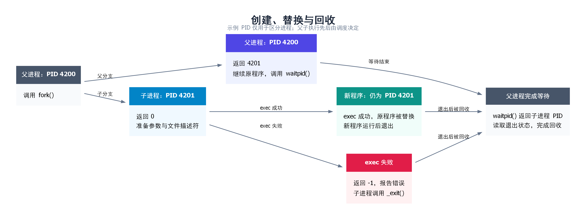
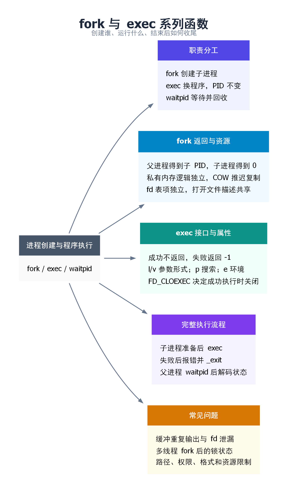

# fork 与 exec 系列函数

**`fork()` 创建子进程，`exec` 系列函数让当前进程运行另一个程序，`waitpid()` 用来等待并回收子进程。** 三者分别解决“谁来执行”“执行什么”和“执行完怎样收尾”的问题。

## 一、为什么要把创建进程和运行程序分开？

在终端输入 `ls` 后，Shell 要启动 `ls`，但自己还要留下来，等命令结束后继续接收输入。如果 Shell 直接用 `exec` 换成 `ls`，原来的 Shell 程序就不再运行了。

可以把进程理解成一名正在工作的工作人员，把程序理解成他手里的工作说明书：

- `fork()`：增加一名工作人员，起初按同一份说明书的同一个位置继续工作。
- `exec`：工作人员不换，但把工作说明书换成另一份，从新程序的入口开始执行。
- `waitpid()`：父进程接收子进程的结束结果，完成回收。

这个类比对应的实际变化如下：

| 操作 | 是否创建新进程 | 正在执行的程序 | PID |
| --- | --- | --- | --- |
| `fork()` 成功 | 是 | 父子进程起初执行同一个程序 | 子进程获得新 PID，父进程 PID 不变 |
| `exec` 成功 | 否 | 调用者的程序被新程序替换 | 调用者 PID 不变 |
| `waitpid()` | 否 | 父进程继续执行自己的程序 | 不改变 PID |



`fork` 和 `exec` 可以单独使用。例如，服务器可以让子进程继续执行原程序中的任务，不调用 `exec`；一个启动器也可以直接 `exec` 目标程序，不再保留自身。

## 二、fork：从一个进程变成两个进程

### 2.1 函数原型与返回值

```c
#include <unistd.h>

pid_t fork(void);
```

调用成功以后，父子进程都从 **`fork()` 返回的位置**继续执行，不会从 `main()` 开头重新运行。

```c
pid_t pid = fork();

if (pid == -1) {
    /* 创建失败：没有子进程，检查 errno。 */
} else if (pid == 0) {
    /* 只有子进程执行这里。 */
} else {
    /* 只有父进程执行这里，pid 是新建子进程的 PID。 */
}
```

| 执行者 | `fork()` 返回值 | 含义 |
| --- | --- | --- |
| 父进程 | 大于 0 | 创建成功，返回子进程 PID |
| 子进程 | 0 | 当前执行者是子进程 |
| 创建失败时的调用进程 | -1 | 没有创建出子进程，`errno` 说明原因 |

“一次调用，两次返回”只描述成功情况：父进程调用一次，随后父子进程各自得到一次返回结果。**子进程得到的 0 是函数返回值，不是子进程的 PID。** 子进程自己的 PID 要用 `getpid()` 获取。

父子进程谁先执行由调度决定。代码写在父分支里，并不意味着它一定比子分支先运行；需要先后顺序时，应使用等待或进程间同步。

### 2.2 普通变量：初始值相同，后续各自修改

假设调用前有：

```c
int count = 10;
pid_t pid = fork();
```

成功后，父子进程各自有一个 `count`，初始值都是 10。子进程把自己的 `count` 改成 20，不会把父进程的普通变量也改成 20。

#### 为什么父子进程中的 `&count` 数值一样？

程序打印的 `&count` 是**虚拟地址（Virtual Address）**，不是物理内存中的位置。可以把它理解成“当前进程自己的地址编号”；CPU 访问时，还要通过该进程的页表等地址转换机制，才能找到实际数据。

`fork()` 让子进程继承父进程的虚拟内存布局，并建立对应的页表等管理结构。因此，对于从父进程继承的这个 `count`，父子进程里的虚拟地址数值相同。假设父进程中是 `0x7000`，子进程中也可以看到 `0x7000`；这里的地址仅用于示意。

**一个虚拟地址必须连同“属于哪个进程”一起理解。** 父进程的 `0x7000` 和子进程的 `0x7000` 分别经过各自的映射，并不保证始终对应同一份可修改数据。

#### 地址相同，为什么修改互不影响？

这是因为普通变量所在的私有内存要求父子进程分别维护自己的内容。刚完成 `fork()` 时，相关物理页可以暂时共用；一旦某一方需要写入，内核会通过下面的 COW 机制维持私有内存的独立性。

所以，“私有”描述的是**修改是否影响另一方**，不等于“从创建子进程起，每个物理页就已经复制了两份”。显式共享映射采用另一套规则，见 2.4 节。

### 2.3 写时复制：为什么不立刻复制全部物理内存？

如果子进程紧接着就要 `exec`，先把父进程的大量内存完整复制一遍、随后又丢弃，会造成浪费。Linux 通常用写时复制(Copy-on-Write，COW)处理私有可写内存。

以父子进程都访问的一页普通堆内存为例：

1. **刚完成 `fork()`**：内核建立子进程的地址空间和页表等管理结构。符合 COW 条件的私有页面可以暂时共用物理页，相关页表项被写保护。
2. **双方只读**：可以继续读取原物理页，不必立即复制页面内容。
3. **其中一方写入**：写保护触发异常，内核检查这是合法的 COW 写入，再按需要分配新页并复制原内容，让写入者修改自己的页面。
4. **后续访问**：双方通过各自的映射看到各自的数据。如果原页已经无需与其他使用者共享，内核也可能直接恢复可写，不必再复制。

以 `count` 原值为 10、子进程将它改成 20 为例，可以把典型过程理解为：

| 阶段 | 父进程访问 `count` | 子进程访问 `count` | 结果 |
| --- | --- | --- | --- |
| 两者尚未写入该私有页 | 虚拟地址 `0x7000` → 物理页 A | 虚拟地址 `0x7000` → 物理页 A | 都读到 10，物理页暂时共用 |
| 子进程写入触发 COW 后 | 虚拟地址 `0x7000` → 物理页 A | 虚拟地址 `0x7000` → 新物理页 B | 父进程读到 10，子进程读到 20 |

这里复制的是**包含变量的页面**，不是只复制 `count` 的几个字节。写保护异常由硬件触发，再由内核处理；并非每次执行 `count++` 都需要内核介入。该页完成分离并恢复可写后，后续写入通常可以直接进行。

上述表格展示“页面仍被双方共享时发生写入”的典型情况。若写入时该物理页已经不必与其他使用者共享，内核可能直接恢复写权限，而不再分配一份新页。因此不能把 COW 理解成“每次写入都必定复制”。

因此，COW 是“推迟复制页面内容”的优化，**不代表父子进程共享普通变量，也不代表 `fork()` 没有开销**。进程管理结构、页表以及后续写入都可能产生开销。

不要记成“所有页都变只读，所有写入都复制”：只读代码页、共享映射和特殊映射的处理各不相同。

### 2.4 MAP_SHARED：明确让多个进程访问同一份数据

前面讨论的普通私有内存适合让父子进程分别执行任务。如果希望子进程写入结果后，父进程能从同一块内存中读取结果，就需要建立共享关系。

#### 什么才算映射了“同一块共享区域”？

`mmap()` 的 `MAP_SHARED` 表示：对这段映射的更新，对映射了同一底层对象相应区域的其他进程可见。常见建立方式如下：

| 场景 | 建立方式 | 共享关系来自哪里 |
| --- | --- | --- |
| 父子进程共享匿名内存 | 父进程先用 `MAP_SHARED \| MAP_ANONYMOUS` 建立映射，再 `fork()` | 子进程继承了同一份共享映射 |
| 无亲缘关系的进程共享 | 分别打开同一个共享内存对象，例如用 `shm_open()`，再用 `MAP_SHARED` 映射其对应区域 | 双方使用同一底层对象与对应偏移 |
| 文件共享映射 | 用 `MAP_SHARED` 映射同一个文件的相应区域 | 共享的是文件对应区域的内容 |
| System V 共享内存 | 用 `shmat()` 连接同一个共享内存段 | 双方连接同一个段；这不是 `mmap()` 的标志用法 |

**两个进程各自独立调用匿名共享 `mmap()`，不会仅仅因为都写了 `MAP_SHARED` 就自动共享同一片内存。** 必须先有同一个共享对象或由 `fork()` 继承的同一份映射。

#### 虚拟地址可以不同，数据仍然共享

继承自 `fork()` 的共享映射保留相同的虚拟地址；各进程独立映射同一对象时，内核选出的虚拟地址则可能不同。决定是否共享的是底层对象和映射范围，不是地址数值是否相等。

以双方映射同一共享对象的同一个位置为例：

| 进程 | 本进程的虚拟地址（示意） | 对应内容 |
| --- | --- | --- |
| A | `0x7000` | 共享对象中的计数值 |
| B | `0x9000` | 同一共享对象中的同一个计数值 |

普通内存共享映射使双方访问共同的后备存储，对应的驻留数据可由同一物理页承载。物理页可能按需分配或被内核迁移，程序不应依赖固定的物理地址。

A 写入时，不会像前面的私有 COW 映射那样，为了隔离这次写入而变成 A 的私有副本；修改针对的是共享内容。`fork()` 也不会把已建立的 `MAP_SHARED` 映射变成普通私有映射。[参考：mmap(2)](https://man7.org/linux/man-pages/man2/mmap.2.html)

#### “共享可见”为什么还需要同步？

共享内存让双方能够访问同一份数据，但**不负责约定谁先写、谁后读，也不保证一组读写动作不可分割地完成**。因此，“B 会立即看到 A 的修改”容易让人误以为无需协调就能正确通信。

例如 A 先填写一段数据，B 应当等 A 填写完成后再读。可让 A 写完后执行 `sem_post()`，B 的 `sem_wait()` 成功后再读取；也可以使用放在共享内存中、正确设置为进程共享的互斥量。具体方案需同时保证读取期间不会被另一方无序改写。

同理，两个进程同时执行 `(*count)++`，可能都读到 10，随后都写入 11，丢失一次递增。共享内存并没有让普通的“读 → 加一 → 写回”自动成为原子操作，`volatile` 也不能代替同步。

文件映射还有另一层区别：**其他进程能通过共享映射看到数据，不等于数据已持久化到磁盘。** `msync()` 等接口处理文件映射的同步写回问题，不能代替进程之间的互斥与先后顺序控制。

#### 私有内存与共享映射对比

| 比较项 | 普通私有内存／私有 COW 映射 | 显式共享映射 |
| --- | --- | --- |
| `fork()` 后虚拟地址 | 对应的继承地址相同 | 对应的继承地址也相同 |
| 是否可能共用物理页 | 可以暂时共用 | 通过共同后备存储共享内容 |
| 写入的效果 | 保持本进程的私有修改，不更新另一方的私有副本 | 更新共享内容，供其他映射者访问 |
| 是否能仅凭指针数值判断共享 | 不能 | 不能 |
| 进程间协调 | 修改各自普通变量不构成共享通信 | 并发读写通常还需同步机制 |

### 2.5 文件描述符：表各自一份，打开文件描述可以共享

理解文件继承，要分清三层：

| 层次 | 表示什么 | `fork()` 后的关系 |
| --- | --- | --- |
| 文件描述符 `fd` | 某个进程里的整数编号，如 3 | 父子进程起初保留相同编号 |
| 文件描述符表项 | 由编号找到内核对象的引用，包含 `FD_CLOEXEC` 等描述符标志 | 表项分别属于各自进程 |
| 打开文件描述（open file description） | 内核记录一次打开操作的状态，包括偏移量和 `O_APPEND` 等文件状态标志 | 对应的父子表项引用同一个对象 |

假设父进程先 `open()` 一个普通文件，随后 `fork()`：

- 子进程从继承的 fd 读取 100 字节后，**共享的文件偏移量**前进 100 字节。父进程随后通过对应 fd 读取，会从更新后的位置继续。
- 子进程 `close(fd)` 只释放子进程自己的引用，父进程的 fd 仍然可以使用。
- 子进程修改自己的 `FD_CLOEXEC` 不会修改父进程对应表项的这个标志。
- 通过 `fcntl()` 修改共享对象上的 `O_APPEND` 等文件状态标志，会影响使用同一个打开文件描述的另一方。

如果父子进程分别重新 `open()` 同一路径，通常会得到不同的打开文件描述，读写偏移量也分别管理。**共享偏移量来自“继承同一次打开的引用”，不是来自“文件名相同”。**

### 2.6 其他资源：继承什么，重置什么？

| 项目 | 子进程中的情况 |
| --- | --- |
| PID / PPID | PID 是新值；刚创建时 PPID 是父进程 PID |
| 普通内存中的参数、环境变量 | 初始内容继承，后续修改通常互不影响 |
| 用户、组凭证 | 继承父进程的用户和组身份等凭证 |
| 当前工作目录、根目录、`umask` | 继承；子进程之后 `chdir()` 不改变父进程工作目录 |
| 进程组、会话、控制终端关系 | 通常继承 |
| 信号处理方式、信号屏蔽字 | 继承 |
| 未决信号 | 子进程初始为空 |
| CPU 时间等资源使用统计 | 相应统计被重置；不等于子进程没有内存占用 |
| `alarm()`、间隔定时器、POSIX 定时器 | 不继承 |
| 传统进程关联的 `fcntl` 记录锁 | 不继承 |
| OFD 锁、`flock()` 锁 | 可随共享的打开文件描述继承 |
| 未完成的异步 I/O 请求、异步 I/O 上下文 | 不继承 |

这些规则说明：`fork()` 创建的是一个拥有大量相同初始状态的新进程，并非每一项状态都原样复制。详细边界见 [fork(2)](https://man7.org/linux/man-pages/man2/fork.2.html)。

## 三、exec：进程保留，运行的程序换掉

### 3.1 成功后为什么不会返回？

假设一个 PID 为 4200 的子进程执行：

```c
execl("/bin/ls", "ls", "-l", (char *)NULL);
perror("execl");
```

如果成功，PID 4200 开始运行 `ls`。原程序的代码、普通数据、堆、栈等被新程序映像替换，原来的调用位置不再是它要返回的地方，因此不会执行下一行 `perror()`。

如果调用返回，表示执行失败，返回值为 -1，并设置 `errno`。例如目标路径不存在，或者文件没有执行权限。这时必须处理错误，不能假定新程序已经启动。

对 C 程序而言，新程序通常由运行时启动代码完成初始化后进入 `main()`；不是从原程序 `exec` 后面的语句接着运行。

### 3.2 哪些改变，哪些保留？

| 项目 | `exec` 成功后的情况 |
| --- | --- |
| PID、父子进程关系 | 保留，不额外创建子进程 |
| 原代码、普通数据、堆、栈、原内存映射 | 被新程序映像替换或移除 |
| 参数 `argv` | 使用本次调用传入的新参数 |
| 环境变量 | 由所选接口决定：沿用当前环境，或显式传入新环境 |
| 当前工作目录、`umask` | 保留；不会自动切到可执行文件所在目录 |
| 打开的 fd | 通常保留；设置了 `FD_CLOEXEC` 的 fd 在成功执行时关闭 |
| 自定义信号处理函数 | 重置为默认处理，因为原来的函数代码已被替换 |
| 信号屏蔽字 | 保留，不能认为新程序自动解除所有信号屏蔽 |
| 用户、组身份 | 普通程序通常保留；set-user-ID、set-group-ID、文件 capabilities 等可能按规则改变凭证 |

`FD_CLOEXEC` 的作用是避免把某些 fd 带给新程序，**不是禁止它们被 `fork()` 继承**。创建 fd 时支持的 `O_CLOEXEC` 等选项可以直接设置这一属性。

详细保留与重置规则见 [execve(2)](https://man7.org/linux/man-pages/man2/execve.2.html)。

### 3.3 exec 家族：按参数、路径和环境选择

`exec` 是一组函数的统称，不是一个名叫 `exec()` 的标准 C 接口。先掌握下面六个常用接口，再按需要了解扩展。

| 函数 | 参数怎么传 | 怎样定位程序 | 环境怎么传 |
| --- | --- | --- | --- |
| `execl` | 逐个列出 | 指定路径 | 沿用当前环境 |
| `execlp` | 逐个列出 | 文件名可按 `PATH` 搜索 | 沿用当前环境 |
| `execle` | 逐个列出 | 指定路径 | 显式传入 `envp` |
| `execv` | `argv` 数组 | 指定路径 | 沿用当前环境 |
| `execvp` | `argv` 数组 | 文件名可按 `PATH` 搜索 | 沿用当前环境 |
| `execve` | `argv` 数组 | 指定路径 | 显式传入 `envp` |

后缀可以拆开记：`l` 是 list，参数逐个写；`v` 是 vector，参数放数组；`p` 表示支持 `PATH` 搜索；`e` 表示显式传入环境。

这里的“指定路径”**可以是绝对路径，也可以是相对路径**：`/usr/bin/ls` 和 `./worker` 都是路径，不必一律写绝对路径。相对路径从当前工作目录解析。

带 `p` 的接口在文件名**不含 `/`** 时才按 `PATH` 搜索。例如 `execvp("ls", argv)` 可以搜索，而 `execvp("./worker", argv)` 按给定路径执行。

Linux 的接口不止六个，例如还有 GNU 扩展 `execvpe()`、基于 fd 的 `fexecve()`，以及系统调用 `execveat()`。上述常用接口以 `execve()` 为核心理解即可，不应记成“整个家族只有六个”或“Linux 只有一个执行程序的系统调用”。参见 [exec(3)](https://man7.org/linux/man-pages/man3/exec.3.html)。

### 3.4 参数到底传给谁？

下面两个调用都表达“运行 `ls -l /tmp`”：

```c
/* 列表形式：末尾的空指针结束参数列表。 */
execl("/bin/ls", "ls", "-l", "/tmp", (char *)NULL);

/* 数组形式：数组最后一个元素必须是 NULL。 */
char *args[] = {"ls", "-l", "/tmp", NULL};
execv("/bin/ls", args);
```

这两段是两种写法的对照，不能指望第一条成功之后还能执行第二条。

| 内容 | 用途 |
| --- | --- |
| `"/bin/ls"` | 告诉系统要加载哪个可执行文件 |
| `"ls"` | 新程序收到的 `argv[0]`，惯例是程序名 |
| `"-l"` | 新程序收到的 `argv[1]` |
| `"/tmp"` | 新程序收到的 `argv[2]` |
| 末尾空指针 | 告诉接口参数到此结束，不计入 `argc` |

**定位程序的路径与 `argv[0]` 是两个不同的参数。** 真正决定加载哪个文件的是前者，不是 `argv[0]`。

`exec` 不会替你按 Shell 语法解析整条命令。例如 `execvp("ls -l", ...)` 会把 `ls -l` 当成要找的文件名，而不会拆成程序名和选项。管道、重定向和通配符也不会因为出现在参数字符串中就自动生效。

显式传入环境可以这样写：

```c
char *args[] = {"env", NULL};
char *envp[] = {"LANG=C", "APP_MODE=demo", NULL};
execve("/usr/bin/env", args, envp);
```

此时传入的是一份环境列表，不是在原环境上自动追加两个变量。需要保留的变量必须包含在传入列表中。

## 四、把 fork、exec、waitpid 串起来

### 4.1 执行顺序

1. 父进程调用 `fork()`，检查是否创建成功。
2. 子进程根据需要调整工作目录、文件描述符或凭证。
3. 子进程调用 `exec`，加载目标程序。
4. 如果 `exec` 失败，子进程报告错误并退出，避免继续执行父进程的业务逻辑。
5. 父进程调用 `waitpid()`，取得退出状态并完成回收。

父进程也可以先处理其他任务，稍后再回收，不必一创建子进程就阻塞等待。这里先用同步等待，便于看清整个过程。

### 4.2 完整示例：启动命令并获取结果

环境：Linux、C 编译器和标准 C 库。保存为 `fork_exec_demo.c`。本示例是**单线程程序**。

```c
#define _POSIX_C_SOURCE 200809L
#include <errno.h>
#include <stdio.h>
#include <stdlib.h>
#include <sys/types.h>
#include <sys/wait.h>
#include <unistd.h>

int main(int argc, char *argv[])
{
    if (argc < 2) {
        fprintf(stderr, "Usage: %s command [args...]\n", argv[0]);
        return EXIT_FAILURE;
    }

    printf("parent: pid=%ld\n", (long)getpid());
    /* 刷新用户态缓冲，避免未输出的内容被 fork 复制。 */
    if (fflush(NULL) == EOF) {
        perror("fflush");
        return EXIT_FAILURE;
    }

    pid_t pid = fork();
    if (pid == -1) {
        perror("fork");
        return EXIT_FAILURE;
    }

    if (pid == 0) {
        /* &argv[1] 的第一个元素是命令名，末尾仍有 NULL。 */
        execvp(argv[1], &argv[1]);

        /* 只有 execvp 失败，才会走到这里。 */
        int saved_errno = errno;
        perror("execvp");
        _exit(saved_errno == ENOENT ? 127 : 126);
    }

    int status;
    pid_t result;
    do {
        result = waitpid(pid, &status, 0);
    } while (result == -1 && errno == EINTR);

    if (result == -1) {
        perror("waitpid");
        return EXIT_FAILURE;
    }

    if (WIFEXITED(status)) {
        int code = WEXITSTATUS(status);
        printf("parent: child=%ld exited, code=%d\n", (long)pid, code);
        return code;
    }

    if (WIFSIGNALED(status)) {
        int sig = WTERMSIG(status);
        printf("parent: child=%ld killed by signal=%d\n", (long)pid, sig);
        return EXIT_FAILURE;
    }

    return EXIT_FAILURE;
}
```

编译并运行：

```bash
cc -std=c11 -Wall -Wextra -Wpedantic fork_exec_demo.c -o fork_exec_demo

# 成功路径：由 PATH 找到 printf，并传递两个参数。
./fork_exec_demo printf '%s\n' hello

# 观察目标程序自行返回非零状态。
./fork_exec_demo sh -c 'exit 7'
echo $?

# 失败路径：指定一个不存在的可执行文件。
./fork_exec_demo /definitely-not-existing/demo
```

第一次运行的预期形式如下，实际 PID 每次可能不同：

```text
parent: pid=4200
hello
parent: child=4201 exited, code=0
```

第二次运行会显示退出码 7，紧接着的 `echo $?` 也应得到 7。第三次运行应报告路径不存在，然后父进程打印子进程退出码 127。

示例里的 126 和 127 是自行采用的常见 Shell 风格约定，不是 `execvp()` 的返回值。这里也只是简化映射：单凭子进程退出码，不能严格区分“启动失败”与“目标程序自行返回了相同数值”；需要严格区分时，可增加专门的错误报告管道。

### 4.3 为什么 waitpid 要配合这些宏？

`status` 编码了进程结束的原因，不是直接存着一个普通退出码。

- `WIFEXITED(status)` 为真，才用 `WEXITSTATUS(status)` 获取正常退出码。
- `WIFSIGNALED(status)` 为真，才用 `WTERMSIG(status)` 获取导致终止的信号。
- `waitpid()` 被信号中断且返回 `EINTR` 时，可以重试，不能直接把它当成子进程结束。

子进程退出后，内核通常保留 PID、退出状态等少量信息，供父进程读取。在被回收之前，它称为**僵尸进程**；它已经停止运行，不是还在后台执行任务。`waitpid()` 对已退出子进程完成回收后，这些保留信息才能释放。参见 [wait(2)](https://man7.org/linux/man-pages/man2/waitpid.2.html)。

## 五、最容易踩的坑

### 5.1 fork 前的 printf，为什么可能输出两次？

`printf()` 可能只是把内容放进标准 I/O 的用户态缓冲区，还没有真正写到终端或文件。`fork()` 会把这部分普通内存状态也复制给子进程。

如果父子进程随后都调用 `exit()`，或者从 `main()` 返回，两边都可能刷新自己的缓冲区，于是同一段文本输出两次。输出重定向到文件后更容易遇到，因为缓冲方式可能与终端不同。

处理方法是：需要在创建前输出的内容，先 `fflush()`；只为执行新程序而创建的子进程，在 `exec` 失败后使用 `_exit()`，避免刷新继承的标准 I/O 缓冲或运行继承的 `atexit` 回调。

`_exit()` 不刷新 C 库的标准 I/O 缓冲，但进程退出仍会关闭它持有的文件描述符。它也不是“所有清理都不做”。

### 5.2 多线程进程 fork 后，为什么不能随便调用函数？

父进程如果有多个线程，子进程中只保留调用 `fork()` 的那个线程，而内存里可能留着其他线程持有的锁状态。

例如，一个未被复制到子进程的线程原本持有某个锁。子进程继承了“锁已被占用”的状态，却没有那个线程帮它解锁，再尝试获取该锁就可能卡住。

因此，在多线程进程的子进程中，从 `fork()` 返回到 `exec` 之间，只应调用异步信号安全函数。不能把上面单线程示例中的 `perror()` 等做法直接照搬到多线程场景。实际项目可评估 `posix_spawn()`，用其接口描述文件操作和进程属性设置，减少自行编写这段逻辑的复杂度。

### 5.3 为什么要关掉不需要的 fd？

`exec` 默认保留没有设置 `FD_CLOEXEC` 的 fd，新程序可能意外拿到父程序打开的文件、套接字或管道。

管道尤其容易出问题：只要还有进程持有写端引用，读端就可能一直等不到 EOF。子进程启动前应关闭不需要的端点；不希望传给新程序的 fd，应设置 close-on-exec。

如果希望把输出重定向到文件，应在子进程 `exec` 前用 `dup2()` 等函数调整标准输出的 fd，而不是把 `">output.txt"` 当作普通参数传给目标程序。

### 5.4 常见错误如何排查？

| 位置 | 现象或错误 | 优先检查 |
| --- | --- | --- |
| `fork()` | `EAGAIN` | 用户进程数、系统线程/PID 限制、cgroup 进程数限制 |
| `fork()` | `ENOMEM` | 可用内存与内核创建进程结构所需资源 |
| `exec` | `ENOENT` | 目标路径；脚本的解释器或 ELF 所需解释器是否存在 |
| `exec` | `EACCES` | 文件执行权限、父目录搜索权限、挂载点是否 `noexec` |
| `exec` | `ENOEXEC` | 文件格式、架构是否匹配；脚本解释器声明是否正确 |
| `exec` | `E2BIG` | 参数和环境总量是否过大 |
| `waitpid()` | `ECHILD` | 是否确为自己的子进程、是否已被回收、是否配置了自动回收 |
| 输出顺序不固定 | 父子输出交错 | 是否误把代码排列顺序当成进程执行顺序 |

部分带 `p` 的库接口对 `ENOEXEC` 有调用 Shell 的兼容处理，因此诊断时也要结合具体使用的函数。

## 六、思维导图总结

```text
fork 与 exec 系列函数
├── 职责分工
│   ├── fork：创建子进程
│   ├── exec：替换当前程序，PID 不变
│   └── waitpid：读取状态并回收
├── fork 的返回
│   ├── 父进程：子进程 PID
│   ├── 子进程：0
│   └── 失败：-1，没有子进程
├── fork 后的资源
│   ├── 普通内存：逻辑独立，COW 推迟页面复制
│   ├── fd：表项独立，打开文件描述共享
│   └── 凭证和目录等继承，部分状态重置
├── exec 的规则
│   ├── 成功不返回，失败返回 -1
│   ├── l/v：列表或数组；p：PATH；e：环境
│   └── fd 通常保留，FD_CLOEXEC 控制关闭
├── 完整流程
│   ├── fork → 子进程准备 → exec
│   ├── exec 失败 → 报错 → _exit
│   └── 父进程 waitpid → 解码退出状态
└── 常见问题
    ├── 标准 I/O 缓冲重复刷新
    ├── 多线程 fork 后的锁与函数限制
    └── fd 泄漏、管道 EOF 与错误排查
```


