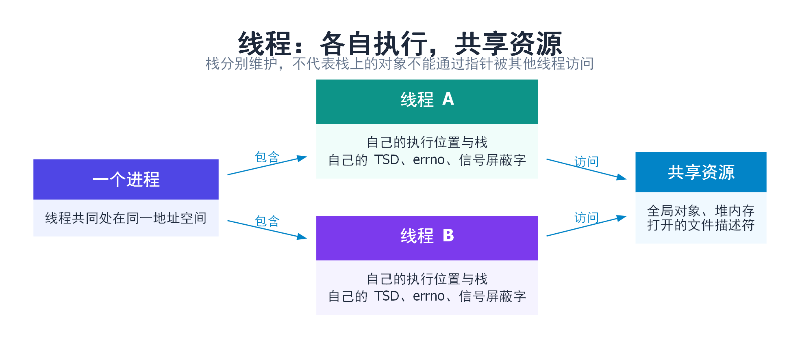
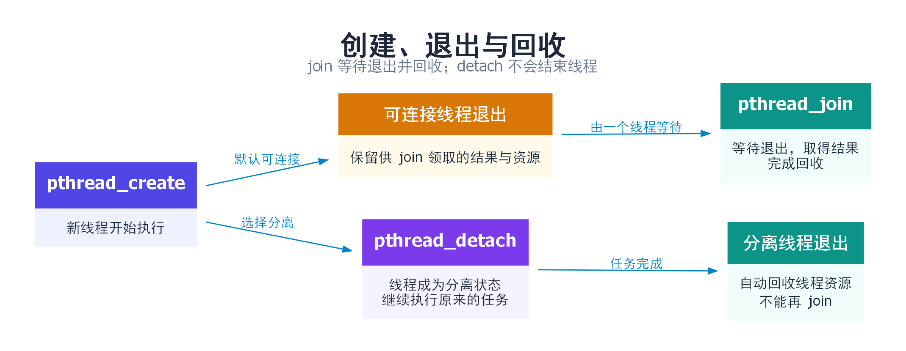
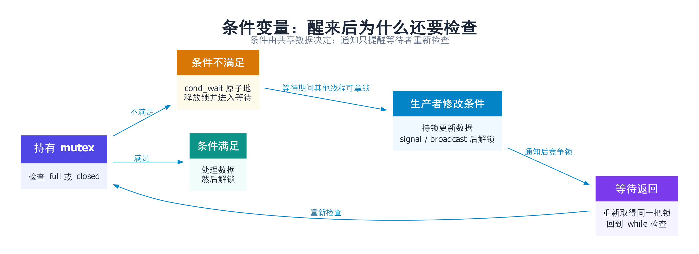
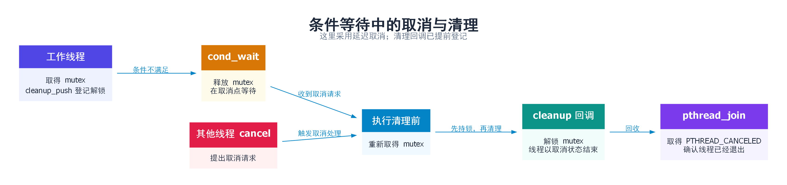
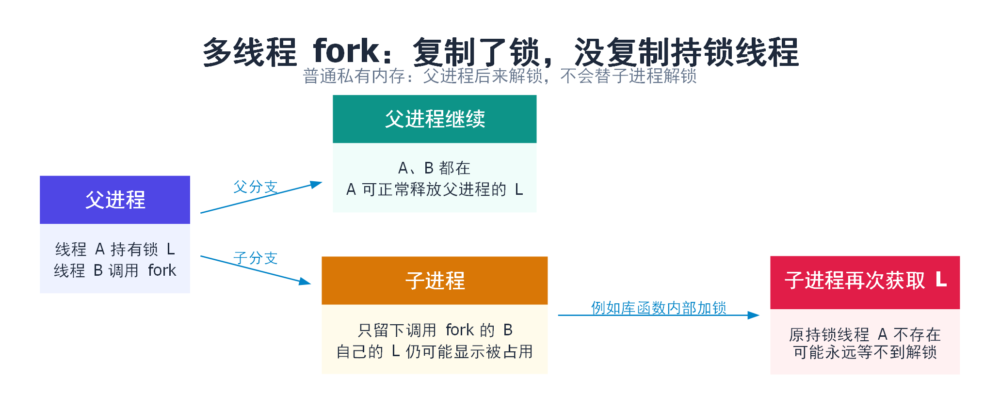

# POSIX 线程：从创建任务到同步与安全退出

本文解决一个问题：怎样让同一进程里的多个线程分工执行，并正确交换数据、等待结果和释放资源。

前置知识是 C++ 函数、指针和变量生命周期。进程拥有地址空间，线程是其中一条执行路线；同一进程可以有多条路线同时前进。[进程管理笔记](../五.进程管理与控制/1.进程管理与控制.md)介绍进程的创建与退出，[信号笔记](../六.信号/1.信号.md)介绍信号怎样递达线程。

第一次阅读按第一至四节走：创建线程 → 等它结束 → 保护共享数据 → 等待条件。然后按问题选择后面的章节。

| 想解决什么问题 | 阅读位置 |
| --- | --- |
| 启动任务、传参数、取结果，弄清 join 与 detach | [一、线程与接口约定](#basics)、[二、创建与回收](#lifecycle) |
| 多线程一起修改数据，或等待任务到来 | [三、mutex](#mutex)、[四、条件变量](#condition) |
| 读多写少、短时间争锁、分阶段计算 | [五、自旋锁与读写锁](#locks)、[六、屏障](#barrier) |
| 设置栈大小、只初始化一次、每线程保存一份数据 | [七、属性](#attributes)、[八、once 与 TSD](#tls) |
| 请求线程退出、处理取消和多线程 fork | [九、取消与清理](#cancel)、[十、fork 与信号](#fork-signal) |
| 编译、排错、准备面试 | [十一、验证](#verify)、[十二、口头回答](#interview)、[Q&A](#qa) |

示例面向 Linux/glibc，使用 C++11。完整代码直接放在正文；将每个代码块保存为指定文件名即可运行。pthread 操作失败时，示例用 `check()` 输出错误并结束进程，以突出同步流程；长期运行的服务还需处理部分启动失败和资源回收。除取消实验外，其余实验不对工作线程发起取消。

<a id="basics"></a>

## 一、一个进程里有多个线程，究竟共享什么？

### 1.1 用“同一间办公室里的几个人”建立直觉

设程序要接收请求、处理数据、写日志。一个线程依次完成，处理数据时就可能顾不上接收。拆成多个线程后，它们可以分别推进；有多个 CPU 核心时，还可能真正并行。

可以把进程看成办公室：桌上的资料大家能看到，每个人又有自己正在做的工作和笔记。但线程不像互相隔开的房间，它们能访问同一地址空间。即使一个变量放在 A 的栈上，只要 A 把地址交给 B，B 也可能访问它。**“每线程有自己的栈”不等于其他线程不能碰这块内存。**

| 内容 | 是否共享 | 对程序意味着什么 |
| --- | --- | --- |
| 全局变量、堆对象、地址空间 | 共享 | 对同一对象的并发访问需要分析同步 |
| 文件描述符表 | 共享 | 一个线程关闭 fd，会影响其他线程使用这个 fd |
| 当前执行位置、寄存器、线程栈 | 各线程分别维护 | A 阻塞不等于 B 必然停止；传递栈地址仍要保证对象存活 |
| 线程局部存储、`errno`、信号屏蔽字 | 每线程各自一份 | A 修改屏蔽设置不会自动修改现有 B 的设置 |
| 信号处理方式 | 进程共享 | 某线程收到信号，默认终止动作可能结束整个进程 |



Linux/glibc 常用 NPTL 实现 POSIX 线程，一个 pthread 对应一个内核调度线程。这是 Linux 实现方式；POSIX 主要规定接口与行为，不要求所有系统采用相同内部结构。[pthreads(7)](https://man7.org/linux/man-pages/man7/pthreads.7.html)

### 1.2 pthread 库、线程 ID 与返回值

使用 `#include <pthread.h>` 声明接口，编译、链接时使用 `-pthread`。glibc 2.34 起相关实现并入 libc，但仍应使用编译器的 `-pthread` 选项，不要只根据某台机器上是否存在单独的 `libpthread` 判断用法。

| 接口或类型 | 作用 | 返回值或边界 |
| --- | --- | --- |
| `pthread_t` | pthread 库的线程标识类型 | 当作不透明标识，不假定是整数或指针 |
| `pthread_self()` | 取得当前线程的 pthread 标识 | 返回 `pthread_t` |
| `pthread_equal(a, b)` | 判断两个标识是否代表同一线程 | 相同返回非零，不同返回 0 |
| `getpid()` | 取得进程 ID | 同进程各线程得到相同 PID |
| Linux `gettid()` | 取得内核线程 ID | 与 `pthread_t` 不同，不能互换传参 |

线程结束并完成回收后，标识可能被复用；不要长期保留失效的 `pthread_t` 再对它操作。打印日志时可以给线程分配业务编号；不能为了用 `%lu` 打印就假定所有平台的 `pthread_t` 都是 `unsigned long`。

**多数返回 `int` 的 pthread 接口用“0 成功，非零错误码”报告结果，不通过 `errno` 报告这次错误。** 例如 `pthread_create()` 返回 `EAGAIN` 时，用 `strerror(err)` 解释返回值，而不是 `perror()`。后文的屏障等待有特殊成功返回值，不能机械套用。

```text
pthread_create / pthread_join / pthread_mutex_lock 等：
    返回 0 → 按成功流程继续
    返回非零 → 这个返回值本身就是错误码

read / fork 等系统调用：
    返回 -1 → 再检查 errno
```

<a id="lifecycle"></a>

## 二、怎样创建线程、传参数、取得结果？

### 2.1 pthread_create 不会替你复制参数对象

假设主线程让另一个线程计算 `1+2+…+100`。主线程需要提供入口函数和输入，并保证计算期间输入还存在。

```cpp
// 接口声明示意；完整可运行示例见本节下方。
int pthread_create(pthread_t* thread, const pthread_attr_t* attr,
                   void* (*start_routine)(void*), void* arg);
```

| 参数 | 含义 | 本节示例 |
| --- | --- | --- |
| `thread` | 输出新线程的标识 | `&worker` |
| `attr` | 新线程的属性；空指针使用默认属性 | `nullptr` |
| `start_routine` | 新线程从哪个函数开始执行 | `calculate` |
| `arg` | 传给入口函数的一个指针值 | `&job` |

`arg` 只把指针值传给线程，不会复制指针指向的对象。因此，如果在循环中反复传入 `&i`，所有线程拿到的都是同一个变量的地址，而不是各轮创建线程时 `i` 的值。等工作线程读取 `i` 时，循环可能已经修改了它；如果 `i` 是局部变量，所在函数返回后它就不再存活，工作线程继续访问这个地址就会使用悬空指针。为了让每个线程读到自己的参数，可以提前为各个线程准备独立的参数对象，并保证这些对象在线程使用期间一直存活。

创建成功后，主线程和工作线程谁先执行没有保证。不要用“主线程睡一秒，另一个线程应该做完了”代替等待关系。

### 2.2 return、pthread_exit、join、detach 分别结束什么？

| 接口或操作 | 作用 | 需要注意 |
| --- | --- | --- |
| 入口函数 `return pointer` | 结束当前工作线程，并提供结果指针 | 不返回指向该线程已结束栈帧的地址 |
| `pthread_exit(pointer)` | 结束当前线程，将 `pointer` 作为退出结果供 `pthread_join()` 接收 | 在线程调用的内层函数中也能结束整个线程；调用后的代码不再执行，退出前会执行下文说明的清理回调 |
| `pthread_join(t, &result)` | 等待可连接线程 t 结束，取得结果并回收其线程资源 | 若 t 已结束可立即返回；第二个参数可为空 |
| `pthread_detach(t)` | 将 t 设为分离线程，结束时自动回收线程资源 | 不等待、不停止线程，之后不能 join |
| 从 `main()` 返回或任意线程调用 `exit()` | 结束整个进程 | 不会自动等待其他线程完成任务；已分离的线程也会随进程结束 |

**为什么说 `pthread_exit()` 能从内层函数结束线程？** 假设线程入口 `worker()` 调用了 `do_work()`，而 `do_work()` 又调用了 `check_task()`。在 `check_task()` 中执行普通 `return`，只是返回 `do_work()`；在这里调用 `pthread_exit()`，则会结束整个当前线程，不需要逐层返回到入口函数。`pointer` 是线程交出的结果指针，不是让系统释放内存的指令，也不能指向退出后已经失效的线程栈上对象。

**退出前会做哪些清理？** 线程可能持有锁、动态分配的内存等资源，结束执行并不代表这些资源都能自动处理。POSIX 规定，`pthread_exit()` 会依次处理以下两类已设置的清理回调：

1. **取消清理函数**：通过 `pthread_cleanup_push()` 登记、尚未通过 `pthread_cleanup_pop()` 移除的函数，按“后登记的先执行”的顺序调用。虽然名称里有“取消”，主动调用 `pthread_exit()` 时也会执行它们。具体用法见[九、取消与清理](#cancel)。
2. **线程特定数据（TSD）的析构回调**：TSD 允许各线程在同一个键下保存各自的值。若创建键时通过 `pthread_key_create()` 设置了析构回调，且当前线程在该键下的值非空，线程退出时会调用对应回调来清理数据。不同键的回调执行顺序没有保证，具体机制见[八、once 与 TSD](#tls)。

这些回调只执行你事先安排的清理代码，不能理解成“退出时自动释放所有资源”。例如，若线程持有互斥锁，却没有安排解锁操作，`pthread_exit()` 不会自动替它解锁。

默认线程是 joinable（可连接）：结束后还有线程管理资源等待 `join()` 回收。 detached（分离）则在结束时自动回收这部分资源，但不会自动释放应用自己分配的所有堆对象，也不会让它脱离进程独立生存。[pthread_join(3)](https://man7.org/linux/man-pages/man3/pthread_join.3.html) · [pthread_detach(3)](https://man7.org/linux/man-pages/man3/pthread_detach.3.html)

**工作线程还没做完，为什么 `main()` 返回就会让它结束？** 线程是进程内部的一条执行路线，需要使用进程的地址空间等资源。从 `main()` 返回会结束整个进程，而不是只结束主线程这条路线。比如主线程创建了负责下载文件的工作线程，随后直接从 `main()` 返回，那么下载任务可能尚未完成，进程就退出了；系统不会因为还有工作线程而自动等待。若要确认下载完成，应在线程仍可连接时先调用 `pthread_join()`，等它结束后再从 `main()` 返回。下一节的完整示例就是这种安排。

`return` 的影响取决于它所在的函数，而 `exit()` 的影响不取决于调用它的是哪个线程：

| 操作 | 结束范围 | 其他线程能否继续执行 |
| --- | --- | --- |
| 普通函数中执行 `return` | 仅结束这次函数调用，回到调用者 | 可以；当前线程也会回到调用者继续执行 |
| 工作线程入口函数中执行 `return` | 结束当前工作线程 | 可以 |
| 从 `main()` 返回 | 结束整个进程 | 不能 |
| 任意线程调用 `exit()` | 结束整个进程 | 不能 |
| 任意线程调用 `pthread_exit()` | 结束当前线程 | 可以；最后一个线程结束后，进程才结束 |

**已经 `detach` 的线程也会随进程结束吗？会。** 可以把 `detach` 理解成“任务做完后自动办理收尾”，而不是“离开进程独立运行”。它只改变线程结束后的线程管理资源回收方式，不改变线程属于这个进程的事实。因此，从 `main()` 返回或任意线程调用 `exit()` 时，已分离线程同样会结束。

如果主线程调用的是 `pthread_exit()`，则只结束主线程，其他线程（包括已分离线程）可以继续运行，直到最后一个线程结束。但这不会延长主线程栈上局部对象的有效期，其他线程不能继续依赖这些对象。需要等待结果、统一管理资源时，通常让主线程先 `join()` 再返回更清楚；已经分离的线程不能再 `join()`，若仍需确认任务完成，就要另行设计完成通知与对象寿命管理。[pthread_exit(3)](https://man7.org/linux/man-pages/man3/pthread_exit.3.html)



对同一个线程应明确由谁负责 join 或 detach。不要重复 join、同时让多个线程 join 同一个目标，或 join 自己。分离线程还需要额外安排参数、共享对象与进程本身的寿命，不能靠 detach 解决这些问题。

### 2.3 完整实验：主线程等待计算结果

保存为 `lifecycle.cpp`。`job` 在主线程栈上，主线程直到 join 完成才离开作用域，因此工作线程访问它时一直有效。

```cpp
#include <pthread.h>
#include <cstdio>
#include <cstdlib>
#include <cstring>

static void check(int err, const char* where) {
    if (err != 0) {
        std::fprintf(stderr, "%s: %s\n", where, std::strerror(err));
        std::exit(EXIT_FAILURE);
    }
}

struct Job {
    int limit;
    long long result;
};

static void* calculate(void* arg) {
    Job* job = static_cast<Job*>(arg);
    long long sum = 0;
    for (int i = 1; i <= job->limit; ++i) sum += i;
    job->result = sum;
    return &job->result;  // 指向主线程仍存活的对象，不是本函数的局部变量 sum。
}

int main() {
    Job job{100, 0};
    pthread_t worker;
    check(pthread_create(&worker, nullptr, calculate, &job), "create");
    void* result = nullptr;
    check(pthread_join(worker, &result), "join");
    std::printf("sum=%lld\n", *static_cast<long long*>(result));
}
```

```bash
g++ -std=c++11 -Wall -Wextra -pedantic -pthread lifecycle.cpp -o lifecycle
./lifecycle
```

预期输出 `sum=5050`。`join()` 不仅等到线程结束，也建立了读取工作线程结果所需的同步关系；主线程不能在 join 前随意读取仍在写的 `job.result`。

若把入口函数最后一句换成 `pthread_exit(&job->result)`，这里也能取得相同指针。但普通 C++ 入口函数优先正常返回，控制流更直观。不要把 `pthread_exit()` 当成 `exit()`，也不要假定它等价于跨所有实现的普通 C++ 返回。[pthread_create(3)](https://man7.org/linux/man-pages/man3/pthread_create.3.html) · [pthread_exit(3)](https://man7.org/linux/man-pages/man3/pthread_exit.3.html)

<a id="mutex"></a>

## 三、mutex：为什么 count++ 也需要保护？

### 3.1 “每人只加一次”也可能互相覆盖

假设 `count` 原来是 0，A、B 都要加一。直觉上最终应该是 2，但一次 `count++` 通常包含读取、计算、写回三个步骤：

```text
A 读到 0 → A 算出 1
B 读到 0 → B 算出 1
A 写入 1 → B 写入 1
```

这个交错过程解释了为什么需要保护更新。在 C++ 中，若对同一个普通变量存在未同步的并发冲突访问，就构成**数据竞争**，行为未定义；不能把“偶尔少加一次”当成唯一后果。

互斥锁像一把房间钥匙：拿到锁的线程才能进入受保护的代码段，其他线程等它交出锁。这个代码段叫**临界区**。锁保护的是大家共同遵守的访问规则，变量不会因为旁边定义了一把锁就自动安全。

**`volatile` 不能代替线程同步。** 多个线程访问同一个普通变量，只要其中有线程修改它，就需要采取适当的同步措施。例如，用同一把互斥锁保护这些访问。给变量加上 `volatile`，并不能让这些访问变得线程安全。C++ 还提供 `std::atomic` 原子操作，它可以与 pthread 线程配合使用，但属于另一组接口，本文不展开。

### 3.2 接口怎样用？

| 接口或初始化方式 | 作用 | 返回与使用条件 |
| --- | --- | --- |
| `pthread_mutex_t m = PTHREAD_MUTEX_INITIALIZER` | 用默认属性初始化锁 | 适合固定寿命的对象，不能对同一把已初始化锁再重复 init |
| `pthread_mutex_init(&m, attr)` | 动态初始化；`attr=nullptr` 使用默认属性 | 成功 0，失败为错误码 |
| `pthread_mutex_lock(&m)` | 获取锁；不能立即取得时可以等待 | 成功返回后才进入临界区 |
| `pthread_mutex_trylock(&m)` | 尝试取锁，不等待它释放 | 已被占用通常返回 `EBUSY` |
| `pthread_mutex_unlock(&m)` | 释放自己持有的锁 | 释放后其他线程才有机会进入 |
| `pthread_mutex_destroy(&m)` | 销毁不用的锁 | 确保无人持有、等待或将再次使用它 |

使用默认互斥锁时，线程获得锁后，应在释放它之前避免再次获取同一把锁，也不能让其他线程代为解锁。若希望及时发现这些误用，可以选择 `PTHREAD_MUTEX_ERRORCHECK` 类型，并检查加锁、解锁操作的返回值。若确实需要同一线程多次获取同一把锁，可以使用递归锁 `PTHREAD_MUTEX_RECURSIVE`；它会记录成功加锁的次数，只有执行相同次数的解锁后，其他线程才能获得锁。不过，递归锁不能解决多个线程因加锁顺序不同而互相等待的问题。

在 Linux/glibc 中，普通互斥锁加锁时，通常先通过用户态的原子操作尝试取得锁。如果锁空闲，线程可以直接获得锁，不需要进入内核。如果锁被其他线程占用，无法立即取得，glibc 可以通过 futex 请求内核让当前线程休眠，等待后续唤醒，从而避免一直循环争抢锁、消耗 CPU。某些锁类型或实现还会在休眠前短暂自旋，但这不是所有互斥锁都有的固定步骤。[pthread_mutex_lock(3p)](https://man7.org/linux/man-pages/man3/pthread_mutex_lock.3p.html) · [futex(7)](https://man7.org/linux/man-pages/man7/futex.7.html)

### 3.3 锁为什么还关系到数据可见性？

不只是“两个人别一起改”。A 在持锁期间更新数据，然后解锁；B 随后成功取得**同一把锁**，就能按同步规则读取 A 已完成的更新。所有对这份共享状态的冲突访问都要遵守同一协议。

如果 A 锁住 `m1` 再等 `m2`，B 锁住 `m2` 再等 `m1`，谁也无法继续。可通过统一加锁顺序，例如都先 `m1` 后 `m2`，消除这类循环等待。锁内避免长时间 I/O、未知回调和等待另一个可能需要这把锁的线程。

### 3.4 持锁线程没来得及解锁就结束了，怎么办？

假设线程 A 获得锁后，正在修改共享数据，却在修改到一半时结束了，没能执行解锁。这里留下两个问题：锁仍被占用，其他线程可能一直等待；数据也可能只更新了一部分，已经不符合原来的规则。对于普通的非稳健互斥锁，不能指望系统自动替 A 解锁。

**稳健锁（robust mutex）**就是为这种持锁线程异常结束的情况提供恢复机制。可以把它理解成“接手未完成的工作时，附带一张需要检查的提醒”：系统允许下一个线程接手锁，但要求它检查前一个线程留下的数据。这个类比只说明交接过程；系统并不知道业务数据应该是什么样子，不能自动替程序修好数据。

稳健锁需要在初始化互斥锁之前，通过 `pthread_mutexattr_setrobust()` 将属性设置为 `PTHREAD_MUTEX_ROBUST`，再用该属性初始化锁。默认互斥锁没有这项能力。这里讨论同一进程内某个线程结束、其他线程仍在运行的情况；如果整个进程退出，进程内其他线程也不能继续恢复数据。跨进程共享稳健锁还需要共享内存和相应的进程共享属性，不属于本节示例范围。

**`EOWNERDEAD` 不表示“没有拿到锁”。** 当 B 获取一把前任持有者未正常解锁就结束的稳健锁时，`pthread_mutex_lock()` 返回 `EOWNERDEAD`，表示：**B 已经获得锁，但受保护的数据可能处于不一致状态，需要先检查和修复。** 因此，不能把这个返回值简单交给“非零就退出”的通用错误处理函数。

例如，共享数据同时保存数组及其元素总和。A 修改了数组，却没来得及更新总和：

```text
修改前：数组 = [10, 20]，总和 = 30
A 结束时：数组 = [15, 20]，总和 = 30
                                 ↑ 与数组不一致
B 接手后：检查数组，重新计算总和，将总和改成 35
```

这个例子假定数组本身仍可作为可信依据，修复目标只是恢复“总和等于数组元素之和”。实际业务可能还要求整笔操作全部完成或全部撤销，甚至连数组本身也可能只修改了一部分。这时就需要日志、备份或事务记录，不能随意选一个字段作为正确答案。

修复完成后，B 调用 `pthread_mutex_consistent()`，通知互斥锁“受保护的数据已经恢复一致”，然后正常解锁。**这个函数不会修复数据，也不会释放锁；修复必须由程序完成，解锁仍要另外调用。**

```text
B 调用 pthread_mutex_lock()
  → 返回 EOWNERDEAD：B 已经持有锁
  → B 检查并修复共享数据
  → B 调用 pthread_mutex_consistent()，成功后标记恢复一致
  → B 调用 pthread_mutex_unlock()
  → 后续线程可以正常取得锁并使用数据
```

如果无法修复，B 在没有成功调用 `pthread_mutex_consistent()` 的情况下解锁，这把锁就会被标记为不可恢复。后续加锁返回 `ENOTRECOVERABLE`，且不会取得锁；程序需要停止正常使用这份数据，另行安排恢复或重建，不能忽略错误继续读写。

| 加锁返回值 | 当前线程是否取得锁 | 接下来怎样处理 |
| --- | --- | --- |
| `0` | 是 | 正常访问数据，完成后解锁 |
| `EOWNERDEAD` | 是 | 先检查并修复数据，再标记恢复一致并解锁 |
| `ENOTRECOVERABLE` | 否 | 进入故障处理流程，不能按持锁成功继续执行 |

本节介绍的是 POSIX 稳健锁的恢复语义，不是所有互斥锁的默认行为。本文完整实验仍使用普通锁，未验证稳健锁恢复流程。[POSIX pthread_mutex_lock](https://pubs.opengroup.org/onlinepubs/9799919799/functions/pthread_mutex_lock.html) · [POSIX pthread_mutex_consistent](https://pubs.opengroup.org/onlinepubs/9799919799/functions/pthread_mutex_consistent.html)

<a id="condition"></a>

## 四、条件变量：没有任务时，怎样放下锁并等待？

### 4.1 条件是数据，通知只是提醒

消费者要从任务槽取数据。槽为空时，反复加锁查看会浪费 CPU；拿着锁一直等也不行，因为生产者需要同一把锁才能放入任务。

条件变量让线程在“暂时没活可干”时等待。例如，消费者发现任务槽为空，就释放互斥锁并等待，让生产者有机会取得锁、放入任务。收到通知后，消费者会重新取得锁，再检查槽里是否真的有任务；有任务才处理，没有就继续等待。**任务是否存在由 `full` 这样的共享变量记录，条件变量只负责等待和通知，不负责保存或判断“有没有任务”。**

| 接口 | 作用 | 调用时必须理解的含义 |
| --- | --- | --- |
| `pthread_cond_t cv = PTHREAD_COND_INITIALIZER` | 默认初始化条件变量 | 动态创建可用 `pthread_cond_init(&cv, attr)` |
| `pthread_cond_wait(&cv, &m)` | 原子地释放 m 并开始等待，返回前重新取得 m | 调用前必须持有 m；正常返回 0 不代表条件为真 |
| `pthread_cond_signal(&cv)` | 唤醒至少一个当前等待者 | 只通知等待者，不会自动释放互斥锁；没有线程等待时，通知不会保存下来供以后使用 |
| `pthread_cond_broadcast(&cv)` | 唤醒所有当前等待者 | 适合关停等可能使多个等待者都需检查状态的情况 |
| `pthread_cond_timedwait(&cv, &m, &deadline)` | 等待到绝对截止时间 | 超时返回 `ETIMEDOUT`，此时已经重新拿到锁。仍要检查有没有任务，因为重新拿锁期间，生产者可能已经放入了任务 |
| `pthread_cond_destroy(&cv)` | 销毁条件变量 | 确保没有等待者和后续使用者 |

消费者检查 `full`、生产者修改 `full` 时，都要先取得同一把互斥锁，避免消费者刚检查完“没有任务”，生产者就插进来放入任务并发出通知，导致消费者错过通知。消费者发现没有任务时，应在持锁状态下调用 `pthread_cond_wait()`，由它协调释放锁和进入等待的过程。本节采用“加锁 → 放入任务并修改 `full` → 发通知 → 解锁”的顺序。也可以先解锁再通知，但对 `full` 的检查和修改仍要放在同一把锁的保护下，并保证发送通知时条件变量仍然有效。



### 4.2 为什么是 while，不能用 if？

先看不涉及虚假唤醒的情况：A 等任务，生产者放入一个任务并唤醒 A。A 还没重新拿到锁时，另一个消费者 B 已先拿到锁并取走任务。A 随后拿到锁，槽又空了。如果 A 认为“醒了就一定有任务”，就会读取不存在的数据。

此外，接口允许**虚假唤醒**：等待返回时，不能仅凭返回就推断发生了某次通知，更不能推断业务条件成立。两个原因都要求：每次持锁回来重新检查，不满足就继续等。[pthread_cond_wait(3p)](https://man7.org/linux/man-pages/man3/pthread_cond_wait.3p.html)

```text
拿锁
while 条件不满足：
    cond_wait：释放锁并等待，返回时重新拿锁
使用满足条件的数据
解锁
```

条件变量不会保存一张“过去发过通知”的票。如果通知发生时没有等待者，通知本身不会留给后来者；但生产者已经把 `full` 改为 true，后来者持锁检查会直接取走数据，因此不需要依赖保存通知。**共享状态保存事实，通知促使等待者重新检查事实。**

### 4.3 完整实验：一个生产者、两个消费者

保存为 `condition.cpp`。主线程依次放入 1～5，两个消费者分摊任务。`full` 表示槽里有数据，`closed` 表示不会再有新任务。关闭后仍先取走槽中剩余数据，再退出。

```cpp
#include <pthread.h>
#include <cstdio>
#include <cstdlib>
#include <cstring>

static void check(int err, const char* where) {
    if (err) {
        std::fprintf(stderr, "%s: %s\n", where, std::strerror(err));
        std::exit(EXIT_FAILURE);
    }
}

struct Slot {
    // 三个线程共用一个槽，最多存一个任务；以下状态由同一把锁保护。
    pthread_mutex_t mutex = PTHREAD_MUTEX_INITIALIZER;
    // 两个条件变量只是两种等待通知，不会自动判断 full 或 closed。
    // 消费者在 not_empty 上等任务，生产者在 not_full 上等空位。
    pthread_cond_t not_empty = PTHREAD_COND_INITIALIZER;
    pthread_cond_t not_full = PTHREAD_COND_INITIALIZER;
    bool full = false;    // true：有任务可取；false：允许放入新任务。
    bool closed = false;  // true：生产者不再放入新任务，但已有任务仍需取走。
    int value = 0;        // 仅在 full 为 true 时表示一个待取的任务。
};
// 每个消费者有独立的参数对象：slot 指向同一个槽，sum 各自保存。
struct Consumer { Slot* slot; int sum; };

static void* consume(void* arg) {
    // pthread_create 传来的是当前消费者参数的地址，将 void* 转回原类型。
    Consumer* c = static_cast<Consumer*>(arg);
    Slot& s = *c->slot;  // 给共享槽起一个别名，不复制槽或其中的锁。
    for (;;) {
        check(pthread_mutex_lock(&s.mutex), "lock");
        // 没任务、也没关闭：以后还可能有任务，所以等待。
        // wait 会释放 mutex，让生产者有机会放任务；返回前重新取得 mutex。
        // 用 while 重查：可能虚假唤醒，也可能任务已被另一个消费者取走。
        while (!s.full && !s.closed)
            check(pthread_cond_wait(&s.not_empty, &s.mutex), "wait data");
        // 离开上面的循环有两种原因：有任务，或者槽已经关闭。
        // 只有“没任务且已关闭”才退出；已关闭但仍有任务时，要先取完。
        if (!s.full && s.closed) {
            // break 不会自动释放 pthread 互斥锁，因此必须先解锁。
            check(pthread_mutex_unlock(&s.mutex), "unlock");
            break;
        }
        // 此时持有锁且槽中有任务：复制到局部变量，再把槽标记为空。
        // 两个消费者不能同时执行这段代码，所以同一任务不会被重复取走。
        int value = s.value;
        s.full = false;
        // 告诉可能正在等待的生产者：现在有空位了。
        // signal 不会释放 mutex，生产者仍需等下面解锁后才能取得这把锁。
        check(pthread_cond_signal(&s.not_full), "notify producer");
        check(pthread_mutex_unlock(&s.mutex), "unlock");
        // 用局部副本处理任务，不再占着槽的锁，其他线程可以继续放取任务。
        c->sum += value;  // 每个消费者只写自己的结果，主线程 join 后才读。
    }
    return nullptr;  // 结束当前消费者线程；计算结果保存在 c->sum 中。
}

int main() {
    Slot s;
    // 两个参数对象共享 s，但分别拥有自己的 sum；它们一直存活到 join 完成。
    Consumer consumers[2] = {{&s, 0}, {&s, 0}};
    pthread_t threads[2];
    for (int i = 0; i < 2; ++i)
        // 每次传独立参数对象的地址，不传会不断变化的循环变量 &i。
        check(pthread_create(&threads[i], nullptr, consume, &consumers[i]), "create");
    // 主线程自己充当生产者；循环里的 value 是本轮准备放入的任务。
    for (int value = 1; value <= 5; ++value) {
        check(pthread_mutex_lock(&s.mutex), "lock");
        // 槽里还有未取走的任务，不能直接覆盖；等消费者腾出空位。
        // wait 期间释放锁，返回时重新持锁，再用 while 确认槽确实为空。
        while (s.full)
            check(pthread_cond_wait(&s.not_full, &s.mutex), "wait space");
        s.value = value;
        s.full = true;
        // 先写好任务和 full，再通知消费者。一次只放一个任务，通知一个即可。
        check(pthread_cond_signal(&s.not_empty), "notify consumer");
        check(pthread_mutex_unlock(&s.mutex), "unlock");
    }
    // 1～5 已全部放入，但最后一个任务不一定已被取走。
    // 这里只宣布“不再生产”，不清除 full，也不丢弃槽中的剩余任务。
    check(pthread_mutex_lock(&s.mutex), "lock");
    s.closed = true;
    // 两个消费者都需要知道关停消息，用广播唤醒所有当前等待者。
    // 尚未等待的消费者以后拿锁时也能看到 closed，不依赖保存这次通知。
    check(pthread_cond_broadcast(&s.not_empty), "close");
    check(pthread_mutex_unlock(&s.mutex), "unlock");
    // 等两个消费者处理完并退出，才能读取各自的 sum、销毁共享同步对象。
    for (pthread_t t : threads) check(pthread_join(t, nullptr), "join");
    std::printf("total=%d\n", consumers[0].sum + consumers[1].sum);
    // 此时没有消费者再等待或使用这些对象，可以安全销毁。
    check(pthread_cond_destroy(&s.not_empty), "destroy data condition");
    check(pthread_cond_destroy(&s.not_full), "destroy space condition");
    check(pthread_mutex_destroy(&s.mutex), "destroy mutex");
}
```

```bash
g++ -std=c++11 -Wall -Wextra -pedantic -pthread condition.cpp -o condition
./condition
```

预期输出 `total=15`。哪个消费者取到哪些数字不固定，但每个数字只被取一次。关闭时使用 broadcast，确保两个消费者都有机会醒来发现结束条件；只 signal 可能留下一个消费者一直等待。

超时等待也应围绕条件写循环，重复等待使用同一个截止时间，避免每次唤醒都把期限延后。默认条件变量时钟是 `CLOCK_REALTIME`；需要不受系统日期调整影响的超时时，可在初始化属性上用 `pthread_condattr_setclock(..., CLOCK_MONOTONIC)`，截止时间也必须由同一时钟计算。普通 mutex/cond 的等待不按 `read()` 那样返回 `EINTR` 重试，不要复制信号笔记里的判断模板。

<a id="locks"></a>

## 五、自旋锁与读写锁：换一把锁会更快吗？

### 5.1 自旋锁把“等锁”变成反复尝试

mutex 竞争时可以让等待者让出 CPU；自旋锁拿不到时持续尝试，消耗 CPU。若持锁时间极短，且持锁线程正运行在另一核心上，自旋可能省掉睡眠与唤醒的成本。如果持锁者被调度出去，自旋者只能空等；单核或线程过多时尤其容易浪费计算资源。

| 接口 | 作用 |
| --- | --- |
| `pthread_spin_init(&lock, PTHREAD_PROCESS_PRIVATE)` | 初始化本进程线程使用的自旋锁 |
| `pthread_spin_lock(&lock)` | 忙等直到取到锁 |
| `pthread_spin_trylock(&lock)` | 尝试一次，未取得时返回 `EBUSY` |
| `pthread_spin_unlock(&lock)` | 释放自己持有的锁 |
| `pthread_spin_destroy(&lock)` | 无人使用后销毁 |

这些接口成功返回 0，失败返回错误码。不要在自旋锁内睡眠、做阻塞 I/O 或调用耗时不可控的函数；持锁期间忙等并不会给被阻塞的持锁者变出 CPU 时间。[pthread_spin_lock(3)](https://man7.org/linux/man-pages/man3/pthread_spin_lock.3.html)

### 5.2 读写锁允许多个读者，但写者需要独占

假设很多线程查路由表，偶尔有一个线程更新。读者之间不改变数据，可以同时进入；写者必须等所有读者离开，更新期间也不能有其他读者进入。

| 接口 | 作用 |
| --- | --- |
| `pthread_rwlock_init(&rw, nullptr)` | 默认属性初始化，也可用 `PTHREAD_RWLOCK_INITIALIZER` |
| `pthread_rwlock_rdlock(&rw)` | 取得读锁，允许其他读锁持有者并存 |
| `pthread_rwlock_wrlock(&rw)` | 取得写锁，独占访问 |
| `pthread_rwlock_tryrdlock/trywrlock(&rw)` | 尝试取得对应锁，无法立即取得时通常返回 `EBUSY` |
| `pthread_rwlock_unlock(&rw)` | 释放当前持有的读锁或写锁 |
| `pthread_rwlock_destroy(&rw)` | 无人持有、等待或使用后销毁 |

读锁内必须只做不会与其他读者冲突的访问。例如“查询时顺便更新普通命中计数”也是写入，需要另行同步。也不能持有读锁直接等待写锁来实现升级：写锁可能在等你手里的读锁，形成自我等待。先释放再重取写锁则要重新验证数据，因为中途别人可能已修改。

### 5.3 写饥饿从哪里来？

一个读者还没离开，下一个读者又加入；只要系统持续允许新读者越过等待中的写者，写者就可能长时间得不到独占机会。这叫**写饥饿**，不是死锁：读者仍不断完成工作，只是写者迟迟轮不到。


不能把“读写锁一定公平”当作 POSIX 保证。Linux/glibc 默认读者偏好策略可能出现上述问题。可以通过 glibc 扩展 `pthread_rwlockattr_setkind_np()` 选择 `PTHREAD_RWLOCK_PREFER_WRITER_NONRECURSIVE_NP`，让等待中的写者优先获得机会。但同一线程持有读锁时，不能再次获取同一把锁的读锁，否则可能死锁：第二次读锁请求在等写者，写者又在等这个线程释放第一次读锁，双方都无法继续。

这里的“递归获取读锁”不一定发生在递归函数中：外层函数拿到读锁后，调用的内层函数又对同一把锁申请读锁，也属于这种情况。`NONRECURSIVE` 是要求应用避免这种用法，不是让库自动检测并修复递归加锁。名称中的 `_NP` 表示非可移植扩展，不能当成跨平台接口。也不要误以为 `PTHREAD_RWLOCK_PREFER_WRITER_NP` 在 glibc 上就提供所想要的写者优先行为。[glibc 读写锁策略说明](https://man7.org/linux/man-pages/man3/pthread_rwlockattr_setkind_np.3.html)

如果业务不能接受写线程偶尔等待很久，就需要确认读写锁如何安排读者和写者，并在实际负载下测试写线程的等待时间。也可以先使用更简单的普通互斥锁，再根据测试结果决定是否换成读写锁；不过，普通互斥锁也不保证公平或固定的等待时间。如果每次读操作只做很少的工作，例如读取一个整数，读写锁维护读者数量、协调读写状态的开销可能抵消并发读取的好处，因此不一定比普通互斥锁更快。

### 5.4 完整实验：分别使用两种锁保护两个计数

保存为 `locks.cpp`。两个线程各执行 10,000 次：自旋锁保护 `spin_count`，写锁保护 `rw_count`，之后读锁取得快照。两把锁从不嵌套持有。这个实验验证用法，不用于比较哪把锁更快。

```cpp
#include <pthread.h>
#include <cstdio>
#include <cstdlib>
#include <cstring>

static void check(int err, const char* where) {
    if (err) {
        std::fprintf(stderr, "%s: %s\n", where, std::strerror(err));
        std::exit(EXIT_FAILURE);
    }
}
static pthread_spinlock_t spin;
static pthread_rwlock_t rw = PTHREAD_RWLOCK_INITIALIZER;
static int spin_count = 0;
static int rw_count = 0;

static void* work(void*) {
    for (int i = 0; i < 10000; ++i) {
        check(pthread_spin_lock(&spin), "spin lock");
        ++spin_count;
        check(pthread_spin_unlock(&spin), "spin unlock");

        check(pthread_rwlock_wrlock(&rw), "write lock");
        ++rw_count;
        check(pthread_rwlock_unlock(&rw), "write unlock");

        check(pthread_rwlock_rdlock(&rw), "read lock");
        int snapshot = rw_count;
        check(pthread_rwlock_unlock(&rw), "read unlock");
        if (snapshot < 1 || snapshot > 20000) std::abort();
    }
    return nullptr;
}
int main() {
    check(pthread_spin_init(&spin, PTHREAD_PROCESS_PRIVATE), "spin init");
    pthread_t threads[2];
    for (pthread_t& t : threads)
        check(pthread_create(&t, nullptr, work, nullptr), "create");
    for (pthread_t t : threads) check(pthread_join(t, nullptr), "join");
    std::printf("spin=%d rw=%d\n", spin_count, rw_count);
    check(pthread_spin_destroy(&spin), "spin destroy");
    check(pthread_rwlock_destroy(&rw), "rw destroy");
}
```

```bash
g++ -std=c++11 -Wall -Wextra -pedantic -pthread locks.cpp -o locks
./locks
```

预期 `spin=20000 rw=20000`。示例不制造写饥饿，实际选型要单独测读写比例、临界区长度、CPU 数量和写者等待分布。

<a id="barrier"></a>

## 六、barrier：怎样让所有线程完成一阶段后再继续？

三个线程分别计算三个分块，只有都算完才能合并结果。mutex 只能限制谁同时进入，不能表达“必须到齐三个人”。**屏障**按到达人数等待：本轮达到指定人数后，一起放行，然后可用于下一轮。

| 接口 | 作用与返回值 |
| --- | --- |
| `pthread_barrier_init(&b, nullptr, count)` | 设置每轮参与人数，必须大于 0；成功返回 0 |
| `pthread_barrier_wait(&b)` | 调用后等待，直到到达屏障的线程数达到预设数量，才允许本轮参与者继续执行。其中一个线程返回 `PTHREAD_BARRIER_SERIAL_THREAD`，其余线程返回 `0`，都表示成功。这个特殊返回值方便选出一个线程做汇总等公共工作，但不会让其他线程等待它完成 |
| `pthread_barrier_destroy(&b)` | 所有参与者不再使用后销毁 |

### 完整实验：各算一项，再由一个线程合并

保存为 `barrier.cpp`。本例只做一轮，其他线程过屏障后不再改结果，因此合并时没有并发写入。

```cpp
#include <pthread.h>
#include <cstdio>
#include <cstdlib>
#include <cstring>

static void check(int err, const char* where) {
    if (err) {
        std::fprintf(stderr, "%s: %s\n", where, std::strerror(err));
        std::exit(EXIT_FAILURE);
    }
}
static pthread_barrier_t ready;
static int parts[3] = {};
static int total = 0;

static void* calculate(void* arg) {
    int i = *static_cast<int*>(arg);
    parts[i] = (i + 1) * (i + 1);  // 各线程写不同的数组元素。
    int err = pthread_barrier_wait(&ready);
    // 正常成功时，同一个屏障的每一轮等待中，恰好一个线程返回
    // PTHREAD_BARRIER_SERIAL_THREAD，其余线程返回 0。
    // 因此，下面的合并操作每轮只由一个线程执行。
    // 如果复用屏障进入下一轮，获得特殊返回值的可能是另一个线程。
    if (err == PTHREAD_BARRIER_SERIAL_THREAD) {
        total = parts[0] + parts[1] + parts[2];
    } else {
        check(err, "barrier wait");
    }
    return nullptr;
}
int main() {
    check(pthread_barrier_init(&ready, nullptr, 3), "barrier init");
    int ids[3] = {0, 1, 2};
    pthread_t threads[3];
    for (int i = 0; i < 3; ++i)
        check(pthread_create(&threads[i], nullptr, calculate, &ids[i]), "create");
    for (pthread_t t : threads) check(pthread_join(t, nullptr), "join");
    std::printf("total=%d\n", total);
    check(pthread_barrier_destroy(&ready), "barrier destroy");
}
```

```bash
g++ -std=c++11 -Wall -Wextra -pedantic -pthread barrier.cpp -o barrier
./barrier
```

预期 `total=14`。若人数设为 4，却只有三个线程调用 wait，就会一直等第四个。若某参与线程中途退出，其他线程也可能无法到齐；这个例子创建失败会直接结束进程，真实任务应设计阶段失败后的退出机制。[pthread_barrier_wait(3p)](https://man7.org/linux/man-pages/man3/pthread_barrier_wait.3p.html)

### 同步原语怎样选？

| 需求 | 起点方案 | 主要代价与边界 |
| --- | --- | --- |
| 多线程保护一组可变状态 | mutex | 临界区过长会串行化，多个锁需统一顺序 |
| 没任务就睡，有任务或关闭就继续 | mutex + cond | 条件需要持锁检查，通知不能代替状态 |
| 极短临界区，持锁者能很快继续运行 | 测量后考虑 spin | 等待消耗 CPU，调度不利时更慢 |
| 读操作多且有足够工作可并行 | 测量后考虑 rwlock | 管理开销、写饥饿、不可直接升级 |
| 固定参与者分阶段汇合 | barrier | 少一个参与者也可能全体卡住 |

<a id="attributes"></a>

## 七、线程属性：怎样在创建时配置线程？

创建一个会使用大量局部数组的线程，可能需要调整栈；创建不再 join 的线程，可能需要让它从一开始就是 detached。`pthread_attr_t` 保存这些**创建时的选项**，不是已经运行线程的实时控制面板。

使用顺序是 `pthread_attr_init()` → 设置选项 → 将属性传给 `pthread_create()` → `pthread_attr_destroy()`。创建函数使用属性里的配置，之后销毁属性对象不会终止线程。

| 接口 | 作用与参数 | 常见误区 |
| --- | --- | --- |
| `pthread_attr_init(&attr)` | 填入默认属性 | 不把未初始化的对象直接交给 create |
| `pthread_attr_setdetachstate(&attr, state)` | state 为 `PTHREAD_CREATE_JOINABLE` 或 `PTHREAD_CREATE_DETACHED` | detached 不能再 join，也不能恢复为 joinable |
| `pthread_attr_setstacksize(&attr, bytes)` | 设置线程栈大小，单位字节 | 不小于实现最低要求；还可能有对齐要求，错误检查 `EINVAL` |
| `pthread_attr_setguardsize(&attr, bytes)` | 设置栈旁的保护区大小 | 用于检测越界，不会自动扩展栈或让溢出可恢复 |
| `pthread_attr_setstack(&attr, address, bytes)` | 应用自己提供栈空间 | 应用负责对齐、寿命与保护；不等价于只设大小 |
| `pthread_attr_setinheritsched(&attr, mode)` | 选择继承创建者调度属性或使用显式属性 | 要应用自己设置的策略，通常需 `PTHREAD_EXPLICIT_SCHED` |
| `pthread_attr_setschedpolicy/setschedparam` | 配置策略与优先级 | 实时调度常需权限，创建可能返回 `EPERM` |
| `pthread_attr_destroy(&attr)` | 销毁属性对象 | 不销毁由它创建的线程 |

不要把 `PTHREAD_STACK_MIN` 当成“任何 C++ 函数都够用”的推荐值。它只是实现允许的最低要求，调用深度、库函数和局部对象还会继续消耗栈。应用自供栈时，glibc 不会替你按 guardsize 自动布置同样的保护区，应自行规划。

下一节的完整例子设置 1 MiB 的线程栈并检查结果，其他选项保持默认。[pthread_attr_init(3)](https://man7.org/linux/man-pages/man3/pthread_attr_init.3.html) · [pthread_attr_setstacksize(3)](https://man7.org/linux/man-pages/man3/pthread_attr_setstacksize.3.html) · [pthread_attr_setguardsize(3)](https://man7.org/linux/man-pages/man3/pthread_attr_setguardsize.3.html)

<a id="tls"></a>

## 八、pthread_once 与线程私有数据：一份全局配置，每线程一份上下文

### 8.1 pthread_once 为什么比 if (!initialized) 更可靠？

两个线程第一次进入日志模块，都看到 `initialized == false`，于是同时打开文件、分配缓冲。给标志加 `volatile` 也不能把“检查并初始化”变成不可分开的操作。

多个线程需要使用同一份数据时，可以通过同一个 `pthread_once_t` 控制对象调用 `pthread_once()`，让其中一个线程执行初始化函数。初始化尚未完成时，其他调用者会等待；初始化完成后，大家才能从 `pthread_once()` 返回并使用数据。后续调用不会重复初始化。

| 接口或对象 | 含义 |
| --- | --- |
| `pthread_once_t once = PTHREAD_ONCE_INIT` | 共享的初始化控制对象，应保持稳定存活 |
| `pthread_once(&once, init)` | init 是无参数、无返回值的函数；成功返回 0 |

`init` 没有业务错误返回值。若初始化会失败，可以把错误保存到共享状态，调用者在 once 返回后读取；不能把初始化失败悄悄当成可用。初始化函数正常返回后，同一个 once 不会因为业务错误自动重试；若初始化被取消，控制对象会允许后续调用重新尝试。不要在 init 中递归等待同一个 once，也不要拷贝或手工复位使用中的 once。[pthread_once(3p)](https://man7.org/linux/man-pages/man3/pthread_once.3p.html)

多线程单例可以将构造放进 init，并在取得实例前调用 once。它保证初始化，不保证实例后续的成员修改安全。纯 C++11 代码还可以用函数局部 `static` 或 `std::call_once`，不必为了单例强行绕到 pthread。

### 8.2 TSD：同一个 key，为什么每个线程读到不同指针？

日志模块想让每个线程都有自己的请求编号，又不想每层函数都传参数。可以给模块申请一个 key，把它当成“储物柜编号”：编号在进程中共享，但每个线程都有自己的柜子。同一 key 在 A 的柜子里取到 A 的值，在 B 的柜子里取到 B 的值。

| 接口 | 作用与返回值 |
| --- | --- |
| `pthread_key_create(&key, destructor)` | 创建共享 key；成功 0；destructor 在线程退出时处理该线程关联的非空值，可为空 |
| `pthread_setspecific(key, pointer)` | 为调用线程的这个 key 保存指针值；成功 0，失败为错误码 |
| `pthread_getspecific(key)` | 取得调用线程关联的指针；没设置过时为空，不返回错误码 |
| `pthread_key_delete(key)` | 删除 key；不会替所有线程调用 destructor，也不会自动释放关联对象 |

TSD 只保存指针，不复制对象、不自动决定所有权。若两个线程把同一个堆对象地址存进去，它们仍在访问同一个对象；“每线程一个槽位”不能把对象自动变成私有。

替换一个 key 中的旧指针也不会自动释放旧对象，需自己安排。线程退出时，非空值通常交给析构回调；若回调又设置非空值，实现只进行有限轮重试，不要依赖无限析构循环。删除 key 前，应让使用它的线程完成清理。[pthread_key_create(3)](https://man7.org/linux/man-pages/man3/pthread_key_create.3.html)

### 8.3 __thread、thread_local 与 pthread key 有什么区别？

| 方式 | 怎样取得每线程副本 | 适用与边界 |
| --- | --- | --- |
| POSIX TSD key | 通过 key 存取 `void*` | 适合动态库上下文；类型、分配与回调由应用管理 |
| GCC `__thread` | 给变量添加编译器 TLS 存储说明 | GCC 扩展，适合简单 TLS 数据；不假定与 C++ 动态初始化、析构语义完全相同 |
| C++11 `thread_local` | 每线程一个具有线程存储期的对象 | 可使用 C++ 类型与析构机制，优先用于普通 C++ TLS |

例如声明 `static __thread int calls = 0;`，各线程操作自己的 calls；在标准 C++11 中可写 `static thread_local int calls = 0;`。本节完整例子使用后一种。它们都不是同步手段：把 TLS 对象地址交给另一个线程后，仍要考虑并发访问和原线程退出后的寿命。[GCC TLS 文档](https://gcc.gnu.org/onlinedocs/gcc/Thread-Local.html)

### 8.4 完整实验：一次初始化、TSD 清理与线程栈属性

保存为 `once_tsd.cpp`。共享配置和 key 初始化一次；两个线程分别分配上下文，并通过同一 key 取回自己的编号。退出时 `destroy_context()` 删除各自对象，主线程 join 后才删除 key。

```cpp
#include <pthread.h>
#include <cstdio>
#include <cstdlib>
#include <cstring>
#include <new>

static void check(int err, const char* where) {
    if (err) {
        std::fprintf(stderr, "%s: %s\n", where, std::strerror(err));
        std::exit(EXIT_FAILURE);
    }
}
// 每个工作线程在堆上创建自己的 Context，保存自己的编号。
struct Context { int id; };
struct Config { int limit; };
// config 由所有线程共享：初始化完成后只读，本例不再修改它。
static Config config{};
// 所有工作线程使用同一个 once，才能协调同一次初始化。
static pthread_once_t once = PTHREAD_ONCE_INIT;
// key 是大家共用的“索引”，但每个线程在这个索引下保存自己的指针。
// key 本身不是 Context 对象，也不是所有线程共用的一份 Context*。
static pthread_key_t key;
// initialize 没有返回值，因此用 init_error 单独记录 key 创建是否成功。
static int init_error = 0;
// 只有执行 initialize 的线程修改它，主线程等 join 完成后再读取。
static int init_count = 0;
// 与普通全局变量不同，每个线程都有独立的一份，初值各自为 0。
static thread_local int local_calls = 0;

static void destroy_context(void* p) {
    // 线程退出时，库将该线程在 key 下保存的非空指针传给这个回调。
    // 当初用 new 创建 Context，这里用 delete 释放；不是删除 key 本身。
    delete static_cast<Context*>(p);
}
static void initialize() {
    // 创建一次共享的 key，并登记线程退出时使用的清理回调。
    // 此时只是创建 key，还没有为任意线程分配 Context。
    init_error = pthread_key_create(&key, destroy_context);
    if (init_error == 0) config.limit = 42;
    ++init_count;
}
// id 是输入；其余字段是当前工作线程写给主线程看的结果。
struct Job { int id; int seen_id; int calls; int limit; };

static void* work(void* arg) {
    // 两个线程分别接收 &jobs[0] 和 &jobs[1]，不会写同一个 Job。
    Job* job = static_cast<Job*>(arg);
    // 一个线程执行 initialize；另一个若遇到初始化未完成，会在这里等待。
    // 成功返回后才能使用初始化得到的 key、config 和 init_error。
    check(pthread_once(&once, initialize), "once");
    // once 返回成功，不代表 initialize 内调用的 key_create 也一定成功。
    // initialize 正常返回后，once 不会因 init_error 非零而自动重试初始化。
    check(init_error, "key create");
    // 每个线程各分配一份上下文；nothrow 分配失败返回 nullptr。
    // 本教学示例遇到分配失败直接结束进程，实际服务应设计相应的错误处理。
    Context* ctx = new (std::nothrow) Context{job->id};
    if (!ctx) std::abort();
    // 仅为当前线程保存 ctx 指针，不复制对象，也不改变另一个线程的值。
    int err = pthread_setspecific(key, ctx);
    if (err) {
        delete ctx;  // 关联失败，退出回调不会替我们删除它。
        check(err, "setspecific");
    }
    // 同一个 key，在不同线程调用 getspecific，会取回各自保存的指针。
    // 本例刚刚关联成功，所以这里能取回自己的 ctx，不会是空指针。
    Context* mine = static_cast<Context*>(pthread_getspecific(key));
    job->seen_id = mine->id;
    // 两个线程分别把自己的计数从 0 加到 1，因此最终两个 calls 都是 1。
    job->calls = ++local_calls;
    // once 已完成初始化，且此后没有线程修改 config，可以共同读取。
    job->limit = config.limit;
    // 从线程入口返回会结束当前线程，并触发非空 TSD 值的清理回调。
    // 不在这里手动 delete ctx，否则保留在 TSD 中的指针会导致重复释放。
    return nullptr;  // 结果在 Job 中；Context 则交给 destroy_context 删除。
}
int main() {
    // attr 是创建线程时使用的配置对象，不是线程本身，也不是线程栈。
    pthread_attr_t attr;
    check(pthread_attr_init(&attr), "attr init");
    // 为随后按 attr 创建的每个线程设置 1 MiB 栈大小（字节数）。
    // 这不是给 Context 分配空间；Context 由 new 分配在堆上。
    // 大小需满足平台要求，实际业务还要按调用深度和栈上对象大小评估。
    check(pthread_attr_setstacksize(&attr, 1024 * 1024), "stack size");
    // 主线程直到 join 完成才离开作用域，参数和结果对象始终有效。
    Job jobs[2] = {{1, 0, 0, 0}, {2, 0, 0, 0}};
    pthread_t threads[2];
    for (int i = 0; i < 2; ++i)
        check(pthread_create(&threads[i], &attr, work, &jobs[i]), "create");
    // 创建时已经使用了属性，之后销毁 attr 不会销毁线程或它们的栈。
    check(pthread_attr_destroy(&attr), "attr destroy");
    // 等两个线程退出、各自的 TSD 清理完成，再读取结果并删除共享 key。
    for (pthread_t t : threads) check(pthread_join(t, nullptr), "join");
    std::printf("init_count=%d\n", init_count);
    // 按 jobs 数组顺序输出，所以显示顺序不代表线程的实际执行顺序。
    for (const Job& job : jobs)
        std::printf("id=%d calls=%d limit=%d\n", job.seen_id, job.calls, job.limit);
    // key_delete 只删除索引，不会替各线程调用 destroy_context。
    // 两个 Context 已在线程退出时释放，且此时不再有线程使用这个 key。
    check(pthread_key_delete(key), "key delete");
}
```

```bash
g++ -std=c++11 -Wall -Wextra -pedantic -pthread once_tsd.cpp -o once_tsd
./once_tsd
```

预期输出：

```text
init_count=1
id=1 calls=1 limit=42
id=2 calls=1 limit=42
```

两个 calls 都是 1，说明它们不是同一个普通全局计数。主线程按数组顺序打印，因此输出顺序固定，不表示两个工作线程按编号顺序启动。

<a id="cancel"></a>

## 九、pthread_cancel：请求退出之后，谁负责把锁放开？

### 9.1 取消请求不等于立即停止

假设工作线程 B 一直在等任务，现在主线程 A 希望它结束。有两种不同的做法：

- **让 B 自己按正常流程退出。** 像第四节那样，A 在锁内设置 `closed`，再通知 B。B 醒来后检查标志，处理完需要收尾的工作，释放资源，最后从入口函数返回。普通业务通常优先这样做，因为程序能明确安排“哪些任务先做完、什么时候解锁”。
- **向 B 发出取消请求。** A 调用 `pthread_cancel(B的线程ID)`，请求线程库让 B 结束。B 何时响应，要看 B 自己的取消设置；取消生效后，B 会执行已登记的退出清理，再结束线程。

可以把 cancel 理解成“发出一份停止请求”。**发出请求成功，不代表对方已经停止。** 想知道 B 确实结束了，A 还需要等待，例如对可连接的 B 调用 `pthread_join()`。

**先分清两项设置：现在允许退出吗？允许时在哪里退出？**

这两项设置由目标线程自己修改。线程 A 调用 `pthread_setcancelstate()` 或 `pthread_setcanceltype()`，改的是 A 自己，不是 B；这两个函数没有“目标线程 ID”参数。

| 设置 | 取值 | 用通俗的话解释 |
| --- | --- | --- |
| 取消状态：现在是否允许取消？ | `PTHREAD_CANCEL_ENABLE` | 允许响应取消请求，但何时响应还要看下面的类型 |
| 取消状态：现在是否允许取消？ | `PTHREAD_CANCEL_DISABLE` | 暂时不响应；收到的请求保留着，不会因为禁用就被丢掉 |
| 取消类型：允许时在哪里响应？ | `PTHREAD_CANCEL_DEFERRED` | 等执行到规定的取消检查位置时再响应，称为“延迟取消” |
| 取消类型：允许时在哪里响应？ | `PTHREAD_CANCEL_ASYNCHRONOUS` | 不必等规定的检查位置，可能在执行过程中随时响应，称为“异步取消” |

新线程默认使用 **ENABLE + DEFERRED**，也就是“允许取消，但在取消点响应”。**延迟不是“过几秒再退出”，而是“等到合适的检查位置再处理请求”。** [取消状态与类型](https://man7.org/linux/man-pages/man3/pthread_setcancelstate.3.html)

**取消点是什么？线程必须自己不停检查吗？**

取消点是 POSIX 规定可以处理延迟取消请求的位置，常见的有 `pthread_cond_wait()`、`read()`，以及专门用于检查请求的 `pthread_testcancel()`。调用前两类函数时，线程库会按接口规定处理取消，不需要再额外写一个“检查取消标志”的循环。

以 B 使用默认设置为例：

```text
A 发出取消请求
  ├── B 正在普通计算：通常继续执行，等遇到取消点再响应
  └── B 已阻塞在 pthread_cond_wait 等取消点：可以在等待期间响应

B 响应取消
  → 执行已登记、尚未移除的清理函数
  → 处理符合条件的 TSD 清理回调
  → 结束 B 线程

A 的 pthread_join 返回，才能确认 B 已经结束
```

因此，B 已经卡在 `pthread_cond_wait()` 中时，不需要先收到一次普通的条件变量通知，才有机会响应取消。但取消不是这个 wait 的普通错误返回：**一旦在这里因取消退出，B 就不会从 wait 返回后继续执行下一行代码。** 清理工作必须提前安排，不能只写在 wait 后面。

“取消点”也不等于“这里天然不会弄坏数据”。如果线程到这里时还持有其他资源，仍需要提前登记相应清理。第 9.2 节和完整实验会解释怎么释放锁。[pthread_cancel(3)](https://man7.org/linux/man-pages/man3/pthread_cancel.3.html)

**这些 API 分别由谁调用，参数表示什么？**

| 接口 | 谁调用、影响谁 | 结果怎样理解 |
| --- | --- | --- |
| `pthread_cancel(t)` | 请求发起者调用；`t` 是希望结束的目标线程 ID | 返回 `0` 只说明请求已成功发出，不说明 t 已结束；失败返回错误码 |
| `pthread_setcancelstate(state, &old_state)` | 线程设置自己是否允许取消；state 取 ENABLE 或 DISABLE 对应的完整常量 | 把修改前的设置写进 `old_state`，便于稍后恢复；成功返回 `0`，失败返回错误码 |
| `pthread_setcanceltype(type, &old_type)` | 线程设置自己采用延迟取消还是异步取消；type 取 DEFERRED 或 ASYNCHRONOUS 对应的完整常量 | 把修改前的类型写进 `old_type`；成功返回 `0`，失败返回错误码 |
| `pthread_testcancel()` | 当前线程主动提供一个取消点，常放在长时间计算的合适位置 | 若允许取消且有请求，就开始清理并退出，不再回到下一行；否则正常返回。它没有返回值，不是返回 true/false 的查询函数 |
| `pthread_join(t, &result)` | 等待者等待可连接线程 t 完成退出 | join 自身成功返回 `0`；若 t 因取消退出，`result` 中得到特殊值 `PTHREAD_CANCELED` |

表中的 `old_state`、`old_type` 是调用者准备的 `int` 变量，传地址是为了让函数把旧设置写进去。`result` 则是 `void*` 变量，接收线程退出结果。**`PTHREAD_CANCELED` 是写进 result 的特殊标记，不是 pthread_join 的返回码。** 第 9.3 节有完整用法。

**为什么卡在 mutex 上，cancel 不一定能让它退出？**

普通 `pthread_mutex_lock()` 不是取消点。假设 B 等一把永远不会再被释放的锁，A 给 B 发出取消请求。B 采用默认的延迟取消，仍会卡在 lock 里，走不到下一个取消点；A 再 join B，也可能一直等下去。

同样，如果 B 一直执行没有取消点的计算循环，请求也可能迟迟得不到处理。可以在每轮计算完成、数据已整理好且资源容易清理的位置调用 `pthread_testcancel()`。它只是给正在执行的线程增加检查机会，不能插进已经死锁的线程里把锁解开。

**异步取消为什么不适合普通业务线程？**

异步取消不必等到取消点，但这也意味着程序很难安排安全的退出位置。例如，B 刚拿到锁，还没登记解锁回调，就可能响应取消；或者刚把链表前半部分改好，后半部分还没改，操作就被中断了。

异步取消仍有清理回调机制，但回调不一定知道程序恰好改到了哪一步，也不能自动补全业务数据。即使锁最终释放了，链表也可能已经不完整。因此，不能把异步取消当作“遇到死锁就强行救出来”的通用办法。普通业务更容易正确实现的是关闭标志配合唤醒，或者在提前安排清理的前提下使用延迟取消。

**暂时禁用取消，为什么还要恢复原设置？**

假设 B 需要完成一小段不能被取消打断的收尾操作，可以先保存旧状态，再把自己设为 DISABLE，做完后恢复旧状态。保存旧值是为了尊重原来的安排：如果调用这段代码之前就已经禁用了取消，结束后也应该保持禁用，而不是擅自改成 ENABLE。

```text
B 暂时禁用取消
  → A 发出取消请求：请求保留下来，B 仍继续执行
  → B 做完这段工作，准备好退出清理，再恢复原状态
      ├── 恢复后仍是 DISABLE：继续暂不响应
      ├── 恢复为 ENABLE，类型是 DEFERRED：在后续取消点响应
      └── 恢复为 ENABLE，类型是 ASYNCHRONOUS：恢复时就可能响应
```

所以，“恢复允许取消”不是把之前的请求清空。恢复前必须先确保：若接下来发生取消，已经取得的资源有人负责释放，必要的数据修改也已完成。禁用期间也不宜执行可能永远等不到结果的操作，否则线程即使收到请求也无法退出。[pthread_setcancelstate(3)](https://man7.org/linux/man-pages/man3/pthread_setcancelstate.3.html) · [pthread_testcancel(3)](https://man7.org/linux/man-pages/man3/pthread_testcancel.3.html)

### 9.2 cleanup_push/pop 为什么必须成对？

假设线程先拿到锁，再调用某个取消点函数，最后才写 unlock。若取消在中间生效，程序就走不到最后的 unlock，锁可能一直留着。

清理回调就是提前告诉线程库：“如果我在这段代码中因取消而退出，请调用这个函数替我收尾。”回调的内容仍由程序员写，线程库不会自动猜出应该释放哪把锁或哪块内存。

| 接口 | 含义 |
| --- | --- |
| `pthread_cleanup_push(cleanup, arg)` | 为当前线程登记一个清理函数 cleanup，并记住传给它的参数 arg；登记时不调用该函数 |
| `pthread_cleanup_pop(execute)` | 移除当前线程最近登记的清理函数。execute 为非零时，还会立即调用它；为 0 时只移除，不执行清理 |

例如，`pthread_cleanup_push(unlock, &mutex)` 登记的是“需要清理时调用 unlock，并把这把 mutex 的地址传进去”，不是立即解锁。随后有两种情况：

- 在线程被取消或调用 pthread_exit 时，这条登记仍在：线程库调用 `unlock(&mutex)` 清理。
- 程序正常执行到 `pthread_cleanup_pop(1)`：移除这条登记，并当场调用 `unlock(&mutex)`。如果写 `pop(0)`，则只移除登记，程序需要自己确保资源已经释放或有其他安排。

登记多个清理函数时，后登记的先执行，类似先解开最里面的一层，再处理外面一层。

push/pop 可能是展开后带有 `{` 和 `}` 的宏，因此要在同一个函数、同一层大括号范围内成对出现。取消时线程可能执行不到源码中的 pop，这由取消清理机制处理；但正常执行时，不能从两者之间直接 return 或 goto 跳走。**不要依赖从线程入口 return 来代替配对的 pop 和明确的资源清理。**

`pthread_cond_wait()` 等待期间会释放 mutex，但因取消而退出等待时，会**先重新取得传给它的那把 mutex，再执行清理回调**。所以，下方实验可以把解锁函数登记为回调：执行回调时，工作线程已经重新持有锁，回调再把锁释放。这不是“任何线程退出都会自动解锁”，而是 cond_wait 的规定配合我们自己登记的解锁函数。[pthread_cleanup_push(3)](https://man7.org/linux/man-pages/man3/pthread_cleanup_push.3.html) · [条件等待的取消规则](https://man7.org/linux/man-pages/man3/pthread_cond_wait.3p.html)



### 9.3 完整实验：取消等待者后，确认锁已经释放

保存为 `cancel.cpp`。主线程先确认工作线程已经开始工作，再请求取消。即使请求刚好先于工作线程进入等待，也会在后续取消点生效，不依赖 `sleep()` 猜时机。

```cpp
#include <pthread.h>
#include <cstdio>
#include <cstdlib>
#include <cstring>

static void check(int err, const char* where) {
    if (err) {
        std::fprintf(stderr, "%s: %s\n", where, std::strerror(err));
        std::exit(EXIT_FAILURE);
    }
}
static pthread_mutex_t mutex = PTHREAD_MUTEX_INITIALIZER;
static pthread_cond_t ready_cv = PTHREAD_COND_INITIALIZER;
static pthread_cond_t work_cv = PTHREAD_COND_INITIALIZER;
static bool started = false;
static bool stop = false;

static void unlock(void* p) {
    check(pthread_mutex_unlock(static_cast<pthread_mutex_t*>(p)), "cleanup unlock");
}
static void* work(void*) {
    // 使用默认设置：允许取消，但只在取消点响应。
    // 普通 lock 不是取消点，因此这里拿锁后，可以先登记解锁回调再进入等待。
    check(pthread_mutex_lock(&mutex), "worker lock");
    pthread_cleanup_push(unlock, &mutex);  // 登记“取消时解锁”，这里还没有解锁。
    started = true;
    check(pthread_cond_signal(&ready_cv), "ready signal");
    // cond_wait 是取消点。因取消退出时，不会继续执行下面的 pop，
    // 而是先重新取得 mutex，再由线程库调用上面登记的 unlock。
    while (!stop)
        check(pthread_cond_wait(&work_cv, &mutex), "work wait");
    pthread_cleanup_pop(1);  // 若通过 stop 正常退出，也执行解锁。
    return nullptr;
}
int main() {
    pthread_t thread;
    check(pthread_create(&thread, nullptr, work, nullptr), "create");
    check(pthread_mutex_lock(&mutex), "main lock");
    while (!started)
        check(pthread_cond_wait(&ready_cv, &mutex), "ready wait");
    check(pthread_mutex_unlock(&mutex), "main unlock");

    // 这一步只发出请求。返回成功时，工作线程可能还没完成清理和退出。
    check(pthread_cancel(thread), "cancel");
    void* result = nullptr;
    // 等工作线程实际退出；result 接收 PTHREAD_CANCELED 等线程退出结果。
    check(pthread_join(thread, &result), "join");
    // 现在尝试拿锁，检查取消时登记的解锁回调是否确实释放了锁。
    check(pthread_mutex_trylock(&mutex), "lock after cancel");
    check(pthread_mutex_unlock(&mutex), "unlock after cancel");
    std::printf("canceled=%s mutex_free=yes\n",
                result == PTHREAD_CANCELED ? "yes" : "no");
    check(pthread_cond_destroy(&ready_cv), "destroy ready");
    check(pthread_cond_destroy(&work_cv), "destroy work");
    check(pthread_mutex_destroy(&mutex), "destroy mutex");
}
```

```bash
g++ -std=c++11 -Wall -Wextra -pedantic -pthread cancel.cpp -o cancel
./cancel
```

预期 `canceled=yes mutex_free=yes`。本实验不修改 stop，专门走取消路径；真实服务可改为持锁设置 stop、通知 `work_cv`，走正常退出路径。

C++ 业务通常优先使用 RAII 和协作退出。Linux/glibc 的取消会涉及栈展开，不能在 `catch (...)` 中吞掉取消使用的强制展开；也不能把所有平台的 pthread 取消都当成普通 C++ 异常。持锁资源由 cleanup 还是 RAII 负责，应明确唯一的释放责任，避免重复 unlock。

<a id="fork-signal"></a>

## 十、多线程里的 fork 和段错误，为什么会影响其他工作？

### 10.1 fork 复制了锁状态，却没有复制所有线程

设 A 正拿着日志锁写缓冲，B 调用 `fork()`。父进程中 A、B 都还在；子进程中只有 B 的执行路线，但普通私有内存里的锁副本可能仍记录“已被 A 占用”。子进程调用需要这把锁的库函数，就可能一直等待一个并不存在的 A 来解锁。



父进程 A 后来解锁，改的是父进程自己的那份普通私有内存，不会替子进程的锁副本解锁。这个问题也可能藏在 `malloc()`、stdio 等库内部，不限于代码里显式声明的 mutex。

因此多线程进程 fork 后，子进程到成功 exec 之前只应调用异步信号安全函数，通常尽快 `execve()`，失败时用安全方式报告并 `_exit()`。不要在这段窗口随意执行 C++ 容器、输出流或复杂析构。`posix_spawn()` 可以把常见启动需求交给库处理，减少手写子进程逻辑。[fork(2)](https://man7.org/linux/man-pages/man2/fork.2.html)

| 接口 | 能做什么 | 不能据此推断什么 |
| --- | --- | --- |
| `pthread_atfork(prepare, parent, child)` | 登记 fork 前、父进程返回后、子进程返回后的回调，空指针表示不需要该阶段 | 不会自动找出所有库里的锁，也不会解除子进程的异步信号安全限制 |

prepare 回调按登记的逆序执行，parent/child 按登记顺序执行。它可以协调自己能控制的状态，但在复杂 C++ 程序中，无法轻易知道所有线程与第三方库的内部锁；不能简单承诺“给所有锁加 atfork 就安全”。传统回调中解锁的做法还需考虑具体平台与异步信号安全边界。[pthread_atfork(3)](https://man7.org/linux/man-pages/man3/pthread_atfork.3.html)

### 10.2 一个线程段错误，为什么通常整个进程退出？

线程共享地址空间。A 越界写坏了堆，不代表只有 A 的局部数据坏了；其他线程可能正在使用被破坏的同一对象。操作系统不能假定“只杀 A，进程剩下部分就安全”。

执行非法内存访问引起的 `SIGSEGV` 通常是**线程定向信号**，递达给出错线程。信号的处理方式由进程共享，而 `SIGSEGV` 的默认动作是终止**整个进程**，并按配置生成 core dump。

```text
A 执行非法内存访问
  → 故障引发 SIGSEGV，递达给 A
  → 采用默认终止动作
  → 整个进程结束，B、C 也随之结束
```

所以“只递达一个线程”和“默认动作影响整个进程”并不矛盾。不要笼统记成“所有信号都面向进程”：`kill(pid, sig)` 是进程定向，`pthread_kill(thread, sig)` 和硬件故障引发的信号可以是线程定向。[signal(7)](https://man7.org/linux/man-pages/man7/signal.7.html)

安装 `SIGSEGV` 处理函数不等于能够安全恢复。若未修复根因就返回，可能再次执行故障指令；共享内存也可能已经损坏。需要把某类任务故障隔离在独立边界时，考虑使用独立进程，而不是把线程当作互不影响的容器。

<a id="verify"></a>

## 十一、编译、验证与排错

### 11.1 环境和验证范围

目标环境为 Linux/glibc、支持 C++11 的 g++。Debian/Ubuntu 可用 `sudo apt install build-essential` 安装工具链。每个完整代码块独立保存、独立编译，不能把多个 `main()` 拼成一个文件。

`pthread_spinlock_t`、`pthread_barrier_t` 等接口的可用性与平台有关；本文以 Linux 为准，不宣称这些程序原样覆盖所有 UNIX 或 Windows pthread 兼容库。glibc `_np` 扩展需要另行确认声明条件，不属于可移植 POSIX 接口。

以下为预期结果，不以运行快慢评价锁性能。

验证记录（2026-11-05）：当前保留的六个完整程序，均在 Windows 的 MSYS2 UCRT64、GCC 16.1.0 / winpthreads 环境下，以 `-std=c++11 -Wall -Wextra -Wpedantic -pthread` 编译通过，无编译警告，运行输出与下表一致。这是兼容库环境的验证，尚未在 Linux/glibc 上运行，也未执行 ThreadSanitizer；不能据此验证 Linux 特有的锁策略、fork 或信号行为。

| 程序 | 预期输出 | 验证的关系 |
| --- | --- | --- |
| `lifecycle` | `sum=5050` | 参数存活至 join，结果在 join 后读取 |
| `condition` | `total=15` | 持锁检查、循环等待、关闭时广播 |
| `locks` | `spin=20000 rw=20000` | 用对应锁保护读写，结束后销毁 |
| `barrier` | `total=14` | 三者到齐，一个参与者合并，主线程 join 后取结果 |
| `once_tsd` | 初始化计数 1，两个线程 calls 都为 1 | 一次初始化与每线程独立状态 |
| `cancel` | `canceled=yes mutex_free=yes` | 取消等待者时通过 cleanup 释放锁 |

### 11.2 出现问题先看哪里？

| 现象 | 优先检查 | 原因 |
| --- | --- | --- |
| create 返回非零，perror 却说 Success | 打印 pthread 返回码，用 `strerror(err)` | 多数 pthread API 不通过 errno 报告错误 |
| 线程参数偶尔不对 | 参数是否指向同一个循环变量或已销毁对象 | 传指针没有复制对象 |
| 条件变量等待永远不结束 | 条件是否持锁修改，结束时是否广播，是否遗漏参与者 | 通知不存储业务状态 |
| 唤醒后读到空队列 | wait 外是否用 while 重新检查 | 虚假唤醒或资源被其他线程取走 |
| cancel 成功但 join 不返回 | 目标是否禁用取消，或一直没到取消点 | 请求成功不是退出完成 |
| 屏障处全体卡住 | count 是否包括正确人数，是否有人提前退出 | 屏障等本轮所有参与者 |
| 读写锁写入延迟很大 | 读者是否持续进入、读锁是否长期持有 | 读者偏好或临界区过长可能拖延写者 |
| fork 后子进程卡在输出或分配内存 | 是否调用了需要内部锁的非安全函数 | 锁副本可能仍由消失的线程“持有” |
| 一条线程崩溃，所有任务消失 | 进程是否按 SIGSEGV 默认动作退出 | 线程共享进程故障边界 |

Linux 上可用 ThreadSanitizer 辅助查数据竞争，例如：

```bash
g++ -std=c++11 -g -O1 -fsanitize=thread -pthread condition.cpp -o condition_tsan
./condition_tsan
```

它依赖工具链和运行环境支持，会改变运行时开销；一次没有报告也不能证明所有调度与输入都正确。检查代码时仍要标出每个共享变量的写入者、读取者、保护锁或同步关系。

<a id="interview"></a>

## 十二、面试时怎样把接口讲成一条完整流程？

**线程生命周期：**

> 我用 pthread_create 启动一个入口函数，把参数放在整个任务期间都有效的对象中。创建成功不保证哪条线程先运行。需要结果就安排唯一的 join 负责人，等线程结束后再读结果；不需要 join 时可以分离，但仍要管理共享对象和进程寿命。线程入口返回结束的是当前线程，main 返回或 exit 结束的是整个进程。

**任务队列同步：**

> mutex 保护队列和关闭标志，条件变量让没有任务的消费者释放锁并等待。wait 返回后重新持锁，再用 while 检查条件，因为醒来时任务可能已被别人取走，也可能虚假唤醒。生产者先改变受保护的状态，再通知；关闭时广播，让所有等待者都能观察结束条件。这样等待依赖的是状态，而不是通知次数。

**退出和性能取舍：**

> 普通退出时，我会先设置关闭标志并唤醒工作线程，让它自己收尾，再 join 确认结束。如果使用 pthread_cancel，要分清“请求发出”和“线程退出”：默认是延迟取消，在允许取消且执行到取消点时才响应，还要提前登记解锁等清理。普通 mutex_lock 不是取消点，所以 cancel 不能保证解除死锁。锁的选择还要看共享数据和等待方式：mutex 通用，自旋会消耗 CPU，读写锁要考虑写者等多久；不能用 volatile 代替线程同步。

<a id="qa"></a>

## Q&A（常见问题与解答）

**Q1：线程有自己的栈，为什么传局部变量还会出错？**

栈属于地址空间的一部分，指针可以让其他线程访问它。风险是变量可能被修改或销毁，而工作线程尚未完成访问。第一例把 job 保留到 join 之后，才保证寿命；若主线程在 join 前还修改相同字段，则还需要同步。

**Q2：detach 是不是让线程在后台独立运行？**

不是。它只改变结束后的线程资源回收方式，不创建新进程、不延长参数对象寿命，也不阻止进程退出。从 `main()` 返回或任意线程调用 `exit()` 时，已分离线程也会结束；主线程调用 `pthread_exit()` 则只结束主线程，其他线程可以继续运行，但不能继续使用主线程栈上已失效的对象。若需要确认工作完成，应保持线程可连接并使用 `join()`，或为分离线程设计显式完成通知，不能靠“detach 后猜它做完了”。

**Q3：notify 后对方马上能执行临界区吗？**

不能保证。等待者还需要得到调度并重新拿到 mutex。若通知者仍持锁，它就不能进入受保护的部分；拿锁后也必须重新检查条件。

**Q4：能否只用条件变量，不用 mutex？**

不能直接省掉 mutex。消费者检查有没有任务、生产者放入任务时，都要取得同一把互斥锁。消费者发现没有任务，就在持锁状态下调用 `pthread_cond_wait()`，由它协调好释放锁和进入等待的过程。这样可以避免“消费者刚检查完没有任务，生产者就放入任务并发出通知，而消费者随后才开始等待”的情况；否则通知已经过去，消费者却可能一直等不到下一次通知。

条件变量不会保存通知次数。例如，没有线程等待时连续发出三次通知，并不会留下三次“以后不用等待的机会”。任务数量应由任务队列或受锁保护的计数变量记录，消费者每次醒来都要重新检查。如果需要“生产者增加一次计数，消费者等待并消耗一次计数”的机制，可以考虑信号量；它会保留尚未消耗的计数，但任务仍需放在队列等数据结构中，队列本身也要正确保护。

**Q5：读很多、写很少，就一定该用读写锁吗？**

还要看每次读做多少工作、并发程度和写延迟要求。极短读取可能被读写锁管理开销抵消；读者源源不断时，写者还可能饥饿。先用正确的简单方案，再以实际工作负载测试。

**Q6：barrier 的特殊返回者开始合并时，其他人会等它吗？**

不会。第一道屏障只保证前一阶段都完成；其余线程可以继续。若下一阶段需要合并结果，应增加第二道屏障。本例其他线程只退出，主线程 join 所有人后读取总和，因此不需要第二道。

**Q7：once 保证只初始化一次，是否意味着配置对象永远不用加锁？**

只读且初始化后不再修改时，可利用 once 建立的初始化同步。如果后来还要更新字段，需要新的同步协议。once 不会自动包住未来所有成员访问。

**Q8：删除 TSD key 会自动 delete 所有线程的对象吗？**

不会。key 删除不会逐线程执行析构回调，覆盖旧值也不会释放旧对象。应明确对象所有权，让相关线程先清理退出，再删除 key；否则可能泄漏或访问无效 key。

**Q9：为什么取消条件变量等待时，清理函数可以直接解锁？**

因为 pthread_cond_wait 在因取消而退出等待时，会先重新拿到传给它的 mutex，再执行清理函数。因此，登记的解锁函数执行时，当前线程确实持有这把锁。其他位置发生取消时，不一定有这个前提，尤其不能因此认为异步取消时也总能安全解锁。

**Q10：volatile 标志在测试里一直正常，为什么还说不安全？**

测试中读到了预期结果，只能说明那几次运行没有暴露问题。一个线程修改 volatile 标志，另一个线程读取它，如果没有其他同步措施，仍然存在数据竞争，C++ 不保证程序行为。volatile 不会让这个标志变成安全的线程通知工具。例如，可以用同一把 mutex 保护标志和相关数据的读写；需要等待时，再配合条件变量。

**Q11：线程发生 SIGSEGV，能否只调用 pthread_exit 结束它？**

不能把它当作通用恢复方案。共享状态可能已经损坏，pthread_exit 也不是可随意从异步信号处理函数调用的安全接口。故障隔离应在设计时考虑进程边界，诊断可结合 core dump 与调试器。

## 参考与延伸阅读

- [Linux pthreads 总览](https://man7.org/linux/man-pages/man7/pthreads.7.html)：共享属性、线程标识与实现说明。
- [POSIX 线程创建](https://pubs.opengroup.org/onlinepubs/9799919799/functions/pthread_create.html)：接口规范与参数生命周期。
- [POSIX 内存同步规则](https://pubs.opengroup.org/onlinepubs/9799919799/basedefs/V1_chap04.html#tag_04_15)：锁、等待和数据可见性的规范背景。
- [Linux 条件变量等待](https://man7.org/linux/man-pages/man3/pthread_cond_wait.3p.html)：条件重查、超时与取消时重新加锁。
- [C++ 数据竞争与线程执行](https://eel.is/c++draft/intro.races)：为什么共享变量的冲突访问需要同步。
- [GCC ThreadSanitizer 选项](https://gcc.gnu.org/onlinedocs/gcc/Instrumentation-Options.html)：运行时检测的构建方式。

## 思维导图总结

```text
POSIX 线程：从创建任务到同步与安全退出
├── 一、共享资源与接口约定
│   ├── 地址空间共享；栈、TSD、errno 和屏蔽字分别维护
│   └── pthread_t 与内核 TID 不同；多数接口直接返回错误码
├── 二、创建与回收
│   ├── create 传指针；参数和结果必须保持有效
│   └── return / pthread_exit 当前线程；join 等待；detach 自动回收
├── 三、mutex
│   ├── 保护临界区与可见性；所有访问遵守同一协议
│   └── 加锁顺序、锁寿命和特殊 robust 语义
├── 四、条件变量
│   ├── 条件是数据；wait 释放锁并等待，返回前重新加锁
│   └── while 重查；关闭广播；超时使用固定截止时间
├── 五、spin 与 rwlock
│   ├── 自旋消耗 CPU；读锁共享、写锁独占
│   └── 读者持续进入可能写饥饿，选型依赖实测
├── 六、barrier
│   ├── 到齐放行，特殊返回值也是成功
│   └── 合并完成需要另行同步，避免参与者提前退出
├── 七、线程属性
│   ├── init → 配置 → create → destroy
│   └── 分离状态、栈、保护区与调度权限
├── 八、once 与 TSD
│   ├── 初始化一次不等于后续访问全部安全
│   └── key 共享、值每线程一份；__thread 与 thread_local
├── 九、取消与清理
│   ├── 延迟取消、取消点、join 确认退出
│   └── cleanup 配对，条件等待取消前重新取得锁
├── 十、fork 与信号
│   ├── 子进程只有调用线程，锁状态可能仍被占用
│   └── 故障信号递达出错线程，默认动作终止整个进程
└── 十一、十二、验证与复习
    ├── 六个完整实验、错误码与排错
    └── 生命周期、同步与退出的口头回答和 Q&A
```


[独立思维导图 PNG](1.POSIX线程_思维导图.png) · [Graphviz 源文件](1.POSIX线程_思维导图.dot)
