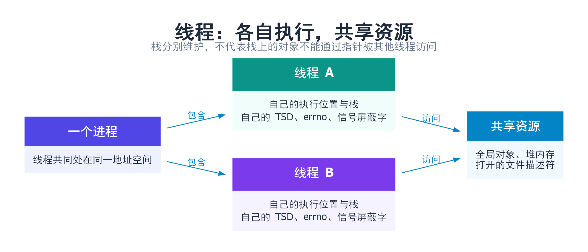
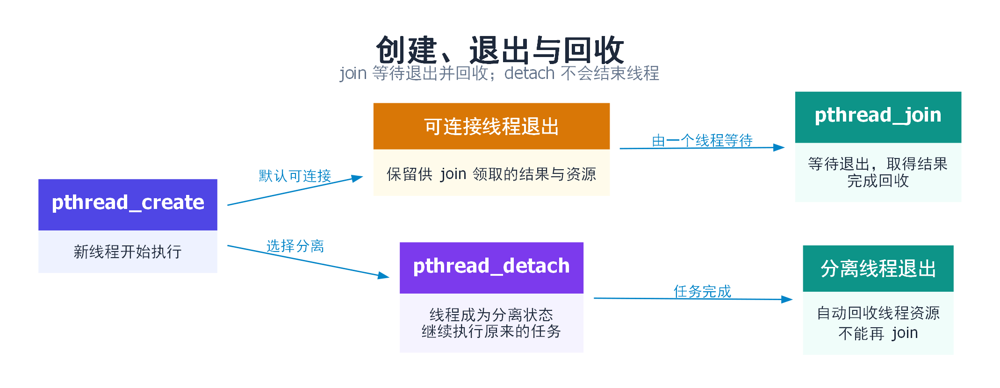
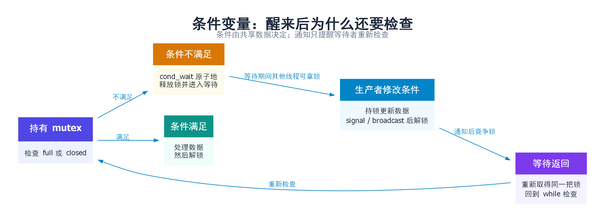
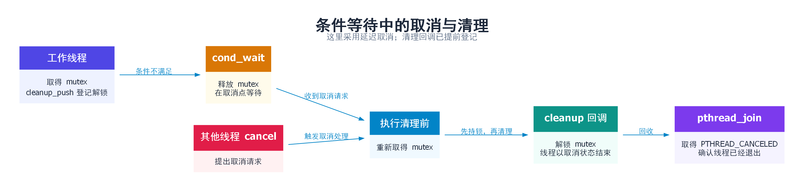
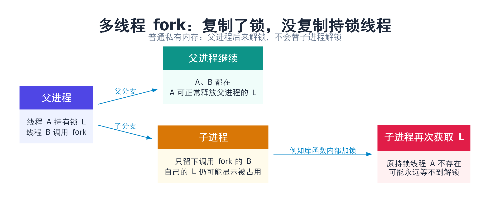
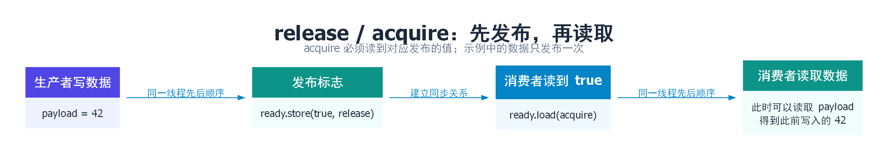

# POSIX 线程：从创建任务到同步与安全退出

本文解决一个问题：怎样让同一进程里的多个线程分工执行，并正确交换数据、等待结果和释放资源。

前置知识是 C++ 函数、指针和变量生命周期。进程拥有地址空间，线程是其中一条执行路线；同一进程可以有多条路线同时前进。[进程管理笔记](../五.进程管理与控制/1.进程管理与控制.md)介绍进程的创建与退出，[信号笔记](../六.信号/1.信号.md)介绍信号怎样递达线程。

第一次阅读按第一至四节走：创建线程 → 等它结束 → 保护共享数据 → 等待条件。然后按问题选择后面的章节。

| 想解决什么问题 | 阅读位置 |
| --- | --- |
| 启动任务、传参数、取结果，弄清 join 与 detach | [一、线程与接口约定](#basics)、[二、创建与回收](#lifecycle) |
| 多线程一起修改数据，或等待任务到来 | [三、mutex](#mutex)、[四、条件变量](#condition) |
| 读多写少、短时间争锁、分阶段计算 | [五、自旋锁与读写锁](#locks)、[六、屏障](#barrier) |
| 设置栈大小、只初始化一次、每线程保存一份数据 | [七、属性](#attributes)、[八、once 与 TSD](#tls) |
| 请求线程退出、处理取消和多线程 fork | [九、取消与清理](#cancel)、[十、fork 与信号](#fork-signal) |
| 理解 volatile、原子操作与内存序 | [十一、原子与内存序](#atomics) |
| 编译、排错、准备面试 | [十二、验证](#verify)、[十三、口头回答](#interview)、[Q&A](#qa) |

示例面向 Linux/glibc，使用 C++11。完整代码直接放在正文；将每个代码块保存为指定文件名即可运行。pthread 操作失败时，示例用 `check()` 输出错误并结束进程，以突出同步流程；长期运行的服务还需处理部分启动失败和资源回收。除取消实验外，其余实验不对工作线程发起取消。

<a id="basics"></a>

## 一、一个进程里有多个线程，究竟共享什么？

### 1.1 用“同一间办公室里的几个人”建立直觉

设程序要接收请求、处理数据、写日志。一个线程依次完成，处理数据时就可能顾不上接收。拆成多个线程后，它们可以分别推进；有多个 CPU 核心时，还可能真正并行。

可以把进程看成办公室：桌上的资料大家能看到，每个人又有自己正在做的工作和笔记。但线程不像互相隔开的房间，它们能访问同一地址空间。即使一个变量放在 A 的栈上，只要 A 把地址交给 B，B 也可能访问它。**“每线程有自己的栈”不等于其他线程不能碰这块内存。**

| 内容 | 是否共享 | 对程序意味着什么 |
| --- | --- | --- |
| 全局变量、堆对象、地址空间 | 共享 | 对同一对象的并发访问需要分析同步 |
| 文件描述符表 | 共享 | 一个线程关闭 fd，会影响其他线程使用这个 fd |
| 当前执行位置、寄存器、线程栈 | 各线程分别维护 | A 阻塞不等于 B 必然停止；传递栈地址仍要保证对象存活 |
| 线程局部存储、`errno`、信号屏蔽字 | 每线程各自一份 | A 修改屏蔽设置不会自动修改现有 B 的设置 |
| 信号处理方式 | 进程共享 | 某线程收到信号，默认终止动作可能结束整个进程 |



Linux/glibc 常用 NPTL 实现 POSIX 线程，一个 pthread 对应一个内核调度线程。这是 Linux 实现方式；POSIX 主要规定接口与行为，不要求所有系统采用相同内部结构。[pthreads(7)](https://man7.org/linux/man-pages/man7/pthreads.7.html)

### 1.2 pthread 库、线程 ID 与返回值

使用 `#include <pthread.h>` 声明接口，编译、链接时使用 `-pthread`。glibc 2.34 起相关实现并入 libc，但仍应使用编译器的 `-pthread` 选项，不要只根据某台机器上是否存在单独的 `libpthread` 判断用法。

| 接口或类型 | 作用 | 返回值或边界 |
| --- | --- | --- |
| `pthread_t` | pthread 库的线程标识类型 | 当作不透明标识，不假定是整数或指针 |
| `pthread_self()` | 取得当前线程的 pthread 标识 | 返回 `pthread_t` |
| `pthread_equal(a, b)` | 判断两个标识是否代表同一线程 | 相同返回非零，不同返回 0 |
| `getpid()` | 取得进程 ID | 同进程各线程得到相同 PID |
| Linux `gettid()` | 取得内核线程 ID | 与 `pthread_t` 不同，不能互换传参 |

线程结束并完成回收后，标识可能被复用；不要长期保留失效的 `pthread_t` 再对它操作。打印日志时可以给线程分配业务编号；不能为了用 `%lu` 打印就假定所有平台的 `pthread_t` 都是 `unsigned long`。

**多数返回 `int` 的 pthread 接口用“0 成功，非零错误码”报告结果，不通过 `errno` 报告这次错误。** 例如 `pthread_create()` 返回 `EAGAIN` 时，用 `strerror(err)` 解释返回值，而不是 `perror()`。后文的屏障等待有特殊成功返回值，不能机械套用。

```text
pthread_create / pthread_join / pthread_mutex_lock 等：
    返回 0 → 按成功流程继续
    返回非零 → 这个返回值本身就是错误码

read / fork 等系统调用：
    返回 -1 → 再检查 errno
```

<a id="lifecycle"></a>

## 二、怎样创建线程、传参数、取得结果？

### 2.1 pthread_create 不会替你复制参数对象

假设主线程让另一个线程计算 `1+2+…+100`。主线程需要提供入口函数和输入，并保证计算期间输入还存在。

```cpp
// 接口声明示意；完整可运行示例见本节下方。
int pthread_create(pthread_t* thread, const pthread_attr_t* attr,
                   void* (*start_routine)(void*), void* arg);
```

| 参数 | 含义 | 本节示例 |
| --- | --- | --- |
| `thread` | 输出新线程的标识 | `&worker` |
| `attr` | 新线程的属性；空指针使用默认属性 | `nullptr` |
| `start_routine` | 新线程从哪个函数开始执行 | `calculate` |
| `arg` | 传给入口函数的一个指针值 | `&job` |

`arg` 传的是地址，不会深拷贝地址指向的对象。若每轮创建线程都传同一个循环变量 `&i`，工作线程可能看到后来修改的值；若创建函数返回导致局部对象销毁，工作线程还可能访问悬空指针。常用办法是先准备稳定存活的参数对象，再创建线程。

创建成功后，主线程和工作线程谁先执行没有保证。不要用“主线程睡一秒，另一个线程应该做完了”代替等待关系。

### 2.2 return、pthread_exit、join、detach 分别结束什么？

| 接口或操作 | 作用 | 需要注意 |
| --- | --- | --- |
| 入口函数 `return pointer` | 结束当前工作线程，并提供结果指针 | 不返回指向该线程已结束栈帧的地址 |
| `pthread_exit(pointer)` | 结束调用线程，不返回调用处 | 可从更深层函数退出；会执行已登记的取消清理函数和 TSD 析构回调 |
| `pthread_join(t, &result)` | 等待可连接线程 t 结束，取得结果并回收其线程资源 | 若 t 已结束可立即返回；第二个参数可为空 |
| `pthread_detach(t)` | 将 t 设为分离线程，结束时自动回收线程资源 | 不等待、不停止线程，之后不能 join |
| 从 `main()` 返回或调用 `exit()` | 结束整个进程 | 即使其他线程还没做完，也会一起结束 |

默认线程是 **joinable（可连接）**：结束后还有线程管理资源等待 `join()` 回收。**detached（分离）**则在结束时自动回收这部分资源，但不会自动释放应用自己分配的所有堆对象，也不会让它脱离进程独立生存。[pthread_join(3)](https://man7.org/linux/man-pages/man3/pthread_join.3.html) · [pthread_detach(3)](https://man7.org/linux/man-pages/man3/pthread_detach.3.html)



对同一个线程应明确由谁负责 join 或 detach。不要重复 join、同时让多个线程 join 同一个目标，或 join 自己。分离线程还需要额外安排参数、共享对象与进程本身的寿命，不能靠 detach 解决这些问题。

### 2.3 完整实验：主线程等待计算结果

保存为 `lifecycle.cpp`。`job` 在主线程栈上，主线程直到 join 完成才离开作用域，因此工作线程访问它时一直有效。

```cpp
#include <pthread.h>
#include <cstdio>
#include <cstdlib>
#include <cstring>

static void check(int err, const char* where) {
    if (err != 0) {
        std::fprintf(stderr, "%s: %s\n", where, std::strerror(err));
        std::exit(EXIT_FAILURE);
    }
}

struct Job {
    int limit;
    long long result;
};

static void* calculate(void* arg) {
    Job* job = static_cast<Job*>(arg);
    long long sum = 0;
    for (int i = 1; i <= job->limit; ++i) sum += i;
    job->result = sum;
    return &job->result;  // 指向主线程仍存活的对象，不是本函数的局部变量 sum。
}

int main() {
    Job job{100, 0};
    pthread_t worker;
    check(pthread_create(&worker, nullptr, calculate, &job), "create");
    void* result = nullptr;
    check(pthread_join(worker, &result), "join");
    std::printf("sum=%lld\n", *static_cast<long long*>(result));
}
```

```bash
g++ -std=c++11 -Wall -Wextra -pedantic -pthread lifecycle.cpp -o lifecycle
./lifecycle
```

预期输出 `sum=5050`。`join()` 不仅等到线程结束，也建立了读取工作线程结果所需的同步关系；主线程不能在 join 前随意读取仍在写的 `job.result`。

若把入口函数最后一句换成 `pthread_exit(&job->result)`，这里也能取得相同指针。但普通 C++ 入口函数优先正常返回，控制流更直观。不要把 `pthread_exit()` 当成 `exit()`，也不要假定它等价于跨所有实现的普通 C++ 返回。[pthread_create(3)](https://man7.org/linux/man-pages/man3/pthread_create.3.html) · [pthread_exit(3)](https://man7.org/linux/man-pages/man3/pthread_exit.3.html)

<a id="mutex"></a>

## 三、mutex：为什么 count++ 也需要保护？

### 3.1 “每人只加一次”也可能互相覆盖

假设 `count` 原来是 0，A、B 都要加一。直觉上最终应该是 2，但一次 `count++` 通常包含读取、计算、写回三个步骤：

```text
A 读到 0 → A 算出 1
B 读到 0 → B 算出 1
A 写入 1 → B 写入 1
```

这个交错过程解释了为什么需要保护更新。在 C++ 中，若对同一个普通变量存在未同步的并发冲突访问，就构成**数据竞争**，行为未定义；不能把“偶尔少加一次”当成唯一后果。

互斥锁像一把房间钥匙：拿到锁的线程才能进入受保护的代码段，其他线程等它交出锁。这个代码段叫**临界区**。锁保护的是大家共同遵守的访问规则，变量不会因为旁边定义了一把锁就自动安全。

### 3.2 接口怎样用？

| 接口或初始化方式 | 作用 | 返回与使用条件 |
| --- | --- | --- |
| `pthread_mutex_t m = PTHREAD_MUTEX_INITIALIZER` | 用默认属性初始化锁 | 适合固定寿命的对象，不能对同一把已初始化锁再重复 init |
| `pthread_mutex_init(&m, attr)` | 动态初始化；`attr=nullptr` 使用默认属性 | 成功 0，失败为错误码 |
| `pthread_mutex_lock(&m)` | 获取锁；不能立即取得时可以等待 | 成功返回后才进入临界区 |
| `pthread_mutex_trylock(&m)` | 尝试取锁，不等待它释放 | 已被占用通常返回 `EBUSY` |
| `pthread_mutex_unlock(&m)` | 释放自己持有的锁 | 释放后其他线程才有机会进入 |
| `pthread_mutex_destroy(&m)` | 销毁不用的锁 | 确保无人持有、等待或将再次使用它 |

默认互斥锁不要递归加锁，也不要由未持锁的线程解锁。需要诊断误用时可通过 mutex 属性选择 `PTHREAD_MUTEX_ERRORCHECK`；递归锁是另一种语义，会要求对应次数的 unlock，不会自动解决设计上的死锁。

Linux/glibc 的普通互斥锁通常先尝试用户态原子操作，竞争时可借助 futex 让线程等待，避免一直占用 CPU。是否先短暂自旋取决于具体实现和类型，不能把 mutex 理解成“每次 lock 都必然陷入内核”。[pthread_mutex_lock(3p)](https://man7.org/linux/man-pages/man3/pthread_mutex_lock.3p.html) · [futex(7)](https://man7.org/linux/man-pages/man7/futex.7.html)

### 3.3 锁为什么还关系到数据可见性？

不只是“两个人别一起改”。A 在持锁期间更新数据，然后解锁；B 随后成功取得**同一把锁**，就能按同步规则读取 A 已完成的更新。所有对这份共享状态的冲突访问都要遵守同一协议。

如果 A 锁住 `m1` 再等 `m2`，B 锁住 `m2` 再等 `m1`，谁也无法继续。可通过统一加锁顺序，例如都先 `m1` 后 `m2`，消除这类循环等待。锁内避免长时间 I/O、未知回调和等待另一个可能需要这把锁的线程。

稳健锁（robust mutex）是特殊情况：返回 `EOWNERDEAD` 表示前任持锁者死亡，而且调用者已取得锁，需要修复共享状态并调用 `pthread_mutex_consistent()`。这不是默认锁的行为，下面示例只使用普通锁。

<a id="condition"></a>

## 四、条件变量：没有任务时，怎样放下锁并等待？

### 4.1 条件是数据，通知只是提醒

消费者要从任务槽取数据。槽为空时，反复加锁查看会浪费 CPU；拿着锁一直等也不行，因为生产者需要同一把锁才能放入任务。

条件变量解决的是：**检查条件不满足后，释放锁并等待；被唤醒后重新取得锁，再检查条件。** 条件本身是诸如 `full == true` 的共享状态，不存放在条件变量对象里。

| 接口 | 作用 | 调用时必须理解的含义 |
| --- | --- | --- |
| `pthread_cond_t cv = PTHREAD_COND_INITIALIZER` | 默认初始化条件变量 | 动态创建可用 `pthread_cond_init(&cv, attr)` |
| `pthread_cond_wait(&cv, &m)` | 原子地释放 m 并开始等待，返回前重新取得 m | 调用前必须持有 m；正常返回 0 不代表条件为真 |
| `pthread_cond_signal(&cv)` | 唤醒至少一个当前等待者 | 不交出调用者手中的锁，也不累计“通知次数” |
| `pthread_cond_broadcast(&cv)` | 唤醒所有当前等待者 | 适合关停等可能使多个等待者都需检查状态的情况 |
| `pthread_cond_timedwait(&cv, &m, &deadline)` | 等待到绝对截止时间 | 超时返回 `ETIMEDOUT`，返回后仍需持锁检查状态 |
| `pthread_cond_destroy(&cv)` | 销毁条件变量 | 确保没有等待者和后续使用者 |

修改共享条件必须受同一把 mutex 保护。本节在锁内修改条件并发送通知，便于看清顺序；通知也可以在正确协议下移到解锁后，但不能让检查条件和修改条件脱离同步。



### 4.2 为什么是 while，不能用 if？

先看不涉及虚假唤醒的情况：A 等任务，生产者放入一个任务并唤醒 A。A 还没重新拿到锁时，另一个消费者 B 已先拿到锁并取走任务。A 随后拿到锁，槽又空了。如果 A 认为“醒了就一定有任务”，就会读取不存在的数据。

此外，接口允许**虚假唤醒**：等待返回时，不能仅凭返回就推断发生了某次通知，更不能推断业务条件成立。两个原因都要求：每次持锁回来重新检查，不满足就继续等。[pthread_cond_wait(3p)](https://man7.org/linux/man-pages/man3/pthread_cond_wait.3p.html)

```text
拿锁
while 条件不满足：
    cond_wait：释放锁并等待，返回时重新拿锁
使用满足条件的数据
解锁
```

条件变量不会保存一张“过去发过通知”的票。如果通知发生时没有等待者，通知本身不会留给后来者；但生产者已经把 `full` 改为 true，后来者持锁检查会直接取走数据，因此不需要依赖保存通知。**共享状态保存事实，通知促使等待者重新检查事实。**

### 4.3 完整实验：一个生产者、两个消费者

保存为 `condition.cpp`。主线程依次放入 1～5，两个消费者分摊任务。`full` 表示槽里有数据，`closed` 表示不会再有新任务。关闭后仍先取走槽中剩余数据，再退出。

```cpp
#include <pthread.h>
#include <cstdio>
#include <cstdlib>
#include <cstring>

static void check(int err, const char* where) {
    if (err) {
        std::fprintf(stderr, "%s: %s\n", where, std::strerror(err));
        std::exit(EXIT_FAILURE);
    }
}

struct Slot {
    pthread_mutex_t mutex = PTHREAD_MUTEX_INITIALIZER;
    pthread_cond_t not_empty = PTHREAD_COND_INITIALIZER;
    pthread_cond_t not_full = PTHREAD_COND_INITIALIZER;
    bool full = false;
    bool closed = false;
    int value = 0;
};
struct Consumer { Slot* slot; int sum; };

static void* consume(void* arg) {
    Consumer* c = static_cast<Consumer*>(arg);
    Slot& s = *c->slot;
    for (;;) {
        check(pthread_mutex_lock(&s.mutex), "lock");
        while (!s.full && !s.closed)
            check(pthread_cond_wait(&s.not_empty, &s.mutex), "wait data");
        if (!s.full && s.closed) {
            check(pthread_mutex_unlock(&s.mutex), "unlock");
            break;
        }
        int value = s.value;
        s.full = false;
        check(pthread_cond_signal(&s.not_full), "notify producer");
        check(pthread_mutex_unlock(&s.mutex), "unlock");
        c->sum += value;  // 每个消费者只写自己的结果，主线程 join 后才读。
    }
    return nullptr;
}

int main() {
    Slot s;
    Consumer consumers[2] = {{&s, 0}, {&s, 0}};
    pthread_t threads[2];
    for (int i = 0; i < 2; ++i)
        check(pthread_create(&threads[i], nullptr, consume, &consumers[i]), "create");
    for (int value = 1; value <= 5; ++value) {
        check(pthread_mutex_lock(&s.mutex), "lock");
        while (s.full)
            check(pthread_cond_wait(&s.not_full, &s.mutex), "wait space");
        s.value = value;
        s.full = true;
        check(pthread_cond_signal(&s.not_empty), "notify consumer");
        check(pthread_mutex_unlock(&s.mutex), "unlock");
    }
    check(pthread_mutex_lock(&s.mutex), "lock");
    s.closed = true;
    check(pthread_cond_broadcast(&s.not_empty), "close");
    check(pthread_mutex_unlock(&s.mutex), "unlock");
    for (pthread_t t : threads) check(pthread_join(t, nullptr), "join");
    std::printf("total=%d\n", consumers[0].sum + consumers[1].sum);
    check(pthread_cond_destroy(&s.not_empty), "destroy data condition");
    check(pthread_cond_destroy(&s.not_full), "destroy space condition");
    check(pthread_mutex_destroy(&s.mutex), "destroy mutex");
}
```

```bash
g++ -std=c++11 -Wall -Wextra -pedantic -pthread condition.cpp -o condition
./condition
```

预期输出 `total=15`。哪个消费者取到哪些数字不固定，但每个数字只被取一次。关闭时使用 broadcast，确保两个消费者都有机会醒来发现结束条件；只 signal 可能留下一个消费者一直等待。

超时等待也应围绕条件写循环，重复等待使用同一个截止时间，避免每次唤醒都把期限延后。默认条件变量时钟是 `CLOCK_REALTIME`；需要不受系统日期调整影响的超时时，可在初始化属性上用 `pthread_condattr_setclock(..., CLOCK_MONOTONIC)`，截止时间也必须由同一时钟计算。普通 mutex/cond 的等待不按 `read()` 那样返回 `EINTR` 重试，不要复制信号笔记里的判断模板。

<a id="locks"></a>

## 五、自旋锁与读写锁：换一把锁会更快吗？

### 5.1 自旋锁把“等锁”变成反复尝试

mutex 竞争时可以让等待者让出 CPU；自旋锁拿不到时持续尝试，消耗 CPU。若持锁时间极短，且持锁线程正运行在另一核心上，自旋可能省掉睡眠与唤醒的成本。如果持锁者被调度出去，自旋者只能空等；单核或线程过多时尤其容易浪费计算资源。

| 接口 | 作用 |
| --- | --- |
| `pthread_spin_init(&lock, PTHREAD_PROCESS_PRIVATE)` | 初始化本进程线程使用的自旋锁 |
| `pthread_spin_lock(&lock)` | 忙等直到取到锁 |
| `pthread_spin_trylock(&lock)` | 尝试一次，未取得时返回 `EBUSY` |
| `pthread_spin_unlock(&lock)` | 释放自己持有的锁 |
| `pthread_spin_destroy(&lock)` | 无人使用后销毁 |

这些接口成功返回 0，失败返回错误码。不要在自旋锁内睡眠、做阻塞 I/O 或调用耗时不可控的函数；持锁期间忙等并不会给被阻塞的持锁者变出 CPU 时间。[pthread_spin_lock(3)](https://man7.org/linux/man-pages/man3/pthread_spin_lock.3.html)

### 5.2 读写锁允许多个读者，但写者需要独占

假设很多线程查路由表，偶尔有一个线程更新。读者之间不改变数据，可以同时进入；写者必须等所有读者离开，更新期间也不能有其他读者进入。

| 接口 | 作用 |
| --- | --- |
| `pthread_rwlock_init(&rw, nullptr)` | 默认属性初始化，也可用 `PTHREAD_RWLOCK_INITIALIZER` |
| `pthread_rwlock_rdlock(&rw)` | 取得读锁，允许其他读锁持有者并存 |
| `pthread_rwlock_wrlock(&rw)` | 取得写锁，独占访问 |
| `pthread_rwlock_tryrdlock/trywrlock(&rw)` | 尝试取得对应锁，无法立即取得时通常返回 `EBUSY` |
| `pthread_rwlock_unlock(&rw)` | 释放当前持有的读锁或写锁 |
| `pthread_rwlock_destroy(&rw)` | 无人持有、等待或使用后销毁 |

读锁内必须只做不会与其他读者冲突的访问。例如“查询时顺便更新普通命中计数”也是写入，需要另行同步。也不能持有读锁直接等待写锁来实现升级：写锁可能在等你手里的读锁，形成自我等待。先释放再重取写锁则要重新验证数据，因为中途别人可能已修改。

### 5.3 写饥饿从哪里来？

一个读者还没离开，下一个读者又加入；只要系统持续允许新读者越过等待中的写者，写者就可能长时间得不到独占机会。这叫**写饥饿**，不是死锁：读者仍不断完成工作，只是写者迟迟轮不到。


不能把“读写锁一定公平”当作 POSIX 保证。Linux/glibc 默认读者偏好策略可能出现上述问题；glibc 扩展 `pthread_rwlockattr_setkind_np()` 可选择 `PTHREAD_RWLOCK_PREFER_WRITER_NONRECURSIVE_NP`，但要求应用不递归获取读锁。名称中的 `_NP` 表示非可移植扩展，不能当成跨平台接口。也不要误以为 `PTHREAD_RWLOCK_PREFER_WRITER_NP` 在 glibc 上就提供所想要的写者优先行为。[glibc 读写锁策略说明](https://man7.org/linux/man-pages/man3/pthread_rwlockattr_setkind_np.3.html)

严格关注写入尾延迟时，应明确策略并测试等待时间，或者先选语义简单的 mutex。读操作很短时，读写锁管理读者数量的成本可能超过它带来的并发收益。

### 5.4 完整实验：分别使用两种锁保护两个计数

保存为 `locks.cpp`。两个线程各执行 10,000 次：自旋锁保护 `spin_count`，写锁保护 `rw_count`，之后读锁取得快照。两把锁从不嵌套持有。这个实验验证用法，不用于比较哪把锁更快。

```cpp
#include <pthread.h>
#include <cstdio>
#include <cstdlib>
#include <cstring>

static void check(int err, const char* where) {
    if (err) {
        std::fprintf(stderr, "%s: %s\n", where, std::strerror(err));
        std::exit(EXIT_FAILURE);
    }
}
static pthread_spinlock_t spin;
static pthread_rwlock_t rw = PTHREAD_RWLOCK_INITIALIZER;
static int spin_count = 0;
static int rw_count = 0;

static void* work(void*) {
    for (int i = 0; i < 10000; ++i) {
        check(pthread_spin_lock(&spin), "spin lock");
        ++spin_count;
        check(pthread_spin_unlock(&spin), "spin unlock");

        check(pthread_rwlock_wrlock(&rw), "write lock");
        ++rw_count;
        check(pthread_rwlock_unlock(&rw), "write unlock");

        check(pthread_rwlock_rdlock(&rw), "read lock");
        int snapshot = rw_count;
        check(pthread_rwlock_unlock(&rw), "read unlock");
        if (snapshot < 1 || snapshot > 20000) std::abort();
    }
    return nullptr;
}
int main() {
    check(pthread_spin_init(&spin, PTHREAD_PROCESS_PRIVATE), "spin init");
    pthread_t threads[2];
    for (pthread_t& t : threads)
        check(pthread_create(&t, nullptr, work, nullptr), "create");
    for (pthread_t t : threads) check(pthread_join(t, nullptr), "join");
    std::printf("spin=%d rw=%d\n", spin_count, rw_count);
    check(pthread_spin_destroy(&spin), "spin destroy");
    check(pthread_rwlock_destroy(&rw), "rw destroy");
}
```

```bash
g++ -std=c++11 -Wall -Wextra -pedantic -pthread locks.cpp -o locks
./locks
```

预期 `spin=20000 rw=20000`。示例不制造写饥饿，实际选型要单独测读写比例、临界区长度、CPU 数量和写者等待分布。

<a id="barrier"></a>

## 六、barrier：怎样让所有线程完成一阶段后再继续？

三个线程分别计算三个分块，只有都算完才能合并结果。mutex 只能限制谁同时进入，不能表达“必须到齐三个人”。**屏障**按到达人数等待：本轮达到指定人数后，一起放行，然后可用于下一轮。

| 接口 | 作用与返回值 |
| --- | --- |
| `pthread_barrier_init(&b, nullptr, count)` | 设置每轮参与人数，必须大于 0；成功返回 0 |
| `pthread_barrier_wait(&b)` | 等本轮到齐；一个任意参与者返回 `PTHREAD_BARRIER_SERIAL_THREAD`，其余返回 0，二者均为成功 |
| `pthread_barrier_destroy(&b)` | 所有参与者不再使用后销毁 |

特殊返回值可让一个线程承担合并工作，但**不保证它先于其他线程做完合并**。若其他线程下一阶段需要使用合并结果，还要再等一道屏障，或使用其他同步方式。

### 完整实验：各算一项，再由一个线程合并

保存为 `barrier.cpp`。本例只做一轮，其他线程过屏障后不再改结果，因此合并时没有并发写入。

```cpp
#include <pthread.h>
#include <cstdio>
#include <cstdlib>
#include <cstring>

static void check(int err, const char* where) {
    if (err) {
        std::fprintf(stderr, "%s: %s\n", where, std::strerror(err));
        std::exit(EXIT_FAILURE);
    }
}
static pthread_barrier_t ready;
static int parts[3] = {};
static int total = 0;

static void* calculate(void* arg) {
    int i = *static_cast<int*>(arg);
    parts[i] = (i + 1) * (i + 1);  // 各线程写不同的数组元素。
    int err = pthread_barrier_wait(&ready);
    if (err == PTHREAD_BARRIER_SERIAL_THREAD) {
        total = parts[0] + parts[1] + parts[2];
    } else {
        check(err, "barrier wait");
    }
    return nullptr;
}
int main() {
    check(pthread_barrier_init(&ready, nullptr, 3), "barrier init");
    int ids[3] = {0, 1, 2};
    pthread_t threads[3];
    for (int i = 0; i < 3; ++i)
        check(pthread_create(&threads[i], nullptr, calculate, &ids[i]), "create");
    for (pthread_t t : threads) check(pthread_join(t, nullptr), "join");
    std::printf("total=%d\n", total);
    check(pthread_barrier_destroy(&ready), "barrier destroy");
}
```

```bash
g++ -std=c++11 -Wall -Wextra -pedantic -pthread barrier.cpp -o barrier
./barrier
```

预期 `total=14`。若人数设为 4，却只有三个线程调用 wait，就会一直等第四个。若某参与线程中途退出，其他线程也可能无法到齐；这个例子创建失败会直接结束进程，真实任务应设计阶段失败后的退出机制。[pthread_barrier_wait(3p)](https://man7.org/linux/man-pages/man3/pthread_barrier_wait.3p.html)

### 同步原语怎样选？

| 需求 | 起点方案 | 主要代价与边界 |
| --- | --- | --- |
| 多线程保护一组可变状态 | mutex | 临界区过长会串行化，多个锁需统一顺序 |
| 没任务就睡，有任务或关闭就继续 | mutex + cond | 条件需要持锁检查，通知不能代替状态 |
| 极短临界区，持锁者能很快继续运行 | 测量后考虑 spin | 等待消耗 CPU，调度不利时更慢 |
| 读操作多且有足够工作可并行 | 测量后考虑 rwlock | 管理开销、写饥饿、不可直接升级 |
| 固定参与者分阶段汇合 | barrier | 少一个参与者也可能全体卡住 |

<a id="attributes"></a>

## 七、线程属性：怎样在创建时配置线程？

创建一个会使用大量局部数组的线程，可能需要调整栈；创建不再 join 的线程，可能需要让它从一开始就是 detached。`pthread_attr_t` 保存这些**创建时的选项**，不是已经运行线程的实时控制面板。

使用顺序是 `pthread_attr_init()` → 设置选项 → 将属性传给 `pthread_create()` → `pthread_attr_destroy()`。创建函数使用属性里的配置，之后销毁属性对象不会终止线程。

| 接口 | 作用与参数 | 常见误区 |
| --- | --- | --- |
| `pthread_attr_init(&attr)` | 填入默认属性 | 不把未初始化的对象直接交给 create |
| `pthread_attr_setdetachstate(&attr, state)` | state 为 `PTHREAD_CREATE_JOINABLE` 或 `PTHREAD_CREATE_DETACHED` | detached 不能再 join，也不能恢复为 joinable |
| `pthread_attr_setstacksize(&attr, bytes)` | 设置线程栈大小，单位字节 | 不小于实现最低要求；还可能有对齐要求，错误检查 `EINVAL` |
| `pthread_attr_setguardsize(&attr, bytes)` | 设置栈旁的保护区大小 | 用于检测越界，不会自动扩展栈或让溢出可恢复 |
| `pthread_attr_setstack(&attr, address, bytes)` | 应用自己提供栈空间 | 应用负责对齐、寿命与保护；不等价于只设大小 |
| `pthread_attr_setinheritsched(&attr, mode)` | 选择继承创建者调度属性或使用显式属性 | 要应用自己设置的策略，通常需 `PTHREAD_EXPLICIT_SCHED` |
| `pthread_attr_setschedpolicy/setschedparam` | 配置策略与优先级 | 实时调度常需权限，创建可能返回 `EPERM` |
| `pthread_attr_destroy(&attr)` | 销毁属性对象 | 不销毁由它创建的线程 |

不要把 `PTHREAD_STACK_MIN` 当成“任何 C++ 函数都够用”的推荐值。它只是实现允许的最低要求，调用深度、库函数和局部对象还会继续消耗栈。应用自供栈时，glibc 不会替你按 guardsize 自动布置同样的保护区，应自行规划。

下一节的完整例子设置 1 MiB 的线程栈并检查结果，其他选项保持默认。[pthread_attr_init(3)](https://man7.org/linux/man-pages/man3/pthread_attr_init.3.html) · [pthread_attr_setstacksize(3)](https://man7.org/linux/man-pages/man3/pthread_attr_setstacksize.3.html) · [pthread_attr_setguardsize(3)](https://man7.org/linux/man-pages/man3/pthread_attr_setguardsize.3.html)

<a id="tls"></a>

## 八、pthread_once 与线程私有数据：一份全局配置，每线程一份上下文

### 8.1 pthread_once 为什么比 if (!initialized) 更可靠？

两个线程第一次进入日志模块，都看到 `initialized == false`，于是同时打开文件、分配缓冲。给标志加 `volatile` 也不能把“检查并初始化”变成不可分开的操作。

`pthread_once()` 让同一个控制对象对应的初始化函数完成一次。并发调用者会等初始化完成后才从 once 返回，之后可使用已初始化的数据。

| 接口或对象 | 含义 |
| --- | --- |
| `pthread_once_t once = PTHREAD_ONCE_INIT` | 共享的初始化控制对象，应保持稳定存活 |
| `pthread_once(&once, init)` | init 是无参数、无返回值的函数；成功返回 0 |

`init` 没有业务错误返回值。若初始化会失败，可以把错误保存到共享状态，调用者在 once 返回后读取；不能把初始化失败悄悄当成可用。初始化函数正常返回后，同一个 once 不会因为业务错误自动重试；若初始化被取消，控制对象会允许后续调用重新尝试。不要在 init 中递归等待同一个 once，也不要拷贝或手工复位使用中的 once。[pthread_once(3p)](https://man7.org/linux/man-pages/man3/pthread_once.3p.html)

多线程单例可以将构造放进 init，并在取得实例前调用 once。它保证初始化，不保证实例后续的成员修改安全。纯 C++11 代码还可以用函数局部 `static` 或 `std::call_once`，不必为了单例强行绕到 pthread。

### 8.2 TSD：同一个 key，为什么每个线程读到不同指针？

日志模块想让每个线程都有自己的请求编号，又不想每层函数都传参数。可以给模块申请一个 key，把它当成“储物柜编号”：编号在进程中共享，但每个线程都有自己的柜子。同一 key 在 A 的柜子里取到 A 的值，在 B 的柜子里取到 B 的值。

| 接口 | 作用与返回值 |
| --- | --- |
| `pthread_key_create(&key, destructor)` | 创建共享 key；成功 0；destructor 在线程退出时处理该线程关联的非空值，可为空 |
| `pthread_setspecific(key, pointer)` | 为调用线程的这个 key 保存指针值；成功 0，失败为错误码 |
| `pthread_getspecific(key)` | 取得调用线程关联的指针；没设置过时为空，不返回错误码 |
| `pthread_key_delete(key)` | 删除 key；不会替所有线程调用 destructor，也不会自动释放关联对象 |

TSD 只保存指针，不复制对象、不自动决定所有权。若两个线程把同一个堆对象地址存进去，它们仍在访问同一个对象；“每线程一个槽位”不能把对象自动变成私有。

替换一个 key 中的旧指针也不会自动释放旧对象，需自己安排。线程退出时，非空值通常交给析构回调；若回调又设置非空值，实现只进行有限轮重试，不要依赖无限析构循环。删除 key 前，应让使用它的线程完成清理。[pthread_key_create(3)](https://man7.org/linux/man-pages/man3/pthread_key_create.3.html)

### 8.3 __thread、thread_local 与 pthread key 有什么区别？

| 方式 | 怎样取得每线程副本 | 适用与边界 |
| --- | --- | --- |
| POSIX TSD key | 通过 key 存取 `void*` | 适合动态库上下文；类型、分配与回调由应用管理 |
| GCC `__thread` | 给变量添加编译器 TLS 存储说明 | GCC 扩展，适合简单 TLS 数据；不假定与 C++ 动态初始化、析构语义完全相同 |
| C++11 `thread_local` | 每线程一个具有线程存储期的对象 | 可使用 C++ 类型与析构机制，优先用于普通 C++ TLS |

例如声明 `static __thread int calls = 0;`，各线程操作自己的 calls；在标准 C++11 中可写 `static thread_local int calls = 0;`。本节完整例子使用后一种。它们都不是同步手段：把 TLS 对象地址交给另一个线程后，仍要考虑并发访问和原线程退出后的寿命。[GCC TLS 文档](https://gcc.gnu.org/onlinedocs/gcc/Thread-Local.html)

### 8.4 完整实验：一次初始化、TSD 清理与线程栈属性

保存为 `once_tsd.cpp`。共享配置和 key 初始化一次；两个线程分别分配上下文，并通过同一 key 取回自己的编号。退出时 `destroy_context()` 删除各自对象，主线程 join 后才删除 key。

```cpp
#include <pthread.h>
#include <cstdio>
#include <cstdlib>
#include <cstring>
#include <new>

static void check(int err, const char* where) {
    if (err) {
        std::fprintf(stderr, "%s: %s\n", where, std::strerror(err));
        std::exit(EXIT_FAILURE);
    }
}
struct Context { int id; };
struct Config { int limit; };
static Config config{};
static pthread_once_t once = PTHREAD_ONCE_INIT;
static pthread_key_t key;
static int init_error = 0;
static int init_count = 0;
static thread_local int local_calls = 0;

static void destroy_context(void* p) {
    delete static_cast<Context*>(p);
}
static void initialize() {
    init_error = pthread_key_create(&key, destroy_context);
    if (init_error == 0) config.limit = 42;
    ++init_count;
}
struct Job { int id; int seen_id; int calls; int limit; };

static void* work(void* arg) {
    Job* job = static_cast<Job*>(arg);
    check(pthread_once(&once, initialize), "once");
    check(init_error, "key create");
    Context* ctx = new (std::nothrow) Context{job->id};
    if (!ctx) std::abort();
    int err = pthread_setspecific(key, ctx);
    if (err) {
        delete ctx;  // 关联失败，退出回调不会替我们删除它。
        check(err, "setspecific");
    }
    Context* mine = static_cast<Context*>(pthread_getspecific(key));
    job->seen_id = mine->id;
    job->calls = ++local_calls;
    job->limit = config.limit;
    return nullptr;  // 本线程的非空 TSD 值交给 destroy_context。
}
int main() {
    pthread_attr_t attr;
    check(pthread_attr_init(&attr), "attr init");
    check(pthread_attr_setstacksize(&attr, 1024 * 1024), "stack size");
    Job jobs[2] = {{1, 0, 0, 0}, {2, 0, 0, 0}};
    pthread_t threads[2];
    for (int i = 0; i < 2; ++i)
        check(pthread_create(&threads[i], &attr, work, &jobs[i]), "create");
    check(pthread_attr_destroy(&attr), "attr destroy");
    for (pthread_t t : threads) check(pthread_join(t, nullptr), "join");
    std::printf("init_count=%d\n", init_count);
    for (const Job& job : jobs)
        std::printf("id=%d calls=%d limit=%d\n", job.seen_id, job.calls, job.limit);
    check(pthread_key_delete(key), "key delete");
}
```

```bash
g++ -std=c++11 -Wall -Wextra -pedantic -pthread once_tsd.cpp -o once_tsd
./once_tsd
```

预期输出：

```text
init_count=1
id=1 calls=1 limit=42
id=2 calls=1 limit=42
```

两个 calls 都是 1，说明它们不是同一个普通全局计数。主线程按数组顺序打印，因此输出顺序固定，不表示两个工作线程按编号顺序启动。

<a id="cancel"></a>

## 九、pthread_cancel：请求退出之后，谁负责把锁放开？

### 9.1 取消请求不等于立即停止

线程正在等数据，主线程希望它结束。普通关停通常采用第四节的方式：持锁设置 `closed`，广播唤醒，再 join。线程沿正常路径退出，资源关系容易追踪。

`pthread_cancel()` 是另一套机制：向目标线程发送**取消请求**。请求什么时候生效，由目标线程的取消状态与类型决定。

| 接口 | 作用与返回值 |
| --- | --- |
| `pthread_cancel(t)` | 请求取消 t；返回 0 不代表 t 已经结束 |
| `pthread_setcancelstate(state, &old)` | 选择 `PTHREAD_CANCEL_ENABLE` 或 `PTHREAD_CANCEL_DISABLE`；保存原状态可传空指针跳过 |
| `pthread_setcanceltype(type, &old)` | 选择 `PTHREAD_CANCEL_DEFERRED` 或 `PTHREAD_CANCEL_ASYNCHRONOUS` |
| `pthread_testcancel()` | 主动检查待处理取消请求，是取消点；无错误码返回 |
| `pthread_join(t, &result)` | 确认线程结束；因取消退出时 result 为 `PTHREAD_CANCELED` |

新线程默认允许取消，类型为**延迟取消**：请求在取消点才生效，例如 `pthread_cond_wait()`、`read()`、`pthread_testcancel()`。普通 `pthread_mutex_lock()` 不是取消点，所以不能指望 cancel 一定救出一个死锁在普通 mutex 上的线程。

**异步取消**允许在线程任意执行位置生效。线程可能刚改了一半链表、刚取得一把锁，就被终止，应用通常无法在任意位置修复所有状态，因此不作为普通业务退出方式。暂时禁用取消也不是丢弃请求：请求可以保留，恢复允许取消后还需考虑它会在哪里生效。[pthread_cancel(3)](https://man7.org/linux/man-pages/man3/pthread_cancel.3.html)

### 9.2 cleanup_push/pop 为什么必须成对？

取消点可能使函数无法走到普通的 unlock 语句。清理处理函数用于登记“若从这里取消退出，怎样释放我已经取得的资源”。

| 接口 | 含义 |
| --- | --- |
| `pthread_cleanup_push(cleanup, arg)` | 将回调及参数压入当前线程的清理栈 |
| `pthread_cleanup_pop(execute)` | 弹出最近一次登记；execute 非零时立即执行它，0 则只移除 |

取消生效或调用 `pthread_exit()` 时，尚未弹出的回调按后进先出顺序执行。**正常从入口函数 return 不能代替显式 pop 清理。** 这些接口可能实现为展开花括号的宏，push/pop 必须在同一个函数、同一层词法作用域中配对；不要从它们之间用 return、goto 等跳出。

`pthread_cond_wait()` 被取消时，还有一条关键保证：它先重新取得关联的 mutex，再执行清理回调。于是回调可以按“当前线程持有该锁”来解锁，无需猜测它是在睡眠前还是睡眠后被取消。[pthread_cleanup_push(3)](https://man7.org/linux/man-pages/man3/pthread_cleanup_push.3.html) · [条件等待的取消规则](https://man7.org/linux/man-pages/man3/pthread_cond_wait.3p.html)



### 9.3 完整实验：取消等待者后，确认锁已经释放

保存为 `cancel.cpp`。主线程先确认工作线程已经开始工作，再请求取消。即使请求刚好先于工作线程进入等待，也会在后续取消点生效，不依赖 `sleep()` 猜时机。

```cpp
#include <pthread.h>
#include <cstdio>
#include <cstdlib>
#include <cstring>

static void check(int err, const char* where) {
    if (err) {
        std::fprintf(stderr, "%s: %s\n", where, std::strerror(err));
        std::exit(EXIT_FAILURE);
    }
}
static pthread_mutex_t mutex = PTHREAD_MUTEX_INITIALIZER;
static pthread_cond_t ready_cv = PTHREAD_COND_INITIALIZER;
static pthread_cond_t work_cv = PTHREAD_COND_INITIALIZER;
static bool started = false;
static bool stop = false;

static void unlock(void* p) {
    check(pthread_mutex_unlock(static_cast<pthread_mutex_t*>(p)), "cleanup unlock");
}
static void* work(void*) {
    // 使用默认的允许取消、延迟取消；普通加锁与 push 之间没有取消点。
    check(pthread_mutex_lock(&mutex), "worker lock");
    pthread_cleanup_push(unlock, &mutex);
    started = true;
    check(pthread_cond_signal(&ready_cv), "ready signal");
    while (!stop)
        check(pthread_cond_wait(&work_cv, &mutex), "work wait");
    pthread_cleanup_pop(1);  // 若通过 stop 正常退出，也执行解锁。
    return nullptr;
}
int main() {
    pthread_t thread;
    check(pthread_create(&thread, nullptr, work, nullptr), "create");
    check(pthread_mutex_lock(&mutex), "main lock");
    while (!started)
        check(pthread_cond_wait(&ready_cv, &mutex), "ready wait");
    check(pthread_mutex_unlock(&mutex), "main unlock");

    check(pthread_cancel(thread), "cancel");
    void* result = nullptr;
    check(pthread_join(thread, &result), "join");
    check(pthread_mutex_trylock(&mutex), "lock after cancel");
    check(pthread_mutex_unlock(&mutex), "unlock after cancel");
    std::printf("canceled=%s mutex_free=yes\n",
                result == PTHREAD_CANCELED ? "yes" : "no");
    check(pthread_cond_destroy(&ready_cv), "destroy ready");
    check(pthread_cond_destroy(&work_cv), "destroy work");
    check(pthread_mutex_destroy(&mutex), "destroy mutex");
}
```

```bash
g++ -std=c++11 -Wall -Wextra -pedantic -pthread cancel.cpp -o cancel
./cancel
```

预期 `canceled=yes mutex_free=yes`。本实验不修改 stop，专门走取消路径；真实服务可改为持锁设置 stop、通知 `work_cv`，走正常退出路径。

C++ 业务通常优先使用 RAII 和协作退出。Linux/glibc 的取消会涉及栈展开，不能在 `catch (...)` 中吞掉取消使用的强制展开；也不能把所有平台的 pthread 取消都当成普通 C++ 异常。持锁资源由 cleanup 还是 RAII 负责，应明确唯一的释放责任，避免重复 unlock。

<a id="fork-signal"></a>

## 十、多线程里的 fork 和段错误，为什么会影响其他工作？

### 10.1 fork 复制了锁状态，却没有复制所有线程

设 A 正拿着日志锁写缓冲，B 调用 `fork()`。父进程中 A、B 都还在；子进程中只有 B 的执行路线，但普通私有内存里的锁副本可能仍记录“已被 A 占用”。子进程调用需要这把锁的库函数，就可能一直等待一个并不存在的 A 来解锁。



父进程 A 后来解锁，改的是父进程自己的那份普通私有内存，不会替子进程的锁副本解锁。这个问题也可能藏在 `malloc()`、stdio 等库内部，不限于代码里显式声明的 mutex。

因此多线程进程 fork 后，子进程到成功 exec 之前只应调用异步信号安全函数，通常尽快 `execve()`，失败时用安全方式报告并 `_exit()`。不要在这段窗口随意执行 C++ 容器、输出流或复杂析构。`posix_spawn()` 可以把常见启动需求交给库处理，减少手写子进程逻辑。[fork(2)](https://man7.org/linux/man-pages/man2/fork.2.html)

| 接口 | 能做什么 | 不能据此推断什么 |
| --- | --- | --- |
| `pthread_atfork(prepare, parent, child)` | 登记 fork 前、父进程返回后、子进程返回后的回调，空指针表示不需要该阶段 | 不会自动找出所有库里的锁，也不会解除子进程的异步信号安全限制 |

prepare 回调按登记的逆序执行，parent/child 按登记顺序执行。它可以协调自己能控制的状态，但在复杂 C++ 程序中，无法轻易知道所有线程与第三方库的内部锁；不能简单承诺“给所有锁加 atfork 就安全”。传统回调中解锁的做法还需考虑具体平台与异步信号安全边界。[pthread_atfork(3)](https://man7.org/linux/man-pages/man3/pthread_atfork.3.html)

### 10.2 一个线程段错误，为什么通常整个进程退出？

线程共享地址空间。A 越界写坏了堆，不代表只有 A 的局部数据坏了；其他线程可能正在使用被破坏的同一对象。操作系统不能假定“只杀 A，进程剩下部分就安全”。

执行非法内存访问引起的 `SIGSEGV` 通常是**线程定向信号**，递达给出错线程。信号的处理方式由进程共享，而 `SIGSEGV` 的默认动作是终止**整个进程**，并按配置生成 core dump。

```text
A 执行非法内存访问
  → 故障引发 SIGSEGV，递达给 A
  → 采用默认终止动作
  → 整个进程结束，B、C 也随之结束
```

所以“只递达一个线程”和“默认动作影响整个进程”并不矛盾。不要笼统记成“所有信号都面向进程”：`kill(pid, sig)` 是进程定向，`pthread_kill(thread, sig)` 和硬件故障引发的信号可以是线程定向。[signal(7)](https://man7.org/linux/man-pages/man7/signal.7.html)

安装 `SIGSEGV` 处理函数不等于能够安全恢复。若未修复根因就返回，可能再次执行故障指令；共享内存也可能已经损坏。需要把某类任务故障隔离在独立边界时，考虑使用独立进程，而不是把线程当作互不影响的容器。

<a id="atomics"></a>

## 十一、volatile、原子操作和内存序：看到标志，不等于看到数据

### 11.1 volatile 为什么不能代替锁？

设 A 先写 `data = 42`，再写 `ready = true`；B 不断检查 ready，看到 true 后读 data。若两个变量都是普通共享变量且没有同步，这段程序存在数据竞争。给 ready 加 `volatile` 不能解决：它既不能建立线程间的先后关系，也不能保证 `count++` 是不可分割的更新。

`volatile` 处理的是特定访问不能按普通变量那样随意消除等语义，常用于特定硬件或信号场景；它不是跨线程通信协议。[信号笔记](../六.信号/1.信号.md)中的 `volatile sig_atomic_t` 有其单线程被信号打断的适用前提，不能照搬成线程安全计数器。

`std::atomic<T>` 提供对指定对象的原子访问。例如 `count.fetch_add(1)` 将读取旧值、加一、写回合成一个原子读改写操作。即使 count 是 atomic，先 `load()` 再 `store(old+1)` 仍是两个操作，中间别的线程可以插入，仍可能丢失一次更新，只是不再是普通变量的数据竞争。

### 11.2 原子性和发布其他数据是两件事

把 ready 改成 atomic，只先解决了对 ready 本身的访问。要让 B 读 data，还需把“A 写好 data”和“B 读 data”排出线程间的先后关系。

一种典型协议是：A 写好普通 data，再对 ready 做 **release 存储**；B 用 **acquire 读取** ready，并且读到这次发布的值，才去访问 data。这对操作建立同步关系，使 A 发布前的写入先于 B 获取后的读取，常称为 **happens-before（先发生于）**。它是语言层面的顺序保证，不是拿墙上时钟比较两条指令谁先执行。



| 内存序 | 主要保证 | 本文怎样使用 |
| --- | --- | --- |
| `memory_order_relaxed` | 原子对象本身的访问不可分割，仍有该对象的修改顺序；不发布其他对象 | 独立计数，不把计数当作数据准备完成通知 |
| `memory_order_release` | 将之前的操作纳入发布关系 | `ready.store(true, release)` |
| `memory_order_acquire` | 读到对应发布后，后续操作受该同步关系约束 | `ready.load(acquire)` 成功后读取 data |
| `memory_order_acq_rel` | 同一读改写操作兼具获取与发布 | 用于需要两种方向约束的原子读改写，不用于普通 load/store |
| `memory_order_seq_cst` | 在 acquire/release 等保证上，为 seq_cst 操作提供单一总顺序 | atomic 默认内存序；先保证正确，再考虑放宽 |

普通 store 不能使用 acquire，普通 load 不能使用 release。`relaxed` 也不是“CPU 随便做”：它仍约束同一原子对象的访问，只是不替其他共享对象建立所需的发布关系。[C++ 内存序规则](https://eel.is/c++draft/atomics.order)

### 11.3 完整实验：原子计数与一次性数据发布

保存为 `atomic_publish.cpp`。只有一个生产者写 payload，发布后不再修改；消费者只在 acquire 读到 true 后读取。计数使用 relaxed，因为数据发布由 ready 单独负责。

```cpp
#include <pthread.h>
#include <sched.h>
#include <atomic>
#include <cstdio>
#include <cstdlib>
#include <cstring>

static void check(int err, const char* where) {
    if (err) {
        std::fprintf(stderr, "%s: %s\n", where, std::strerror(err));
        std::exit(EXIT_FAILURE);
    }
}
static std::atomic<bool> ready{false};
static std::atomic<int> count{0};
static int payload = 0;
static int observed = 0;

static void* produce(void*) {
    for (int i = 0; i < 1000; ++i)
        count.fetch_add(1, std::memory_order_relaxed);
    payload = 42;
    ready.store(true, std::memory_order_release);
    return nullptr;
}
static void* consume(void*) {
    while (!ready.load(std::memory_order_acquire))
        sched_yield();  // 仅让出调度机会，不负责建立同步关系。
    observed = payload;
    return nullptr;
}
int main() {
    pthread_t reader, writer;
    check(pthread_create(&reader, nullptr, consume, nullptr), "create reader");
    check(pthread_create(&writer, nullptr, produce, nullptr), "create writer");
    check(pthread_join(writer, nullptr), "join writer");
    check(pthread_join(reader, nullptr), "join reader");
    std::printf("observed=%d count=%d\n", observed,
                count.load(std::memory_order_relaxed));
}
```

```bash
g++ -std=c++11 -Wall -Wextra -pedantic -pthread atomic_publish.cpp -o atomic_publish
./atomic_publish
```

预期 `observed=42 count=1000`。主线程 join 后读取 observed，因此读取消费者结果也有同步关系。

这个程序用短暂轮询展示内存序，等待较长或不确定时应使用条件变量，避免持续消耗 CPU。它只发布一次；若生产者把 ready 重置后反复复用 payload，必须重新设计所有权和确认流程，不能仅反复写 true/false 就认为数据不会被覆盖。

### 11.4 内存屏障是不是“强制刷新缓存”？

在这个问题里，内存屏障约束的是操作的可见顺序；C++ 的 `std::atomic_thread_fence()` 要和合适的原子读写配合，才能建立所需的同步关系。随手在普通共享变量前后插一条 fence，并不能消除数据竞争。

编译器会根据目标 CPU 将内存序映射成需要的指令和编译约束，不是每个 release/acquire 都必然生成一条独立硬件屏障，也不宜把它统一解释成“把缓存全刷回内存”。本例直接在 atomic 操作上指定内存序，关系比单独使用 fence 更容易追踪。

atomic 也不等于一定无锁：某些类型或平台可能借助库内部锁，可用 `is_lock_free()` 查询具体原子对象。多个字段必须共同维持不变量时，mutex 往往比拼接多个原子操作更易正确。[原子屏障](https://eel.is/c++draft/atomics.fences)

<a id="verify"></a>

## 十二、编译、验证与排错

### 12.1 环境和验证范围

目标环境为 Linux/glibc、支持 C++11 的 g++。Debian/Ubuntu 可用 `sudo apt install build-essential` 安装工具链。每个完整代码块独立保存、独立编译，不能把多个 `main()` 拼成一个文件。

`pthread_spinlock_t`、`pthread_barrier_t` 等接口的可用性与平台有关；本文以 Linux 为准，不宣称这些程序原样覆盖所有 UNIX 或 Windows pthread 兼容库。glibc `_np` 扩展需要另行确认声明条件，不属于可移植 POSIX 接口。

以下为预期结果，不以运行快慢评价锁性能。

验证记录（2026-11-05）：从正文提取的七个完整程序，均在 Windows 的 MSYS2 UCRT64、GCC 16.1.0 / winpthreads 环境下，以 `-std=c++11 -Wall -Wextra -Wpedantic -pthread` 编译通过，无编译警告，运行输出与下表一致。这是兼容库环境的验证，尚未在 Linux/glibc 上运行，也未执行 ThreadSanitizer；不能据此验证 Linux 特有的锁策略、fork 或信号行为。

| 程序 | 预期输出 | 验证的关系 |
| --- | --- | --- |
| `lifecycle` | `sum=5050` | 参数存活至 join，结果在 join 后读取 |
| `condition` | `total=15` | 持锁检查、循环等待、关闭时广播 |
| `locks` | `spin=20000 rw=20000` | 用对应锁保护读写，结束后销毁 |
| `barrier` | `total=14` | 三者到齐，一个参与者合并，主线程 join 后取结果 |
| `once_tsd` | 初始化计数 1，两个线程 calls 都为 1 | 一次初始化与每线程独立状态 |
| `cancel` | `canceled=yes mutex_free=yes` | 取消等待者时通过 cleanup 释放锁 |
| `atomic_publish` | `observed=42 count=1000` | release/acquire 发布一次普通数据 |

### 12.2 出现问题先看哪里？

| 现象 | 优先检查 | 原因 |
| --- | --- | --- |
| create 返回非零，perror 却说 Success | 打印 pthread 返回码，用 `strerror(err)` | 多数 pthread API 不通过 errno 报告错误 |
| 线程参数偶尔不对 | 参数是否指向同一个循环变量或已销毁对象 | 传指针没有复制对象 |
| 条件变量等待永远不结束 | 条件是否持锁修改，结束时是否广播，是否遗漏参与者 | 通知不存储业务状态 |
| 唤醒后读到空队列 | wait 外是否用 while 重新检查 | 虚假唤醒或资源被其他线程取走 |
| cancel 成功但 join 不返回 | 目标是否禁用取消，或一直没到取消点 | 请求成功不是退出完成 |
| 屏障处全体卡住 | count 是否包括正确人数，是否有人提前退出 | 屏障等本轮所有参与者 |
| 读写锁写入延迟很大 | 读者是否持续进入、读锁是否长期持有 | 读者偏好或临界区过长可能拖延写者 |
| fork 后子进程卡在输出或分配内存 | 是否调用了需要内部锁的非安全函数 | 锁副本可能仍由消失的线程“持有” |
| 一条线程崩溃，所有任务消失 | 进程是否按 SIGSEGV 默认动作退出 | 线程共享进程故障边界 |

Linux 上可用 ThreadSanitizer 辅助查数据竞争，例如：

```bash
g++ -std=c++11 -g -O1 -fsanitize=thread -pthread condition.cpp -o condition_tsan
./condition_tsan
```

它依赖工具链和运行环境支持，会改变运行时开销；一次没有报告也不能证明所有调度与输入都正确。检查代码时仍要标出每个共享变量的写入者、读取者、保护锁或同步关系。

<a id="interview"></a>

## 十三、面试时怎样把接口讲成一条完整流程？

**线程生命周期：**

> 我用 pthread_create 启动一个入口函数，把参数放在整个任务期间都有效的对象中。创建成功不保证哪条线程先运行。需要结果就安排唯一的 join 负责人，等线程结束后再读结果；不需要 join 时可以分离，但仍要管理共享对象和进程寿命。线程入口返回结束的是当前线程，main 返回或 exit 结束的是整个进程。

**任务队列同步：**

> mutex 保护队列和关闭标志，条件变量让没有任务的消费者释放锁并等待。wait 返回后重新持锁，再用 while 检查条件，因为醒来时任务可能已被别人取走，也可能虚假唤醒。生产者先改变受保护的状态，再通知；关闭时广播，让所有等待者都能观察结束条件。这样等待依赖的是状态，而不是通知次数。

**退出和性能取舍：**

> 普通退出优先用共享的关闭状态和唤醒机制，再 join。取消请求需要目标到达取消点，并预先安排 cleanup。锁的选择先看共享状态和等待模式：mutex 通用，自旋会消耗 CPU，读写锁要考虑写者等待。独立计数可用 relaxed 原子操作，发布其他数据则需要明确的同步关系，不能用 volatile 代替。

<a id="qa"></a>

## Q&A（常见问题与解答）

**Q1：线程有自己的栈，为什么传局部变量还会出错？**

栈属于地址空间的一部分，指针可以让其他线程访问它。风险是变量可能被修改或销毁，而工作线程尚未完成访问。第一例把 job 保留到 join 之后，才保证寿命；若主线程在 join 前还修改相同字段，则还需要同步。

**Q2：detach 是不是让线程在后台独立运行？**

它只改变结束后的线程资源回收方式，不创建新进程、不延长参数对象寿命，也不阻止进程退出。若需要确认工作完成，join 或显式完成通知比“detach 后猜它做完了”可靠。

**Q3：notify 后对方马上能执行临界区吗？**

不能保证。等待者还需要得到调度并重新拿到 mutex。若通知者仍持锁，它就不能进入受保护的部分；拿锁后也必须重新检查条件。

**Q4：能否只用条件变量，不用 mutex？**

`pthread_cond_wait()` 要求调用时持有关联 mutex。条件检查、条件修改和等待要协调起来，否则会出现检查后还没开始等，通知却先发生的空隙。若要累计任务数等持久计数，可考虑信号量，但不能把条件变量直接当计数器。

**Q5：读很多、写很少，就一定该用读写锁吗？**

还要看每次读做多少工作、并发程度和写延迟要求。极短读取可能被读写锁管理开销抵消；读者源源不断时，写者还可能饥饿。先用正确的简单方案，再以实际工作负载测试。

**Q6：barrier 的特殊返回者开始合并时，其他人会等它吗？**

不会。第一道屏障只保证前一阶段都完成；其余线程可以继续。若下一阶段需要合并结果，应增加第二道屏障。本例其他线程只退出，主线程 join 所有人后读取总和，因此不需要第二道。

**Q7：once 保证只初始化一次，是否意味着配置对象永远不用加锁？**

只读且初始化后不再修改时，可利用 once 建立的初始化同步。如果后来还要更新字段，需要新的同步协议。once 不会自动包住未来所有成员访问。

**Q8：删除 TSD key 会自动 delete 所有线程的对象吗？**

不会。key 删除不会逐线程执行析构回调，覆盖旧值也不会释放旧对象。应明确对象所有权，让相关线程先清理退出，再删除 key；否则可能泄漏或访问无效 key。

**Q9：为什么取消条件变量等待时，清理函数可以直接解锁？**

接口保证取消处理前重新取得关联的 mutex。因此回调知道锁由当前线程持有。这个保证不代表任意位置取消都能猜中哪些锁已获取，尤其不能据此改用异步取消。

**Q10：volatile 标志在测试里一直正常，为什么还说不安全？**

某次运行只是某种编译和调度结果。volatile 没有建立 C++ 线程间同步关系，普通共享数据的竞争仍可能是未定义行为。应使用 mutex 或正确的 atomic 协议，不靠测试没出错来替代规则。

**Q11：atomic 能否代替所有锁？**

单个对象的原子更新不等于多个字段能一起保持一致。例如余额扣减和库存更新之间还有整体条件，可能需要一把锁保护整个事务。无锁算法还涉及对象寿命、内存回收和进展保证，复杂度高于换一个变量类型。

**Q12：线程发生 SIGSEGV，能否只调用 pthread_exit 结束它？**

不能把它当作通用恢复方案。共享状态可能已经损坏，pthread_exit 也不是可随意从异步信号处理函数调用的安全接口。故障隔离应在设计时考虑进程边界，诊断可结合 core dump 与调试器。

## 参考与延伸阅读

- [Linux pthreads 总览](https://man7.org/linux/man-pages/man7/pthreads.7.html)：共享属性、线程标识与实现说明。
- [POSIX 线程创建](https://pubs.opengroup.org/onlinepubs/9799919799/functions/pthread_create.html)：接口规范与参数生命周期。
- [POSIX 内存同步规则](https://pubs.opengroup.org/onlinepubs/9799919799/basedefs/V1_chap04.html#tag_04_15)：锁、等待和数据可见性的规范背景。
- [Linux 条件变量等待](https://man7.org/linux/man-pages/man3/pthread_cond_wait.3p.html)：条件重查、超时与取消时重新加锁。
- [C++ 数据竞争与线程执行](https://eel.is/c++draft/intro.races)、[原子内存序](https://eel.is/c++draft/atomics.order)：语言层面的原子性和同步关系。
- [GCC ThreadSanitizer 选项](https://gcc.gnu.org/onlinedocs/gcc/Instrumentation-Options.html)：运行时检测的构建方式。

## 思维导图总结

```text
POSIX 线程：从创建任务到同步与安全退出
├── 一、共享资源与接口约定
│   ├── 地址空间共享；栈、TSD、errno 和屏蔽字分别维护
│   └── pthread_t 与内核 TID 不同；多数接口直接返回错误码
├── 二、创建与回收
│   ├── create 传指针；参数和结果必须保持有效
│   └── return / pthread_exit 当前线程；join 等待；detach 自动回收
├── 三、mutex
│   ├── 保护临界区与可见性；所有访问遵守同一协议
│   └── 加锁顺序、锁寿命和特殊 robust 语义
├── 四、条件变量
│   ├── 条件是数据；wait 释放锁并等待，返回前重新加锁
│   └── while 重查；关闭广播；超时使用固定截止时间
├── 五、spin 与 rwlock
│   ├── 自旋消耗 CPU；读锁共享、写锁独占
│   └── 读者持续进入可能写饥饿，选型依赖实测
├── 六、barrier
│   ├── 到齐放行，特殊返回值也是成功
│   └── 合并完成需要另行同步，避免参与者提前退出
├── 七、线程属性
│   ├── init → 配置 → create → destroy
│   └── 分离状态、栈、保护区与调度权限
├── 八、once 与 TSD
│   ├── 初始化一次不等于后续访问全部安全
│   └── key 共享、值每线程一份；__thread 与 thread_local
├── 九、取消与清理
│   ├── 延迟取消、取消点、join 确认退出
│   └── cleanup 配对，条件等待取消前重新取得锁
├── 十、fork 与信号
│   ├── 子进程只有调用线程，锁状态可能仍被占用
│   └── 故障信号递达出错线程，默认动作终止整个进程
├── 十一、原子与内存序
│   ├── volatile 不同步；fetch_add 才是一次原子读改写
│   └── relaxed 计数；release/acquire 发布；fence 需要协议
└── 十二、十三、验证与复习
    ├── 七个完整实验、错误码与排错
    └── 生命周期、同步与退出的口头回答和 Q&A
```


[独立思维导图 PNG](1.POSIX线程_思维导图.png) · [Graphviz 源文件](1.POSIX线程_思维导图.dot)
