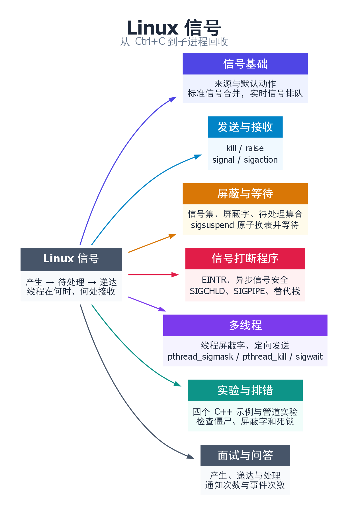

# Linux 信号：从 Ctrl+C 到子进程回收

在 Bash 中运行 `sleep 60`，再按 Ctrl+C。你没有等满一分钟，就又能输入命令了。要解释这个现象，只需弄清两件事：谁通知了 `sleep`，以及收到通知后谁决定让它退出。

前三节从这次按键讲到一个可以自己运行的小实验。会读 C++ 函数和 `while` 循环就能跟上。第四、五节再看子进程退出、管道断开和多线程服务这些实际问题。编译命令放在第六节。进程可以有多个线程，下文说“打断线程”时，指的是让其中一条正在执行的路线暂时转去做别的事。[关联笔记：进程管理与控制](../五.进程管理与控制/1.进程管理与控制.md)

## 一、按下 Ctrl+C 后，谁通知了谁？

在通常的交互式终端中，这件事分三步发生：

1. **Bash 把终端交给前台作业。** 这里只有一个 `sleep` 进程。Bash 还在运行，但它在等 `sleep` 结束。
2. **你按下 Ctrl+C。** 终端驱动向前台进程组发出 `SIGINT`。可以把它理解为一张“用户要求中断”的通知单。若前台运行的是一条管道，管道两端通常都在这一组里，所以一次按键可以通知两端。
3. **`sleep` 退出，Bash 继续。** `SIGINT` 的默认动作是终止进程。`sleep` 沿用这个设置，Bash 等到它退出，才重新显示提示符。

如果换成文本编辑器，同一个 Ctrl+C 也可能只取消当前操作。原因是程序可以事先约定：收到 `SIGINT` 时先调用自己的函数。这种函数叫**信号处理函数**。于是，同样的通知可以有不同结果。少数信号有固定动作，比如 `SIGKILL` 强制终止进程，程序无法拦住它。

除了按键，子进程退出、写管道失败等事件也能产生信号。下面这张表可以留到遇见具体名字时再查。

| 事情怎样发生 | 信号 | 不安装处理函数时通常怎样 |
| --- | --- | --- |
| 终端收到 Ctrl+C / Ctrl+Z | `SIGINT` / `SIGTSTP` | 分别终止 / 暂停前台作业。暂停的进程还可以继续运行 |
| 程序访问无权访问的内存 | `SIGSEGV` | 终止，并可能留下供调试用的进程转储文件（core dump），是否生成取决于系统配置 |
| 子进程退出、停止或继续 | `SIGCHLD` | 默认忽略通知；子进程退出后一般仍需回收 |
| 管道已没有读端，还有人写入 | `SIGPIPE` | 默认终止写入者 |
| 另一个进程请求服务退出 | `SIGTERM` | 默认终止；服务可以捕获它，请主循环收尾 |
| 管理者要求强制终止、暂停或恢复 | `SIGKILL` / `SIGSTOP` / `SIGCONT` | 分别终止、停止、继续。`SIGKILL` 和 `SIGSTOP` 不能捕获、忽略或屏蔽 |

### 发两次信号，处理函数一定会运行两次吗？

继续用“通知单”来想。发出通知的时刻叫**产生**。内核开始执行对应动作的时刻叫**递达**。如果装了处理函数，内核会保存线程当前的执行位置，让这个线程转去运行处理函数。处理函数正常返回，线程才回到刚才的位置继续执行。[Linux 信号概览](https://man7.org/linux/man-pages/man7/signal.7.html)

这两个时刻可以隔开。比如程序正在修改数据，还没改完，不希望中途被处理函数打断。它可以暂时**屏蔽**某个信号。新来的通知会留在内核里，等允许处理时再递达；这段时间，它就叫**待处理信号**。

假设一个单线程程序屏蔽了 `SIGUSR1`（用途由程序自己约定）。这时给它连发两次 `SIGUSR1`，Linux 的记录就像复选框：第一次把“有 `SIGUSR1`”勾上，第二次看到框已经勾上了。等线程解除屏蔽，只会处理一次。如果等第一次处理完再发第二次，就可以处理两次。**合并发生在同一种标准信号已经待处理的这段时间。**

| 你希望接收方知道什么 | 适合哪类信号 | 两次发送都在屏蔽期间时会怎样 |
| --- | --- | --- |
| “配置可能变了，请再读一次” | 标准信号，例如 `SIGUSR1` | 解除屏蔽后检查一次，就能读到最新配置 |
| “两次通知都要处理” | 实时信号，例如程序选用的 `SIGRTMIN` | 两次成功排队的同编号信号会按发送顺序递达 |

有些教材称标准信号为“不可靠信号”，称实时信号为“可靠信号”。这里的差别是待处理的通知能不能逐条排队。实时队列也有上限：用 `sigqueue()` 发送时，可以附带一个整数；队列满了会返回错误 `EAGAIN`，这一次没有排进去。使用多个实时信号编号时，Linux 优先递达编号较小的。选编号用 `SIGRTMIN + n` 并检查不超过 `SIGRTMAX`，避免占用线程库保留的编号。[标准信号与实时信号](https://man7.org/linux/man-pages/man7/signal.7.html)

## 二、怎样发送信号，怎样决定收到后做什么？

### 先约定收到后做什么，再给自己发一次

用一个单线程程序验证上面的过程，比在两个终端之间来回发送更容易看清顺序。实验希望收到 `SIGUSR1` 后继续运行，还能知道“处理函数来过了”。默认动作会让进程退出；设为忽略（`SIG_IGN`）则留不下“处理过”的标记。所以第一步是登记自己的处理函数。

下面摘出[完整实验](signal-examples/pending.cpp)中登记函数的部分。标志 `seen` 初始为 0，处理函数 `remember` 只负责把它改成 1。主程序稍后再读它。

```cpp
static volatile sig_atomic_t seen = 0;
static void remember(int) { seen = 1; }
```

`sig_atomic_t` 适合让这个单线程程序在处理函数里对小标志做一次简单赋值。为什么不直接在函数里打印“收到了”？第四节会看到，处理函数可能恰好打断另一次打印。

主程序用下面几行把 `SIGUSR1` 和 `remember` 对应起来。这一步只登记函数，不会执行它。

```cpp
struct sigaction action{};
action.sa_handler = remember;
sigemptyset(&action.sa_mask);
if (sigaction(SIGUSR1, &action, nullptr) == -1) return fail("sigaction");
```

`sa_handler` 指定要调用谁。`sa_mask` 指定运行这个函数时**还想额外挡住哪些信号**，这里留空。处理期间，当前这种信号默认已经被暂时屏蔽。正常返回时，内核恢复原来的屏蔽设置。以后若想恢复默认动作，把 `sa_handler` 改成 `SIG_DFL` 再登记即可。

`signal(SIGUSR1, remember)` 也能登记函数，但不同 UNIX 实现的历史行为有差异，例如处理一次后是否恢复默认动作。新写的 POSIX 程序通常用 `sigaction()`，它能明确指定处理期间的屏蔽设置和 `sa_flags` 选项。例如，想知道谁发来了信号，可以设 `SA_SIGINFO`，用三参数的 `sa_sigaction` 代替 `sa_handler`。第四节遇到阻塞调用和备用栈时，再看它们各自用到的选项。[signal(2)](https://man7.org/linux/man-pages/man2/signal.2.html) · [sigaction(2)](https://man7.org/linux/man-pages/man2/sigaction.2.html)

### 发送目标怎么选？

登记好了，本实验用 `raise(SIGUSR1)` 给自己发信号。如果信号没有被屏蔽，处理函数会在这次 `raise()` 返回前运行。第三节会故意把它屏蔽住，观察“发了但还没处理”的状态。

如果是管理程序想请另一个服务退出，就用 `kill(pid, SIGTERM)`。`pid` 是目标的进程编号。返回 0 说明发送成功，服务可能还在收尾。目标不存在通常报 `ESRCH`，权限不足报 `EPERM`。

| 调用 | 通知谁 |
| --- | --- |
| `raise(sig)` | 给自己发；多线程程序中，目标是调用它的线程 |
| `kill(pid, sig)`，`pid > 0` | 给指定进程发。多线程时由哪个线程接收，见第五节 |
| `kill(0, sig)` | 给自己所在进程组中有权限发送的进程发，可能包括自己 |
| `kill(-pgid, sig)`，`pgid > 1` | 给编号为 `pgid` 的进程组中有权限发送的进程发 |

只想检查当前是否存在这个进程、是否有权发信号，可以用 `kill(pid, 0)`。这里的 0 放在**信号参数**里，不会发出实际信号。[kill(2)](https://man7.org/linux/man-pages/man2/kill.2.html) · [raise(3)](https://man7.org/linux/man-pages/man3/raise.3.html)

## 三、怎样暂缓处理，又不漏掉唤醒？

### 同一次运行，为什么先看到 pending=1，后来才看到 seen=1？

读[完整实验](signal-examples/pending.cpp)时，从 `main()` 开始。它想把“通知已经到了”和“处理函数已经运行”分开观察，所以要在发送前加一个步骤：暂时屏蔽 `SIGUSR1`。

| 顺序 | 程序做什么 | 哪一点发生了变化 |
| --- | --- | --- |
| ① 写名单 | 用 `sigemptyset(&blocked)` 建空集合，再用 `sigaddset(&blocked, SIGUSR1)` 把这个编号放进去 | `blocked` 是程序里的一个 `sigset_t` 变量。只改变量，线程的行为还没有变化 |
| ② 用名单 | 调用 `sigprocmask(SIG_BLOCK, &blocked, &old_mask)` | 内核把名单里的信号加到线程的**屏蔽字**里，也就是“现在暂缓哪些信号”。`old_mask` 保存修改前的设置 |
| ③ 发送 | 安装上一节的 `remember`，连续两次调用 `raise(SIGUSR1)` | 内核记下有一个 `SIGUSR1` 待处理。处理函数还没运行，程序里的 `seen` 仍为 0 |
| ④ 查看 | 调用 `sigpending(&pending)`，再用 `sigismember(&pending, SIGUSR1)` 检查 | 返回 1 表示这个编号在待处理集合里。查询不会取走信号 |

所以第一行预期输出是 `before: pending=1 seen=0`。左边是**内核**的记录，右边是**程序**的变量，两者回答的是不同的问题。接下来程序要等 `remember` 真正运行，再打印第二行。单纯解除屏蔽可以用 `SIG_UNBLOCK`，但如果还打算睡下来等，就要留意下面这个时间差。[sigprocmask(2)](https://man7.org/linux/man-pages/man2/sigprocmask.2.html) · [sigpending(2)](https://man7.org/linux/man-pages/man2/sigpending.2.html)

### 为什么“先解除屏蔽，再 pause()”会永远睡下去？

回到刚才的实验：`SIGUSR1` 已经在等，而 `seen` 还是 0。假设主程序先检查 `seen`，发现还没处理，于是打算“先解除屏蔽，再调用 `pause()` 睡到信号来”。这段代码可能按以下顺序执行：

| 步骤 | 实际发生的事 |
| --- | --- |
| ① 检查 | 主程序看到 `seen == 0`，进入等待分支 |
| ② 解除屏蔽 | 待处理的 `SIGUSR1` 得以递达。`remember` 把 `seen` 设成 1，然后返回 |
| ③ 睡眠 | 主程序从刚才停下的位置继续，执行分支里的下一句 `pause()`。它等的是**下一次**信号。如果没人再发，它就一直睡 |

信号明明处理过，程序却还在等。问题出在第二步和第三步之间留了空隙，处理函数可以恰好在那里运行。**这种结果取决于执行时机的问题，叫竞态。**

`sigsuspend()` 把“临时解除屏蔽”和“进入等待”做成一个不可分开的操作。下面是[完整实验](signal-examples/pending.cpp)中的等待部分。执行这段代码时，当前屏蔽字里仍有 `SIGUSR1`。

```cpp
sigset_t wait_mask = old_mask;
sigdelset(&wait_mask, SIGUSR1);  // 准备一份允许 SIGUSR1 递达的临时设置
while (!seen) {
    if (sigsuspend(&wait_mask) == -1 && errno != EINTR)
        return fail("sigsuspend");
}
```

再按执行顺序看一遍。检查 `seen` 时，`SIGUSR1` 还被屏蔽。进入 `sigsuspend()` 时，内核才换上 `wait_mask`，允许这次信号递达。通知若早到了，就处理已经在等的那一个；若晚到，就唤醒正在等待的线程。两种情况下都没有“信号已经处理完，程序才去睡”的空隙。

`remember` 把 `seen` 改成 1 后返回。`sigsuspend()` 会恢复调用前的屏蔽字，并返回 -1、设置 `errno = EINTR`，意思是等待被信号打断。这是预期结果。外层还要用 `while` 检查 `seen`，因为别的信号也可能唤醒线程，却不会运行 `remember`。

现在查不到待处理的 `SIGUSR1` 了，程序预期打印 `after:  pending=0 seen=1`。最后用 `sigprocmask(SIG_SETMASK, &old_mask, nullptr)` 恢复实验开始前的设置，整个过程才结束。[sigsuspend(2)](https://man7.org/linux/man-pages/man2/sigsuspend.2.html)

## 四、信号打断程序时，哪些事容易出错？

### 4.1 正在 read 时收到信号：从哪里继续？

上一节的线程本来就在等信号，被唤醒正合它的心意。如果它要等的是**管道里的数据**呢？假设管道暂时为空，写端还开着，线程就在 `read()` 里等。这时来了一个有处理函数的信号，线程先去运行处理函数。函数返回后，程序要看这次读到了什么。

- **还没读到数据。** 对这种管道读取，设置了 `SA_RESTART` 时，Linux 可以让 `read()` 自动继续等。否则它可能返回 -1，`errno` 为 `EINTR`。如果程序仍想读数据，可以重试；如果信号是在请求退出，就该先处理退出请求。
- **已经读到部分数据。** 返回值是正数，表示实际读到的字节数。先处理这些字节，再决定是否继续读。写操作也一样：已经写出去的那一段不能从头再写，否则会重复。
- **换成其他接口。** `SA_RESTART` 只对部分调用有效。例如 `poll()` 仍可能因信号而返回 `EINTR`。带超时的等待如果需要重试，应按原截止时间算还剩多久，否则每次中断都可能把总等待时间拉长。[Linux 的中断和重启规则](https://man7.org/linux/man-pages/man7/signal.7.html)

### 4.2 为什么处理函数里连 printf 都不能随便用？

现在从处理函数这一边看。假设线程正在 `printf()` 里更新输出缓冲区，刚改了一半就被打断。处理函数如果也用 `printf()` 打日志，就可能碰到那块还没更新完的缓冲区。加锁也未必能解决：如果原代码手里拿着锁，处理函数又去等同一把锁，原代码只有等处理函数返回才能放锁，于是谁也走不下去。

能在这种“原代码随时可能被打断”的情况下安全调用，叫**异步信号安全**（AS-Safe）。POSIX 列出了具备这个保证的函数，例如 `write()`、`_exit()` 和 `waitpid()`。`printf()`、`malloc()`、C++ 流、通常需要分配内存的容器操作和常规互斥锁都不适合放在处理函数里。如果处理函数可能改变 `errno`，要在入口保存、返回前恢复，让原代码还能读到自己的错误。

这也解释了实验里为什么只写 `seen = 1`。单线程程序用 `volatile sig_atomic_t` 保存这样一个小标志，等主程序看到它后再打印或清理资源。一个标志只能记录“发生过”，不能统计次数，也不能用来同步多个线程。即使是清单里的 `write()`，往已满的阻塞管道写仍可能卡住。[signal-safety(7)](https://man7.org/linux/man-pages/man7/signal-safety.7.html)

### 4.3 SIGCHLD：收一次通知，为什么要循环 waitpid？

假设父进程创建了 A、B、C 三个子进程，在它解除屏蔽前，三个都退出了。此时有两种记录，数量不同：**内核给每个子进程各留一份退出状态，但待处理的 `SIGCHLD` 可能只有一个。** 如果父进程收到通知后只调用一次 `waitpid()`，也许只取走了 A 的结果。B、C 已不运行，退出记录却一直没人领取，这就是僵尸进程。

因此处理函数要反复问内核：“还有哪个子进程已经退出？”调用 `waitpid(-1, &status, WNOHANG)` 时，第一个参数 `-1` 表示可以领取任意子进程的结果。最后一个参数 `WNOHANG` 表示只取现成的结果。如果 C 还在运行，处理函数就能先返回，不会卡在那里等 C 退出。

例如，A 和 B 已退出，C 还在运行。两次调用可能依次返回 A 和 B 的 PID，第三次返回 0，处理函数就结束这轮回收。后来 C 退出，父进程再收到通知，再来取 C 的结果。A、B 谁先被取走不影响结果。[完整回收实验](signal-examples/reap.cpp)

| 返回结果 | 接下来做什么 |
| --- | --- |
| 大于 0 | 是刚回收的子进程 PID。记下结果，继续取下一个；需要退出码时先检查 `WIFEXITED(status)` |
| 0 | 还有孩子，但现在没有可取的退出状态。离开处理函数，等下次通知 |
| -1，`EINTR` | 本次等待被打断，重试 |
| -1，`ECHILD` | 已没有可等待的孩子，结束循环。其他错误要记录并交给主流程处理 |

实验在创建子进程前就屏蔽 `SIGCHLD` 并安装处理函数。即使孩子刚创建就退出，父进程也能先数清成功创建了几个，再用第三节的 `sigsuspend()` 等待。循环什么时候结束，看的是**已回收的数量是否等于成功创建的数量**。服务里如果有多个线程，应约定由谁回收，否则一个线程可能取走另一个线程正在等的退出状态。

Linux 上若明确不需要子进程的退出状态，可以显式设 `SIGCHLD` 为 `SIG_IGN`，或设置 `SA_NOCLDWAIT`，让内核自动回收。保持默认设置时，虽然程序不会因 `SIGCHLD` 执行处理函数，却仍要用 `waitpid()` 回收退出的子进程。[wait(2)](https://man7.org/linux/man-pages/man2/waitpid.2.html) · [sigaction(2)](https://man7.org/linux/man-pages/man2/sigaction.2.html)

### 4.4 SIGPIPE：为什么写入失败后，连错误日志都没打印？

在 `yes | head -n 1` 里，`yes` 不断输出字母 y，`head` 只取第一行就退出。等管道的最后一个读端关闭，`yes` 再写时，内核会给它发 `SIGPIPE`。默认动作是终止进程，写调用后面那句“打印错误”的代码自然没有机会运行。

如果程序要自己处理这次失败，可以忽略 `SIGPIPE`。这时 `write()` 返回 -1，`errno` 是 `EPIPE`，程序就知道该停写了。注意条件是**所有读端都关闭**。要是别的进程手里还留着一个读端，写入者可能继续写，直到管道写满后阻塞。[管道笔记](../七.进程间通信%20IPC/1.pipe匿名管道(亲缘进程).md) · [pipe(7)](https://man7.org/linux/man-pages/man7/pipe.7.html)

流式 socket 也可能遇到这个问题，不过“对端刚关闭”并不保证下一次写立刻失败。TCP 可能先把数据收进本机缓冲，之后才报告 `EPIPE` 或 `ECONNRESET`，具体取决于连接状态。Linux 网络服务可以用 `send(fd, buf, len, MSG_NOSIGNAL)` 只抑制这次发送产生的 `SIGPIPE`，仍要检查返回值。整个进程忽略 `SIGPIPE` 的影响范围更广；普通管道的 `write()` 没有这个按次设置的参数。[send(2)](https://man7.org/linux/man-pages/man2/send.2.html)

### 4.5 sigaltstack：栈满了，处理函数还能在哪儿运行？

上面几节都默认处理函数能正常开始运行。可每次函数调用都需要栈空间。如果递归太深，把线程平时使用的栈耗尽了，再发生 `SIGSEGV`，内核连安排处理函数运行的空间都可能找不到。这就是为什么“明明装了处理函数，却连一行诊断都没打印”。

要在这种情况下留下简短诊断，需要在线程还正常时先做两件事：

1. **准备空间。** 分配一块足够大的内存，用 `sigaltstack()` 告诉内核“这个线程还有一块备用栈”。每个需要保护的线程都要设置自己的备用栈，使用期间不能释放它。
2. **指定用途。** 用 `sigaction()` 安装处理函数，并加上 `SA_ONSTACK`，让内核递达这个信号时使用备用栈。只准备空间，内核不知道哪个处理函数要用；只设标志却没准备空间，线程仍会用普通栈。

[替代栈实验](signal-examples/altstack.cpp)在堆上准备备用栈，然后用 `raise(SIGSEGV)` 测试已设置好的处理函数。函数只用 `write()` 尝试输出一行文字，就用 `_exit(1)` 退出。实验没有制造实际的栈溢出。真实故障中，备用栈能给诊断代码提供空间，但原来的栈仍然满着，从处理函数返回可能再次触发同一故障。示例主动退出，也就不会按默认动作生成 core dump。[sigaltstack(2)](https://man7.org/linux/man-pages/man2/sigaltstack.2.html)

## 五、多线程：究竟哪个线程接收信号？

假设一个服务只有 A、B 两个线程，它们在同一进程里工作。程序为 `SIGUSR1` 装了处理函数。现在 A 暂时屏蔽了这个信号，B 允许处理。分别用下面两种方式发送，会看到不同结果。

| 怎么发 | 谁可以接收 | 在这个例子里会怎样 |
| --- | --- | --- |
| `kill(pid, SIGUSR1)`，发给整个进程 | 内核可以选一个没有屏蔽它的线程 | A 屏蔽了，B 可以运行处理函数。如果两者都屏蔽，通知可以留在进程里等待 |
| `pthread_kill(A, SIGUSR1)`，点名发给线程 A | 只有 A | 即便 B 此时空闲，也不能代收。通知留给 A，等它解除屏蔽或主动领取 |

为什么 B 可以和 A 有不同的表现？因为“这个信号来了要调用哪个函数”是**整个进程**的设置，而“现在允不允许它打断我”由**每个线程各自的屏蔽字**决定。新线程起初继承创建者当时的屏蔽字，之后各改各的。

如果把信号换成默认终止程序的 `SIGTERM`，即使用 `pthread_kill()` 点名发给 A，默认动作也会结束整个进程。反过来，某个线程执行指令时发生的内存访问故障，会引发针对出错线程的 `SIGSEGV`；不能让另一个空闲线程代为处理这次故障。[pthread_kill(3)](https://man7.org/linux/man-pages/man3/pthread_kill.3.html) · [signal(7)](https://man7.org/linux/man-pages/man7/signal.7.html)

如果服务希望只有一个线程接收退出请求，还要把日志写在普通代码里，可以这样安排：

1. **先屏蔽，再创建。** 主线程用 `pthread_sigmask()` 屏蔽 `SIGTERM`，然后再创建工作线程。新线程继承这份屏蔽字，于是关停信号不会突然打断某个工作线程。反过来，先创建再屏蔽，只会改到主线程自己的设置。
2. **安排一个线程等信号。** 它同样保持屏蔽，调用 `sigwait()` 专门等待 `SIGTERM`。这里容易疑惑：既然屏蔽了，怎么还能收到？屏蔽挡住的是信号突然打断代码；`sigwait()` 是线程主动向内核领取通知。信号已经在等，它就直接取走，否则就睡到信号来。
3. **收到后安排退出。** `sigwait()` 返回后，等待线程照常往下执行，可以记日志、拿锁，通知工作线程结束手头的任务。这段代码没有打断谁，不受异步处理函数的那些限制。

[线程实验](signal-examples/thread_signal.cpp)用 `pthread_kill(receiver, SIGUSR1)` 明确把信号发给等待线程。即使它还没走到 `sigwait()`，这次信号也会为它保留。服务从外部接收的 `SIGTERM` 则通常是发给整个进程的。`pthread_sigmask()`、`pthread_kill()` 和 `sigwait()` 都直接返回错误码，排错时要检查返回值。[pthread_sigmask(3)](https://man7.org/linux/man-pages/man3/pthread_sigmask.3.html) · [sigwait(3)](https://man7.org/linux/man-pages/man3/sigwait.3.html)

## 六、动手验证与排错

以下示例面向 Linux、glibc 和支持 C++11 的 g++。例如在 Ubuntu 22.04/24.04 上，可用 `sudo apt install build-essential` 安装编译器。进入本文同目录的 [signal-examples](signal-examples/) 后执行：

```bash
g++ -std=c++11 -Wall -Wextra -pedantic pending.cpp -o pending
g++ -std=c++11 -Wall -Wextra -pedantic reap.cpp -o reap
g++ -std=c++11 -Wall -Wextra -pedantic altstack.cpp -o altstack
g++ -std=c++11 -Wall -Wextra -pedantic -pthread thread_signal.cpp -o thread_signal
```

| 运行命令 | Linux 上的预期结果 | 它能说明什么 |
| --- | --- | --- |
| `./pending` | 先 `before: pending=1 seen=0`，再 `after:  pending=0 seen=1` | 屏蔽期间信号可以待处理，临时解除屏蔽后才运行处理函数。标志只表示处理过，不统计调用次数 |
| `./reap` | 正常为 `started=3 reaped=3` | 三个孩子都有退出记录。通知次数受调度影响，程序不依赖恰好只收到一次 |
| `./altstack; echo $?` | 打印 `handler on alternate stack`，退出码为 1 | 预先设置的处理函数主动结束进程。此处的 1 是示例设计的结果 |
| `./thread_signal` | `receiver got SIGUSR1: yes` | 信号由指定线程用 `sigwait()` 取走，无需异步处理函数 |

第四节的管道例子也可以直接在 Linux Bash 中试。运行下面两行，预期先看到一个 `y`，再看到 `141 0`。第二行的两个数字依次对应 `yes` 和 `head`：`head` 成功读到一行，退出码是 0；`yes` 继续写时收到 13 号信号 `SIGPIPE`，Bash 用 128 + 13 表示这种退出方式。要紧接着读取 `PIPESTATUS`，下一条命令会更新它。

```bash
yes | head -n 1
printf '%s\n' "${PIPESTATUS[*]}"
```

这些是 Linux 上的**预期行为**。当前编辑环境没有可运行的 Linux/WSL，未把结果标成实测。实验中的孩子立即退出，替代栈只用于一次简短诊断；服务中要考虑任务寿命、线程退出顺序和异常记录需求。

| 遇到的现象 | 先检查什么 |
| --- | --- |
| 一发 `SIGUSR1` 程序就退出 | 它默认终止进程。检查是否在安装处理方式前就发送了，或是否有线程尚未屏蔽它 |
| 程序一直挂着 | 看 `sigsuspend` 的临时集合里是否仍包含目标信号；看 `sigwait` 等待的信号是否发给了别的线程 |
| 子进程退出后仍显示 `Z` | 检查每次通知是否循环取完退出记录，是否提前因 `EINTR` 离开，以及谁负责回收 |
| 想查到底哪个线程屏蔽了信号 | 在 Linux 的 `/proc/<pid>/task/<tid>/status` 查看 `SigBlk`（该线程屏蔽哪些信号）、`SigPnd`（专门发给该线程、仍在等待的信号）和 `ShdPnd`（发给整个进程、仍在等待的信号）。每一位对应一个信号编号，不能用它统计发送次数 |
| 处理函数偶尔卡死 | 检查日志、分配内存、互斥锁。把这些操作移回主流程，再看处理函数里的写操作是否可能阻塞 |

## 七、面试时怎么讲？

问“Linux 信号是怎么处理的”，可以这样答：

> 我会用父进程等孩子退出举例。一个孩子退出后，内核给父进程发 `SIGCHLD`。如果父进程暂时屏蔽了它，通知可以先等着。等到处理函数运行时，另外两个孩子可能也退出了，所以我不能按收到几次信号来数孩子，而要循环调用 `waitpid()`，把已经退出的孩子逐个回收。处理函数可能在原代码执行到一半时插进来，我会把日志留到主流程再写。如果是多线程服务，还可以让所有线程先屏蔽这个信号，由专门的线程用 `sigwait()` 接收，再做回收和记录。

## 八、Q&A（常见问题与解答）

**Q1：既然实时信号会排队，为什么不全部改用实时信号？**

假设信号只是提醒服务重读配置。配置一连改了三次，服务通常只关心磁盘上的最终版本，读一次就够。如果每次通知都代表一项独立任务，合并就会漏掉任务；这时才需要排队，还得处理队列已满、发送失败的情况。

**Q2：处理函数装好了，为什么还要先屏蔽再检查条件？**

安装处理函数解决“收到后做什么”；屏蔽解决“现在能不能打断我”。如果先检查再直接睡，处理函数可能恰好在睡前运行完。检查期间保持屏蔽，再用 `sigsuspend` 一步换表并等待，才关掉这段空隙。

**Q3：收到一个 SIGCHLD 就能断定有一个孩子刚退出吗？**

不一定。一个孩子暂停或继续运行，也可能让父进程收到 `SIGCHLD`。反过来，两个孩子都退出，父进程也可能只收到一次通知。只关心退出时，可用 `SA_NOCLDSTOP` 跳过暂停和继续的通知；究竟谁退出了，看 `waitpid()` 返回的 PID。

**Q4：给线程 A 发 SIGTERM，为什么其他线程也停了？**

指定 A，只决定由哪个线程接收信号。处理方式由整个进程共享。若采用默认的终止动作，整个进程一起退出。只想让某个工作线程结束时，可以设置受同步保护的退出条件并唤醒它，让线程正常返回。

**Q5：异步信号安全和线程安全有什么区别？**

线程 A 和 B 同时打印时，即使 B 暂时等锁，A 还可以继续运行并把锁放开。如果 A 自己拿着锁时被信号打断，处理函数再去等它，谁来放锁？A 得等处理函数返回才能往下走，这就可能僵住。一个函数能安全地供多个线程调用，并不能保证它也能放进信号处理函数。

**Q6：用了替代栈，就能从栈溢出继续执行吗？**

替代栈只给处理函数提供落脚的空间。原线程的栈仍然耗尽，出错指令也还在那里。通常目标是留下有限的故障信息并终止进程。

## 九、思维导图总结

```text
Linux 信号：从 Ctrl+C 到子进程回收
├── 一、信号基础
│   ├── 来源、默认动作、产生与递达
│   └── 标准信号可能合并，实时信号可排队
├── 二、发送与接收
│   ├── kill 选进程或组，raise 发给自己
│   └── sigaction 选择处理函数、屏蔽集和标志
├── 三、屏蔽与等待
│   ├── 信号集 → 屏蔽字 → 待处理集合
│   └── sigsuspend 原子换表并等待
├── 四、被信号打断时
│   ├── EINTR、重启、异步信号安全
│   └── SIGCHLD 回收、SIGPIPE 写失败、替代栈诊断
├── 五、多线程
│   ├── 共享处理方式，每线程有自己的屏蔽字
│   └── pthread_kill 定向发送，sigwait 同步接收
├── 六、验证与排错
│   ├── 四个 C++ 实验与管道实验
│   └── 屏蔽字、待处理信号、僵尸与死锁
└── 七、八、面试与 Q&A
    ├── 从产生、递达到处理讲清一次通知
    └── 区分通知与计数、异步处理与同步等待
```



[Graphviz 源文件](signal-assets/mindmap.dot)
