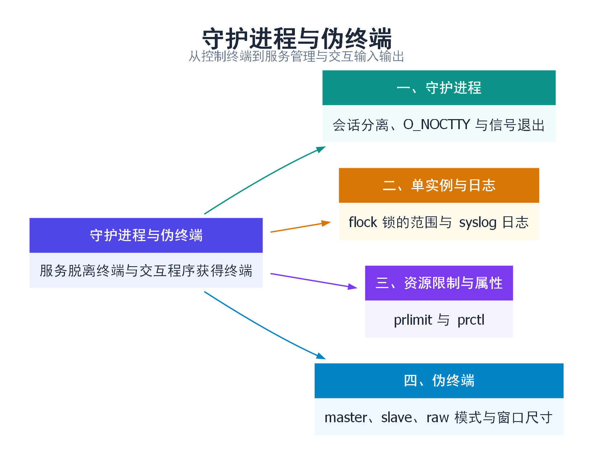

# Linux 守护进程与伪终端

关掉启动程序的终端后，后台服务怎样继续运行？通过 SSH 操作远程 shell 时，按键又是怎样传到远端的？理解这两个场景，要先弄清进程怎样关联控制终端。

- **守护进程（一至三节）** 从终端里启动一个长期运行的服务，解释传统守护进程怎样脱离终端，以及如何处理单实例、日志、退出和资源限制。
- **伪终端（第四节）** 从一次 SSH 按键出发，沿着 PTY 的两端追踪输入和输出，再看 Ctrl+C 和窗口尺寸变化怎样传到前台程序。

快速复习可先读第一、四节，再看文末 Q&A。想动手时，可分别运行第二节的守护进程示例和第四节的 PTY 示例。

阅读前了解 fd、标准输入输出及 SIGHUP、SIGTERM 的基本含义即可。需要时可回顾 [文件描述符与重定向](../二.文件IO/1.文件IO.md#control) 和 [Linux 信号](../六.信号/1.信号.md)。

## 一、守护进程为什么要脱离终端？

假设你从 SSH shell 启动一个长期处理任务的程序。把它放到后台，只表示 shell 不再等待它完成。它仍可能属于原会话，标准输入输出也仍可能连着终端。终端断开后，相关进程可能收到 SIGHUP，程序的输出也可能失去去处。

理解传统启动流程前先分清三种关系。**会话**组织一个或多个进程组，并可拥有一个控制终端。**进程组**组织一批作业进程，终端可以向前台进程组发送信号。**文件描述符**引用已打开的终端或文件，即使进程已脱离控制终端，继承来的 fd 仍可保持打开。

| 传统步骤 | 解决的问题 |
| --- | --- |
| 第一次 `fork()`，父进程用 `_exit()` 结束 | 新子进程的 PID 不等于继承的进程组 ID，因此它可以调用 `setsid()`。进程组组长直接调用会失败 |
| 子进程调用 `setsid()` | 创建新会话和新进程组，并脱离旧控制终端。调用者成为新会话首进程 |
| 再次 `fork()`，中间进程退出 | 最终子进程继续留在新会话里，但已不是会话首进程，避免以后打开终端设备时意外获得控制终端 |
| `chdir("/")` 或切换到明确的服务工作目录 | 避免一直引用启动目录所在的挂载点。相对路径的含义也会随之改变 |
| 处理继承的 fd，重定向 0、1、2 | 关闭无关 fd，保留显式交接的 fd。输入可接 `/dev/null` 并立即读到 EOF，输出和错误可接日志或 `/dev/null` |

`dup2(new_fd, STDOUT_FILENO)` 改的是 fd 1 指向的对象。仅调用 `setsid()` 不会进行这一步。真实服务还需要明确 umask、权限、退出与就绪通知。两次 fork 的父进程退出只代表派生流程开始，不能用来确认服务已经就绪。[daemon(7)](https://man7.org/linux/man-pages/man7/daemon.7.html)

| 场景 | 常用做法 |
| --- | --- |
| 系统服务由 systemd 等管理器托管 | 程序保持前台运行，让管理器跟踪主进程、收集日志并按配置重启 |
| 兼容要求程序自行脱离终端的旧式环境 | 使用传统派生流程，并补齐就绪通知及资源清理 |
| 临时让当前任务在终端关闭后继续 | 用 `nohup` 调整 SIGHUP 的处理方式，并安排输入、输出和错误流 |

GNU `nohup` 在执行目标命令前把 SIGHUP 设为忽略。目标程序若没有自行修改信号处理方式，就会继承该设置。GNU 工具检测到标准流连着终端时会相应调整它们，例如把终端上的标准输出追加到 `nohup.out`。Shell 的 `&` 才负责后台执行。任务仍可能因其他信号或服务管理策略退出。[GNU nohup 手册](https://www.gnu.org/software/coreutils/manual/html_node/nohup-invocation.html)

#### 打开终端设备时，什么时候需要 O_NOCTTY？

例如服务要读取串口传感器，它只需要一个能读写设备的 fd。在 Linux 上，**没有控制终端的会话首进程**打开尚未被其他会话用作控制终端的终端设备时，可能让该设备成为整个会话的控制终端。刚调用 `setsid()` 的进程恰好是这种会话首进程。获得控制终端后，设备挂断可能带来 SIGHUP。第二次 fork 让最终子进程失去会话首进程身份，从结构上避免这条自动获取路径。

POSIX 的 `O_NOCTTY` 可以在打开终端或串口时明确禁止这次 `open()` 为进程取得控制终端。标志只影响这次打开，不会解除既有控制终端，也不会改变设备的读写权限。反过来，PTY 子进程若需要把 slave 作为控制终端，应有意建立这个关系，例如使用下文的 `forkpty()`。[open(2)](https://man7.org/linux/man-pages/man2/open.2.html) · [credentials(7)](https://man7.org/linux/man-pages/man7/credentials.7.html)

#### systemd 为什么让服务留在前台？

前台运行时，systemd 可以直接跟踪 `ExecStart=` 启动的主进程，按单元设置管理标准流、把输出交给 journald，并负责停止与重启。传统程序如果自行派生子进程再退出，`Type=forking` 会把启动进程退出作为启动阶段完成的信号。此时建议用 `PIDFile=` 明确主进程身份。缺少 PID 文件时，systemd 可能猜测主 PID，进程结构复杂时可能猜错。PID 文件也要由服务正确更新，避免遗留记录干扰识别。

新服务可以保持前台，使用 `Type=simple` 或 `Type=exec`。前者在派生主进程后就继续启动后续单元，后者等到程序成功执行，因此能报告可执行文件不存在等启动错误。如果依赖方需要等到服务真正就绪，可使用 `Type=notify` 并在初始化完成后发送就绪通知。容器入口也通常保持前台，让容器运行时跟踪进程并投递停止信号。[systemd.service](https://www.freedesktop.org/software/systemd/man/latest/systemd.service.html)

## 二、怎样防止启动两个实例，并记录后台错误？

先查 PID 文件再写有竞态。两个实例都可能看到文件不存在，随后同时启动。让两个进程对同一个锁文件执行 `flock(fd, LOCK_EX | LOCK_NB)`，由内核决定谁先取得排他锁。Linux 的 flock 是协作式锁，程序需要统一锁路径和加锁规则。应在本地文件系统的受控目录使用固定文件，运行期间保持锁 fd 打开。删除锁文件会让后来者创建另一个 inode，可能与原实例各锁各的。仅把 PID 写入文件可以辅助排查，单实例保证来自锁。[flock(2)](https://man7.org/linux/man-pages/man2/flock.2.html)

如果两个实例分别运行在不同机器上，先确认锁到底在哪个范围生效。Linux 2.6.11 及更早的 NFS 客户端只在本机处理 `flock`。从 2.6.12 起，Linux NFS 客户端可用覆盖整个文件的字节范围锁模拟 `flock`，此时排他锁要求文件以可写方式打开。服务器能力和挂载选项仍会影响结果，例如 `local_lock=flock` 会把这类锁限制在客户端本机。共享目录里看见同一个文件名，不能据此确认两台机器会互斥。[flock(2)](https://man7.org/linux/man-pages/man2/flock.2.html) · [nfs(5)](https://man7.org/linux/man-pages/man5/nfs.5.html)

单机服务可用本地锁。多机高可用则要明确谁能接管以及故障时怎样阻止旧实例继续写。即使共享存储支持跨机加锁，也要验证断连和恢复行为。若使用 etcd 等服务的租约，旧实例可能在租约过期后恢复执行。可以让写入端校验随接管递增的令牌，拒绝旧实例的操作。若需求仅是某条业务记录不可重复，数据库唯一约束可直接保证这条规则。

后台服务通常没有人在终端上看报错。可用 `syslog(priority, format, ...)` 提交日志，再由系统配置决定日志去哪。

| 接口 | 用途 |
| --- | --- |
| `openlog("job-daemon", LOG_PID, LOG_DAEMON)` | 设置日志标识、附带 PID，并用 facility 标记日志来源类别 |
| `setlogmask(LOG_UPTO(LOG_INFO))` | 允许 INFO 及更紧急的等级，过滤 DEBUG。可用 `setlogmask(0)` 查询当前掩码 |
| `syslog(LOG_ERR, "%s", message)` | 发送错误日志。固定格式字符串，把外部文本当作数据传入 |
| `closelog()` | 关闭库维护的日志连接。进程退出也会释放相关资源 |

日志是否可查询以及保留多久取决于本机日志服务和配置。采用 journald 时可尝试 `journalctl -t job-daemon`。[syslog(3)](https://man7.org/linux/man-pages/man3/syslog.3.html)

### 完整示例：单实例与日志

在 Linux、glibc 和 GCC 11 或更新版本的 C++17 环境下，将下面保存为 `service.cpp`。Debian/Ubuntu 可安装 `build-essential`。默认保持前台，也可用 `--daemon` 观察传统流程。程序收到 SIGTERM 或 SIGINT 后进入清理流程。用自己拥有、其他用户不可写的工作目录，避免锁路径被其他用户替换。

处理函数只修改 `volatile sig_atomic_t` 标志。主流程在检查标志前屏蔽停止信号，再用 `sigsuspend()` 原子地解除屏蔽并等待，避免信号恰好在检查之后、等待之前到达而使进程一直睡下去。日志、关闭连接和清理缓冲区等工作应放在主流程。[sigsuspend(2)](https://man7.org/linux/man-pages/man2/sigsuspend.2.html)

```cpp
#include <cerrno>
#include <cstdio>
#include <cstring>
#include <fcntl.h>
#include <signal.h>
#include <sys/file.h>
#include <sys/stat.h>
#include <syslog.h>
#include <unistd.h>

static volatile sig_atomic_t running = 1;

static void stop(int) {
    running = 0;
}

static void detach() {
    pid_t pid = fork();
    if (pid < 0) { perror("fork"); _exit(1); }
    if (pid > 0) _exit(0);
    if (setsid() < 0) { perror("setsid"); _exit(1); }
    pid = fork();
    if (pid < 0) { perror("fork"); _exit(1); }
    if (pid > 0) _exit(0);
    if (chdir("/") < 0) { perror("chdir"); _exit(1); }
    int fd = open("/dev/null", O_RDWR);
    if (fd < 0) { perror("open /dev/null"); _exit(1); }
    for (int target = 0; target <= 2; ++target) {
        if (dup2(fd, target) < 0) { perror("dup2"); _exit(1); }
    }
    if (fd > 2) close(fd);
}

int main(int argc, char** argv) {
    if (argc < 2 || argc > 3 || argv[1][0] != '/' ||
        (argc == 3 && std::strcmp(argv[2], "--daemon") != 0)) {
        std::fprintf(stderr, "usage: %s /absolute/lock/path [--daemon]\n", argv[0]);
        return 2;
    }
    sigset_t stop_signals, wait_mask;
    sigemptyset(&stop_signals);
    sigaddset(&stop_signals, SIGTERM);
    sigaddset(&stop_signals, SIGINT);
    if (sigprocmask(SIG_BLOCK, &stop_signals, &wait_mask) < 0) {
        perror("sigprocmask");
        return 1;
    }
    sigdelset(&wait_mask, SIGTERM);
    sigdelset(&wait_mask, SIGINT);
    struct sigaction action{};
    action.sa_handler = stop;
    sigemptyset(&action.sa_mask);
    if (sigaction(SIGTERM, &action, nullptr) < 0 ||
        sigaction(SIGINT, &action, nullptr) < 0) {
        perror("sigaction");
        return 1;
    }
    umask(077);
    int lock_fd = open(argv[1], O_RDWR | O_CREAT | O_CLOEXEC, 0600);
    if (lock_fd < 0) { perror("open lock"); return 1; }
    // 标准流可能在启动前就已关闭，锁不能占用随后会被重定向的 fd。
    if (lock_fd <= 2) {
        int saved = fcntl(lock_fd, F_DUPFD_CLOEXEC, 3);
        if (saved < 0) { perror("duplicate lock fd"); return 1; }
        close(lock_fd);
        lock_fd = saved;
    }
    if (flock(lock_fd, LOCK_EX | LOCK_NB) < 0) {
        if (errno == EWOULDBLOCK) std::fputs("already running\n", stderr);
        else perror("flock");
        close(lock_fd);
        return 1;
    }

    // fork 继承打开文件描述。最终子进程继续持锁。
    if (argc == 3) detach();
    openlog("job-daemon", LOG_PID, LOG_DAEMON);
    setlogmask(LOG_UPTO(LOG_INFO));
    syslog(LOG_INFO, "started");
    if (argc == 2) {
        std::printf("ready pid=%ld\n", static_cast<long>(getpid()));
        std::fflush(stdout);
    }
    while (running) sigsuspend(&wait_mask);
    // 正式服务在这里停止接收任务，按业务要求收尾。
    syslog(LOG_INFO, "finished");
    closelog();
    // 关闭 fd 释放锁。保留锁文件，退出时也不要 unlink(argv[1])。
    return close(lock_fd) == 0 ? 0 : 1;
}
```

```bash
g++ -std=c++17 -Wall -Wextra service.cpp -o service
# 终端 A：等到打印 ready pid=...
./service "$PWD/service.lock"
```

在终端 B 进入同一目录并再次运行同一条命令，预期看到 `already running`。随后在终端 A 按 Ctrl+C，或在终端 B 用 `kill -TERM PID` 发送 SIGTERM，其中 PID 替换为 A 打印的数字。预期 A 正常退出，日志出现 `finished`，此时可再次启动。用 `--daemon` 观察双 fork 时，从启动日志的 PID 定位最终实例，再向它发送 SIGTERM。

释放锁前先完成资源清理，避免另一实例抢先启动。示例没有业务任务，清理仅涉及日志与锁。如果进程收到 SIGKILL，处理函数无法执行。若 `open lock` 失败，检查目录存在且可写。若日志查不到，检查日志服务和读取权限。正式服务还需明确关闭无关的继承 fd，并把子进程启动结果反馈给调用方。

## 三、运行中的资源限制和进程属性怎样调整？

服务打开文件或接受连接时可能遇到 `EMFILE`。这时可以先查询 `RLIMIT_NOFILE`，它限制本进程能使用的 fd 编号范围，上界值比允许的最大 fd 大 1。软限制是当前生效的值，硬限制是普通进程提高软限制时的上限。降低限制不会关闭已打开的 fd。

Linux 的 `prlimit(pid, resource, new_limit, old_limit)` 可以在同一次调用里获取旧值和设定新值。PID 为 0 表示自己，传空的 `new_limit` 表示只查询。调整其他进程需满足身份或能力要求，提高硬限制也受权限和内核上限约束。[getrlimit / prlimit(2)](https://man7.org/linux/man-pages/man2/getrlimit.2.html)

```bash
# Linux 的 util-linux 工具。查询当前 shell 的限制。
prlimit --pid "$$" --nofile
# 只修改新命令的软限制，保留硬限制。
prlimit --nofile=64: -- sh -c 'ulimit -Sn'
```

第二条在硬限制至少为 64 时预期打印 `64`。若设置失败，检查现有硬限制和权限。

`prctl()` 是 Linux 的进程或线程属性接口，含义由操作码决定。例如 `PR_SET_NAME` 设置调用线程的名字，`PR_SET_PDEATHSIG` 请求父线程终止时通知自己。它与 `prlimit()` 分工不同。调整 fd、栈等资源额度应查对应的 `RLIMIT_*`。父退出信号也需考虑父线程已经退出的竞态，并且该设置在 fork 得到的子进程中会清除。[prctl(2)](https://man7.org/linux/man-pages/man2/prctl.2.html)

## 四、为什么 SSH 和终端模拟器需要 PTY？

如果把 shell 的输入输出只接到管道，字节可以传输，但 shell 看到的 fd 不是终端。程序可能改变交互方式。普通管道也没有终端行规程提供的回显、行编辑、前台作业信号等行为。

**伪终端（PTY）是一对相连的终端端点。** 终端模拟器或 SSH 服务端操作 master，shell 或交互程序把标准流接到 slave，通常还把 slave 设为控制终端。

| 动作 | 字节或事件怎样走 |
| --- | --- |
| 用户键入命令 | 终端程序写 master → slave 的终端行规程处理 → shell 从 slave 读 |
| shell 输出文字 | shell 写 slave → 终端程序从 master 读 → 本地绘制或通过 SSH 发回客户端 |
| 用户按 Ctrl+C | 通常写入终端的中断字符。启用 `ISIG` 等相应设置时，终端向前台进程组发送 SIGINT |
| 窗口变大 | 持有 PTY 的程序可用 `TIOCSWINSZ` 更新尺寸，内核可通知前台进程组 SIGWINCH |

#### 调整窗口时，vim 怎样知道该重画？

终端模拟器发现窗口大小变化后，把新行列数通过 `ioctl(master, TIOCSWINSZ, &size)` 写入 PTY。SSH 客户端通常先发现本地终端的尺寸变化，再通过连接把新尺寸发给服务端，由服务端更新远程 PTY。尺寸变化时，内核向该终端的**前台进程组**发送 SIGWINCH。此时前台任务可能是 vim 或 htop，程序可以在收到信号后重新用 `TIOCGWINSZ` 查询尺寸并重画。如果代理只转发字节，程序查询到的行列数可能仍是旧值。下文示例只做一轮固定交互，因此没有实现窗口事件转发。[TIOCGWINSZ / TIOCSWINSZ](https://man7.org/linux/man-pages/man2/TIOCSWINSZ.2const.html)

规范模式下，行规程通常攒到换行再交给读取者。终端应用可以调整这些属性，例如关闭回显或启用非规范模式。SSH 是否申请 PTY 与会话用途和选项有关，交互登录常用，机器读取命令输出时通常可直接用普通字节流。[pty(7)](https://man7.org/linux/man-pages/man7/pty.7.html) · [termios(3)](https://man7.org/linux/man-pages/man3/termios.3.html)

#### 终端代理为什么常对本地 TTY 使用 raw 模式？

在交互式 SSH 中，一次按键可能先经过本地 TTY 的行规程，再经过远程 PTY slave 的行规程。若两端都按规范模式处理，本地可能先缓存整行，导致方向键序列或逐键输入不能及时到达远端。如果本地还启用了 `ISIG`，Ctrl+C 和 Ctrl+Z 通常由本地终端解释成发给本地前台进程组的信号。键入的字节是否被转换、回显或解释为信号，取决于各自的终端标志，单独清掉 `ICANON` 只会关闭按行处理。

需要逐键转发时，代理先通过 `tcgetattr()` 保存本地 TTY 设置，把它复制一份并用 `cfmakeraw()` 修改副本，再调用 `tcsetattr()` 应用。glibc 的 `cfmakeraw()` 会关闭规范模式、回显、终端信号字符处理及多种输入输出转换。Ctrl+C 的字节便可传到远端 master，由远程 slave 按它自己的设置决定是否产生 SIGINT。方向键转义序列也能及时交给远端程序解析。

这里切换的是代理面对的**本地 TTY**。远端 shell 可以继续使用规范模式，vim 也可以按需调整远端 slave。前端没有本地 TTY 时，例如输入来自管道，便无需切换本地终端模式。使用 raw 模式的代理要在正常退出及可处理的停止路径上恢复保存的设置。下文例子改变的是 slave 的规范模式和回显，只演示一行输入。[termios(3)](https://man7.org/linux/man-pages/man3/termios.3.html)

### 完整示例：父进程用 master 给子进程输入

在同一 Linux 环境下，将示例保存为 `pty_demo.cpp`。glibc 提供的 `forkpty()` 把创建 PTY 与派生子进程结合起来。父进程拿到 master，子进程的标准流接到 slave。示例固定使用规范输入并关闭回显，避免把输入回显误认为子进程的应答。

```cpp
#include <cerrno>
#include <cstdio>
#include <pty.h>
#include <sys/wait.h>
#include <termios.h>
#include <unistd.h>

static bool print_line(int fd) {
    for (int i = 0; i < 128; ++i) {
        char ch;
        ssize_t n;
        do { n = read(fd, &ch, 1); } while (n < 0 && errno == EINTR);
        if (n != 1) return false;
        if (ch != '\r') std::putchar(ch);
        if (ch == '\n') return true;
    }
    return false;
}

int main() {
    int master = -1;
    pid_t child = forkpty(&master, nullptr, nullptr, nullptr);
    if (child < 0) { perror("forkpty"); return 1; }
    if (child == 0) {
        // 先配置 slave，再发出 ready。父进程看到 ready 后才发送输入。
        termios settings{};
        if (tcgetattr(STDIN_FILENO, &settings) < 0) _exit(1);
        settings.c_lflag |= ICANON;
        settings.c_lflag &= ~ECHO;
        if (tcsetattr(STDIN_FILENO, TCSANOW, &settings) < 0) _exit(1);
        std::puts("ready");
        std::fflush(stdout);
        char line[64];
        if (!std::fgets(line, sizeof line, stdin)) _exit(1);
        std::printf("child received: %s", line);
        std::fflush(stdout);
        _exit(0);
    }

    bool ok = false;
    if (print_line(master)) {
        ssize_t n;
        do { n = write(master, "hi\n", 3); } while (n < 0 && errno == EINTR);
        ok = n == 3 && print_line(master);
    }
    close(master);
    int status = 0;
    pid_t waited;
    do { waited = waitpid(child, &status, 0); } while (waited < 0 && errno == EINTR);
    return ok && waited == child && WIFEXITED(status) && WEXITSTATUS(status) == 0 ? 0 : 1;
}
```

```bash
g++ -std=c++17 -Wall -Wextra pty_demo.cpp -o pty_demo -lutil
./pty_demo
```

预期看到 `ready` 和 `child received: hi`。终端输出可能把换行转换为 CRLF。若打开 PTY 失败，检查容器或本机是否提供可用的 `/dev/ptmx` 和 devpts。该示例只做一轮固定交互，短写视为失败。真实终端代理要做双向转发，处理部分读写、窗口变化、子进程退出和背压。[forkpty(3)](https://man7.org/linux/man-pages/man3/openpty.3.html)

## Q&A（常见问题与解答）

**面试时怎样把这两块说清楚？** 守护进程处理服务与启动终端的关系，传统做法先通过 setsid 脱离终端，再整理标准流和其他继承资源。PTY 则给交互程序提供终端语义，终端前端控制 master，shell 使用 slave。服务托管、终端输入输出和进程资源限制各自有独立接口。

**为什么 setsid 后仍要重定向？** 会话关系和 fd 引用各自维护。旧终端可能仍被 0、1、2 引用，必须通过关闭或重定向解除引用。

**为什么检查停止标志后直接调用 pause 可能卡住？** 信号可能在检查结束后、进入 pause 前已经被处理。进入 pause 后进程会继续等待下一次信号。先屏蔽停止信号，再用 sigsuspend 一步完成解除屏蔽和等待，可以消除这段竞态。

**进程崩溃后锁文件还在，为什么仍能重启？** Linux flock 随相关打开文件描述的引用全部关闭而释放。留下的名字可以继续用于下次加锁，但若子进程仍继承并持有该描述，锁可能继续存在。

**提高 NOFILE 就能承载更多连接吗？** 提高它只放宽 fd 限制。内存、应用自己的连接限制及其他系统资源仍可能先耗尽。

**PTY slave 只是另一条管道吗？** 应用可以像读写 fd 一样操作它，但 slave 支持终端属性、行规程和作业控制。普通管道只传递字节。

**只关闭 ICANON，Ctrl+C 就会作为字节转发吗？** 还要看 ISIG。关闭 ICANON 后输入可以逐键交付，但启用 ISIG 时终端仍可把中断字符解释为信号。终端代理可以使用 raw 模式让远端决定怎样处理该字节。

## 思维导图总结

```text
Linux 守护进程与伪终端
├── 一、守护进程
│   ├── fork → setsid → fork，打开终端可用 O_NOCTTY
│   └── 标准流、nohup、前台托管与信号退出
├── 二、单实例与日志
│   ├── 持有锁 fd，确认本地或跨机锁的范围
│   └── syslog 标识、级别掩码与日志服务
├── 三、资源限制与属性
│   ├── prlimit 管理软限制和硬限制
│   └── prctl 修改进程或线程属性
└── 四、伪终端
    ├── master 面向终端前端，slave 面向交互程序
    └── 本地 raw 模式、远端行规程、前台信号与窗口尺寸
```



[Graphviz 源文件](mindmap.dot)
