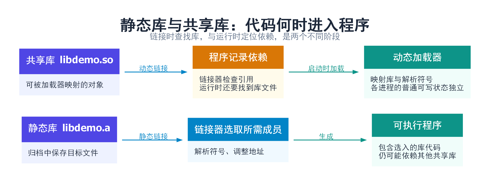

# Linux 库、调度与资源限制：程序怎样找到代码、获得 CPU 和使用资源

本文解决三个问题：公共代码怎样放进库并被程序调用，多个任务怎样竞争 CPU，以及程序怎样查询并遵守运行环境的资源限制。

前置知识是 C++ 函数与指针、编译链接、进程和文件描述符。可先看[Linux 系统编程基础](../一.基础概念/1.Linux系统编程基础.md)、[文件 I/O](../二.文件IO/1.文件IO.md)和[POSIX 线程](../八.POSIX线程/1.POSIX线程.md)。这里也会回顾必要概念，不要求先记住全部接口。

**快速阅读**：先看每章开头的场景、配图和第六章排查表。**动手学习**：按第一、二、三、四、五章顺序完成实验，再用 Q&A 检查自己能否解释失败原因。

| 章节 | 主要问题 |
| --- | --- |
| [一、静态库与共享库](#libraries) | 编译时找得到库，为什么运行时还会找不到？ |
| [二、运行时动态加载](#loading) | 程序启动后，怎样再加载一个插件？ |
| [三、进程与线程调度](#scheduling) | nice 值改变了什么，为什么不等于限速？ |
| [四、运行时配置查询](#configuration) | CPU 数、页大小、文件名长度应该向谁查询？ |
| [五、进程资源限制](#limits) | soft 和 hard 有何区别，fd 用完后如何处理？ |
| [六、排查与验证](#verification) | 如何检查实际环境，避免把示例预期当成实测？ |

## 实验环境与约定

示例面向 Linux/glibc、GCC 的 `g++`、GNU binutils 和 Bash，使用 C++11。可以在 Ubuntu 22.04/24.04 等 Linux 开发环境复现；具体内核、glibc 和容器配置会影响输出，不要求所有机器得到相同的资源数值。

Ubuntu/Debian 安装依赖并查看环境：

```bash
sudo apt update
sudo apt install build-essential binutils util-linux
g++ --version
ldd --version
uname -r
mkdir -p library-limits-lab
cd library-limits-lab
```

把下面各代码块保存成所标明的文件名。教学代码直接保留在本文中；同一实验的多个文件放在这个实验目录中。所有资源修改实验只修改实验进程自身，不要求修改系统服务配置，也不要求使用 root 启动程序。

本文明确区分三类结论：POSIX 接口语义、Linux/glibc 的实现行为、根据负载测试才能决定的工程建议。配额、线程数和性能不能只靠一个接口返回值推断。

<a id="libraries"></a>
## 一、静态库与共享库：为什么要把公共代码单独打包？

### 1.1 从三个程序都需要同一个函数说起

假设三个程序都需要 `add(2, 3)`。把函数复制到三个项目里，修复一次错误就要改三份源码。把实现放进库，可以集中维护，但程序最终必须拿到这段函数的机器指令，CPU 才能执行它。

可以把静态链接理解成“制作教材时，把需要的附录印进书里”；共享库则像“书中注明所需资料，使用时再找到对应版本”。这个类比只帮助区分交付方式：真正执行时，程序仍需要把相应代码映射到自己的虚拟地址空间，并不是远程调用另一个进程。

在 GNU 工具链中，源文件先编译成目标文件 `.o`。它包含机器代码、符号以及尚待确定的地址关系。“符号”可以先理解为函数或变量的名字；链接器要把调用方引用的名字与定义对应起来。

**静态库 `.a` 是一组目标文件的归档。** 链接可执行程序时，链接器按需要从归档中选取成员，完成符号解析和地址调整。通常不是把整个库无条件复制进去，也不是简单按函数文本复制；成员粒度、节区回收和优化选项都会影响最终内容。

**共享库 `.so` 是可被动态加载器映射的对象。** 正常动态链接的程序会记录依赖；启动时，加载器找到依赖库，建立映射并完成必要的符号绑定和重定位，然后进入程序。某些函数绑定可以延迟到首次调用，不能理解为所有工作都在同一时刻完成。



共享库的只读代码页通常可以由内核在多个进程间共享物理内存，但每个进程有自己的地址空间和普通可写全局状态。两个程序都用了 `libdemo.so`，不代表库里的一个全局变量会自动变成跨进程共享变量。

### 1.2 三种使用方式有什么区别？

| 方式 | 什么时候确定要用哪个库 | 运行时需要什么 | 主要代价与适用场景 |
| --- | --- | --- | --- |
| 静态链接某个 `.a` | 链接程序时 | 该部分代码已并入程序 | 部署这部分依赖较直接；更新库通常要重新链接发布 |
| 启动时加载共享库 | 链接时记录依赖，启动时定位文件 | 匹配的 `.so` 及其依赖 | 可共享库文件和代码页；需要管理路径、版本和 ABI |
| `dlopen` 加载共享库 | 程序运行时决定加载 | 插件文件、依赖及约定接口 | 适合可选模块；需要自己处理加载失败和生命周期 |

这里的 ABI 是“已经编译好的双方如何配合”的约定，包括函数参数如何传递、结构体布局、符号名称等。只保持函数名称相同，却把参数类型改掉，旧程序也可能调用出错。

**链接一个静态库，不等于整个程序都是静态链接。** 程序仍可能动态依赖 libc、libstdc++ 等。不要用“使用了 `.a`”推断“复制一个文件就一定能在任何 Linux 上运行”。

### 1.3 完整实验：同一份代码，分别做成静态库与共享库

文件 `demo.h`：

```cpp
#ifndef DEMO_H
#define DEMO_H

// C 链接约定避免 C++ 名字改编，方便后续用 dlsym 查找 "add"。
// 它不会自动保证任意 C++ 类型跨编译器、跨版本兼容。
extern "C" int add(int a, int b);

#endif
```

文件 `demo.cpp`：

```cpp
#include "demo.h"

extern "C" int add(int a, int b) {
    return a + b;  // 本例只用小整数，不演示溢出处理。
}
```

文件 `main.cpp`：

```cpp
#include "demo.h"
#include <iostream>

int main() {
    std::cout << "2 + 3 = " << add(2, 3) << '\n';
}
```

编译运行：

```bash
# -c 只生成目标文件；ar 把目标文件打包为静态库。
g++ -std=c++11 -Wall -Wextra -c demo.cpp -o demo.o
ar rcs libdemo.a demo.o
# 显式给 .a 路径，避免同目录 .so 干扰本实验的选择。
g++ -std=c++11 -Wall -Wextra main.cpp ./libdemo.a -o app_static

# -fPIC 生成适合共享对象的位置无关代码；-shared 生成共享库。
g++ -std=c++11 -Wall -Wextra -fPIC -shared demo.cpp -o libdemo.so
# $ORIGIN 由动态加载器解释为可执行文件所在目录，单引号避免 Bash 展开。
g++ -std=c++11 -Wall -Wextra main.cpp -L. -ldemo \
    -Wl,-rpath,'$ORIGIN' -o app_shared

./app_static
./app_shared
ar t libdemo.a
nm -D --defined-only libdemo.so
readelf -d app_static
readelf -d app_shared
```

两个程序的预期输出都是 `2 + 3 = 5`。归档列表应包含 `demo.o`，共享库的导出符号中应有 `add`。`app_shared` 的动态信息应包含 `libdemo.so` 依赖及运行时搜索路径；`app_static` 不应依赖 `libdemo.so`，但仍可能有其他共享库依赖。

在自己控制的实验目录中，还可以暂时改名验证依赖：

```bash
mv libdemo.so libdemo.so.saved
./app_static
./app_shared
mv libdemo.so.saved libdemo.so
```

在没有其他可搜索到的同名库的环境中，前者仍可运行，后者应在进入 `main()` 前报告找不到库。验证结束后要恢复文件名，再进行第二章实验。

### 1.4 `-L`、`-l` 和运行时路径，为什么经常混淆？

`-L.` 告诉**链接器**到当前目录找库；`-ldemo` 表示查找名为 demo 的库，常规动态链接时存在合适 `.so` 就通常优先选择它。`-L` 不会自动把这个路径保存成运行时搜索路径。因此，编译能找到库与程序启动能找到库，是两次不同的查找。[GCC 链接选项](https://gcc.gnu.org/onlinedocs/gcc/Link-Options.html)

启动时如何找库，由动态加载器按依赖名称、ELF 中的 RPATH/RUNPATH、环境变量、缓存和默认路径等规则处理。具体优先级及传递性要区分 RPATH 与 RUNPATH；不要背成“永远先搜某一个环境变量”。本实验只用 `$ORIGIN` 让旁边的直接依赖可定位。[ld.so(8)](https://man7.org/linux/man-pages/man8/ld.so.8.html)

几个常见错误背后的原因：

- `undefined reference to add`：声明让编译通过，链接时仍需实现；检查是否加入库、名称是否一致。静态库一般放在引用它的目标文件之后，因为归档成员的提取与链接顺序有关。
- `cannot find -ldemo`：链接器没找到可用库，检查文件名、`-L` 和目标架构。
- `error while loading shared libraries`：已完成编译，但启动时找不到依赖；检查运行时路径及依赖链。
- 换库后崩溃：可能存在 ABI 不兼容。生产发布还需管理 SONAME、接口版本和兼容性，不能直接覆盖库文件就认为所有进程会安全更新。

实际工程应从受控目录加载库。库中的代码与宿主处于同一进程，具备宿主权限；“插件”不是安全隔离边界。

<a id="loading"></a>
## 二、dlopen 与 dlsym：程序启动后怎样再加载代码？

### 2.1 为什么普通链接还不够？

假设程序支持多种图片格式，但用户这次只读取 PNG。把所有可选模块都做成启动时的必需依赖，可能导致某个不需要的模块缺失也使整个程序启动失败。动态加载让程序先启动，真正需要模块时再尝试加载；失败后可报告“不支持该功能”或选择替代实现。

过程分为四步：加载库得到句柄，按名字查找函数地址，按照约定类型调用，确认没有使用者后关闭句柄。句柄是加载器管理对象的凭据，不是文件描述符，也不是直接可以调用的函数地址。


| 接口 | 做什么 | 如何判断结果 |
| --- | --- | --- |
| `dlopen(path, flags)` | 加载共享对象并处理依赖 | 成功返回句柄，失败返回空指针，用 `dlerror()` 取说明 |
| `dlsym(handle, name)` | 查找符号地址 | 先清除旧错误，查找后检查新的 `dlerror()` |
| `dlerror()` | 获取并清除当前线程尚未取走的动态加载错误 | 无待取错误返回空指针；不是查询 `errno` |
| `dlclose(handle)` | 释放一次加载引用 | 成功为 0，失败为非 0；错误说明同样来自 `dlerror()` |

本例选 `RTLD_NOW | RTLD_LOCAL`：加载时就解析需要的未定义符号，方便尽早发现依赖缺失；不把新对象的符号默认暴露给后续加载对象作为全局查找来源。`RTLD_LAZY` 可以延迟部分函数符号绑定，但不表示所有缺失都延后检查。[dlopen(3)](https://man7.org/linux/man-pages/man3/dlopen.3.html)

### 2.2 为什么不能只写 `if (dlsym(...) == nullptr)`？

“返回的地址值是 0”和“查找发生错误”并不在所有情况下等价。因此应在查找前调用一次 `dlerror()` 清除旧错误，查找后再次调用它：这一次有错误字符串，才能归因于刚才的查找。不要反复调用 `dlerror()` 再使用返回值，因为第一次调用已经取走了错误。[dlsym(3)](https://man7.org/linux/man-pages/man3/dlsym.3.html)

普通函数插件即使出现无错误的空地址，也不能调用。下面代码把“加载器报告失败”和“拿到不可调用地址”分开判断。`dlerror()` 返回的字符串还可能被后续调用覆盖，需要长期保存时应复制到自己的字符串中。

### 2.3 完整实验：运行时加载上一章的 add 函数

先按第一章生成 `libdemo.so`，再保存 `plugin_host.cpp`：

```cpp
#include <dlfcn.h>
#include <iostream>

int main(int argc, char* argv[]) {
    const char* path = argc > 1 ? argv[1] : "./libdemo.so";
    const char* name = argc > 2 ? argv[2] : "add";
    void* handle = dlopen(path, RTLD_NOW | RTLD_LOCAL);
    if (!handle) {
        const char* error = dlerror();
        std::cerr << "dlopen: " << (error ? error : "unknown error") << '\n';
        return 1;
    }

    dlerror();  // 清除此前的错误，后面才能判断本次 dlsym。
    void* address = dlsym(handle, name);
    const char* error = dlerror();  // 只取一次，并立即报告。
    if (error || !address) {
        std::cerr << "dlsym: " << (error ? error : "null callable address") << '\n';
        dlclose(handle);
        return 1;
    }

    // 依赖本实验 Linux/POSIX 动态加载环境的函数地址转换支持。
    // 参数、返回类型和调用约定必须与插件完全一致。
    using Add = int (*)(int, int);
    Add add = reinterpret_cast<Add>(address);
    std::cout << "plugin result = " << add(2, 3) << '\n';

    // 从这里起，不得再通过 add 调用插件。
    if (dlclose(handle) != 0) {
        const char* close_error = dlerror();
        std::cerr << "dlclose: "
                  << (close_error ? close_error : "unknown error") << '\n';
        return 1;
    }
}
```

```bash
g++ -std=c++11 -Wall -Wextra plugin_host.cpp -ldl -o plugin_host
./plugin_host
./plugin_host ./missing.so
./plugin_host ./libdemo.so missing_symbol
```

第一次预期输出 `plugin result = 5`。后两次分别应报告加载文件失败、查找符号失败，并以非零状态结束；具体错误文字取决于环境。

**编译命令为什么保留 `-ldl`？** 较旧 glibc 环境需要显式链接 libdl。glibc 2.34 将原 libdl 的功能并入 libc，因此一些新系统不写也能链接成功。保留 `-ldl` 有助于兼容旧环境，但不能据此说“所有 Linux 环境不加它都必然失败”。[glibc 2.34 发布说明](https://sourceware.org/pipermail/libc-announce/2021/000032.html)

示例使用 `./libdemo.so`，相对的是**进程当前工作目录**，不是可执行文件所在目录。离开实验目录运行时，要传入正确路径，或由应用明确构造可信插件路径。

### 2.4 真正的插件还缺哪些约束？

本例只有一个同步调用的整数函数，没有后台线程和跨库对象。实际插件如果启动了线程、注册了回调，或者返回带虚函数的对象，关闭前必须先停止线程、注销回调、销毁相关对象。否则下一次调用或析构时，可能跳进已经卸载的代码。

`dlclose()` 成功不保证立刻解除所有映射，其他引用和加载标志可能使库继续存在；但程序不能利用“这次恰好没卸载”继续使用已释放句柄所对应的接口。

稳定插件接口通常会明确版本、结构大小、对象由谁创建销毁，以及异常能否跨边界传播。`extern "C"` 主要解决链接名称等约定，不能自动修复结构布局变化，也不会让 C++ 异常或 STL 对象在任意工具链之间兼容。

<a id="scheduling"></a>
## 三、进程调度：nice 值到底改变了什么？

### 3.1 调度器分配的是“谁现在可以运行”

假设同一个 CPU 上有两个一直进行计算的线程。CPU 一次只能执行其中一个线程，内核要决定何时换人，以及两个线程在一段时间内各得到多少运行机会。

可以类比一台机器前排队加工的工人：调度策略决定排队规则，优先级影响规则中的位置或权重。CPU 亲和性则决定“允许使用哪几台机器”，它不是优先级，也不表示独占那些机器。

Linux 实际调度对象是线程。文档常说“进程调度”，但在 Linux 上，一个多线程进程的线程可以有不同的调度设置；资源限制则通常由进程内线程共享。不要把一个接口操作主线程理解为自动修改整个线程池。

当线程等待 I/O、互斥锁或条件变量而睡眠时，它通常不参与可运行任务之间的 CPU 竞争。调高优先级不能让缺失的数据立刻到达，也不能让持锁者自动释放锁。


### 3.2 nice 的名字可以理解为“愿意给别人让多少机会”

Linux nice 值通常在 `-20` 到 `19` 之间。数值越大，普通公平调度竞争中的权重越低；数值越小，权重越高。它不是“每秒只能运行多少毫秒”的配额。

比如备份程序设置 nice 为 10：系统忙时，它相对更愿意让出 CPU；如果其他线程都在睡眠，它仍可能充分使用空闲 CPU。因此，不能用 nice 保证“备份程序最多占 20% CPU”。需要按时间限制 CPU 用量时，应了解 cgroup 等配额机制。

普通用户通常能把自己的 nice 数值调大，降低竞争优先级。反过来调小涉及权限或 `RLIMIT_NICE` 等限制。**先降低优先级，再恢复原值，可能恢复失败**，所以示例只调整即将退出的实验进程。[nice(2)](https://man7.org/linux/man-pages/man2/nice.2.html)

| 接口 | 参数表达的含义 | 返回值注意点 |
| --- | --- | --- |
| `nice(inc)` | 在当前 nice 上增加 inc，不是设置成 inc | 新 nice 可能合法地等于 -1，需结合 errno |
| `getpriority(PRIO_PROCESS, 0)` | 查询当前调用线程的 nice（Linux 行为） | -1 既可能是值，也可能是错误，调用前清零 errno |
| `setpriority(PRIO_PROCESS, 0, value)` | 把当前调用线程的 nice 设置为 value | 成功 0；失败 -1 并设置 errno |
| `sched_getscheduler(0)` | 查询当前调用线程的调度策略 | 返回策略编号，错误为 -1 |
| `sched_getparam(0, &p)` | 查询调度参数中的静态优先级 | 成功 0；普通策略下该优先级通常为 0 |

普通公平调度不是永远固定为同一算法。历史内核使用 CFS；Linux 6.6 起公平调度逐步引入 EEVDF。本文只依赖 nice 影响相对权重等接口层面的含义，不把某一版本的队列算法写成永久保证。[内核 EEVDF 文档](https://docs.kernel.org/scheduler/sched-eevdf.html)

### 3.3 调度策略与 nice 不是同一把刻度尺

| 策略 | 如何理解 | 重要边界 |
| --- | --- | --- |
| `SCHED_OTHER` | 默认普通分时策略，在可运行任务之间分配机会 | nice 影响相对权重，不保证固定响应时间 |
| `SCHED_BATCH` | 面向非交互批处理任务的普通调度策略 | 仍属于普通调度，并非独占 CPU |
| `SCHED_IDLE` | 极低优先级的后台计算策略 | 不等于进程被暂停；不能靠它保证任务按时完成 |
| `SCHED_FIFO` | 按实时静态优先级调度；同优先级不靠普通时间片轮转 | 持续运行的任务可能长期压制其他任务 |
| `SCHED_RR` | 在 FIFO 规则上，让同实时优先级的任务按时间片轮转 | 不是所有实时任务无差别平分 CPU |
| `SCHED_DEADLINE` | 使用运行预算、截止期限和周期进行调度 | 使用 Linux 专用接口和准入规则，不是普通 nice 调参 |

FIFO/RR 的优先级用 `sched_priority` 表达，Linux 上通常为 1–99，越大越高；可用 `sched_get_priority_min/max()` 查询。这个数值与 nice 的方向、范围和用途都不同。`SCHED_OTHER` 的 `sched_priority` 为 0，不代表 nice 只能为 0。[sched(7)](https://man7.org/linux/man-pages/man7/sched.7.html)

实时调度适合有明确时延需求并经过验证的任务。它不会替程序解决缺页、锁等待、设备延迟和长临界区；线程优先级高也不等于业务响应必然满足截止时间。调度权限、实时运行预算及其他系统配置也会影响实际行为。

### 3.4 完整实验：查询策略，再降低自己的竞争优先级

保存为 `scheduler_info.cpp`：

```cpp
#include <sys/resource.h>
#include <sched.h>
#include <cerrno>
#include <cstdio>
#include <iostream>

int main() {
    int policy = sched_getscheduler(0);
    if (policy == -1) { std::perror("sched_getscheduler"); return 1; }
    sched_param parameter{};
    if (sched_getparam(0, &parameter) == -1) {
        std::perror("sched_getparam"); return 1;
    }
    errno = 0;
    int before = getpriority(PRIO_PROCESS, 0);
    if (before == -1 && errno != 0) {
        std::perror("getpriority"); return 1;
    }
    std::cout << "policy=" << policy
              << " static_priority=" << parameter.sched_priority
              << " nice_before=" << before << '\n';

    int target = before <= 14 ? before + 5 : 19;
    if (setpriority(PRIO_PROCESS, 0, target) == -1) {
        std::perror("setpriority"); return 1;
    }
    errno = 0;
    int after = getpriority(PRIO_PROCESS, 0);
    if (after == -1 && errno != 0) {
        std::perror("getpriority after"); return 1;
    }
    std::cout << "nice_after=" << after << '\n';
    // 不尝试提升优先级恢复原值；实验进程随即退出，不影响父 shell。
}
```

```bash
g++ -std=c++11 -Wall -Wextra scheduler_info.cpp -o scheduler_info
./scheduler_info
ps -o pid,cls,rtprio,ni,pri,comm -p $$
```

如果原策略是 `SCHED_OTHER` 且 nice 为 0，常见预期为 `policy=0 static_priority=0 nice_before=0`，之后 `nice_after=5`。继承不同设置时输出会不同。`ps` 的 `PRI` 是工具展示的优先级字段，不能与 nice 或实时优先级数值直接混为一谈。

这个实验验证“参数确实被设置”，**不验证获得 CPU 的比例**。若要比较份额，应让任务竞争同一个允许使用的 CPU，控制调度组和容器配额，记录运行时间；不同 CPU 上各跑一个任务时，可能根本没有预期中的竞争。

<a id="configuration"></a>
## 四、sysconf 与 pathconf：为什么不把系统参数写死？

### 4.1 三种问题，要问三个不同的地方

程序准备建立线程池、创建文件或映射文件时，可能想问：这台机器有多少在线 CPU？这个目录允许多长的文件名？这个进程还能申请多少资源？三者不是同一个层次。

| 接口 | 问题范围 | 典型例子 |
| --- | --- | --- |
| `sysconf(name)` | 运行环境的配置值、限制或选项 | 页大小、在线逻辑 CPU 数、打开文件限制 |
| `pathconf(path, name)` | 指定路径所在文件系统或对象的限制 | 目录中的文件名长度、管道原子写入上限 |
| `fpathconf(fd, name)` | 对已经打开的对象查询 | 避免路径变化后查询了别的对象 |
| `getrlimit(resource, &r)` | 当前进程的资源软硬限制 | 文件描述符、地址空间、CPU 时间 |

可以把它们想成“问场地规格、问某个房间的规则、问自己领到的额度”。这些查询通常不为你预留资源：即使配置允许，申请时也可能因内存、系统总量或其他约束失败。


### 4.2 提纲里的三个 sysconf 参数怎样正确使用？

**`_SC_OPEN_MAX`：进程可同时打开文件数量的限制信息。** 在 Linux/glibc 上，它通常反映当前 `RLIMIT_NOFILE` 软限制相关值。它不是系统剩余可用的 fd 数，也不是 `/proc/sys/fs/file-max` 的系统级总量限制。要查看并修改自己的软硬限制，直接用 `getrlimit/setrlimit`。

假设限制是 1024，不等于马上还能打开 1024 个文件：标准输入输出、日志、socket、管道、epoll 等都可能已经使用描述符。Linux 的 `RLIMIT_NOFILE` 更精确地限制新分配 fd 编号必须小于软限制值，降低限制不会自动关闭原有高编号 fd。

**`_SC_NPROCESSORS_ONLN`：当前在线的逻辑 CPU 数。** 它不一定是物理核心数：开启 SMT 的一个物理核心可能呈现多个逻辑 CPU。也不能用它直接决定容器中线程池大小，因为线程可能只允许在少数 CPU 上运行，或者受到更小的 CPU 时间配额约束。

例如主机有 16 个在线逻辑 CPU，线程亲和性只允许使用 4 个，而 cgroup 每个周期只给相当于 2 个 CPU 的时间预算。三个数分别回答“系统有多少在线 CPU”“我能在哪些 CPU 上运行”“我总共能用多少时间”。`sched_getaffinity()` 可检查前一种位置约束，不能代替配额检查。[sched_setaffinity(2)](https://man7.org/linux/man-pages/man2/sched_setaffinity.2.html)

线程池因此要结合可用 CPU、任务是否等待 I/O、队列长度和延迟实测调整。CPU 密集型任务盲目增加线程可能增加切换开销；I/O 密集型任务也不能无限增加线程，把下游服务压垮。

**`_SC_PAGESIZE`：普通内存页的字节大小。** 普通文件 `mmap` 的偏移需要按页大小对齐；`munmap` 的起始地址也有页对齐要求。不能把常见的 4096 写成所有机器的保证。大页映射还可能有另外的对齐要求，页大小也不等于磁盘扇区或 `O_DIRECT` 对齐要求。

假设需要映射文件偏移 5000 处的 100 字节，查询到页大小为 4096：

```text
对齐后的文件偏移 = (5000 / 4096) * 4096 = 4096
目标数据在映射内的偏移 = 5000 - 4096 = 904
至少需要映射的长度 = 904 + 100 = 1004

mmap 从文件偏移 4096 开始；实际目标地址 = 返回地址 + 904。
munmap 使用原始返回地址和映射长度，不能传“目标地址”。
```

这里的除法是整数除法。实际封装还要检查负偏移、长度溢出、文件是否足够长，以及映射期间是否被截短；完整映射实验见[文件 I/O 的 mmap 章节](../二.文件IO/1.文件IO.md#mapping)。

### 4.3 pathconf 为什么要传路径，返回 -1 又为什么不一定失败？

两个挂载点可能使用不同文件系统。某个目录允许的文件名长度，不必与另一个目录相同，所以 `_PC_NAME_MAX` 要针对具体目录查询。它描述单个名字组成部分的长度限制，不是整条路径长度；通常按字节计，不能直接当成汉字个数。

`pathconf()` 返回 -1 可能表示该项没有可确定的限制，也可能发生错误。调用前先把 `errno` 设为 0；返回 -1 且 errno 非零才按错误处理。`sysconf()` 的 -1 也要结合查询项和 errno 判断，可能表示不支持或限制不确定，不能直接解释为“无限资源”。[pathconf(3)](https://man7.org/linux/man-pages/man3/pathconf.3.html)、[sysconf(3)](https://man7.org/linux/man-pages/man3/sysconf.3.html)

### 4.4 完整实验：查询页大小、CPU、文件限制及路径限制

保存为 `runtime_config.cpp`：

```cpp
#include <unistd.h>
#include <cerrno>
#include <cstring>
#include <iostream>

bool report(const char* label, long value, int error) {
    std::cout << label << " = ";
    if (value != -1) {
        std::cout << value << '\n';
        return true;
    }
    if (error != 0) {
        std::cout << "error: " << std::strerror(error) << '\n';
        return false;
    }
    std::cout << "indeterminate or unsupported (interpret per option)\n";
    return true;  // 已正确报告不确定状态，不把它当成资源可无限使用。
}

bool query_system(const char* label, int option) {
    errno = 0;
    long value = sysconf(option);
    int saved = errno;  // 输出等后续操作之前，先保存本次调用的 errno。
    return report(label, value, saved);
}

int main(int argc, char* argv[]) {
    const char* directory = argc > 1 ? argv[1] : ".";
    bool ok = true;
    if (!query_system("OPEN_MAX", _SC_OPEN_MAX)) ok = false;
    if (!query_system("ONLINE_LOGICAL_CPUS", _SC_NPROCESSORS_ONLN)) ok = false;
    if (!query_system("PAGE_SIZE_BYTES", _SC_PAGESIZE)) ok = false;
    errno = 0;
    long value = pathconf(directory, _PC_NAME_MAX);
    int saved = errno;
    if (!report("NAME_MAX_BYTES", value, saved)) ok = false;
    return ok ? 0 : 1;
}
```

```bash
g++ -std=c++11 -Wall -Wextra runtime_config.cpp -o runtime_config
./runtime_config .
./runtime_config ./directory-that-does-not-exist
getconf PAGESIZE
getconf NAME_MAX .
```

第一次应打印四项查询结果，数值由机器和限制决定。`PAGE_SIZE_BYTES` 可与 `getconf PAGESIZE` 对照；第二次在该路径确实不存在时应报告路径错误并返回非零。这个实验刻意不把 CPU 数或 fd 限制写成固定的“标准答案”。

<a id="limits"></a>
## 五、getrlimit 与 setrlimit：怎样限制自己的资源使用？

### 5.1 为什么限制分为 soft 和 hard 两个数？

设想管理员允许一个服务最多打开 4096 个描述符，但希望服务默认只使用 1024。服务工作量增大时可以把当前额度提高一些，但不能自行无限扩大。

这两个角色分别对应：

- **软限制 `rlim_cur`**：内核当前按它约束资源使用。
- **硬限制 `rlim_max`**：普通进程调整软限制时不能超过的上界。

可以把软限制理解成“现在允许使用的额度”，硬限制理解成“你有权自行调整到的最高额度”。软限制不是警告线；到达之后可以直接导致申请失败，具体效果由资源种类决定。

普通进程通常能在硬限制内调高或调低软限制，也可以降低硬限制；**降低硬限制后，通常不能再自行恢复原来的高值**。提高硬限制需要相应权限，还可能受系统上限约束。教学实验只临时降低软限制，保留硬限制不动。[getrlimit(2)](https://man7.org/linux/man-pages/man2/getrlimit.2.html)


例如 `soft=1024, hard=4096`：改成 `soft=2048` 通常允许；改成 `soft=8192` 超过 hard，不能直接成功。若误把 hard 降到 512，即使以前有 4096 的额度，也不能认为随时可以恢复。

`RLIM_INFINITY` 是表示无限制的特殊值，不能当成普通整数参与加一等运算。即使该项无限制，其他约束仍可能先起作用，例如系统内存、cgroup 配额或系统级文件表容量。

### 5.2 不同资源到达上限，结果并不相同

| 资源 | 限制的对象 | 常见结果与误区 |
| --- | --- | --- |
| `RLIMIT_NOFILE` | 新分配的 fd 编号范围 | `open/socket/dup` 等可能报 `EMFILE`；不是只统计磁盘文件 |
| `RLIMIT_AS` | 进程虚拟地址空间大小 | `mmap/brk` 等可能失败；不等于常驻物理内存 RSS |
| `RLIMIT_STACK` | 栈的增长限制 | 自动栈扩展失败可能触发 `SIGSEGV`；不能推断所有 pthread 栈会立刻改变 |
| `RLIMIT_CPU` | 进程消耗的 CPU 时间 | 软限制可能触发 `SIGXCPU`，硬限制导致终止；不计普通睡眠等待时间 |
| `RLIMIT_FSIZE` | 进程可创建文件的大小上限 | 可能收到 `SIGXFSZ`，相关写入失败；不是磁盘总容量 |
| `RLIMIT_CORE` | core 转储大小限制 | 设为 0 通常禁用常规 core 文件；转储方式和其他系统配置也会影响结果 |
| `RLIMIT_NPROC` | Linux 上与真实用户 ID 关联的进程／线程数量 | 不是单个进程私有的线程池配额，还存在权限例外与其他限制 |

表中效果是 Linux 范围内的概括。需要精确处理某项资源时，应查对应限制和具体系统调用的错误语义，不要把所有限制都写成“超过就返回 -1”。

限制通常被 `fork()` 出来的子进程继承，并跨 `exec()` 保留。因此，shell 的 `ulimit`、服务启动器、容器运行时都可能影响最终程序。修改一个已经运行的子进程自己的限制，不会反向修改启动它的 shell；同一进程的线程却共享资源限制，不能在某个工作线程里把它当成仅约束自己的设置。

### 5.3 完整实验：在自身进程中降低 fd 额度，观察 EMFILE

保存为 `fd_limit.cpp`。它最多保留 64 个实验 fd，使用 `/dev/null`，不创建大量磁盘文件；所有路径在结束前关闭已打开的描述符，并尝试恢复原软限制。

```cpp
#include <sys/resource.h>
#include <fcntl.h>
#include <unistd.h>
#include <cerrno>
#include <cstdio>
#include <iostream>

void print_limit(const char* name, rlim_t value) {
    std::cout << name << '=';
    if (value == RLIM_INFINITY) std::cout << "unlimited";
    else std::cout << static_cast<unsigned long long>(value);
    std::cout << '\n';
}

int main() {
    rlimit original{};
    if (getrlimit(RLIMIT_NOFILE, &original) == -1) {
        std::perror("getrlimit"); return 1;
    }
    print_limit("original_soft", original.rlim_cur);
    print_limit("original_hard", original.rlim_max);

    rlimit reduced = original;
    if (reduced.rlim_cur == RLIM_INFINITY || reduced.rlim_cur > 32)
        reduced.rlim_cur = 32;
    if (reduced.rlim_cur < 8) {
        std::cout << "skip: existing soft limit is too small for this experiment\n";
        return 0;
    }
    if (setrlimit(RLIMIT_NOFILE, &reduced) == -1) {
        std::perror("setrlimit reduce"); return 1;
    }
    print_limit("temporary_soft", reduced.rlim_cur);

    int descriptors[64];  // 固定数组：实验期间不再为保存 fd 动态分配内存。
    int count = 0;
    int failure = 0;
    while (count < 64) {
        int fd = open("/dev/null", O_RDONLY | O_CLOEXEC);
        if (fd == -1) {
            if (errno == EINTR) continue;
            failure = errno;
            break;
        }
        descriptors[count++] = fd;
    }
    for (int i = 0; i < count; ++i) {
        // Linux 上不盲目重试 close，以免误关被复用的 fd 编号。
        if (close(descriptors[i]) == -1) std::perror("close");
    }
    // 硬限制没变，因此本例通常有权恢复原软限制。
    bool restored = setrlimit(RLIMIT_NOFILE, &original) == 0;
    if (!restored) std::perror("setrlimit restore");
    std::cout << "opened=" << count
              << " reached_EMFILE=" << (failure == EMFILE ? "yes" : "no")
              << " restored=" << (restored ? "yes" : "no") << '\n';
    if (failure != 0 && failure != EMFILE) {
        errno = failure;
        std::perror("open stopped for another reason");
    }
    return restored && failure == EMFILE ? 0 : 1;
}
```

```bash
g++ -std=c++11 -Wall -Wextra fd_limit.cpp -o fd_limit
./fd_limit
ulimit -Sn
ulimit -Hn
cat /proc/$$/limits
```

如果原软限制至少为 32，并且启动时仅有 fd 0、1、2，通常还能成功打开 29 个，然后遇到 `EMFILE`，最终打印 `reached_EMFILE=yes restored=yes`。继承了其他 fd、原额度更小或受到其他错误影响时，数量会变化。父 shell 的限制应保持原状。

本例验证限制的作用和恢复流程，不是服务端的完整 fd 耗尽处理方案。服务还需要排查泄漏、限制并发连接、为日志和恢复操作预留余量；提高额度只能缓解数量上限，不能修复泄漏。

### 5.4 ulimit、系统上限和容器限制怎么一起看？

`ulimit` 是 shell 内建命令。Bash 的 `ulimit -Sn` 和 `ulimit -Hn` 分别查询当前 shell 的软、硬 fd 限制；从它启动的程序继承这些值。另一个终端里修改自己的 `ulimit`，不会自动改变已经运行的服务。

排查时应看目标进程，而不是只看当前终端：

```bash
# $$ 是当前 shell 的 PID；检查服务时换成实际服务 PID。
cat /proc/$$/limits
ls /proc/$$/fd
cat /proc/sys/fs/file-max
cat /proc/sys/fs/nr_open
```

`EMFILE` 常提示进程级 fd 限制；`ENFILE` 常提示系统级打开文件表限制。不要一看到“too many open files”就只改某一处数值。服务由 systemd 启动时还要检查其 `LimitNOFILE` 等设置；容器中则还要检查运行时配置、cgroup 和启动器继承关系。

同理，`RLIMIT_AS`、cgroup 内存限制和机器剩余内存不是一个东西；`RLIMIT_CPU` 的累计 CPU 秒数也不同于 cgroup 的每周期 CPU 配额。先确认限制的对象和单位，再决定要改哪个配置。

<a id="verification"></a>
## 六、排查、选型与验证清单

### 6.1 从现象反推检查方向

| 现象 | 先查什么 | 为什么 |
| --- | --- | --- |
| 编译通过，链接失败 | 实现文件、导出名称、库顺序 | 头文件只声明接口，不提供机器代码 |
| 本机能启动，换目录就找不到 `.so` | RUNPATH、当前目录、依赖路径 | 编译路径与运行时查找规则不同 |
| dlopen 成功但调用崩溃 | 函数签名、ABI、对象寿命 | 找到地址不代表按任何类型调用都合法 |
| dlsym 错误描述前后不一致 | 是否清除旧错误、是否多次调用 dlerror | 错误是取一次就清除的状态 |
| nice 已变但 CPU 使用率没下降 | 是否有竞争、是否跨 CPU、调度组和配额 | nice 决定相对机会，不提供固定限速 |
| 在线 CPU 很多，线程池却没有收益 | 亲和性、CPU 配额、I/O 等待和锁竞争 | 系统数量不是任务实际可用计算能力 |
| sysconf/pathconf 返回 -1 | errno、查询项的语义 | 可能是错误，也可能是限制不确定或不支持 |
| setrlimit 失败 | soft 是否超过 hard、权限和系统上限 | 资源额度不是想设置多少就能设置多少 |
| fd 耗尽 | 目标进程 limits、fd 列表、泄漏和并发量 | 系统总量和进程限制需要分开判断 |
| 新终端调大 ulimit，服务没变化 | 服务的父进程和启动方式 | 新设置不会自动传播到已运行进程 |

### 6.2 实验检查表

| 实验 | 应验证什么 | 不应据此推断什么 |
| --- | --- | --- |
| 静态库／共享库 | 输出一致、NEEDED 依赖不同、缺库后的行为不同 | 静态库使整个程序完全无依赖 |
| 动态插件 | 正常调用、文件缺失、符号缺失三个分支 | 插件可任意卸载或 ABI 永远兼容 |
| 调度参数 | nice 改变，策略和参数可查询 | 获得了固定 CPU 比例或实时保证 |
| 运行时配置 | 数值可查询，路径错误被报告 | 查询值表示资源已为程序预留 |
| fd 限制 | 降低软限制后出现 EMFILE，随后恢复 | 同样的成功打开数量在所有环境固定不变 |

**验证记录（2026-11-11）**：本文在 Windows 工作区编写，已对照官方工具链文档、Linux man-pages、内核文档和 glibc 发布说明检查关键语义。文中的 Linux 实验尚未在 Linux/glibc 环境编译运行；输出均为预期，不是实测数据。配图和文档链接单独检查，不把文档检查等同于程序运行验证。

配图使用 Graphviz、200 DPI，保留 `assets/*.dot`。DOT 指定 PingFang SC，当前 Windows 未安装该字体，PNG 使用可用中文字体回退。从本文目录运行以下 Bash 命令可重新生成：

```bash
for source in assets/*.dot; do
    dot -Tpng -Gdpi=200 "$source" -o "${source%.dot}.png"
done
```

## 七、面试时怎样用自己的话说明？

**库与加载：** 为了复用代码，可以把目标文件打成静态库，也可以构建共享库。静态链接把需要的目标代码并入程序；共享链接让加载器在运行时定位和映射依赖。可选插件使用 dlopen 和 dlsym 决定何时加载与调用，但应用必须管理错误、ABI 和卸载时机。取舍主要是部署方式、更新方式和运行时依赖管理。

**调度：** 多个可运行线程竞争 CPU 时，需要调度器分配运行机会。普通调度中的 nice 影响相对权重，不是 CPU 百分比；实时策略使用另一套优先级规则，也不能消除锁等待和设备延迟。调整前要先区分是 CPU 竞争、亲和性限制、配额，还是任务本身在等待资源。

**配置与资源限制：** 程序不能把页大小、CPU 数和文件限制都写死。sysconf 查运行环境，pathconf 查具体路径的限制，getrlimit 查本进程额度。setrlimit 的软限制决定当前执行上限，硬限制约束普通进程可以自行调多高。查询不是资源预留，所有实际申请仍需检查失败。

## Q&A（常见问题与解答）

**Q1：头文件里声明了函数，为什么还会 undefined reference？**

声明让编译器知道怎样生成调用代码，但函数实现还需要在链接阶段找到。检查实现目标文件是否参与链接、库顺序是否正确，以及导出符号是否与调用方一致。

**Q2：用了静态库，删除这个 `.a` 后程序还能运行吗？**

这部分代码已经链接进可执行文件，运行通常不再读取原 `.a`。但程序还可能依赖其他 `.so`、配置和数据文件，不能把这个结论扩大成“完全独立”。

**Q3：两个进程使用同一个共享库，库里的全局变量会共享吗？**

普通可写变量不会因此成为跨进程共享状态。只读代码页可共享物理存储，但进程各有地址空间。需要共享业务数据时应使用明确的 IPC 和同步机制。

**Q4：dlopen 成功是否意味着马上可以调用任意函数名？**

不意味着。还要查找符号、检查错误，并使用与实现一致的函数类型。名字存在但签名不匹配，同样可能崩溃或破坏内存。

**Q5：为什么 dlsym 后要用 dlerror，而不是 perror？**

动态加载接口有自己的错误报告机制。perror 根据 errno 输出，可能打印无关的旧错误；dlerror 才提供本次加载或查找的说明。

**Q6：现代机器不加 -ldl 也能编译，是教程错了吗？**

glibc 2.34 将 libdl 功能并入 libc，这是具体版本的变化。保留 -ldl 兼容较旧 glibc 环境仍有意义，但“所有环境都必须显式写”不准确。

**Q7：dlclose 成功后，旧函数指针还能用吗？**

应用必须停止使用。库可能解除映射，也可能因为其他引用暂时还存在；不能把后者当作接口生命周期保证。应先停止调用、回调和后台线程，销毁插件对象，再释放加载引用。

**Q8：nice=19 为什么还能占满一个 CPU？**

nice 表达与其他普通任务竞争时的相对权重。当没有其他可运行任务争抢相应 CPU 时，它仍可使用空闲计算能力。固定限额应考虑配额机制。

**Q9：优先级越高，服务器响应就越快吗？**

只有瓶颈确实是 CPU 竞争时才可能有帮助。如果在等待数据库、锁或磁盘，提高调用线程优先级不会自动解决问题，还可能挤压为它提供服务的其他任务。

**Q10：sysconf 得到 32 个 CPU，线程池就开 32 个吗？**

它提供在线逻辑 CPU 信息，而不是线程池配置答案。还要检查可运行 CPU 集合、配额、任务等待比例和负载下的吞吐与延迟。先给合理初值，再测量调整。

**Q11：页大小是 4096，是否说明 mmap 长度必须是 4096 的倍数？**

普通映射长度不要求简单地等于整页倍数；文件偏移必须符合页对齐要求，内核以页管理映射。不要把偏移、地址和长度的规则混为一谈，大页映射还需单独查规则。

**Q12：soft=1024 表示用到 1024 后先警告，再用到 hard 才失败吗？**

不是。对于 RLIMIT_NOFILE，软限制就是当前的新 fd 分配边界，触及后申请会失败。硬限制约束的是能否把软限制调高，不是再免费提供一段可用额度。

**Q13：把 fd 软限制调低，会关闭已经打开的文件吗？**

不会自动关闭。限制影响后续分配，既有描述符仍可存在，因此降低限制后可能还看到编号高于新上限的 fd。

**Q14：为什么 setrlimit 在一个线程里调用，却影响其他线程？**

资源限制由同一进程的线程共享。调度设置和 Linux nice 的作用范围不能直接套到资源限制上；工作线程不应擅自修改服务全局额度。

**Q15：调大 fd 上限能解决文件描述符泄漏吗？**

不能，只会延后耗尽。要找出未关闭的文件、连接或重复创建的事件对象，并明确所有权和清理路径。容量确实不足时再按系统总量与服务负载提高额度。

## 参考与延伸阅读

- [GCC 链接选项](https://gcc.gnu.org/onlinedocs/gcc/Link-Options.html)：`-l`、`-L`、链接方式与顺序。
- [动态加载器 ld.so](https://man7.org/linux/man-pages/man8/ld.so.8.html)：依赖搜索、RPATH/RUNPATH 和 `$ORIGIN`。
- [dlopen](https://man7.org/linux/man-pages/man3/dlopen.3.html)、[dlsym](https://man7.org/linux/man-pages/man3/dlsym.3.html)、[dlerror](https://man7.org/linux/man-pages/man3/dlerror.3.html)：动态加载、符号和错误生命周期。
- [glibc 2.34 发布说明](https://sourceware.org/pipermail/libc-announce/2021/000032.html)：libdl 等功能并入 libc 的版本边界。
- [sched](https://man7.org/linux/man-pages/man7/sched.7.html)、[nice](https://man7.org/linux/man-pages/man2/nice.2.html)、[getpriority](https://man7.org/linux/man-pages/man2/getpriority.2.html)：调度与权限语义。
- [EEVDF](https://docs.kernel.org/scheduler/sched-eevdf.html)、[CPU 亲和性](https://man7.org/linux/man-pages/man2/sched_setaffinity.2.html)：实现演进和可运行 CPU 集合。
- [sysconf](https://man7.org/linux/man-pages/man3/sysconf.3.html)、[pathconf](https://man7.org/linux/man-pages/man3/pathconf.3.html)：运行时配置和不确定返回值。
- [getrlimit/setrlimit](https://man7.org/linux/man-pages/man2/getrlimit.2.html)：资源种类、软硬限制及继承规则。
- [cgroup v2](https://docs.kernel.org/admin-guide/cgroup-v2.html)：CPU 配额、内存和进程数量等组级限制。

## 思维导图总结

```text
Linux 库、调度与资源限制
├── 一、静态库与共享库
│   ├── .a 归档目标文件；链接时选取需要的成员
│   └── .so 运行时映射；区分链接搜索与运行时依赖
├── 二、运行时动态加载
│   ├── dlopen → dlsym → 调用 → 停止使用 → dlclose
│   └── dlerror 检查、ABI、生命周期；-ldl 的 glibc 版本边界
├── 三、进程与线程调度
│   ├── nice 是普通调度的相对权重，不是固定 CPU 配额
│   └── 区分实时策略、亲和性、配额与等待资源
├── 四、运行时配置
│   ├── sysconf：fd 限制、在线逻辑 CPU、页大小
│   └── pathconf/fpathconf：对象相关限制；-1 结合 errno 判断
├── 五、进程资源限制
│   ├── soft 当前执行；hard 约束调节权限；线程共享、子进程继承
│   └── getrlimit/setrlimit；不同资源耗尽有不同效果
├── 六、排查与验证
│   ├── 看目标进程、实际路径、权限与启动器设置
│   └── 验证成功与失败分支，区分预期输出和实测
└── 七、面试表达与 Q&A
    ├── 解决什么问题 → 如何实现 → 有什么限制
    └── 用缺库、旧指针、CPU 竞争和 fd 耗尽检验理解
```


[思维导图 PNG](assets/mindmap.png) · [DOT 源文件](assets/mindmap.dot)
