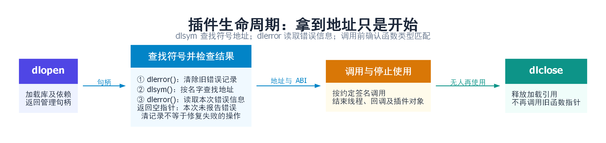
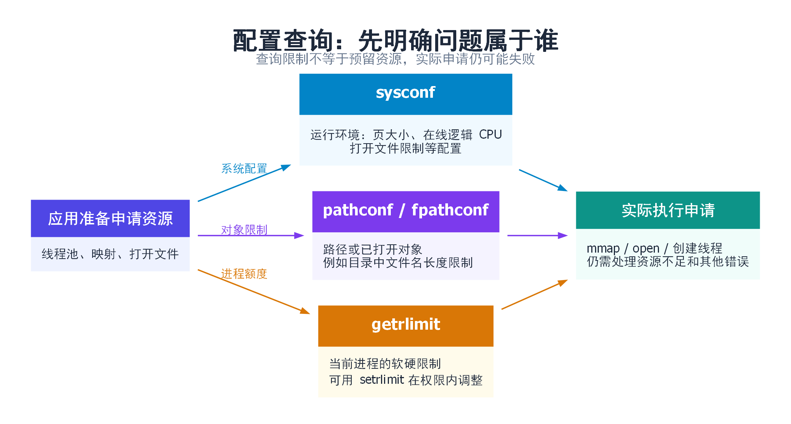

# Linux 库、调度与资源限制：程序怎样找到代码、获得 CPU 和使用资源

本文解决三个问题：公共代码怎样放进库并被程序调用，多个任务怎样竞争 CPU，以及程序怎样查询并遵守运行环境的资源限制。

前置知识是 C++ 函数与指针、编译链接、进程和文件描述符。可先看[Linux 系统编程基础](../一.基础概念/1.Linux系统编程基础.md)、[文件 I/O](../二.文件IO/1.文件IO.md)和[POSIX 线程](../八.POSIX线程/1.POSIX线程.md)。这里也会回顾必要概念，不要求先记住全部接口。

**快速阅读**：先看每章开头的场景、配图和第六章排查表。**动手学习**：按第一、二、三、四、五章顺序完成实验，再用 Q&A 检查自己能否解释失败原因。

| 章节 | 主要问题 |
| --- | --- |
| [一、静态库与共享库](#libraries) | 编译时找得到库，为什么运行时还会找不到？ |
| [二、运行时动态加载](#loading) | 程序启动后，怎样再加载一个插件？ |
| [三、进程与线程调度](#scheduling) | nice 值改变了什么，为什么不等于限速？ |
| [四、运行时配置查询](#configuration) | CPU 数、页大小、文件名长度应该向谁查询？ |
| [五、进程资源限制](#limits) | soft 和 hard 有何区别，fd 用完后如何处理？ |
| [六、排查与验证](#verification) | 如何检查实际环境，避免把示例预期当成实测？ |

## 实验环境与约定

示例面向 Linux/glibc、GCC 的 `g++`、GNU binutils 和 Bash，使用 C++11。可以在 Ubuntu 22.04/24.04 等 Linux 开发环境复现；具体内核、glibc 和容器配置会影响输出，不要求所有机器得到相同的资源数值。

Ubuntu/Debian 安装依赖并查看环境：

```bash
sudo apt update
sudo apt install build-essential binutils util-linux
g++ --version
ldd --version
uname -r
mkdir -p library-limits-lab
cd library-limits-lab
```

把下面各代码块保存成所标明的文件名。教学代码直接保留在本文中；同一实验的多个文件放在这个实验目录中。所有资源修改实验只修改实验进程自身，不要求修改系统服务配置，也不要求使用 root 启动程序。

本文明确区分三类结论：POSIX 接口语义、Linux/glibc 的实现行为、根据负载测试才能决定的工程建议。配额、线程数和性能不能只靠一个接口返回值推断。

<a id="libraries"></a>
## 一、静态库与共享库：为什么要把公共代码单独打包？

### 1.1 从三个程序都需要同一个函数说起

假设三个程序都需要 `add(2, 3)`。把函数复制到三个项目里，修复一次错误就要改三份源码。把实现放进库，可以集中维护，但程序最终必须拿到这段函数的机器指令，CPU 才能执行它。

在 GNU 工具链中，源文件先编译成目标文件 `.o`，其中包含机器代码、函数和变量的名称，以及尚待确定的地址关系。函数和变量的名称称为“符号”；链接器负责把调用方使用的符号与对应定义连接起来。

**静态链接**：构建可执行文件时，链接器从静态库 `.a` 中选取需要的目标文件，将其中的代码和数据链接进最终程序，并完成所需的地址调整。因此，程序运行时不再需要这份 `.a` 文件。静态库是一组目标文件的归档，通常不会被整个复制进程序；具体保留哪些内容，还会受到节区回收和优化选项的影响。

**动态链接**：构建可执行文件时，通常记录所依赖的共享库 `.so` 及相关符号引用。程序启动时，动态链接器找到这些共享库，将其映射到该进程的虚拟地址空间，并处理必要的符号绑定和地址调整。因此，运行环境中需要提供兼容的共享库。某些函数的绑定可以延迟到首次调用时完成。调用共享库函数仍是在当前进程中执行，不是请求另一个进程替自己执行。

**一个程序可以同时使用静态库和共享库。** 链接了某个静态库，只说明这部分代码已链接进程序，不代表整个程序都是静态链接。


共享库的只读代码页通常可以由内核在多个进程间共享物理内存，但每个进程有自己的地址空间和普通可写全局状态。两个程序都用了 `libdemo.so`，不代表库里的一个全局变量会自动变成跨进程共享变量。

### 1.2 三种使用方式有什么区别？

| 方式 | 什么时候确定要用哪个库 | 运行时需要什么 | 主要代价与适用场景 |
| --- | --- | --- | --- |
| 静态链接某个 `.a` | 链接程序时 | 该部分代码已并入程序 | 部署这部分依赖较直接；更新库通常要重新链接发布 |
| 启动时加载共享库 | 链接时记录依赖，启动时定位文件 | 匹配的 `.so` 及其依赖 | 可共享库文件和代码页；需要管理路径、版本和 ABI |
| `dlopen` 加载共享库 | 程序运行时决定加载 | 插件文件、依赖及约定接口 | 适合可选模块；需要自己处理加载失败和生命周期 |

这里的 ABI 是“已经编译好的双方如何配合”的约定，包括函数参数如何传递、结构体布局、符号名称等。只保持函数名称相同，却把参数类型改掉，旧程序也可能调用出错。

**链接一个静态库，不等于整个程序都是静态链接。** 程序仍可能动态依赖 libc、libstdc++ 等。不要用“使用了 `.a`”推断“复制一个文件就一定能在任何 Linux 上运行”。

#### 直接加 -static，是否就能只交付一个文件？

`-static` 要求链接时使用静态库，但前提是工具链中确实存在所需的静态版本。它不能把所有运行时配置、数据和按需加载的模块都自动装进程序，也不保证二进制适用于任意 Linux 环境。[GCC 链接选项](https://gcc.gnu.org/onlinedocs/gcc/Link-Options.html)

例如，程序要连接 `api.example.com`，需要先调用 `getaddrinfo()` 查询它对应的 IP 地址。即使查询函数的代码已经静态链接进程序，程序也不会因此知道这个主机名的地址；运行时仍要从本机文件或名称服务器取得答案。

在 glibc 中，**NSS**（Name Service Switch，名称服务切换机制）负责按系统配置选择查询来源。以 `/etc/nsswitch.conf` 中的这一行为例：

```text
hosts: files dns
```

这里的 `hosts:` 表示主机名查询；`files` 表示查本机的 `/etc/hosts` 文件；`dns` 表示向 DNS 服务器查询。在这条配置的默认处理规则下，先查本机文件，没有找到再尝试 DNS。DNS 服务器地址通常由 `/etc/resolv.conf` 指定；查询还需要服务器可达。这些配置和外部服务不会因为加了 `-static` 就自动包含在可执行文件中。[glibc NSS 介绍](https://sourceware.org/glibc/manual/latest/html_node/NSS-Basics.html)

另外，NSS 支持多种查询来源，有些需要运行时加载额外的 `.so` 模块。如果目标机器配置了这种来源，却没有安装对应模块，依赖它的查询就可能失败。不是每次查询都需要额外模块：例如 glibc 2.34 已内置 `files` 和 `dns` 的实现，其他来源仍可能需要加载模块。因此，要看实际使用的 glibc 和查询配置，不能一概说“静态链接后 DNS 就不能用了”。[glibc 2.34 NSS 模块加载源码](https://github.com/bminor/glibc/blob/glibc-2.34/nss/nss_module.c)

部署时除了检查程序能否启动，还应让它在目标环境中实际查询业务使用的主机名。若查询失败，再检查查询顺序、本机 hosts 记录、DNS 配置，以及是否缺少所需模块。这里要区分的是：**函数代码已经包含在程序里，不等于函数运行时需要的所有东西都包含在里面。**

### 1.3 完整实验：同一份代码，分别做成静态库与共享库

文件 `demo.h`：

```cpp
#ifndef DEMO_H
#define DEMO_H

// C 链接约定避免 C++ 名字改编，方便后续用 dlsym 查找 "add"。
// 它不会自动保证任意 C++ 类型跨编译器、跨版本兼容。
extern "C" int add(int a, int b);

#endif
```

文件 `demo.cpp`：

```cpp
#include "demo.h"

extern "C" int add(int a, int b) {
    return a + b;  // 本例只用小整数，不演示溢出处理。
}
```

文件 `main.cpp`：

```cpp
#include "demo.h"
#include <iostream>

int main() {
    std::cout << "2 + 3 = " << add(2, 3) << '\n';
}
```

编译运行：

```bash
# 在 Linux / Bash 中执行，当前目录需包含 demo.h、demo.cpp 和 main.cpp。
# g++ 来自 C++ 编译工具链；ar、nm、readelf 来自 GNU Binutils。
# 以下编译命令中：-std=c++11 使用 C++11；-Wall -Wextra 开启常用及额外警告；
# -o 后面指定本次生成的文件名。

# 1. 把库的源文件编译成目标文件 demo.o。
# -c 表示编译、汇编后停止，不进行链接，因此这里不会生成可执行程序。
g++ -std=c++11 -Wall -Wextra -c demo.cpp -o demo.o

# 2. 把 demo.o 收进静态库 libdemo.a；这一步是归档，不是链接。
# r：加入目标文件，若库中已有同名成员则替换；c：库不存在时创建且不提示；
# s：建立或更新符号索引，供链接器查找哪个成员定义了所需函数。
ar rcs libdemo.a demo.o

# 3. 编译 main.cpp，并与静态库链接，生成 app_static。
# main.cpp 使用 add，链接器从 libdemo.a 取出定义 add 的 demo.o 参与链接。
# 把库放在使用它的源文件后面，便于链接器按顺序解析尚未找到定义的符号。
# 显式写 ./libdemo.a，确保本次使用静态库，不会选中同目录的 libdemo.so。
# 这里只把 demo 库静态链接进程序；未加 -static，其他库仍可能采用动态链接。
g++ -std=c++11 -Wall -Wextra main.cpp ./libdemo.a -o app_static

# 4. 从同一份 demo.cpp 生成共享库 libdemo.so。
# -fPIC：生成位置无关代码，使库能被装入不同进程的不同虚拟地址。
# -shared：把编译结果链接成共享库，而不是带 main 入口的可执行程序。
g++ -std=c++11 -Wall -Wextra -fPIC -shared demo.cpp -o libdemo.so

# 5. 编译 main.cpp，并链接共享库，生成 app_shared。
# -L.：链接时到当前目录查找库；-ldemo：按库名 demo 查找 libdemo.so / libdemo.a。
# 本例两种文件都存在，常规动态链接方式会优先使用合适的 libdemo.so。
# -Wl,：把后面以逗号分隔的参数传给链接器；这里传入 -rpath 和 $ORIGIN。
# -rpath：把库的运行时搜索路径记录进可执行文件；-L. 本身不会记录这个路径。
# $ORIGIN 在本例中由动态加载器解释为 app_shared 所在目录，不是启动命令时的目录。
# 单引号保留字面量 $ORIGIN，避免 Bash 把它当成 shell 变量展开。
# 行末反斜杠表示命令在下一行继续；反斜杠后不要再加空格或注释。
g++ -std=c++11 -Wall -Wextra main.cpp -L. -ldemo \
    -Wl,-rpath,'$ORIGIN' -o app_shared

# 6. 运行两个程序；它们都应输出：2 + 3 = 5。
# app_static 中已有本例 add 的实现；app_shared 启动时需要加载 libdemo.so。
./app_static
./app_shared

# 7. 查看静态库包含哪些目标文件。t 表示列出归档成员，本例应看到 demo.o。
ar t libdemo.a

# 8. 查看共享库对动态链接可见的已定义符号。
# -D 选择动态符号表；--defined-only 排除只有引用、没有在库中定义的符号。
# 输出中应有 add；demo.h 的 extern "C" 使这里的名称没有 C++ 名字改编。
nm -D --defined-only libdemo.so

# 9. 查看两个可执行文件的动态链接信息。-d 表示显示 ELF 动态节。
# app_static 不应有 libdemo.so 的 NEEDED 项；可能有 libstdc++、libc 等其他依赖。
# 因此，看到动态节并不意味着前面没有成功链接 libdemo.a。
readelf -d app_static

# app_shared 应有 libdemo.so 的 NEEDED 项，以及值含 $ORIGIN 的 RUNPATH 或 RPATH。
# NEEDED 记录依赖库；RUNPATH/RPATH 记录查找路径，具体生成哪种取决于链接器配置。
readelf -d app_shared
```

两个程序的预期输出都是 `2 + 3 = 5`。归档列表应包含 `demo.o`，共享库的导出符号中应有 `add`。`app_shared` 的动态信息应包含 `libdemo.so` 依赖及运行时搜索路径；`app_static` 不应依赖 `libdemo.so`，但仍可能有其他共享库依赖。

在自己控制的实验目录中，还可以暂时改名验证依赖：

```bash
mv libdemo.so libdemo.so.saved
./app_static
./app_shared
mv libdemo.so.saved libdemo.so
```

在没有其他可搜索到的同名库的环境中，前者仍可运行，后者应在进入 `main()` 前报告找不到库。验证结束后要恢复文件名，再进行第二章实验。

### 1.4 `-L`、`-l` 和运行时路径，为什么经常混淆？

**这一节要解决的问题是：为什么 `g++` 已经成功生成了程序，执行程序时却又说找不到 `libdemo.so`？** 原因是共享库要在两个阶段被找到：生成可执行文件时找一次，启动可执行文件时再找一次。两次查找由不同的工具完成，使用的查找路径也不一定相同。

可以把共享库想成一本需要现场查阅的工具书。写工作计划时，你在办公室找到了这本书，于是在计划里写下书名；到了另一个工作地点执行计划时，还需要在那里找到这本书。计划里只有书名，并不意味着书已经随计划一起带过去。这个类比对应到程序中，就是“链接时确认依赖”和“运行时加载依赖”；真正的函数地址处理还由链接器、动态加载器完成。

下面继续使用第 1.3 节的完整代码和实验目录。先确认 `main.cpp`、`demo.h` 和 `libdemo.so` 都在当前目录中，且前面临时改名的库已经恢复。

#### 第一步：生成程序时，`-L` 指定去哪里找，`-l` 指定找哪个库

先看一条故意没有配置运行时查找路径的命令：

```bash
# 生成一个新程序，保留前面已经能运行的 app_shared。
g++ -std=c++11 -Wall -Wextra main.cpp -L. -ldemo -o app_no_rpath
```

这里 `g++` 会先编译 `main.cpp`，再调用链接器生成 `app_no_rpath`。编译器从 `demo.h` 知道 `add` 函数怎样调用；链接器还需要找到提供 `add` 实现的库。把与找库有关的两项拆开看：

| 参数 | 拆开怎么读 | 在这条命令中的作用 |
| --- | --- | --- |
| `-L.` | 大写 `-L` 加目录 `.` | 把执行这条编译命令时的当前目录加入链接器的库搜索目录 |
| `-ldemo` | 小写 `-l` 加库名 `demo` | 要求链接器查找 demo 库；在本例中对应 `libdemo.so` 或 `libdemo.a` |

如果库放在 `./lib` 目录，就把 `-L.` 换成 `-L./lib`；如果库叫 `libmathutil.so`，就使用 `-lmathutil`。可以记为：**`-L` 后面写目录，`-l` 后面写去掉 `lib` 前缀和常见库后缀的名字。** 这里讲的是 GNU 工具链中常用的 `-l名称` 写法。

本例同一目录里既有 `libdemo.so`，又有 `libdemo.a`。普通动态链接模式下，链接器优先选择合适的共享库 `libdemo.so`。如果明确想用静态库，可以像上一节一样直接写 `./libdemo.a`。另外，把 `-ldemo` 放在使用它的 `main.cpp` 后面，可让链接器先看到需要解决的函数引用，再处理提供实现的库。正向顺序 (main.cpp ➔ -ldemo)：当链接器先读到 main.cpp（或其编译后的目标文件）时，发现代码中调用了 add() 但尚未找到定义，于是把它加入到“未解决的符号列表”中。接着向右扫描到 -ldemo 时，链接器会去库中检查是否有匹配的定义，并成功将其提取出来。反向顺序（如果把 -ldemo 写在前面）：当链接器先读到库时，此时的“未解决符号列表”还是空的，因此它不会从库中提取任何目标代码。随后再读到 main.cpp 发现找不到定义时，就会抛出编译错误。[GCC 链接选项](https://gcc.gnu.org/onlinedocs/gcc/Link-Options.html)

#### 第二步：运行程序时，为什么还要重新找一次库？

使用共享库时，链接器不会把 `libdemo.so` 中的 `add` 函数实现复制进 `app_no_rpath`。对于本例的构建方式，它会在程序里记录一项依赖，大意是“启动时需要 `libdemo.so`”。`-L.` 只是刚才链接时找库的提示，**不会自动把当前目录写成程序的运行时搜索路径。**

执行 `./app_no_rpath` 时，负责查找和加载共享库的是动态加载器。它会读取程序记录的依赖及相关配置，找到库并把它映射到进程中，再让程序进入 `main()`。本例记录的库名没有目录信息，而加载器默认不会仅因为库放在当前目录或程序旁边，就自动去那里查找。

可以用下面的命令观察。这里暂时排除继承的 `LD_LIBRARY_PATH`，避免它让问题被掩盖：

```bash
# 查看可执行文件记录的动态链接信息。
# 本例应看到依赖 libdemo.so 的 NEEDED 项，没有我们设置的 RUNPATH/RPATH 项。
readelf -d app_no_rpath

# 仅在这次启动中移除 LD_LIBRARY_PATH，不修改当前 shell 的环境。
env -u LD_LIBRARY_PATH ./app_no_rpath
```

如果系统的其他搜索位置也没有可用的同名库，第二条命令预期在进入 `main()` 前失败，错误形式如下：

```text
./app_no_rpath: error while loading shared libraries: libdemo.so: cannot open shared object file: No such file or directory
```

这不是说 `g++` 刚才没有找到库，而是说**这次启动时，动态加载器没有在它使用的搜索位置找到库**。如果程序成功运行，应检查是否在系统目录或加载器缓存中已有同名库；不能因此推断 `-L.` 配置了运行时路径。

#### 解决方法一：启动这一次程序时，告诉加载器库在哪

`LD_LIBRARY_PATH` 是动态加载器识别的环境变量，可以提供额外的共享库搜索目录。在实验目录执行：

```bash
# Bash 先把 $PWD 展开为当前目录的绝对路径。
# 将这个目录交给本次启动的程序，供动态加载器查找共享库。
LD_LIBRARY_PATH="$PWD" ./app_no_rpath
```

在本例依赖都正常的情况下，程序预期输出 `2 + 3 = 5`。这条命令没有重新编译程序，也没有把共享库复制进程序；它只是补上了本次启动所需的查找目录。变量写在命令前面，作用于这次启动及其继承环境的后代，不会为当前 shell 后续的所有命令永久设置该变量。

临时排查适合用这种方式。若想观察加载器实际检查了哪些目录、最终选中了哪个库，可以运行：

```bash
# LD_DEBUG=libs 让 glibc 动态加载器向标准错误输出找库过程。
LD_DEBUG=libs LD_LIBRARY_PATH="$PWD" ./app_no_rpath
```

诊断信息的具体路径随机器变化。重点看 `libdemo.so` 的搜索过程和最终选中的文件，而不是只确认程序输出正确。

#### 解决方法二：生成程序时，把“运行时去哪里找库”记录进去

如果每次运行都要手动设置环境变量，就容易遗漏。程序和私有共享库准备放在同一个发布目录时，可以在构建程序时记录“到程序所在目录找库”：

```bash
# 与第 1.3 节相同：构建带有运行时搜索路径的 app_shared。
g++ -std=c++11 -Wall -Wextra main.cpp -L. -ldemo \
    -Wl,-rpath,'$ORIGIN' -o app_shared

# 排除 LD_LIBRARY_PATH 后，程序仍应能找到旁边的 libdemo.so。
env -u LD_LIBRARY_PATH ./app_shared

# 检查依赖名称，以及值为 $ORIGIN 的 RUNPATH 或 RPATH 项。
readelf -d app_shared
```

`-Wl,-rpath,'$ORIGIN'` 看起来长，是因为它经过了几个不同的处理者：

1. **Bash 处理单引号。** 单引号让 `$ORIGIN` 原样传下去。如果不加引号，Bash 会先把它当作 shell 变量展开，而这个变量通常没有设置。
2. **`g++` 处理 `-Wl,`。** 这个前缀表示“把逗号分隔的后续参数交给链接器”，所以链接器收到的是 `-rpath` 和字面量 `$ORIGIN`。
3. **链接器处理 `-rpath`。** 它把这个运行时搜索路径记录到可执行文件中；这里并不要求编译时展开 `$ORIGIN`。
4. **动态加载器在程序启动时解释 `$ORIGIN`。** 在本例的可执行文件里，它表示 `app_shared` 所在目录，于是加载器可以在那里找 `libdemo.so`。

例如，程序位于 `/opt/demo/app_shared`，库位于 `/opt/demo/libdemo.so`。即使你先切换到 `/tmp`，再执行 `/opt/demo/app_shared`，这里的 `$ORIGIN` 仍指 `/opt/demo`。它与 `-L.` 中的 `.` 不同：前者在启动时按程序位置解释，后者在构建时按当前工作目录解释。

如果发布结构是 `bin/app_shared` 和 `lib/libdemo.so`，可将记录的路径改为 `'$ORIGIN/../lib'`。只要整个目录的相对结构保持不变，移动发布目录后仍能按这个关系查库。这个做法不会解决库文件缺失、版本不兼容等其他问题。[ld.so：动态路径标记](https://man7.org/linux/man-pages/man8/ld.so.8.html)

#### RPATH、RUNPATH 和环境变量：掌握主流程后再看这些边界

`RPATH` 和 `RUNPATH` 都是 ELF 文件中用于记录运行时搜索路径的字段。上面的 `-rpath` 最终生成哪种字段，取决于链接器配置；可用 `readelf -d` 确认。现代 GNU 工具链常生成 `RUNPATH`。二者不是完全相同的别名，排查路径冲突时需要区分。

在 Linux/glibc 的普通启动情形中，对于**不含斜杠的依赖名称**，基本搜索顺序如下：

| 次序 | 去哪里找 | 条件与含义 |
| --- | --- | --- |
| 1 | 适用的 `RPATH` 目录 | 存在旧式 `RPATH` 且没有相应 `RUNPATH` 时使用 |
| 2 | `LD_LIBRARY_PATH` 中的目录 | 安全执行模式下忽略这个变量 |
| 3 | `RUNPATH` 中的目录 | 用于查找记录该字段的对象的直接依赖 |
| 4 | `/etc/ld.so.cache` 中的候选库 | 加载器维护使用的系统库查找缓存 |
| 5 | 系统默认库目录 | 例如 `/lib`、`/usr/lib` 或相应架构的目录 |

这个表描述常规规则；特殊链接选项和体系结构目录会影响具体查找。若依赖名称本身含斜杠，加载器会按该路径处理，而不是简单套用上表。[ld.so：共享库搜索规则](https://man7.org/linux/man-pages/man8/ld.so.8.html)

“直接依赖”可以用一个具体例子理解：程序依赖 `libA.so`，而 `libA.so` 又依赖 `libB.so`。程序中的 `RUNPATH` 可以帮助找 `libA.so`，但不会自动替 `libA.so` 找到 `libB.so`。后者需要自己的运行时路径配置，或由环境变量、系统路径等方式找到。旧式 `RPATH` 的传递规则不同，因此不能把两者混为一谈。

环境变量也需要明确作用范围。假设你执行 `export LD_LIBRARY_PATH=/opt/appA/lib`，随后从同一 shell 启动程序 B；B 会继承这个变量，如果该目录中存在 B 需要的同名库，B 也可能加载到它。库版本不兼容时，就可能出现符号缺失或崩溃。因此，临时实验可以用前面的单命令设置；发布私有库时，可以使用受控目录和合适的运行时路径，避免让多个无关程序长期共用不明确的搜索设置。

`export` 不会自动修改全机所有进程，也不会让已经运行的程序换掉已加载的库。对于执行时发生身份权限变化的 SUID/SGID 程序等特殊情形，加载器可能进入安全执行模式并忽略 `LD_LIBRARY_PATH`；不要用提高权限的方式验证这个变量是否有效。

#### 遇到错误时，先判断失败发生在哪一步

| 看到的错误或现象 | 哪一步出了问题 | 从哪里检查 |
| --- | --- | --- |
| `cannot find -ldemo` | 链接器还没有找到可用的库文件 | 检查 `-L` 目录、`libdemo.so` / `libdemo.a` 文件名和目标架构 |
| `undefined reference to add` | 链接时没有解决 `add` 的函数引用 | 检查是否加入了库、库是否导出该符号、名字是否一致以及链接顺序 |
| `error while loading shared libraries` | 已生成程序，但启动时加载共享库失败 | 查看错误中具体缺哪个库，再检查运行时路径及其依赖 |
| 换库后出现符号错误或崩溃 | 可能找到了不兼容的库版本 | 确认实际加载的路径及二进制接口是否兼容 |

二进制接口兼容性（ABI）涉及函数调用方式、符号和数据布局等约定。能找到一个同名库，不等于它就能替代原来的库；正式发布还需管理库的依赖名称（SONAME）和兼容版本。库代码加载后在宿主进程中执行，因此库目录也应避免被无关用户任意修改；共享库或插件本身不提供进程隔离。

**面试时可以这样说：** `-L` 和 `-l` 解决生成程序时的找库问题，前者指定搜索目录，后者指定库名。使用共享库时，程序启动还要由动态加载器找到并加载依赖，`-L` 不会自动配置这次查找。临时排查可以设置单次命令的 `LD_LIBRARY_PATH`；程序随附私有库时，可以通过运行时路径和 `$ORIGIN` 描述它们的相对位置。最后还要确认实际加载的库版本兼容，而不仅仅是路径正确。

<a id="loading"></a>
## 二、dlopen 与 dlsym：程序启动后怎样再加载代码？

### 2.1 为什么普通链接还不够？

假设程序支持多种图片格式，但用户这次只读取 PNG。把所有可选模块都做成启动时的必需依赖，可能导致某个不需要的模块缺失也使整个程序启动失败。动态加载让程序先启动，真正需要模块时再尝试加载；失败后可报告“不支持该功能”或选择替代实现。

过程分为四步：加载库得到句柄，按名字查找函数地址，按照约定类型调用，确认没有使用者后关闭句柄。句柄是加载器管理对象的凭据，不是文件描述符，也不是直接可以调用的函数地址。



| 接口 | 做什么 | 如何判断结果 |
| --- | --- | --- |
| `dlopen(path, flags)` | 加载共享对象并处理依赖 | 成功返回句柄，失败返回空指针，用 `dlerror()` 取说明 |
| `dlsym(handle, name)` | 按名字查找函数或变量的地址 | 调用前用 `dlerror()` 清除旧错误记录；调用后再用 `dlerror()` 检查本次查找是否报错 |
| `dlerror()` | 返回当前线程最近一条尚未读取的动态加载错误信息，并清除这条待读取记录 | 有错误信息时返回字符串指针，没有时返回空指针；不读取 `errno`，也不会修复失败的操作 |
| `dlclose(handle)` | 释放一次加载引用 | 成功为 0，失败为非 0；错误说明同样来自 `dlerror()` |

RTLD_NOW：立即解析。加载时就把库里所有用到的外部函数符号全部检查一遍。如果发现有依赖缺失或符号找不到，dlopen 会直接返回失败，帮助我们尽早暴露问题。

RTLD_LOCAL：私有作用域。这个库里定义的符号默认是“私有”的，不会自动暴露给后续加载的其他对象作为全局查找来源，从而避免不同插件之间的符号冲突。

RTLD_LAZY：延迟绑定。与 RTLD_NOW 相对，它允许把函数符号的解析推迟到第一次真正调用该函数时。不过，这并不意味着所有检查都可以省去——基本的库文件是否存在、底层依赖是否完整，在加载时依然会进行验证。

### 2.2 为什么不能只写 `if (dlsym(...) == nullptr)`？

**`dlsym()` 负责找地址，`dlerror()` 负责读取错误说明。** 这里的“错误”是动态加载接口保存的诊断信息，例如：要求查找 `add_typo`，库里却没有这个符号，加载器就可能记录一条包含 `undefined symbol: add_typo` 的说明。它不是 C++ 异常，也不是要查找的某种“错误函数”。

可以把这条记录想成一张待领取的故障通知单：`dlerror()` 把通知内容交给调用者，同时将其标记为已读取。如果之后没有发生新的动态加载错误，再调用 `dlerror()` 就返回 `nullptr`。这只是帮助理解接口的比喻，并不表示内部维护着可逐条取出的错误队列；接口报告的是最近一条尚未读取的错误。

因此，“清除旧错误”准确地说是**读取并丢弃之前遗留的错误信息，让它不再干扰本次查找的判断**。它不会修复缺失的库或符号，也不会重新执行失败的操作。如果旧错误需要记录，应在处理那次失败时及时保存或打印。

为什么需要这一步？假设刚才查找一个不存在的符号失败了，但程序还没读取错误信息。接下来查找 `add` 时，如果没有先处理旧记录，就可能把之前的失败说明误认为这次查找的结果。所以检查一次 `dlsym` 要按下面三个步骤执行。片段中的 `handle` 已由 `dlopen` 成功返回，完整上下文见紧接着的 2.3 节：

```cpp
// 1. 读取并丢弃之前遗留的动态加载错误信息；没有旧信息时也可以调用。
dlerror();

// 2. 在 handle 对应的查找范围内寻找名为 add 的符号，取得它的地址。
void* address = dlsym(handle, "add");

// 3. 立即读取本次查找的错误信息。不要在中间插入其他动态加载操作。
const char* error = dlerror();
if (error != nullptr) {
    std::cerr << "查找 add 失败：" << error << '\n';
}
```

第三步返回非空指针时，`error` 指向本次查找的错误说明；返回 `nullptr` 时，表示本次查找没有报告动态加载错误。“读取本次错误信息”并不意味着每次调用都会产生错误。

之所以不只看 `address == nullptr`，是因为某些特殊符号的解析结果本来就可能为空，`dlsym()` 返回空指针并不总能证明查找失败。一般错误判断应使用上面的 `dlerror()` 流程；普通函数插件还要另外检查地址是否可以调用。[dlsym(3)](https://man7.org/linux/man-pages/man3/dlsym.3.html)

另外，不要写成 `if (dlerror()) { std::cerr << dlerror(); }`：第一次调用已经读取了错误，第二次没有新错误时会返回空指针。应像上面一样只读取一次，再使用保存在变量中的结果。[dlerror(3)](https://man7.org/linux/man-pages/man3/dlerror.3.html)

普通函数插件即使出现无错误的空地址，也不能调用。下面代码把“加载器报告失败”和“拿到不可调用地址”分开判断。`dlerror()` 返回的字符串还可能被后续调用覆盖，需要长期保存时应复制到自己的字符串中。

### 2.3 完整实验：运行时加载上一章的 add 函数

先按第一章生成 `libdemo.so`，再保存 `plugin_host.cpp`：

```cpp
#include <dlfcn.h>
#include <iostream>

int main(int argc, char* argv[]) {
    const char* path = argc > 1 ? argv[1] : "./libdemo.so";
    const char* name = argc > 2 ? argv[2] : "add";
    void* handle = dlopen(path, RTLD_NOW | RTLD_LOCAL);
    if (!handle) {
        const char* error = dlerror();
        std::cerr << "dlopen: " << (error ? error : "unknown error") << '\n';
        return 1;
    }

    dlerror();  // 读取并丢弃之前的错误信息，不是修复之前失败的操作。
    void* address = dlsym(handle, name);  // 按 name 查找符号地址。
    const char* error = dlerror();  // 读取本次查找的错误信息；nullptr 表示未报告错误。
    if (error || !address) {
        std::cerr << "dlsym: " << (error ? error : "null callable address") << '\n';
        dlclose(handle);
        return 1;
    }

    // 依赖本实验 Linux/POSIX 动态加载环境的函数地址转换支持。
    // 参数、返回类型和调用约定必须与插件完全一致。
    using Add = int (*)(int, int);
    Add add = reinterpret_cast<Add>(address);
    std::cout << "plugin result = " << add(2, 3) << '\n';

    // 从这里起，不得再通过 add 调用插件。
    if (dlclose(handle) != 0) {
        const char* close_error = dlerror();
        std::cerr << "dlclose: "
                  << (close_error ? close_error : "unknown error") << '\n';
        return 1;
    }
}
```

```bash
g++ -std=c++11 -Wall -Wextra plugin_host.cpp -ldl -o plugin_host
./plugin_host
./plugin_host ./missing.so
./plugin_host ./libdemo.so missing_symbol
```

第一次预期输出 `plugin result = 5`。后两次分别应报告加载文件失败、查找符号失败，并以非零状态结束；具体错误文字取决于环境。

**编译命令为什么保留 `-ldl`？** 较旧 glibc 环境需要显式链接 libdl。glibc 2.34 将原 libdl 的功能并入 libc，因此一些新系统不写也能链接成功。保留 `-ldl` 有助于兼容旧环境，但不能据此说“所有 Linux 环境不加它都必然失败”。[glibc 2.34 发布说明](https://sourceware.org/pipermail/libc-announce/2021/000032.html)

示例使用 `./libdemo.so`，相对的是**进程当前工作目录**，不是可执行文件所在目录。离开实验目录运行时，要传入正确路径，或由应用明确构造可信插件路径。

### 2.4 真正的插件还缺哪些约束？

本例只有一个同步调用的整数函数，没有后台线程和跨库对象。实际插件如果启动了线程、注册了回调，或者返回带虚函数的对象，关闭前必须先停止线程、注销回调、销毁相关对象。否则下一次调用或析构时，可能跳进已经卸载的代码。

`dlclose()` 成功不保证立刻解除所有映射，其他引用和加载标志可能使库继续存在；但程序不能利用“这次恰好没卸载”继续使用已释放句柄所对应的接口。

稳定插件接口通常会明确版本、结构大小、对象由谁创建销毁，以及异常能否跨边界传播。`extern "C"` 主要解决链接名称等约定，不能自动修复结构布局变化，也不会让 C++ 异常或 STL 对象在任意工具链之间兼容。

<a id="scheduling"></a>
## 三、进程调度：nice 值到底改变了什么？

### 3.1 调度器分配的是“谁现在可以运行”

假设同一个 CPU 上有两个一直进行计算的线程。CPU 一次只能执行其中一个线程，内核要决定何时换人，以及两个线程在一段时间内各得到多少运行机会。

可以类比一台机器前排队加工的工人：调度策略决定排队规则，优先级影响规则中的位置或权重。CPU 亲和性则决定“允许使用哪几台机器”，它不是优先级，也不表示独占那些机器。

Linux 实际调度对象是线程。文档常说“进程调度”，但在 Linux 上，一个多线程进程的线程可以有不同的调度设置；资源限制则通常由进程内线程共享。不要把一个接口操作主线程理解为自动修改整个线程池。

当线程等待 I/O、互斥锁或条件变量而睡眠时，它通常不参与可运行任务之间的 CPU 竞争。调高优先级不能让缺失的数据立刻到达，也不能让持锁者自动释放锁。


### 3.2 nice 的名字可以理解为“愿意给别人让多少机会”

Linux nice 值通常在 `-20` 到 `19` 之间。数值越大，普通公平调度竞争中的权重越低；数值越小，权重越高。它不是“每秒只能运行多少毫秒”的配额。

比如备份程序设置 nice 为 10：系统忙时，它相对更愿意让出 CPU；如果其他线程都在睡眠，它仍可能充分使用空闲 CPU。因此，不能用 nice 保证“备份程序最多占 20% CPU”。需要按时间限制 CPU 用量时，应了解 cgroup 等配额机制。

普通用户通常能把自己的 nice 数值调大，降低竞争优先级。反过来调小涉及权限或 `RLIMIT_NICE` 等限制。**先降低优先级，再恢复原值，可能恢复失败**，所以示例只调整即将退出的实验进程。[nice(2)](https://man7.org/linux/man-pages/man2/nice.2.html)

| 接口 | 参数表达的含义 | 返回值注意点 |
| --- | --- | --- |
| `nice(inc)` | 在当前 nice 上增加 inc，不是设置成 inc | 新 nice 可能合法地等于 -1，需结合 errno |
| `getpriority(PRIO_PROCESS, 0)` | 查询当前调用线程的 nice（Linux 行为） | -1 既可能是值，也可能是错误，调用前清零 errno |
| `setpriority(PRIO_PROCESS, 0, value)` | 把当前调用线程的 nice 设置为 value | 成功 0；失败 -1 并设置 errno |
| `sched_getscheduler(0)` | 查询当前调用线程的调度策略 | 返回策略编号，错误为 -1 |
| `sched_getparam(0, &p)` | 查询调度参数中的静态优先级 | 成功 0；普通策略下该优先级通常为 0 |

普通公平调度不是永远固定为同一算法。历史内核使用 CFS；Linux 6.6 起公平调度逐步引入 EEVDF。本文只依赖 nice 影响相对权重等接口层面的含义，不把某一版本的队列算法写成永久保证。[内核 EEVDF 文档](https://docs.kernel.org/scheduler/sched-eevdf.html)

### 3.3 调度策略与 nice 不是同一把刻度尺

| 策略 | 如何理解 | 重要边界 |
| --- | --- | --- |
| `SCHED_OTHER` | 默认普通分时策略，在可运行任务之间分配机会 | nice 影响相对权重，不保证固定响应时间 |
| `SCHED_BATCH` | 面向非交互批处理任务的普通调度策略 | 仍属于普通调度，并非独占 CPU |
| `SCHED_IDLE` | 极低优先级的后台计算策略 | 不等于进程被暂停；不能靠它保证任务按时完成 |
| `SCHED_FIFO` | 按实时静态优先级调度；同优先级不靠普通时间片轮转 | 持续运行的任务可能长期压制其他任务 |
| `SCHED_RR` | 在 FIFO 规则上，让同实时优先级的任务按时间片轮转 | 不是所有实时任务无差别平分 CPU |
| `SCHED_DEADLINE` | 使用运行预算、截止期限和周期进行调度 | 使用 Linux 专用接口和准入规则，不是普通 nice 调参 |

FIFO/RR 的优先级用 `sched_priority` 表达，Linux 上通常为 1–99，越大越高；可用 `sched_get_priority_min/max()` 查询。这个数值与 nice 的方向、范围和用途都不同。`SCHED_OTHER` 的 `sched_priority` 为 0，不代表 nice 只能为 0。[sched(7)](https://man7.org/linux/man-pages/man7/sched.7.html)

实时调度适合有明确时延需求并经过验证的任务。它不会替程序解决缺页、锁等待、设备延迟和长临界区；线程优先级高也不等于业务响应必然满足截止时间。调度权限、实时运行预算及其他系统配置也会影响实际行为。

### 3.4 完整实验：查询策略，再降低自己的竞争优先级

保存为 `scheduler_info.cpp`：

```cpp
#include <sys/resource.h>
#include <sched.h>
#include <cerrno>
#include <cstdio>
#include <iostream>

int main() {
    int policy = sched_getscheduler(0);
    if (policy == -1) { std::perror("sched_getscheduler"); return 1; }
    sched_param parameter{};
    if (sched_getparam(0, &parameter) == -1) {
        std::perror("sched_getparam"); return 1;
    }
    errno = 0;
    int before = getpriority(PRIO_PROCESS, 0);
    if (before == -1 && errno != 0) {
        std::perror("getpriority"); return 1;
    }
    std::cout << "policy=" << policy
              << " static_priority=" << parameter.sched_priority
              << " nice_before=" << before << '\n';

    int target = before <= 14 ? before + 5 : 19;
    if (setpriority(PRIO_PROCESS, 0, target) == -1) {
        std::perror("setpriority"); return 1;
    }
    errno = 0;
    int after = getpriority(PRIO_PROCESS, 0);
    if (after == -1 && errno != 0) {
        std::perror("getpriority after"); return 1;
    }
    std::cout << "nice_after=" << after << '\n';
    // 不尝试提升优先级恢复原值；实验进程随即退出，不影响父 shell。
}
```

```bash
g++ -std=c++11 -Wall -Wextra scheduler_info.cpp -o scheduler_info
./scheduler_info
ps -o pid,cls,rtprio,ni,pri,comm -p $$
```

如果原策略是 `SCHED_OTHER` 且 nice 为 0，常见预期为 `policy=0 static_priority=0 nice_before=0`，之后 `nice_after=5`。继承不同设置时输出会不同。`ps` 的 `PRI` 是工具展示的优先级字段，不能与 nice 或实时优先级数值直接混为一谈。

这个实验验证“参数确实被设置”，**不验证获得 CPU 的比例**。若要比较份额，应让任务竞争同一个允许使用的 CPU，控制调度组和容器配额，记录运行时间；不同 CPU 上各跑一个任务时，可能根本没有预期中的竞争。

<a id="configuration"></a>
## 四、sysconf 与 pathconf：为什么不把系统参数写死？

### 4.1 同一个程序换台机器运行，原来写死的数字还对吗？

假设你写了一个处理文件的程序。在自己的电脑上测试时，你发现内存页大小是 4096 字节，系统有 8 个逻辑 CPU，输出目录允许的文件名最长是 255 字节。于是，你把这三个数字直接写进了代码。

问题是：这些数字描述的是测试环境，不一定适用于程序将来运行的环境。换一台机器，页大小和 CPU 数可能不同；把输出目录改到另一个文件系统，文件名长度限制也可能不同。错误的页大小可能让文件映射的偏移不满足对齐要求；错误的文件名长度假设可能让创建文件失败。程序应该先查清自己所依赖的条件，再决定怎样执行。

可以把它类比为搬家具：旧房子的门宽只能说明家具能否通过旧门，搬家时要量新房子的门。这些接口相当于让程序“现场测量”。不过，它们查询的是系统提供的配置值或限制，并不会因为你查过一次，就替你保留内存、CPU 或文件描述符。

本节需要的基础是：文件描述符（fd）是进程用来访问已打开对象的整数编号；内存页是系统管理虚拟内存的基本单位。文件映射的背景可回顾[文件 I/O 的 mmap 章节](../二.文件IO/1.文件IO.md#mapping)。

**先根据“查什么”选择接口：不需要指定文件或目录的配置，用 `sysconf`；与某个目录或打开对象有关的限制，用 `pathconf` 或 `fpathconf`。**

| 你想知道什么 | 怎样查询 | 返回值怎么理解 |
| --- | --- | --- |
| 当前运行环境的普通内存页有多大？ | `sysconf(_SC_PAGESIZE)` | 每页的字节数 |
| 系统有多少个在线逻辑 CPU？ | `sysconf(_SC_NPROCESSORS_ONLN)` | 在线逻辑 CPU 的数量，不直接等于线程池大小 |
| 在 `./output` 目录中，文件名最长能有多少字节？ | `pathconf("./output", _PC_NAME_MAX)` | 该目录中单个文件名的长度限制 |
| 已经打开了一个目录，怎样查询同样的限制？ | `fpathconf(directory_fd, _PC_NAME_MAX)` | 针对这个 fd 所引用的目录查询 |

这三个函数都是查询接口，不会修改配置。下一节的 `getrlimit` 专门查询本进程的资源软、硬限制，`setrlimit` 才用于调整它们。例如，想同时知道文件描述符的软限制和硬限制，就应使用 `getrlimit`。



### 4.2 sysconf 的参数是在选择“要问的问题”

`sysconf` 声明在 `<unistd.h>` 中，形式是 `long sysconf(int name)`。参数 `name` 虽然是整数类型，但使用时应传头文件提供的 `_SC_...` 宏，而不是自己猜一个数字。例如，`_SC_PAGESIZE` 的含义是“我要查询页大小”；**宏本身是查询项目的编号，函数返回值才是查到的页大小。** 下方 4.5 节给出了可以直接编译的完整程序。

它是 C 库提供的接口。库会根据查询项目取得相应信息，再把结果交给调用者；并不是每个项目都对应一个同名系统调用。下面的页大小和打开文件限制查询属于 POSIX 接口范围；`_SC_NPROCESSORS_ONLN` 是 Linux/glibc 等环境提供的扩展，移植到其他系统时应检查是否支持。[sysconf(3)](https://man7.org/linux/man-pages/man3/sysconf.3.html)

#### 先看页大小：`_SC_PAGESIZE` 能帮程序做什么？

`sysconf(_SC_PAGESIZE)` 返回普通内存页的字节大小。页是内存管理单位，不是磁盘扇区，也不是“当前还剩多少内存”。

它的一个实际用途是计算文件映射的起点。使用普通文件 `mmap` 映射时，传入的文件偏移必须是页大小的整数倍。如果目标数据不在页边界上，就要从前一个页边界开始映射，再在映射区域内找到目标数据。

假设需要映射文件偏移 5000 处的 100 字节，查询到页大小为 4096：

```text
对齐后的文件偏移 = (5000 / 4096) * 4096 = 4096
目标数据在映射内的偏移 = 5000 - 4096 = 904
至少需要映射的长度 = 904 + 100 = 1004

mmap 从文件偏移 4096 开始；实际目标地址 = 返回地址 + 904。
munmap 使用原始返回地址和映射长度，不能传“目标地址”。
```

这里的除法是整数除法，4096 是这次计算假设查询到的值。若另一台机器返回了不同页大小，就要用新值重新计算。普通映射的长度不要求是页大小的整数倍；不要把“偏移必须对齐”误解成“长度也必须对齐”。使用大页映射时，还需按该映射类型检查额外要求。

实际封装还要检查负偏移、长度溢出、文件是否足够长，以及映射期间是否被截短；完整映射实验见[文件 I/O 的 mmap 章节](../二.文件IO/1.文件IO.md#mapping)。

#### 再看 CPU 数：`_SC_NPROCESSORS_ONLN` 为什么不能直接作为线程数？

`sysconf(_SC_NPROCESSORS_ONLN)` 查询在线逻辑 CPU 的数量。“在线”表示系统已启用这些 CPU 来参与调度；“逻辑 CPU”是操作系统看到的执行单元，开启同时多线程（SMT）时，一个物理核心可能提供多个逻辑 CPU。

不过，系统有这些 CPU，不代表你的线程可以不受限制地使用它们。例如，系统有 16 个在线逻辑 CPU，但线程亲和性只允许当前线程在其中 4 个上运行；容器所属的 cgroup 又可能只提供每 100 毫秒合计 200 毫秒的 CPU 执行时间。这个配额相当于平均 2 个 CPU 的计算时间，并不表示线程被固定在两个 CPU 上。

所以这里有三个不同的问题：系统启用了多少 CPU、线程能在哪些 CPU 上运行、整个受限组每个周期能用多少 CPU 时间。`sysconf` 的这项查询回答第一个；`sched_getaffinity()` 检查第二个；第三个需要检查 cgroup 的 CPU 配额。[sched_setaffinity(2)](https://man7.org/linux/man-pages/man2/sched_setaffinity.2.html)

线程池大小还与工作内容有关。线程主要做计算时，过多线程可能只增加切换开销；线程经常等待 I/O 时，可以通过更多线程重叠等待时间，但还要考虑内存和下游服务的承受能力。因此，CPU 数适合作为估算的依据之一，最终配置应结合实际吞吐和延迟调整。

#### 最后看文件描述符：`_SC_OPEN_MAX` 查到的是额度还是剩余数量？

`sysconf(_SC_OPEN_MAX)` 查询进程打开文件的限制信息。在 Linux/glibc 上，它通常反映当前 `RLIMIT_NOFILE` 的软限制。**它查的是限制，不会替你统计还空着多少个 fd。**

假设返回值为 1024，当前仅有标准输入、标准输出、标准错误占用了 fd 0、1、2，那么只考虑这项限制，还剩 1021 个可分配编号。但实际程序可能还打开了日志、socket、管道等对象；即使编号有空位，申请也可能因系统总量或内存不足而失败。

更准确地说，Linux 要求新分配的 fd 编号小于 `RLIMIT_NOFILE` 的软限制值。例如限制为 1024 时，新分配的编号应在 0 到 1023 之间。把限制调低不会自动关闭已经打开的高编号 fd。这也解释了为什么不能在所有情况下简单地用“限制减去已打开数量”计算还能打开几个文件。

需要同时查看或调整软、硬限制时，使用下一节的 `getrlimit/setrlimit`。`_SC_OPEN_MAX` 也不同于 `/proc/sys/fs/file-max`：后者约束系统级的打开文件对象总量。

### 4.3 pathconf 为什么还要告诉它“查哪个目录”？

同一台机器可以同时挂载多种文件系统。程序向本地磁盘目录和网络挂载目录创建文件时，遇到的文件名长度限制可能不同。只问“这台机器允许多长的文件名”还不够，还要说明文件准备创建在哪里。

`pathconf` 的形式是 `long pathconf(const char* path, int name)`。例如 `pathconf("./output", _PC_NAME_MAX)` 表示：查询 `./output` 目录中允许创建的单个文件名长度上限。这里传入的是目标目录；查询时该目录应当已经存在。

对于 `./output/report.txt`，这里关心的是 `report.txt` 这一段名字，不是包含目录的整条路径。返回值按字节计算，不包含 C 字符串结尾的 `\0`。假如返回 255，含义是单个名字最多 255 字节，不是最多 255 个汉字；UTF-8 中一个汉字通常占多个字节。

如果程序已经打开了这个目录，可以用 `fpathconf(directory_fd, _PC_NAME_MAX)`，直接针对 fd 引用的目录查询。这样即使目录后来改了名，也不用重新通过旧路径寻找它。不过，查询本身不保证后续创建文件一定成功：权限、磁盘空间和实际使用的名字都需要满足要求。创建时也应检查操作结果。

### 4.4 为什么返回 -1 时，还要再看 errno？

这两个接口不能一律按“返回 -1 就是调用失败”处理。以查询长度限制为例，`-1` 既可能表示路径有问题等错误，也可能表示接口无法给出确定的限制值；查询功能选项时，还可能表示该功能不受支持。

`errno` 是当前线程的错误状态。关键在于：它可能残留之前某次调用的错误，成功的库函数调用并不负责替你清零。如果直接用旧的 `errno` 判断，就可能把“没有确定限制”误判成“本次查询失败”。因此，本节使用下面的顺序：

1. 调用前将 `errno` 设为 0，让本次查询从明确的状态开始。
2. 调用 `sysconf` 或 `pathconf`，并立即保存返回值与 `errno`，避免后续输出等操作干扰判断。
3. 返回值不是 `-1` 时，按查询项解释结果。
4. 返回值是 `-1` 且保存的 `errno` 非零时，按调用错误处理。
5. 返回值是 `-1` 且保存的 `errno` 为 0 时，根据查询项区分“限制不确定”或“选项不支持”。

**没有查到确定上限，不代表可以无限申请资源。** 程序应按自身需求选择合理策略，并处理实际操作的失败；如果某个计算必须依赖确定的正值，例如页对齐计算必须知道页大小，就应停止该操作并报告原因，不能把 `-1` 当成有效大小继续计算。[pathconf(3)](https://man7.org/linux/man-pages/man3/pathconf.3.html)、[sysconf(3)](https://man7.org/linux/man-pages/man3/sysconf.3.html)

### 4.5 完整实验：把查询结果打印出来，再和命令行对照

这个程序依次查询进程的 fd 限制、在线逻辑 CPU 数、页大小，以及指定目录中的文件名长度限制。`query_system` 负责调用 `sysconf`；`report` 只负责解释并打印结果。这样每次查询都遵循上一节的错误处理顺序。

保存为 `runtime_config.cpp`，使用本文开头的 Linux/glibc、GCC 和 C++11 环境：

```cpp
#include <unistd.h>
#include <cerrno>
#include <cstring>
#include <iostream>

bool report(const char* label, long value, int error) {
    std::cout << label << " = ";
    if (value != -1) {
        std::cout << value << '\n';
        return true;
    }
    if (error != 0) {
        std::cout << "error: " << std::strerror(error) << '\n';
        return false;
    }
    std::cout << "indeterminate or unsupported (interpret per option)\n";
    return true;  // 已正确报告不确定状态，不把它当成资源可无限使用。
}

bool query_system(const char* label, int option) {
    errno = 0;
    long value = sysconf(option);
    int saved = errno;  // 输出等后续操作之前，先保存本次调用的 errno。
    return report(label, value, saved);
}

int main(int argc, char* argv[]) {
    // 第一个命令行参数是待查询目录；未传参数时查询当前目录。
    const char* directory = argc > 1 ? argv[1] : ".";
    bool ok = true;
    if (!query_system("OPEN_MAX", _SC_OPEN_MAX)) ok = false;
    if (!query_system("ONLINE_LOGICAL_CPUS", _SC_NPROCESSORS_ONLN)) ok = false;
    if (!query_system("PAGE_SIZE_BYTES", _SC_PAGESIZE)) ok = false;
    errno = 0;
    long value = pathconf(directory, _PC_NAME_MAX);
    int saved = errno;
    if (!report("NAME_MAX_BYTES", value, saved)) ok = false;
    return ok ? 0 : 1;
}
```

```bash
# 编译程序。
g++ -std=c++11 -Wall -Wextra runtime_config.cpp -o runtime_config
# 查询当前目录及本进程运行环境。
./runtime_config .
# 测试错误路径：执行前确认这个目录确实不存在。
./runtime_config ./directory-that-does-not-exist
# 紧接着查看上一个程序的退出状态，查询出错时应为 1。
echo $?
# 用系统命令查询相同项目，与第一次运行结果对照。
getconf PAGESIZE
getconf NAME_MAX .
```

第一次运行的输出形式如下。**这些数字仅用于说明输出含义，不是本次实测结果，也不是所有 Linux 机器的固定值。**

```text
OPEN_MAX = 1024
ONLINE_LOGICAL_CPUS = 8
PAGE_SIZE_BYTES = 4096
NAME_MAX_BYTES = 255
```

从上到下分别表示：本进程的 fd 限制信息、系统在线逻辑 CPU 数、普通页的字节数、当前目录中单个文件名的最大字节数。最后两项应分别与同一环境中的 `getconf PAGESIZE`、`getconf NAME_MAX .` 对应。

第二次运行时，前三项仍会正常查询；如果指定目录不存在，最后一行应显示类似 `NAME_MAX_BYTES = error: No such file or directory` 的信息，程序返回 1。错误文本可能随语言环境变化。若查询真实目录时出现 `Permission denied`，应检查路径中各级目录的搜索权限；若编译器提示找不到 `_SC_NPROCESSORS_ONLN`，先确认使用的是本文约定的 Linux/glibc 环境，该查询项不是所有平台都提供。

这个示例只展示查询和结果判断，没有据此创建线程或申请资源。`report` 对“限制不确定或功能不支持”返回 `true`，表示程序成功识别并报告了这种状态，不表示查到了可用于计算的数值。实际业务需要页大小等具体数值时，还应验证其有效性，再执行相应操作。

<a id="limits"></a>
## 五、getrlimit 与 setrlimit：怎样限制自己的资源使用？

### 5.1 为什么限制分为 soft 和 hard 两个数？

设想管理员允许一个服务最多打开 4096 个描述符，但希望服务默认只使用 1024。服务工作量增大时可以把当前额度提高一些，但不能自行无限扩大。

这两个角色分别对应：

- **软限制 `rlim_cur`**：内核当前按它约束资源使用。
- **硬限制 `rlim_max`**：普通进程调整软限制时不能超过的上界。

可以把软限制理解成“现在允许使用的额度”，硬限制理解成“你有权自行调整到的最高额度”。软限制不是警告线；到达之后可以直接导致申请失败，具体效果由资源种类决定。

普通进程通常能在硬限制内调高或调低软限制，也可以降低硬限制；**降低硬限制后，通常不能再自行恢复原来的高值**。提高硬限制需要相应权限，还可能受系统上限约束。教学实验只临时降低软限制，保留硬限制不动。[getrlimit(2)](https://man7.org/linux/man-pages/man2/getrlimit.2.html)


例如 `soft=1024, hard=4096`：改成 `soft=2048` 通常允许；改成 `soft=8192` 超过 hard，不能直接成功。若误把 hard 降到 512，即使以前有 4096 的额度，也不能认为随时可以恢复。

`RLIM_INFINITY` 是表示无限制的特殊值，不能当成普通整数参与加一等运算。即使该项无限制，其他约束仍可能先起作用，例如系统内存、cgroup 配额或系统级文件表容量。

### 5.2 不同资源到达上限，结果并不相同

| 资源 | 限制的对象 | 常见结果与误区 |
| --- | --- | --- |
| `RLIMIT_NOFILE` | 新分配的 fd 编号范围 | `open/socket/dup` 等可能报 `EMFILE`；不是只统计磁盘文件 |
| `RLIMIT_AS` | 进程虚拟地址空间大小 | `mmap/brk` 等可能失败；不等于常驻物理内存 RSS |
| `RLIMIT_STACK` | 栈的增长限制 | 自动栈扩展失败可能触发 `SIGSEGV`；不能推断所有 pthread 栈会立刻改变 |
| `RLIMIT_CPU` | 进程消耗的 CPU 时间 | 软限制可能触发 `SIGXCPU`，硬限制导致终止；不计普通睡眠等待时间 |
| `RLIMIT_FSIZE` | 进程可创建文件的大小上限 | 可能收到 `SIGXFSZ`，相关写入失败；不是磁盘总容量 |
| `RLIMIT_CORE` | core 转储大小限制 | 设为 0 通常禁用常规 core 文件；转储方式和其他系统配置也会影响结果 |
| `RLIMIT_NPROC` | Linux 上与真实用户 ID 关联的进程／线程数量 | 不是单个进程私有的线程池配额，还存在权限例外与其他限制 |

表中效果是 Linux 范围内的概括。需要精确处理某项资源时，应查对应限制和具体系统调用的错误语义，不要把所有限制都写成“超过就返回 -1”。

限制通常被 `fork()` 出来的子进程继承，并跨 `exec()` 保留。因此，shell 的 `ulimit`、服务启动器、容器运行时都可能影响最终程序。修改一个已经运行的子进程自己的限制，不会反向修改启动它的 shell；同一进程的线程却共享资源限制，不能在某个工作线程里把它当成仅约束自己的设置。

### 5.3 完整实验：在自身进程中降低 fd 额度，观察 EMFILE

保存为 `fd_limit.cpp`。它最多保留 64 个实验 fd，使用 `/dev/null`，不创建大量磁盘文件；所有路径在结束前关闭已打开的描述符，并尝试恢复原软限制。

```cpp
#include <sys/resource.h>
#include <fcntl.h>
#include <unistd.h>
#include <cerrno>
#include <cstdio>
#include <iostream>

void print_limit(const char* name, rlim_t value) {
    std::cout << name << '=';
    if (value == RLIM_INFINITY) std::cout << "unlimited";
    else std::cout << static_cast<unsigned long long>(value);
    std::cout << '\n';
}

int main() {
    rlimit original{};
    if (getrlimit(RLIMIT_NOFILE, &original) == -1) {
        std::perror("getrlimit"); return 1;
    }
    print_limit("original_soft", original.rlim_cur);
    print_limit("original_hard", original.rlim_max);

    rlimit reduced = original;
    if (reduced.rlim_cur == RLIM_INFINITY || reduced.rlim_cur > 32)
        reduced.rlim_cur = 32;
    if (reduced.rlim_cur < 8) {
        std::cout << "skip: existing soft limit is too small for this experiment\n";
        return 0;
    }
    if (setrlimit(RLIMIT_NOFILE, &reduced) == -1) {
        std::perror("setrlimit reduce"); return 1;
    }
    print_limit("temporary_soft", reduced.rlim_cur);

    int descriptors[64];  // 固定数组：实验期间不再为保存 fd 动态分配内存。
    int count = 0;
    int failure = 0;
    while (count < 64) {
        int fd = open("/dev/null", O_RDONLY | O_CLOEXEC);
        if (fd == -1) {
            if (errno == EINTR) continue;
            failure = errno;
            break;
        }
        descriptors[count++] = fd;
    }
    for (int i = 0; i < count; ++i) {
        // Linux 上不盲目重试 close，以免误关被复用的 fd 编号。
        if (close(descriptors[i]) == -1) std::perror("close");
    }
    // 硬限制没变，因此本例通常有权恢复原软限制。
    bool restored = setrlimit(RLIMIT_NOFILE, &original) == 0;
    if (!restored) std::perror("setrlimit restore");
    std::cout << "opened=" << count
              << " reached_EMFILE=" << (failure == EMFILE ? "yes" : "no")
              << " restored=" << (restored ? "yes" : "no") << '\n';
    if (failure != 0 && failure != EMFILE) {
        errno = failure;
        std::perror("open stopped for another reason");
    }
    return restored && failure == EMFILE ? 0 : 1;
}
```

```bash
g++ -std=c++11 -Wall -Wextra fd_limit.cpp -o fd_limit
./fd_limit
ulimit -Sn
ulimit -Hn
cat /proc/$$/limits
```

如果原软限制至少为 32，并且启动时仅有 fd 0、1、2，通常还能成功打开 29 个，然后遇到 `EMFILE`，最终打印 `reached_EMFILE=yes restored=yes`。继承了其他 fd、原额度更小或受到其他错误影响时，数量会变化。父 shell 的限制应保持原状。

本例验证限制的作用和恢复流程，不是服务端的完整 fd 耗尽处理方案。服务还需要排查泄漏、限制并发连接、为日志和恢复操作预留余量；提高额度只能缓解数量上限，不能修复泄漏。

### 5.4 ulimit、系统上限和容器限制怎么一起看？

`ulimit` 是 shell 内建命令。Bash 的 `ulimit -Sn` 和 `ulimit -Hn` 分别查询当前 shell 的软、硬 fd 限制；从它启动的程序继承这些值。另一个终端里修改自己的 `ulimit`，不会自动改变已经运行的服务。

排查时应看目标进程，而不是只看当前终端：

```bash
# $$ 是当前 shell 的 PID；检查服务时换成实际服务 PID。
# 查看该进程各项资源的软限制、硬限制和单位；Max open files 一行是文件描述符限制。
cat /proc/$$/limits

# 列出该进程当前已打开的文件描述符编号；0、1、2 通常对应标准输入、标准输出和标准错误。
# 若要查看每个描述符指向的文件、管道或 socket，可改用 ls -l /proc/$$/fd。
ls /proc/$$/fd

# 查看系统级文件句柄总量上限，即内核对打开文件对象总量设置的限制。
# 多个 fd 可以共享同一个打开文件对象，因此它不是所有进程的 fd 数量之和的上限。
cat /proc/sys/fs/file-max

# 查看单个进程的文件描述符硬限制（RLIMIT_NOFILE）允许设置到的内核上限。
# 该值不是进程当前生效的软限制；实际软、硬限制应查看上面的 /proc/PID/limits。
cat /proc/sys/fs/nr_open
```

`EMFILE` 常提示进程级 fd 限制；`ENFILE` 常提示系统级打开文件表限制。不要一看到“too many open files”就只改某一处数值。服务由 systemd 启动时还要检查其 `LimitNOFILE` 等设置；容器中则还要检查运行时配置、cgroup 和启动器继承关系。

同理，`RLIMIT_AS`、cgroup 内存限制和机器剩余内存不是一个东西；`RLIMIT_CPU` 的累计 CPU 秒数也不同于 cgroup 的每周期 CPU 配额。先确认限制的对象和单位，再决定要改哪个配置。

### 5.5 fd 额度提高后，select 为什么仍可能出错？

假设目标进程成功把 `RLIMIT_NOFILE` 软限制从 1024 提高到 100000，随后拿到了编号为 1500 的 socket。内核允许分配这个 fd，不代表程序使用的所有接口都能表示它。

可以把资源额度理解为“允许使用多少范围的编号”，而 `select()` 的 `fd_set` 像一张固定大小的登记表。Linux/glibc 常规接口中的 `FD_SETSIZE` 为 1024，集合只能表示 **0—1023 的 fd 编号**。提高资源限制不会扩展这个结构；把 `select()` 的第一个参数 `nfds` 调大，也不会让集合自动变大。

**限制针对编号，不是本次等待的连接数量。** 即使只监听一个编号为 1500 的 fd，也不能将它传给普通 `FD_SET`。对负数或大于等于 `FD_SETSIZE` 的编号调用 `FD_SET`、`FD_CLR` 属于未定义行为，可能越界访问或被加固检查终止，不能期待它只是正常返回“数量超限”。Linux 内核与 glibc 的接口限制还需区分，不能把 glibc 的固定集合大小说成内核只允许打开 1024 个文件。[select(2)](https://man7.org/linux/man-pages/man2/select.2.html)

因此，服务要使用高编号 fd 时，应检查实际 I/O 等待接口及其封装库：常见选择是 `poll()` 或 Linux 的 `epoll`，它们没有这项固定 `fd_set` 限制。`poll()` 每次提交描述符数组；大量长连接的 Linux 服务通常考虑维护关注集合的 epoll。更换接口不等于解除所有容量限制，仍需验证内存、业务队列、CPU 和错误处理。

排查可以按顺序问：目标进程的额度是否真的提高？实际拿到的最大 fd 编号是多少？代码或第三方库是否仍调用 select？切换事件接口后，整个请求路径是否通过负载验证？不要仅看到 `setrlimit()` 返回成功就宣布扩容完成。

<a id="verification"></a>
## 六、排查、选型与验证清单

### 6.1 从现象反推检查方向

| 现象 | 先查什么 | 为什么 |
| --- | --- | --- |
| 编译通过，链接失败 | 实现文件、导出名称、库顺序 | 头文件只声明接口，不提供机器代码 |
| 本机能启动，换目录就找不到 `.so` | RUNPATH、当前目录、依赖路径 | 编译路径与运行时查找规则不同 |
| dlopen 成功但调用崩溃 | 函数签名、ABI、对象寿命 | 找到地址不代表按任何类型调用都合法 |
| dlsym 错误描述前后不一致 | 查找前是否调用 dlerror 清除旧记录，查找后是否只读取一次 | dlerror 读取后清除待读取记录；没有新错误时再次调用会返回空指针 |
| nice 已变但 CPU 使用率没下降 | 是否有竞争、是否跨 CPU、调度组和配额 | nice 决定相对机会，不提供固定限速 |
| 在线 CPU 很多，线程池却没有收益 | 亲和性、CPU 配额、I/O 等待和锁竞争 | 系统数量不是任务实际可用计算能力 |
| sysconf/pathconf 返回 -1 | errno、查询项的语义 | 可能是错误，也可能是限制不确定或不支持 |
| setrlimit 失败 | soft 是否超过 hard、权限和系统上限 | 资源额度不是想设置多少就能设置多少 |
| fd 耗尽 | 目标进程 limits、fd 列表、泄漏和并发量 | 系统总量和进程限制需要分开判断 |
| 提高 fd 限制后崩溃或无法监听高编号 fd | 是否仍用 select、是否向 FD_SET 传入越界编号 | 资源额度不会扩展 glibc 的固定 fd_set |
| 设置查库环境变量后其他程序异常 | 环境继承范围、实际加载路径与 ABI | 同名库可能被错误替换 |
| 静态程序在目标环境解析主机名失败 | 应用实际调用结果、glibc 版本、NSS 后端和 DNS 配置 | 静态链接成功不保证名称查询的运行环境完整 |
| 新终端调大 ulimit，服务没变化 | 服务的父进程和启动方式 | 新设置不会自动传播到已运行进程 |

### 6.2 实验检查表

| 实验 | 应验证什么 | 不应据此推断什么 |
| --- | --- | --- |
| 静态库／共享库 | 输出一致、NEEDED 依赖不同、缺库后的行为不同 | 静态库使整个程序完全无依赖 |
| 动态插件 | 正常调用、文件缺失、符号缺失三个分支 | 插件可任意卸载或 ABI 永远兼容 |
| 调度参数 | nice 改变，策略和参数可查询 | 获得了固定 CPU 比例或实时保证 |
| 运行时配置 | 数值可查询，路径错误被报告 | 查询值表示资源已为程序预留 |
| fd 限制 | 降低软限制后出现 EMFILE，随后恢复 | 同样的成功打开数量在所有环境固定不变 |

**验证记录（2026-11-11）**：本文在 Windows 工作区编写，已对照官方工具链文档、Linux man-pages、内核文档和 glibc 发布说明检查关键语义。文中的 Linux 实验尚未在 Linux/glibc 环境编译运行；输出均为预期，不是实测数据。配图和文档链接单独检查，不把文档检查等同于程序运行验证。

**补充核对（2026-11-17）**：新增查库环境变量、glibc 静态链接/NSS、select 与 fd 额度的边界说明，对照加载器手册、glibc 2.34 源码及 select 手册核查；未新增 Linux 运行实测。

配图使用 Graphviz、200 DPI，保留 `assets/*.dot`。DOT 指定 PingFang SC，当前 Windows 未安装该字体，PNG 使用可用中文字体回退。从本文目录运行以下 Bash 命令可重新生成：

```bash
for source in assets/*.dot; do
    dot -Tpng -Gdpi=200 "$source" -o "${source%.dot}.png"
done
```

## 七、面试时怎样用自己的话说明？

**库与加载：** 为了复用代码，可以把目标文件打成静态库，也可以构建共享库。静态链接把需要的目标代码并入程序；共享链接让加载器在运行时定位和映射依赖。可选插件使用 dlopen 和 dlsym 决定何时加载与调用，但应用必须管理错误、ABI 和卸载时机。取舍主要是部署方式、更新方式和运行时依赖管理。查库环境应限制影响范围；静态发布也需核对 NSS 等运行时需求。

**调度：** 多个可运行线程竞争 CPU 时，需要调度器分配运行机会。普通调度中的 nice 影响相对权重，不是 CPU 百分比；实时策略使用另一套优先级规则，也不能消除锁等待和设备延迟。调整前要先区分是 CPU 竞争、亲和性限制、配额，还是任务本身在等待资源。

**配置与资源限制：** 程序不能把页大小、CPU 数和文件限制都写死。sysconf 查运行环境，pathconf 查具体路径的限制，getrlimit 查本进程额度。setrlimit 的软限制决定当前执行上限，硬限制约束普通进程可以自行调多高。查询不是资源预留，所有实际申请仍需检查失败。提高 fd 额度后，还要确认等待接口能处理高编号 fd，不能继续越界使用 select 的固定集合。

## Q&A（常见问题与解答）

**Q1：头文件里声明了函数，为什么还会 undefined reference？**

声明让编译器知道怎样生成调用代码，但函数实现还需要在链接阶段找到。检查实现目标文件是否参与链接、库顺序是否正确，以及导出符号是否与调用方一致。

**Q2：用了静态库，删除这个 `.a` 后程序还能运行吗？**

这部分代码已经链接进可执行文件，运行通常不再读取原 `.a`。但程序还可能依赖其他 `.so`、配置和数据文件，不能把这个结论扩大成“完全独立”。

**Q3：两个进程使用同一个共享库，库里的全局变量会共享吗？**

普通可写变量不会因此成为跨进程共享状态。只读代码页可共享物理存储，但进程各有地址空间。需要共享业务数据时应使用明确的 IPC 和同步机制。

**Q4：dlopen 成功是否意味着马上可以调用任意函数名？**

不意味着。还要查找符号、检查错误，并使用与实现一致的函数类型。名字存在但签名不匹配，同样可能崩溃或破坏内存。

**Q5：为什么 dlsym 后要用 dlerror，而不是 perror？**

动态加载接口有自己的错误报告机制。perror 根据 errno 输出，可能打印无关的旧错误。检查 dlsym 时，先调用 dlerror 读取并丢弃旧错误信息，再调用 dlsym，最后调用一次 dlerror 并保存结果：非空表示有本次查找的错误说明，空指针表示没有报告错误。清除记录只是防止误判，不会修复失败的操作。

**Q6：现代机器不加 -ldl 也能编译，是教程错了吗？**

glibc 2.34 将 libdl 功能并入 libc，这是具体版本的变化。保留 -ldl 兼容较旧 glibc 环境仍有意义，但“所有环境都必须显式写”不准确。

**Q7：dlclose 成功后，旧函数指针还能用吗？**

应用必须停止使用。库可能解除映射，也可能因为其他引用暂时还存在；不能把后者当作接口生命周期保证。应先停止调用、回调和后台线程，销毁插件对象，再释放加载引用。

**Q8：nice=19 为什么还能占满一个 CPU？**

nice 表达与其他普通任务竞争时的相对权重。当没有其他可运行任务争抢相应 CPU 时，它仍可使用空闲计算能力。固定限额应考虑配额机制。

**Q9：优先级越高，服务器响应就越快吗？**

只有瓶颈确实是 CPU 竞争时才可能有帮助。如果在等待数据库、锁或磁盘，提高调用线程优先级不会自动解决问题，还可能挤压为它提供服务的其他任务。

**Q10：sysconf 得到 32 个 CPU，线程池就开 32 个吗？**

它提供在线逻辑 CPU 信息，而不是线程池配置答案。还要检查可运行 CPU 集合、配额、任务等待比例和负载下的吞吐与延迟。先给合理初值，再测量调整。

**Q11：页大小是 4096，是否说明 mmap 长度必须是 4096 的倍数？**

普通映射长度不要求简单地等于整页倍数；文件偏移必须符合页对齐要求，内核以页管理映射。不要把偏移、地址和长度的规则混为一谈，大页映射还需单独查规则。

**Q12：soft=1024 表示用到 1024 后先警告，再用到 hard 才失败吗？**

不是。对于 RLIMIT_NOFILE，软限制就是当前的新 fd 分配边界，触及后申请会失败。硬限制约束的是能否把软限制调高，不是再免费提供一段可用额度。

**Q13：把 fd 软限制调低，会关闭已经打开的文件吗？**

不会自动关闭。限制影响后续分配，既有描述符仍可存在，因此降低限制后可能还看到编号高于新上限的 fd。

**Q14：为什么 setrlimit 在一个线程里调用，却影响其他线程？**

资源限制由同一进程的线程共享。调度设置和 Linux nice 的作用范围不能直接套到资源限制上；工作线程不应擅自修改服务全局额度。

**Q15：调大 fd 上限能解决文件描述符泄漏吗？**

不能，只会延后耗尽。要找出未关闭的文件、连接或重复创建的事件对象，并明确所有权和清理路径。容量确实不足时再按系统总量与服务负载提高额度。

**Q16：LD_LIBRARY_PATH 是不是完全不能用？**

不是。可用于范围明确的调试或专用启动环境，问题在于把私有路径扩散到无关程序。它影响继承它的后续进程，不会自动改变全机；安全执行模式下加载器会忽略它。排查要确认实际加载路径，不能只看变量是否设置。

**Q17：glibc 程序加 -static 后，getaddrinfo 一定失败吗？**

不一定。名称查询结果取决于版本、NSS 后端及部署配置；例如 glibc 2.34 已内置 files/dns 实现，但其他后端仍可能需要运行时模块。应验证目标环境中的实际查询，不能把静态链接与“完全无外部依赖”画等号。

**Q18：只监控一个 fd，也会碰到 select 的 1024 限制吗？**

会。glibc 的固定集合限制的是 fd 编号范围；一个编号为 1500 的 fd 也超出范围。提高 RLIMIT_NOFILE 不会扩展 fd_set，应检查并更换相关等待接口，避免越界使用 FD_SET。

**Q19：`_SC_PAGESIZE` 本身就是页大小吗？**

不是。它是传给 `sysconf` 的查询项目编号，意思是“请查询页大小”。调用 `sysconf(_SC_PAGESIZE)` 得到的有效返回值，才是当前运行环境中普通内存页的字节大小。

**Q20：`pathconf` 返回 -1，为什么不能立刻调用 perror 报错？**

因为 -1 还可能表示限制不确定或选项不支持，此时 `errno` 不一定被修改。调用前应先清零 `errno`，调用后立即保存它；只有返回 -1 且保存的错误码非零，才按本次调用错误处理。否则可能把此前遗留的错误当成本次失败。

**Q21：`pathconf("./output", _PC_NAME_MAX)` 返回 255，是整条路径最多 255 个字符吗？**

不是。它表示该目录中单个文件名最多 255 字节，不包括字符串末尾的空字符，也不包括前面的目录路径。多字节编码中的字符可能占多个字节，不能把这个结果直接当成汉字数量上限。

## 参考与延伸阅读

- [GCC 链接选项](https://gcc.gnu.org/onlinedocs/gcc/Link-Options.html)：`-l`、`-L`、链接方式与顺序。
- [动态加载器 ld.so](https://man7.org/linux/man-pages/man8/ld.so.8.html)：依赖搜索、RPATH/RUNPATH 和 `$ORIGIN`。
- [dlopen](https://man7.org/linux/man-pages/man3/dlopen.3.html)、[dlsym](https://man7.org/linux/man-pages/man3/dlsym.3.html)、[dlerror](https://man7.org/linux/man-pages/man3/dlerror.3.html)：动态加载、符号和错误生命周期。
- [glibc 2.34 发布说明](https://sourceware.org/pipermail/libc-announce/2021/000032.html)：libdl 等功能并入 libc 的版本边界。
- [sched](https://man7.org/linux/man-pages/man7/sched.7.html)、[nice](https://man7.org/linux/man-pages/man2/nice.2.html)、[getpriority](https://man7.org/linux/man-pages/man2/getpriority.2.html)：调度与权限语义。
- [EEVDF](https://docs.kernel.org/scheduler/sched-eevdf.html)、[CPU 亲和性](https://man7.org/linux/man-pages/man2/sched_setaffinity.2.html)：实现演进和可运行 CPU 集合。
- [sysconf](https://man7.org/linux/man-pages/man3/sysconf.3.html)、[pathconf](https://man7.org/linux/man-pages/man3/pathconf.3.html)：运行时配置和不确定返回值。
- [select 的 fd_set 限制](https://man7.org/linux/man-pages/man2/select.2.html)：fd 编号边界与越界风险。
- [glibc NSS](https://sourceware.org/glibc/manual/latest/html_node/NSS-Basics.html)、[glibc 2.34 模块加载实现](https://github.com/bminor/glibc/blob/glibc-2.34/nss/nss_module.c)：区分内置后端与外部模块。
- [getrlimit/setrlimit](https://man7.org/linux/man-pages/man2/getrlimit.2.html)：资源种类、软硬限制及继承规则。
- [cgroup v2](https://docs.kernel.org/admin-guide/cgroup-v2.html)：CPU 配额、内存和进程数量等组级限制。

## 思维导图总结

```text
Linux 库、调度与资源限制
├── 一、静态库与共享库
│   ├── .a 归档目标文件；链接时选取需要的成员
│   ├── .so 运行时映射；限制 LD_LIBRARY_PATH 的影响范围
│   └── -static 不等于无运行时依赖；核对 glibc 与 NSS
├── 二、运行时动态加载
│   ├── dlopen → dlsym → 调用 → 停止使用 → dlclose
│   └── dlerror 检查、ABI、生命周期；-ldl 的 glibc 版本边界
├── 三、进程与线程调度
│   ├── nice 是普通调度的相对权重，不是固定 CPU 配额
│   └── 区分实时策略、亲和性、配额与等待资源
├── 四、运行时配置
│   ├── sysconf：fd 限制、在线逻辑 CPU、页大小
│   └── pathconf/fpathconf：对象相关限制；-1 结合 errno 判断
├── 五、进程资源限制
│   ├── soft 当前执行；hard 约束调节权限；线程共享、子进程继承
│   ├── getrlimit/setrlimit；不同资源耗尽有不同效果
│   └── 提高 NOFILE 不会扩展 select 的 fd_set；检查 poll/epoll
├── 六、排查与验证
│   ├── 看目标进程、实际路径、权限与启动器设置
│   └── 验证成功与失败分支，区分预期输出和实测
└── 七、面试表达与 Q&A
    ├── 解决什么问题 → 如何实现 → 有什么限制
    └── 用缺库、旧指针、CPU 竞争和 fd 耗尽检验理解
```


[思维导图 PNG](assets/mindmap.png) · [DOT 源文件](assets/mindmap.dot)
