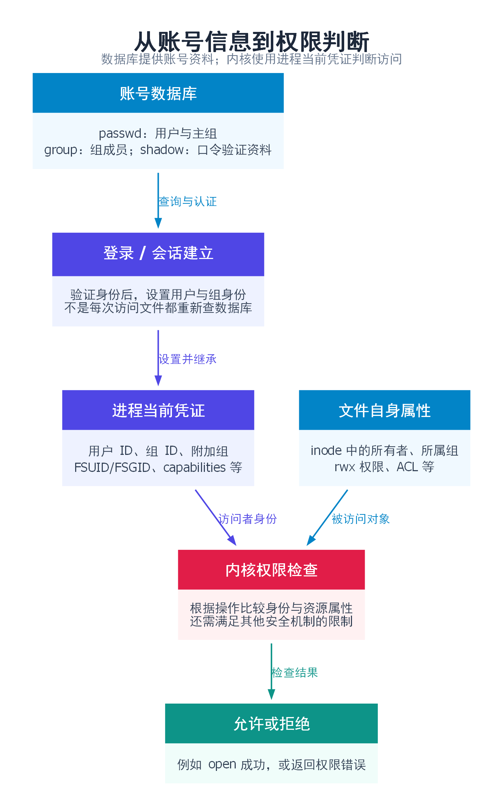
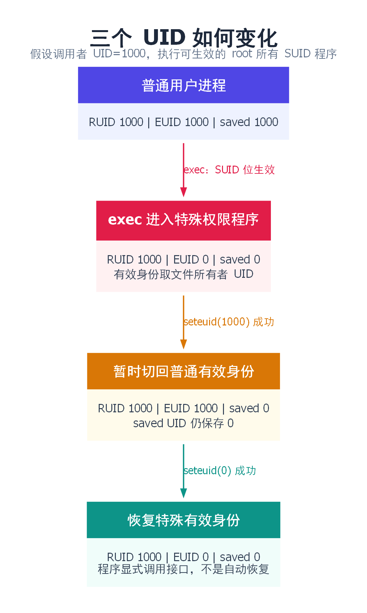
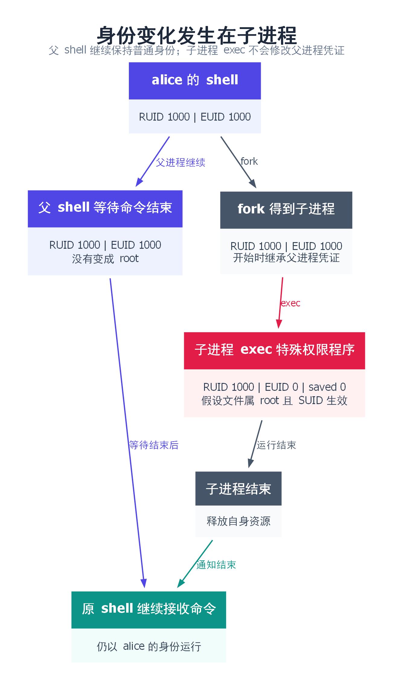
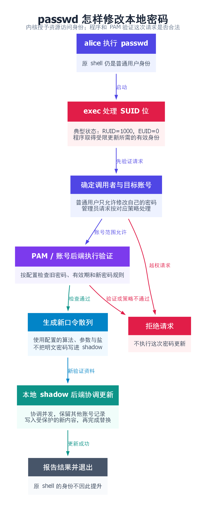
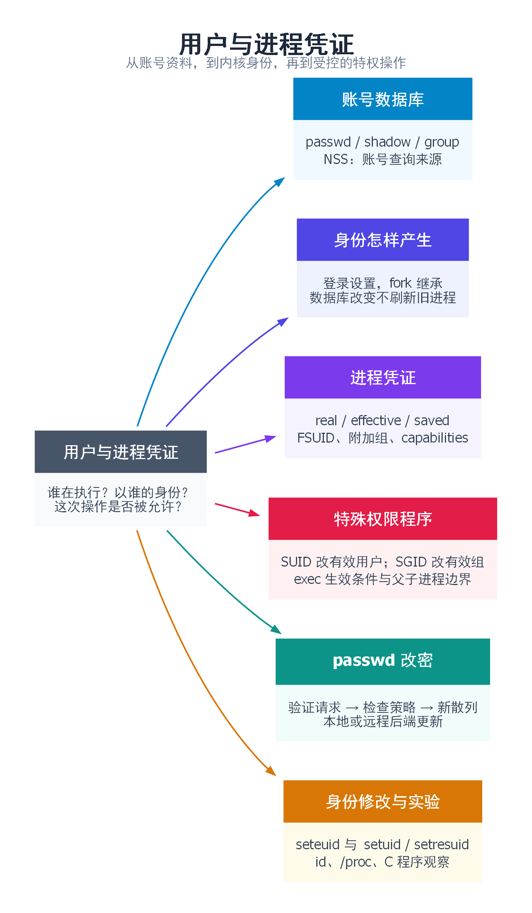

# 用户与进程凭证：从用户数据库到 setuid 程序

**用户数据库记录账号信息，进程凭证决定程序以什么身份执行操作。** 这两者有关联，但不是同一个东西。

普通用户不能直接修改 `/etc/shadow`，却能运行 `passwd` 修改自己的密码。理解这个现象，需要顺着四个问题往下看：系统怎样记录用户？进程怎样得到身份？内核检查哪个身份？程序获得较高权限后，为什么仍只允许用户修改自己的密码？

下面以 Linux/glibc、普通本地账号为主。涉及密码更新时，采用常见的“root 所有的 set-user-ID passwd＋PAM＋本地 shadow 数据库”配置；具体发行版和网络账号可以使用不同后端。

## 目录

- [1. 用户、组和进程是三种不同的对象](#basics)
- [2. 用户和组数据库：passwd、shadow、group](#databases)
- [3. 从登录到程序运行：凭证怎样进入进程](#login)
- [4. real、effective、saved UID 各管什么](#uids)
- [5. 内核怎样根据凭证检查权限](#permission)
- [6. set-user-ID 与 set-group-ID 程序](#special-bits)
- [7. passwd 为什么能修改 shadow](#passwd-flow)
- [8. 修改进程身份：setuid、seteuid、setresuid](#change-identity)
- [9. 实验：观察自己的凭证及身份切换](#experiment)
- [10. 常见问题与接口速查](#faq)
- [11. 思维导图总结](#mindmap)

<a id="basics"></a>

## 1. 用户、组和进程是三种不同的对象

### 1.1 先用“员工、部门和办事人员”理解

可以把用户账号看成员工档案，UID 是员工编号；组类似部门，GID 是部门编号。一个员工可以属于多个部门。

进程则是正在执行任务的程序。它带着一份由内核管理的身份信息，系统据此判断它能读什么文件、发什么信号、修改什么状态。

这份身份信息叫作**凭证（credentials）**。这里的“凭证”不是密码或登录令牌字符串，而是 UID、GID、附加组、capabilities 等内核状态。

| 概念 | 例子 | 主要作用 |
|---|---|---|
| 用户名 | alice | 便于人识别账号 |
| UID | 1000 | 标识用户身份 |
| 组名 | developers | 便于人识别一组用户 |
| GID | 2000 | 标识组身份 |
| PID | 4321 | 标识一个进程 |
| 进程凭证 | UID、GID、附加组等 | 为权限判断提供身份依据 |

alice 同时运行编辑器和终端，会有多个 PID，但这些进程通常带着 alice 的用户身份。**PID 回答“哪个进程”，UID 回答“什么用户身份”，不能互换。**

### 1.2 用户名给人看，内核主要使用编号

假设文件属性中保存所有者 UID=1000，用户数据库把 1000 对应到 alice。`ls -l` 查到名称后显示 alice；`ls -ln` 可以直接显示数值编号。

文件不会因为账号改名，就把内容或所有权自动换成另一份。相反，如果删除账号后又把相同 UID 分配给新账号，原来属于该 UID 的文件可能被新账号视为自己的文件。

UID=0 传统上对应 root。普通账号常从 1000 一类的编号开始，但编号范围由系统配置决定，不应把“所有 UID 小于 1000 都是什么”当作通用规则。

### 1.3 文件的所有者与访问它的进程，是两边的信息

前一章中的 inode 保存文件所有者、所属组和权限。本章讲的是访问者的身份：



例如，文件属于 UID=1000，而进程当前用于文件访问的用户身份也是 1000，内核才按所有者规则检查。文件叫 `alice.txt` 并不能证明它属于 alice，进程名字叫 `root-tool` 也不会获得 root 身份。

先区分这两边，接下来才有必要看“账号信息从哪里来”。

<a id="databases"></a>

## 2. 用户和组数据库：passwd、shadow、group

### 2.1 三个文件分开保存什么

| 文件 | 主要内容 | 通常谁能读取 |
|---|---|---|
| `/etc/passwd` | 用户名、UID、主组 GID、主目录、登录 shell 等 | 普通用户通常可读 |
| `/etc/shadow` | 口令散列及密码有效期规则 | 受限读取，不能让所有普通用户读取 |
| `/etc/group` | 组名、GID、显式组成员列表 | 普通用户通常可读 |

`/etc/passwd` 的名字里虽然有 passwd，现代系统通常不把实际口令散列放在其中。很多程序需要查询用户名和 UID 的对应关系，这些基础资料可以公开；口令验证数据则单独放进权限更严格的 shadow。

### 2.2 /etc/passwd：用户基本资料

一行记录有七个字段，用冒号分隔：

```text
alice:x:1000:1000:Alice:/home/alice:/bin/bash
```

| 位置 | 本例值 | 含义 |
|---|---|---|
| 1 | alice | 用户名 |
| 2 | x | 通常表示口令信息另存于 shadow |
| 3 | 1000 | UID |
| 4 | 1000 | 主组 GID |
| 5 | Alice | 描述信息，也称 GECOS 字段 |
| 6 | /home/alice | 主目录 |
| 7 | /bin/bash | 登录 shell |

主目录是账号配置，不意味着进程运行时一定停留在那里；进程可以通过 chdir 改变工作目录。

第二个字段的 `x` 不是密码，也不是“没有密码”。登录 shell 为 `nologin` 一类程序，通常用于限制交互式登录；服务进程仍可以使用这个账号的 UID 运行。

[参考：passwd(5)](https://man7.org/linux/man-pages/man5/passwd.5.html)

### 2.3 /etc/shadow：口令验证资料和有效期

下面用占位文字表示口令字段，不是一条可直接写入系统的记录：

```text
alice:<口令散列字段>:20000:0:99999:7:::
```

| 位置 | 含义 | 计量或说明 |
|---|---|---|
| 1 | 用户名 | 与账号对应 |
| 2 | 口令字段 | 可包含算法标识、参数、盐和散列结果，格式取决于算法 |
| 3 | 上次修改密码的日期 | 从 1970-01-01 起算的天数 |
| 4 | 两次修改的最小间隔 | 天数 |
| 5 | 密码最长有效时间 | 天数 |
| 6 | 到期前警告时间 | 天数 |
| 7 | 密码过期后允许的宽限期 | 天数，空值含义按接口规则处理 |
| 8 | 账号到期日期 | 从 1970-01-01 起算的天数 |
| 9 | 保留字段 | 通常为空 |

口令散列不是把明文密码“加密后等着解密”。验证时，用输入的密码、保存的算法参数和盐重新计算，再比较结果。盐有助于避免相同密码直接得到相同结果；算法成本参数提高每次猜测所需的计算量。

字段中的 `!`、`*` 等特殊形式常用于禁止对应的密码验证方式。**锁住密码不等于账号的所有访问方式都被关闭**，SSH 密钥等是否仍可用，要看其他认证和账号策略。

shadow 的具体权限可能是 root 专用，也可能允许特定受限组读取，不能把某个发行版的权限位写成全部系统的固定规则。

[参考：shadow(5)](https://man7.org/linux/man-pages/man5/shadow.5.html)

### 2.4 /etc/group：主组和附加组要一起看

示例：

```text
alice:x:1000:
developers:x:2000:alice,bob
```

格式是：

```text
组名:组口令字段:GID:逗号分隔的成员列表
```

alice 的 `/etc/passwd` 记录把主组设置为 GID=1000；developers 的成员列表又包含 alice，因此 alice 还可被配置为该组的成员。

**一个人的主组关系记录在 passwd 的 GID 字段里，不要求其用户名同时出现在 group 的成员列表中。** 因此，仅查最后一列有没有 alice，可能漏掉主组关系。

组口令字段经常是 `x`，相关受限信息可涉及 `/etc/gshadow`；一般应用关注的是组编号及成员身份，而不是使用组口令。

[参考：group(5)](https://man7.org/linux/man-pages/man5/group.5.html)

### 2.5 为什么查用户时常用 getent，而不是自己解析文件

这些文件保存本地账号信息，但系统还可能通过 LDAP、SSSD 等服务提供用户和组。glibc 的 NSS 机制按 `/etc/nsswitch.conf` 配置决定查询来源。

```bash
getent passwd alice
getent group developers
id alice
```

这些命令可以通过系统配置查询，不必假定所有账号都在本地文本文件中。C 程序通常使用 `getpwnam()`、`getpwuid()`、`getgrnam()` 等接口；多线程程序还要注意返回存储的生命周期，常使用对应的 `_r` 接口。

**查询数据库不会改变进程身份。** 程序即使成功查到了 root 的 UID=0，也不意味着它能把自己改成 root。[参考：nsswitch.conf(5)](https://man7.org/linux/man-pages/man5/nsswitch.conf.5.html)

<a id="login"></a>

## 3. 从登录到程序运行：凭证怎样进入进程

### 3.1 登录成功，不只是显示一个 shell

用户输入账号和密码后，登录服务先验证身份、检查账号是否允许登录。验证通过后，具有相应权限的登录程序为用户会话设置组列表和用户身份，再启动 shell。

可以把常见过程理解为：

1. 查询账号，取得 UID、主组 GID 等资料。
2. 通过 PAM 等机制验证用户并检查账号策略。
3. 为会话设置主组和附加组。
4. 将会话进程切换到用户身份。
5. 启动 shell，之后 shell 启动的普通程序继承这些凭证。

这是常见流程的概念顺序，不要求每种登录服务采用完全相同的函数调用组合。

### 3.2 fork 继承身份，exec 按规则建立新程序身份

普通 shell 启动命令时，通常先创建子进程，再由子进程执行新程序：

```text
alice 的 shell
    → fork：子进程继承凭证
    → exec：装入 ls、cat 等程序
    → 新程序通常仍以 alice 的身份运行
```

fork 创建了新进程；exec 替换的是当前进程执行的程序，通常保留 PID。

普通程序执行时，real/effective IDs 通常保持原值；saved IDs 会按 exec 后的 effective IDs 更新。若执行文件具有可生效的 set-user-ID 或 set-group-ID 位，effective IDs 会发生后文说明的变化。

### 3.3 数据库改了，已有进程不会自动刷新

管理员把 alice 加入 developers 后：

- `id alice` 查询账号配置，可能已经显示新组。
- 旧终端里的 `id` 查看当前进程继承的身份，可能还没有新组。

原因是：旧 shell 的附加组列表已经存在于内核凭证中。内核不会每次打开文件时都重新解析 `/etc/group`。

重新登录建立新会话，或者通过专门工具建立具有新组身份的会话，才可能取得更新后的组列表。反过来，把用户从数据库的组列表删除，也不会自动收回所有已有进程持有的组身份。

[参考：credentials(7)](https://man7.org/linux/man-pages/man7/credentials.7.html)

### 3.4 凭证在内核里，不能靠修改普通变量伪造

Linux 内核用 `struct cred` 等结构保存身份信息，任务通过内核中的关联找到自己的凭证。用户程序不能直接把这块内核数据当普通内存修改。

例如：

```c
uid_t uid = getuid();
uid = 0;
```

第二行只是把程序自己的局部变量改成 0，进程身份没有变化。再次调用 getuid，仍会查询内核保存的实际用户 ID。

真正切换身份时，程序调用 setuid 等接口，由内核先验证是否允许，再准备和提交新的凭证。内核的凭证管理采用复制后替换等机制，而不是允许用户程序直接改写已经发布的凭证字段。

所以，`/etc/passwd` 是账号资料来源，局部变量是程序手里的一个数，`struct cred` 才参与运行时身份管理。接下来讨论的三种 UID，就是这份内核凭证中的不同身份字段。

[参考：Linux 内核凭证文档](https://docs.kernel.org/security/credentials.html)

<a id="uids"></a>

## 4. real、effective、saved UID 各管什么

### 4.1 为什么一个进程不只保存一个 UID

普通程序通常只需要一个用户身份。但密码修改工具提出了两个不同要求：

- 要知道普通用户是谁，防止他冒充别人改密码。
- 要获得完成受限更新所需的权限，否则连密码数据库都写不了。

如果只保存一个 UID，把它改成 root 后，就不能再用同一个字段区分调用者和当前操作身份。于是需要区分 real UID 和 effective UID；为了允许暂时放下特殊身份、之后按规则恢复，还保存 saved set-user-ID。

| 字段 | 中文含义 | 核心作用 |
|---|---|---|
| RUID：real UID | 实际用户 ID | 通常保留程序调用者的用户身份，某些检查也使用它 |
| EUID：effective UID | 有效用户 ID | 表示当前有效用户身份，参与许多权限判断 |
| saved set-user-ID | 保存的用户 ID | 保存一个可供身份切换规则使用的 UID |

**saved UID 不是最初登录者的永久备份，也不是退出时自动恢复身份的开关。** 它会按 exec 和身份修改接口的规则更新。

本文把保存的用户 ID 写作 saved UID，避免与文件上的 SUID 权限位混淆。

### 4.2 用一组数字看区别

假设 alice 的 UID=1000，执行一个 root 所有、set-user-ID 位生效的程序：

| 时刻 | RUID | EUID | saved UID |
|---|---:|---:|---:|
| 普通用户程序 | 1000 | 1000 | 1000 |
| exec 进入 set-user-ID-root 程序后 | 1000 | 0 | 0 |
| 程序暂时把 EUID 改成 1000 | 1000 | 1000 | 0 |
| 程序按规则恢复 EUID=0 | 1000 | 0 | 0 |

第二行中，RUID 仍能帮助程序识别原来的普通调用者；EUID 提供当前特殊身份；saved UID 保存可供恢复使用的身份。第三、四行需要程序显式调用相关接口，不是系统定时自动切换。



这张图展示一般身份切换规律，并不是说所有 passwd 实现都必须执行这套临时降权流程。

### 4.3 real UID 也不是不可改变的审计身份

具备权限的程序可以通过身份修改接口改变 RUID。因此，“RUID 永远等于最初登录用户”是不准确的。

通过 sudo 启动程序时，目标命令的 RUID/EUID 等还可能都被设置为目标用户。不能只看某个子进程的 RUID，就推断它最初来自哪个终端用户。审计来源还涉及独立的登录会话、审计记录等机制。

### 4.4 GID 也有对应的三种身份

组同样有 real GID、effective GID 和 saved set-group-ID。另外还有**附加组列表**。

例如，一个普通 alice 进程可能是：

```text
RUID / EUID / saved UID：1000 / 1000 / 1000
RGID / EGID / saved GID：1000 / 1000 / 1000
附加组：2000、3000 等
```

set-group-ID 程序可以改变 EGID，但不等于把附加组列表也全部替换。判断进程能否利用某个组的文件权限，需要同时看相关组身份和附加组。

<a id="permission"></a>

## 5. 内核怎样根据凭证检查权限

### 5.1 文件访问：拿进程身份与文件属性比较

先看没有扩展 ACL、没有额外特权绕过的普通文件。内核根据访问身份与文件所有者、所属组的关系，选择所有者、组或其他人对应的权限位。

例如 `report.txt` 属于 alice，权限为 0640：

```text
所有者：读、写
所属组：读
其他人：无权限
```

进程以 alice 的文件访问身份打开它时，按所有者权限检查；不是所有者，但相关组身份匹配时，按组权限检查；否则才看其他人。匹配了某类身份却权限不足，不是继续挑另一类更宽松的权限。

### 5.2 Linux 还有 FSUID 和 FSGID

初学时常说“访问文件看 EUID/EGID”。在 Linux 中，更精确地说，常规文件权限检查使用 **FSUID、FSGID 和附加组**。

FSUID/FSGID 通常随 effective IDs 变化，因此绝大多数普通程序中二者一致。除非专门调用相关接口改变文件系统身份，否则把 EUID 理解为当前文件访问身份通常能解释现象。

这不是要再引入另一套不相关概念，而是说明前面那个简化规则成立的条件。读取 `/proc/PID/status` 时，Uid/Gid 行的第四个数就是文件系统身份。

### 5.3 其他检查不一定用相同字段

`access()` 与通常的 `open()` 检查目标不同：传统 `access()` 主要使用 real IDs 判断调用者身份能否访问，不能用它保证接下来 open 一定成功。

一方面身份基准可能不同，另一方面两次调用之间路径可能被替换。需要打开文件时，应检查实际 open 的返回结果，而不是把“先 access 成功”当作安全承诺。[参考：access(2)](https://man7.org/linux/man-pages/man2/access.2.html)

### 5.4 UID=0 为什么仍不等于无条件成功

现代 Linux 把许多传统 root 权限拆成 capabilities，例如 `CAP_SETUID` 与身份修改有关，`CAP_DAC_OVERRIDE` 与绕过部分普通文件权限检查有关。

除此之外，还要考虑只读文件系统、SELinux/AppArmor、用户命名空间等机制。容器内看到 UID=0，也不表示获得宿主机所有权限。

因此，后文的“root 权限”是典型主机环境下的便于理解的说法；具体操作始终需要检查结果。[参考：capabilities(7)](https://man7.org/linux/man-pages/man7/capabilities.7.html)

<a id="special-bits"></a>

## 6. set-user-ID 与 set-group-ID 程序

### 6.1 特殊权限位保存在可执行文件上

普通可执行文件可能显示：

```text
-rwxr-xr-x root root ... tool
```

set-user-ID 文件可能显示：

```text
-rwsr-xr-x root root ... tool
```

所有者执行位的位置出现小写 `s`，表示 set-user-ID 位和该位置的执行位都已设置。如果是大写 `S`，表示特殊位设置了，但对应执行位没设置；它不是额外增加执行许可。

常见数字写法：

| 权限 | 含义 |
|---|---|
| 0755 | 普通执行权限 |
| 4755 | 0755 加 set-user-ID |
| 2755 | 0755 加 set-group-ID |
| 6755 | 同时设置这两个特殊位 |

文件权限位只定义执行时可能发生的身份变化，不意味着任何人都能执行它；执行许可和其他限制仍然适用。

### 6.2 真正改变身份的是 exec 阶段的内核处理

在典型条件下，执行 set-user-ID 程序时：

1. 内核检查执行文件及执行条件。
2. 如果 set-user-ID 位可以生效，把 EUID 改成该文件所有者的 UID。
3. 将变化后的 EUID 保存到 saved UID。
4. RUID 保留原值。
5. 新程序开始运行，进入 main 时就已经具有相应身份。

所以，root 所有的 set-user-ID 程序不需要先从普通身份“偷偷调用 setuid(0)”来取得 root；身份变化在进入程序之前已经由 exec 的规则完成。

如果文件属于 UID=2000，生效后 EUID 是 2000，不是 0。**set-user-ID 的含义是“使用文件所有者身份”，不是“固定变成 root”。**

### 6.3 set-group-ID 是对应的组身份变化

可执行文件设置 set-group-ID 位时，生效后 EGID 变为文件所属组 GID，随后保存到 saved GID；RGID 以及附加组不会因为这个位就自动全部改成同一组。

只需要访问某个受限组资源时，可以用组权限设计受限工具，不一定要给整个程序 root 身份。

### 6.4 程序身份变化不会反过来修改父 shell



alice 的 shell 创建子进程，子进程 exec 进入特殊权限程序。改变的是子进程的凭证。程序结束后，用户回到原 shell；不是先把 shell 变成 root，再帮它改回来。

普通文件“所有者是 root”也不够。只有相关特殊权限位和执行条件都满足，才发生上述变化。

### 6.5 有特殊权限位，为什么实际没有提权

| 条件 | 影响 |
|---|---|
| 文件系统以 `nosuid` 挂载 | 特殊位不能按通常方式授予身份 |
| 调用线程设置 `no_new_privs` | exec 不能借这类机制获得新增权限 |
| 进程正在被 ptrace 跟踪 | 特殊权限执行受到限制，不能按普通场景推断 |
| 给脚本设置 set-user-ID | Linux 不按普通原生可执行文件的方式认可脚本的该特殊位 |
| 程序自行降权 | 可能进入 main 后立即放弃部分身份 |

因此，用普通用户的 `strace` 直接跟踪一个 set-user-ID 程序，可能改变本来想观察的行为。排错时先查看实际 ID，而不是仅看 `ls -l` 有一个 s 就认定已经提权。[参考：execve(2)](https://man7.org/linux/man-pages/man2/execve.2.html)

### 6.6 目录上的 set-group-ID 是另一种用途

如果目录设置 set-group-ID 位，新建子项通常继承这个目录的所属组；新建子目录还会继承该特殊位。这用于共享工作目录的组归属管理。

进入这样的目录不会把进程 EGID 改掉。**目录继承规则与可执行程序的身份切换规则，虽然使用同一个权限位，但处理的是不同对象和不同操作。**


<a id="passwd-flow"></a>

## 7. passwd 为什么能修改 shadow

### 7.1 先看直接修改为什么失败

普通 alice 进程的有效用户身份通常是 1000，而 shadow 不允许 alice 随意写入。用普通编辑器打开它并尝试修改时，会被文件权限等机制拒绝。

如果为了让用户改自己的密码，就把 shadow 设成所有人可写，用户也能修改别人的记录，整个认证机制就失去了保护。

所以需要一个中间程序：它拥有完成更新所需的权限，但只提供有限操作，并验证调用者是否有资格执行这次操作。`passwd` 正是这类程序的典型例子。

### 7.2 程序有写权限，与用户被允许改谁，是两层判断

常见系统上的 `/usr/bin/passwd` 由 root 所有，并具有 set-user-ID 位。alice 执行后，进程可能处于：

```text
RUID = 1000：普通调用者 alice
EUID = 0：程序当前具有 root 有效身份
saved UID = 0：exec 保存下来的有效身份
```

内核根据进程凭证和访问限制决定能否操作受保护资源。**内核并不知道“alice 只能改 alice 那一行密码”这条业务规则。**

限制修改哪个账号、是否需要旧密码、是否符合密码策略，主要由 passwd、PAM 模块及相关服务共同完成。

| 判断 | 负责者 | 例子 |
|---|---|---|
| 是否允许程序打开和更新受保护数据库 | 内核权限机制及安全策略 | 文件访问权限、capabilities、SELinux 等 |
| 本次调用者是否能修改指定账号 | passwd/PAM 等用户态逻辑 | 普通用户只能改自己，管理员按策略处理 |
| 新密码是否符合规则 | 配置的密码模块和后端 | 长度、复杂度、历史密码、有效期等 |

这就是为什么“程序能写 shadow”不等于“用户可以任意编辑 shadow”。[参考：passwd(1)](https://man7.org/linux/man-pages/man1/passwd.1.html)

### 7.3 一次修改密码经历什么



按这张图逐步看：

**第一步：启动程序，取得受限操作所需的身份。**

shell 启动 passwd，exec 处理 set-user-ID 位。此时只是程序有了执行受限操作的条件，尚未说明这次请求已经获准。

**第二步：确定调用者和目标账号。**

普通用户不指定账号时，通常修改自己的密码；试图指定其他账号会受到权限检查。程序不能把“EUID 是 0”简单当成“最初调用者就是管理员”，因为普通用户执行 set-user-ID-root 程序后也会是这个 EUID。

**第三步：按 PAM 配置检查账号和旧密码。**

很多发行版的 passwd 使用 PAM。PAM 按服务配置调用模块，例如本地口令常涉及 `pam_unix`，还可以有密码质量检查模块。

普通用户修改自己的本地密码通常要提供当前密码；管理员重置他人密码的规则不同。验证时比较的是计算结果，不是从 shadow 解密出原密码。[参考：pam_unix(8)](https://man7.org/linux/man-pages/man8/pam_unix.8.html)

**第四步：取得并检查新密码。**

交互中通常要求输入两次以避免输错。密码质量、历史限制、最小修改间隔等检查由实际配置决定，并非所有机器都采用同一套规则。

**第五步：生成新的口令散列。**

模块根据配置选择算法和成本参数，生成盐并计算新结果。用于验证的散列字段和修改日期等信息随后交给对应后端保存。明文密码不应直接写入 shadow 或普通日志。

**第六步：协调更新本地数据库。**

对于本地 shadow 后端，更新需要避免两个修改者互相覆盖，也要避免把数据库写到一半就供其他程序读取。常见实现会协调加锁、读取当前记录、生成完整的新文件、保持适当的所有者和权限，再替换旧路径并释放锁。

例如，原文件有 alice 和 bob 两行：改 alice 时，不能只写 alice 的新行就丢掉其他账号。也不能让两个进程都根据过时副本分别写回，导致后一次覆盖前一次的修改。

临时文件替换解决的是可见内容的完整切换；掉电持久性还涉及同步写入和文件系统保证，不能仅凭“用了 rename”就断言所有崩溃都不会丢更新。[实现参考：Linux-PAM 密码更新代码](https://github.com/linux-pam/linux-pam/blob/master/modules/pam_unix/pam_unix_passwd.c)、[本地口令验证与文件更新代码](https://github.com/linux-pam/linux-pam/blob/master/modules/pam_unix/passverify.c)

### 7.4 为什么不能说“passwd 一定直接 write shadow”

具体更新者可能是 PAM 模块、受限辅助程序，或者远程账号服务。部分安全配置会使用专门的辅助程序进一步限制直接访问数据库的范围。

LDAP、SSSD 等网络账号改密，还可能把请求提交到远端，并不以更新本机 `/etc/shadow` 为最终结果。

因此，理解底层机制时要分清三件事：

1. **执行身份从哪里来**：set-user-ID、服务身份或其他特权机制。
2. **这次请求为什么被允许**：账号与调用者验证、PAM 和服务策略。
3. **最终数据写到哪里**：本地 shadow，或实际配置的账号后端。

[参考：unix_update(8)](https://man7.org/linux/man-pages/man8/unix_update.8.html)

### 7.5 修改密码不会把父 shell 变成 root

更新成功后，passwd 进程结束，它持有的资源随退出清理。原来的 shell 一直保留普通用户身份，继续等待下一条命令。

密码数据库内容改变了，但这不是把现有进程凭证全部重新生成。已经登录的会话是否要结束、哪些令牌要失效，是另外的会话管理策略。

<a id="change-identity"></a>

## 8. 修改进程身份：setuid、seteuid、setresuid

### 8.1 同名容易混淆：文件权限位与系统调用不同

| 名称 | 放在哪里或由谁执行 | 作用 |
|---|---|---|
| set-user-ID 位 | 可执行文件的权限属性 | exec 时影响新程序有效身份 |
| `setuid(uid)` | 运行中的程序调用 | 按调用者权限修改进程用户身份 |
| saved UID | 内核凭证字段 | 参与身份恢复和修改规则 |

普通用户调用 `setuid(0)` 通常失败。知道数字 0 并不构成授权；内核会检查当前凭证及相应 capability。

### 8.2 先掌握查询接口

```c
uid_t getuid(void);     /* RUID */
uid_t geteuid(void);    /* EUID */
gid_t getgid(void);     /* RGID */
gid_t getegid(void);    /* EGID */
```

Linux 中可以用 `getresuid()` 一次取得 real、effective、saved 三个 UID，`getresgid()` 查询三个 GID。`getgroups()` 取得附加组列表。完整程序见第 9 节。

### 8.3 seteuid：临时改变有效身份

在现代 glibc 中，`seteuid()` 修改 EUID，不改变 saved UID。没有相应特权时，目标通常只能是当前 real、effective、saved UID 中允许的值。

从下列状态开始：

```text
RUID=1000，EUID=0，saved UID=0
```

程序调用 `seteuid(1000)` 成功后，变成：

```text
RUID=1000，EUID=1000，saved UID=0
```

随后它仍可按 saved UID 的规则恢复 EUID=0。此时能够恢复的原因不是“曾经做过 root”，而是**当前凭证中仍保留了允许恢复的 saved UID**。[参考：seteuid(2)](https://man7.org/linux/man-pages/man2/seteuid.2.html)

saved UID 仍为 0 时，不应声称已经不可逆地放弃权限，也不宜在这段期间运行不可信插件或命令。

### 8.4 setuid：是否同时修改三个 UID，取决于权限

在 Linux 中，具备相应 `CAP_SETUID` 权限时，`setuid(target)` 会设置 real、effective 和 saved UID；缺少该权限时，只能按更受限的规则改变有效身份。

因此，典型 set-user-ID-root 程序如果执行：

```c
setuid(getuid());
```

成功后可能得到：

```text
原来：1000 / 0 / 0
后来：1000 / 1000 / 1000
```

saved UID=0 已经丢掉，就不能再靠 saved UID 把 EUID 恢复为 0。临时降权与永久放弃原身份，不应混用同一套写法。

所有这类调用都必须检查返回值。若降权失败却继续处理不可信输入，程序可能仍在高权限下运行。[参考：setuid(2)](https://man7.org/linux/man-pages/man2/setuid.2.html)

### 8.5 setresuid：显式指定三个身份

Linux 提供：

```c
int setresuid(uid_t ruid, uid_t euid, uid_t suid);
```

三个参数对应 real、effective、saved；某参数传 `(uid_t)-1` 表示不改这一项。例如：

```c
/* 只示意参数含义；成功与否仍取决于权限。 */
setresuid((uid_t)-1, target_uid, (uid_t)-1);
```

对需要明确丢弃旧身份的程序，显式将三个值设置为目标 UID，比只想着“改 EUID”更容易说明意图。但完整权限收缩仍要处理组、capabilities 和已打开资源。

[参考：setresuid(2)](https://man7.org/linux/man-pages/man2/setresuid.2.html)

### 8.6 为什么放弃权限还要考虑组和 fd

假设服务以 root 启动，最后要以受限账号工作。典型安排是：

1. 在仍具备权限时，清理或建立目标附加组列表。
2. 设置目标 real/effective/saved GID。
3. 设置目标 real/effective/saved UID。
4. 核验调用结果及最终身份；按设计处理 capabilities 等额外权限。
5. 关闭不该交给后续代码的文件、socket 等资源。

先处理组，是因为先放弃用户特权后，可能已经没有权限再修改组列表。

只把 EUID 改成普通用户，并不会自动关闭此前以高权限打开的 fd。已经打开的资源可能仍可使用，因此“现在 EUID 是普通用户”不等于“没有任何高权限遗留能力”。

### 8.7 exec 也会影响 saved UID

假设程序处于 `1000 / 1000 / 0`，随后 exec 一个普通、没有特殊身份位的程序。exec 会把有效 UID 复制到 saved UID，因此新程序通常变成 `1000 / 1000 / 1000`。

不能以为旧进程记录的 saved UID=0 会无条件穿过所有 exec。是否保留或变化，要按实际 exec 规则判断。

### 8.8 多线程程序里不要自行绕过凭证协调

Linux 内核在任务层面维护凭证，POSIX 线程接口则要求进程中的线程具有一致的用户/组身份。glibc 的相关包装函数会协调其他线程更新。

直接调用底层 syscall 绕过库包装，可能造成不同线程凭证不一致。服务设计中通常在创建工作线程之前完成必要的身份设置，并避免边处理请求边随意切换整组线程身份。

[参考：credentials(7)](https://man7.org/linux/man-pages/man7/credentials.7.html)、[setuid(2)](https://man7.org/linux/man-pages/man2/setuid.2.html)

<a id="experiment"></a>

## 9. 实验：观察自己的凭证及身份切换

### 9.1 先用只读命令看实际状态

在 Linux shell 中执行：

```bash
id
id -u                # 有效 UID
id -ru               # 实际 UID
id -g                # 有效 GID
id -G                # 当前组身份列表
getent passwd "$(id -un)"

grep -E '^(Uid|Gid|Groups|NoNewPrivs|CapEff):' /proc/$$/status
ls -l /usr/bin/passwd /etc/passwd /etc/shadow /etc/group
```

`/proc/$$/status` 查看当前 shell。Uid/Gid 行的四个数字按顺序是：

```text
Real    Effective    Saved    Filesystem
```

例如 `1000 1000 1000 1000` 表示四种身份当前一致。`Groups` 列出附加组；`CapEff` 是有效 capability 集合的位掩码。

这些命令只查看状态，不需要读取 shadow 中实际保存的散列值。

### 9.2 完整 C 程序：打印凭证，选择性演示临时切换

保存为 `credentials_demo.c`。默认只打印凭证；加 `--cycle` 时，在 RUID 与 EUID 不同的前提下，临时切换到 RUID，再恢复启动时的 EUID。程序不读写密码文件，也不启动其他命令。

```c
#define _GNU_SOURCE
#include <errno.h>
#include <inttypes.h>
#include <stdio.h>
#include <stdlib.h>
#include <string.h>
#include <sys/types.h>
#include <unistd.h>

static int show_ids(const char *stage)
{
    uid_t r, e, s;
    gid_t gr, ge, gs;
    if (getresuid(&r, &e, &s) == -1) {
        perror("getresuid");
        return -1;
    }
    if (getresgid(&gr, &ge, &gs) == -1) {
        perror("getresgid");
        return -1;
    }

    printf("[%s] pid=%jd\n", stage, (intmax_t)getpid());
    printf("  UID real=%ju effective=%ju saved=%ju\n",
           (uintmax_t)r, (uintmax_t)e, (uintmax_t)s);
    printf("  GID real=%ju effective=%ju saved=%ju\n",
           (uintmax_t)gr, (uintmax_t)ge, (uintmax_t)gs);

    int count = getgroups(0, NULL);
    if (count == -1) {
        perror("getgroups count");
        return -1;
    }
    gid_t *groups = NULL;
    if (count > 0) {
        groups = calloc((size_t)count, sizeof(*groups));
        if (groups == NULL) {
            perror("calloc");
            return -1;
        }
        int actual = getgroups(count, groups);
        if (actual == -1) {
            perror("getgroups");
            free(groups);
            return -1;
        }
        count = actual;
    }
    printf("  supplementary groups:");
    for (int i = 0; i < count; ++i)
        printf(" %ju", (uintmax_t)groups[i]);
    if (count == 0)
        printf(" (none)");
    putchar('\n');
    free(groups);
    return 0;
}

int main(int argc, char **argv)
{
    if (argc > 2 || (argc == 2 && strcmp(argv[1], "--cycle") != 0)) {
        fprintf(stderr, "usage: %s [--cycle]\n", argv[0]);
        return EXIT_FAILURE;
    }
    uid_t caller = getuid();
    uid_t elevated = geteuid();

    if (show_ids("start") == -1)
        return EXIT_FAILURE;
    if (argc == 1)
        return EXIT_SUCCESS;

    if (caller == elevated) {
        puts("RUID equals EUID; no distinct identity to demonstrate.");
        return EXIT_SUCCESS;
    }
    if (seteuid(caller) == -1) {
        perror("seteuid caller");
        return EXIT_FAILURE;
    }
    if (show_ids("temporarily lowered") == -1)
        return EXIT_FAILURE;

    if (seteuid(elevated) == -1) {
        perror("seteuid restore");
        return EXIT_FAILURE;
    }
    if (show_ids("restored") == -1)
        return EXIT_FAILURE;
    return EXIT_SUCCESS;
}
```

编译并按普通用户运行：

```bash
cc -std=c11 -Wall -Wextra -Wpedantic -O2 credentials_demo.c -o credentials_demo
./credentials_demo
./credentials_demo --cycle
```

普通用户运行时，三个 UID 通常相同。`--cycle` 会提示没有不同身份可演示，不会凭空获得高权限。

### 9.3 在 Linux 测试虚拟机中观察 set-user-ID

要观察 `1000 / 0 / 0`，需要该程序成为 root 所有的 set-user-ID 可执行文件。实验应使用自己审阅、编译的上述程序，并放在普通用户不能替换程序内容的目录中。

以下是测试环境的安装命令；执行前确认目标文件不存在：

```bash
sudo install -d -o root -g root -m 0755 /usr/local/libexec
sudo install -o root -g root -m 4755 ./credentials_demo /usr/local/libexec/credentials-demo
ls -l /usr/local/libexec/credentials-demo
```

随后**从普通用户 shell 直接运行，不在前面加 sudo**：

```bash
/usr/local/libexec/credentials-demo --cycle
```

假设用户 UID=1000，且特殊位生效，预期 UID 变化为：

| 阶段 | real | effective | saved |
|---|---:|---:|---:|
| start | 1000 | 0 | 0 |
| temporarily lowered | 1000 | 1000 | 0 |
| restored | 1000 | 0 | 0 |

如果用 `sudo` 启动，sudo 可能先把 real/effective IDs 都设成 0，就观察不到普通用户进入 set-user-ID 程序的区别。

实验结束后移除测试程序：

```bash
sudo rm -- /usr/local/libexec/credentials-demo
```

这里的临时切换只演示 UID 规则，不是完整的生产环境权限隔离方案。没有改变的组身份、capabilities 或已打开资源，需要按实际程序的安全边界另行处理。

### 9.4 单独观察 set-group-ID

在测试环境中，选择一个已存在且与当前有效组不同的测试组，将下面的 `testgroup` 替换为实际组名：

```bash
sudo install -o root -g testgroup -m 2755 ./credentials_demo /usr/local/libexec/credentials-demo-sgid
/usr/local/libexec/credentials-demo-sgid
```

这次应观察 EGID 和 saved GID 变为测试组，RGID 通常仍是调用者原组；UID 不会仅因为 SGID 位就变成 root。附加组列表也不是自动改成只有 testgroup。

实验结束后清理：

```bash
sudo rm -- /usr/local/libexec/credentials-demo-sgid
```

<a id="faq"></a>

## 10. 常见问题与接口速查

### 10.1 遇到现象，从哪一层排查

| 现象 | 优先检查 |
|---|---|
| 改了 /etc/group，旧终端还是没权限 | 旧进程的附加组没有自动刷新 |
| 文件归 root 所有，运行后仍是普通用户 | 是否设置 set-user-ID 位，是否满足生效条件 |
| 显示 s，但 EUID 没变化 | nosuid、no_new_privs、跟踪状态、脚本或程序主动降权 |
| passwd 能改密码，编辑器却不能改 shadow | 特殊权限工具有受控更新流程，普通编辑器没有对应身份 |
| EUID 是 0，却不让改指定账号密码 | 程序还在检查调用者及账号策略 |
| seteuid 降权后还能恢复 | saved UID 等凭证仍允许恢复 |
| setuid 降权后不能恢复 | 可能同时改掉了 real/effective/saved IDs |
| 只改 UID 后仍有意外访问能力 | 检查组、capabilities、已打开 fd 等 |
| access 成功但 open 失败 | 身份检查规则或两次调用之间的状态可能不同 |
| 容器里是 root，宿主机文件仍不能操作 | 用户命名空间、挂载和安全策略不同 |

### 10.2 常用接口

| 目的 | 接口 |
|---|---|
| 查询实际/有效用户 | getuid、geteuid |
| 查询三个用户 ID | getresuid |
| 查询实际/有效组 | getgid、getegid |
| 查询三个组 ID | getresgid |
| 查询附加组 | getgroups |
| 查询账号或组资料 | getpwnam/getpwuid、getgrnam/getgrgid 及对应 _r 接口 |
| 修改有效用户/组 | seteuid、setegid |
| 修改用户/组身份 | setuid、setgid，具体影响取决于权限 |
| 显式修改 real/effective/saved IDs | setresuid、setresgid |
| 设置附加组或按账号初始化 | setgroups、initgroups，需要相应权限 |

### 10.3 设计受限工具时，要明确哪部分由谁保证

内核负责验证身份变化是否合法、资源访问是否允许；程序负责验证业务请求。两者缺一不可。

set-user-ID 工具不能把用户输入的路径直接当作任意高权限读写目标，也不应靠不受控的 PATH、环境变量或 shell 命令完成特权操作。身份变化成功后，还必须限制程序实际可以做什么。

如果只需要某一个受限操作，可以考虑权限更窄的组、合适的 capability 或单独的受限服务。选择哪种方式，取决于需要保护的资源以及请求怎样验证。

<a id="mindmap"></a>

## 11. 思维导图总结

```text
用户与进程凭证
├── 账号数据库
│   ├── passwd：UID、主组、主目录、shell
│   ├── shadow：口令散列和有效期
│   └── group / NSS：组成员与账号查询来源
├── 进程身份的来源
│   ├── 登录时设置身份和组
│   ├── fork 继承凭证
│   └── 数据库变化不自动刷新已有进程
├── 用户与组凭证
│   ├── real：通常保留调用者身份
│   ├── effective：当前有效身份
│   ├── saved：参与身份切换规则
│   └── FSUID/FSGID、附加组、capabilities
├── 特殊权限程序
│   ├── SUID：exec 后使用文件所有者的有效用户身份
│   ├── SGID：exec 后使用文件所属组的有效组身份
│   └── nosuid、no_new_privs、跟踪等影响生效
├── passwd 修改密码
│   ├── 有更新权限，不等于获准修改任意账号
│   ├── PAM 校验、密码策略、生成新散列
│   └── 按本地或远程后端安全更新
└── 身份修改与观察
    ├── seteuid：临时切换有效身份
    ├── setuid/setresuid：按权限修改相应 ID
    └── id、/proc、C 程序观察实际状态
```

