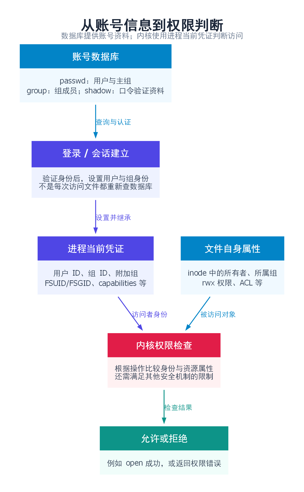
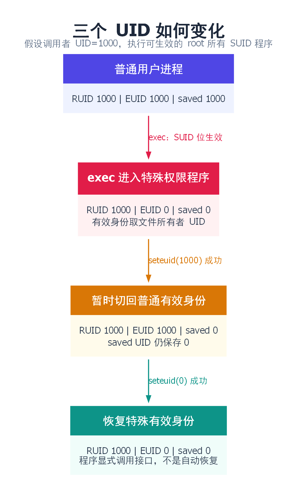
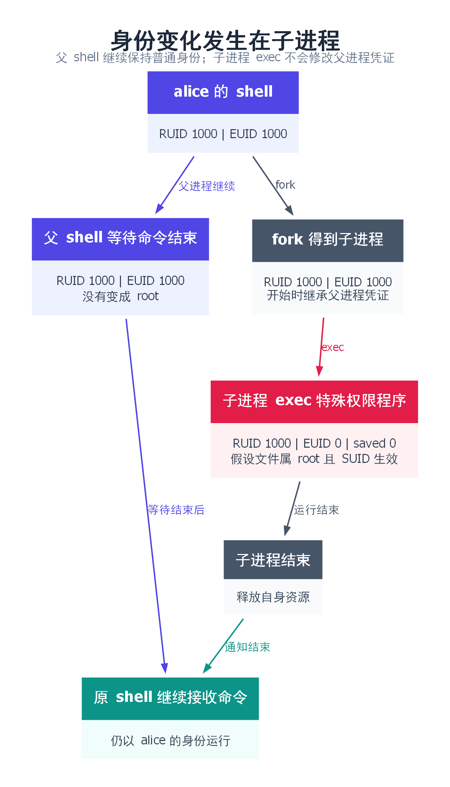
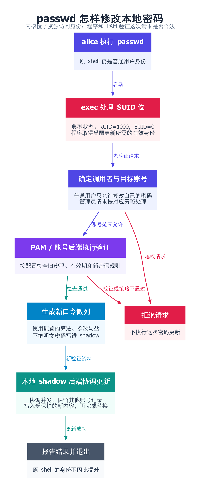
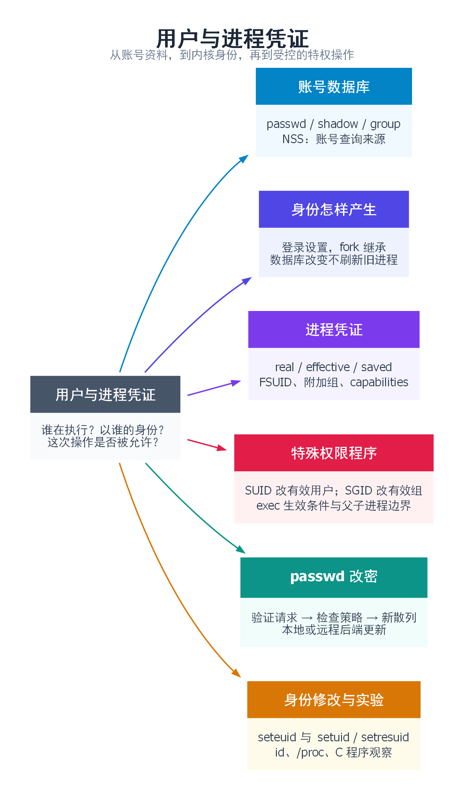

# 用户与进程凭证：从用户数据库到 setuid 程序

Alice 在 Linux 上有自己的账号。她可以输入 `passwd` 换密码，却不能用编辑器修改系统保存密码验证信息的文件。同一个人操作，为什么换个程序，能做的事就变了？

可以先想想去柜台改电话号码的情形。你能申请改自己的号码，工作人员能写入登记册。弄清楚这件事，要分别看谁提出申请、谁有权写登记册、工作人员凭什么同意这次修改。回到 Linux，Alice 输入命令，真正向系统请求写文件的是运行起来的程序。后面我们就跟着这次请求，看系统和程序各检查了什么。

只要知道“读文件”和“写文件”是什么意思，就可以从第 1 节开始。第一次读，先弄清账号、文件和运行中的程序有什么关系，再跟着第 3～7 节走一遍改密码的过程。账号记录的每一列可以用时再查。想亲眼看看自己电脑上的身份编号，可以做第 9.1 节的只读实验。全文以账号资料保存在本机的 Linux 系统为例。

## 目录

- [1. 用户、组和进程是三种不同的对象](#basics)
- [2. 用户和组数据库：passwd、shadow、group](#databases)
- [3. 从登录到程序运行：凭证怎样进入进程](#login)
- [4. real、effective、saved UID 各管什么](#uids)
- [5. 内核怎样根据凭证检查权限](#permission)
- [6. set-user-ID 与 set-group-ID 程序](#special-bits)
- [7. passwd 为什么能修改 shadow](#passwd-flow)
- [8. 修改进程身份：setuid、seteuid、setresuid](#change-identity)
- [9. 实验：观察自己的凭证及身份切换](#experiment)
- [10. Q&A（常见问题与解答）与接口速查](#faq)
- [11. 思维导图总结](#mindmap)

<a id="basics"></a>

## 1. 用户、组和进程是三种不同的对象

### 1.1 先用“员工、部门和办事人员”理解

假设 Alice 用编辑器打开一份报告。这里有三个角色。Alice 登录时用的是**用户账号**。磁盘上装着编辑器这个**程序**。双击图标以后，编辑器开始运行，这个正在运行的实例叫**进程**。稍后 Alice 点击“保存”，向系统请求写报告的就是编辑器进程。

系统怎么知道编辑器在替谁做事？可以把账号想成员工档案，把进程随身带的身份信息想成工牌。档案里写着姓名和工号，工牌上也有工号。Linux 给每个用户身份分配一个数字，叫**用户编号（UID）**。假设 Alice 的编号是 1000，她启动的普通编辑器通常也带着编号 1000。

多人要共用报告时，可以把他们列入同一个**组**，再把读报告的权限给这个组。Linux 也用数字识别组，叫**组编号（GID）**。账号有一个默认的组，叫**主组**，还可以加入其他组，叫**附加组**。

进程的这张“工牌”由**内核**保管。内核是操作系统中实际处理打开文件等请求的部分。它为进程记录的用户编号、组编号等身份信息，合起来叫**进程凭证**。另有一个编号专门区分正在运行的进程，叫**进程号（PID）**。即使两个编辑器进程都替 Alice 做事，也能按进程号区分它们。

| 概念 | 例子 | 主要作用 |
|---|---|---|
| 用户名 | alice | 便于人识别账号 |
| UID | 1000 | 标识用户身份 |
| 组名 | developers | 便于人识别一组用户 |
| GID | 2000 | 标识组身份 |
| PID | 4321 | 标识一个进程 |
| 进程凭证 | UID、GID、附加组等 | 为权限判断提供身份依据 |

alice 同时运行编辑器和终端，会有多个 PID，但这些进程通常带着 alice 的用户身份。**PID 回答“哪个进程”，UID 回答“什么用户身份”，不能互换。**

### 1.2 用户名给人看，内核主要使用编号

假设文件属性中保存所有者 UID=1000，用户数据库把 1000 对应到 alice。`ls -l` 查到名称后显示 alice；`ls -ln` 可以直接显示数值编号。

文件不会因为账号改名，就把内容或所有权自动换成另一份。相反，如果删除账号后又把相同 UID 分配给新账号，原来属于该 UID 的文件可能被新账号视为自己的文件。

Linux 通常把管理员账号命名为 `root`，它的用户编号是 0。例子中 Alice 的账号名写作小写的 `alice`，编号是 1000。不同机器分配普通用户编号的起点可以不同。

### 1.3 文件的所有者与访问它的进程，是两边的信息

假设报告只允许所有者写入。Alice 点了“保存”，编辑器请求以写入方式打开现有文件。检查文件的写权限时，内核要对照两处记录：报告归谁？编辑器现在用谁的身份访问文件？第一项保存在文件自己的属性记录里，这份记录叫 inode。第二项来自编辑器进程的凭证。[前一章《文件、目录与链接》](../三.文件、目录与链接/1.文件、目录与链接.md)

看下图时，先沿着“进程带着什么身份、文件允许谁访问”这两条线看。卡片里的英文缩写会在第 5 节用例子展开。



例如，Alice 和 Bob 先后打开同一个文件。文件记录的所有者 UID 是 1000，Alice 的进程访问文件时使用的 UID 也是 1000。两个值相同，内核就按文件所有者的权限检查这次访问。Bob 的进程使用的是另一个 UID，内核就继续检查组权限或其他用户权限。

先区分这两边，接下来才有必要看“账号信息从哪里来”。

<a id="databases"></a>

## 2. 用户和组数据库：passwd、shadow、group

### 2.1 三个文件分开保存什么

现在反过来想：Alice 登录时，系统从哪里查到她的编号是 1000？在本机管理账号的例子里，Linux 把资料分开存。列文件时谁都可能需要查文件所有者的名字，所以姓名和编号可以公开查询。核对密码所需的数据要限制读取，另存一处。下表里的 `/etc/passwd` 是一份文件，前面 Alice 输入的 `passwd` 是一条命令。

| 文件 | 主要内容 | 通常谁能读取 |
|---|---|---|
| `/etc/passwd` | 用户名、UID、主组 GID、主目录、登录 shell 等 | 普通用户通常可读 |
| `/etc/shadow` | 核对密码所需的计算结果，以及密码何时过期 | 只有获得相应权限的账号或程序可以读 |
| `/etc/group` | 组名、GID、显式组成员列表 | 普通用户通常可读 |


### 2.2 /etc/passwd：用户基本资料

一行记录有七个字段，用冒号分隔：

```text
alice:x:1000:1000:Alice:/home/alice:/bin/bash
```

| 位置 | 本例值 | 含义 |
|---|---|---|
| 1 | alice | 用户名 |
| 2 | x | 通常表示口令信息另存于 shadow |
| 3 | 1000 | UID |
| 4 | 1000 | 主组 GID |
| 5 | Alice | 描述信息，也称 GECOS 字段 |
| 6 | /home/alice | 主目录，通常是 Alice 存放个人文件的地方 |
| 7 | /bin/bash | 终端登录后启动的程序，这里是接收命令的 Bash |

比如 Alice 登录后从 `/home/alice` 切换到 `/tmp`，她当前所在的目录变了，第六列记录的主目录仍然是 `/home/alice`。

第二个字段的 `x` 是占位符，表示密码验证信息另存于 `/etc/shadow`。仅凭这个 `x` 看不出账号能否用密码登录。

Alice 通过终端登录后，是谁在等她输入下一条命令？登录程序会启动第七个字段指定的程序。上例指定的是 `/bin/bash`。Bash 显示命令提示符，接收 Alice 输入的 `ls`，再按她的要求运行这条命令。这样接收、解释命令的程序叫 **shell**；登录时启动的那个叫**登录 shell**。

有些账号专门用来运行后台服务。比如，管理员希望 Web 服务器用一个专用账号读网页文件，但不需要有人用这个账号登录终端。管理员可以把第七个字段设为 `/usr/sbin/nologin`（具体路径因系统而异）。`nologin` 是一个可执行程序。登录程序启动它时，它通常会显示一条提示，然后立即退出，用户也就得不到命令提示符。启动 Web 服务走的是另一条路径：服务管理器可以直接用这个账号的 UID 启动服务器程序，整个过程无须启动登录 shell。

[参考：passwd(5)](https://man7.org/linux/man-pages/man5/passwd.5.html)

### 2.3 /etc/shadow：口令验证资料和有效期

登录时，系统怎么判断 Alice 输入的密码对不对？一种做法是把密码送进专门的算法，保存算出的结果。下次登录时再按相同条件算一遍，看结果能不能对上。这种用于核对密码的计算叫**口令散列**。下面的尖括号代表实际记录中用于核对密码的那一栏：

```text
alice:<口令散列字段>:20000:0:99999:7:::
```

| 位置 | 含义 | 计量或说明 |
|---|---|---|
| 1 | 用户名 | 与账号对应 |
| 2 | 口令字段 | 记录怎样计算，以及上次设密码时算出了什么 |
| 3 | 上次修改密码的日期 | 从 1970-01-01 起算的天数 |
| 4 | 两次修改的最小间隔 | 天数 |
| 5 | 密码最长有效时间 | 天数 |
| 6 | 到期前警告时间 | 天数 |
| 7 | 密码过期后，还能通过改密码恢复登录的天数 | 例如填 7，过期后的宽限期内登录要先换密码；超过宽限期就需要管理员介入。留空表示不设置这项期限 |
| 8 | 账号到期日期 | 从 1970-01-01 起算的天数 |
| 9 | 保留字段 | 通常为空 |

如果 Alice 和 Bob 碰巧选了同一个密码，怎样让两人的记录仍然不同？设置密码时，各自生成一段随机数据，跟密码一起参与计算。这段数据叫**盐**，也保存在口令字段里，下次验证时取出来再用。字段里通常还记录算法及其计算成本。调高成本，每猜一个密码就要多花一些计算资源，正常登录核对一次也会相应变慢。

字段中的 `!`、`*` 等特殊形式常用于禁止对应的密码验证方式。**锁住密码不等于账号的所有访问方式都被关闭**，SSH 密钥等是否仍可用，要看其他认证和账号策略。

shadow 的具体权限可能是 root 专用，也可能允许特定受限组读取，不能把某个发行版的权限位写成全部系统的固定规则。

[参考：shadow(5)](https://man7.org/linux/man-pages/man5/shadow.5.html)

### 2.4 /etc/group：主组和附加组要一起看

示例：

```text
alice:x:1000:
developers:x:2000:alice,bob
```

格式是：

```text
组名:组口令字段:GID:逗号分隔的成员列表
```

alice 的 `/etc/passwd` 记录把主组设置为 GID=1000；developers 的成员列表又包含 alice，因此 alice 还可被配置为该组的成员。

**一个人的主组关系记录在 passwd 的 GID 字段里，不要求其用户名同时出现在 group 的成员列表中。** 因此，仅查最后一列有没有 alice，可能漏掉主组关系。

组口令字段经常是 `x`，相关受限信息可涉及 `/etc/gshadow`；一般应用关注的是组编号及成员身份，而不是使用组口令。

[参考：group(5)](https://man7.org/linux/man-pages/man5/group.5.html)

### 2.5 为什么查用户时常用 getent，而不是自己解析文件

如果 Alice 用公司账号登录多台机器，账号资料可能统一放在公司的服务器上。只翻本机的文件，就可能查不到这个人。`getent` 可以请系统按配置去查。Linux 上常用的 C 库 glibc 把这套“到哪里查名字和编号”的机制称为 NSS，查询来源写在 `/etc/nsswitch.conf` 里。

```bash
getent passwd "$(id -un)"
id
```

第一行里，`id -un` 先输出你当前的有效用户名，shell 再把这个名字交给 `getent passwd` 查账号资料。在前面的例子里，你会看到以 `alice:x:1000:1000:` 开头的一行。第二行的 `id` 查看当前进程实际带着的用户和组身份。想按名字查某个组，可以运行 `getent group developers`，把最后一项换成本机已有的组名。

**查询数据库不会改变进程身份。** 程序即使成功查到了 root 的 UID=0，也不意味着它能把自己改成 root。[参考：nsswitch.conf(5)](https://man7.org/linux/man-pages/man5/nsswitch.conf.5.html)

<a id="login"></a>

## 3. 从登录到程序运行：凭证怎样进入进程

### 3.1 登录成功，不只是显示一个 shell

用户输入账号和密码后，登录服务先验证身份、检查账号是否允许登录。验证通过后，具有相应权限的登录程序为用户会话设置组列表和用户身份，再启动 shell。

可以把常见过程理解为：

1. 查询账号，取得 UID、主组 GID 等资料。
2. 核对 Alice 提供的登录凭据，再检查账号是否过期等条件。很多 Linux 登录程序把这些工作交给 PAM。可以把 PAM 理解成一套公共框架，管理员为登录服务配置要做哪些检查，登录程序调用它来执行。
3. 为会话设置主组和附加组。
4. 将会话进程切换到用户身份。
5. 启动 shell，之后 shell 启动的普通程序继承这些凭证。

这是常见流程的概念顺序，不要求每种登录服务采用完全相同的函数调用组合。

### 3.2 fork 继承身份，exec 按规则建立新程序身份

普通 shell 启动命令时，通常先创建子进程，再由子进程执行新程序：

```text
alice 的 shell
    → fork：子进程继承凭证
    → exec：装入 ls、cat 等程序
    → 新程序通常仍以 alice 的身份运行
```

比如 Alice 在 Bash 里输入 `ls`。第一步叫 fork，相当于 Bash 创建了一个子进程。子进程有自己的进程号，也带着 Alice 的身份。第二步叫 exec，子进程装入 `ls`，从此执行列目录的代码，进程号沿用刚才那个。原来的 Bash 仍在，等 `ls` 结束后，它还能接收下一条命令。

这解释了普通命令为什么能替 Alice 做事。改密码的工具有个特别之处：装入它时，内核可以按程序文件上的一个标记调整身份。要看清改的是哪一项，先看第 4 节的例子。

### 3.3 数据库改了，已有进程不会自动刷新

管理员把 alice 加入 developers 后：

- `id alice` 查询账号配置，可能已经显示新组。
- 旧终端里的 `id` 查看当前进程继承的身份，可能还没有新组。

原因是：旧 shell 的附加组列表已经存在于内核凭证中。内核不会每次打开文件时都重新解析 `/etc/group`。

重新登录建立新会话，或者通过专门工具建立具有新组身份的会话，才可能取得更新后的组列表。反过来，把用户从数据库的组列表删除，也不会自动收回所有已有进程持有的组身份。

[参考：credentials(7)](https://man7.org/linux/man-pages/man7/credentials.7.html)

### 3.4 凭证在内核里，不能靠修改普通变量伪造

Linux 内核用 `struct cred` 等结构保存身份信息，任务通过内核中的关联找到自己的凭证。用户程序不能直接把这块内核数据当普通内存修改。

例如：

```c
uid_t uid = getuid();
uid = 0;
```

第二行只是把程序自己的局部变量改成 0，进程身份没有变化。再次调用 getuid，仍会查询内核保存的实际用户 ID。

真正切换身份时，程序调用 setuid 等接口，由内核先验证是否允许，再准备和提交新的凭证。内核的凭证管理采用复制后替换等机制，而不是允许用户程序直接改写已经发布的凭证字段。

所以，`/etc/passwd` 是账号资料来源，局部变量是程序手里的一个数，`struct cred` 才参与运行时身份管理。接下来讨论的三种 UID，就是这份内核凭证中的不同身份字段。

[参考：Linux 内核凭证文档](https://docs.kernel.org/security/credentials.html)

<a id="uids"></a>

## 4. real、effective、saved UID 各管什么

### 4.1 Alice 启动编辑器和改密码工具，有什么不同？

Alice 的用户编号是 1000。她从自己的终端启动一个普通编辑器。谁启动了它？Alice。它用谁的身份工作？也是 Alice。平时这两个答案一样，所以我们说一句“编辑器以 Alice 的身份运行”就够了。

现在 Alice 在同一个终端里输入 `passwd`。假设这台机器上的改密工具归 root 所有。光凭这一点，Alice 启动它时，程序通常还是以 Alice 的身份运行。那它怎样才能以 root 的身份工作？

Linux 在可执行文件的权限里留了一个开关，叫 **set-user-ID 位**。“位”指一个只能取 0 或 1 的设置，也就是关或开。它管的是这样一件事：**有人执行这个文件时，要不要把进程的有效用户编号设为文件所有者的编号？** 这里的“有效用户编号”，就是程序当前用来工作的用户身份。

假设 Alice 有权执行这个工具。用 `ls -l /usr/bin/passwd` 查看文件，对比下面两种可能的权限显示（只列最左边的权限串）：

| 权限串 | Alice 启动工具时会怎样 |
|---|---|
| `-rwxr-xr-x` | 第一组是 `rwx`，开关关闭。工具归 root 所有，进程仍以 Alice（1000）的身份工作。 |
| `-rwsr-xr-x` | 第一组变成 `rws`。小写 `s` 表示这一组的执行权限和开关都已打开。假设开关生效，进程就以文件所有者 root（0）的身份工作。 |

如果文件属于另一个普通用户，开关生效时用的也会是那个用户的编号。下面沿用第二行的情形：文件属于 root，执行命令的人是 Alice。

这时再问“这个进程的用户编号是多少”，就要看你问的是哪件事：

| 想知道什么 | 内核记录在哪一栏 | Alice 的编辑器 | Alice 启动的改密工具 |
|---|---|---:|---:|
| 本例中，是哪个用户启动了程序？ | 实际用户 ID（real UID，简称 RUID） | 1000 | 1000 |
| 程序现在用哪个用户身份工作？ | 有效用户 ID（effective UID，简称 EUID） | 1000 | 0 |

这两个数字可以同时用上。改密工具查看实际 UID，知道这次是 Alice 来改密码，可以据此限制她能改哪个账号。等到更新受保护的密码文件时，工具以 root 的有效身份工作，才有条件写入。变的是这个工具进程的身份，Alice 的终端仍然以 1000 运行。

这里能用实际 UID 认出 Alice，有一个前提：工具是从她的普通终端直接启动的。如果通过 `sudo` 运行，`sudo` 可以在启动目标命令前把实际 UID 也设成目标用户的编号。单看那个编号，就无法倒推出最初是谁在键盘前输入命令。

### 4.2 工具暂时切回 Alice，以后还怎么切回 root？

用第 9 节的演示程序看第三个编号。假设它和刚才的改密工具一样，也归 root 所有，特殊标记也生效。这里让演示程序主动切换两次身份，以便看清每一步。实际的改密工具采用哪些步骤，取决于具体实现。

**启动时。** 内核先把有效 UID 设成文件所有者的编号 0，再把这个 0 记到另一栏。这一栏叫**保存的用户 ID（saved UID）**。此时实际 UID 是 1000，有效 UID 和保存的 UID 都是 0。

**暂时用普通身份工作时。** 程序调用 `seteuid(1000)`，请求把有效 UID 改为 Alice 的编号。这一步成功后，有效 UID 成了 1000，保存的 UID 仍是 0。

**需要恢复时。** 程序调用 `seteuid(0)`。内核允许进程把有效 UID 切换到自己保存的 UID。刚才保存的是 0，所以这个请求能成功。对照一下 Alice 的普通编辑器：它的实际、有效、保存 UID 都是 1000，也没有切换到任意用户的特权，同样请求切到 0 就会被拒绝。

| 同一个演示进程 | 实际 UID | 有效 UID | 保存的 UID |
|---|---:|---:|---:|
| 刚装入演示程序 | 1000 | 0 | 0 |
| 请求切回 Alice 后 | 1000 | 1000 | 0 |
| 请求恢复 root 后 | 1000 | 0 | 0 |

读表时只看后两行：中间一栏回答“**现在用谁的身份**”，最后一栏解释“**为什么还能切回去**”。恢复需要程序发起请求。第 8 节再讨论什么操作会改掉保存的编号。



### 4.3 到了组权限，还要多看一份名单

前面说的是用户编号。组编号也有实际、有效和保存三栏，含义与用户编号对应。区别在于，Alice 还可以同时属于多个组。比如她的进程当前有效组是 1000，附加组名单里还有 developers（编号 2000）。遇到一份只允许 developers 成员阅读的报告，这个附加组也能派上用场。

**有效用户编号变了，有效组编号会跟着变吗？** 不会。可执行文件上有两个独立的开关。set-user-ID（SUID）决定是否采用文件所有者的用户编号，set-group-ID（SGID）决定是否采用文件所属组的组编号。

假设 Alice 的有效 UID 和有效 GID 起初都是 1000。她执行的工具归 root（UID 0）所有，文件所属组是 developers（GID 2000）。假设打开的标记都能生效，刚装入工具时会看到：

| 文件上打开的开关 | 进程的有效 UID | 进程的有效 GID |
|---|---:|---:|
| 只开 SUID | 0 | 1000 |
| 只开 SGID | 1000 | 2000 |
| 两个都开 | 0 | 2000 |

看第一行：即使进程现在以 root 的用户身份工作，有效组仍是原来的 1000。三种情况下，原来的附加组名单也都保留。[execve(2)](https://man7.org/linux/man-pages/man2/execve.2.html)

如果程序已经在运行，主动调用 `setuid()` 切换用户编号，也不会顺带切换组编号。需要改变组身份时，要另外调用 `setgid()` 等组身份接口。[setuid(2)](https://man7.org/linux/man-pages/man2/setuid.2.html)

<a id="permission"></a>

## 5. 内核怎样根据凭证检查权限

### 5.1 文件访问：拿进程身份与文件属性比较

先只看最常见的三栏文件权限：给所有者的、给同组成员的、给其他人的。假设文件没有为个别用户另外列出授权名单（这种名单叫扩展 ACL），访问者也没有绕过普通检查的特权。

例如 `report.txt` 的所有者是 alice，所属组是 developers，权限为 `0640`。末三位依次对应所有者、所属组、其他人。每一位都用 4 表示读、2 表示写、1 表示执行，需要哪些权限就把哪些数加起来。因此 6 表示可以读和写，4 表示只能读，0 表示没有权限：

```text
所有者：读、写
所属组：读
其他人：无权限
```

Alice 用普通编辑器打开报告，用户编号与文件所有者匹配，按第一栏的 6 检查，所以可以读写。假设 Bob 属于 developers，他打开同一份报告时，按第二栏的 4 检查，只能读。其他既非所有者、又不属于该组的人按最后一栏的 0 检查，连读也不允许。

三栏按顺序只选一栏。比如把权限改成 `0460`，即使 Alice 也是 developers 成员，她仍按所有者那一栏的 4 检查，不能再借用组那一栏的写权限。这里仅讨论文件本身的权限，并假设访问者能够经过路径上的各级目录。

### 5.2 Linux 还有 FSUID 和 FSGID

初学时常说“访问文件看 EUID/EGID”。在 Linux 中，更精确地说，常规文件权限检查使用 **FSUID、FSGID 和附加组**。

FSUID/FSGID 通常随 effective IDs 变化，因此绝大多数普通程序中二者一致。除非专门调用相关接口改变文件系统身份，否则把 EUID 理解为当前文件访问身份通常能解释现象。

这不是要再引入另一套不相关概念，而是说明前面那个简化规则成立的条件。读取 `/proc/PID/status` 时，Uid/Gid 行的第四个数就是文件系统身份。

### 5.3 其他检查不一定用相同字段

假设 Alice 启动一个带特殊权限的工具，它需要更新一份只有管理员能写的文件。工具若想问“Alice 自己能写吗”，可以用 `access(path, W_OK)` 按实际用户和组身份检查，结果是不能写。若工具真正调用 `open(path, O_WRONLY)` 请求打开文件写入，内核检查的是工具当前的文件访问身份。工具以管理员身份工作时，这次打开就可能成功。

一方面身份基准可能不同，另一方面两次调用之间路径可能被替换。需要打开文件时，应检查实际 open 的返回结果，而不是把“先 access 成功”当作安全承诺。[参考：access(2)](https://man7.org/linux/man-pages/man2/access.2.html)

<a id="capabilities"></a>

### 5.4 用户编号一样，为什么一个程序能切换用户，另一个不能？

假设两个程序的实际、有效、保存 UID 都是 1000。它们分别调用 `setuid(2000)`，想以另一个用户的身份工作。只看三个 UID，你可能会猜两个请求都会被拒绝。但如果管理员在启动第二个程序时，专门给了它切换用户的权限，结果就会不同。**三个 UID 说明进程带着哪些用户身份；要判断它能不能切换到别的用户，还得看它具有什么特权。**

可以沿用第 1 节的工牌来理解：工号记录你是谁，门禁授权记录你能不能进机房。Linux 把许多原先集中在 root 身上的特权拆开，每一项叫一个 **capability**，复数写作 **capabilities**。例如，切换用户编号的特权叫 `CAP_SETUID`。它和三个 UID 一起属于凭证信息。在 Linux 内核中，这些特权具体按线程记录；这里假设两个程序都是单线程。

回到刚才的例子，假设 2000 是当前用户命名空间中的有效编号，且没有其他安全策略拦截：

| 调用前已生效的特权 | 同样调用 `setuid(2000)` 会怎样 |
|---|---|
| 第一个程序没有 `CAP_SETUID` | 2000 既不是它的实际 UID，也不是保存的 UID，请求被拒绝，三个编号都仍是 1000 |
| 第二个程序有 `CAP_SETUID` | 内核允许这次切换，成功后实际、有效、保存 UID 都是 2000 |

管理员可以通过服务的启动配置授予特定能力，也可以把能力记录在可执行文件上，由内核在执行文件时按规则计算程序能获得哪些能力。授予 `CAP_SETUID` 本身不会立刻改动 UID。上例中，真正改变编号的是随后成功的 `setuid()` 调用。另一项能力 `CAP_SETGID` 管的是切换组编号、设置附加组名单等操作。

**怎么看自己现在有哪些能力？** 在 Linux 的 Bash 终端里运行下面的只读命令，`$$` 会替换成当前 shell 的进程号：

```bash
grep -E '^(CapPrm|CapEff):' /proc/$$/status
```

`CapPrm` 是允许这个线程启用的能力集合，`CapEff` 是当前已经生效、内核检查特权时实际使用的集合。普通用户的终端常见 `CapEff: 0000000000000000`，表示没有启用任何这类特权。你仍然能写自己的文件，因为文件本身就允许所有者写入。若某些位非零，每个置为 1 的位代表一项能力。第 9.1 节可以把这行和 UID、组名单放在一起看。

能力也有适用范围。例如，`CAP_DAC_OVERRIDE` 可以绕过普通文件读写权限检查，但管理员把整个文件系统挂成只读后，写入仍会失败。容器还可能有独立的用户编号映射（用户命名空间），容器里的 0 映射到宿主机时可能只是普通用户的编号。判断一次操作能否成功，要看这项操作实际经过哪些检查。

因此，后文的“root 权限”是典型主机环境下的便于理解的说法；具体操作始终需要检查结果。[参考：capabilities(7)](https://man7.org/linux/man-pages/man7/capabilities.7.html)

<a id="special-bits"></a>

## 6. set-user-ID 与 set-group-ID 程序

### 6.1 特殊权限位保存在可执行文件上

两个工具都归 root 所有，为什么 Alice 启动它们时，一个仍以 Alice 的身份运行，另一个却能用 root 的身份工作？看 `ls -l` 输出中最左边的权限串。下面两行只差一个字符：在第一组 `rwx`（读、写、执行）里，原来写 `x` 的位置变成了 `s`。

普通可执行文件可能显示：

```text
-rwxr-xr-x root root ... tool
```

set-user-ID 文件可能显示：

```text
-rwsr-xr-x root root ... tool
```

所有者执行位的位置出现小写 `s`，表示 set-user-ID 位和该位置的执行位都已设置。如果是大写 `S`，表示特殊位设置了，但对应执行位没设置；它不是额外增加执行许可。

常见数字写法：

| 权限 | 含义 |
|---|---|
| 0755 | 普通执行权限 |
| 4755 | 0755 加 set-user-ID |
| 2755 | 0755 加 set-group-ID |
| 6755 | 同时设置这两个特殊位 |

文件权限位只定义执行时可能发生的身份变化，不意味着任何人都能执行它；执行许可和其他限制仍然适用。

### 6.2 真正改变身份的是 exec 阶段的内核处理

在典型条件下，执行 set-user-ID 程序时：

1. 内核检查执行文件及执行条件。
2. 如果 set-user-ID 位可以生效，把 EUID 改成该文件所有者的 UID。
3. 将变化后的 EUID 保存到 saved UID。
4. RUID 保留原值。
5. 新程序开始运行，进入 main 时就已经具有相应身份。

所以，root 所有的 set-user-ID 程序不需要先从普通身份“偷偷调用 setuid(0)”来取得 root；身份变化在进入程序之前已经由 exec 的规则完成。

如果文件属于 UID=2000，生效后 EUID 是 2000，不是 0。**set-user-ID 的含义是“使用文件所有者身份”，不是“固定变成 root”。**

### 6.3 set-group-ID 是对应的组身份变化

可执行文件设置 set-group-ID 位时，生效后 EGID 变为文件所属组 GID，随后保存到 saved GID；RGID 以及附加组不会因为这个位就自动全部改成同一组。

只需要访问某个受限组资源时，可以用组权限设计受限工具，不一定要给整个程序 root 身份。

### 6.4 程序身份变化不会反过来修改父 shell



alice 的 shell 创建子进程，子进程 exec 进入特殊权限程序。改变的是子进程的凭证。程序结束后，用户回到原 shell；不是先把 shell 变成 root，再帮它改回来。

普通文件“所有者是 root”也不够。只有相关特殊权限位和执行条件都满足，才发生上述变化。

### 6.5 有特殊权限位，为什么实际没有提权

| 条件 | 影响 |
|---|---|
| 文件系统以 `nosuid` 挂载 | 特殊位不能按通常方式授予身份 |
| 调用线程设置 `no_new_privs` | exec 不能借这类机制获得新增权限 |
| 进程正在被 ptrace 跟踪 | 特殊权限执行受到限制，不能按普通场景推断 |
| 给脚本设置 set-user-ID | Linux 不按普通原生可执行文件的方式认可脚本的该特殊位 |
| 程序自行降权 | 可能进入 main 后立即放弃部分身份 |

因此，用普通用户的 `strace` 直接跟踪一个 set-user-ID 程序，可能改变本来想观察的行为。排错时先查看实际 ID，而不是仅看 `ls -l` 有一个 s 就认定已经提权。[参考：execve(2)](https://man7.org/linux/man-pages/man2/execve.2.html)

<a id="passwd-flow"></a>

## 7. passwd 为什么能修改 shadow

### 7.1 先看直接修改为什么失败

普通 alice 进程的有效用户身份通常是 1000，而 shadow 不允许 alice 随意写入。用普通编辑器打开它并尝试修改时，会被文件权限等机制拒绝。

如果为了让用户改自己的密码，就把 shadow 设成所有人可写，用户也能修改别人的记录，整个认证机制就失去了保护。

所以需要一个中间程序：它拥有完成更新所需的权限，但只提供有限操作，并验证调用者是否有资格执行这次操作。`passwd` 正是这类程序的典型例子。

### 7.2 程序有写权限，与用户被允许改谁，是两层判断

常见系统上的 `/usr/bin/passwd` 由 root 所有，并具有 set-user-ID 位。alice 执行后，进程可能处于：

```text
RUID = 1000：普通调用者 alice
EUID = 0：程序当前具有 root 有效身份
saved UID = 0：exec 保存下来的有效身份
```

内核根据进程凭证和访问限制决定能否操作受保护资源。**内核并不知道“alice 只能改 alice 那一行密码”这条业务规则。**

限制修改哪个账号、是否需要旧密码、是否符合密码策略，主要由 passwd、PAM 模块及相关服务共同完成。

| 判断 | 负责者 | 例子 |
|---|---|---|
| 是否允许程序打开和更新受保护数据库 | 内核权限机制及安全策略 | 文件访问权限、capabilities、SELinux 等 |
| 本次调用者是否能修改指定账号 | passwd/PAM 等用户态逻辑 | 普通用户只能改自己，管理员按策略处理 |
| 新密码是否符合规则 | 配置的密码模块和后端 | 长度、复杂度、历史密码、有效期等 |

这就是为什么“程序能写 shadow”不等于“用户可以任意编辑 shadow”。[参考：passwd(1)](https://man7.org/linux/man-pages/man1/passwd.1.html)

### 7.3 一次修改密码经历什么



按这张图逐步看：

**第一步：启动程序，取得受限操作所需的身份。**

shell 启动 passwd，exec 处理 set-user-ID 位。此时只是程序有了执行受限操作的条件，尚未说明这次请求已经获准。

**第二步：确定调用者和目标账号。**

普通用户不指定账号时，通常修改自己的密码；试图指定其他账号会受到权限检查。程序不能把“EUID 是 0”简单当成“最初调用者就是管理员”，因为普通用户执行 set-user-ID-root 程序后也会是这个 EUID。

**第三步：按 PAM 配置检查账号和旧密码。**

很多发行版的 passwd 使用 PAM。PAM 按服务配置调用模块，例如本地口令常涉及 `pam_unix`，还可以有密码质量检查模块。

普通用户修改自己的本地密码通常要提供当前密码；管理员重置他人密码的规则不同。验证时比较的是计算结果，不是从 shadow 解密出原密码。[参考：pam_unix(8)](https://man7.org/linux/man-pages/man8/pam_unix.8.html)

**第四步：取得并检查新密码。**

交互中通常要求输入两次以避免输错。密码质量、历史限制、最小修改间隔等检查由实际配置决定，并非所有机器都采用同一套规则。

**第五步：生成新的口令散列。**

模块根据配置选择算法和成本参数，生成盐并计算新结果。用于验证的散列字段和修改日期等信息随后交给对应后端保存。明文密码不应直接写入 shadow 或普通日志。

**第六步：协调更新本地数据库。**

对于本地 shadow 后端，更新需要避免两个修改者互相覆盖，也要避免把数据库写到一半就供其他程序读取。常见实现会协调加锁、读取当前记录、生成完整的新文件、保持适当的所有者和权限，再替换旧路径并释放锁。

例如，原文件有 alice 和 bob 两行：改 alice 时，不能只写 alice 的新行就丢掉其他账号。也不能让两个进程都根据过时副本分别写回，导致后一次覆盖前一次的修改。

临时文件替换解决的是可见内容的完整切换；掉电持久性还涉及同步写入和文件系统保证，不能仅凭“用了 rename”就断言所有崩溃都不会丢更新。[实现参考：Linux-PAM 密码更新代码](https://github.com/linux-pam/linux-pam/blob/master/modules/pam_unix/pam_unix_passwd.c)、[本地口令验证与文件更新代码](https://github.com/linux-pam/linux-pam/blob/master/modules/pam_unix/passverify.c)

### 7.4 为什么不能说“passwd 一定直接 write shadow”

具体更新者可能是 PAM 模块、受限辅助程序，或者远程账号服务。部分安全配置会使用专门的辅助程序进一步限制直接访问数据库的范围。

LDAP、SSSD 等网络账号改密，还可能把请求提交到远端，并不以更新本机 `/etc/shadow` 为最终结果。

因此，理解底层机制时要分清三件事：

1. **执行身份从哪里来**：set-user-ID、服务身份或其他特权机制。
2. **这次请求为什么被允许**：账号与调用者验证、PAM 和服务策略。
3. **最终数据写到哪里**：本地 shadow，或实际配置的账号后端。

[参考：unix_update(8)](https://man7.org/linux/man-pages/man8/unix_update.8.html)

### 7.5 修改密码不会把父 shell 变成 root

更新成功后，passwd 进程结束，它持有的资源随退出清理。原来的 shell 一直保留普通用户身份，继续等待下一条命令。

密码数据库内容改变了，但这不是把现有进程凭证全部重新生成。已经登录的会话是否要结束、哪些令牌要失效，是另外的会话管理策略。

<a id="change-identity"></a>

## 8. 修改进程身份：setuid、seteuid、setresuid

### 8.1 同名容易混淆：文件权限位与系统调用不同

| 名称 | 放在哪里或由谁执行 | 作用 |
|---|---|---|
| set-user-ID 位 | 可执行文件的权限属性 | exec 时影响新程序有效身份 |
| `setuid(uid)` | 运行中的程序调用 | 按调用者权限修改进程用户身份 |
| saved UID | 内核凭证字段 | 参与身份恢复和修改规则 |

普通用户调用 `setuid(0)` 通常失败。知道数字 0 并不构成授权；内核会检查当前凭证及相应 capability。

### 8.2 先掌握查询接口

```c
uid_t getuid(void);     /* RUID */
uid_t geteuid(void);    /* EUID */
gid_t getgid(void);     /* RGID */
gid_t getegid(void);    /* EGID */
```

Linux 中可以用 `getresuid()` 一次取得 real、effective、saved 三个 UID，`getresgid()` 查询三个 GID。`getgroups()` 取得附加组列表。完整程序见第 9 节。

### 8.3 seteuid：临时改变有效身份

在现代 glibc 中，`seteuid()` 修改 EUID，不改变 saved UID。没有相应特权时，目标通常只能是当前 real、effective、saved UID 中允许的值。

从下列状态开始：

```text
RUID=1000，EUID=0，saved UID=0
```

程序调用 `seteuid(1000)` 成功后，变成：

```text
RUID=1000，EUID=1000，saved UID=0
```

随后它仍可按 saved UID 的规则恢复 EUID=0。此时能够恢复的原因不是“曾经做过 root”，而是**当前凭证中仍保留了允许恢复的 saved UID**。[参考：seteuid(2)](https://man7.org/linux/man-pages/man2/seteuid.2.html)

saved UID 仍为 0 时，不应声称已经不可逆地放弃权限，也不宜在这段期间运行不可信插件或命令。


### 8.4 setresuid：显式指定三个身份

Linux 提供：

```c
int setresuid(uid_t ruid, uid_t euid, uid_t suid);
```

三个参数对应 real、effective、saved；某参数传 `(uid_t)-1` 表示不改这一项。例如：

```c
/* 只示意参数含义；成功与否仍取决于权限。 */
setresuid((uid_t)-1, target_uid, (uid_t)-1);
```

对需要明确丢弃旧身份的程序，显式将三个值设置为目标 UID，比只想着“改 EUID”更容易说明意图。但完整权限收缩仍要处理组、capabilities 和已打开资源。

[参考：setresuid(2)](https://man7.org/linux/man-pages/man2/setresuid.2.html)

### 8.5 降权之前打开的文件，降权后还能写吗

假设服务先以 root 身份打开一个只允许 root 写的日志文件。打开成功时，内核给进程一个小整数，叫**文件描述符（fd）**。以后写日志时，程序可以把这个编号交给内核，继续使用已经打开的文件。即使随后切换成普通账号，原来的编号也可能仍然可用。这就是为什么交接权限时，还得清点手里已经打开了什么。

假设服务以 root 启动，最后要以受限账号工作。典型安排是：

1. 在仍具备权限时，清理或建立目标附加组列表。
2. 设置目标 real/effective/saved GID。
3. 设置目标 real/effective/saved UID。
4. 核验调用结果及最终身份；按设计处理 capabilities 等额外权限。
5. 关闭不该交给后续代码的文件、socket 等资源。

先处理组，是因为先放弃用户特权后，可能已经没有权限再修改组列表。


### 8.6 exec 也会影响 saved UID

假设程序处于 `1000 / 1000 / 0`，随后 exec 一个普通、没有特殊身份位的程序。exec 会把有效 UID 复制到 saved UID，因此新程序通常变成 `1000 / 1000 / 1000`。

不能以为旧进程记录的 saved UID=0 会无条件穿过所有 exec。是否保留或变化，要按实际 exec 规则判断。

### 8.7 多线程程序里不要自行绕过凭证协调

Linux 内核在任务层面维护凭证，POSIX 线程接口则要求进程中的线程具有一致的用户/组身份。glibc 的相关包装函数会协调其他线程更新。

直接调用底层 syscall 绕过库包装，可能造成不同线程凭证不一致。服务设计中通常在创建工作线程之前完成必要的身份设置，并避免边处理请求边随意切换整组线程身份。

[参考：credentials(7)](https://man7.org/linux/man-pages/man7/credentials.7.html)、[setuid(2)](https://man7.org/linux/man-pages/man2/setuid.2.html)

<a id="experiment"></a>

## 9. 实验：观察自己的凭证及身份切换

### 9.1 先用只读命令看实际状态

在 Linux shell 中执行：

```bash
id
id -u                # 有效 UID
id -ru               # 实际 UID
id -g                # 有效 GID
id -G                # 当前组身份列表
getent passwd "$(id -un)"

grep -E '^(Uid|Gid|Groups|NoNewPrivs|CapEff):' /proc/$$/status
ls -l /usr/bin/passwd /etc/passwd /etc/shadow /etc/group
```

命令里的 `$$` 会被 shell 换成自己的进程号。假设进程号是 4321，读的就是 `/proc/4321/status`，里面是内核列出的这个进程的状态。`Uid` 和 `Gid` 两行各有四个数，顺序相同：

```text
Real    Effective    Saved    Filesystem
```

例如 `Uid: 1000 1000 1000 1000` 表示实际、有效、保存和文件访问用的用户编号都是 1000。`Groups` 列出附加组编号。排查特殊权限时再看后两项：`NoNewPrivs` 为 1 表示执行新程序时不能借文件上的特殊位获得额外权限，`CapEff` 用十六进制表示当前生效的各项特权，全为 0 表示一项也没有。

这些命令只查看状态，不需要读取 shadow 中实际保存的散列值。

### 9.2 完整 C 程序：打印凭证，选择性演示临时切换

保存为 `credentials_demo.c`。默认只打印凭证；加 `--cycle` 时，在 RUID 与 EUID 不同的前提下，临时切换到 RUID，再恢复启动时的 EUID。程序不读写密码文件，也不启动其他命令。

```c
#define _GNU_SOURCE
#include <errno.h>
#include <inttypes.h>
#include <stdio.h>
#include <stdlib.h>
#include <string.h>
#include <sys/types.h>
#include <unistd.h>

static int show_ids(const char *stage)
{
    uid_t r, e, s;
    gid_t gr, ge, gs;
    if (getresuid(&r, &e, &s) == -1) {
        perror("getresuid");
        return -1;
    }
    if (getresgid(&gr, &ge, &gs) == -1) {
        perror("getresgid");
        return -1;
    }

    printf("[%s] pid=%jd\n", stage, (intmax_t)getpid());
    printf("  UID real=%ju effective=%ju saved=%ju\n",
           (uintmax_t)r, (uintmax_t)e, (uintmax_t)s);
    printf("  GID real=%ju effective=%ju saved=%ju\n",
           (uintmax_t)gr, (uintmax_t)ge, (uintmax_t)gs);

    int count = getgroups(0, NULL);
    if (count == -1) {
        perror("getgroups count");
        return -1;
    }
    gid_t *groups = NULL;
    if (count > 0) {
        /* sizeof(*groups) 取一个 gid_t 的大小，不会读取空指针指向的内存。 */
        groups = calloc((size_t)count, sizeof(*groups));
        if (groups == NULL) {
            perror("calloc");
            return -1;
        }
        int actual = getgroups(count, groups);
        if (actual == -1) {
            perror("getgroups");
            free(groups);
            return -1;
        }
        count = actual;
    }
    printf("  supplementary groups:");
    for (int i = 0; i < count; ++i)
        printf(" %ju", (uintmax_t)groups[i]);
    if (count == 0)
        printf(" (none)");
    putchar('\n');
    free(groups);
    return 0;
}

int main(int argc, char **argv)
{
    if (argc > 2 || (argc == 2 && strcmp(argv[1], "--cycle") != 0)) {
        fprintf(stderr, "usage: %s [--cycle]\n", argv[0]);
        return EXIT_FAILURE;
    }
    uid_t caller = getuid();
    uid_t elevated = geteuid();

    if (show_ids("start") == -1)
        return EXIT_FAILURE;
    if (argc == 1)
        return EXIT_SUCCESS;

    if (caller == elevated) {
        puts("RUID equals EUID; no distinct identity to demonstrate.");
        return EXIT_SUCCESS;
    }
    if (seteuid(caller) == -1) {
        perror("seteuid caller");
        return EXIT_FAILURE;
    }
    if (show_ids("temporarily lowered") == -1)
        return EXIT_FAILURE;

    if (seteuid(elevated) == -1) {
        perror("seteuid restore");
        return EXIT_FAILURE;
    }
    if (show_ids("restored") == -1)
        return EXIT_FAILURE;
    return EXIT_SUCCESS;
}
```

在有 C 编译器和 glibc 开发头文件的 Linux 环境中，按普通用户编译运行。若 Debian 或 Ubuntu 提示找不到 `cc` 或标准头文件，可以先安装 `build-essential` 软件包：

```bash
cc -std=c11 -Wall -Wextra -Wpedantic -O2 credentials_demo.c -o credentials_demo
./credentials_demo
./credentials_demo --cycle
```

普通用户运行时，三个 UID 通常相同。`--cycle` 会提示没有不同身份可演示，不会凭空获得高权限。

### 9.3 在 Linux 测试虚拟机中观察 set-user-ID

要观察 `1000 / 0 / 0`，需要该程序成为 root 所有的 set-user-ID 可执行文件。实验应使用自己审阅、编译的上述程序，并放在普通用户不能替换程序内容的目录中。

以下是测试环境的安装命令；执行前确认目标文件不存在：

```bash
sudo install -d -o root -g root -m 0755 /usr/local/libexec
sudo install -o root -g root -m 4755 ./credentials_demo /usr/local/libexec/credentials-demo
ls -l /usr/local/libexec/credentials-demo
```

随后**从普通用户 shell 直接运行，不在前面加 sudo**：

```bash
/usr/local/libexec/credentials-demo --cycle
```

假设用户 UID=1000，且特殊位生效，预期 UID 变化为：

| 阶段 | real | effective | saved |
|---|---:|---:|---:|
| start | 1000 | 0 | 0 |
| temporarily lowered | 1000 | 1000 | 0 |
| restored | 1000 | 0 | 0 |

如果用 `sudo` 启动，sudo 可能先把 real/effective IDs 都设成 0，就观察不到普通用户进入 set-user-ID 程序的区别。

实验结束后移除测试程序：

```bash
sudo rm -- /usr/local/libexec/credentials-demo
```

这里的临时切换只演示 UID 规则，不是完整的生产环境权限隔离方案。没有改变的组身份、capabilities 或已打开资源，需要按实际程序的安全边界另行处理。

### 9.4 单独观察 set-group-ID

在测试环境中，选择一个已存在且与当前有效组不同的测试组，将下面的 `testgroup` 替换为实际组名：

```bash
sudo install -o root -g testgroup -m 2755 ./credentials_demo /usr/local/libexec/credentials-demo-sgid
/usr/local/libexec/credentials-demo-sgid
```

这次应观察 EGID 和 saved GID 变为测试组，RGID 通常仍是调用者原组；UID 不会仅因为 SGID 位就变成 root。附加组列表也不是自动改成只有 testgroup。

实验结束后清理：

```bash
sudo rm -- /usr/local/libexec/credentials-demo-sgid
```

<a id="faq"></a>

## 10. Q&A（常见问题与解答）与接口速查

**面试时怎么解释“普通用户为什么能改自己的密码”？** 在常见的本地账号配置里，Alice 输入 `passwd`，她的终端启动一个单独的进程。这个程序文件属于 root，并设置了 set-user-ID 位。内核装入程序时保留 Alice 的实际 UID，把有效 UID 设成文件所有者的 UID，所以程序有条件更新受保护的密码记录。接下来，程序还要核对是谁发起请求、要改哪个账号，并按配置验证密码。这样 Alice 能办成改自己密码这件事，又用不着拿到整份文件的写权限。

**如果 Alice 输入 `passwd bob`，程序已经能写密码文件，为什么还会拒绝？** 文件权限检查只回答程序能不能写这份文件。普通用户 Alice 指定了另一个账号，改密工具还会检查她是否有权替 Bob 改密码。按常见的本地账号策略，请求会在更新 Bob 的记录之前被拒绝。

**改完密码，下一条命令会继承 root 身份吗？** 下一条命令还是由原来的终端 shell 启动。刚才有效 UID 变成 0 的是运行 `passwd` 的子进程，它结束以后，父进程一直保有的仍是 Alice 的身份。

### 10.1 遇到现象，从哪一层排查

| 现象 | 优先检查 |
|---|---|
| 改了 /etc/group，旧终端还是没权限 | 旧进程的附加组没有自动刷新 |
| 文件归 root 所有，运行后仍是普通用户 | 是否设置 set-user-ID 位，是否满足生效条件 |
| 显示 s，但 EUID 没变化 | nosuid、no_new_privs、跟踪状态、脚本或程序主动降权 |
| passwd 能改密码，编辑器却不能改 shadow | 特殊权限工具有受控更新流程，普通编辑器没有对应身份 |
| EUID 是 0，却不让改指定账号密码 | 程序还在检查调用者及账号策略 |
| seteuid 降权后还能恢复 | saved UID 等凭证仍允许恢复 |
| setuid 降权后不能恢复 | 可能同时改掉了 real/effective/saved IDs |
| 只改 UID 后仍有意外访问能力 | 检查组、capabilities、已打开 fd 等 |
| access 成功但 open 失败 | 身份检查规则或两次调用之间的状态可能不同 |
| 容器里是 root，宿主机文件仍不能操作 | 用户命名空间、挂载和安全策略不同 |

### 10.2 常用接口

| 目的 | 接口 |
|---|---|
| 查询实际/有效用户 | getuid、geteuid |
| 查询三个用户 ID | getresuid |
| 查询实际/有效组 | getgid、getegid |
| 查询三个组 ID | getresgid |
| 查询附加组 | getgroups |
| 查询账号或组资料 | getpwnam/getpwuid、getgrnam/getgrgid 及对应 _r 接口 |
| 修改有效用户/组 | seteuid、setegid |
| 修改用户/组身份 | setuid、setgid，具体影响取决于权限 |
| 显式修改 real/effective/saved IDs | setresuid、setresgid |
| 设置附加组或按账号初始化 | setgroups、initgroups，需要相应权限 |

### 10.3 设计受限工具时，要明确哪部分由谁保证

内核负责验证身份变化是否合法、资源访问是否允许；程序负责验证业务请求。两者缺一不可。

set-user-ID 工具不能把用户输入的路径直接当作任意高权限读写目标，也不应靠不受控的 PATH、环境变量或 shell 命令完成特权操作。身份变化成功后，还必须限制程序实际可以做什么。

如果只需要某一个受限操作，可以考虑权限更窄的组、合适的 capability 或单独的受限服务。选择哪种方式，取决于需要保护的资源以及请求怎样验证。

<a id="mindmap"></a>

## 11. 思维导图总结

```text
用户与进程凭证
├── 账号数据库
│   ├── passwd：UID、主组、主目录、shell
│   ├── shadow：口令散列和有效期
│   └── group / NSS：组成员与账号查询来源
├── 进程身份的来源
│   ├── 登录时设置身份和组
│   ├── fork 继承凭证
│   └── 数据库变化不自动刷新已有进程
├── 用户与组凭证
│   ├── real：通常保留调用者身份
│   ├── effective：当前有效身份
│   ├── saved：参与身份切换规则
│   └── FSUID/FSGID、附加组、capabilities
├── 特殊权限程序
│   ├── SUID：exec 后使用文件所有者的有效用户身份
│   ├── SGID：exec 后使用文件所属组的有效组身份
│   └── nosuid、no_new_privs、跟踪等影响生效
├── passwd 修改密码
│   ├── 有更新权限，不等于获准修改任意账号
│   ├── PAM 校验、密码策略、生成新散列
│   └── 按本地或远程后端安全更新
└── 身份修改与观察
    ├── seteuid：临时切换有效身份
    ├── setuid/setresuid：按权限修改相应 ID
    └── id、/proc、C 程序观察实际状态
```


