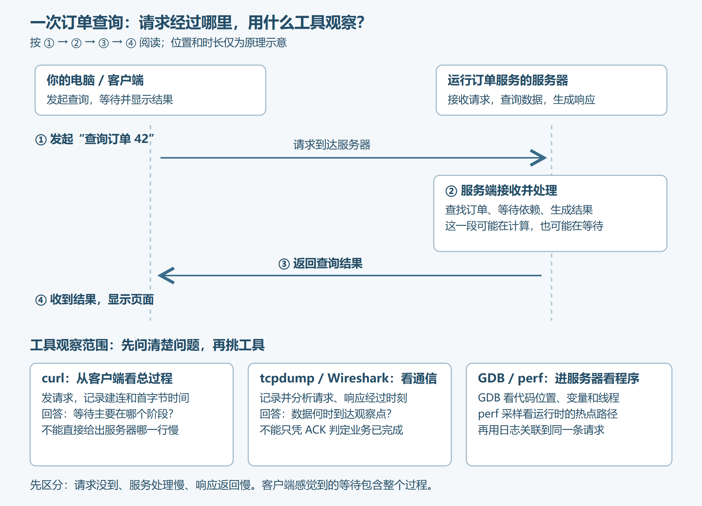
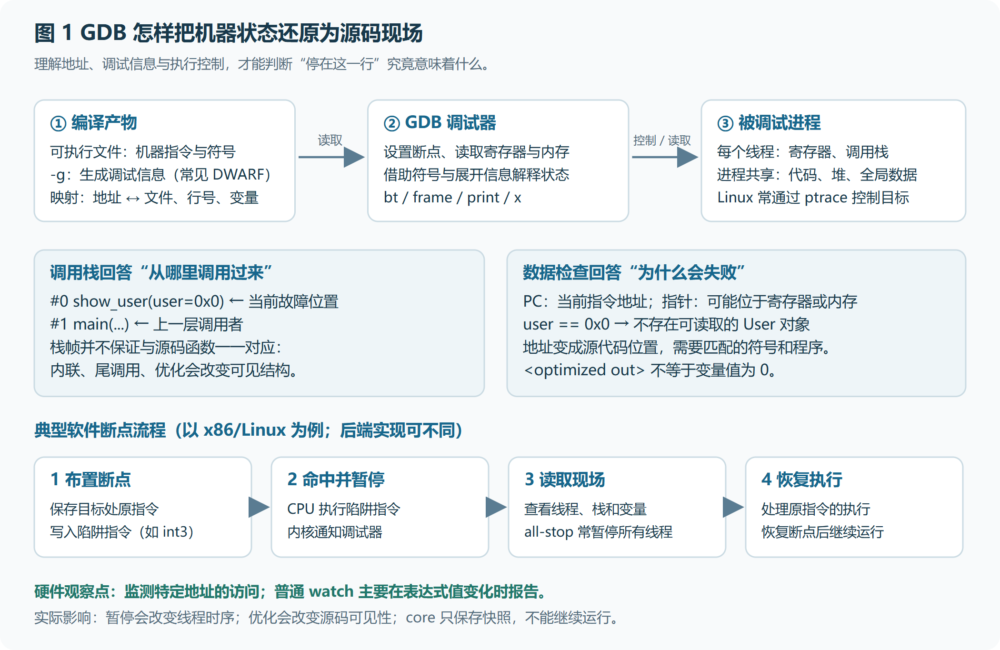
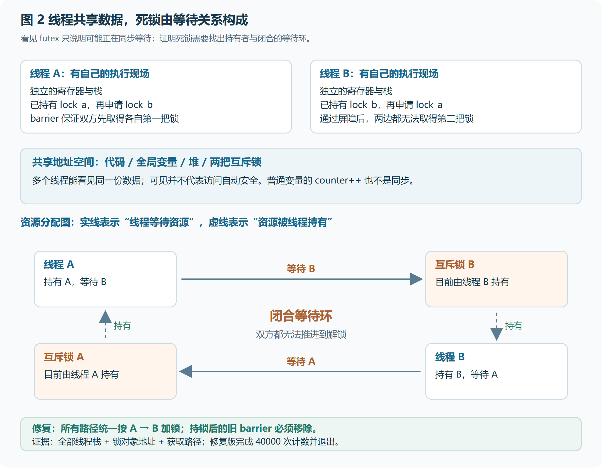
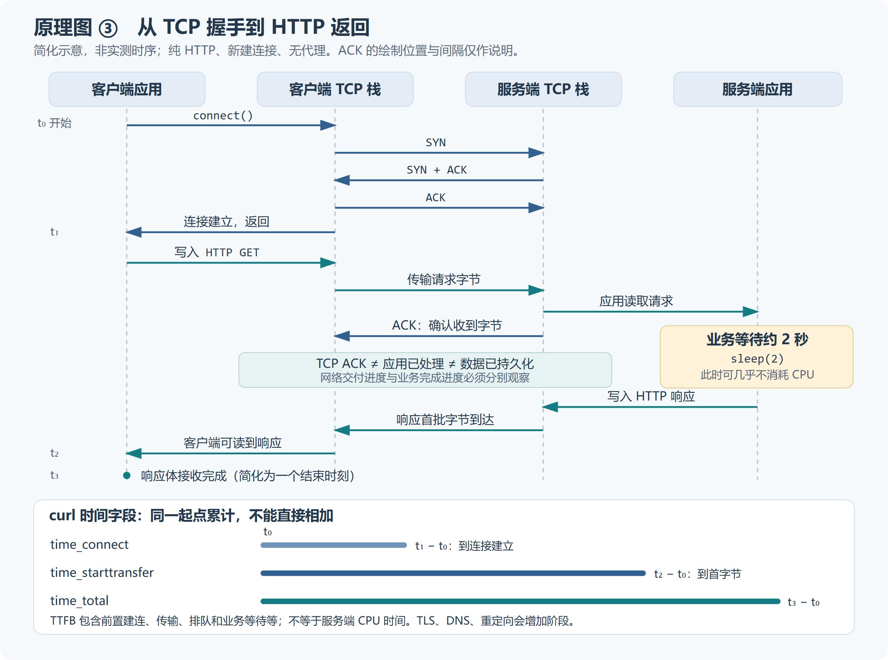
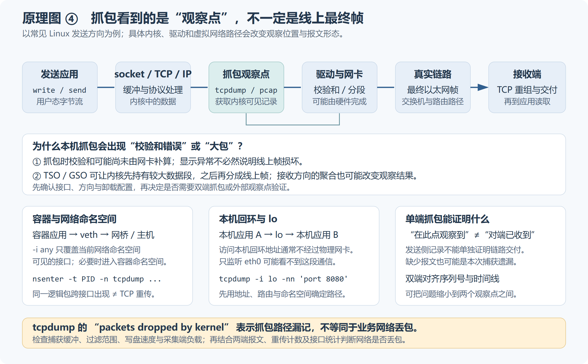
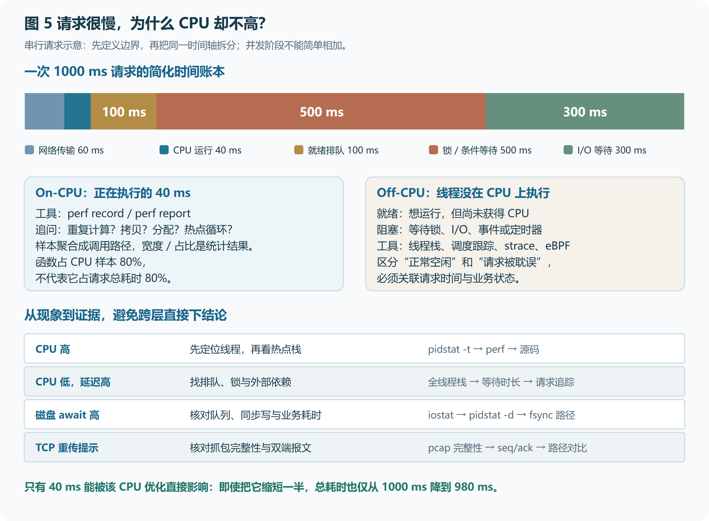
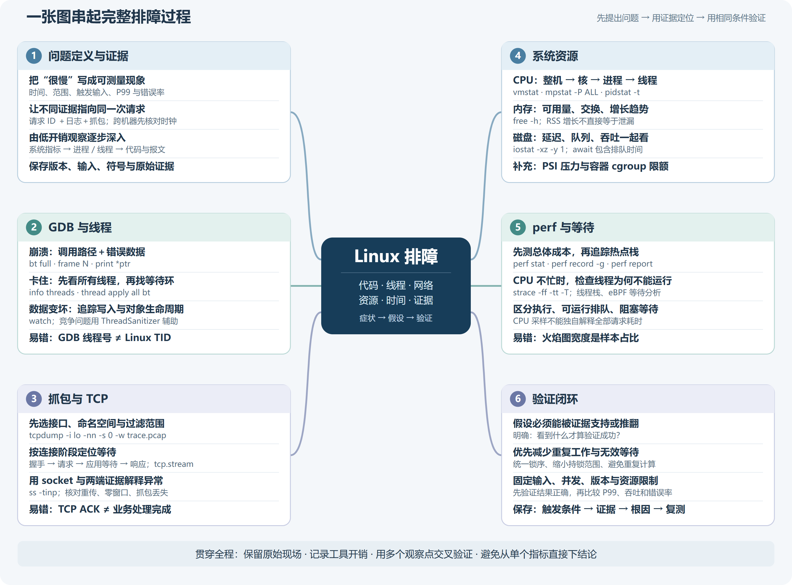

# Linux 调试、抓包与性能分析实战：从看懂现象到定位根因（通俗图解版）

适合读者：掌握基本 Linux 命令、能阅读简单 C 代码，希望开始独立排查程序问题的开发者。正文围绕 GDB、多线程、网络抓包和性能诊断展开，配套源码位于 `examples/`。所有终端命令均针对 Linux Bash；带 `(gdb)` 的行在 GDB 内输入，不要复制提示符。文中的 PID、接口名和远端地址需要按实际环境替换。

> **排障主线：记录现象 → 定位慢阶段 → 选择工具 → 修改验证。**
>
> **第一次阅读：** 先读 01—02，再按 03（崩溃）、05（死锁）、07（慢请求）、12（CPU 热点）完成四个实验。
>
> **复习或遇到具体问题：** 先看 15 的常见误区，再用 16 的“现象—证据—工具”表格和文字思维树选择下一步。

**操作标签。** “实验环境”指配套程序和可重建的 Linux 测试环境；“现场采集”需要按业务可接受的暂停、资源开销和权限确定范围。

<a id="contents"></a>

## 目录

按顺序阅读可以完成四个实验；已有具体问题时，可以直接跳到相应章节。

**先读懂这几个词，后面的命令会容易很多。**

| 术语 | 可以先这样理解 | 在本文中怎么看 |
|---|---|---|
| 进程 / 线程 | 一间厨房 / 厨房里的多个厨师 | 进程有资源，线程负责执行；线程之间共享许多数据 |
| PID / TID | 进程编号 / 内核中的线程编号 | Linux 的 TID 与所在 PID 命名空间有关；GDB 第一列线程号不等于 TID，对照 `LWP xxx` 查看 |
| 调用栈 / 栈帧 | 当前办事路线 / 路线中的一站 | `bt` 看谁调用谁，`frame` 选择哪一层查看 |
| 指针 / NULL | 对象的地址 / 没有对象地址 | `0x0` 不是一个可以随意读取的用户对象 |
| 锁 / 死锁 | 共用钥匙 / 互相等对方交出钥匙 | 等一下可能正常，互相永远等下去才是问题 |
| RTT / TTFB | 一次来回时间 / 请求开始到首个响应字节 | 两者衡量不同阶段，不能混为一谈 |
| 延迟 / 吞吐 | 一个顾客等多久 / 每秒服务多少顾客 | 同时看速度、处理量和错误率 |
| 采样 / core | 定时抽查 / 进程状态快照 | core 可来自崩溃或显式转储；普通 core 只能静态检查，不能继续原执行过程 |

**复制命令前先看标签。** Bash 代码在 Linux 终端运行；GDB 命令在调试器里运行，不要复制 `(gdb)` 提示符。`12345` 是需要替换的示例 PID，不是固定值。目录名称有空格时，给路径加引号，例如 `cd "学习资料所在目录"`。


**多行命令怎样复制？** Bash 行末的反斜杠 `\` 表示命令下一行继续，反斜杠后不能再有空格。复制完整代码块，不要把一条续行命令拆开逐行执行；排版自动折行和真正的换行也不是一回事。遇到粘贴异常，先在编辑器中核对，不要反复执行残缺命令。

**第一部分：问题与环境**

- [01｜从一个慢请求开始：先找出时间花在哪一步](#part-01)
- [02｜准备一个能反复运行的实验环境](#part-02)

**第二部分：GDB 与多线程**

- [03｜实验一：从空指针崩溃找到遗漏的检查](#part-03)
- [04｜学会让程序停在真正有价值的位置](#part-04)
- [05｜实验二：制造并定位一个确定发生的双线程死锁](#part-05)
- [06｜多线程调试最重要的三个细节](#part-06)

**第三部分：抓包与网络**

- [07｜实验三：证明 HTTP 慢请求不一定是网络慢](#part-07)
- [08｜真正抓包时，接口、范围和完整性决定结论](#part-08)
- [09｜读懂 TCP 和 Wireshark，避免“看见红色就下结论”](#part-09)
- [10｜用连接与路径信息补全网络证据](#part-10)

**第四部分：性能与排障闭环**

- [11｜性能诊断从整体向局部收敛](#part-11)
- [12｜实验四：找到重复计算，让优化有证据](#part-12)
- [13｜CPU 不忙时，追踪线程到底在等什么](#part-13)
- [14｜把一次慢请求排查闭环](#part-14)

**第五部分：常见问题、总结与速查**

- [15｜Q&A：常见问题与解答](#part-15)
- [16｜思维导图总结：用证据选择下一步](#part-16)

**插图索引**

- [开篇图：订单请求与工具观察范围](#part-01)

- [图 1：GDB 控制、符号与调用栈](#part-04)
- [图 2：线程与死锁资源等待环](#part-06)
- [图 3：TCP / HTTP 分阶段时序](#part-07)
- [图 4：抓包观察点与卸载](#part-08)
- [图 5：请求时间与性能工具](#part-11)
- [图 6：总结思维导图](#part-16)

**推荐路线：** 初学先读 01→02 和术语表，再依次完成 03、05、07、12 四个实验；复习可直接查看 [第 16 节思维导图](#part-16)。


<a id="part-01"></a>

## 01｜从一个慢请求开始：先找出时间花在哪一步

假设你写了一个查询订单的服务。平时打开订单页面，约 0.2 秒就有结果；今天却要等 5 秒。你准备找出原因，这个过程就叫“排查问题”，简称“排障”。下面的数字是用来帮助理解的假设，不是实验测量结果。

你可能会猜：“是不是网络慢了？”这只是一个可能。要弄清楚原因，先看一次查询需要经过哪些步骤：



*从上往下读：发送请求 → 服务端接收和处理 → 返回结果。图下方标明工具能看到的范围；这不是实际抓包记录。*

**你感受到的 5 秒，是整个过程的耗时。** 请求可能迟迟没送到，服务器可能处理得慢，也可能服务器早已处理完，但结果没有及时回到你的电脑。这几种情况的处理办法不同，所以先找出慢在哪一步。

**第一步：把你看到的现象记清楚。** 不用先背专业指标，只要写出别人能够照着检查的描述。例如：

```text
什么时候：今天 10:30 左右。
做了什么：查询订单 42。
等了多久：平时约 0.2 秒，这次约 5 秒。
能否重现：连续查询 10 次，有 3 次超过 3 秒。
影响范围：查询订单慢，打开首页正常。
```

这份记录能帮你缩小范围。如果只有查询订单慢，就先检查这条请求经过的代码和依赖；如果所有页面都慢，再检查共同使用的服务和机器。这里不需要立即猜出答案，先把发生了什么说清楚。

**第二步：沿着这次请求，寻找两个时间点。** 一个是服务器什么时候收到请求，另一个是什么时候准备好返回结果。可以先看服务日志；日志记录不足时，再结合后文的抓包和调试方法。

假设你找到下面两条日志：

```text
10:30:00.000  request_id=abc123  开始处理订单 42
10:30:04.800  request_id=abc123  已生成查询结果
```

两条日志之间相差约 4.8 秒，说明主要等待出现在这两处日志之间。接下来就应该细查这段处理流程：是在计算、等锁，还是等数据库返回？`request_id` 是这次请求的编号，两条日志必须属于同一次查询，才能这样比较。日志没有出现，也不能直接证明请求没到；可能只是日志没有在那个位置记录。

**第三步：根据已经看到的情况，选择工具。** 现在再认识本文的几类工具，就容易理解它们各自解决什么问题了：

| 你想弄清楚什么 | 用什么工具 | 可以理解为 |
|---|---|---|
| 请求和响应什么时候经过某台机器？ | tcpdump、Wireshark | 给网络通信做带时间的记录，这叫“抓包” |
| 程序执行到哪一行？变量是什么？哪个线程在等待？ | GDB | 暂停程序，查看当前代码位置和数据 |
| 哪个线程正在忙？CPU 时间主要花在哪些函数？ | top、pidstat、perf | 先看谁忙，再统计它主要忙什么 |

例如，若服务器在那 4.8 秒里持续使用很多 CPU，就进一步查看正在运行的线程和热点函数；若 CPU 不忙，却一直没有结果，就检查它是否在等锁、磁盘或其他服务。CPU 高低只是线索，最后还要用代码位置、调用耗时等证据确认原因。后面的章节会一步步教你怎么做。

**第四步：改完以后，用相同的查询再试。** 如果你发现查询重复计算了同一份数据，修改后就再查订单 42，检查结果是否仍然正确、耗时是否下降。还要多试几次，避免把偶然的一次变快当成问题已经解决。

学习本文时，可以一直带着这条顺序：**先说清楚现象 → 找到慢的阶段 → 用合适的工具细查 → 修改后重新验证。** 先完成后面的四个小实验，不需要一开始就记住所有命令。

### 先认识工具：每个工具帮你回答什么

**GDB 是程序调试器。** 它像能暂停、查看和控制程序执行的检查台：让程序停在某行，查看变量，查看“谁调用了谁”，切换线程。它既能运行待调试程序，也能附加已有进程或读取 core。它不会自动告诉你根因；你要根据停下来的位置和数据继续推理。比如程序查询用户 404 后崩溃，GDB 可以帮助确认 show_user 收到的是空指针，接着追问为什么调用方没有处理“查无此人”。

**GCC 与 GDB 不是同一种工具。** GCC 把 C 源码编译成可执行程序，GDB 再调试这个程序。源码是说明书，可执行文件是机器实际运行的结果，调试信息是两者之间的地址对照资料。

| 工具 | 通俗理解与具体作用 | 本文什么时候用 | 它不能独自证明什么 |
|---|---|---|---|
| GCC（gcc） | 把 C 源码编译成程序，并给出编译诊断 | 生成 crash、deadlock、cpu_hotspot | 编译成功不代表逻辑正确 |
| GDB（gdb） | 控制执行，查看调用栈、变量和线程 | 崩溃找坏参数，卡住查等待关系 | 一次暂停的状态不等于完整执行历史 |
| Python 3（python3） | 运行 Python 脚本 | 启动本机 HTTP 教学服务 | 该脚本不是生产服务器 |
| curl | 发起请求并显示请求阶段的计时 | 对照 fast 与 slow | 客户端总等待不等于服务端计算时间 |
| tcpdump | 从指定网络接口捕获并保存报文 | 保存 HTTP 请求和响应的时间线 | 捕获不完整时，缺包不等于链路丢包 |
| Wireshark | 图形界面分析抓包文件、连接和协议 | 找 HTTP 流、看握手与响应 | 分析提示不是根因判决 |
| TShark（tshark） | 在终端中解码和筛选抓包文件 | 无图形界面时读取实验 pcap | HTTPS 不会因此自动变成明文 |
| ip、ss | 查看接口、路由、socket 状态与队列 | 核对抓哪个网卡、服务监听哪里 | 连接存在不代表业务处理成功 |
| top、ps | 查看进程与线程状态，top 可动态刷新 | 找持续忙的线程、查看 TID | CPU 高低只是线索 |
| sysstat 工具集 | mpstat 看各 CPU，pidstat 看任务，iostat 看设备 | 从机器缩小到线程或磁盘 | 单个利用率不能说明全部等待 |
| vmstat、free、uptime | 看运行队列、内存、交换和负载概况 | 判断资源调查方向 | free 小不等于泄漏，负载不等于 CPU 百分比 |
| perf | 统计性能事件，采样执行位置和调用栈 | 查 checksum 等 CPU 热点 | CPU 热点不能覆盖全部阻塞时间 |
| time | 记录命令的墙钟时间及 CPU 时间 | 没有采样权限时先做时间对照 | 不直接指出哪一行慢 |
| strace | 跟踪系统调用、返回值及耗时 | 查网络调用失败、读写与等待 | 等待长不代表一直在使用 CPU |
| ThreadSanitizer | 编译插桩后检测测试中的数据竞争 | 可复现的多线程测试 | 未报告不等于证明无竞争 |
| BCC、bpftrace | 按内核事件追踪调度、I/O、网络等 | 栈和指标还不能解释等待时 | 需要明确事件、范围和权限 |
| iperf3、ping | 主动产生传输或连通性测试流量 | 获准的网络对照测试 | 不能代替真实接口的性能验证 |

**下面的命令表怎样读？** “输入什么”是要输入的命令；“为什么输入”解释本步目标；“观察什么”告诉你读哪一项结果。先确认代码块属于 Bash 还是 GDB，再照顺序执行；表格中的完整命令只是解释，不需要重复执行一遍。

<a id="part-02"></a>

## 02｜准备一个能反复运行的实验环境

建议使用 Linux 虚拟机或开发机。基础实验只需要 GCC、GDB、Python 3 和 curl；抓包需要 tcpdump，终端协议分析使用 TShark，系统指标使用 sysstat，CPU 采样使用 perf。Debian/Ubuntu 的常见安装方式如下：

```bash
sudo apt update
sudo apt install build-essential gdb python3 curl
sudo apt install tcpdump tshark sysstat strace iperf3
```

**这几条命令分别做什么？**

| 输入什么 | 为什么输入 | 观察什么 / 注意什么 |
|---|---|---|
| `sudo apt update` | 刷新 APT 的软件包索引。 | 更新的是安装目录信息，不是直接升级全部程序。 |
| `sudo apt install build-essential gdb python3 curl` | 安装本行列出的工具或工具包。 | build-essential 提供构建工具；sysstat 提供 pidstat/mpstat/iostat；perf 包按发行版选择，不能把所有安装分支都执行。 |
| `sudo apt install tcpdump tshark sysstat strace iperf3` | 安装本行列出的工具或工具包。 | build-essential 提供构建工具；sysstat 提供 pidstat/mpstat/iostat；perf 包按发行版选择，不能把所有安装分支都执行。 |


**perf 要按“确认系统 → 检查命令 → 安装所需包 → 验证”的顺序处理。** 

先确认发行版和正在运行的内核：

```bash
cat /etc/os-release
uname -r
```

**这几条命令分别做什么？**

| 输入什么 | 为什么输入 | 观察什么 / 注意什么 |
|---|---|---|
| `cat /etc/os-release` | 读取发行版身份文件。 | 看 ID、VERSION_ID，再选对应安装规则。 |
| `uname -r` | 显示正在运行的内核版本。 | 按内核打包时，用它核对需要的工具包。 |


`/etc/os-release` 用于识别 Debian、Ubuntu 等发行版；`uname -r` 显示当前正在运行的内核版本。不要只凭电脑安装过哪个内核包来猜当前内核。

再检查当前 Shell 能否找到 perf：

```bash
command -v perf
```

**这几条命令分别做什么？**

| 输入什么 | 为什么输入 | 观察什么 / 注意什么 |
|---|---|---|
| `command -v perf` | 让 shell 查找 perf 命令的位置。 | 路径说明能找到入口，不说明能采样；无输出也要检查 PATH。 |


如果输出一个路径，只说明当前 Shell 找到了这个命令，还不能证明它能正常运行。如果没有输出，说明它不在当前 Shell 的命令查找范围中：常见原因是尚未安装，也可能是安装位置没有加入 `PATH`。`PATH` 就是 Shell 查找可执行程序时使用的目录列表。

**确实需要安装时，按实际发行版选择下面一组命令，不要两组都执行。** 以下示例适用于使用 APT、且相应软件包在已配置仓库中可用的系统。

Debian 的常见安装方式：

```bash
sudo apt update
sudo apt install linux-perf
```

**这几条命令分别做什么？**

| 输入什么 | 为什么输入 | 观察什么 / 注意什么 |
|---|---|---|
| `sudo apt update` | 刷新 APT 的软件包索引。 | 更新的是安装目录信息，不是直接升级全部程序。 |
| `sudo apt install linux-perf` | 安装本行列出的工具或工具包。 | build-essential 提供构建工具；sysstat 提供 pidstat/mpstat/iostat；perf 包按发行版选择，不能把所有安装分支都执行。 |


对于 Ubuntu 22.04 / 24.04 中采用按内核打包的常见环境，安装公共入口和当前内核对应的工具包：

```bash
sudo apt update
sudo apt install linux-tools-common "linux-tools-$(uname -r)"
```

**这几条命令分别做什么？**

| 输入什么 | 为什么输入 | 观察什么 / 注意什么 |
|---|---|---|
| `sudo apt update` | 刷新 APT 的软件包索引。 | 更新的是安装目录信息，不是直接升级全部程序。 |
| `sudo apt install linux-tools-common "linux-tools-$(uname -r)"` | 安装本行列出的工具或工具包。 | build-essential 提供构建工具；sysstat 提供 pidstat/mpstat/iostat；perf 包按发行版选择，不能把所有安装分支都执行。 |


这里的 `$(uname -r)` 会被 Shell 替换为当前内核版本。例如当前版本为 `6.8.0-xx-generic`，对应的包名就是 `linux-tools-6.8.0-xx-generic`；`xx` 只是说明用的占位符，不要照抄这个包名。在这种打包方式下，Ubuntu 的公共入口可能已经存在，但与当前内核对应的实际工具仍未安装，因此仅看 `command -v perf` 的结果不够。

**不要把上述 Ubuntu 示例推广到所有版本。** 例如 Ubuntu 25.10 的官方手册将 perf 列为由 `linux-perf` 包提供。较新版本、其他内核分支或衍生发行版，应先查询该版本的官方软件包目录，再选择包名。[Ubuntu 25.10 perf 手册及提供软件包](https://manpages.ubuntu.com/manpages/questing/man1/perf.1.html)

如果 APT 提示找不到软件包，先核对发行版、仓库配置和 `uname -r` 的输出。自编译内核、某些云内核或已不再由当前仓库提供的旧内核，可能没有这个精确包名；应按该内核供应方的说明获取工具，不能保证换装一个任意版本的包就能解决。Debian 与 Ubuntu 的包组织不同，也不要把 Ubuntu 的按内核命名方式照搬到所有发行版。[Debian linux-perf 软件包](https://packages.debian.org/stable/linux-perf)、[Ubuntu linux-tools-common 软件包](https://packages.ubuntu.com/noble/linux-tools-common)

**按内核打包的环境，更新后要重新核对。** 重启进入新内核后，再运行 `uname -r`；若 perf 入口报告缺少当前内核工具，需要安装该版本对应的 tools 包。云内核、HWE 或自编译内核应按供应方和发行版的包规则检查，不要随便挑一个其他版本来替代。工具与内核并非在所有发行版都必须逐字同版本，但事件、接口和栈展开能力必须实际验证；入门实验优先在受控测试机完成。

安装后，或系统原本已有 perf 时，再执行：

```bash
perf --version
```

**这几条命令分别做什么？**

| 输入什么 | 为什么输入 | 观察什么 / 注意什么 |
|---|---|---|
| `perf --version` | 启动已有 perf 并显示版本。 | 命令可启动不代表有事件权限或硬件 PMU。 |


成功打印版本号，只说明 perf 命令可以启动；若入口提示缺少当前内核工具，仍需补齐安装。**perf --version 成功 ≠ 可以采样。** 虚拟机可能不暴露硬件 PMU，权限策略也可能阻止 `perf_event_open`。软件事件仍受相应权限限制，不能保证改用软件事件就一定成功。第 12 节将按软件事件、程序计时和 `time` 逐步验证，不要求读者为了完成实验降低整机安全参数。[perf 安全与权限说明](https://docs.kernel.org/admin-guide/perf-security.html)


解压配套实验包后，在含有 `examples/` 的目录执行命令。配套 HTTP 实验绑定 `127.0.0.1:18080`，不需要外部服务器。后文的远端网络检查属于工程用法示意，需要替换地址。实验程序不用于生产服务。示例输出展示应观察的形态，地址、线程编号、时间和内部函数名以实际机器为准。

调试构建可考虑 `-g -Og`：`-g` 生成调试信息，`-Og` 是面向调试体验的优化选项。本教程的崩溃和死锁实验用 `-O0` 简化观察，性能实验用 `-O2`。**不要用 -O0 实验的线程时序和变量表现，直接推断线上 -O2 程序的行为。** 改变优化会改变生成代码和时序；涉及数据竞争等未定义行为时，更没有稳定表现可依赖。

**-g 可以与 -O2 共用，也可以用于生产构建。** 是否将符号随程序分发由发布策略决定，工程上可单独保存匹配的调试符号包。线上分析应使用故障现场的原始二进制、共享库与对应符号；“文件名相同”不代表匹配，可结合 Build ID 核对。重新构建的程序不一定不匹配，但未经确认不能拿它替代原件。[GCC 调试选项](https://gcc.gnu.org/onlinedocs/gcc/Debugging-Options.html)

<a id="compiler-options"></a>
### 编译选项速查：通用含义只在这里说明

| 选项 | 具体作用 |
|---|---|
| `-g` | 生成调试信息，帮助 GDB 将地址对应到源码与变量 |
| `-O0` / `-O2` | 分别关闭大多数优化 / 开启一组优化；本文用前者简化入门观察，用后者做性能对照 |
| `-Wall -Wextra` | 启用更多编译诊断，帮助发现可疑写法 |
| `-o 名称` | 指定生成的可执行文件名 |
| `-pthread` | 设置线程相关的编译和链接支持 |
| `-fno-omit-frame-pointer` | 请求保留帧指针，辅助基于帧指针的调用栈展开；不保证所有栈都完整 |

后面的命令表只解释本次编译的目标及关键差异，通用选项可回看本表。

<a id="part-03"></a>

## 03｜实验一：从空指针崩溃找到遗漏的检查

### 1. 实验目标

**实验环境。** 用一个不存在的用户编号触发空指针问题，练习从调用栈找参数来源，最后验证正确处理错误输入。

配套 `examples/crash.c` 模拟用户查询：编号 1 存在，编号 404 不存在。错误版没有检查查询结果，就读取用户编号与姓名。完整代码如下，也可以直接保存为 `examples/crash.c`：

```c
#include <stdio.h>
#include <stdlib.h>

typedef struct {
    int id;
    const char *name;
} User;

static User alice = {1, "Alice"};

static const User *find_user(int id)
{
    return id == alice.id ? &alice : NULL;
}

static void show_user(const User *user)
{
    /* Intentional bug: find_user() can return NULL. */
    printf("id=%d, name=%s\n", user->id, user->name);
}

int main(int argc, char **argv)
{
    /* Keep argument parsing simple; use 1 or 404 for this lab. */
    int id = argc > 1 ? atoi(argv[1]) : 404;
    const User *user = find_user(id);
    show_user(user);
    return 0;
}
```

### 2. 编译命令

先编译，再准备调试输入：

```bash
gcc -g -O0 -Wall -Wextra examples/crash.c -o crash
./crash 1
gdb --args ./crash 404
```

**这几条命令分别做什么？**

| 输入什么 | 为什么输入 | 观察什么 / 注意什么 |
|---|---|---|
| `gcc -g -O0 -Wall -Wextra examples/crash.c -o crash` | 把错误版源码编译成 crash，准备比较正常输入与崩溃输入。 | `-g -O0` 便于本实验单步和查看变量；通用选项见[编译选项速查](#compiler-options)。 |
| `./crash 1` | 直接运行错误版的正常输入 1，作为对照。 | 应显示 Alice；它不能覆盖不存在用户的错误路径。 |
| `gdb --args ./crash 404` | 用 GDB 加载 ./crash，并将 404 设置为被调试程序的参数。 | 进入 (gdb) 后输入 run 才启动；404 用于触发“用户不存在”。 |


### 3. 复现步骤

上面的正常输入用于对照；进入 GDB 后执行：

```text
(gdb) run
(gdb) bt
(gdb) frame 0
(gdb) info args
(gdb) info locals
(gdb) print user
```

**这几条命令分别做什么？**

| 输入什么 | 为什么输入 | 观察什么 / 注意什么 |
|---|---|---|
| `(gdb) run` | 按已设置的参数真正启动程序。 | 本实验随后崩溃或卡住；加载程序本身不等于启动。 |
| `(gdb) bt` | 打印当前线程的调用栈（backtrace）。 | 从 #0 往外看谁调用了出错函数。 |
| `(gdb) frame 0` | 切换到指定编号的栈帧，准备检查该层的数据。 | 编号取自 bt；0 通常为最内层，示例 1 不一定是你的业务帧。 |
| `(gdb) info args` | 显示当前栈帧的函数参数及可恢复的值。 | 在 show_user 对应帧确认 user 是否为 0x0。 |
| `(gdb) info locals` | 显示当前栈帧的局部变量。 | 结合函数源码检查输入经过了什么处理；没有变量也可能正常。 |
| `(gdb) print user` | 求值并显示变量 user。 | 本实验应为 0x0，说明没有找到用户对象。 |


### 4. 观察输出要点

在通常的 Linux 环境中，错误输入触发 `SIGSEGV`，表示程序访问了不允许访问的内存。`bt` 是调用路径；`frame 0` 选择最内层栈帧；参数和局部变量帮助解释触发条件。应在解引用所在的栈帧看到 `user` 为 `0x0`。如果当前帧是运行库，沿调用栈切换到自己的函数。

应看到类似下面的结果。地址会变化，但空指针和调用关系不会因地址随机化而改变：

```text
Program received signal SIGSEGV, Segmentation fault.
show_user (user=0x0) at examples/crash.c:19
#0  show_user (user=0x0) ...
#1  main (...) ...
```

### 5. 关键结论

不要停在“空指针”三个字。继续问：谁应该处理“用户不存在”？当前接口应该返回错误、使用默认值，还是拒绝请求？修复版 `examples/crash_fixed.c` 在调用 `show_user` 前加入以下检查，保留正常输入的行为，对不存在的用户给出明确错误，并返回非零退出状态：

```c
if (user == NULL) {
    fprintf(stderr, "user %d not found\n", id);
    return 2;
}
```

### 6. 修复验证

在 GDB 中输入 `quit`，按提示确认结束实验进程，回到终端后编译并运行修复版：

```bash
gcc -g -O0 -Wall -Wextra examples/crash_fixed.c -o crash_fixed
./crash_fixed 1
./crash_fixed 404
echo $?
```

**这几条命令分别做什么？**

| 输入什么 | 为什么输入 | 观察什么 / 注意什么 |
|---|---|---|
| `gcc -g -O0 -Wall -Wextra examples/crash_fixed.c -o crash_fixed` | 把修复版编译成 crash_fixed，用于验证空指针检查。 | 与错误版保持相同编译设置，重点比较正常、错误输入及退出状态。 |
| `./crash_fixed 1` | 运行修复版，1 与 404 分别检查正常和不存在的用户。 | 1 应成功，404 应输出 not found 并返回 2，无段错误。 |
| `./crash_fixed 404` | 运行修复版，1 与 404 分别检查正常和不存在的用户。 | 1 应成功，404 应输出 not found 并返回 2，无段错误。 |
| `echo $?` | 显示上一条命令的退出状态。 | 紧接 crash_fixed 404 执行应为 2；插入别的命令会改变结果。 |


验证目标是：编号 1 输出 `id=1, name=Alice`，编号 404 输出 `user 404 not found`，紧接着的 `echo $?` 输出 `2`，没有段错误。错误输入返回非零是正确行为，不代表修复失败。示例为聚焦指针问题使用了简单的 `atoi`；真实工程还要使用更严格的输入解析并覆盖边界值和上游失败。仅把指针随意改成一个非空地址，并没有解决问题。[GDB 调用栈文档](https://sourceware.org/gdb/current/onlinedocs/gdb.html/Backtrace.html)

<a id="part-04"></a>

## 04｜学会让程序停在真正有价值的位置

每次都从入口逐行执行会很慢。先在可疑函数设断点，检查输入，再向数据出错的位置缩小范围。

```text
(gdb) break main
(gdb) run
(gdb) next
(gdb) step
(gdb) finish
(gdb) continue
(gdb) info breakpoints
```

**这几条命令分别做什么？**

| 输入什么 | 为什么输入 | 观察什么 / 注意什么 |
|---|---|---|
| `(gdb) break main` | 在 main 入口附近设置断点。 | 出现断点编号；后续 run 才会运行并在此停止。 |
| `(gdb) run` | 按已设置的参数真正启动程序。 | 本实验随后崩溃或卡住；加载程序本身不等于启动。 |
| `(gdb) next` | 执行到下一源码位置，通常越过当前行的函数调用。 | 检查本行执行后的数据变化；其他线程可能仍会运行。 |
| `(gdb) step` | 单步执行，允许进入有调试信息的被调用函数。 | 观察控制流进入哪一个函数。 |
| `(gdb) finish` | 继续执行到当前函数返回。 | 查看返回值及回到调用方的位置；不是立即跳出。 |
| `(gdb) continue` | 从暂停处恢复运行，直到再次停止或结束。 | 可能命中断点、观察点或异常。 |
| `(gdb) info breakpoints` | 列出断点、观察点及启用状态。 | 按实际编号选择要禁用或删除的项目。 |


`next` 通常越过当前行中的函数调用；`step` 可以进入有调试信息的函数；`finish` 执行到当前函数返回；`continue` 恢复运行。它们可以简写为 `n`、`s`、`fin`、`c`。断点还可以指定文件行号和条件：

```text
(gdb) break server.c:120 if request_id == 42
(gdb) disable 2
(gdb) enable 2
(gdb) delete 2
```

**这几条命令分别做什么？**

| 输入什么 | 为什么输入 | 观察什么 / 注意什么 |
|---|---|---|
| `(gdb) break server.c:120 if request_id == 42` | 在示例文件行号处设置带条件的断点。 | 文件、行号和 request_id 必须存在于你的工程；条件判断也有开销。 |
| `(gdb) disable 2` | 分别禁用、启用或删除指定编号的断点/观察点。 | 编号以 info breakpoints 为准；delete 后需重新设置才能恢复。 |
| `(gdb) enable 2` | 分别禁用、启用或删除指定编号的断点/观察点。 | 编号以 info breakpoints 为准；delete 后需重新设置才能恢复。 |
| `(gdb) delete 2` | 分别禁用、启用或删除指定编号的断点/观察点。 | 编号以 info breakpoints 为准；delete 后需重新设置才能恢复。 |


以上 `server.c` 是工程用法示意，条件中的变量必须在该位置可见。高频位置的条件断点也可能产生明显开销，因为程序可能反复停下来判断条件。[GDB 断点文档](https://sourceware.org/gdb/current/onlinedocs/gdb.html/Set-Breaks.html)

常用显示设置可以先加上：

```text
(gdb) set pagination off
(gdb) set print pretty on
(gdb) info args
(gdb) info locals
```

**这几条命令分别做什么？**

| 输入什么 | 为什么输入 | 观察什么 / 注意什么 |
|---|---|---|
| `(gdb) set pagination off` | 关闭 GDB 输出分页。 | 长线程栈不再反复等待回车。 |
| `(gdb) set print pretty on` | 将适用的结构体值分行缩进显示。 | 只改显示方式，不修改被调试对象。 |
| `(gdb) info args` | 显示当前栈帧的函数参数及可恢复的值。 | 在 show_user 对应帧确认 user 是否为 0x0。 |
| `(gdb) info locals` | 显示当前栈帧的局部变量。 | 结合函数源码检查输入经过了什么处理；没有变量也可能正常。 |


`set pagination off` 关闭分页，查看长调用栈时无需不断按回车；`set print pretty on` 让适用的结构体等值分行缩进显示，便于阅读，不改变程序数据。`info args` 显示**当前所选栈帧的函数参数**；`info locals` 显示该帧的局部变量。两者都受符号和优化影响；查看程序启动参数则是另一件事，可用 `show args`。

看数据时，`print *ptr` 解释对象，`print/x flags` 看十六进制，`x/32bx buffer` 按字节查看内存。`x/s message` 把地址当作字符串，使用前应确认内容可访问且有结束符。优化代码可能显示 `<optimized out>`，也可能出现行号跳跃，此时应结合 `disassemble /m function_name` 与 `x/10i $pc` 查看机器指令。

如果知道数据什么时候变坏，却不知道是谁修改，可以使用观察点：

```text
(gdb) watch counter
(gdb) watch -l obj->state
(gdb) continue
```

**这几条命令分别做什么？**

| 输入什么 | 为什么输入 | 观察什么 / 注意什么 |
|---|---|---|
| `(gdb) watch counter` | 观察指定表达式的值何时被写成不同值；-l 按对象所在内存位置观察。 | 继续执行后检查旧值、新值和写入线程；需确认对象仍有效。 |
| `(gdb) watch -l obj->state` | 观察指定表达式的值何时被写成不同值；-l 按对象所在内存位置观察。 | 继续执行后检查旧值、新值和写入线程；需确认对象仍有效。 |
| `(gdb) continue` | 从暂停处恢复运行，直到再次停止或结束。 | 可能命中断点、观察点或异常。 |


普通 `watch` 在写入导致表达式值变化时停止，**不保证每次写入相同值都停**。`rwatch` 监测读取，`awatch` 监测读写访问，依赖硬件支持。常见 x86 有四个地址断点槽位，调试器可用数量还受硬件断点占用、地址宽度和对齐等因素影响；一次复杂监测可能占多个槽位，不能理解为“任意四个变量”。

软件观察点靠反复单步检查值，可能严重拖慢程序；多线程时还可能漏掉非当前线程的修改，不适合拿来证明“其他线程没写过”。硬件观察点本身的监测成本较低，但高频命中、暂停与交互仍会明显干扰业务。现场附加应少量、短时使用；对象释放后地址可被复用，也要先确认生命周期。[GDB 观察点文档](https://sourceware.org/gdb/current/onlinedocs/gdb.html/Set-Watchpoints.html)

**普通 core 不能“回放大量 watch”。** core 没有后续执行过程，只能检查保存的栈、寄存器和内存。要追查后续写入，应在可复现的活进程中设置观察点；执行录制与回放属于另外的能力，不能与普通 core 混为一谈。

**理解调试器的工作机制。** 软件断点就像在代码路口放一块“停车牌”。GDB 保存目标位置的原指令，再替换为能触发异常的特殊指令；CPU 执行到这里，调试器便获得控制。恢复时还要处理原指令并重新布置断点，具体实现随架构变化。因此断点有实际执行成本，高频条件断点也可能改变线程相遇的时机。硬件观察点则让处理器监测指定地址的访问，适合追查“谁改了这几个字节”，但监测数量、宽度都有限。[GDB 断点机制](https://sourceware.org/gdb/current/onlinedocs/gdb.html/Set-Breaks.html)

先把调用栈想成“当前办事路线”：`main` 找 `show_user` 办事，后者出错时，GDB 顺着路线往回看。`bt` 展示的是当前仍能还原的调用关系，不是完整历史录像。GDB 从当前寄存器、栈内存以及展开规则推回调用者。栈帧表示一次函数调用的上下文；参数可能在寄存器中，变量也不保证都在栈上。DWARF 可以先理解为编译器附带的“地址对照表”，提供地址与源码行、变量位置等映射，调用帧信息帮助恢复上一层状态。优化后变量可能被消除或只在部分指令区间有可恢复位置，`-g` 无法让已经消失的值重新出现。看到栈异常，依次核对二进制版本、符号、展开方式，再检查内存破坏。[DWARF 格式介绍](https://dwarfstd.org/doc/Debugging%20using%20DWARF-2012.pdf)



*图 1：GDB 的执行控制、符号映射和调用栈。图中软件断点以典型 x86/Linux 流程说明；具体后端实现可以不同*


<a id="part-05"></a>

## 05｜实验二：制造并定位一个确定发生的双线程死锁

### 1. 实验目标

**实验环境。** 稳定构造一次双锁等待环，从全部线程栈和代码持锁顺序证明死锁，再验证统一加锁顺序后的结果。

死锁可以理解为“两个人分别拿着对方需要的钥匙，谁都不肯先放手”。本实验有锁 A、锁 B：线程 1 先拿 A 再拿 B，线程 2 先拿 B 再拿 A。

只使用 `sleep` 制造时机并不可靠，所以 `examples/deadlock.c` 使用 `pthread_barrier_t`：两个线程分别拿到第一把锁后，在屏障处集合，双方到齐才一起往下走。于是两把锁必定已被不同线程持有，随后必然互相等待。以下是完整源码的关键顺序，省略了错误检查和启动代码：

```c
/* 线程 A */
pthread_mutex_lock(&lock_a);
pthread_barrier_wait(&both_locked);
pthread_mutex_lock(&lock_b);

/* 线程 B */
pthread_mutex_lock(&lock_b);
pthread_barrier_wait(&both_locked);
pthread_mutex_lock(&lock_a);
```

```text
线程 1：持有 A ──等待──▶ B（线程 2 持有）
线程 2：持有 B ──等待──▶ A（线程 1 持有）
```

**屏障只为稳定复现服务。** `pthread_barrier_t` 在这里是教学装置，刻意让双方同时持有第一把锁；真实死锁通常没有这种集合点，可能只在少量特定时序下出现。不能因为不容易复现，就断言不存在死锁。

### 2. 编译命令

```bash
gcc -g -O0 -Wall -Wextra -pthread examples/deadlock.c -o deadlock
gdb ./deadlock
```

**这几条命令分别做什么？**

| 输入什么 | 为什么输入 | 观察什么 / 注意什么 |
|---|---|---|
| `gcc -g -O0 -Wall -Wextra -pthread examples/deadlock.c -o deadlock` | 编译故意制造死锁的双线程程序。 | 本实验增加 `-pthread` 支持线程编译与链接；仍用 `-g -O0` 便于调试。 |
| `gdb ./deadlock` | 加载死锁实验程序进入 GDB。 | 它暂未开始运行；run 后再按 Ctrl+C 暂停以检查全部线程。 |


### 3. 复现步骤

```text
(gdb) run
```

**这几条命令分别做什么？**

| 输入什么 | 为什么输入 | 观察什么 / 注意什么 |
|---|---|---|
| `(gdb) run` | 按已设置的参数真正启动程序。 | 本实验随后崩溃或卡住；加载程序本身不等于启动。 |


看到两个线程分别输出获得第一把锁后，程序不再结束。在 GDB 所在终端按 `Ctrl+C`，然后执行：

```text
(gdb) set pagination off
(gdb) info threads
(gdb) thread apply all bt
```

**这几条命令分别做什么？**

| 输入什么 | 为什么输入 | 观察什么 / 注意什么 |
|---|---|---|
| `(gdb) set pagination off` | 关闭 GDB 输出分页。 | 长线程栈不再反复等待回车。 |
| `(gdb) info threads` | 列出线程及其当前停止位置。 | 第一列是 GDB 线程号；LWP 通常对应 Linux TID。 |
| `(gdb) thread apply all bt` | 对全部线程分别打印调用栈。 | 找工作线程在哪里等待，再结合源码建立持有/等待关系。 |


### 4. 观察输出要点

通常能看到主线程等待 `pthread_join`，两个工作线程各自停在第二次加锁的路径中。内部栈可能出现 `pthread_mutex_lock`、`futex` 等函数，但名称随系统实现变化。切换工作线程，找到自己的源码栈帧，结合源码中第一次加锁和第二次加锁的位置建立等待关系。

```text
(gdb) thread 2
(gdb) bt
(gdb) frame 1
(gdb) list
```

**这几条命令分别做什么？**

| 输入什么 | 为什么输入 | 观察什么 / 注意什么 |
|---|---|---|
| `(gdb) thread 2` | 切换到指定 GDB 线程。 | 编号取自 info threads，不要把 Linux TID 直接填在这里。 |
| `(gdb) bt` | 打印当前线程的调用栈（backtrace）。 | 从 #0 往外看谁调用了出错函数。 |
| `(gdb) frame 1` | 切换到指定编号的栈帧，准备检查该层的数据。 | 编号取自 bt；0 通常为最内层，示例 1 不一定是你的业务帧。 |
| `(gdb) list` | 显示当前源码位置附近的代码。 | 需要匹配的源码路径和调试信息。 |


这里的 `2` 和 `1` 仅为示意。先从 `info threads` 选择工作线程，再在 `bt` 中找包含 `worker_a` 或 `worker_b` 的那一行，使用该行左侧的栈帧编号执行 `frame N`；`N` 需要替换成实际数字。重点不是记住某个运行库函数，而是证明“谁持有 A、谁持有 B、谁正在等谁”。只有停在锁函数，并不能证明死锁；空闲线程正常等待条件变量也会睡眠。

### 5. 关键结论

修复版统一使用 A→B 的加锁顺序，并移除持锁后的屏障。后一点非常重要：如果线程 1 拿到 A 后在屏障等待，而线程 2 因拿不到 A 无法到达屏障，依然会卡死。

### 6. 修复验证

```bash
gcc -g -O0 -Wall -Wextra -pthread examples/deadlock_fixed.c -o deadlock_fixed
./deadlock_fixed
```

**这几条命令分别做什么？**

| 输入什么 | 为什么输入 | 观察什么 / 注意什么 |
|---|---|---|
| `gcc -g -O0 -Wall -Wextra -pthread examples/deadlock_fixed.c -o deadlock_fixed` | 编译统一加锁顺序后的修复版。 | 保持与错误版相同的编译选项，运行后检查是否正常完成。 |
| `./deadlock_fixed` | 运行统一锁顺序后的修复版。 | 应显示 completed=40000 并退出；只打印启动信息不算通过。 |


修复后两个线程各执行 20000 次受锁保护的计数，输出 `completed=40000 (expected 40000)` 并正常退出。在这个封闭示例中，统一顺序消除了两把锁之间的循环等待；真实工程需要对所有相关路径采用同一顺序，并检查异常返回是否遗漏解锁。结束错误版 GDB 会话时可执行 `kill`、确认结束实验进程，再 `quit`。

还可以用修复版练习观察点：新开 `gdb ./deadlock_fixed`，依次执行 `break worker`、`run`，首次停止后 `delete 1` 删除入口断点，再执行 `watch completed`、`continue`。删除入口断点是为了避免另一个线程再次命中它，干扰观察。当共享计数改变时，硬件观察点可以告诉你当前是哪个线程、旧值和新值是什么。这次练习只观察前几次变化，随后用 `info breakpoints` 找到观察点编号，删除它再继续，避免数万次停止拖慢程序。

<a id="part-06"></a>

## 06｜多线程调试最重要的三个细节

第一，GDB 线程号与 Linux TID 不相同。`info threads` 第一列用于 `thread 2`；输出中的 `LWP 12348` 通常对应 Linux 线程 ID。要定位高 CPU 线程，可以先运行：

```bash
top -H -p 12345
ps -L -p 12345 -o pid,tid,pcpu,stat,wchan:24,comm
```

**这几条命令分别做什么？**

| 输入什么 | 为什么输入 | 观察什么 / 注意什么 |
|---|---|---|
| `top -H -p 12345` | 以线程为单位动态查看指定进程。 | -H 显示线程，-p 限定 PID；寻找持续占 CPU 的 TID。 |
| `ps -L -p 12345 -o pid,tid,pcpu,stat,wchan:24,comm` | 列出目标进程各线程，并选择 PID/TID、CPU、状态、等待位置、名称等列。 | 它是一次状态快照，应结合时间窗口和 GDB 栈验证。 |


再附加 GDB，将可疑 TID 与 LWP 对应起来。`thread apply all bt` 看整体，`thread N` 后的 `bt full` 看个体。[GDB 多线程文档](https://sourceware.org/gdb/current/onlinedocs/gdb.html/Threads.html)

第二，默认 all-stop 模式下，一个线程停止会使其他线程一起停止；但再次执行单步或继续时，其他线程通常也可能运行。短距离观察当前线程可用：

```text
(gdb) set scheduler-locking on
(gdb) next
(gdb) set scheduler-locking off
```

**这几条命令分别做什么？**

| 输入什么 | 为什么输入 | 观察什么 / 注意什么 |
|---|---|---|
| `(gdb) set scheduler-locking on` | 在支持的调试目标上，限制只让当前线程运行。 | 仅短时使用；它可能阻止别的线程释放所需锁。 |
| `(gdb) next` | 执行到下一源码位置，通常越过当前行的函数调用。 | 检查本行执行后的数据变化；其他线程可能仍会运行。 |
| `(gdb) set scheduler-locking off` | 取消上述调度锁定。 | 恢复后其他线程才有机会正常参与执行。 |


开启后若当前线程等待其他线程释放锁，就可能人为制造“卡死”。因此只在必要的短小片段中使用，之后恢复。non-stop 模式允许部分线程继续运行，但共享数据可能随时变化，也就难以获得一致快照。入门先掌握默认模式更稳妥。[GDB 调度控制文档](https://sourceware.org/gdb/current/onlinedocs/gdb.html/All_002dStop-Mode.html)

### 死锁、锁竞争、数据竞争：先分清再选工具

**死锁**是相关执行者形成无法自行解除的等待，**锁竞争**是暂时没拿到锁但持有者仍能推进；某条业务路径死锁时，进程其他线程也可能继续运行，不能要求“整个进程完全静止”才算死锁。

第三，数据竞争是另一个维度的问题：缺少必要同步的冲突访问。例如两个线程同时对普通 `int` 做 `counter++`，并不等于两个不可分割的加法。在 C/C++ 中，这可能构成数据竞争和未定义行为。

对竞争问题，GDB 会改变时序，可能“一调试就不出错”。测试环境可用 `clang -g -O1 -fsanitize=thread -pthread ...` 运行真实多线程程序，让 ThreadSanitizer 报告冲突访问栈。**ThreadSanitizer 仅用于受控测试复现，不把插桩程序直接部署到生产服务。** 它可能显著增加 CPU、内存开销，改变线程时序，支持的平台也有限；没有报告不等于证明不存在竞争。修复要按状态语义选择锁或原子操作，不能用 `volatile` 替代同步。[ThreadSanitizer 文档](https://clang.llvm.org/docs/ThreadSanitizer.html)

### 现场附加与 core：暂停业务前先明确采集方式

**⚠️ 现场采集：`sudo gdb -p 12345` 会干扰目标运行。** 默认 all-stop 调试会暂停被调试进程的线程，可能造成超时；检查结束用 `detach` 解除附加并恢复正常运行。不要直接复制示例 PID，也不要在不了解影响时对线上服务附加。

崩溃后优先分析**已经保存的现场**，例如 `gdb ./app ./core`。普通 core 只能静态检查，不能继续崩溃前的执行；在有可执行文件时重新 `run` 是启动新的进程，不是恢复旧现场。使用独立的 `gcore` 工具在线转储时，会暂停目标来保存内存等状态，并可能产生较大 I/O；**它不通过让目标崩溃来生成 core，成功完成并解除附加后，目标会继续运行。** 暂停不保证很短，时间取决于转储量、存储速度及环境，因此仍可能造成请求超时。若是在已附加的交互式 GDB 中执行 `generate-core-file`，转储完成不会替你执行 `continue` 或 `detach`。这些都不是无干扰采集；不要为了取得 core 主动让业务崩溃。[gcore 官方说明](https://sourceware.org/gdb/current/onlinedocs/gdb.html/gcore-man.html)

**core 为什么没有出现在当前目录？** 先读配置，不要直接修改：

```bash
ulimit -c
cat /proc/sys/kernel/core_pattern
# 12345 替换为目标进程 PID；读取权限受系统策略影响。
grep 'Max core file size' /proc/12345/limits
```

**这几条命令分别做什么？**

| 输入什么 | 为什么输入 | 观察什么 / 注意什么 |
|---|---|---|
| `ulimit -c` | 读取当前 shell 的 core 大小软限制。 | 它不是对既有 systemd 服务资源限制的查询。 |
| `cat /proc/sys/kernel/core_pattern` | 读取内核配置的 core 命名或交付规则。 | 开头为竖线时是交给收集程序，不一定落在当前目录。 |
| `grep 'Max core file size' /proc/12345/limits` | 从目标进程的资源限制文件中筛选 core 大小限制。 | 与目标进程对应，读取受权限限制；不能只看当前 shell 的 ulimit。 |


- `ulimit -c unlimited` 修改当前 shell 的软限制（受硬限制约束），随后启动的子进程通常继承它；它不会追溯改变已运行服务，也不会影响由另一个管理器启动的服务。
- systemd 服务应检查相应单元的 `LimitCORE`，以及收集器和存储策略；可用 `systemctl show 服务名 -p LimitCORE -p LimitCORESoft` 读取。使用 systemd-coredump 时，可按权限运行 `coredumpctl list`、`coredumpctl info` 查已有记录，并非每台机器都启用了该组件。
- 容器进程仍有资源限制，常由容器运行时设置；core 去向还与宿主机内核的 `core_pattern`、命名空间和收集器有关，可能由宿主机收集。不能保证一定写进容器当前目录，也不能保证一定写到宿主机文件系统的固定位置。
- 若 `core_pattern` 以 `|` 开头，内核把 core 交给收集程序，此时 `RLIMIT_CORE` 不按普通文件转储方式限制输出，仍需检查收集器自己的存储与大小限制。

是否需要调整上述配置取决于已经查到的原因，不是必须把所有限制都改掉。core 可能包含口令、请求正文等业务数据，应控制读权限、存储空间和保留时间。[Linux core 手册](https://man7.org/linux/man-pages/man5/core.5.html)、[systemd-coredump 说明](https://www.freedesktop.org/software/systemd/man/latest/systemd-coredump.html)

**理解锁竞争、唤醒与死锁。** 把互斥锁想成只有一把的钥匙：拿到的人使用共享资源，其他人要等。常见 Linux mutex 实现的无竞争路径，通常用用户态原子操作完成；竞争时可能直接等待，也可能按锁类型和实现先有限自旋，再使用 futex。**futex 是等待和唤醒等操作的底层机制，不等于 mutex，也不意味着每次加锁都先自旋。** 条件变量等同步机制也可能使用它。futex 可以理解为“抢不到就登记休息，等别人来叫醒”。内核把“检查共享值”和“条件满足才睡眠”作为一个原子步骤完成，避免简单的先检查后睡眠遗漏唤醒。释放方唤醒等待者，只是让它有机会继续竞争，并不保证它立刻获得 CPU 或锁。因此一次加锁耗时可能包含竞争、睡眠和被唤醒后的调度等待。[Linux futex 机制](https://www.man7.org/linux/man-pages/man2/futex.2.html)

例如线程 A 持锁调用下游 200 毫秒，线程 B 等了 180 毫秒，这属于锁竞争；下游返回后仍可推进。若 A 持锁甲等锁乙，而 B 持锁乙等锁甲，且没有超时等解除路径，才形成该示例中的死锁。可以画等待图：线程→正在请求的锁，锁→当前持有者；甲乙均为单实例互斥锁时，闭环说明循环等待。证据应来自全部线程栈、锁地址、持有路径和执行记录。单个 futex 栈无法给出这些信息。GDB 调度锁定还可能冻结真正能解锁的线程，人为改变等待图。[GDB 调度控制](https://sourceware.org/gdb/current/onlinedocs/gdb.html/All_002dStop-Mode.html)



*图 2：线程共享状态与资源等待环。实线表示请求锁，虚线表示锁被线程持有；等待闭环与源码路径共同构成证据*


<a id="part-07"></a>

## 07｜实验三：证明 HTTP 慢请求不一定是网络慢

### 1. 实验目标

**实验环境。** 对照两个本机 HTTP 请求，结合 curl、抓包和已知服务端代码，证明“响应晚”不一定是链路传输慢。

配套 `examples/http_lab.py` 使用 Python 3.7 及以上标准库提供两个接口：`/fast` 立即返回，`/slow` 在返回前等待约两秒。等待发生在应用中，没有刻意制造网络延迟。使用线程式服务器，避免把所有请求都串行阻塞。关键代码如下；完整文件还补充了响应头、日志、404 和退出处理：

```python
if self.path == "/slow":
    time.sleep(2)
    status, body = 200, b"slow: waited 2 seconds\n"
elif self.path == "/fast":
    status, body = 200, b"fast: no deliberate wait\n"
```

### 2. 编译或启动准备

这是 Python 程序，不需要 C 编译。先准备三个终端，均进入能看到 examples/ 的目录。

终端 A 启动服务：

```bash
python3 examples/http_lab.py
```

**这几条命令分别做什么？**

| 输入什么 | 为什么输入 | 观察什么 / 注意什么 |
|---|---|---|
| `python3 examples/http_lab.py` | 启动配套 Python HTTP 服务。 | 保持终端 A 运行，监听 127.0.0.1:18080；结束实验用 Ctrl+C。 |


### 3. 复现步骤

终端 B 先开始抓包，等看到监听提示后再发送请求：

```bash
sudo tcpdump -i lo -nn -s 0 -w http-lab.pcap 'tcp port 18080'
```

**这几条命令分别做什么？**

| 输入什么 | 为什么输入 | 观察什么 / 注意什么 |
|---|---|---|
| `sudo tcpdump -i lo -nn -s 0 -w http-lab.pcap 'tcp port 18080'` | 在 -i 指定接口抓取引号内过滤范围的报文；-nn 禁止名称解析，-s 0 保留通常足够的抓取长度，-w 保存原始记录。 | lo 用于本机实验；eth0 需按路由替换。轮转时 -C 是十进制 MB、-W 是文件数、-B 是缓冲区 KiB。先启动抓包，结束用 Ctrl+C 并检查捕获丢包统计。 |


终端 C 执行以下两条命令。`--noproxy '*'` 排除代理环境变量影响，`-4` 与回环 IPv4 地址保持一致：

```bash
curl --noproxy '*' -4 -sS -o /dev/null \
  -w 'connect=%{time_connect} ttfb=%{time_starttransfer} total=%{time_total}\n' \
  http://127.0.0.1:18080/fast

curl --noproxy '*' -4 -sS -o /dev/null \
  -w 'connect=%{time_connect} ttfb=%{time_starttransfer} total=%{time_total}\n' \
  http://127.0.0.1:18080/slow
```

**这几条命令分别做什么？**

| 输入什么 | 为什么输入 | 观察什么 / 注意什么 |
|---|---|---|
| `curl（完整参数见上方代码块）` | 发送一次 HTTP 请求；--noproxy 排除代理，-4 使用 IPv4，-sS 隐藏进度但保留错误，-o /dev/null 不显示正文，-w 输出时间。 | 对照 fast/slow 的 connect、ttfb、total；这些累计计时不能相加，差值也不等于服务端纯处理时间。 |
| `curl（完整参数见上方代码块）` | 发送一次 HTTP 请求；--noproxy 排除代理，-4 使用 IPv4，-sS 隐藏进度但保留错误，-o /dev/null 不显示正文，-w 输出时间。 | 对照 fast/slow 的 connect、ttfb、total；这些累计计时不能相加，差值也不等于服务端纯处理时间。 |


### 4. 观察输出要点

应观察到：两者建立 TCP 连接都很快，而 `/slow` 的首字节与总耗时约多两秒。这里所有时间单位都是秒，`time_connect` 是从开始到连接完成，`time_starttransfer` 是从开始到收到首个响应字节，`time_total` 是总耗时。它们是累计时间，不能简单相加。

**ttfb - connect 不等于服务端处理耗时，更不等于 CPU 计算时间。** 对本节的新建本机 HTTP 连接，它可粗看建连后的等待，但包含请求发送、传输、内核与应用排队、处理以及首字节返回等时间。换成 HTTPS、代理、重定向或复用连接，累计计时的解释还会变化。本实验因为地址、负载和等待逻辑可控，才能将主要差异关联到服务端的 `sleep`。[curl 时间变量说明](https://curl.se/docs/manpage.html#-w)

请求结束后，在终端 B 按 `Ctrl+C` 正常结束抓包。读取文件：

```bash
tcpdump -nn -tttt -r http-lab.pcap
tshark -r http-lab.pcap -d tcp.port==18080,http -Y http
```

**这几条命令分别做什么？**

| 输入什么 | 为什么输入 | 观察什么 / 注意什么 |
|---|---|---|
| `tcpdump -nn -tttt -r http-lab.pcap` | 用 -r 读取已有 pcap，-nn 保留数字形式，-tttt 显示日期和时间。 | 这是离线阅读，不是重新抓包；查看请求与响应时刻。 |
| `tshark -r http-lab.pcap -d tcp.port==18080,http -Y http` | 在终端解码 pcap；-d 把 TCP 18080 端口明确按 HTTP 解码，-Y http 只显示 HTTP。 | 用于找到 GET 与响应；过滤后无记录不一定是完全没抓到包。 |


TShark 中用 `-d` 明确将实验端口识别为 HTTP。无 TShark 时，可用 `tcpdump -A -r http-lab.pcap 'tcp port 18080'` 查看明文内容，但它不会替你完整重组所有应用层消息。

### 5. 关键结论

在 Wireshark 中找到 `/slow` 所在 TCP 流；若端口 18080 未自动识别为 HTTP，先选择该连接的 TCP 报文，使用“分析→解码为（Decode As）”将该端口指定为 HTTP。应看到握手迅速完成、GET 请求到达，然后约两秒后才出现响应。TCP ACK 即使很快出现，也仅表示对端 TCP 栈确认收到相应字节，不代表业务处理完成。这个实验建立了最重要的直觉：先确定等待发生在哪个阶段，再决定是否调查网络路径。

### 6. 对照与修复验证

本实验是主动加入等待的对照实验，不需要修改网络参数。先确认 fast/slow 都成功返回，再核对两者耗时差、服务日志与请求时序一致。若模拟修复，可在测试副本中移除 slow 分支的教学 sleep 后重启服务，保持同样请求和抓包条件重新对照；这只验证人为等待被移除，不代表真实业务等待都可以删掉。

可以追加一个问题：慢请求会不会阻塞快请求？在一个终端发起 `/slow`，马上在另一个终端请求 `/fast`，后者应仍然很快完成。如果将线程式服务器换成单线程服务器，前一个请求的等待就可能阻塞后一个请求。抓包可以看见“请求已到达但响应未出现”，服务器的执行模型才能解释为什么。

服务日志里的线程编号来自 Python，不要直接拿它与 Linux TID 等同。完成实验后，在终端 A 按 `Ctrl+C` 停止服务。如果端口已被占用，用 `ss -lntp` 确认占用者，再选择未占用端口，并同步修改服务、curl 和抓包条件。



*图 3：TCP 握手、HTTP 应用等待与累计计时。仅为原理示意，非实际抓包时序；首字节等待不等于 CPU 计算时间*


<a id="part-08"></a>

## 08｜真正抓包时，接口、范围和完整性决定结论

本机访问本机抓 `lo`，访问远端则先确认路由：

```bash
ip -br addr
ip route get 192.0.2.10
sudo tcpdump -D
sudo tcpdump -i eth0 -nn -s 0 -w incident.pcap \
  'host 192.0.2.10 and tcp port 8080'
```

**这几条命令分别做什么？**

| 输入什么 | 为什么输入 | 观察什么 / 注意什么 |
|---|---|---|
| `ip -br addr` | 简短列出网络接口与地址。 | 找到 lo、eth0 等实际接口名。 |
| `ip route get 192.0.2.10` | 查询到指定目标时内核会选择的路由。 | 看 dev 与 src；地址需换成真实目标。 |
| `sudo tcpdump -D` | 列出当前环境可以抓取的接口。 | 它不会自动进入其他容器的网络命名空间。 |
| `sudo tcpdump -i eth0 -nn -s 0 -w incident.pcap  'host 192.0.2.10 and tcp port 8080'` | 在 -i 指定接口抓取引号内过滤范围的报文；-nn 禁止名称解析，-s 0 保留通常足够的抓取长度，-w 保存原始记录。 | lo 用于本机实验；eth0 需按路由替换。轮转时 -C 是十进制 MB、-W 是文件数、-B 是缓冲区 KiB。先启动抓包，结束用 Ctrl+C 并检查捕获丢包统计。 |


`-i` 选接口，`-nn` 禁止地址与端口名称解析，`-w` 保存原始包，`-s 0` 使用足够大的默认抓取长度，通常保留完整常规报文。不要误以为抓取任意长度的特殊大报文都绝不会截断。实时排查用 `-tttt` 显示日期时间；离线分析时读取原始文件即可。

不确定接口可先用 `-i any`，但它只覆盖当前网络命名空间可见的接口，并非自动进入每个容器。容器内部通信可用 `sudo nsenter -t 12345 -n tcpdump -i any -nn 'tcp port 8080'`。**any 只覆盖当前网络命名空间可见的接口**；它不是所有容器的全局抓包入口。`nsenter` 示例中的 PID 必须对应目标命名空间中的进程，在宿主机上按权限执行。相同逻辑报文经过多个接口时可能出现多份记录，**重复记录不等于 TCP 重传**。

常用过滤规则如下。抓包表达式使用引号，复杂条件用括号：

```text
host 192.0.2.10                         与该地址有关
src host 192.0.2.10                     来自该地址
tcp and (port 8080 or port 8443)        两个 TCP 端口
port 53                                常见明文 DNS 端口
icmp or icmp6                          ICMP/ICMPv6
```

按端口 53 抓取不能覆盖 DNS over HTTPS 等加密 DNS。排查不明原因超时时，若只抓业务端口，也会遗漏此前的 DNS 与部分 ICMP 线索。[pcap-filter 手册](https://man7.org/linux/man-pages/man7/pcap-filter.7.html)

长时间等偶发问题时，使用轮转限制磁盘占用：

```bash
sudo tcpdump -i eth0 -nn -s 0 -B 4096 \
  -C 100 -W 10 -w ring.pcap 'tcp port 8080'
```

**这几条命令分别做什么？**

| 输入什么 | 为什么输入 | 观察什么 / 注意什么 |
|---|---|---|
| `sudo tcpdump -i eth0 -nn -s 0 -B 4096  -C 100 -W 10 -w ring.pcap 'tcp port 8080'` | 在 -i 指定接口抓取引号内过滤范围的报文；-nn 禁止名称解析，-s 0 保留通常足够的抓取长度，-w 保存原始记录。 | lo 用于本机实验；eth0 需按路由替换。轮转时 -C 是十进制 MB、-W 是文件数、-B 是缓冲区 KiB。先启动抓包，结束用 Ctrl+C 并检查捕获丢包统计。 |


这组 `-C` 与 `-W` 参数按约 100 MB 的阈值轮转，循环使用最多 10 个文件；这里 **1 MB = 1,000,000 字节，不是 1 MiB = 1,048,576 字节**。检查发生在写下一条记录之前，文件大小可能略超阈值，不能把它当作严格的磁盘配额；触发问题后要及时停止，避免证据被覆盖。`-B` 的单位是 KiB。保存目录应允许 tcpdump 最终运行账户创建文件；部分发行版启动抓包后会降权，可能在新建轮转文件时暴露目录权限问题。退出时的 `packets dropped by kernel` 指抓包机制因缓冲不足等原因漏掉报文，不等于业务网络发生同样数量的丢包。应缩小范围、减少实时输出并检查存储速度。[tcpdump 手册](https://man7.org/linux/man-pages/man8/tcpdump.8.html)

**文件格式看实际内容，不看后缀。** 本文 tcpdump 的常规 `-w` 保存示例按 pcap 使用；从其他工具取得的文件也可能是 pcapng，应结合实际格式、链路类型和分析器版本确认兼容性。把 `.pcapng` 改名成 `.pcap` 并不完成格式转换，也不应笼统认为“某个系统上的 tcpdump 自动换成 pcapng”。[libpcap 保存接口说明](https://www.tcpdump.org/manpages/pcap_dump_open.3pcap.html)

**理解观察点和卸载造成的差异。** 抓包像在传送带不同位置拍照：应用先写入字节流，内核与网卡再负责组织和发送报文。本机发送方向的抓包点可能在网卡完成校验和之前，因此“校验和异常”未必是线上坏包。TSO/GSO 允许较大的内部缓冲稍后分段，GRO 则可以在接收路径合并报文；抓到超过常规 MTU 的记录，不能直接证明线上传输了同样大小的以太网帧。[Wireshark 校验和说明](https://www.wireshark.org/docs/wsug_html_chunked/ChAdvChecksums.html)、[Linux 分段与聚合机制](https://docs.kernel.org/networking/segmentation-offloads.html)

实操先记录接口、方向、网络命名空间与 `ethtool -k eth0` 的卸载配置，再比较对端抓包。发送端看见数据、接收端没有看见，只能先把范围缩到两处观察点之间，还需排除过滤过窄和抓包自身丢包。容器中的同一数据还可能经过 veth、网桥与宿主机接口，`any` 中出现多份记录也不自动等于 TCP 重传。比较 TCP 字节区间、确认进度和时间线，比只比包数可靠。**不要为了抓包方便在线上随意关闭 tx-checksum、TSO/GSO/GRO。** 这些机制可能显著影响 CPU 和吞吐；若确需关闭某项来做对照，只在获准的隔离测试中进行，记录原值、控制负载并恢复配置。本文不要求关闭卸载功能。



*图 4：Linux 抓包观察点与报文路径。观察点位于协议处理路径中；主机内部记录未必等同于线上最终帧*


<a id="part-09"></a>

## 09｜读懂 TCP 和 Wireshark，避免“看见红色就下结论”

TCP 常见握手为 SYN→SYN/ACK→ACK。tcpdump 中 `[S]` 常表示 SYN，`[S.]` 为 SYN/ACK，`[.]` 为 ACK，`[F.]` 常表示 FIN/ACK，`[R.]` 为 RST/ACK。重复 SYN 而无响应，提示连接建立失败；收到 RST，可能是端口未监听、应用主动中断或中间设备拒绝，需要继续验证。

`seq` 和 `ack` 描述字节序列及确认进度。TCP 是字节流，一次应用 `send` 可能拆成多个报文，多次写入也可能合并。业务必须依靠协议规定的长度、分隔符或格式识别消息边界，不能把“一包”当成“一条请求”。

Wireshark 有两套过滤语法：捕获过滤器决定保存哪些包，显示过滤器只决定当前显示哪些包。后者不会删除文件里的其他报文。例如：

| 目的 | 捕获过滤器 | 显示过滤器 |
|---|---|---|
| 指定 TCP 端口 | `tcp port 18080` | `tcp.port == 18080` |
| 指定 IPv4 地址 | `host 192.0.2.10` | `ip.addr == 192.0.2.10` |
| 查看 HTTP 请求 | 无完全对应的通用短表达式 | `http.request` |
| 跟踪一个 TCP 流 | 地址、端口组成连接条件 | `tcp.stream eq 0` |

先用 Conversations 找连接，再用 Follow TCP Stream 还原内容。`tcp.stream` 编号由当前抓包分析生成，不是端口，也不是跨文件通用标识。[Wireshark 用户指南](https://www.wireshark.org/docs/wsug_html/)

重传看 `tcp.analysis.retransmission`，重复确认看 `tcp.analysis.duplicate_ack`，零窗口看 `tcp.analysis.zero_window`。**这些是 Wireshark 根据已捕获报文推断的分析标签，不是 TCP 报文携带的“重传标志位”。** 缺少握手、单向抓包、捕获丢包、乱序和过短截断，可能让判断缺少必要上下文，产生误导提示；影响取决于缺失的方向和内容，并非出现截断就一定误判。**只看单向抓包的分析标签，不要直接认定真实网络故障。** 也不能把标签数量当成链路丢包数，应结合两端抓包的字节区间、ACK 进度、捕获完整性与业务日志交叉核对。

零窗口意味着接收端通告的窗口为零，应检查接收应用是否及时读取及缓冲压力；它不等于链路带宽不足。某方向重传增加时，应核对对端是否真的缺失数据、确认包是否返回，以及两端抓包是否完整。[Wireshark TCP 分析文档](https://www.wireshark.org/docs/wsug_html_chunked/ChAdvTCPAnalysis.html)

本机抓包还可能看到“校验和错误”或比 MTU 大的报文。这可能来自校验和卸载、分段卸载或接收聚合：抓包位置看见的形态不完全等于线缆上的形态。先检查观察点与卸载配置，再判断。HTTPS 只能直接看到加密后的通信；受控调试中可使用应用支持的 TLS 会话密钥日志，不能指望仅有服务器私钥就解密现代 TLS 流量。

**把窗口、吞吐和超时联系起来。** 把网络传输想成货车送货：收货仓库可能没地方放，途中道路也可能拥堵。TCP 因此同时受两种约束：接收窗口 rwnd 表示接收方当前允许再接收多少数据；拥塞窗口 cwnd 是发送方对网络承载能力的控制。粗略说，允许在途的数据受两者较小值限制，新发送量还要减掉已经在途的数据。若有效窗口为 64 KiB、RTT 为 100 毫秒，窗口限制下的理想量级约为 640 KiB/s，即 5.2 Mbit/s；这只是忽略损耗等因素的估算，并非实际吞吐保证。即使网卡为千兆，也不能据此断言单连接应跑满。cwnd 是发送端内部状态，不能只看报文里的 Window 字段，应结合 `ss -ti`。还要注意单位：`ss` 的 `cwnd` 通常以报文段数表示，做字节估算时需乘相应 MSS；通告接收窗口还可能受握手时协商的窗口扩大选项影响。[RFC 5681 的窗口定义](https://www.rfc-editor.org/rfc/rfc5681.html)

ACK 确认的是 TCP 字节接收进度：数据可能仍在接收缓冲区，应用尚未读取；即便应用读了，也未必写入数据库。排查应拆成 DNS、TCP 建连、TLS、请求发送、服务端排队与处理、响应传输。应用设置的两秒截止时间，也不是 TCP 重传计时器。本例 `/slow` 的 ACK 很快，业务响应两秒后才出现，就是两种进度不同。应以同一请求的抓包、服务日志和执行耗时逐段核对。[RFC 9293：TCP 语义](https://www.rfc-editor.org/rfc/rfc9293.html)

<a id="part-10"></a>

## 10｜用连接与路径信息补全网络证据

抓包看报文，`ss` 看内核中的 socket：

```bash
sudo ss -lntp
sudo ss -tinp
ss -s
ip -s link show dev eth0
ping -c 5 192.0.2.10
```

**这几条命令分别做什么？**

| 输入什么 | 为什么输入 | 观察什么 / 注意什么 |
|---|---|---|
| `sudo ss -lntp` | 查看监听中的 TCP socket，使用数字地址/端口并显示进程信息。 | 确认服务绑定在哪个地址和端口。 |
| `sudo ss -tinp` | 查看 TCP 连接及内部指标、数字地址与进程信息。 | 关注队列、RTT、cwnd，注意单位和权限。 |
| `ss -s` | 打印 socket 汇总统计。 | 先看连接状态的总体分布，再查具体连接。 |
| `ip -s link show dev eth0` | 读取指定接口的收发统计。 | 看错误和丢弃趋势；不能直接归因到某条请求。 |
| `ping -c 5 192.0.2.10` | 向目标发送五次 ICMP 探测。 | 只检验这种探测的响应，不证明业务 TCP 端口正常。 |


先确认服务监听的地址和端口，再观察连接状态、队列与 RTT 等信息。已建立连接的 `Recv-Q` 通常是应用尚未读取的数据，`Send-Q` 通常是尚未被确认的数据；监听 socket 的队列含义不同，不能照搬。`CLOSE_WAIT` 表示已收到对端 FIN，本端还未完成关闭；短暂出现可以正常，持续堆积才值得追查应用是否及时收尾和关闭，不能仅凭单次状态截图断言 fd 泄漏。较多 `TIME_WAIT` 则可能只是短连接频繁。[ss 手册](https://man7.org/linux/man-pages/man8/ss.8.html)

ping 正常不能证明业务端口正常，ping 不通也不能证明 TCP 一定不通。`mtr` 或 `tracepath` 能辅助看路径，但中间跳不回答可能只是限制探测报文。跨机器抓包还要检查时钟同步，否则几毫秒的时钟偏差就可能误导短请求分析。

**⚠️ 实验流量。** iperf3 会主动产生网络负载，不能把生产链路当作随时可跑满的测试环境。

在允许产生测试流量的环境，用 `iperf3 -s` 启动服务端，客户端运行 `iperf3 -c 192.0.2.10 -t 30`。`-R` 测反向传输，`-P 4` 使用四条并行连接。它验证特定条件下的传输能力，不包含数据库、业务计算和真实用户行为，不能当成接口性能测试。[iperf3 文档](https://software.es.net/iperf/invoking.html)

<a id="part-11"></a>

## 11｜性能诊断从整体向局部收敛

先回答两个问题：CPU 是否真的忙，还是线程大部分时间在等待？一次请求的总耗时包括执行、排队以及 I/O 等待；CPU 采样主要解释正在执行的部分。因此“CPU 很低但接口很慢”并不矛盾。

```bash
uptime
top
free -h
vmstat 1 6
mpstat -P ALL 1 5
pidstat -t -u -w -p 12345 1 5
iostat -xz -y 1 5
```

**这几条命令分别做什么？**

| 输入什么 | 为什么输入 | 观察什么 / 注意什么 |
|---|---|---|
| `uptime` | 看运行时间及 1、5、15 分钟负载平均值。 | 结合 CPU 数、任务状态判断；它不是 CPU 使用率。 |
| `top` | 动态查看进程 CPU、内存及运行状态。 | 先找持续异常的进程，按 q 退出。 |
| `free -h` | 按易读单位查看内存概况。 | 重点结合 available、交换和变化趋势。 |
| `vmstat 1 6` | 每秒输出一次，共六次系统概况。 | 第一行通常为启动以来汇总，之后看队列、交换及 CPU。 |
| `mpstat -P ALL 1 5` | 每秒列出所有逻辑 CPU 的统计，共五次。 | 检查是否只有一个核持续很忙。 |
| `pidstat -t -u -w -p 12345 1 5` | 每秒查目标进程及线程的 CPU 与上下文切换，共五次。 | 用线程号缩小调查范围，PID 必须替换。 |
| `iostat -xz -y 1 5` | 每秒输出扩展设备统计，共五次，跳过启动以来的首份报告并省略空闲设备。 | 看 await、队列和吞吐，不仅看 %util。 |


不要只看某一瞬间，至少连续观察多个间隔。`vmstat` 第一行通常是自启动以来的汇总，后续才是间隔数据。负载平均值包含可运行任务及部分不可中断睡眠任务，不是 CPU 利用率；判断还需结合 CPU 数量和任务状态。

CPU 高时先看是哪一个核、哪个进程、哪个线程，再用 perf 找函数。不同工具的 CPU 百分比口径可能不同，有的 100% 表示一个逻辑 CPU 被占满，多线程进程可以超过 100%。上下文切换多要结合请求量看：高吞吐服务切换多可能正常，低吞吐却频繁切换才值得进一步研究。[pidstat 手册](https://man7.org/linux/man-pages/man1/pidstat.1.html)

内存看 `available`、交换活动和进程增长趋势，不能把 `free` 小直接当成内存不足，文件缓存也占内存。RSS 是进程当前驻留在物理内存中的空间，增长可能来自缓存、分配器保留或泄漏；应比较相同负载下多个时间点，必要时用堆分析工具验证。容器还要检查自己的 CPU 配额和内存上限，宿主机有空闲不代表容器不受限。

磁盘关注吞吐、请求数、`await` 和队列长度。`await` 包括排队及请求完成时间；现代并行存储的 `%util` 接近 100% 不必然等于达到绝对吞吐极限。大量小随机 I/O 与少量大顺序 I/O 对设备的压力不同，不能只比较 MB/s。一次 `write` 很快，也不代表之后的 `fsync` 一定很快。[iostat 手册](https://man7.org/linux/man-pages/man1/iostat.1.html)

PSI 像一个“因为资源不够而等了多久”的计时器。支持 PSI 的内核可读取 `/proc/pressure/cpu`、`memory`、`io`。PSI 表示任务因资源不足而停顿的时间比例，补充“利用率很高但到底有没有影响任务”的信息。`some` 表示至少部分任务停顿，`full` 有更严格的定义且 CPU 系统级存在特殊语义，应按对应内核解释。[Linux PSI 文档](https://docs.kernel.org/accounting/psi.html)

**区分正在计算、等调度与阻塞。** 顾客等餐十分钟，厨师真正切菜可能只用一分钟，其余时间在等灶台或送货。程序也一样：一个线程处理请求的关键路径可分为：正在 CPU 上运行，已可运行但等调度，以及等待锁、I/O 或外部事件。后两类通常属于离开 CPU 的时间。假设某请求总共一秒，其中计算 50 毫秒、等锁 850 毫秒、其他等待 100 毫秒，CPU 热点里某解析函数占八成，只说明它占了被采样执行的主要部分；在这个串行示例里，即便消除其约 40 毫秒计算，也难以解决主要延迟。并发请求的多线程 CPU 时间还可能重叠，不能简单相加当成单个请求的墙钟时间。

perf 常见的 CPU 采样是在选定事件触发时记录指令位置和调用栈，再统计样本。应明确事件、采样范围和频率，不能把任意事件的占比都称作时间占比。短任务样本太少、栈展开不完整，都会影响解释。[perf 采样选项](https://man7.org/linux/man-pages/man1/perf-record.1.html)

等待问题则应记录切出与切回 CPU 的时刻，按调用栈累计等待；再用线程状态、调度事件和唤醒者区分阻塞与运行队列等待。BCC 的 offcputime 提供这种观察方式，但一个线程在空闲事件循环等待很久，仍可能完全正常，必须关联真实慢请求。[BCC offcputime 示例](https://github.com/iovisor/bcc/blob/master/tools/offcputime_example.txt)



*图 5：请求时间分解与性能工具的覆盖范围。图中数值是串行请求的教学假设；不同观察范围与并发阶段不能直接相加*


<a id="part-12"></a>

## 12｜实验四：找到重复计算，让优化有证据

### 1. 实验目标

**实验环境。** 在结果一致的前提下，找出重复计算，分清热点样本占比、绝对运行耗时和优化收益。

配套 `examples/cpu_hotspot.c` 对一块固定数据反复计算校验和。`baseline` 每轮重新扫描；`cached` 只计算一次，再复用结果。两种模式输出同一汇总值，便于验证优化没有改变实验语义。

### 2. 编译命令

```bash
gcc -O2 -g -Wall -Wextra -fno-omit-frame-pointer \
  examples/cpu_hotspot.c -o cpu_hotspot
```

**这几条命令分别做什么？**

| 输入什么 | 为什么输入 | 观察什么 / 注意什么 |
|---|---|---|
| `gcc -O2 -g -Wall -Wextra -fno-omit-frame-pointer  examples/cpu_hotspot.c -o cpu_hotspot` | 编译 CPU 对照程序，两个计算模式共用同一二进制。 | 使用 `-O2` 做优化构建下的对照，并保留调试信息和帧指针以辅助采样分析。 |


### 3. 复现步骤

使用同一二进制、默认输入先各运行一次：

```bash
./cpu_hotspot baseline
./cpu_hotspot cached
```

**这几条命令分别做什么？**

| 输入什么 | 为什么输入 | 观察什么 / 注意什么 |
|---|---|---|
| `./cpu_hotspot baseline` | 运行同一实验程序，选择每轮重复计算的 baseline 或复用结果的 cached 模式。 | 默认轮数时两种 result 都应为 ad8d345e08537ef0，再比较 elapsed。 |
| `./cpu_hotspot cached` | 运行同一实验程序，选择每轮重复计算的 baseline 或复用结果的 cached 模式。 | 默认轮数时两种 result 都应为 ad8d345e08537ef0，再比较 elapsed。 |


源码中保留热点函数，并通过明确的读取方式防止编译器把基准中的重复扫描悄悄消除。这些是教学测量措施，不是在建议业务代码到处添加 `volatile`。核心差异如下：

```c
/* baseline：每一轮扫描固定的 32 KiB 数据。 */
for (uint64_t i = 0; i < rounds; ++i)
    result += checksum() ^ i;

/* cached：固定数据只扫描一次，后续复用结果。 */
uint64_t saved = checksum();
for (uint64_t i = 0; i < rounds; ++i)
    result += saved ^ i;
```

### 4. 观察输出要点

默认 20000 轮，两种模式都应输出 `result=ad8d345e08537ef0`；运行时间依机器而变。等价的原因是 `checksum()` 的输入始终不变，因此每次返回相同值。优化减少的是重复工作，不是让同一段机器指令神奇地跑得更快。真实缓存必须解决数据变化后的失效、并发访问和内存成本。

接着在本实验环境里观察整体计数与调用栈。先尝试软件事件，避免把默认硬件事件不可用误当成程序错误：

```bash
perf stat -e task-clock,context-switches,page-faults \
  -- ./cpu_hotspot baseline

perf record -e cpu-clock -F 99 -g -o baseline.data \
  -- ./cpu_hotspot baseline
perf report -i baseline.data
```

**这几条命令分别做什么？**

| 输入什么 | 为什么输入 | 观察什么 / 注意什么 |
|---|---|---|
| `perf stat -e task-clock,context-switches,page-faults  -- ./cpu_hotspot baseline` | 统计指定软件事件；-e 选择 task-clock、上下文切换、缺页，-- 后是待运行程序。 | 先确认统计是否成功，再读指标；权限限制时用程序计时对照。 |
| `perf record -e cpu-clock -F 99 -g -o baseline.data  -- ./cpu_hotspot baseline` | 启动实验程序并采样；-e cpu-clock 选软件事件，-F 99 请求 99Hz，-g 记录调用栈，-o 指定采样文件。 | 生成 baseline.data 后交给 report；样本不足或栈不全会影响结论。 |
| `perf report -i baseline.data` | 读取 -i 指定的采样文件，按函数/调用栈汇总。 | 对照 Self、Children 和 checksum 路径；它不是再次运行程序。 |


### 5. 关键结论

如果采样数量太少，可增加最后的轮数参数，例如 ./cpu_hotspot baseline 100000；该数值只是测试起点，应按机器和采集时长调整，对照时两种模式保持相同轮数。热点应主要集中于 `checksum` 及其调用路径。在 `perf report` 中，`Self` 看样本直接落在当前函数的比例，`Children` 还包含沿调用栈归入该函数的后代开销；理解两列后再决定优化哪里。采样看到的是统计占比，不是精确的每次函数耗时。比较 `cached` 时还要注意它可能太快，样本不足；此时先核对结果，再多次计时看趋势，避免用极短运行宣称精确加速倍数。程序自身计时只覆盖计算区间，`perf/time` 则测量整个命令，比较时应保持统计口径一致。

**⚠️ 现场采集。** 对现有服务的 perf 采样也应限制进程、事件、频率和持续时间，并观察开销；实验通过不代表同样参数在线上无影响。例如经评估后，可短时采集：

```bash
sudo perf record -e cpu-clock -F 99 -g -p 12345 -- sleep 15
```

**这几条命令分别做什么？**

| 输入什么 | 为什么输入 | 观察什么 / 注意什么 |
|---|---|---|
| `sudo perf record -e cpu-clock -F 99 -g -p 12345 -- sleep 15` | 附加 -p 指定进程采样；sleep 15 让这次采集约持续十五秒。 | 采样可能干扰业务；检查权限、频率、栈完整性与目标 PID。 |


这里使用软件 CPU 时钟事件，仍需要相应内核支持和权限。**-F 99 请求约每秒 99 次采样，不是采集 99 个样本的总量；实际频率可能被内核调节。** 不要为“看得更清楚”盲目调高频率，尤其是多线程、多 CPU 或昂贵栈展开场景，工具本身可能明显扰动负载。若没有帧指针、栈展开不完整，可在支持的环境尝试 `--call-graph dwarf`，但它有额外开销。`[unknown]` 较多时，要检查符号、权限和展开方式，不要直接根据残缺报告改代码。[perf record 手册](https://man7.org/linux/man-pages/man1/perf-record.1.html)

硬件支持时，可增加 `cycles,instructions`，由两者计算 IPC。IPC 低可能与访存或分支等因素有关，但没有适用于所有程序的“达标值”，不能只为提高 IPC 而优化。[perf stat 手册](https://man7.org/linux/man-pages/man1/perf-stat.1.html)

### 6. 优化与修复验证

在相同机器和输入下重复运行对照；默认轮数时先核对两次 result 均为 ad8d345e08537ef0，再比较同口径时间：

```bash
time ./cpu_hotspot baseline
time ./cpu_hotspot cached
```

**这几条命令分别做什么？**

| 输入什么 | 为什么输入 | 观察什么 / 注意什么 |
|---|---|---|
| `time ./cpu_hotspot baseline` | 运行后面的命令并记录整个命令的耗时。 | real 是墙钟时间，user/sys 是 CPU 时间；与程序内计算区间计时分开比较。 |
| `time ./cpu_hotspot cached` | 运行后面的命令并记录整个命令的耗时。 | real 是墙钟时间，user/sys 是 CPU 时间；与程序内计算区间计时分开比较。 |


cached 可能非常短，不要把输出舍入后的 0 当成“没有开销”，也不要仅凭一轮结果给出精确加速倍数。

若 perf 提示权限受限或虚拟机没有相应事件，可先采用程序自身计时或 `time ./cpu_hotspot baseline`；Linux 中 `time` 的 `real` 是经过的墙钟时间，`user`、`sys` 是 CPU 执行时间，三者不要当成同一指标；必要时在有权限的测试机采样。不要为了完成示例而盲目降低整机安全设置。测试应固定输入、编译选项与负载，重复数次看趋势，并先确认两种模式输出一致。

火焰图像“按工作内容分类的账单”：下面表示调用者，上面表示被调用者；横向宽度表示相应采样事件的样本占比，不是按时间从左到右播放，也不是单次调用耗时。优化时优先找“占比高且可以减少的工作”，再回到业务延迟和吞吐验证；某函数占比下降，也可能仅仅是其他工作变多。

**CPU 火焰图与 off-CPU 火焰图怎样搭配？**

| 观察方式 | 回答的问题 | 不能直接推出什么 |
|---|---|---|
| 基于 CPU 时钟等合适事件的 CPU 火焰图 | 线程运行时，样本主要落在哪些调用路径？ | 不能直接解释离开 CPU 的长时间等待 |
| 按调度切出/切回累计的 off-CPU 火焰图 | 离开 CPU 的时间集中在哪些切出调用栈？ | 不一定全是锁阻塞，也可能含运行队列等待；空闲线程的等待未必影响请求 |

BCC 常提供现成分析工具，bpftrace 适合按事件写短追踪脚本；可用于研究 I/O 延迟、调度等待或 TCP 事件，但应先确认内核、权限和工具版本。它们不是默认零开销，也不会自动把所有等待归因到同一条请求。[BCC offcputime 示例](https://github.com/iovisor/bcc/blob/master/tools/offcputime_example.txt)、[bpftrace 官方文档](https://bpftrace.org/docs/)

<a id="part-13"></a>

## 13｜CPU 不忙时，追踪线程到底在等什么

**⚠️ 现场采集：strace 会介入系统调用。** 高频系统调用或高 QPS 服务可能明显变慢；先在测试副本复现，现场需要时再按范围短时采集。不要把短时示例扩成长期全量跟踪。

短时使用 strace 可以看系统调用与返回值：

```bash
sudo strace -ff -tt -T -p 12345 \
  -e trace=network,futex,read,write,epoll_wait -o trace
```

**这几条命令分别做什么？**

| 输入什么 | 为什么输入 | 观察什么 / 注意什么 |
|---|---|---|
| `sudo strace -ff -tt -T -p 12345  -e trace=network,futex,read,write,epoll_wait -o trace` | 附加目标跟踪指定系统调用；-ff 分任务保存，-tt 打时间，-T 记调用经过时长，-o 指定输出前缀。 | 按过滤范围看返回值、错误与等待；采集会干扰高频调用程序，用 Ctrl+C 结束。 |


`-e trace=network,futex,read,write,epoll_wait` 是一个过滤集合：`network` 选择网络类系统调用，其余是另行列出的系统调用名，**不是说 futex 属于 network 类**。futex 也不专属于 mutex，条件变量等机制同样可能使用它。

`-ff` 配合 `-p` 会附加该进程的线程，并继续跟踪新任务，按任务分文件保存；`-tt` 显示时间；`-T` 显示系统调用经过的时间。发现反复连接失败，就检查目的地址与错误码；大量小读写可能值得合并；锁等待则结合线程栈和锁关系继续查。

系统调用耗时可能包含睡眠与调度等待，不等于内核持续使用 CPU。空闲服务长期停在 `epoll_wait` 通常正常。strace 可能明显影响高频系统调用程序，因此应限制范围与时间。[strace 手册](https://man7.org/linux/man-pages/man1/strace.1.html)

更深入时，BCC/bpftrace 等 eBPF 工具可以观察线程离开 CPU 的调用栈、调度等待、TCP 重传或块设备延迟。先明确要测的事件，再选择探针和过滤条件；工具名称、内核支持和权限随环境变化。CPU 火焰图回答“运行时做什么”，等待分析回答“不能运行时在等什么”，两者共同解释请求延迟。

<a id="part-14"></a>

## 14｜把一次慢请求排查闭环

假设接口 P99 突然增加，但平均 CPU 不高。先从日志找出慢请求时间和标识；再查看同一窗口的线程 CPU、磁盘和内存压力；随后抓包确定握手、请求与响应各阶段的时序。

如果请求很快到达，服务端很久后才回应，就查看服务端排队与执行。线程栈若显示大量工作线程等待同一把锁，而持锁线程正在执行远程调用，这组证据支持“锁内阻塞操作扩大了等待”的方向。继续用调用耗时、锁范围和请求追踪验证，再决定是否缩小临界区或调整执行模型。

如果 CPU 很高，perf 显示重复解析占主要样本，就检查输入是否可复用、解析是否能移出循环。如果客户端重复 SYN，而服务端完全看不到对应报文，才把排查重点转向途中路径、访问策略和观察点。每个结论都应能回答：证据是什么，还排除了哪些可能？

修改完成后，保持相同数据、并发、资源限制与持续时间，比较吞吐、错误率、P50/P95/P99 和资源占用。再记录触发条件、采集命令、关键证据、根因和修复验证。这样一次排障不仅解决当前故障，也留下下一次可以复用的操作路径。

**先估算优化收益，再决定投入。** 先用餐馆想一想：每秒进来十位客人，每位平均停留十秒，店里平均大约有一百位客人。这对应第一个问题：系统里平均有多少请求尚未完成？在稳定、边界一致且统计时间足够长的条件下，Little 定律给出 `L = λ × W`：平均在途请求数＝平均完成速率×平均停留时间。例如 1000 请求/秒、平均耗时 0.2 秒，对应平均约 200 个在途请求；这些请求可能在排队或异步等待，并不意味着必须有 200 个线程。**Little 定律这里全部使用平均值：不能用 P99 代替平均耗时推算平均并发。** 持续增长的队列也不能直接当成稳定状态。[Little 原始论文](https://pubsonline.informs.org/doi/10.1287/opre.9.3.383)

再问“加快这一步，对整件事能省多少时间”。按 Amdahl 的分解思路，若某部分占总耗时 30%，将它加速三倍，其他部分不变，总耗时成为 `0.7 + 0.3/3 = 0.8`，整体只加速 1.25 倍。这解释了为什么优化一个很显眼但占比不大的函数，用户感受有限。这里要求统计边界一致，且该部分与剩余部分可按假设分解；并不是说 Amdahl 定律一律只能用于平均值。也不能把不同请求或不同阶段的 P99 直接相加，或把 CPU 样本占比直接当成整个请求的墙钟耗时占比。[Amdahl 原始论文](https://doi.org/10.1145/1465482.1465560)

最后看“最慢的那少部分”为什么拖累整体。若每条请求必须等待 100 个相互独立的子调用全部结束，每个子调用有 1% 概率超过某阈值，则至少一个超阈值的概率为 `1 − 0.99^100 ≈ 63.4%`。这是明确假设下的算例，实际依赖可能相关。P99 变差时，应检查队列突增、锁持有时间、下游长尾与重试放大，并用单请求追踪验证因果。不能用平均值变好证明尾延迟也改善。

**配套文件与验证说明。** `examples/` 保留六份源码，覆盖四个实验；`assets/` 包含五张原理图和一张总结思维导图的 SVG、PNG。`README.md` 提供执行顺序，`核查说明.md` 说明实测范围。Linux 专用抓包与 perf 命令尚未在制作环境实测；示意时间和公式算例均未包装成测量结果。

<a id="part-15"></a>

## 15｜Q&A：常见问题与解答

**问：打开源码却不能逐行调试，为什么？** 答：先确认程序编译时带 `-g`，且符号与可执行文件同一版本。优化可能让变量消失或多行合并；入门实验用 `-O0`，分析线上故障则保留现场版本。

**问：`gdb -p` 报“不允许操作”，怎么办？** 答：先核对进程属于谁、是否位于容器里、系统是否限制 ptrace。按测试环境的权限策略运行，不能靠反复执行同一条命令解决权限问题。

**问：线程停在 `futex` 就是死锁吗？** 答：不是。它也可能在正常等工作。要找到锁的持有者与所有等待路径，证明谁都无法推进，而不只是看见一个睡眠线程。

**问：抓不到 localhost 请求怎么办？** 答：本实验明确访问 `127.0.0.1`，应抓 `lo`，不是外部网卡。确认先启动抓包，再发送请求；容器里还要核对网络命名空间。

**问：HTTP 过滤器里看不到请求，是没抓到吗？** 答：先用 `tcp.port == 18080` 查找，再把该端口 Decode As 为 HTTP。HTTPS 内容被加密，即使捕获成功，也不会直接显示明文请求。

**问：CPU 不高，为什么请求还能等两秒？** 答：线程可能在睡眠、等锁或等网络。就像厨师没切菜，也可能是灶台被占了；用线程栈与等待时间找原因。

**问：运行实验没有得到固定毫秒数，是错了吗？** 答：不是。机器和负载影响时间。崩溃修复看错误被正确处理，死锁修复看完成计数，性能优化先看两种结果一致，再多次比较耗时趋势。

**问：该先学哪个工具？** 答：先跑崩溃、死锁、慢 HTTP、CPU 重复计算四个实验。每次只回答一个问题：“哪里出错”“谁在等谁”“哪一段慢”“哪段代码忙”。

**问：生产 release 能不能带 -g？** 答：可以，调试信息与优化选项并不互斥，可以采用 -O2 -g 并单独保存符号。是否分发符号由发布和数据管理策略决定，不应简单写成“生产不能用 -g”。

**问：-O0 调试正常，能否证明 -O2 线上也正常？** 答：不能。生成代码、变量可见性和线程时序会改变，数据竞争等未定义行为可能呈现不同结果；需回到原优化设置、负载与触发条件验证。

**问：重新编译一个同名 app，就能分析旧 core 吗？** 答：不能仅凭文件名判断。保留故障现场二进制及对应共享库、调试符号，核对 Build ID 和部署记录；不匹配时，栈和变量解释可能错误。可复现构建能生成相同制品，但仍要核对，而非假定。

**问：能在 core 上加 watch 找出谁写坏内存吗？** 答：普通 core 没有写入历史或后续执行，只能看快照状态。应先根据栈与数据缩小范围，再在测试复现时布置观察点。

**问：修改终端的 ulimit，systemd 服务就有 core 了吗？** 答：不会追溯影响它。要检查目标进程自己的限制、服务配置和 core 收集路径；core_pattern 的管道收集还存在专门语义，见第 06 节。


<a id="part-16"></a>

## 16｜思维导图总结：用证据选择下一步

| 看到的现象 | 先采集什么 | 下一步验证什么 | 常见误判 | 推荐工具 |
|---|---|---|---|---|
| 程序崩溃 | 匹配程序的 core、`bt full`、参数与局部变量 | 非法地址从哪条调用路径传入 | 崩溃在 memcpy 就认定库函数有 bug | GDB + 匹配二进制/core |
| 进程卡住 | `thread apply all bt`、线程状态、锁对象 | 持有者是否能推进，是否存在等待环 | 所有 futex 等待都是死锁 | GDB、ps、短时 strace |
| 请求超时 | curl 阶段计时、两端 pcap、请求日志 | 卡在建连、应用等待还是响应传输 | 收到 ACK 就认为业务已完成 | curl、tcpdump、Wireshark |
| CPU 持续高 | `pidstat -t`、perf 事件与热点栈 | 热点是不是可减少的重复工作 | 只看热点比例，不核对绝对耗时 | pidstat、perf、time |
| CPU 低但很慢 | 线程栈、队列、调度与 I/O 等待 | 正在阻塞还是就绪却未获 CPU | 加线程就一定能提高吞吐 | 线程栈、pidstat、PSI、经筛选的 BCC/bpftrace |
| 修改后平均值变好 | 同条件吞吐、错误率、P95/P99 | 正确性、尾延迟与资源成本是否改善 | 平均值改善就宣布全部问题解决 | 同负载压测、请求日志、指标监控 |

### 排障闭环三问

> **1. 我看到的是事实，还是猜想？**
>
> **2. 当前工具观测的是哪一层？**
>
> **3. 什么证据可以推翻我的假设？**

把答案写进排障记录，再决定下一步采集；不要把一个工具的提示当成最终结论。

**随手查命令：** 配套新增 [Linux排障速查小抄.md](Linux排障速查小抄.md)，按读取信息、实验操作和会干扰业务的采集分别列出。下面仍保留不依赖图片的文字思维树，可以直接复制到笔记中。


```text
Linux 调试、抓包与性能分析
├── 先定义问题：时间、输入、范围、P99、错误率
├── GDB：断点 → 栈帧 → 变量 → 错误数据的来源
├── 多线程：全部线程栈 → 持锁者 → 等待环 → 修复验证
├── 网络：接口与命名空间 → 握手 → 请求 → 应用等待 → 响应
├── 性能：资源概况 → 线程 → CPU 热点 / 阻塞与排队
└── 验证：结果正确 → 同条件复测 → 保存证据与结论
```

下面的导图把学习内容汇成六条排查路线。它适合复习，也适合现场排障时快速决定“下一步采集什么”。浏览器版可点击图放大，资料包同时保留高清 PNG 和可编辑 SVG。




*图 6：Linux 排障总结思维导图。中心是现象、假设与验证，六个分支对应证据、代码、网络、资源、时间和复测*


