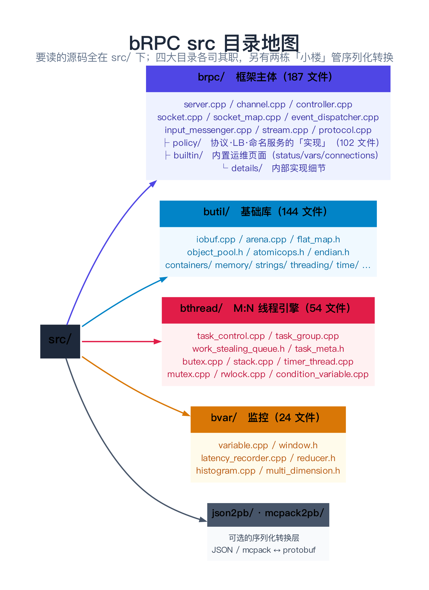
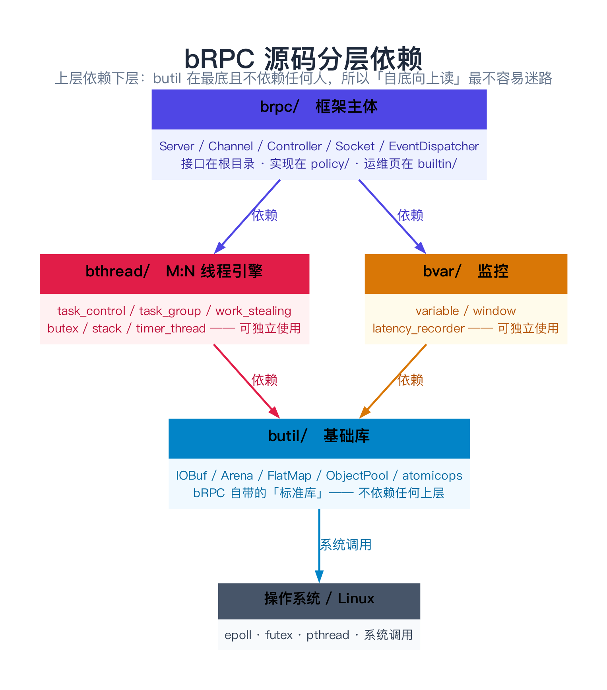
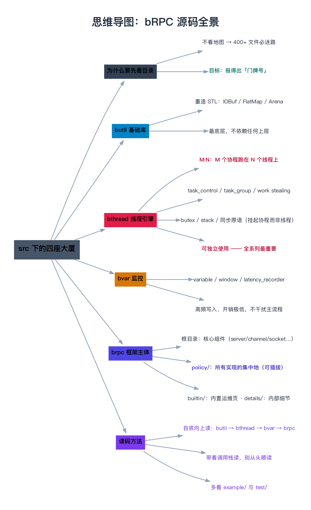

# bRPC 源码全景：src 下的四座「大厦」

> **一句话总结**：bRPC 的源码不是一整块，而是**四座分工明确的大厦**——最底层的 `butil`（基础库）、承重的 `bthread`（M:N 线程引擎）、旁挂的 `bvar`（监控）、以及最上层把三者组装成 RPC 框架的 `brpc`。先把这四座大厦的**分层依赖关系**认清楚，你才知道跟调用栈时「跳来跳去」到底跳到了哪一层——否则你会在 400 多个文件里彻底迷路。

---

## 阅读路径

- **快速版（约 5 分钟）**：读「一句话总结」+ 第 2 节「src 全景」+ 第 3 节「分层依赖图」。
- **深入版（约 25 分钟）**：全文通读，重点吃透第 4 节「逐座大厦」和第 5 节「brpc 内部的三块」——这两节决定了你后面跟代码时能不能「报得出门牌号」。

---

## 目录

1. [为什么读源码前要先看目录](#1-为什么读源码前要先看目录)
2. [src 全景：四座大厦 + 两栋小楼](#2-src-全景四座大厦--两栋小楼)
3. [分层依赖：谁站在谁的肩上](#3-分层依赖谁站在谁的肩上)
4. [逐座大厦：butil / bthread / bvar](#4-逐座大厦butil--bthread--bvar)
5. [brpc：把零件组装成框架](#5-brpc把零件组装成框架)
6. [一次 RPC，串起所有目录](#6-一次-rpc串起所有目录)
7. [构建系统：三套并存的编译方式](#7-构建系统三套并存的编译方式)
8. [读源码的四个常见误区](#8-读源码的四个常见误区)
9. [为什么 bRPC 要这么切](#9-为什么-brpc-要这么切)
10. [常见问题 FAQ](#10-常见问题-faq)
11. [延伸阅读](#11-延伸阅读)
12. [思维导图总结](#12-思维导图总结)

---

## 1. 为什么读源码前要先看目录

### 1.1 痛点：钻进小巷，忘了自己在哪座城

读 bRPC 源码最常见的死法是这样的：

```cpp
// 你在跟 Channel::CallMethod，突然跳进一个函数：
butil::IOBuf buf;
bthread_mutex_lock(&mutex);
```

两个问题立刻冒出来：

- `butil::IOBuf` 是什么？**是 STL 吗？**（不是，是 bRPC 自己写的）
- `bthread_mutex_lock` 是系统调用吗？**它和 pthread 什么关系？**

如果你没有地图，就只能一个个去搜——**搜到第 20 个文件时，你已经忘了最初在跟哪条调用栈了**。

> **类比：去一座陌生的城市**。聪明人先看**地图**，知道「老城区在哪、新区在哪、哪条河把城分成两半」；然后钻进小巷时，心里始终有一根「我在城的哪个方位」的弦。笨办法是直接钻进第一条小巷乱转，转三个小时后既不知道身在何处，也不知道还有哪些地方没去。

### 1.2 地图能给你什么

看完本篇，你应该能立刻回答下面这些问题（**在跟代码之前**）：

| 你看到的东西 | 你应该能立刻答出 |
|-------------|-----------------|
| `butil::IOBuf` | 基础库 `butil` 里的缓冲区，**最底层**，谁都能用 |
| `bthread_mutex_lock` | `bthread` 库里的**协程锁**，**不是**系统调用，会挂起协程而非线程 |
| `bvar::LatencyRecorder` | `bvar` 库的延迟统计，跟主流程**解耦**，只负责记录 |
| `policy/http_rpc_protocol.cpp` | `brpc` 的**协议插件**，HTTP 协议的具体实现 |

**这就是「报得出门牌号」的能力**——它是后面 49 篇的地基。

---

## 2. src 全景：四座大厦 + 两栋小楼

先看全景。bRPC 仓库根目录下有很多东西（`example/`、`test/`、`tools/`、`docs/`、各语言绑定…），但**真正要读的源码全在 `src/` 下**：

```text
src/
├── brpc/          187 个文件    ← 框架主体：Server/Channel/Controller/Socket…
├── butil/         144 个文件    ← 基础库：IOBuf/Arena/FlatMap/原子操作…
├── bthread/        54 个文件    ← M:N 线程引擎：TaskControl/TaskGroup/butex…
├── bvar/           24 个文件    ← 监控：指标、窗口、延迟统计…
├── json2pb/                     ← JSON ↔ protobuf 转换
├── mcpack2pb/                   ← mcpack ↔ protobuf 转换
└── idl_options.proto            ← proto 的扩展选项
```

> **文件数说明**：以上数字取自 Apache bRPC 主干（`src/` 下 `brpc` 187、`butil` 144、`bthread` 54、`bvar` 24）。**版本之间会有出入**，但不影响「四大目录」这个结构判断——结构是稳定的。

四个目录的**一句话职责**：

| 目录 | 一句话职责 | 类比 |
|------|-----------|------|
| **butil** | bRPC 自带的「标准库」——为性能重造了缓冲区、哈希表、内存池 | 大楼的**地基与建材** |
| **bthread** | M:N 线程引擎——让「同步的写法」跑出「异步的性能」 | 大楼的**承重结构 + 电梯** |
| **bvar** | 内置监控——指标采集、延迟统计 | 大楼的**仪表盘** |
| **brpc** | 把上面三者组装成 RPC 框架 | 大楼的**房间与装修** |

另外两栋「小楼」`json2pb`、`mcpack2pb` 是**可选的序列化转换层**（当你需要用 JSON 或 mcpack 跟 protobuf 互转时才会碰到），本系列不重点展开。



---

## 3. 分层依赖：谁站在谁的肩上

光知道「有四个目录」还不够，关键是**依赖方向**——它决定了你读代码的**正确顺序**：

```text
        ┌─────────────────────────────────────┐
        │              brpc                    │  ← 框架主体（最上层）
        │  Server / Channel / Controller / …   │
        └───────┬──────────────┬──────────────┘
                │              │
        ┌───────▼──────┐  ┌────▼─────┐
        │   bthread     │  │   bvar    │  ← 中间层（两个独立的地基）
        │  M:N 线程引擎  │  │  监控     │
        └───────┬───────┘  └────┬─────┘
                │               │
        ┌───────▼───────────────▼──────┐
        │            butil              │  ← 最底层（谁都依赖它）
        │  IOBuf / Arena / FlatMap / …   │
        └───────────────────────────────┘
                │
        ┌───────▼───────┐
        │  操作系统/Linux │  ← epoll、futex、pthread…
        └───────────────┘
```



**三条必须记住的依赖规则**：

1. **`butil` 在最底**，谁都可以依赖它，**它不依赖任何人**（除了系统调用）。所以你读 `butil` 时，不用担心遇到「上面」的概念。
2. **`bthread` 依赖 `butil`**，但**不依赖 `brpc`**。这意味着：**`bthread` 是一个可以独立使用的通用协程库**——事实上它常被单独拿去用（不写 RPC 也能用）。这是它被单独放一个目录的原因。
3. **`bvar` 与 `bthread` 平级**，互相不依赖；**都被 `brpc` 使用**。`bvar` 同样可独立使用。

> **读码顺序启示**：**自底向上读**比自顶向下读更不容易迷路。先 `butil`（不依赖别人，最好懂），再 `bthread`，再 `bvar`，最后 `brpc`。这也正是本系列第 2–6 部分的排布逻辑。

---

## 4. 逐座大厦：butil / bthread / bvar

### 4.1 butil —— bRPC 的「标准库」

`butil` 最容易让人困惑的地方是：**它的很多组件和 STL 重名**。为什么要重造轮子？

| butil 组件 | 替代了 STL 的什么 | 为什么要重造 |
|-----------|-----------------|-------------|
| `butil::IOBuf` | 没有直接对应（类似 `std::string` + 链表的混合） | 需要**零拷贝**、需要能容纳「不连续的多块内存」 |
| `butil::FlatMap` | `std::unordered_map` | 开放寻址、**无链表指针**、**缓存友好**——RPC 热路径上快得多 |
| `butil::Arena` | 无（malloc/free 的替代） | 一次性分配、统一释放，**消除大量 free 调用** |
| `butil::ObjectPool` | 无 | 对象复用，减少 malloc 与锁竞争 |
| `butil::atomicops.h` | `std::atomic`（当时还没有/不够用） | 跨平台、跨编译器的原子操作封装 |
| `butil/endian.h` | 手写字节序转换 | 网络序转换的高频工具 |

**读 `butil` 的抓手**：先读 `iobuf`（第 2 部分会用两篇专讲），再读 `arena`、`flat_map`。其余（base64、strings、files…）扫一眼知道「有这个东西」即可，用到再看。

> `butil` 目录下还有子目录：`containers/`、`memory/`、`strings/`、`files/`、`synchronization/`、`threading/`、`time/`、`posix/`、`debug/` 等——它们按主题归置了这些工具。

### 4.2 bthread —— M:N 线程引擎（全系列最重要）

这是 bRPC 与其他 C++ RPC 框架**最大的区别**。核心一句话：**让 M 个协程（bthread）跑在 N 个系统线程（worker）上**，从而既保住「同步阻塞式」的编程直觉，又拿到「异步事件驱动」的性能。

关键文件（**都是精华，第 3 部分逐一精读**）：

| 文件 | 职责 |
|------|------|
| `task_control.cpp/h` | **全局调度器**：管理所有 worker 线程（TaskGroup） |
| `task_group.cpp/h` + `task_group_inl.h` | **每个 worker 一个**的任务队列，work stealing 发生在这里 |
| `work_stealing_queue.h` | 工作窃取用到的队列结构 |
| `task_meta.h` | **一个协程**的元数据（栈、状态、上下文…） |
| `butex.cpp/h` | bthread 版的「futex」——所有同步原语的**地基** |
| `mutex.cpp/h`、`rwlock.cpp/h`、`condition_variable.cpp/h`、`semaphore.cpp` | 协程版同步原语（挂起协程，**不阻塞线程**） |
| `stack.cpp/h` | 协程栈的分配与复用 |
| `context.cpp/h` | 上下文切换 |
| `timer_thread.cpp/h` | 定时器（超时、定时任务） |
| `execution_queue.cpp/h` | 串行执行队列 |

一条**极关键的伏笔**（第 3 部分会重点讲）：`bthread` 里的锁会**挂起协程**而不是**阻塞线程**。这就是为什么你在 bthread 里**绝对不能用 `usleep`、不能用 pthread 锁**——一用就把整个 worker 线程堵死了。这是 bRPC 新手最大的坑。

### 4.3 bvar —— 内置监控仪表盘

`bvar` 的设计目标：**高频写入、开销极低、不干扰主流程**。这就是为什么它能做到「每个 RPC 都记录延迟」却不拖慢服务。

| 文件 | 职责 |
|------|------|
| `variable.cpp/h` | 指标的核心抽象：`Variable` / `Agent` / `AgentGroup` |
| `window.h` | 时间窗口（「最近 1 分钟」「每秒」怎么算出来） |
| `latency_recorder.cpp/h` | 延迟统计（avg / p99 / qps）——**RPC 场景特化** |
| `detail/` | 内部实现（Sampler、Reducer、Series…） |
| `reducer.h`、`passive_status.h`、`histogram.cpp`、`multi_dimension.h` | 各类统计与多维指标 |

`bvar` 与 `brpc` 的**唯一接触点**是「内置服务」：当你用浏览器打开服务的 `/vars` 页面时，看到的所有数字都来自 `bvar`。

---

## 5. brpc：把零件组装成框架

`brpc` 目录有 187 个文件，直接平铺着看会晕。**它的组织规律是：根目录放核心组件，三个子目录各管一类事。**

### 5.1 根目录：核心组件

| 组件（文件） | 职责 | 对应本系列 |
|-------------|------|-----------|
| `server.cpp/h` | 服务端：启动、注册 service、监听 | 第 46–47 篇 |
| `channel.cpp/h`、`channel_base.h` | 客户端：一次调用的人口 | 第 42、45 篇 |
| `controller.cpp/h` | 单次调用的**上下文与状态机** | 第 44 篇 |
| `socket.cpp/h`、`socket_map.cpp/h` | **连接对象**与全局 fd→Socket 映射 | 第 30–31、35 篇 |
| `event_dispatcher.cpp/h`（+ `_epoll` / `_kqueue`） | **事件循环**（注意：epoll/kqueue 分平台实现） | 第 29 篇 |
| `input_messenger.cpp/h`（+ `_processor`） | 读数据、**按协议切包** | 第 32 篇 |
| `acceptor.cpp/h` | **accept** 新连接 | 第 34 篇 |
| `protocol.cpp/h` | **协议接口**（可插拔的关键） | 第 36 篇 |
| `load_balancer.cpp/h` | **负载均衡接口** | 第 43 篇 |
| `naming_service.h` | **命名服务接口**（实现都在 policy/） | 第 42 篇 |
| `stream.cpp/h` | **Streaming RPC** | 第 49 篇 |
| `backup_request_policy.cpp/h` | **对冲请求**（降长尾） | 第 45 篇 |
| `circuit_breaker.cpp/h` | **熔断** | 第 16 篇 |
| `compress.cpp/h` | 压缩 | 第 41 篇 |
| `coroutine.h` | 协程相关的胶水 | 第 33 篇 |
| `shared_object.h`、`describable.h`、`data_factory.h` | 扩展点基础设施 | 第 48 篇 |

### 5.2 三个子目录：实现都藏在这里

这是**读 bRPC 源码最关键的一个认知**：

> **接口（抽象类）放在 `brpc/` 根目录，具体实现全部放在 `brpc/policy/`。**

| 子目录 | 放什么 | 例子 |
|--------|--------|------|
| **`policy/`**（102 个文件） | 协议、负载均衡、命名服务、压缩的**具体实现** | `baidu_rpc_protocol.cpp`、`http_rpc_protocol.cpp`、`http2_rpc_protocol.cpp`、`file_naming_service.cpp`、`consistent_hashing_load_balancer.cpp`、`auto_concurrency_limiter.cpp` |
| **`builtin/`** | **内置服务**——你浏览器打开监控页看到的那些 | `status_service`、`vars_service`、`connections_service`、`bthreads_service`、`flags_service`、`hotspots_service` |
| **`details/`** | 内部实现细节（不对外暴露） | — |

**为什么这样分？** 因为它实现了 bRPC 最得意的一点：**协议/负载均衡/命名服务都可以「即插即用」**。你写一个新的协议实现，放进 `policy/`，在 `protocol.cpp` 里注册一个名字，全框架立刻支持——**不用改动任何核心代码**。这就是第 48 篇「扩展点」要讲的东西。

> **类比**：`brpc/` 根目录是**插座面板**（统一的接口），`policy/` 是**各种可替换的插头**（具体实现）。换协议就像换插头，面板不动。

---

## 6. 一次 RPC，串起所有目录

把四个目录串起来看一次调用，你会发现它们**各司其职、界限分明**：

**客户端侧**

```text
channel.cpp                 ← 发起调用（brpc）
  → naming_service (policy/) ← 把名字解析成一组地址（brpc/policy）
  → load_balancer (policy/)  ← 挑一台机器（brpc/policy）
  → socket.cpp               ← 建立/复用连接（brpc）
  → event_dispatcher.cpp     ← 挂到 epoll 上等待（brpc）
  → bthread 挂起当前协程      ← 让出 worker，去干别的活（bthread）
  …… 数据到达 ……
  → event_dispatcher 唤醒     ← epoll 报告就绪（brpc）
  → bthread 唤醒协程          ← 回到调用点继续（bthread）
  → controller.cpp            ← 记录这次调用的结果与耗时（brpc）
  → bvar                      ← 把延迟计入指标（bvar）
  全程的缓冲区 = butil::IOBuf  ← 数据一路零拷贝传递（butil）
```

服务端侧是对称的（`acceptor` → `server` → `input_messenger` → `policy` 里的协议实现 → 你的 `EchoService::Echo`）。

**这张图的价值**：它告诉你后面每篇要读的文件**在整条链路里的位置**。你读第 29 篇（事件循环）时，心里清楚它处在「等待唤醒」那一环；读第 32 篇（切包）时，清楚它处在「数据到达」那一环。

---

## 7. 构建系统：三套并存的编译方式

bRPC 同时维护了**三套构建方式**，读源码前先知道该用哪套：

| 构建方式 | 入口文件 | 特点 |
|---------|---------|------|
| **Shell 脚本** | `config_brpc.sh` | 最老牌、最轻量；生成 `config.mk`，直接 `make` |
| **CMake** | `CMakeLists.txt` | 主流、IDE 友好；推荐搭建调试环境时用 |
| **Bazel** | `WORKSPACE` / `BUILD.bazel` / `MODULE.bazel` | 官方主推，依赖管理最省心 |

> **读源码建议**：**用 CMake 或 Bazel 编译，并带 `-g`**，这样才能用 gdb 单步跟进去。如果你只是「想读」，不打算调试，其实**不编译也能读**——但第 03 篇会讲，**在 gdb 里看真实调用栈**的效率是纯读代码的数倍。

---

## 8. 读源码的四个常见误区

| 误区 | 后果 | 正确做法 |
|------|------|---------|
| **打开 `src/brpc/` 从第一个文件顺读到最后一个** | 读到第 20 个文件就迷路、放弃 | 先从 `example/` 跟一条调用栈，**用到哪个读哪个** |
| **把 `butil::IOBuf` 当 STL、把 `bthread_mutex` 当 pthread** | 理解全错（性能模型完全不一样） | 先花 10 分钟认清楚「哪些是 bRPC 自造的」 |
| **只看 `brpc/` 根目录，忽略 `policy/`** | 找不到协议/负载均衡的实现在哪，以为「只有接口没有实现」 | 记住：**实现在 `policy/`** |
| **跳过 `example/` 和 `test/`** | 不知道每个组件「该怎么用」，只看到内部实现 | `example/` 是最好的「使用说明书」；`test/` 是最好的「边界用例集」 |

---

## 9. 为什么 bRPC 要这么切

对比一下 gRPC 的源码组织，能更看清 bRPC 的设计取向：

| | bRPC | gRPC |
|---|------|------|
| 分层 | 四座「大厦」，边界清晰 | `core/` 下切得很碎（`iomgr`、`transport`、`call`…） |
| 线程模型 | **自带 `bthread`**（M:N） | 依赖外部事件循环（如 `EventEngine`），无内置协程 |
| 可插拔 | 接口在根目录、实现在 `policy/`，**注册即生效** | 多为编译期配置/插件 |
| 独立复用 | `butil` / `bthread` / `bvar` **都可以单独拿走用** | 组件与框架耦合更紧 |

**核心取向**：bRPC 把「**可独立复用的地基**」和「**可插拔的实现**」这两件事做到了极致——这也是为什么它的目录结构看起来比 gRPC「干净」。

---

## 10. 常见问题 FAQ

**Q1：我不编译，能读源码吗？**
能。但如果要真正跟调用栈、验证理解，**建议编译 + gdb**（第 02、03 篇会手把手）。纯读容易「以为懂了」。

**Q2：`butil`、`bthread`、`bvar` 能不能单独用？**
能，而且它们的设计目标就是「可独立使用」。`bthread` 常被单独当作协程库用；`bvar` 常被单独当作指标库用。这也解释了为什么它们被单独放在 `src/` 下、而不是塞进 `brpc/`。

**Q3：为什么 `policy/` 有 100 多个文件？**
因为它是**所有实现的集中地**：各种协议（baidu_std、HTTP、HTTP/2、gRPC 兼容…）、各种命名服务、各种负载均衡、各种认证与压缩。**每一个都可以看作一个插件**。

**Q4：`builtin/` 里的服务是干什么的？**
是 bRPC **自带的运维页面**。你启动一个 bRPC 服务后，浏览器打开 `http://机器:端口/status` 能看到实时状态——这些页面就是 `builtin/` 里的 service 实现的。它们是学习 bRPC 内置能力的极好样本（第 41 篇详讲）。

**Q5：本系列 50 篇里，最该花时间的是哪部分？**
**第 3 部分（bthread，第 14–24 篇）**。它是 bRPC 一切高性能特性的根源；不读透它，后面很多设计你只能「背结论」，不能「讲道理」。其次是第 2 部分（butil 的 IOBuf / Arena）。

**Q6：文件数和你的对不上怎么办？**
正常。主干在演进，文件会增删。**认准「四大目录 + 接口在根、实现在 policy」这个结构**即可，具体文件以你 clone 到的版本为准。

---

## 11. 延伸阅读

- **官方文档**：`docs/` 目录下的 `getting_started_cn.md`、`server.md`、`client.md` —— 官方中文文档质量很高，先从「怎么用」建立直觉。
- **示例代码**：`example/` 目录 —— 每个子目录是一个可编译的小例子，是「这玩意儿怎么用」的权威答案。
- **构建说明**：`README.md` 与 `README_cn.md` 里有三种构建方式的完整步骤。
- **bthread 的前身**：陈硕《Linux 多线程服务端编程》—— bthread 的「one loop per thread」思想与 muduo 一脉相承，理解 muduo 的 `EventLoop` 有助于理解 bRPC 的事件循环。
- **源码地址**：[github.com/apache/brpc](https://github.com/apache/brpc)

---

## 12. 思维导图总结

```text
bRPC 源码全景：src 下的四座大厦
├── 为什么要先看目录
│   ├── 否则跟调用栈会迷路（400+ 文件）
│   └── 目标是「报得出门牌号」
├── src 全景
│   ├── brpc/   187 文件  框架主体
│   ├── butil/  144 文件  基础库
│   ├── bthread/ 54 文件  M:N 线程引擎
│   ├── bvar/    24 文件  监控
│   └── json2pb / mcpack2pb（可选转换层）
├── 分层依赖（自底向上）
│   └── butil → bthread → brpc；bvar 平级并被 brpc 使用
├── 逐座大厦
│   ├── butil：重造 STL（IOBuf/FlatMap/Arena）
│   ├── bthread：task_control / task_group / butex / stack
│   └── bvar：variable / window / latency_recorder
├── brpc 内部三块
│   ├── 根目录：server / channel / socket / event_dispatcher …
│   ├── policy/：协议·LB·命名服务的「实现」（可插拔）
│   ├── builtin/：内置运维页面
│   └── details/：内部细节
├── 构建：config_brpc.sh / CMake / Bazel
└── 读码误区
    ├── 从头顺读 → 必迷路
    ├── 把 butil 当 STL、bthread 当 pthread
    └── 忽略 policy/ 与 example/
```


