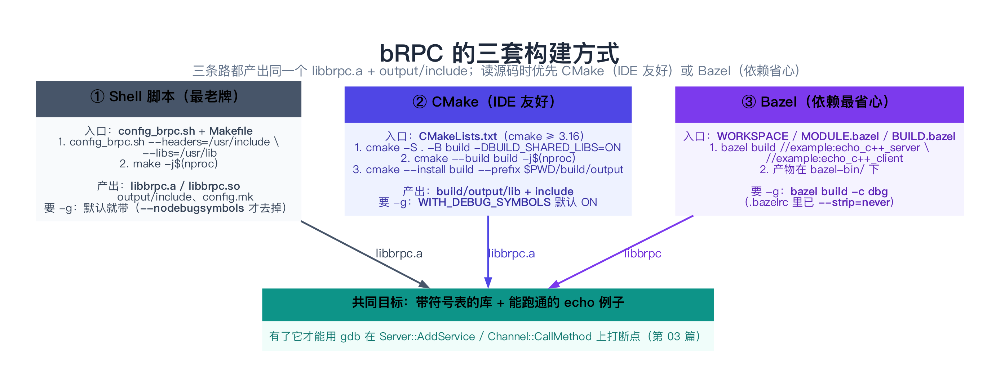
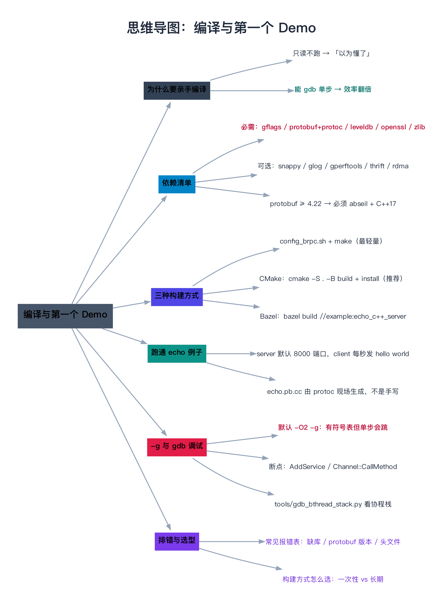

# 编译与第一个 Demo

> **一句话总结**：读 bRPC 源码的第一步不是打开 `channel.cpp`，而是**把 bRPC 编出来、把 `example/echo_c++` 跑起来、再让 gdb 挂上去**——bRPC 同时维护了 `config_brpc.sh` + Makefile、CMake、Bazel **三套构建方式**，三条路的终点都是同一个 `libbrpc.a`（或 `libbrpc.so`）加一个 `output/include/`；而**只要你不显式关掉，`-g` 是默认打开的**，所以「能单步进 `Channel::CallMethod`」这件事，成本比你想的低得多。

---

## 阅读路径

- **快速版（约 5 分钟）**：读「一句话总结」+ 第 2 节「依赖清单」+ 第 3 节「三种构建方式」+ 第 6 节的命令块，照着敲一遍。
- **深入版（约 30 分钟）**：全文通读。重点吃透第 4 节（`config.mk` / `output/` 是怎么来的，这决定了你后面改源码后怎么增量编译）和第 8 节（**真坑合集**）——第 8 节里的每个坑，都是新手会在前两小时里踩到的。

---

## 目录

1. [为什么非要自己编一遍](#1-为什么非要自己编一遍)
2. [依赖清单：哪些必需，哪些可选](#2-依赖清单哪些必需哪些可选)
3. [三种构建方式的真实步骤](#3-三种构建方式的真实步骤)
4. [原理到实现：config.mk 与 output/ 是怎么来的](#4-原理到实现configmk-与-output-是怎么来的)
5. [源码剖析：三套构建系统的入口与产物](#5-源码剖析三套构建系统的入口与产物)
6. [完整可复现流程：编译 + 跑通 echo + gdb 挂上去](#6-完整可复现流程编译--跑通-echo--gdb-挂上去)
7. [数据验证：怎么确认「真的带符号表」](#7-数据验证怎么确认真的带符号表)
8. [边界、反例与失败路径](#8-边界反例与失败路径)
9. [对比与选型：三种构建方式怎么选](#9-对比与选型三种构建方式怎么选)
10. [常见问题 FAQ](#10-常见问题-faq)
11. [延伸阅读](#11-延伸阅读)
12. [思维导图总结](#12-思维导图总结)

---

## 1. 为什么非要自己编一遍

### 1.1 痛点：不编译也能读，但读得「心慌」

bRPC 是纯头文件 + 源码可读的项目，你完全可以直接读 `.cpp`。但纯读源码会遇到三个几乎无解的问题：

1. **「它到底走了哪条分支」**：`Channel::Init` 有五个重载（`channel.cpp:257 / 294 / 362 / 367 / 420`），`Server::Start` 也有五个。你读代码时只能**猜**示例走的是哪一个。在 gdb 里，这是 `bt` 一秒钟的事。
2. **「这个函数是谁调的」**：bRPC 大量使用函数指针注册（比如协议表里的 `pack_request`、`process_request`），静态搜索**搜不到调用点**。只有运行时调用栈能告诉你答案。
3. **「我理解的对不对」**：以为自己看懂了 `AddService` 存了什么、`CallMethod` 在哪个线程里跑，这属于**不可证伪的自信**。而打断点是可证伪的。

> **类比：看菜谱 vs 进厨房**。菜谱（源码）能告诉你「加盐少许」，但只有真进厨房（编译 + gdb）你才知道自家灶的火候、锅的脾气、以及哪一步会被油溅到。**第 03 篇整篇都建立在「你已经有一个能跑的 echo 例子」之上**——如果这篇没跑通，那篇你只能看个热闹。

### 1.2 编译一次，能给你换来什么

| 编完之后你能做的事 | 对应本系列哪几篇 |
|------------------|----------------|
| 在任意函数下断点、`bt` 看真实调用栈 | 全系列，尤其 03 / 42–47 |
| 单步进 `Channel::CallMethod`、看 `Controller` 字段变化 | 44 |
| 用 `tools/gdb_bthread_stack.py` 看**协程**级调用栈 | 14–24（bthread） |
| 跑 `example/` 里的 30 多个例子，验证「这玩意儿怎么用」 | 全系列 |
| 改 `-O0` 后逐行调试，甚至改源码加日志 | 全系列 |

**一句话**：编译是**一次性投入、全程受益**的事。下面的内容你只需要认真做一遍。

---

## 2. 依赖清单：哪些必需，哪些可选

bRPC 的依赖分成两档，**必需的不装绝对编不过，可选的按需装**。这份清单直接来自源码：CMake 里用 `REQUIRED` 或 `message(FATAL_ERROR)` 强制的就是必需项。

### 2.1 必需依赖

| 依赖 | 为什么必需 | 源码里的强约束 |
|------|-----------|--------------|
| **gflags** | 几乎所有 example 和内部代码都用它解析命令行 | `CMakeLists.txt:158` `find_package(GFLAGS REQUIRED)` |
| **protobuf**（含 `protoc` 编译器） | bRPC 的接口定义、协议元信息全靠 protobuf；`protoc` 用来现场生成 `.pb.cc` | `CMakeLists.txt:245`；`CMakeLists.txt:401-404` 找不到 `libprotoc` 直接 `FATAL_ERROR` |
| **leveldb** | 内置服务（如 `/rpcz`、`/hotspots`）需要它存数据 | `CMakeLists.txt:293-296`：找不到就 `Fail to find leveldb` |
| **openssl** | HTTPS / SSL 支持 | `CMakeLists.txt:416` `find_package(OpenSSL REQUIRED)` |
| **zlib** | gzip 压缩 | `CMakeLists.txt:246` `find_package(ZLIB REQUIRED)` |
| **pthread / dl** | 线程与动态加载 | `CMakeLists.txt:291` `find_package(Threads REQUIRED)` |

Ubuntu / Debian 一条命令搞定（这也是官方 `Dockerfile` 里装的集合）：

```bash
sudo apt-get update && sudo apt-get install -y \
    g++ make cmake git \
    libssl-dev \
    libgflags-dev \
    libprotobuf-dev libprotoc-dev protobuf-compiler \
    libleveldb-dev
```

macOS（Homebrew）：

```bash
brew install gflags protobuf leveldb openssl cmake gnu-getopt
```

> **`gnu-getopt` 是 macOS 特有的一条**：`config_brpc.sh` 用的是 GNU 版 `getopt` 的长选项语法（`--long headers:,libs:...`，见 `config_brpc.sh:57`）。BSD 版 `getopt` 不支持，脚本会在开头直接报 `gnu-getopt must be installed and used` 然后退出（`config_brpc.sh:43-46`）。装完后如果 `which getopt` 仍指向 `/usr/bin/getopt`，需要把 Homebrew 的 `opt/gnu-getopt/bin` 加进 `PATH`，或者用 `alias`。

### 2.2 可选依赖（默认不开）

| 依赖 | 开关 | 装/不装的差别 |
|------|------|--------------|
| **snappy** | CMake `-DWITH_SNAPPY=ON`；shell 里由 leveldb 的链接情况自动判断 | 多一种压缩算法。**注意**：`config_brpc.sh:276-300` 会去 `ldd libleveldb.so` 看它是否依赖 snappy，如果依赖却找不到 `libsnappy`，就退回动态链接 leveldb |
| **glog** | CMake `-DWITH_GLOG=ON`；shell `--with-glog` | 用 glog 替换 bRPC 自带的日志实现（`config_brpc.sh:651-665`） |
| **gperftools** | Makefile 里的 `NEED_GPERFTOOLS`；CMake 里走 example 的 `BRPC_EXAMPLE_ENABLE_CPU_PROFILER` | CPU/Heap profiler 依赖 `libtcmalloc_and_profiler`。**不开也能编译**，`/hotspots` 之类页面会退化 |
| **thrift** | CMake `-DWITH_THRIFT=ON`；shell `--with-thrift` | 支持 thrift framed 协议；会强制要求 `libthrift`（`CMakeLists.txt:100-105`） |
| **abseil（absl）** | **不是你可选的，是被 protobuf 版本逼出来的** | 见下 |

### 2.3 一个必须提前知道的「版本分水岭」：protobuf ≥ 4.22

这是**最容易被忽略、又最容易翻车**的一条。bRPC 在源码里显式判断了 protobuf 版本：

```cmake
# CMakeLists.txt:245-251
find_package(Protobuf REQUIRED)
find_package(ZLIB REQUIRED)
if(Protobuf_VERSION VERSION_GREATER 4.21)
    # required by absl
    set(BRPC_CXX_STANDARD 17)
    find_package(absl REQUIRED CONFIG)
```

`config_brpc.sh` 里是同一套逻辑的另一份实现：

```sh
# config_brpc.sh:308-309（读 protobuf 头里的 GOOGLE_PROTOBUF_VERSION）
PROTOBUF_VERSION=$(grep '#define GOOGLE_PROTOBUF_VERSION [0-9]\+' \
    $PROTOBUF_HDR/google/protobuf/stubs/common.h | awk '{print $3}')
if [ "$PROTOBUF_VERSION" -ge 4022000 ]; then
    # from v22, utf8_validity should be explicitly linked
    ...
    CXXFLAGS="-std=c++17"
```

**含义**：

- protobuf ≤ 4.21（即 v21 及更早）：C++14 就够，走默认路径。
- protobuf ≥ 4.22（v22+ / v5 / v6）：**必须同时安装 abseil**，且标准升到 **C++17**。`config_brpc.sh` 还会去挨个找 `absl_strings`、`absl_base` 等一堆 absl 子库（`config_brpc.sh:317-389`），缺一个就报 `Fail to find xxx from --libs`。

所以：**如果你用的是较新的发行版（Ubuntu 24.04+ 或滚动更新的系统），protobuf 很可能已经是 v4.x/v5，这时 `libabsl-dev` 是硬依赖。**

---

## 3. 三种构建方式的真实步骤



bRPC 仓库根目录同时躺着三套构建系统的入口，这不是历史包袱的偶然，而是**面向不同使用场景的刻意并存**。下面每一条都对着源码核对过。

### 3.1 方式一：`config_brpc.sh` + Makefile（最老牌、最轻量）

```bash
# 1) 生成 config.mk 和 src/butil/config.h
sh config_brpc.sh --headers=/usr/include --libs=/usr/lib

# 2) 编译
make -j$(nproc)
```

`--headers` 和 `--libs` **不给会直接退出**（`config_brpc.sh:141-144`：`--headers=HDRPATHS --libs=LIBPATHS must be specified`）。脚本会在这两个目录树里 `find` 出 `gflags`、`protobuf`、`leveldb`、`openssl`、`protoc` 的位置（`config_brpc.sh:146-199` 的一组 `find_dir_of_lib` / `find_dir_of_header` 辅助函数），然后生成 `config.mk`。

**产物**（`Makefile:239-240` 的 `all` 目标）：

```text
libbrpc.a          ← 静态库
libbrpc.so         ← 动态库（macOS 下是 libbrpc.dylib）
output/include/    ← 所有 .h/.hpp 按目录结构拷好
output/lib/        ← 上两个库的副本
output/bin/        ← protoc-gen-mcpack 工具
```

`output/include` 这一步在 `Makefile:289-294` 实现：它 `find src -name "*.h"`，把目录结构原样搬到 `output/include` 下——**这就是为什么你 `#include <brpc/channel.h>` 能生效**，因为 `output/include/brpc/channel.h` 正是 `src/brpc/channel.h` 的副本。

### 3.2 方式二：CMake（推荐用来搭调试环境）

顶层 `CMakeLists.txt` 用 `project(brpc C CXX)`（`CMakeLists.txt:19`），最低版本 `3.16`（`CMakeLists.txt:18`）。

```bash
# 1) 配置（-DBUILD_SHARED_LIBS=ON 才会额外产出动态库）
cmake -S . -B build -DBUILD_SHARED_LIBS=ON

# 2) 编译
cmake --build build -j$(nproc)

# 3) 安装到本地前缀：头文件 + 库都会落到 build/output/
cmake --install build --prefix "$PWD/build/output"
```

**为什么第 3 步要 `--prefix "$PWD/build/output"`**？这不是随便写的。看 `example/cmake/BrpcExample.cmake` 的第 30-38 行：

```cmake
macro(brpc_example_find_common_deps out_libs)
    execute_process(
        COMMAND bash -c "find ${PROJECT_SOURCE_DIR}/../.. -type d -regex \".*output/include$\" | head -n1 | xargs dirname | tr -d '\n'"
        OUTPUT_VARIABLE OUTPUT_PATH
    )
    if(OUTPUT_PATH)
        list(PREPEND CMAKE_PREFIX_PATH ${OUTPUT_PATH})
    endif()
```

示例的 CMake 脚本会**从仓库根往下找 `output/include` 目录**，把它的上一级（也就是 `output/`）塞进 `CMAKE_PREFIX_PATH`，然后靠 `find_path(BRPC_INCLUDE_PATH NAMES brpc/server.h)` 和 `find_library(BRPC_LIB NAMES libbrpc.a brpc)`（`BrpcExample.cmake:96-104`）去找 bRPC。

所以 CMake 路径下，「build 目录」和「install 前缀」必须凑成 `<某处>/output/{include,lib}` 的形状，示例才找得到 bRPC。**这是 CMake 路径最容易卡住新手的一步**。

> 顺带一提：顶层 CMake **不会**编译 `example/`（只有 `add_subdirectory(src)`、可选的 `test`、`tools`，见 `CMakeLists.txt:743-759`）。示例是各自独立的 CMake 工程。

### 3.3 方式三：Bazel（依赖管理最省心）

Bazel 相关文件有四个：`WORKSPACE`（传统 workspace）、`WORKSPACE.bzlmod`、`MODULE.bazel`（Bzlmod 模块）、`BUILD.bazel`（目标定义）。`.bazelversion` 钉的是 **`7.2.1`**。

```bash
# 在仓库根目录
bazel build //example:echo_c++_server //example:echo_c++_client
```

产物在 `bazel-bin/example/` 下。echo 这两个目标定义在 `example/BUILD.bazel`：

```python
brpc_proto_library(
    name = "cc_echo_c++_proto",
    srcs = ["echo_c++/echo.proto"],
    include = "echo_c++",
    proto_deps = [],
)

cc_binary(
    name = "echo_c++_server",
    srcs = ["echo_c++/server.cpp"],
    copts = COPTS,
    includes = ["echo_c++"],
    deps = [":cc_echo_c++_proto", "//:brpc"],
)
```

Bazel 最舒服的一点是**依赖全部由构建系统自己下载编译**：`WORKSPACE` 里 HTTP-archive 了 gflags 2.2.2、protobuf 3.19.1、leveldb 1.23、openssl 1.1.1m、zlib 1.2.11、snappy 1.1.7（见 `WORKSPACE` 的各段）。新版 `MODULE.bazel` 走 Bzlmod，从 BCR 拉依赖（`bazel_dep(name = 'protobuf', version = '27.3')` 等），并声明了三个额外的 registry（`.bazelrc` 里 `common --registry=https://bcr.bazel.build` 等三行）。

`example/build_with_bazel_module/` 还演示了**把 brpc 当作外部模块来用**的姿势（`MODULE.bazel` 里写 `bazel_dep(name='brpc')`，代码里 `deps = ["@apache_brpc//:brpc"]`）——这是给「我自己的项目要用 bRPC」准备的，不是给读源码用的，知道有这个目录即可。

⚠️ **Bazel 的坑**：`WORKSPACE` 与 `MODULE.bazel` 里同时锁了大量第三方版本，首次构建需要联网拉一堆东西（含 boost 1.77 这种大件）。**如果你只是想读源码，别用 Bazel 起步**——它对网络和磁盘的胃口最大。

### 3.4 三条路的命令速查

| | 配置 | 编译 | 产物位置 |
|---|------|------|---------|
| **shell** | `sh config_brpc.sh --headers=... --libs=...` | `make -j$(nproc)` | 仓库根 `libbrpc.a` / `output/` |
| **CMake** | `cmake -S . -B build -DBUILD_SHARED_LIBS=ON` | `cmake --build build -j` → `cmake --install build --prefix $PWD/build/output` | `build/output/{lib,include}` |
| **Bazel** | 无需配置 | `bazel build //example:echo_c++_server` | `bazel-bin/example/` |

---

## 4. 原理到实现：config.mk 与 output/ 是怎么来的

这一节解释「为什么 shell 路径要先生成 `config.mk`」——理解它，你后面改源码增量编译才不会懵。

### 4.1 `config_brpc.sh` 干了三件事

读完 `config_brpc.sh`（723 行），它的行为可以精确概括为三步：

**第一步：探测（找到所有依赖的绝对路径）**

脚本用 `find_dir_of_lib` / `find_dir_of_header` 在一堆目录里搜文件。以 gflags 为例：

```sh
# config_brpc.sh:146-151, 265-267
find_dir_of_lib() {
    local lib=$(find ${LIBS_IN} -name "lib${1}.a" -o -name "lib${1}.$SO" 2>/dev/null | head -n1)
    if [ ! -z "$lib" ]; then dirname $lib; fi
}
...
GFLAGS_LIB=$(find_dir_of_lib_or_die gflags)
append_linking $GFLAGS_LIB gflags
```

**第二步：分类（静态 vs 动态）**

`append_linking`（`config_brpc.sh:250-263`）是关键：**目录里有 `.a` 就静态链接，否则动态链接**，并把结果写进 `STATIC_LINKINGS` / `DYNAMIC_LINKINGS` 两个变量。这就是为什么 bRPC 的链接命令看起来很奇怪（Linux 下用 `-Xlinker "-(" ... -Wl,-Bstatic ... -Wl,-Bdynamic -Xlinker "-)"`，见 `Makefile:259`）——它在**手工切换静态/动态链接**。

**第三步：落盘（生成两份文件）**

```sh
# config_brpc.sh:685-701 → 生成 src/butil/config.h
cat << EOF > src/butil/config.h
#define BRPC_WITH_GLOG $WITH_GLOG
#define BUTIL_USE_CPU_FREQUENCY $WITH_CPU_FREQUENCY
EOF

# config_brpc.sh:706 → 生成 config.mk
$ECHO "$OUTPUT_CONTENT" > config.mk
```

`config.mk` 里有什么？追一下 `append_to_output` 的调用点就知道了（`config_brpc.sh:477-486`）：

```make
SYSTEM=Linux
HDRS=/usr/include ...
LIBS=/usr/lib ...
PROTOC=/usr/bin/protoc
PROTOBUF_HDR=/usr/include
CC=gcc
CXX=g++
GCC_VERSION=...
STATIC_LINKINGS=...
DYNAMIC_LINKINGS=-lpthread -lssl -lcrypto -ldl -lz -lrt
CPPFLAGS=... -g
CXXFLAGS=-std=c++14
```

### 4.2 `-g` 从哪来：默认打开，可以关掉

**这是本篇最关键的一条结论**：

```sh
# config_brpc.sh:69
DEBUGSYMBOLS=-g
...
# config_brpc.sh:495-497
if [ ! -z "$DEBUGSYMBOLS" ]; then
    CPPFLAGS="${CPPFLAGS} $DEBUGSYMBOLS"
fi
```

`DEBUGSYMBOLS` **默认就是 `-g`**，只有显式加 `--nodebugsymbols` 才会变空（`config_brpc.sh:106`）。CMake 那边同理：

```cmake
# CMakeLists.txt:24, 91-92
option(WITH_DEBUG_SYMBOLS "With debug symbols" ON)
...
if(WITH_DEBUG_SYMBOLS)
    list(APPEND BRPC_COMMON_COMPILE_OPTIONS -g)
endif()
```

**所以「用 -g 编译以便 gdb 调试」这件事，bRPC 已经替你做了。** 你需要知道的只是**它同时开着 `-O2`**：

```cmake
# CMakeLists.txt:205-207
list(APPEND BRPC_COMMON_COMPILE_OPTIONS
    -O2
    -pipe
```

`-O2 -g` 的组合意味着：**函数名、变量、行号、调用栈全都有**（能打断点、能 `bt`、能 `p cntl->log_id()`），但**逐行单步会被优化打乱**（变量可能被优化掉、断点可能跳行、`step` 会乱跳分支）。想彻底逐行调试，就把 `CMakeLists.txt:206` 的 `-O2` 改成 `-O0` 重新编译。

> 还有一个更少人知道的开关：顶层 `Makefile:242-243` 的 `make debug` 目标，会编出一份 `test/libbrpc.dbg.so`，它的 `DEBUG_CXXFLAGS`（`Makefile:28-29`）是**去掉 `-DNDEBUG`** 并加上 `-DUNIT_TEST`。去掉 `-DNDEBUG` 意味着 `DCHECK` 之类的调试断言会**真正生效**——这是排查「代码为什么走了不该走的分支」的一把利器。

### 4.3 为什么编译这么慢（以及怎么增量）

bRPC 主体（`butil` + `bthread` + `bvar` + `brpc` + `json2pb` + `mcpack2pb`）加起来是上百个 `.cc` 文件。`Makefile:232` 把它们组织成 `OBJS`，然后：

```make
# Makefile:265-267
libbrpc.a:$(BRPC_PROTOS:.proto=.pb.h) $(OBJS)
	@echo "> Packing $@"
	ar crs $@ $(filter %.o,$^)
```

**增量编译是安全的**：`.o` 是按源文件生成的（`Makefile:315-317` 的 `%.o:%.cpp` 规则），你改一个 `.cpp`，只有它重新编译、然后重新 `ar` 打包。**但注意一个陷阱**：`libbrpc.a` 依赖 `.pb.h` 的**生成**（`Makefile:265` 的目标依赖），如果你改了 `src/brpc/*.proto`，protoc 会重新生成 `.pb.cc/.pb.h`，但**已经编译好的、`#include` 了那个 `.pb.h` 的 `.o` 不会自动重编**——因为 make 不知道 `.o` 依赖 `.pb.h`。这时候要 `make clean && make`。

---

## 5. 源码剖析：三套构建系统的入口与产物

这一节把三套构建系统的入口文件逐个拆开，给出一张「入口 → 关键行为 → 产物」的对照表。**你不需要背，但需要知道遇到问题时该翻哪个文件。**

### 5.1 `config_brpc.sh`：探测 + 生成

| 行号 | 行为 |
|------|------|
| `34-55` | 判断系统（Linux/macOS），决定 `SO=so/dylib`、`LDD=ldd/otool -L` |
| `43-46` | macOS 上检测 GNU getopt，不是就报错退出 |
| `57` | `getopt -o v: --long headers:,libs:,cc:,cxx:,with-glog,...` 定义所有命令行选项 |
| `69` | `DEBUGSYMBOLS=-g`（默认带调试符号） |
| `146-199` | 一组 `find_dir_of_lib` / `find_dir_of_header` 辅助函数 |
| `214-218` | 检查 openssl：`find_dir_of_header_or_die openssl/ssl.h mesalink/openssl/ssl.h` |
| `265-303` | 依次找 gflags → protobuf → leveldb → protoc |
| `308-395` | 读 protobuf 版本，决定 C++14 / C++17 + 是否需要 absl |
| `495-497` | 把 `-g` 拼进 `CPPFLAGS` |
| `629-649` | 可选的 gperftools 块（`NEED_GPERFTOOLS=1` 时才要求） |
| `685-701` | 生成 `src/butil/config.h` |
| `706` | 生成 `config.mk` |

### 5.2 `Makefile`：全局编译与打包

| 行号 | 行为 |
|------|------|
| `18-19` | `NEED_LIBPROTOC=1` + `include config.mk`（没有 config.mk 就编不了） |
| `25-27` | 全局 `CPPFLAGS`：`-DBTHREAD_USE_FAST_PTHREAD_MUTEX -D_GNU_SOURCE -DUSE_SYMBOLIZE -DNO_TCMALLOC ... -DNDEBUG` |
| `58-175` | `BUTIL_SOURCES`（逐个文件列举，注意它自带 snappy/murmurhash 等 third_party） |
| `194-219` | `BVAR` / `BTHREAD` / `JSON2PB` / `BRPC` 用 `wildcard` 自动收集源文件 |
| `239-240` | `all: protoc-gen-mcpack libbrpc.a libbrpc.$(SOEXT) output/include output/lib output/bin` |
| `242-243` | `make debug` → `test/libbrpc.dbg.$(SOEXT)`（去掉 `-DNDEBUG`） |
| `265-275` | 打包 `libbrpc.a` / 链接 `libbrpc.so` |
| `289-306` | `output/include` / `output/lib` / `output/bin` 的拷贝规则 |

> **一个值得注意的细节**：`Makefile` 用 `wildcard` 自动收集 `src/brpc`、`src/brpc/policy`、`src/brpc/builtin` 等目录下的 `.cc`（`Makefile:206-219`）。这意味着**新加一个 `.cpp` 文件不需要改 Makefile**——但也意味着**自动生成的 `.pb.cc` 也会被卷进来**，所以 `BRPC_SOURCES` 里特意把 `event_dispatcher_*`（多平台实现，只能选一个）和 `thrift*` 排除掉了。

### 5.3 `CMakeLists.txt`：模块化目标

| 行号 | 行为 |
|------|------|
| `19-56` | `project(brpc)` + 一堆 `option(WITH_*)` + `set(BRPC_VERSION 1.18.0)`（`:51`） |
| `58-66` | 编译器门槛：GCC ≥ 5.0（`:60`），Clang ≥ 3.5（`:65`） |
| `77` | `set(BRPC_CXX_STANDARD 14)` |
| `91-92` | `WITH_DEBUG_SYMBOLS` → `-g` |
| `154` | `configure_file(config.h.in → src/butil/config.h)`（CMake 路径下的对应实现） |
| `158 / 245-296 / 401 / 416` | 各依赖的 `find_package` / `find_path` / `find_library` |
| `247-251` | protobuf > 4.21 → C++17 + `find_package(absl REQUIRED CONFIG)` |
| `410-414` | macOS 上默认把 `OPENSSL_ROOT_DIR` 指向 `/usr/local/opt/openssl` |
| `703-743` | `set(PROTO_FILES ...)`（`:704`）+ `compile_proto(...)`（`:727`）+ `add_subdirectory(src)`（`:743`） |
| `762, 768` | 把生成的头文件与 `src/` 下的头文件拷到 `<build>/output/include/` |

`src/CMakeLists.txt` 里定义了产物目标：

```cmake
# src/CMakeLists.txt:18-28, 62
add_library(BUTIL_LIB OBJECT ${BUTIL_SOURCES})
add_library(SOURCES_LIB OBJECT ${SOURCES})
...
add_library(brpc-static STATIC $<TARGET_OBJECTS:BUTIL_LIB> ...)
SET_TARGET_PROPERTIES(brpc-static PROPERTIES OUTPUT_NAME brpc CLEAN_DIRECT_OUTPUT 1)
```

注意 `OUTPUT_NAME brpc`——这就是为什么最终文件叫 `libbrpc.a`，而不是 `librpc-static.a`。

### 5.4 关键差异：CMake 会自动下载 gtest 和 protoc？

**不会无条件下载**。CMake 路径下有 `option(DOWNLOAD_GTEST "..." ON)`（`CMakeLists.txt:44`）——但 gtest 只在 `BUILD_UNIT_TESTS=ON` 时才真正用到，且它只是**开启后允许联网拉 gtest** 的开关，默认不触发下载（因为单元测试默认关）。`BUILD_UNIT_TESTS` 默认 `OFF`（`CMakeLists.txt:41`），想跑 `test/` 要显式打开并准备 gtest。

---

## 6. 完整可复现流程：编译 + 跑通 echo + gdb 挂上去


下面这段是**从零到「能在 gdb 里单步进 `Channel::CallMethod`」的完整流程**。以 Ubuntu 为例（macOS 的差异在第 6.6 节单列）。

### 6.1 环境

```text
Ubuntu 22.04 / 20.04
g++ (GCC) 11.x
CMake >= 3.16
gflags / protobuf(+protoc) / leveldb / openssl / zlib 已装
```

### 6.2 拉代码

```bash
git clone https://github.com/apache/brpc.git
cd brpc
git log -1 --oneline
```

> 本系列写作时对照的版本是 commit `6ab8c0e`，`CMakeLists.txt` 里的 `BRPC_VERSION` 是 **1.18.0**（`CMakeLists.txt:51`），`MODULE.bazel` 里同一版本号。**版本演进会增删文件，以你 clone 到的为准**——但本系列讲的机制是稳定的。

### 6.3 编译 bRPC（带符号表）

用 CMake 路线（推荐）：

```bash
cmake -S . -B build -DBUILD_SHARED_LIBS=ON      # -g 由 WITH_DEBUG_SYMBOLS=ON 默认带上
cmake --build build -j"$(nproc)"
cmake --install build --prefix "$PWD/build/output"
```

跑完后确认产物存在：

```bash
ls -l build/output/lib/        # 应该看到 libbrpc.a（BUILD_SHARED_LIBS=ON 时还有 libbrpc.so）
ls build/output/include/brpc/  # 应该看到 channel.h server.h controller.h ...
```

### 6.4 编译并跑通 echo 例子

`example/echo_c++/` 自带一套 Makefile（老式，直接 `include ../../config.mk`），也自带一套 `CMakeLists.txt`。**两条路都能走**。

**路线 A：用示例自带的 Makefile**（前提是你刚才是用 shell 路线编的 bRPC，即仓库根有 `config.mk`）

```bash
cd example/echo_c++
make -j"$(nproc)"
```

这套 Makefile（`example/echo_c++/Makefile:20-28`）会：

```make
BRPC_PATH=../..
include $(BRPC_PATH)/config.mk
CXXFLAGS+=$(CPPFLAGS) -std=c++14 -DNDEBUG -O2 -pipe -W -Wall ... -fno-omit-frame-pointer
HDRS+=$(BRPC_PATH)/output/include
LIBS+=$(BRPC_PATH)/output/lib
```

注意 `CXXFLAGS+=$(CPPFLAGS)`——**`$(CPPFLAGS)` 里就带着 `config.mk` 中的 `-g`**，所以示例同样是带符号表编译的。

它还会自动生成 protobuf 代码：

```make
# example/echo_c++/Makefile:83-85
%.pb.cc %.pb.h:%.proto
	@echo "> Generating $@"
	$(PROTOC) --cpp_out=. --proto_path=. $(PROTOC_EXTRA_ARGS) $<
```

**路线 B：用示例自带的 CMakeLists（CMake 路线下用这个）**

```bash
cd example/echo_c++
cmake -S . -B build
cmake --build build -j"$(nproc)"
```

它做的事情（`example/echo_c++/CMakeLists.txt`）：

```cmake
include(${CMAKE_CURRENT_LIST_DIR}/../cmake/BrpcExample.cmake)
option(LINK_SO "Whether examples are linked dynamically" OFF)
brpc_example_find_common_deps(DYNAMIC_LIB)
protobuf_generate_cpp(PROTO_SRC PROTO_HEADER echo.proto)
add_executable(echo_client client.cpp ${PROTO_SRC} ${PROTO_HEADER})
add_executable(echo_server server.cpp ${PROTO_SRC} ${PROTO_HEADER})
```

### 6.5 跑起来

开**两个终端**。

终端 A（服务端，默认监听 8000）：

```bash
./echo_server -port=8000
```

终端 B（客户端，每秒发一次 `hello world`）：

```bash
./echo_client -server=127.0.0.1:8000
```

**预期输出**。

服务端每次收到请求会打一行（`example/echo_c++/server.cpp:61-65`）：

```text
I20260924 ... Received request[log_id=0] from 127.0.0.1:53128 to 127.0.0.1:8000: hello world (attached=)
```

客户端每次收到响应会打一行（`example/echo_c++/client.cpp:84-88`）：

```text
I20260924 ... Received response from 127.0.0.1:8000 to 127.0.0.1:53128: hello world (attached=) latency=123us
```

**除了终端，还有两条更炫的验证通道**（这也是第 01 篇提到的「内置服务」）：

```bash
# 看服务端实时状态（连接数、QPS、延迟分位…）
curl -s http://127.0.0.1:8000/status | head -30

# 看所有的 bvar 指标
curl -s http://127.0.0.1:8000/vars | head -30
```

> `/status` 和 `/vars` 是 bRPC **自动注册**的内置服务，你一行代码都不用写。它们的实现就在 `src/brpc/builtin/`（第 28 篇会讲）。**「服务起没起、请求走没走通」用这两个页面验证，比看日志靠谱得多。**

### 6.6 gdb 挂上去

```bash
# 方式一：直接带调试器启动服务端
gdb --args ./echo_server -port=8000

# 方式二：先跑起来，再 attach（更常用）
./echo_server -port=8000 &
gdb -p $!
```

进入 gdb 后：

```gdb
# 在服务端的「注册」和「启动」关键路径上打断点
(gdb) b brpc::Server::AddService
(gdb) b brpc::Server::Start

# 真正的重头戏：客户端调用入口
(gdb) b brpc::Channel::CallMethod

# 但 Channel::CallMethod 在 echo_client 里 —— 所以对客户端要单独开一个 gdb
# gdb --args ./echo_client -server=127.0.0.1:8000
# (gdb) b brpc::Channel::CallMethod
# (gdb) run
# 命中后：
# (gdb) bt          ← 看 protobuf Stub 是怎么调进来的
# (gdb) info args   ← 看 method 的 full_name 是不是 "example.EchoService.Echo"
```

**验证「符号表真的在」的最快方法**：

```bash
# 有 .debug_* 段 = 带调试信息
readelf -S build/output/lib/libbrpc.a 2>/dev/null | grep -c debug
# 或
file ./echo_server         # 若显示 "with debug_info" 就对了（macOS 用 dsymutil/otool）
```

**协程栈的坑（提前埋个伏笔）**：bRPC 的请求跑在 **bthread（协程）**上，不是普通 pthread。如果你在服务端 `attach` 后打 `bt`，很可能看到的是**调度器的栈**，而不是你关心的 `EchoServiceImpl::Echo`。这时候用仓库自带的工具：

```gdb
(gdb) source tools/gdb_bthread_stack.py
(gdb) bthread_list        # 列出所有 bthread
(gdb) bthread_frame 0     # 切到第 0 个协程的栈
(gdb) bt                  # 现在看到的就是这个协程的调用栈
(gdb) bthread_end         # 退出（会恢复寄存器）
```

这个脚本的用法在文件头注释里写得很清楚（`tools/gdb_bthread_stack.py:24-49`），支持 `bthread_num` / `bthread_list` / `bthread_frame <id>` / `bthread_all` / `bthread_meta <id>` 等命令。**它是读 bthread 那 11 篇（14–24）的必备工具。**

> ⚠️ **macOS 注意**：macOS 上没有 gdb（Apple 已改用 lldb）。对应的工具是 `tools/lldb_bthread_stack.py`。另外 `attach` 系统进程在 macOS 上受 SIP 限制，可能需要 `codesign` 或改用 lldb 直接 `lldb -- ./echo_server -port=8000`。

---

## 7. 数据验证：怎么确认「真的带符号表」

「能下断点」这件事值得用数据验证，而不是凭感觉。三个层次：

### 7.1 库文件层面

```bash
# Linux: 看调试段是否存在
readelf -S libbrpc.a | grep -c debug_line
# 输出 > 0 说明带行号信息

# 或者用 size 看调试段占用
size -A build/output/lib/libbrpc.a | grep -E "debug|Total"
```

### 7.2 可执行文件层面

```bash
file ./echo_server
# 期望包含 "with debug_info, not stripped"
```

如果显示 `stripped`，说明链接时把符号剥掉了——检查是不是用了 `-s` 或 Bazel 的默认 strip。**bRPC 的 `.bazelrc` 里已经写了 `build --strip=never`**，就是为了配合 `google::Symbolize` 按名字解析函数（`.bazelrc` 有注释说明）。

### 7.3 运行时层面（最可信）

在 gdb 里做这三件事，全过就说明你的调试环境是合格的：

```gdb
(gdb) info functions brpc::Channel::Init        # 能列出一堆重载 → 符号存在
(gdb) b brpc::channel.cpp:482                   # 能按「文件:行号」下断点 → 行号信息存在
(gdb) run                                       # 断点命中 → 符号与地址对得上
Breakpoint 1, brpc::Channel::CallMethod (...) at src/brpc/channel.cpp:482
```

**第三行输出里的 `at src/brpc/channel.cpp:482` 就是黄金标准**：它同时证明了符号名、文件路径、行号三者都可用。第 03 篇的所有断点，都建立在这个前提上。

---

## 8. 边界、反例与失败路径

这一节是**本篇最该反复看的部分**。下面每一条都是真实会发生的失败。

### 8.1 缺库报错对照表

| 报错 | 出处 | 原因 | 修法 |
|------|------|------|------|
| `Fail to find leveldb` | `CMakeLists.txt:296` | 没装 leveldb 或其头文件不在搜索路径 | `apt install libleveldb-dev`；或设 `CMAKE_PREFIX_PATH` / `LEVELDB_INCLUDE_PATH` |
| `Fail to find gflags` | 由 `find_package(GFLAGS REQUIRED)`（`CMakeLists.txt:158`）报 | 同上 | `apt install libgflags-dev` |
| `Fail to find protoc lib` | `CMakeLists.txt:402-404` | 只有 `libprotobuf` 没有 `libprotoc` | `apt install libprotoc-dev` |
| `Fail to find gflags from --libs` | `config_brpc.sh:155`（`find_dir_of_lib_or_die`） | `--libs` 目录里没有 `libgflags.a/.so` | 检查 `--libs` 是否覆盖了库目录（可能是多目录，用空格分隔） |
| `Fail to find openssl ...` | `config_brpc.sh:217`（找 `openssl/ssl.h`） | macOS 上 openssl 没装或被系统库挡住 | `brew install openssl`；CMake 会自动指 `/usr/local/opt/openssl`（`CMakeLists.txt:410-414`），shell 路线脚本也会自动补这个路径（`config_brpc.sh:201-209`） |
| `Fail to find protobuf from --libs` | `config_brpc.sh:155`（同上） | 同上 | 同上 |
| `Fail to find protoc` | `config_brpc.sh:170-178` | `protoc` 不在 `--libs` 目录也不在 `PATH` | `apt install protobuf-compiler` |
| `Fail to find absl_strings from --libs` | `config_brpc.sh:316-317` | **protobuf ≥ 4.22 未装 abseil** | `apt install libabsl-dev`，或改用 protobuf v21 |
| `Fail to find gperftools` | `config_brpc.sh:632-633`（仅 `NEED_GPERFTOOLS=1`） | 开了 profiler 但没装 gperftools | 装 `libgoogle-perftools-dev`，或把 `NEED_GPERFTOOLS` 改成 0 |
| `Fail to find Thrift` | `CMakeLists.txt:100-105`（仅 `WITH_THRIFT`） | 开了 thrift 但没装 | 装 thrift，或去掉 `-DWITH_THRIFT=ON` |
| `gnu-getopt must be installed and used` | `config_brpc.sh:44` | macOS 上是 BSD getopt | `brew install gnu-getopt` 并调整 `PATH` |
| `--headers=HDRPATHS --libs=LIBPATHS must be specified` | `config_brpc.sh:142` | 忘了传参数 | 补上 `--headers --libs` |
| `C++ compiler is too old` | `config_brpc.sh:137` / `CMakeLists.txt:60` | GCC < 5.0 或 Clang < 3.5 | 升级编译器 |
| `gperftools is not compatible with ASAN` | `config_brpc.sh:634-635` | `--with-asan` 和 profiler 同时开 | 二选一 |

### 8.2 头文件找不到：`brpc/channel.h: No such file` 类错误

几乎总是这三个原因之一：

1. **没有 `-I` 到 `output/include`**。你 `#include <brpc/channel.h>`，编译器要找的是 `.../output/include/brpc/channel.h`。CMake 路线下这个目录是 `<build>/output/include`。
2. **只编了 bRPC 没 install**。CMake 路线下，`cmake --build` 产出的 `libbrpc.a` 在 `build/` 里，但**头文件要 `cmake --install` 之后才按结构落到 `output/include/`**。
3. **用了别人编译的产物**。比如复制了 `libbrpc.a` 却没有 `output/include` 树。

### 8.3 「我编了 CMake，但示例的 `make` 失败」——路径不一致

这是最常见的组合技失败：

```text
你做的：cmake -S . -B build                  → 产物在 build/output/{include,lib}
你试的：cd example/echo_c++ && make          → 这份 Makefile 找的是 ../../config.mk
报错：   ../../config.mk: No such file or directory
```

**根因**：`example/echo_c++/Makefile:20` 硬编码了 `include $(BRPC_PATH)/config.mk`，而 `config.mk` **只有 `config_brpc.sh` 会生成**。

**结论：shell 路线配示例 Makefile，CMake 路线配示例 CMakeLists——不要交叉。** 交叉了就按第 6.4 节的「路线 B」改用 CMake。

### 8.4 `-O2 -g` 下打断点「跳来跳去」

现象：在 `Channel::CallMethod` 第一行打断点，`step` 之后直接跳到了 `log_id` 赋值那行，或者 `p response` 显示 `<optimized out>`。

**这不是 bug，是优化**。三个应对：

1. 只用**函数入口**打点 + `bt` / `info args`，不做逐行单步——通常够用。
2. 把 `CMakeLists.txt:206` 的 `-O2` 改成 `-O0` 重编（`grep -n '    -O2' CMakeLists.txt` 能定位）。
3. 用 `make debug`（`Makefile:242-243`）编那份去掉 `-DNDEBUG` 的库。

### 8.5 一个真·反例：不是所有平台都能跑示例

bRPC 的 `example/` 里有一批**依赖特定硬件/平台**的例子，编译失败是正常的，不是你的环境坏了：

| 例子 | 额外要求 |
|------|---------|
| `rdma_performance/` | 需要 RDMA 硬件 + `libibverbs`（`-DWITH_RDMA=ON`） |
| `ubring_performance/` | 需要 UB 硬件（`-DWITH_UBRING=ON`） |
| `thrift_extension_c++/` | 需要 thrift |
| `couchbase_c++/` / `mysql_c++/` | 需要对应客户端库 |
| `nshead_extension_c++/` | 需要自定义协议环境 |

**读源码阶段，只用 `echo_c++`（第 03 篇的主角）、`asynchronous_echo_c++`、`multi_threaded_echo_c++` 这几个纯软件例子就够了。**

### 8.6 Bazel 的两个真实边界

1. **`.bazelversion` = 7.2.1**。用 Bazelisk 会自动切版本；用系统装的 bazel 版本不符时会警告甚至失败。
2. **两套 workspace 并存**（`WORKSPACE` 与 `MODULE.bazel`）。Bazel 7 默认启用 Bzlmod，此时 `WORKSPACE` 会被忽略；如果你需要旧的 `WORKSPACE` 语义，要显式 `--enable_workspace`。**别同时改两个文件里的版本号，它们会打架。**

---

## 9. 对比与选型：三种构建方式怎么选

| 维度 | `config_brpc.sh` + Makefile | CMake | Bazel |
|------|----------------------------|-------|-------|
| **上手成本** | 最低（两条命令） | 中（要理解 `output/` 布局） | 高（要装 Bazel + 首次拉一堆依赖） |
| **依赖获取** | **全靠你自己装** | 全靠你自己装 | **构建系统自己下**（含 boost、openssl、zlib…） |
| **是否生成 `config.mk`** | 是（示例 Makefile 依赖它） | 否 | 否 |
| **产物布局** | 仓库根 `libbrpc.a` + `output/` | `<build>/output/` | `bazel-bin/` |
| **增量编译** | 好（改 `.cpp` 只重编一个） | 好 | 最好（精确到 action） |
| **IDE 集成** | 差 | 好（`compile_commands.json`） | 好（配合 `hedron_compile_commands`，已在 `WORKSPACE`/`MODULE.bazel` 里） |
| **可复现性** | 差（吃本机环境） | 中 | **最好**（版本全钉死） |
| **适合谁** | 只想快速编一次 | **读源码 / 调源码的人** | 长期集成、CI |

**选型建议**：

- **你是为了读源码 / 调源码** → **CMake**。理由是 `-g` 默认开、IDE 能接、示例自带 CMakeLists、产物路径清晰。
- **你只想「五分钟把它编出来」** → **`config_brpc.sh` + make**。前提是依赖已经装好。
- **你要把它集成进自己的项目 / CI** → **Bazel**，或直接 `cmake --install` 后用 `find_package`。
- **你在国内网络环境** → 慎选 Bazel 首次构建（要拉 boost 等大件）。

---

## 10. 常见问题 FAQ

**Q1：我必须编译 bRPC 才能读懂它吗？**

不必需，但强烈建议。纯读源码能懂「结构」，但 `Channel::Init` 有 5 个重载、`Server::Start` 有 5 个重载、协议走函数指针注册——**这些只有运行起来才能确定走了哪条**。第 03 篇整篇都假设你有一个能跑的 echo 例子。

**Q2：`-g` 到底在哪里开的？我怎么确认？**

三处，都是默认开：
- `config_brpc.sh:69` `DEBUGSYMBOLS=-g`，在 `495-497` 拼进 `CPPFLAGS`；`--nodebugsymbols` 关掉。
- `CMakeLists.txt:24` `WITH_DEBUG_SYMBOLS` 默认 `ON`，在 `91-92` 加 `-g`。
- Bazel：`.bazelrc` 里 `build --strip=never`；需要调试信息用 `-c dbg`。

确认方法见第 7 节。

**Q3：为什么我的 `example/echo_c++/make` 报 `config.mk` 找不到？**

因为 `example/echo_c++/Makefile:20` 写死了 `include $(BRPC_PATH)/config.mk`，而 `config.mk` 只有 `config_brpc.sh` 生成。你若走 CMake 路线，改用意例自带的 `CMakeLists.txt`（见 6.4 节路线 B）。

**Q4：编译出来的库放在哪？我要怎么在自己项目里用？**

- shell 路线：仓库根 `libbrpc.a`、`output/include`、`output/lib`。
- CMake 路线：`<build>/output/{include,lib}`（要 `cmake --install` 之后）。
- 用法：`-I<...>/include` + `-L<...>/lib -lbrpc`，再加 gflags/protobuf/leveldb/openssl/zlib 等依赖。CMake 里可以直接抄 `example/cmake/BrpcExample.cmake` 的 `brpc_example_find_common_deps`。

**Q5：我的 protobuf 是新版（≥ 4.22），编译报找不到 abseil，怎么办？**

这是**设计如此**：protobuf v22 起把内部实现迁到 abseil 上，bRPC 在 `CMakeLists.txt:247-251` 和 `config_brpc.sh:309-389` 两处显式处理了这个分水岭。装 `libabsl-dev` 即可；同时注意标准会升到 **C++17**（`CMakeLists.txt:249`）。

**Q6：macOS 上能编吗？和 Linux 有什么不一样？**

能。差异点：① `SO=dylib`，`LDD=otool -L`（`config_brpc.sh:41-42`）；② 需要 `gnu-getopt`（`config_brpc.sh:43-46`）；③ openssl 路径自动补 `/usr/local/opt/openssl` 或 `/opt/homebrew/Cellar`（`config_brpc.sh:201-209`）；④ 链接时要加一堆 `-framework` 和 `-Wl,-U,...`（`config_brpc.sh:235-249`）；⑤ **没有 gdb，用 lldb**（`tools/lldb_bthread_stack.py`）。

**Q7：`make -j` 该开多大？**

`-j$(nproc)` 就行。bRPC 单文件编译峰值内存不高（不像某些模板地狱项目），但 `src/brpc/policy/http2_rpc_protocol.cpp` 是出了名的大文件，内存紧张时用 `-j4` 稳一点。

**Q8：编译成功了，但跑 `./echo_server` 立刻退出？**

看它打了什么。最常见是端口被占（换 `-port=8001`）。另外 `example/echo_c++/server.cpp:132-135` 在 `Start` 失败时会 `LOG(ERROR) << "Fail to start EchoServer"` 并返回 `-1`。也可以先 `curl http://127.0.0.1:8000/status` 确认到底起没起。

---

## 11. 延伸阅读

- **官方构建文档**：`docs/cn/getting_started.md`（中文「编译步骤」）、`docs/en/getting_started.md`。
- **Bazel 支持**：`docs/cn/bazel_support.md`、`docs/en/bazel_support.md`。
- **依赖清单（可执行版）**：仓库根的 `Dockerfile` —— 它把 Ubuntu 上的依赖装法写死了，是最不会出错的参考。
- **构建脚本源码**：`config_brpc.sh`、`Makefile`、`CMakeLists.txt`、`src/CMakeLists.txt`、`WORKSPACE`、`MODULE.bazel`、`.bazelrc`、`.bazelversion`。
- **示例构建模板**：`example/cmake/BrpcExample.cmake`（自己项目接 bRPC 的最佳抄写对象）。
- **协程栈调试工具**：`tools/gdb_bthread_stack.py`、`tools/lldb_bthread_stack.py`。
- **下一篇**：`03-从example反推：第一个RPC走了哪些函数.md` —— 有了本篇的环境，那篇会带你把一次 RPC 的关键函数全部串起来。

---

## 12. 思维导图总结

```text
编译与第一个 Demo
├── 为什么非要自己编
│   ├── 只读不跑 → 「以为懂了」（不信）
│   ├── 重载太多（Channel::Init 5 个、Server::Start 5 个）+ 函数指针注册搜不到调用点
│   └── 编好之后能 gdb 单步、能跑 example、能看协程栈
├── 依赖清单
│   ├── 必需：gflags / protobuf+protoc / leveldb / openssl / zlib / pthread
│   ├── 可选：snappy / glog / gperftools / thrift / rdma
│   └── 分水岭：protobuf ≥ 4.22 → 必须 abseil + C++17
├── 三种构建方式
│   ├── shell：config_brpc.sh --headers --libs → make
│   ├── CMake：cmake -S . -B build → --build → --install --prefix build/output
│   └── Bazel：bazel build //example:echo_c++_server（.bazelversion 7.2.1）
├── 原理到实现
│   ├── config_brpc.sh 三步：探测依赖 → 决定静态/动态 → 写 config.mk + config.h
│   ├── output/include 是 src/ 下所有 .h 的按结构副本（Makefile:289-294）
│   └── -g 默认开（config_brpc.sh:69 / CMakeLists.txt:91-92），-O2 也默认开
├── 完整流程
│   ├── 编 bRPC → 编 echo → 双终端跑 → curl /status /vars 验证
│   └── gdb 断点：Server::AddService / Channel::CallMethod + tools/gdb_bthread_stack.py
├── 失败路径
│   ├── 缺库报错表（leveldb/gflags/protoc/openssl/absl…）
│   ├── 示例 make 找不到 config.mk → CMake 路线要换用示例的 CMakeLists
│   ├── 跨平台例子（rdma/thrift/mysql）编不过属正常
│   └── -O2 让单步跳行（不是 bug）
└── 选型
    ├── 读源码/调试 → CMake
    ├── 快速编一次 → config_brpc.sh + make
    └── 集成/CI → Bazel
```


