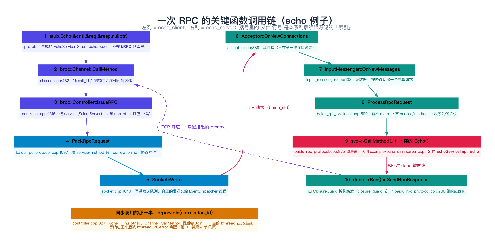
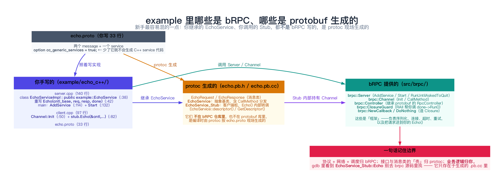
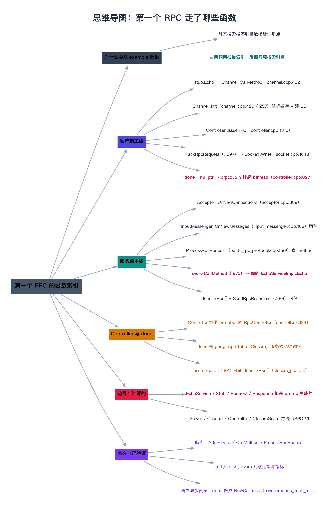

# 从 example 反推：第一个 RPC 走了哪些函数

> **一句话总结**：把 `example/echo_c++` 跑起来之后，一次 RPC 的**函数级路线图**只有两列——客户端是 `stub.Echo()` → `Channel::CallMethod`（`channel.cpp:482`）→ `Controller::IssueRPC`（`controller.cpp:1315`）→ `PackRpcRequest`（`baidu_rpc_protocol.cpp:1097`）→ `Socket::Write`（`socket.cpp:1643`）；服务端是 `Acceptor::OnNewConnections`（`acceptor.cpp:389`）→ `InputMessenger::OnNewMessages`（`input_messenger.cpp:103`）→ `ProcessRpcRequest`（`baidu_rpc_protocol.cpp:599`）→ `svc->CallMethod`（`:875`）→ **你自己写的 `EchoServiceImpl::Echo`** → `done->Run()` = `SendRpcResponse`（`:288`）。**记住这十个函数，后面 47 篇每读一个模块，你都知道它挂在这条线的哪一段上。**

---

## 阅读路径

- **快速版（约 5 分钟）**：看第 1 节的图 + 第 5 节的「十个函数速查表」。这两块就是本篇的骨架。
- **深入版（约 30 分钟）**：全文通读。重点吃透第 6 节（**跟着 gdb 把调用链真的打出来**）和第 8 节（**边界：哪些是 bRPC、哪些是 protobuf 生成的**）——第 8 节是新手最容易混、也最容易在跟代码时白费半天的地方。

---

## 目录

1. [为什么从 example 反推](#1-为什么从-example-反推)
2. [先把这份 proto 与两个 main 看清楚](#2-先把这份-proto-与两个-main-看清楚)
3. [客户端主线：Channel::Init 与 CallMethod](#3-客户端主线channelinit-与-callmethod)
4. [服务端主线：AddService → Start → 收包 → 你的 Echo](#4-服务端主线addservice--start--收包--你的-echo)
5. [源码剖析：一次 RPC 的十个关键函数](#5-源码剖析一次-rpc-的十个关键函数)
6. [完整可复现：编译、运行、预期输出](#6-完整可复现编译运行预期输出)
7. [实验：用 gdb 把调用链真的打出来](#7-实验用-gdb-把调用链真的打出来)
8. [边界、反例与失败路径](#8-边界反例与失败路径)
9. [对比：同步 / 异步 / 半同步，主线差在哪](#9-对比同步--异步--半同步主线差在哪)
10. [常见问题 FAQ](#10-常见问题-faq)
11. [延伸阅读](#11-延伸阅读)
12. [思维导图总结](#12-思维导图总结)

---

## 1. 为什么从 example 反推

### 1.1 痛点：bRPC 的调用链，静态搜索搜不出来

如果你试着从 `EchoServiceImpl::Echo` 反向搜「谁调了我」，你会一无所获。原因是 bRPC 的**调度全部发生在运行时**：

```cpp
// baidu_rpc_protocol.cpp:875 —— 服务端最终是这么把你的 Echo() 叫起来的
return svc->CallMethod(method, cntl.release(), 
                       messages->Request(),
                       messages->Response(), done);
```

这里的 `svc` 是 `google::protobuf::Service*`，`method` 是 `MethodDescriptor*`。**`svc->CallMethod` 是个虚函数调用**：静态看只能看到「调用了基类的 CallMethod」，看不到它会落进 `EchoServiceImpl`。

客户端同理：

```cpp
// channel.cpp:582 附近 —— 一个函数指针，静态看不到它指向谁
cntl->_pack_request = _pack_request;
...
// controller.cpp:1484 附近 —— 运行时才决定调哪个打包函数
_pack_request(&packet, &user_packet, cid.value, _method, this, _request_buf, using_auth);
```

`_pack_request` 是 `Protocol` 结构体里的一个函数指针（`protocol.h` 的 `struct Protocol` 的 `pack_request` 字段），**它指向哪个函数取决于你在 `ChannelOptions.protocol` 里填什么**——echo 例子填的是 `baidu_std`，所以最终落到 `PackRpcRequest`。

> **结论**：bRPC 的关键链路是**运行时装配**的。**唯一可靠的读法是「跑起来 + 打调用栈」**，而不是「打开文件从头读」。

### 1.2 这篇的定位：给后面 47 篇发一张「索引卡」



上图就是本篇的全部内容。它有两个用途：

- **对读源码的人**：后面每读一篇，先在这张图上找到它的位置。读第 29 篇（EventDispatcher）时，你知道它负责的是「第 5 步之后的真正发送」和「响应回来的读事件」；读第 32 篇（InputMessenger）时，你知道它就是第 7 步。
- **对调试的人**：这是一张**断点清单**。想搞清楚任何问题，先在这十个函数上打一圈断点。

---

## 2. 先把这份 proto 与两个 main 看清楚

在讲链路之前，先把原料摆出来。`example/echo_c++/` 下只有四个源文件（外加一个 Makefile）：

```text
example/echo_c++/
├── echo.proto        33 行   ← 接口定义（服务、消息）
├── server.cpp       140 行   ← 服务端：实现 Echo + 启动 Server
├── client.cpp        97 行   ← 客户端：建 Channel + 循环发请求
├── CMakeLists.txt    35 行   ← CMake 构建
└── Makefile                  ← 老式 Makefile 构建
```

### 2.1 `echo.proto`：33 行，但有三个关键点

```protobuf
// example/echo_c++/echo.proto
syntax="proto2";
package example;

option cc_generic_services = true;      // ← 关键点 1

message EchoRequest  { required string message = 1; };   // ← 关键点 2
message EchoResponse { required string message = 1; };

service EchoService {                    // ← 关键点 3
      rpc Echo(EchoRequest) returns (EchoResponse);
};
```

| 关键点 | 少了它会怎样 |
|--------|-------------|
| `option cc_generic_services = true;` | protoc **不会**生成 C++ 的 `EchoService` 抽象类和 `EchoService_Stub`。你会在编译时报 `EchoService was not declared`。**这是新手第一个大坑。** |
| `message` 是 protobuf 的消息定义 | bRPC **不关心**消息里有什么，它只负责搬运序列化后的字节 |
| `service` + `rpc` | 定义「方法名 → 请求/响应类型」的映射。protoc 会把它变成 `MethodDescriptor`，bRPC 靠它做路由 |

注意 `syntax="proto2"`。bRPC 的部分内置 proto 用的是 proto2（`required` 关键字只在 proto2 里合法），**这个例子是 proto2**。你写自己的项目用 proto3 也可以，但 `cc_generic_services` 这个选项在 proto3 里同样有效。

### 2.2 `server.cpp`：三段式

服务端只做三件事（`example/echo_c++/server.cpp`）：

```cpp
// ① 实现服务：继承 protoc 生成的 EchoService（server.cpp:38）
class EchoServiceImpl : public EchoService {
public:
    virtual void Echo(google::protobuf::RpcController* cntl_base,   // :42
                      const EchoRequest* request,
                      EchoResponse* response,
                      google::protobuf::Closure* done) {
        brpc::ClosureGuard done_guard(done);                        // :48  RAII
        brpc::Controller* cntl = static_cast<brpc::Controller*>(cntl_base);
        LOG(INFO) << "Received request[log_id=" << cntl->log_id()   // :61
                  << "] from " << cntl->remote_side() ...
        response->set_message(request->message());                  // :68  业务逻辑
        ...
    }
};

// ② 注册进 Server（server.cpp:106-118）
brpc::Server server;                                                // :106
example::EchoServiceImpl echo_service_impl;                         // :109
if (server.AddService(&echo_service_impl,                           // :114
                      brpc::SERVER_DOESNT_OWN_SERVICE) != 0) { ... }

// ③ 启动并等退出（server.cpp:120-139）
brpc::ServerOptions options;                                        // :130
server.Start(point, &options);                                      // :132
server.RunUntilAskedToQuit();                                       // :138
```

三个细节值得先记下：

1. **`ClosureGuard done_guard(done);`（:48）**——这一行是**整个服务端最容易被忽略、也最不能删的一行**。它保证函数返回时一定调 `done->Run()`。第 5.5 节会展开。
2. **`static_cast<brpc::Controller*>(cntl_base)`（:50-51）**——参数类型是 `google::protobuf::RpcController*`，但实际传进来的**一定是 `brpc::Controller`**。这个 cast 就是「protobuf 接口 / brpc 实现」的分界线。
3. **`SERVER_DOESNT_OWN_SERVICE`（:115）**——因为 `echo_service_impl` 是栈上对象，Server 不能替它 delete。

### 2.3 `client.cpp`：也是三段式

```cpp
// ① 建 Channel（client.cpp:42-53）
brpc::Channel channel;                                              // :42
brpc::ChannelOptions options;
options.protocol = FLAGS_protocol;          // 默认 "baidu_std"       // :46
options.connection_type = FLAGS_connection_type;                    // :47
options.timeout_ms = FLAGS_timeout_ms;                              // :48
options.max_retry = FLAGS_max_retry;                                // :49
if (channel.Init(FLAGS_server.c_str(),                              // :50
                 FLAGS_load_balancer.c_str(), &options) != 0) { ... }

// ② 用 Stub 包一层（client.cpp:57）
example::EchoService_Stub stub(&channel);                           // :57

// ③ 循环调用（client.cpp:61-93）
example::EchoRequest request;                                       // :64
example::EchoResponse response;                                     // :65
brpc::Controller cntl;                                              // :66
request.set_message("hello world");                                 // :68
cntl.set_log_id(log_id ++);                                         // :70
cntl.request_attachment().append(FLAGS_attachment);                 // :73
stub.Echo(&cntl, &request, &response, nullptr);                     // :82  ← 核心
if (!cntl.Failed()) {                                               // :83
    LOG(INFO) << "Received response from " << cntl.remote_side() ...;
} else {
    LOG(WARNING) << cntl.ErrorText();                               // :90
}
usleep(FLAGS_interval_ms * 1000L);                                  // :92
```

**最关键的是第 82 行**：

```cpp
stub.Echo(&cntl, &request, &response, nullptr);
```

**第四个参数是 `nullptr`**——注释里写得很明白（`client.cpp:80-81`）：

> Because `done'(last parameter) is nullptr, this function waits until the response comes back or error occurs(including timedout).

**这就是「同步 RPC」的全部秘密**：`done == nullptr` 时，`Channel::CallMethod` 会在最后调 `Join(correlation_id)`，把当前 bthread 挂起，直到响应回来。第 4.3 节会讲完。

---

## 3. 客户端主线：Channel::Init 与 CallMethod

### 3.1 `Channel::Init`：把「名字」变成「一组地址」

客户端调的是这个重载：

```cpp
// channel.cpp:420
int Channel::Init(const char* ns_url,
                  const char* lb_name,
                  const ChannelOptions* options)
```

注意 `client.cpp:50` 传的是 `FLAGS_load_balancer.c_str()`，默认是空字符串 `""`。进函数第一件事就是判断：

```cpp
// channel.cpp:422-425
if (lb_name == nullptr || *lb_name == '\0') {
    // Treat ns_url as server_addr_and_port
    return Init(ns_url, options);
}
```

**空 load_balancer ⇒ 退化成「单 server 模式」**，走的是 `channel.cpp:257` 的 `Init(const char* server_addr_and_port, const ChannelOptions*)`。这就是为什么 echo 例子里你可以直接写 `-server=127.0.0.1:8000`——**没有命名服务、没有负载均衡**。

完整链路的形状是：

```text
Channel::Init(ns_url, lb_name, options)          channel.cpp:420
  ├─ lb_name 为空 → Init(ns_url, options)        channel.cpp:257
  │     └─ → InitSingle(EndPoint, options)       channel.cpp:367
  └─ lb_name 非空 → 建 LoadBalancerWithNaming
        └─ lb->Init(ns_url, lb_name, ...)        channel.cpp:465
```

`Init` 里还顺手做了两件重要的事：

```cpp
// channel.cpp:431-432（非空 lb 分支）
GlobalInitializeOrDie();                       // 全局初始化（只做一次）
if (InitChannelOptions(options) != 0) { ... }  // 落地协议、超时、重试等配置
```

以及**绑定协议实现**（`channel.cpp:206`）：

```cpp
_pack_request = protocol->pack_request;
```

**这一行就是第 1.1 节说的那个「静态搜不到」的函数指针的赋值点**。它把 `baidu_std` 协议的 `PackRpcRequest` 挂到了 Channel 上。之后每次 RPC 都通过这个指针调用——所以你在源码里搜 `PackRpcRequest(` 只能搜到定义，搜不到调用。

### 3.2 `stub.Echo(...)` 是怎么变成 `Channel::CallMethod` 的

`example::EchoService_Stub stub(&channel);`（`client.cpp:57`）——这个 `EchoService_Stub` **不在 bRPC 仓库里**，它是 protoc 按 `echo.proto` 生成的（详见第 8 节）。它长这样（示意）：

```cpp
// 由 protoc 生成到 echo.pb.cc 中（示意，非 bRPC 源码）
void EchoService_Stub::Echo(RpcController* controller,
                            const EchoRequest* request,
                            EchoResponse* response,
                            Closure* done) {
    channel_->CallMethod(descriptor()->method(0),      // ← 唯一有信息量的参数
                         controller, request, response, done);
}
```

于是**第一次跨入 bRPC 的边界，就是 `channel.cpp:482`**：

```cpp
// channel.cpp:482
void Channel::CallMethod(const google::protobuf::MethodDescriptor* method,
                         google::protobuf::RpcController* controller_base,
                         const google::protobuf::Message* request,
                         google::protobuf::Message* response,
                         google::protobuf::Closure* done)
```

> **一个可操作的验证**：在 gdb 里断在 `Channel::CallMethod`，执行 `p method->full_name()`，会打印 `"example.EchoService.Echo"`；`p method->service()->full_name()` 打印 `"example.EchoService"`。**服务端就是靠这两个字符串找到你的实现的**。

### 3.3 `Channel::CallMethod` 做了五件事

这个函数有 200 行（`channel.cpp:482-667`），但骨架很清楚：

```cpp
void Channel::CallMethod(...) {
    const int64_t start_send_real_us = butil::gettimeofday_us();     // :487
    Controller* cntl = static_cast<Controller*>(controller_base);    // :488
    cntl->OnRPCBegin(start_send_real_us);                            // :489

    // ① 决定重试次数（重要：它决定 correlation_id 的版本空间）
    if (cntl->max_retry() == UNSET_MAGIC_NUM) cntl->set_max_retry(_options.max_retry);  // :491
    if (cntl->max_retry() < 0) cntl->set_max_retry(0);               // :494

    // ② 把 Channel 的配置灌进 Controller
    cntl->_request_protocol = _options.protocol;                     // :499
    cntl->timeout_ms() ... set_timeout_ms(_options.timeout_ms);      // :565
    cntl->set_connection_type(_options.connection_type);             // :577

    // ③ 把 Controller 与这次调用的「上下文」绑起来
    cntl->_response = response;                                      // :580
    cntl->_done = done;                                              // :581
    cntl->_pack_request = _pack_request;                             // :582
    cntl->_method = method;                                          // :583
    cntl->_lb = _lb;                                                 // :592

    // ④ 锁住 correlation_id（一次调用一个 id，重试时 id 递增版本）
    const int rc = bthread_id_lock_and_reset_range(                  // :516
                    correlation_id, nullptr, 2 + cntl->max_retry());

    // ⑤ 序列化请求体（注意：真正的「打包」在 IssueRPC 里）
    _serialize_request(&cntl->_request_buf, cntl, request);           // :597

    // ⑥ 设超时定时器
    bthread_timer_add(&cntl->_timeout_id, ..., HandleTimeout, ...);   // :645

    // ⑦ 发！
    cntl->IssueRPC(start_send_real_us);                               // :657

    if (done == nullptr) {           // 同步调用
        Join(correlation_id);        // :662  ← 在这里挂起
        cntl->SubmitSpan();
        cntl->OnRPCEnd(butil::gettimeofday_us());                     // :664
    }
}
```

三个「为什么这么设计」值得讲：

**（1）为什么要 `bthread_id_lock_and_reset_range(correlation_id, nullptr, 2 + max_retry)`？**

因为要支持**重试**。`correlation_id` 是一个「版本的容器」：第 0 版是初始调用，第 1 ~ N 版是重试。`2 + max_retry` 是版本数上限。这样设计的好处是：**第一次的响应回来了，但你已经重试了——这个迟到的响应会被自动丢弃**，因为它落在旧版本上。`controller.cpp:1326-1334` 有很详细的注释解释这一点：

```cpp
// Make versioned correlation_id.
// call_id         : unversioned, mainly for ECANCELED and ERPCTIMEDOUT
// call_id + 1     : first try.
// call_id + 2     : retry 1
// ...
// call_id + N + 1 : retry N
// All ids except call_id are versioned. Say if we've sent retry 1 and
// a failed response of first try comes back, it will be ignored.
const CallId cid = current_id();
```

**（2）为什么 `_serialize_request` 在 `CallMethod` 里，而 `pack_request` 在 `IssueRPC` 里？**

序列化（protobuf → 字节）是**每个 RPC 一次**的；打包（加协议头、加 meta）是**每次发送一次**的（重试会重打包）。代码里有一段注释专门说明这个顺序不能被颠倒（`channel.cpp:594-596`）：

> Ensure that serialize_request is done before pack_request in all possible executions

**（3）同步调用的挂起点在 `Join`。**

```cpp
// controller.cpp:827-833（channel.cpp:662 调的就是它）
void Join(CallId id) {
    // TODO: timeout of join
    bthread_id_join(id);
}
```

`Join` 在 `controller.h:1028` 声明，实现只有三行。它把当前 **bthread** 挂起（不是线程！），等 `bthread_id_error(id, ...)` 被某个回调触发时唤醒。**这是「同步代码写出异步性能」的关键一步**，第 15–24 篇（bthread）会把这套机制讲透。

`Join` 返回后，`CallMethod` 补上两件事（`channel.cpp:663-664`）：
- `cntl->SubmitSpan()`——上报链路追踪（如果开了）
- `cntl->OnRPCEnd(...)`——记录结束时间，`cntl.latency_us()` 就是从这算出来的

---

## 4. 服务端主线：AddService → Start → 收包 → 你的 Echo

### 4.1 `AddService`：把「方法名」登记进一张表

```cpp
// server.cpp:1618-1622（AddService 的两参重载）
int Server::AddService(google::protobuf::Service* service,
                       ServiceOwnership ownership) {
    ServiceOptions options;
    options.ownership = ownership;
    return AddServiceInternal(service, false, options);
}
```

真正的活在 `AddServiceInternal`（`server.cpp:1373`）。它做了四件事：

```cpp
// server.cpp:1380-1383  ① 拿 ServiceDescriptor
const google::protobuf::ServiceDescriptor* sd = service->GetDescriptor();
if (sd->method_count() == 0) { LOG(ERROR) << "does not have any method."; return -1; }

// server.cpp:1397-1400  ② 检查重复
if (_fullname_service_map.seek(sd->full_name()) != nullptr) {
    LOG(ERROR) << "service=" << sd->full_name() << " already exists"; return -1;
}

// server.cpp:1414  ③ 逐个方法建立 MethodProperty
for (int i = 0; i < sd->method_count(); ++i) {
    const google::protobuf::MethodDescriptor* md = sd->method(i);
    MethodProperty mp;
    ...
}
```

**`MethodProperty` 是这张表的行**——它记录了「完整方法名 → (service 指针, method 描述符, MethodStatus 限流器, http_url ...)」。**服务端收到请求后查的就是这张表**（第 4.3 节）。

> **一个非常重要的认知**：`AddService` **不接收任何网络连接**，也不启动任何东西。它纯粹是把 service 登记进两个 map（`_fullname_service_map` 按完整名、`_service_map` 按短名）。所以 `AddService` 失败只有几种原因：service 为 nullptr、没有方法、重复注册、名字冲突。**它跟「端口有没有起」完全无关。**

### 4.2 `Start`：建监听 socket，交给 Acceptor

`server.Start(point, &options)`（`server.cpp:132`）会一路转到：

```cpp
// server.cpp:1266-1269
int Server::Start(const butil::EndPoint& endpoint, const ServerOptions* opt) {
    return StartInternal(endpoint, PortRange(endpoint.port, endpoint.port), opt);
}
```

`StartInternal`（`server.cpp:831`）是真正的重头戏。关键几步：

```cpp
// server.cpp:1152-1171
if (_am == nullptr) {
    _am = BuildAcceptor();                       // 建 Acceptor（内部会建 EventDispatcher 线程）
    _am->_socket_mode = _options.socket_mode;
}
...
_status = RUNNING;                               // 必须在 accept 之前置位，否则请求会被当成 ELOGOFF 拒掉
...
_am->StartAccept(sockfd, _options.idle_timeout_sec,    // 把监听 fd 的所有权交给 Acceptor
                 _default_ssl_ctx, _options.force_ssl, _options.max_connections);
sockfd.release();
```

以及最后启动一个「派生线程」（`server.cpp:1224-1232`）：

```cpp
bthread_start_background(&_derivative_thread, &tmp, UpdateDerivedVars, this);
```

> **注意 `_status = RUNNING` 必须在 `StartAccept` 之前**（源码里有注释解释：否则并发请求会被当成 `ELOGOFF` 拒绝，见 `baidu_rpc_protocol.cpp:693`）。这是一个经典的「初始化顺序 bug」，bRPC 用注释把它钉住了。你在读并发代码时可以留意这种「先置位再干活」的写法。

`Acceptor::StartAccept`（`acceptor.cpp:57 / 63`）内部会把监听 fd 包装成一个 `Socket`，并注册一个**边沿触发**的回调：

```cpp
// acceptor.cpp:110
options.on_edge_triggered_events = OnNewConnections;
```

**所以「新连接到来」时被调用的是 `Acceptor::OnNewConnections`（`acceptor.cpp:389`）**——这就是链路的第 6 步。

### 4.3 从「字节到达」到「你的 Echo」：中间发生了什么

新连接（`acceptor.cpp:389`）之后，数据到达时走的是另一条路——由 `InputMessenger` 负责**读数据 + 按协议切包**：

```cpp
// input_messenger.cpp:103
void InputMessenger::OnNewMessages(Socket* m) {
    ...
    // input_messenger.cpp:152
    if (processor.ProcessNewMessage(nr, read_eof, received_us, ...)) { ... }
    ...
}
```

`ProcessNewMessage` 会调用协议注册的回调 —— 对 `baidu_std` 来说，就是 `ProcessRpcRequest`（`baidu_rpc_protocol.cpp:599`）。

`ProcessRpcRequest` 里最关键的一段是**查表**（`baidu_rpc_protocol.cpp:757-776`）：

```cpp
// 从 meta 里取出客户端传来的 service/method 名
butil::StringPiece svc_name(request_meta.service_name());
if (svc_name.find('.') == butil::StringPiece::npos) {
    const Server::ServiceProperty* sp = server_accessor.FindServicePropertyByName(svc_name);
    ...
    svc_name = sp->service->GetDescriptor()->full_name();
}
const Server::MethodProperty* mp =
    server_accessor.FindMethodPropertyByFullName(svc_name, request_meta.method_name());
if (nullptr == mp) {
    cntl->SetFailed(ENOMETHOD, "Fail to find method=%s/%s", ...);
    break;
}
```

**这段代码回答了「`AddService` 登记的表到底用在哪」**——就在这。查不到就 `SetFailed(ENOMETHOD, ...)`，客户端会收到「方法不存在」的错误。

查到了之后，一路走到最后的调用（`baidu_rpc_protocol.cpp:861-877`）：

```cpp
// 先造一个 done —— 它就是「响应发完之后要做的事」
google::protobuf::Closure* done = ::brpc::NewCallback<...>(
    &SendRpcResponse, meta.correlation_id(), cntl.get(),
    messages, server, method_status, msg->received_us(), span);

msg.reset();   // 尽早释放资源

if (!FLAGS_usercode_in_pthread) {
    return svc->CallMethod(method, cntl.release(),      // :875  ← 进你的代码
                           messages->Request(),
                           messages->Response(), done);
}
```

**注意 `cntl.release()`**：`cntl` 原本持在一个 `std::unique_ptr<Controller>` 里，这里**主动放弃所有权**，把裸指针连同 `done` 一起交给你的 `Echo()`。谁负责 delete？`done`（也就是 `SendRpcResponse`）负责。这就是「所有权转交」——服务端请求对象的生命周期**绑定在 done 上**。

### 4.4 `done` 必须被调用：`ClosureGuard` 的作用

现在回到 `server.cpp:48` 那一行：

```cpp
brpc::ClosureGuard done_guard(done);
```

`ClosureGuard` 的全部实现只有几十行（`brpc/closure_guard.h`）：

```cpp
class ClosureGuard {
public:
    explicit ClosureGuard(google::protobuf::Closure* done) : _done(done) {}
    ~ClosureGuard() {
        if (_done) { _done->Run(); }      // ← 析构时自动 Run
    }
    google::protobuf::Closure* release() {  // 放弃所有权（异步场景用）
        google::protobuf::Closure* const prev_done = _done;
        _done = nullptr;
        return prev_done;
    }
private:
    google::protobuf::Closure* _done;
};
```

**为什么非要用 RAII？** 因为 `done` 是一个「必须恰好被调用一次」的资源：

- **忘记调** → 客户端永远等不到响应（超时）；`Controller` / 请求 / 响应对象全部泄漏。
- **调两次** → 重复回包，`correlation_id` 已经释放，行为未定义。

`ClosureGuard` 把它绑到栈对象的析构上：**函数无论从哪条路径返回（正常 return、提前 return、抛异常），析构都会执行**。这是 C++ 里最经典的资源管理手法。

**异步场景怎么办？** 用 `done_guard.release()` 把所有权交出去（源码注释里写了：`example/echo_c++/server.cpp:46-47`）。这时你的实现必须在**未来的某个时刻**自己调 `done->Run()`。看异步例子就明白了（`example/asynchronous_echo_c++/client.cpp:99-101`）：

```cpp
google::protobuf::Closure* done = brpc::NewCallback(...);
stub.Echo(cntl, &request, response, done);      // done 非 nullptr
```

---

## 5. 源码剖析：一次 RPC 的十个关键函数

### 5.1 十个函数速查表（本篇的「索引」）

| # | 函数 | 文件:行号 | 一句话职责 | 后面哪篇细讲 |
|---|------|----------|-----------|-------------|
| 1 | `EchoService_Stub::Echo` | **生成的** echo.pb.cc | protobuf 桩，转调 `Channel::CallMethod` | —（第 06 篇讲清边界） |
| 2 | `brpc::Channel::CallMethod` | `channel.cpp:482` | 客户端的「入口总控」：配置落地、锁 id、序列化、发、等 | 44 |
| 3 | `brpc::Controller::IssueRPC` | `controller.cpp:1315` | 选 server → 拿 socket → 打包 → `Socket::Write` | 43 / 44 |
| 4 | `PackRpcRequest` | `baidu_rpc_protocol.cpp:1097` | 填 meta（service/method/correlation_id/超时…） | 37 |
| 5 | `Socket::Write` | `socket.cpp:1643` | 写进发送队列，真正发送交给 EventDispatcher | 33 |
| 6 | `Acceptor::OnNewConnections` | `acceptor.cpp:389` | accept 新连接（只在第一次连接时走） | 34 |
| 7 | `InputMessenger::OnNewMessages` | `input_messenger.cpp:103` | 读数据 + 按协议切出完整请求 | 32 |
| 8 | `ProcessRpcRequest` | `baidu_rpc_protocol.cpp:599` | 解析 meta → 查表找到 service/method → 反序列化 | 37 / 47 |
| 9 | `svc->CallMethod` → **你的 `Echo()`** | `baidu_rpc_protocol.cpp:875` / `server.cpp:42` | 进入业务代码 | 47 |
| 10 | `SendRpcResponse`（由 `done->Run()` 触发） | `baidu_rpc_protocol.cpp:288` | 组响应、回包、回收资源 | 47 |
| — | `brpc::Join`（同步等待） | `controller.cpp:827` | 把当前 bthread 挂起（同步调用独有） | 21 / 24 |

### 5.2 `Channel::CallMethod` 与 `Controller::IssueRPC` 的分界

读源码时容易糊涂：为什么配置在 `CallMethod` 里设，而「选 server」在 `IssueRPC` 里做？

**分界线是「重试」**：

- `CallMethod` 里做的（配置落地、序列化、锁 id、设超时定时器）——**每个 RPC 只做一次**。
- `IssueRPC` 里做的（选 server、拿 socket、打包、写）——**每次尝试都要做一次**。

证据是 `IssueRPC` 第一行就重算超时（`controller.cpp:1318-1320`）：

```cpp
// If has retry/backup request, we will recalculate the timeout,
if (_real_timeout_ms > 0) {
    _real_timeout_ms -= (start_realtime_us - _begin_time_us) / 1000;
}
```

以及选 server 那段（`controller.cpp:1373-1392`）：

```cpp
} else {
    LoadBalancer::SelectIn sel_in =
        { start_realtime_us, true,
          has_request_code(), _request_code, _accessed };
    LoadBalancer::SelectOut sel_out(&tmp_sock);
    const int rc = _lb->SelectServer(sel_in, &sel_out);      // :1377  ← 负载均衡在这里发生
    if (rc != 0) {
        ...
        SetFailed(rc, "Fail to select server from %s", os.str().c_str());
        return HandleSendFailed();
    }
    _current_call.need_feedback = sel_out.need_feedback;
    _current_call.peer_id = tmp_sock->id();
    ...
    _remote_side = tmp_sock->remote_side();
}
```

**重试时 `IssueRPC` 会被再调一次**（由 `HandleSendFailed` / `OnVersionedRPCReturned` 触发），所以它会重新选一台 server。这就是「重试可以换机器」的实现位置。

再看打包与写（`controller.cpp:1483-1528`）：

```cpp
// Make request
butil::IOBuf packet;
SocketMessage* user_packet = nullptr;
_pack_request(&packet, &user_packet, cid.value, _method, this,      // :1484
              _request_buf, using_auth);
...
Socket::WriteOptions wopt;
wopt.id_wait = cid;                  // :1511  ← 把 correlation_id 一起交给 Socket
wopt.abstime = pabstime;
...
rc = _current_call.sending_sock->Write(&packet, &wopt);            // :1526  ← 第 5 步
```

**`wopt.id_wait = cid` 是个伏笔**：当 Socket 把这个包真正发出去（或发失败）时，会回调 `bthread_id_error(cid, ...)`。**响应回来时也是用同一个机制唤醒 `Join` 的。** 这套 `bthread_id` 机制贯穿整条链路，第 44 篇（Controller 状态机）会重点讲。

### 5.3 服务端：`ProcessRpcRequest` 里那 900 行到底在干什么

`ProcessRpcRequest`（`baidu_rpc_protocol.cpp:599-895`）接近 300 行，但结构是线性的一串 `if` + `break`：

```text
① 解析 meta（RpcMeta）                                    :608
② 采样（rpcz 用）：AskToBeSampled()                        :616
③ new Controller，设 log_id / request_id / timeout_ms      :628-637
④ 把 socket 信息、协议、开始时间塞进 Controller            :649-660 附近（:654 设 remote_side）
⑤ 一个 do { ... } while(false) 大块，里面全是失败路径：
     server 没在跑？        → ELOGOFF                       :693
     超过 max_concurrency？ → ELIMIT                        :697
     attachment_size 不合法？→ EREQUEST                      :710
     找不到 service/method？→ ENOSERVICE(:764) / ENOMETHOD(:774)
     连接拥挤？             → EOVERCROWDED                  :726（内部服务）/ :791（普通服务）
     被限流器拒？           → ELIMIT                        :803
     反序列化失败？         → EREQUEST                      :843
⑥ 造 done = NewCallback(&SendRpcResponse, ...)             :861
⑦ svc->CallMethod(...)                                     :875
} while(false);
⑧ 如果上面任何一步 break 了 → 直接 SendRpcResponse 把错误发回去   :893
```

> **这个 `do { ... } while(false)` + `break` 的写法很值得学**：它把「十几种失败原因」统一成「设置错误 + 退出」，最后只有一个出口调 `SendRpcResponse`。比十几个 `return` 好维护得多。**bRPC 源码里这种写法很常见**，见到别懵。

### 5.4 「错误也是响应」：失败路径为什么必须回包

注意 `ProcessRpcRequest` 的最后一段（`baidu_rpc_protocol.cpp:890-893`）：

```cpp
} while (false);

// `cntl', `req' and `res' will be deleted inside `SendRpcResponse'
SendRpcResponse(meta.correlation_id(), cntl.release(), messages,
                server, method_status, msg->received_us(), span);
```

**只要 `correlation_id` 存在，就必须回一个包告诉客户端结果**（哪怕是 `ENOMETHOD` 这样的错误）。因为客户端 `Join` 在等啊——不回包它就一直挂到超时。

**这解释了一个常见现象**：客户端报 `Fail to find method=...` 时，这个错误文本**是服务端填进响应里的**，不是客户端本地产生的。

### 5.5 `done->Run()` 之后：`SendRpcResponse` 的三件事

```cpp
// baidu_rpc_protocol.cpp:288-320
void SendRpcResponse(int64_t correlation_id, Controller* cntl,
                     RpcPBMessages* messages, const Server* server,
                     MethodStatus* method_status, int64_t received_us,
                     std::shared_ptr<Span> span) {
    ...
    // 用 BRPC_SCOPE_EXIT 保证「无论如何都回收资源」
    BRPC_SCOPE_EXIT {
        {
            // Remove concurrency and record latency at first.
            ConcurrencyRemover concurrency_remover(method_status, cntl, received_us);
        }
        std::unique_ptr<Controller, LogErrorTextAndDelete> recycle_cntl(cntl);   // 删 Controller
        ...
        cntl->CallAfterRpcResp(req, res);       // 调用户注册的 after_rpc_resp 回调
        server->options().rpc_pb_message_factory->Return(messages);
    };
    ...
}
```

三件事：

1. **减并发计数 + 记延迟**：`ConcurrencyRemover` 的析构里会把方法级并发数减回去，并把这次请求的延迟打进 bvar（这就是 `/vars` 里那些数字的来源）。
2. **回收对象**：`std::unique_ptr<Controller, LogErrorTextAndDelete> recycle_cntl(cntl)` —— 还记得第 4.3 节 `cntl.release()` 交出去的那个裸指针吗？**在这里被 delete 了**。所有权闭环。
3. **调用户的 `after_rpc_resp` 回调**：echo 例子里用来打印 JSON（`server.cpp:55-56` 注册，`:87-97` 实现）。

---

## 6. 完整可复现：编译、运行、预期输出

### 6.1 编译（用 example 自带的 CMakeLists）

前提：你已经按第 02 篇编好了 bRPC，并且安装到了 `<仓库>/build/output`。

```bash
cd example/echo_c++
cmake -S . -B build
cmake --build build -j"$(nproc)"
```

`example/echo_c++/CMakeLists.txt` 一共就 35 行，关键内容：

```cmake
project(echo_c++ C CXX)                                              # :19
include(${CMAKE_CURRENT_LIST_DIR}/../cmake/BrpcExample.cmake)        # :21
option(LINK_SO "Whether examples are linked dynamically" OFF)        # :23
brpc_example_find_common_deps(DYNAMIC_LIB)                           # :25
protobuf_generate_cpp(PROTO_SRC PROTO_HEADER echo.proto)             # :27
add_executable(echo_client client.cpp ${PROTO_SRC} ${PROTO_HEADER})  # :29
brpc_example_configure_target(echo_client)                           # :30
add_executable(echo_server server.cpp ${PROTO_SRC} ${PROTO_HEADER})  # :31
brpc_example_configure_target(echo_server)                           # :32
target_link_libraries(echo_client PRIVATE ${BRPC_LIB} ${DYNAMIC_LIB})# :34
target_link_libraries(echo_server PRIVATE ${BRPC_LIB} ${DYNAMIC_LIB})# :35
```

产物是 `build/echo_client` 和 `build/echo_server`。同时 `build/` 下会出现 protoc 生成的 `echo.pb.h` / `echo.pb.cc`——**建议你打开看一眼**，第 8 节讲的边界，看了它就全懂了。

### 6.2 运行与预期输出

**终端 A**：

```bash
./build/echo_server -port=8000
```

启动成功的标志是这行日志（由 `StartInternal` 在 `server.cpp:1238` 输出）：

```text
I20260924 ... Server[1.18.0-...] is serving on 0.0.0.0:8000 with builtin service.
```

**终端 B**：

```bash
./build/echo_client -server=127.0.0.1:8000
```

客户端每个循环（1 秒一次）输出一行：

```text
I20260924 ... Received response from 127.0.0.1:8000 to 127.0.0.1:53128: hello world (attached=) latency=141us
```

服务端每次收到请求输出一行：

```text
I20260924 ... Received request[log_id=0] from 127.0.0.1:53128 to 127.0.0.1:8000: hello world (attached=)
I20260924 ... req:{"message":"hello world"} res:{"message":"hello world"}
```

**第二行来自 `CallAfterRpc`**（`server.cpp:87-97`），它用 `json2pb::ProtoMessageToJson` 把请求/响应转成了 JSON——**这是确认「响应真的发出去了」的证据**（注释里写：at this time res is already sent to client）。

### 6.3 验证链路的另外三个通道

```bash
# ① 服务端状态：能看到连接数、QPS、延迟分位
curl -s http://127.0.0.1:8000/status | head -20

# ② 所有 bvar 指标：能搜到 echo 相关的延迟统计
curl -s http://127.0.0.1:8000/vars | grep -i echo

# ③ 连接详情：能看到那条 127.0.0.1:53128 → 8000 的连接
curl -s http://127.0.0.1:8000/connections | head -20
```

**`/status` 和 `/vars` 是 bRPC 自动注册的内置服务**，实现就在 `src/brpc/builtin/`。你写业务代码时一行都不用加，它们自动就有——**这是验证「服务跑起来了没」最省事的方法，比看日志可靠**。

### 6.4 换个玩法：把 protocol 换成 http

echo 例子支持用命令行切协议（`client.cpp:27` 的 `DEFINE_string(protocol, "baidu_std", ...)`）。不过 `echo_client` 只支持 `baidu_std`，想试 HTTP 要看 `example/http_c++`。这里提一句是为了说明**那个「静态搜不到」的函数指针为什么存在**：

```bash
# 客户端把 protocol 换成别的不一样能跑（服务端需要对应支持）
./build/echo_client -server=127.0.0.1:8000 -protocol=http
```

服务端 `baidu_std` 协议的解析器认不出 HTTP 报文 —— 这正是第 40 篇「协议自动检测」要解决的问题。

---

## 7. 实验：用 gdb 把调用链真的打出来

第 02 篇已经让你有了一个可调试的环境。这一节把「断点清单」落成可执行的实验。

### 7.1 客户端侧：看 protobuf 桩是怎么进来的

```bash
gdb --args ./build/echo_client -server=127.0.0.1:8000
```

```gdb
(gdb) b brpc::Channel::CallMethod
(gdb) b brpc::Controller::IssueRPC
(gdb) run

# 命中 Channel::CallMethod 后：
(gdb) bt                 # ★ 关键：看栈里有谁
(gdb) p method->full_name()
$1 = "example.EchoService.Echo"
(gdb) p method->service()->full_name()
$2 = "example.EchoService"
(gdb) p cntl->max_retry()
$3 = 3
(gdb) continue

# 命中 IssueRPC 后：
(gdb) bt
(gdb) p _lb                 # 单 server 模式下是 nullptr
(gdb) p _single_server_id
(gdb) next                  # 单步看它怎么选 socket、怎么打包
```

**`bt` 应该看到的关键帧**（顺序自下而上）：

```text
#3  example::EchoService_Stub::Echo(...)          ← protoc 生成的，不在 bRPC 仓库
#2  brpc::Channel::CallMethod(...)  at channel.cpp:482
#1  main(...)  at client.cpp:82
```

**这就是第 8 节「边界」最好的证据**：栈里那层 `EchoService_Stub::Echo` 在 bRPC 的源码里找不到，它是生成的。

### 7.2 服务端侧：注意「协程栈」

```bash
gdb --args ./build/echo_server -port=8000
```

```gdb
(gdb) b brpc::Server::AddService
(gdb) b brpc::Server::Start
(gdb) run

# AddService 先命中（启动阶段）：
(gdb) bt
(gdb) p service->GetDescriptor()->full_name()
$1 = "example.EchoService"
(gdb) continue

# Start 命中：
(gdb) bt
(gdb) continue
```

服务跑起来后，**再在请求路径上打断点**（注意此时服务端已经在跑了）：

```gdb
(gdb) b brpc::policy::ProcessRpcRequest
(gdb) b example::EchoServiceImpl::Echo
(gdb) continue
```

命中的帧会是这样（**重点看有 `[bthread]` 标记的帧**）：

```text
#?  example::EchoServiceImpl::Echo(...)  at server.cpp:42
#?  google::protobuf::Service::CallMethod(...)
#?  brpc::policy::ProcessRpcRequest(...)  at baidu_rpc_protocol.cpp:599
...
```

**如果你 `bt` 出来只有几帧、看不到 `ProcessRpcRequest`，很可能是踩到了「协程栈」问题**：bRPC 的请求跑在 bthread 上，而 gdb 默认只认当前 pthread 的栈。用仓库自带的工具：

```gdb
(gdb) source /path/to/brpc/tools/gdb_bthread_stack.py
(gdb) bthread_list
(gdb) bthread_frame <id>      # 切到处理请求的那个协程
(gdb) bt                      # 现在能看到完整栈了
(gdb) bthread_end             # 记得退出（它会改寄存器）
```

工具用法见 `tools/gdb_bthread_stack.py:24-49` 的头注释。

### 7.3 实验的产出：自己画一张调用栈

建议你**把 gdb 打出来的栈抄成一张图**，然后和本篇第 1 节那张对照。**自己画一遍，比看十遍都管用**——这是 README 里「读完就画图」那条建议的具体落地。

---

## 8. 边界、反例与失败路径

### 8.1 最核心的边界：哪些是 bRPC、哪些是 protobuf 生成的



这是**新手最容易混、也最影响读源码效率**的一点。用一张表钉死：

| 你见到的东西 | 谁提供的 | 在哪 | 能不能在 `src/brpc/` 里找到 |
|-------------|---------|------|--------------------------|
| `EchoRequest` / `EchoResponse` | **protoc 生成** | 编译产物 `echo.pb.h` | **不能** |
| `example::EchoService`（抽象基类） | **protoc 生成** | `echo.pb.h` | **不能** |
| `example::EchoService_Stub` | **protoc 生成** | `echo.pb.h / echo.pb.cc` | **不能** |
| `EchoService::CallMethod` 的分发逻辑 | **protoc 生成** | `echo.pb.cc` | **不能** |
| `EchoServiceImpl`（你的实现） | **你写的** | `server.cpp:38` | **不能** |
| `brpc::Server` / `Channel` / `Controller` | bRPC | `src/brpc/` | 能 |
| `brpc::ClosureGuard` | bRPC | `src/brpc/closure_guard.h` | 能 |
| `brpc::DoNothing()` | bRPC | `controller.h:1037` / `controller.cpp` | 能 |
| `brpc::NewCallback(...)` | bRPC | `src/brpc/callback.h` | 能 |
| `google::protobuf::RpcController` | protobuf 库 | `google/protobuf/service.h` | **不在本仓库** |
| `google::protobuf::Closure` | protobuf 库 | protobuf 的 `stubs/callback.h` | **不在本仓库** |
| `google::protobuf::Service` | protobuf 库 | `google/protobuf/service.h` | **不在本仓库** |

**三条能立刻用上的推论**：

1. **在 gdb 里看到 `EchoService_Stub::Echo`，别去 brpc 源码里搜**——搜不到的。
2. **`Controller` 之所以能当 `RpcController` 用，是因为它继承了 protobuf 的接口**（`controller.h:124`：`class Controller : public google::protobuf::RpcController`）。这就是第 02 篇里 `static_cast<brpc::Controller*>(cntl_base)` 能成立的原因。
3. **`done` 是 protobuf 定义的 `Closure`，不是 bRPC 的定义**——bRPC 只是遵守这个约定（必须调 `Run()`）。所以这套接口能跟任何遵守 protobuf 约定的框架互换。

### 8.2 真·反例一：删掉 `ClosureGuard` 会发生什么

这是**最容易犯、后果最严重**的错误。把 `server.cpp:48` 那行删掉试试：

```cpp
virtual void Echo(..., google::protobuf::Closure* done) {
    // brpc::ClosureGuard done_guard(done);   ← 删掉它
    ...
    response->set_message(request->message());
    // 函数结束，done 从未被调用
}
```

结果：

- 客户端**永远收不到响应**，一直挂到超时（默认 100ms 后报 `ERPCTIMEDOUT`）。
- 服务端的 `Controller` / 请求 / 响应对象**全部泄漏**（`SendRpcResponse` 没被调，回收代码在它里面）。
- `MethodStatus` 的并发计数**只增不减**，用不了多久就会因为 `max_concurrency` 被限流拒绝。

**服务端写 RPC 实现，「done 必须被调用」的优先级高于「业务逻辑正确」。**

### 8.3 真·反例二：`AddService` 成功了，但连不上

```cpp
if (server.AddService(&svc, brpc::SERVER_DOESNT_OWN_SERVICE) != 0) { ... }   // 返回 0，成功
```

但客户端报 `EHOSTDOWN / Not connected to ...`。原因：**`AddService` 只管注册，不管监听**（第 4.1 节）。可能的原因：

| 现象 | 原因 | 检查 |
|------|------|------|
| 客户端 `Fail to connect` | 忘了调 `server.Start(...)` | 看有没有 `is serving on 0.0.0.0:8000` 日志 |
| `Fail to start EchoServer` | 端口被占 / 权限不足（<1024） | 换 `-port=8001` |
| 服务端起来又立刻退出 | `Start` 返回非 0，`main` 里 `return -1` | 看启动日志 |
| 客户端超时（不是连不上） | 服务端在处理但很慢；或 `process` 卡住 | 用 `/status` 看 `qps` 和 `latency` |

### 8.4 真·反例三：`cc_generic_services` 忘了写

如果 `echo.proto` 里去掉 `option cc_generic_services = true;`，那么：

- protoc **只生成 message 类，不生成 service 类**。
- `server.cpp:38` 的 `class EchoServiceImpl : public EchoService` **编译不过**（`EchoService` 未声明）。
- `client.cpp:57` 的 `EchoService_Stub` 同样找不到。

**报错信息会指向 `echo.pb.h`，让你以为是 protoc 坏了——其实是你少写了一行 option。**

### 8.5 一次性 vs 循环：为什么 `client.cpp` 里每次都要新建 `Controller`

看 `client.cpp:64-66`：

```cpp
example::EchoRequest request;      // 每次循环在栈上新建
example::EchoResponse response;
brpc::Controller cntl;
```

**三个对象都在循环体内**，每次都是新的。这是**必须的**——`Controller` 内部有 `_current_call` 状态（重试次数、correlation_id 版本等），复用会导致 `Channel::CallMethod` 里那个检查报错（`channel.cpp:525-527`）：

```
LOG_IF(ERROR, cntl->is_used_by_rpc())
    << "Controller=" << cntl << " was used by another RPC before. "
    << "Did you forget to Reset() it before reuse?";
```

要复用就必须显式 `cntl.Reset()`。**新手另一个常见 bug 就是把 `Controller` 提到循环外面**。

### 8.6 边界：这套示例没有覆盖的东西

`echo_c++` 是「最小可运行例子」，它**故意**没覆盖以下内容。别以为「跑通 echo 就读懂 bRPC 了」：

| 没覆盖的 | 去哪里看 |
|---------|---------|
| 命名服务 & 负载均衡（本例 `lb_name` 为空） | `example/` 里的 `dynamic_partition_echo_c++`、`partition_echo_c++`、`multi_threaded_echo_fns_c++` |
| 异步 / 半同步调用 | `example/asynchronous_echo_c++` |
| 多线程 | `example/multi_threaded_echo_c++` |
| 流式 RPC | `example/streaming_echo_c++`、`streaming_batch_echo_c++` |
| 超时 / 重试 / backup request | `example/backup_request_c++`、`cancel_c++` |
| HTTP / gRPC | `example/http_c++`、`grpc_c++` |
| 自定义协议（nshead 等） | `example/nshead_extension_c++`、`nshead_pb_extension_c++` |

---

## 9. 对比：同步 / 异步 / 半同步，主线差在哪

三种调用方式的**主链路完全一样**（都是 `Channel::CallMethod → IssueRPC → ...`），差别只在最后那一段。

| | 同步 | 异步 | 半同步 |
|---|------|------|--------|
| `done` 参数 | `nullptr` | 自己 `NewCallback(...)` | `brpc::DoNothing()` |
| `Channel::CallMethod` 最后做什么 | `Join(correlation_id)` **挂起**（`channel.cpp:662`） | 立即返回，`done` 在响应到达时被调 | 立即返回 |
| 你在哪处理结果 | 函数返回值之后，`cntl.Failed()` + `response` | `done` 的回调里 | 后续用 `brpc::Join(cntl.call_id())` 显式等待（`controller.h:1028-1037`） |
| 一次能发多少个 | 1（阻塞） | 任意 | N 个（先全发，再逐个 Join） |
| 例子 | `echo_c++` | `asynchronous_echo_c++` | `multi_threaded_echo_fns_c++` |

**为什么 `done == nullptr` 就等于同步？** 因为 `done` 是「RPC 结束后要做的事」的唯一入口。它为空，框架就没法在响应回来时通知你——所以 `CallMethod` 只能自己等（`Join`）。**这是一行代码推导出来的结论，不是约定俗成**：

```cpp
// channel.cpp:661-666
cntl->IssueRPC(start_send_real_us);
if (done == nullptr) {
    // MUST wait for response when sending synchronous RPC. It will
    // be woken up by callback when RPC finishes (succeeds or still
    // fails after retry)
    Join(correlation_id);
    cntl->SubmitSpan();
    cntl->OnRPCEnd(butil::gettimeofday_us());
}
```

**选型建议**：

- **默认用同步**——代码最好懂，bthread 让阻塞不吃线程，代价很小。
- **一次要发很多个请求** → 半同步（`DoNothing` + 批量 `Join`），并发度最高且代码仍然线性。
- **回调式流水线 / 要跟其他异步系统对接** → 异步。

---

## 10. 常见问题 FAQ

**Q1：我能不能不跑 gdb，靠读代码搞清楚链路？**

能，但会慢很多，而且容易错。本篇第 1.1 节说了：`svc->CallMethod` 是虚调用、`_pack_request` 是函数指针——**静态搜索搜不出来**。只有两种可靠办法：跑起来打栈，或者去查「谁在什么时候给这个指针赋了值」（比如 `channel.cpp:206`）。**后者是读 bRPC 的核心技能，前者是最快的入门方式。**

**Q2：`EchoService_Stub::Echo` 到底在哪？我在 brpc 源码里找不到。**

**它不在 bRPC 仓库里**。它是 protoc 按 `echo.proto` 生成到编译产物 `echo.pb.cc` 里的。编译完你可以在 `example/echo_c++/build/` 下找到它（或 `find . -name "echo.pb.cc"`）。第 8.1 节有完整的对照表。

**Q3：`Controller` 和 `RpcController` 是什么关系？为什么能 cast？**

`RpcController` 是 **protobuf** 定义的接口（`google/protobuf/service.h`），`brpc::Controller` 是它的实现：

```cpp
// controller.h:124
class Controller : public google::protobuf::RpcController/*non-copyable*/ {
```

所以 `static_cast<brpc::Controller*>(cntl_base)`（`server.cpp:50-51`）是**向下转型**——安全的，因为框架在服务端 new 的确实是 `brpc::Controller`（`baidu_rpc_protocol.cpp:628`：`std::unique_ptr<Controller> cntl(new Controller);`）。**这也是 bRPC 能兼容 protobuf 生态的原因。**

**Q4：`done` 为什么必须调用？我不调会怎样？**

因为 `done` 是「RPC 结束」的唯一信号，`SendRpcResponse`（回包 + 回收 Controller/请求/响应 + 减并发 + 记延迟）全在它里面（`baidu_rpc_protocol.cpp:288`）。不调 → 客户端挂到超时 + 服务端对象泄漏 + 并发计数只增不减。**用 `brpc::ClosureGuard`（`closure_guard.h`）就基本不会忘。**

**Q5：为什么 `channel.Init` 传了空的 `load_balancer` 也能用？**

因为 `Channel::Init` 第一件事就是判断 `lb_name` 是否为空（`channel.cpp:422-425`），为空就退化成「单 server 模式」，直接 `Init(ns_url, options)`，不建 `LoadBalancerWithNaming`。echo 例子就是这么用的（`client.cpp:50` 传 `FLAGS_load_balancer.c_str()`，默认 `""`）。

**Q6：`Reply` 里的 `latency=` 是从哪来的？**

`cntl.latency_us()`。它在 `Channel::CallMethod` 结尾由 `cntl->OnRPCEnd(butil::gettimeofday_us())` 记录下来（`channel.cpp:664`），起点是 `OnRPCBegin(start_send_real_us)`（`channel.cpp:491`）。**注意同步调用只在其末尾调一次 `OnRPCEnd`**，源码里还有注释解释为什么（`controller.cpp:1251`：`OnRPCEnd for sync RPC is called in Channel::CallMethod`）。

**Q7：服务端日志里的 `log_id` 是干什么的？**

`log_id` 是**用户自定义的、贯穿客户端与服务端的关联 ID**。客户端设（`client.cpp:70`：`cntl.set_log_id(log_id++)`），它会随请求的 meta 传到服务端（`baidu_rpc_protocol.cpp:637`：`cntl->set_log_id(request_meta.log_id())`），所以服务端打印时能带上（`server.cpp:61`）。**排查「哪个客户端请求对应服务端哪条日志」时非常有用**。

**Q8：为什么我在服务端打断点，`bt` 出来的栈很浅？**

因为请求跑在 **bthread（协程）**上，不是当前 pthread。gdb 默认只展开当前线程的栈。用 `tools/gdb_bthread_stack.py`（见第 7.2 节）切到协程栈。macOS 用 `tools/lldb_bthread_stack.py`。

---

## 11. 延伸阅读

- **示例源码**（逐字对照过）：`example/echo_c++/{echo.proto, server.cpp, client.cpp, CMakeLists.txt, Makefile}`。
  - 本体：`client.cpp:82`（同步调用）、`server.cpp:42-84`（服务实现）、`server.cpp:106-138`（启动三段式）。
- **官方文档**：`docs/cn/client.md`（同步/异步/半同步的定义）、`docs/cn/server.md`（同步/异步 service）、`docs/cn/getting_started.md`（编译与第一个例子）、`docs/cn/builtin_service.md`（`/status` `/vars` 是什么）。
- **源码入口**：
  - `src/brpc/channel.cpp:420`（`Init` 带命名服务）、`:482`（`CallMethod`）
  - `src/brpc/controller.cpp:827`（`Join`）、`:1315`（`IssueRPC`）、`:1260`（`OnRPCEnd`）
  - `src/brpc/server.cpp:1373`（`AddServiceInternal`）、`:831`（`StartInternal`）、`:1913`（`RunUntilAskedToQuit`）
  - `src/brpc/acceptor.cpp:389`、`src/brpc/input_messenger.cpp:103`
  - `src/brpc/policy/baidu_rpc_protocol.cpp:599 / 875 / 288 / 1097`
  - `src/brpc/closure_guard.h`（全文只有几十行，值得整篇读）
  - `src/brpc/callback.h`（`NewCallback`）
- **邻近篇目**：
  - 上一篇：`02-编译与第一个Demo.md`（怎么把本篇的例子编出来、跑起来）
  - 下一篇：`04-读源码的方法论：怎么跟调用栈不迷路.md`（把本篇的「断点清单」升级成方法论）
  - 第 06 篇：会专门讲 `Controller` 继承 `RpcController`、`done` 就是 `Closure` 这两件事

---

## 12. 思维导图总结

```text
从 example 反推：第一个 RPC 走了哪些函数
├── 为什么要从 example 反推
│   ├── svc->CallMethod 是虚调用、_pack_request 是函数指针 → 静态搜不到
│   └── 本篇 = 给后面 47 篇发一张「索引卡」+ 一份「断点清单」
├── 原料（example/echo_c++ 四个文件）
│   ├── echo.proto 33 行：cc_generic_services / message / service
│   ├── server.cpp 140 行：实现 Echo + AddService + Start + RunUntilAskedToQuit
│   └── client.cpp 97 行：Channel::Init + Stub + stub.Echo(done=nullptr)
├── 客户端主线
│   ├── Channel::Init（channel.cpp:420 / 257 / 367）名字→地址
│   ├── CallMethod（:482）配置落地 / 锁 call_id / 序列化 / 定时器
│   ├── IssueRPC（controller.cpp:1315）选 server / 打包 / Write
│   ├── PackRpcRequest（:1097）→ Socket::Write（socket.cpp:1643）
│   └── done==nullptr → brpc::Join（controller.cpp:827）挂起 bthread
├── 服务端主线
│   ├── AddService（server.cpp:1373）只登记，不监听
│   ├── Start（:1266→:831）建 acceptor，_status 先置 RUNNING
│   ├── Acceptor::OnNewConnections（acceptor.cpp:389）
│   ├── InputMessenger::OnNewMessages（input_messenger.cpp:103）切包
│   ├── ProcessRpcRequest（:599）do/while+break 查表
│   ├── svc->CallMethod（:875）→ 你的 EchoServiceImpl::Echo
│   └── done->Run() = SendRpcResponse（:288）回包 + 回收 + 记延迟
├── 边界（最难混的一点）
│   ├── protoc 生成：EchoService / Stub / Request / Response → 不在 brpc 仓库
│   ├── protobuf 库：RpcController / Service / Closure → 也不在本仓库
│   └── bRPC：Server / Channel / Controller / ClosureGuard / NewCallback
├── 失败路径
│   ├── 删掉 ClosureGuard → 客户端超时 + 对象泄漏 + 并发计数不回退
│   ├── AddService 成功 ≠ 监听成功
│   ├── 忘了 cc_generic_services → 编译报 EchoService 未声明
│   └── Controller 提到循环外 → "used by another RPC before"
└── 三种调用方式的差异只在「done」
    ├── 同步：done=nullptr → CallMethod 里 Join
    ├── 异步：done=NewCallback → 回调里处理
    └── 半同步：done=DoNothing → 事后显式 Join(cntl.call_id())
```


