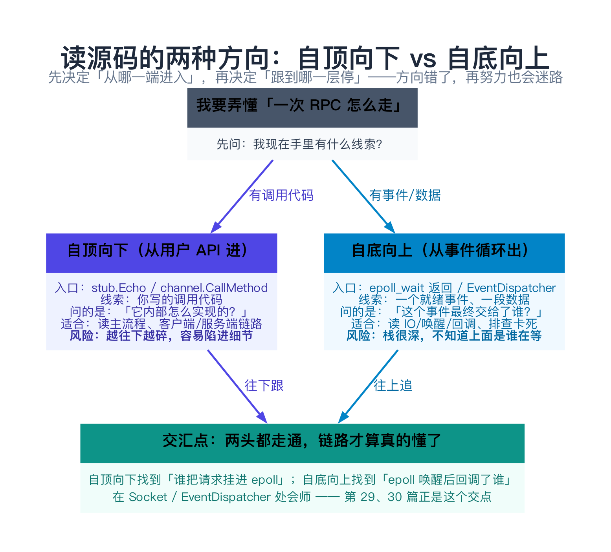
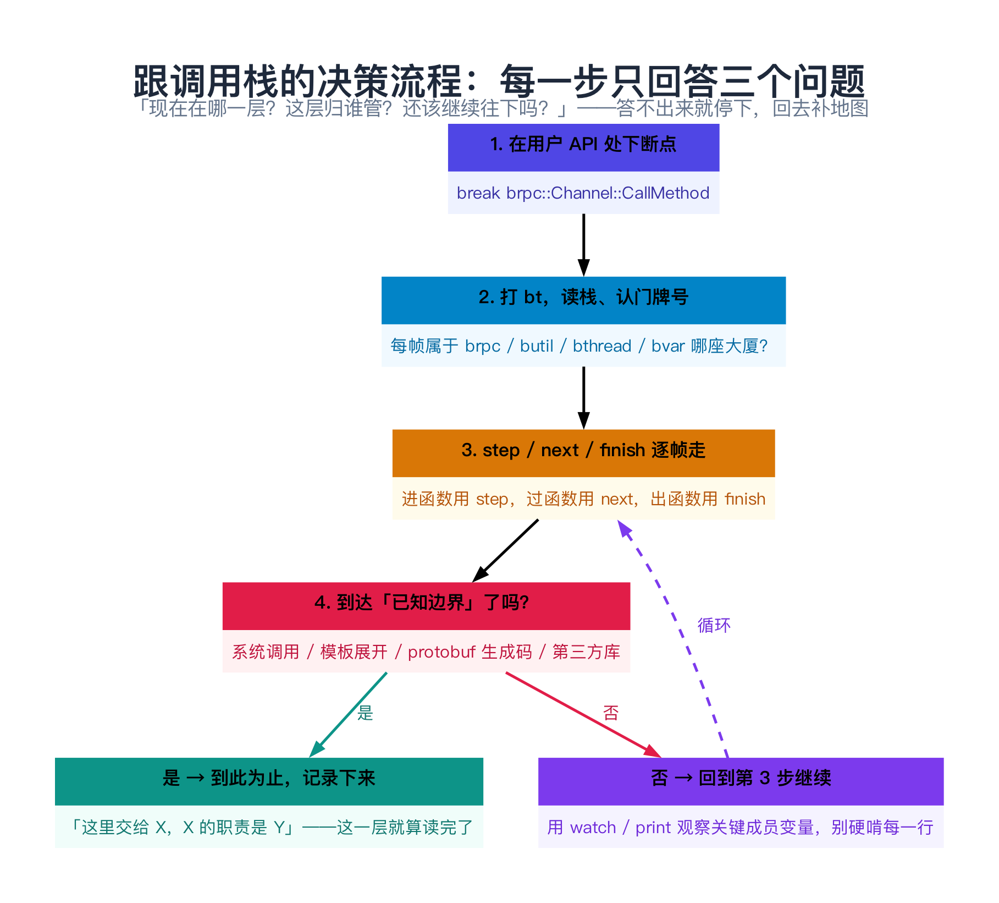
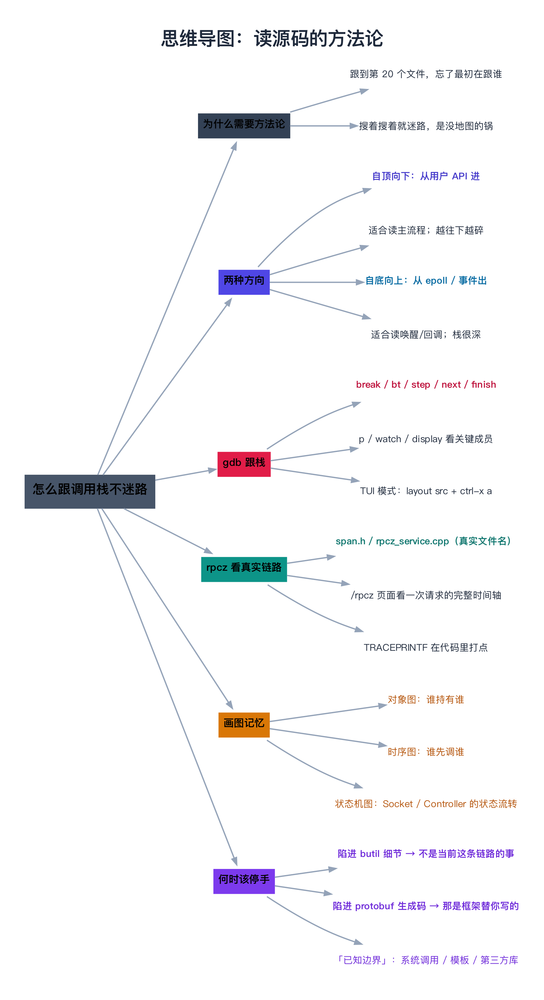

# 读源码的方法论：怎么跟调用栈不迷路

> **一句话总结**：bRPC 源码有 400 多个文件，**从哪进入、在哪里停**比「读得多快」重要得多。自顶向下（从用户 API 进）适合读主流程，自底向上（从 epoll 事件出）适合读唤醒与回调；gdb 的 `break/bt/step/finish/watch` 是脚下的路，`rpcz`（`src/brpc/span.h` + `src/brpc/builtin/rpcz_service.cpp`）是头顶的卫星图。**而真正决定成败的是「什么时候停」——陷进 `butil` 细节或 protobuf 生成代码，是新手最常掉进去的两个坑。**

---

## 阅读路径

- **快速版（约 5 分钟）**：读「一句话总结」+ 第 2 节「两种方向」+ 第 4 节「gdb 命令清单」+ 第 8 节「什么时候该停手」。这四段决定你后面 45 篇的跟码效率。
- **深入版（约 30 分钟）**：全文通读。重点自己动手跑一遍第 6 节的「一次真实的跟栈」，再对照第 5 节读一遍 `span.h` / `rpcz_service.cpp`，理解 bRPC 自己是怎么「把链路画出来」的。

---

## 目录

1. [为什么「会跟栈」比「读得快」重要](#1-为什么会跟栈比读得快重要)
2. [两种方向：自顶向下 vs 自底向上](#2-两种方向自顶向下-vs-自底向上)
3. [跟栈的心智模型：三层法则](#3-跟栈的心智模型三层法则)
4. [gdb 跟栈命令清单](#4-gdb-跟栈命令清单)
5. [源码剖析：bRPC 怎么自己「画出」调用链](#5-源码剖析brpc-怎么自己画出调用链)
6. [完整示例：跟一次同步 Echo 的全链路](#6-完整示例跟一次同步-echo-的全链路)
7. [数据验证：用 rpcz 页面对照 gdb 的结论](#7-数据验证用-rpcz-页面对照-gdb-的结论)
8. [边界、反例与失败路径：什么时候该停手](#8-边界反例与失败路径什么时候该停手)
9. [对比与选型：四种手段怎么选](#9-对比与选型四种手段怎么选)
10. [常见问题 FAQ](#10-常见问题-faq)
11. [延伸阅读](#11-延伸阅读)
12. [思维导图总结](#12-思维导图总结)

---

## 1. 为什么「会跟栈」比「读得快」重要

### 1.1 一个几乎所有新人都经历过的场景

你在读 `Channel::CallMethod`（`src/brpc/channel.cpp:482`），读到这一行停住了：

```cpp
// src/brpc/channel.cpp:657
cntl->IssueRPC(start_send_real_us);
```

于是你跳到 `Controller::IssueRPC`（`src/brpc/controller.cpp:1315`）。里面出现：

```cpp
// src/brpc/controller.cpp:1361
SocketUniquePtr tmp_sock;
...
const int rc = _lb->SelectServer(sel_in, &sel_out);
```

你开始想：`SocketUniquePtr` 是什么？`SelectServer` 的实现又在哪？于是打开 `socket_id.h`、`load_balancer.h`、`policy/randomized_load_balancer.cpp`……

**三个小时后，你合上电脑，已经想不起最初是想搞懂什么了。**

这不是你笨。这是**没有方法论**的必然结果。bRPC 的 `src/` 下有 400 多个文件、四座大厦互相调用，凭「看到不懂就搜」的蛮力，一定会迷路。

> **类比：跟一条地铁线 vs 在城市里乱走**。聪明的做法是：先选定一条线（比如 2 号线），从起点坐到终点，**每一站都知道它在哪**；而不是在换乘大厅里看到哪条线就上哪条线。调用栈就是 bRPC 的「地铁线」——**选一条走到底，比到处换乘快得多**。

### 1.2 本篇要给你什么

本篇不追任何 bRPC 的具体知识点，只给**一套可操作的读码工作流**：

| 你会得到 | 具体形式 |
|---------|---------|
| 两个方向的选择标准 | 什么时候自顶向下、什么时候自底向上（第 2 节） |
| 一张 gdb 命令清单 | 直接抄去用（第 4 节） |
| 一次可复现的跟栈实战 | 从 `stub.Echo` 跟到底（第 6 节） |
| 一个「什么时候停」的判据 | 避免陷进细节（第 8 节） |

**后面 45 篇的每一个「源码剖析」小节，都默认你已经掌握本篇的方法。**

---

## 2. 两种方向：自顶向下 vs 自底向上

### 2.1 自顶向下：从用户 API 进

**入口是你自己写的调用代码**。比如 `example/echo_c++/client.cpp:82`：

```cpp
stub.Echo(&cntl, &request, &response, nullptr);
```

你问的问题是：**「它内部是怎么实现的？」** 然后一层层往里跟：`stub.Echo` → `Channel::CallMethod` → `Controller::IssueRPC` → `Socket::Write` → …

**适用场景**：

- 想弄懂「一次 RPC 的主流程」
- 想弄懂「我调的 API 背后发生了什么」
- 排查「我的调用为什么失败 / 为什么慢」

**风险**：越往下越碎。从 `CallMethod` 往下跟 5 层，就可能进到 `Socket::WriteRequest::Setup`、`IOBuf::append` 这种「细节层」，**你会忘记自己为什么来到这**。

### 2.2 自底向上：从事件循环出

**入口是系统给的事件**。bRPC 服务端/客户端在空闲时都阻塞在 `epoll_wait` 上（第 29 篇的 `EventDispatcher`）。当一个 fd 可读，`epoll_wait` 返回，你问的问题是：**「这个事件最终交给了谁？」** 然后顺着回调往上追：`EventDispatcher::Run` → `Socket::HandleEpollOut/In` → `InputMessenger::OnNewMessages` → 协议解析 → `Service::CallMethod`。

**适用场景**：

- 想弄懂「数据到达后是谁被唤醒、怎么被唤醒」
- 排查「连接卡死」「回调不执行」「协程醒不过来」
- 想弄懂「同步的写法为什么能拿到异步的性能」（这是第 24 篇的主题）

**风险**：栈很深，而且**上面是谁在等它，从栈里看不出来**（那个协程已经挂起了）。所以自底向上往往需要配合 rpcz 或日志，才能把「下半段」和「上半段」拼起来。



### 2.3 两者的交汇点

两条路的**交汇点**在 `Socket` 与 `EventDispatcher` 之间：

- 自顶向下走到 `Socket::Write` 时，会看到「写不进去就把写请求挂起，等 epoll 通知」——这就是**上半段的终点**。
- 自底向上走到 `Socket::HandleEpollOut` 时，会看到「epoll 就绪，触发之前挂起的写请求 / 唤醒等待的协程」——这就是**下半段的起点**。

**在 `Socket` 处会师，一条完整的链路才真正闭环。** 这也是为什么本系列第 5 部分（29–35 篇）要专门讲 IO 与连接层——它是两条路的交接口。

---

## 3. 跟栈的心智模型：三层法则

跟栈时，每一步只回答三个问题（第 01 篇建立的「报门牌号」能力的直接应用）：

1. **现在在哪一层？**（`brpc` / `bthread` / `butil` / `bvar`，还是系统调用）
2. **这层归谁管？**（比如 `bthread_mutex_lock` 归 `bthread` 管，不是 pthread）
3. **还该继续往下吗？**（见第 8 节的「已知边界」）

答不出第 1、2 问，说明**地图没建好**——回去翻第 01 篇，别硬跟。答不出第 3 问，说明**你该停手了**。

> **类比：查案**。一个好侦探每进一间屋子，先确认「我在哪栋楼的哪一层」（第 1 问）、「这栋楼归谁管」（第 2 问）、「线索够了吗，还要不要上楼」（第 3 问）。三条都答不上还硬闯，最后只会手里一把线索、脑子一团浆糊。



---

## 4. gdb 跟栈命令清单

前提：用带 `-g` 的方式编译出可调试的二进制（第 02 篇详细讲）。bRPC 各个 `example/` 的 `Makefile` 里已经带了 `-fno-omit-frame-pointer`，这对 gdb 打栈非常友好——`example/echo_c++/Makefile` 里就这么写着：

```makefile
CXXFLAGS+=$(CPPFLAGS) -std=c++14 -DNDEBUG -O2 -pipe -W -Wall \
    -Wno-unused-parameter -fPIC -fno-omit-frame-pointer
```

### 4.1 命令速查表

| 命令 | 作用 | 典型用法 |
|------|------|---------|
| `break` / `b` | 下断点 | `b brpc::Channel::CallMethod` |
| `tbreak` | 只生效一次的断点 | `tbreak src/brpc/channel.cpp:657` |
| `run` / `r` | 启动程序（带命令行参数） | `r --server=127.0.0.1:8000` |
| `bt` / `backtrace` | **打印完整调用栈**（核心命令） | `bt` |
| `bt 10` | 只打印最内 10 帧 | `bt 10` |
| `frame N` / `f N` | 切到第 N 帧（可以看其局部变量） | `f 3` |
| `up` / `down` | 沿栈上移 / 下移一帧 | `up` |
| `step` / `s` | **步入**函数（进到被调函数里） | `s` |
| `next` / `n` | **步过**（把被调函数当一行执行） | `n` |
| `finish` / `fin` | **跳出**当前函数，回到调用者 | `fin` |
| `until` | 运行到当前行之后的某行 / 循环退出 | `until 700` |
| `print` / `p` | 打印表达式 | `p cntl->_error_code` |
| `watch` | **监视变量，值变化时断下** | `watch -l cntl->_failed` |
| `display` | 每次停下自动打印 | `display cntl->latency_us()` |
| `info locals` | 打印当前帧所有局部变量 | `info locals` |
| `info args` | 打印当前帧参数 | `info args` |
| `layout src` | TUI 源码视图 | 配合 `ctrl-x a` 切换 |
| `list` / `l` | 列出源码 | `l 482` |
| `thread apply all bt` | 打印所有线程的栈 | `thread apply all bt` |

> **五个必背命令**：`b`（在哪停）、`bt`（我在哪）、`s`/`n`（怎么走）、`fin`（什么时候出来）、`p`/`watch`（值对不对）。掌握这五个，跟任何 C++ 项目都够用了。

### 4.2 bRPC 特有的两个跟栈技巧

**技巧一：断点打在「分界处」，别打在「热路径」**。

bRPC 的热路径（如 `IOBuf::append`、`Socket::Write`）一行会被调用成千上万次，断上去就出不来了。正确做法是把断点打在你关心的**边界函数**上：`Channel::CallMethod`、`Controller::IssueRPC`、`Socket::Address`、`Service::CallMethod` 这些「一层只进一次」的地方。

**技巧二：用 `bthread` 的视角看「谁唤醒了我」**。

在 bRPC 里，一个协程挂起后，`bt` 里**看不到**那些还在等它的代码（它们已经被切走了）。想知道「谁唤醒我」，要看 `bthread_id_*`（协程关联 ID）和 `TimerThread`（第 22 篇）。这是第 23 篇「bthread 与 pthread 互操作」的重点。

### 4.3 一个可直接复制的 `.gdbinit` 片段

```gdb
# ~/.gdbinit 片段：给 bRPC 定制的顺手设置
set print pretty on
set print demangle on
set pagination off

# 打印 brpc 的 Controller 状态（字段名取自 src/brpc/controller.h）
define pcntl
  print (char*)($arg0)->ErrorText().c_str()
end

# 一次打全「门牌号」：把栈按四座大厦分类
define btbrief
  bt 20
  echo \n=== 从上往下看：每帧属于 brpc/bthread/butil/bvar 哪一层？ ===\n
end
```

---

## 5. 源码剖析：bRPC 怎么自己「画出」调用链

bRPC 自带一个「链路追踪」系统，**它内部用的正是「自顶向下 + 打点」这套思路**。读它的源码，能反过来加深你对自己跟栈方法的理解。

### 5.1 三个真实文件名（先记住，别记错）

第 01 篇的目录表里写的是「`brpc/rpcz`」，容易让人以为有个 `rpcz/` 目录。**实际情况是**：

| 你要找的东西 | 真实位置 | 说明 |
|-------------|---------|------|
| 链路数据的对象模型 | `src/brpc/span.h` / `src/brpc/span.cpp` | `class Span`（`span.h:65`），一次调用 = 一个 Span |
| `/rpcz` 网页的实现 | `src/brpc/builtin/rpcz_service.h` / `.cpp` | `class RpczService`，提供 `enable/disable/stats/...` |
| 用户侧打点宏 | `src/brpc/traceprintf.h` | `TRACEPRINTF(fmt, ...)`（`traceprintf.h:46`） |

> **没有** `src/brpc/rpcz/` 这个目录，也**没有** `brpc/rpcz.h`。名字是 `span.*` + `builtin/rpcz_service.*`。这正是第 01 篇「报门牌号」的第一次实战。

### 5.2 `Span`：一次调用就是一棵树

`Span` 的设计来自 Google 的 Dapper 论文（`span.h:63-64` 的注释里直接给了论文链接）。关键点：

```cpp
// src/brpc/span.h:65
class Span : public std::enable_shared_from_this<Span> {
    ...
    // src/brpc/span.h:89
    static std::shared_ptr<Span> CreateClientSpan(
        const std::string& full_method_name, int64_t base_real_us);
```

一次调用产生三种 Span（`span.h:76`、`:89`、`:93`）：

- `CreateServerSpan(...)` —— 服务端处理一次请求
- `CreateClientSpan(...)` —— 客户端发起一次调用
- `CreateBthreadSpan(...)` —— 一个 bthread 的生命周期（需要 `BTHREAD_INHERIT_SPAN`，见 `src/bthread/types.h:55`）

Span 里存的关键时间戳（`span.h:134-143`）：

```cpp
void set_received_us(int64_t tm);      // 收到请求的时刻
void set_start_parse_us(int64_t tm);   // 开始解析的时刻
void set_start_callback_us(int64_t tm);// 开始执行用户回调的时刻
void set_start_send_us(int64_t tm);    // 开始发送的时刻
void set_sent_us(int64_t tm);          // 发送完成的时刻
```

**这五个时间戳，正好把一次 RPC 拆成了四段**：接收 → 解析 → 业务处理 → 发送。你在 `/rpcz` 页面上看到的每一行时间，都来自这里。

### 5.3 用户怎么打点：`TRACEPRINTF`

`src/brpc/traceprintf.h:46`：

```cpp
#define TRACEPRINTF(fmt, args...)                                       \
    do {                                                                \
        if (::brpc::CanAnnotateSpan()) {                                \
            ::brpc::AnnotateSpan("[" __FILE__ ":" BAIDU_SYMBOLSTR(__LINE__) "] " fmt, ##args); \
        }                                                               \
    } while (0)
```

注意两个设计细节：

1. **不开启 rpcz 时，参数不求值**（`CanAnnotateSpan()` 短路）。所以注释里特意警告：别在参数里写有副作用的表达式。
2. **自动带上 `文件:行号`**。所以你打开 `/rpcz` 看到一行注解，直接就能定位到 `TRACEPRINTF` 打在哪。

`example/rpcz_echo_c++/server.cpp:49` 就有真实用法：

```cpp
void* RunThreadFunc(void*) {
    TRACEPRINTF("RunThreadFunc %lu", bthread_self());
    ...
}
```

### 5.4 开关与页面

rpcz 默认是**关闭**的（`src/brpc/builtin/rpcz_service.cpp:40`）：

```cpp
DEFINE_bool(enable_rpcz, false, "Turn on rpcz");
```

打开方式有三种：命令行 `--enable_rpcz=true`、代码里设 `brpc::FLAGS_enable_rpcz = true`，或者在服务运行后用浏览器访问**内置服务**：

- `http://服务地址:端口/rpcz/enable` —— 打开
- `http://服务地址:端口/rpcz` —— 查看
- `http://服务地址:端口/rpcz/stats` —— 看存储状态

这个 `RpczService` 是在 `Server` 启动时被自动注册的（`src/brpc/server.cpp:521`）：

```cpp
if (AddBuiltinService(new RpczService)) {
    LOG(ERROR) << "Fail to add RpczService";
}
```

---

## 6. 完整示例：跟一次同步 Echo 的全链路

### 6.1 环境与准备

```bash
# 假设你已完成第 02 篇，bRPC 已编译带 -g
cd /tmp/brpc-src/example/echo_c++

# 终端 A：起服务
./echo_server --port=8000

# 终端 B：用 gdb 起客户端
gdb ./echo_client
```

### 6.2 第 0 步：先在「入口」下断点

```gdb
(gdb) b brpc::Channel::CallMethod
Breakpoint 1 at 0x...: file src/brpc/channel.cpp, line 486.
(gdb) r --server=127.0.0.1:8000
```

第一次停下时，先别急着 `s`。**先 `bt`，把「我是谁、我从哪来」记下来**：

```gdb
(gdb) bt
#0  brpc::Channel::CallMethod (...) at src/brpc/channel.cpp:486
#1  example::EchoService_Stub::Echo (...) at echo.pb.cc:...
#2  main () at client.cpp:81
```

这一眼就告诉你两件事：

- `#1` 的 `EchoService_Stub::Echo` 在 **`echo.pb.cc`** 里——**这是 protobuf 生成的代码**，不是 bRPC 的源码。**这里就是「已知边界」之一**（第 8 节会展开）。
- `#2` 是你自己的 `main`。

### 6.3 第 1 步：一路 `next`，看主流程的骨架

`CallMethod` 有 170 多行，别逐行 `step`。**用 `next` 过一遍，只记「它调了哪些大函数」**：

```gdb
(gdb) n
... 
(gdb) n    # 走到 channel.cpp:657 附近
(gdb) bt
```

你会依次看到这些关键调用（行号取自 `src/brpc/channel.cpp`）：

| 行号 | 调用 | 这一步在干什么 |
|------|------|--------------|
| 489 | `cntl->OnRPCBegin(start_send_real_us)` | 记录开始时间，起状态机 |
| 502 | `CHECK(cntl->protocol_param().empty())` | 参数校验（`CHECK` 见第 05 篇） |
| 516 | `cntl->call_id()` | 取出「调用 ID」（bthread_id，用于关联响应） |
| 517 | `bthread_id_lock_and_reset_range(...)` | **给这次调用加锁**（防止 Controller 被复用） |
| 597 | `_serialize_request(&cntl->_request_buf, cntl, request)` | **序列化请求**（走 protobuf） |
| 657 | `cntl->IssueRPC(start_send_real_us)` | **真正进入发送流程** |
| 662 | `Join(correlation_id)` | **同步调用在此挂起等待**（关键！） |

> **第 511 行的 `bthread_id_lock_and_reset_range` 是 `bthread` 的东西**，不是 pthread——这就是「三层法则」第 2 问的应用：`bthread_id_*` 一律归 `bthread` 管（第 20、21 篇）。

### 6.4 第 2 步：进 `IssueRPC`，看「挑服务器」和「发数据」

```gdb
(gdb) until 657
(gdb) s          # 进入 Controller::IssueRPC
(gdb) info args  # 看参数
```

`Controller::IssueRPC`（`src/brpc/controller.cpp:1315`）里，挑服务器有两条路：

```cpp
// src/brpc/controller.cpp:1349 处声明，1361 起分支
SocketUniquePtr tmp_sock;
...
} else if (SingleServer()) {
    // 单服务器：直接按 _single_server_id 找 Socket
    const int rc = Socket::Address(_single_server_id, &tmp_sock);
    ...
} else {
    // 多服务器：交给负载均衡器
    LoadBalancer::SelectIn sel_in = { start_realtime_us, true, ... };
    LoadBalancer::SelectOut sel_out(&tmp_sock);
    const int rc = _lb->SelectServer(sel_in, &sel_out);   // controller.cpp:1377
    ...
}
```

**这里就是「自顶向下」往下跟时该停的地方**：`SelectServer` 的具体实现（`policy/randomized_load_balancer.cpp` 等）属于「负载均衡」这个独立话题，本系列放第 43 篇。**跟主流程时，知道「这里交给了 LoadBalancer，它的职责是挑一台机器」就够了。**

### 6.5 第 3 步：同步调用在哪里挂起

回到 `Channel::CallMethod` 的最后：

```cpp
// src/brpc/channel.cpp:657-664
cntl->IssueRPC(start_send_real_us);
if (done == nullptr) {
    // MUST wait for response when sending synchronous RPC. It will
    // be woken up by callback when RPC finishes (succeeds or still
    // fails after retry)
    Join(correlation_id);
    cntl->SubmitSpan();
    cntl->OnRPCEnd(butil::gettimeofday_us());
}
```

`Join(correlation_id)` 展开就是一行（`src/brpc/controller.cpp:827`）：

```cpp
void Join(CallId id) {
    bthread_id_join(id);
}
```

**`done == nullptr` 就是「同步调用」的标志**——bRPC 里同步/异步的唯一区别就是最后一个参数传不传 `done`。`bthread_id_join` 会让当前**协程**挂起（不是阻塞整个线程！），等 `IssueRPC` 那边把响应处理后唤醒它。

> **这就是 bRPC「同步写法、异步性能」的落点**：你的代码写着 `stub.Echo(...)` 停在这里等，但底下的 worker 线程早跑去执行别的 bthread 了。第 24 篇专讲这个。

### 6.6 第 4 步：确认你走对了——看 `cntl` 的状态

挂起前用 `p` 观察 Controller：

```gdb
(gdb) p cntl->_error_code
$1 = 0
(gdb) p cntl->latency_us()
(gdb) p cntl->remote_side()
```

`latency_us()` 的最终值，会和客户端日志里 `latency=...us` 对上（`example/echo_c++/client.cpp:88`）。**能对上，说明你这条栈跟对了。**

---

## 7. 数据验证：用 rpcz 页面对照 gdb 的结论

gdb 跟的是「代码怎么走」，rpcz 看的是「时间花在哪」。**两者结合，才是一次完整的阅读。**

### 7.1 打开 rpcz 跑一遍

```bash
# 服务端开启 rpcz
./echo_server --port=8000 --enable_rpcz=true

# 客户端发几次请求后，浏览器打开
# http://127.0.0.1:8000/rpcz
```

你会看到每个请求一行，点进去是一条完整时间轴，形如（`rpcz_service.cpp:159` 的 `PrintRealTime` / `PrintElapse` 生成的格式）：

```text
14:03:12.004821      .000000 [Server SPAN#203b54d4f4] Received request
14:03:12.004829      .000008 [Server SPAN#203b54d4f4] [server.cpp:521] ...
14:03:12.004836      .000007 [Client SPAN#5a764476] start_send_real_us
14:03:12.005102      .000266 [Client SPAN#5a764476] response received
14:03:12.005110      .000008 [Server SPAN#203b54d4f4] Responded
```

> **怎么读**：左列是**绝对时刻**，右列是**相对上一行的时间差（微秒）**。中间 `[Server SPAN#xxx]` / `[Client SPAN#xxx]` 是**哪个 Span、哪一侧**；`[文件:行号]` 来自 `TRACEPRINTF` 宏自动带的 `__FILE__:__LINE__`（`traceprintf.h:49`）。

### 7.2 把 rpcz 的五个时间戳，对回 gdb 跟到的五个函数

| rpcz 上的字段 | 对应 gdb 里你会停在的函数 | 源码位置 |
|--------------|------------------------|---------|
| `received_real_us` | 服务端收完包 | `InputMessenger::OnNewMessages`（第 32 篇） |
| `start_parse_real_us` | 开始按协议解析 | `Protocol::ParseRequest`（第 36 篇） |
| `start_callback_real_us` | 开始调你的 `EchoImpl::Echo` | `Service::CallMethod`（第 47 篇） |
| `start_send_real_us` | 客户端开始发 | `Controller::IssueRPC`（`controller.cpp:1315`） |
| `sent_real_us` | 客户端发完 | `Socket::Write`（第 33 篇） |

**这张表的价值**：它把你「用 gdb 一个个函数跟出来的路径」，和 rpcz 页面上「一根时间轴」精确对应上了。以后你只需要看 rpcz 的耗时分布，就能判断**该去 gdb 里跟哪一段**——哪段耗时长，就重点跟哪段。

### 7.3 官方示例：`example/rpcz_echo_c++/`

这个例子的服务端故意在 `Echo` 里起了两个带 `BTHREAD_INHERIT_SPAN` 的 bthread（`server.cpp:45`）：

```cpp
static const bthread_attr_t BTHREAD_ATTR_NORMAL_WITH_SPAN = {
    BTHREAD_STACKTYPE_NORMAL, BTHREAD_INHERIT_SPAN, nullptr, BTHREAD_TAG_INVALID};
```

打开 `/rpcz`，你能看到**子 bthread 的 Span 挂在父 Span 下面**，形成一棵树。这正好演示了「一次请求内部又派生了并发任务」时，链路是怎么保持不散的。注释里也说了，这需要 bthread 创建时带 `BTHREAD_INHERIT_SPAN` 标志。

---

## 8. 边界、反例与失败路径：什么时候该停手

**这一节是整篇最重要的。** 会跟栈不算本事，**知道在哪停**才是。

### 8.1 陷阱一：陷进 `butil` 的细节

你跟到 `CallMethod` 里的 `_serialize_request`，想看看它怎么序列化，于是进了 `IOBuf`……然后你在 `iobuf.cpp` 里读了三小时块结构和引用计数。

**问题在于**：你现在读的是「客户端主流程」，`IOBuf` 的实现细节**不属于这条链路**。你需要的只是知道：「`IOBuf` 是一个非连续、零拷贝的缓冲区，`append` 会拷贝（小的）或引用（大的）」——**这句话就够了**，细节留给第 08、09 篇。

**判据**：当你要读的函数在 `butil/` 里，且它与**当前这条链路的主流程**无关时——**停**。记下「这里用到了 `butil::X`，职责是 Y」，继续往上走。

### 8.2 陷阱二：陷进 protobuf 生成代码

`bt` 里出现 `echo.pb.cc`、`.pb.h`、`google::protobuf::` 开头的帧时，**这是「已知边界」**。生成代码是 protobuf 编译器替你写的，读了也不会让你更懂 bRPC。

**判据**：文件名以 `.pb.cc` / `.pb.h` 结尾，或命名空间是 `google::protobuf::` —— **停**。你只需要知道「Stub 的 `Echo` 最终调到了 `Channel::CallMethod`」这个接口契约（第 06 篇讲 protobuf 与 bRPC 的接口关系）。

### 8.3 陷阱三：陷进「系统调用与第三方库」

`bt` 底部出现 `epoll_wait`、`accept4`、`futex`、`__libc_read`、`tcmalloc`、`glog`、`leveldb` 时，同样是「已知边界」。**你不需要读 glibc 的 `epoll_wait` 实现。**

**判据**：帧名是纯 C 风格的系统调用名，或在 `/usr/include/` 下的第三方库 —— **停**。

### 8.4 一张「已知边界」清单

| 边界类型 | 典型特征（`bt` 里长什么样） | 停下来的理由 |
|---------|--------------------------|-------------|
| protobuf 生成码 | `example::EchoService_Stub::Echo`、`*_Stub`、`.pb.cc` | 是编译器生成的，不是 bRPC 的设计 |
| 第三方库 | `google::protobuf::`、`glog`、`leveldb::`、`tcmalloc` | 它们是 bRPC 的依赖，不是 bRPC 本身 |
| 系统调用 | `epoll_wait`、`accept4`、`futex`、`read`、`write` | 属于 OS，第 01 篇的分层图里它们在 `butil` 下面 |
| `butil` 容器细节 | `FlatMap::insert`、`IOBuf::append_impl` | 不在当前主流程，留给第二部分的专篇 |
| 模板展开 | `std::__1::`、`boost::` 那一长串 | 读它不增加对 bRPC 的理解 |
| 测试/调试框架 | `testing::`、`bvar::detail::Sampler` | 旁路逻辑，不是主流程 |

### 8.5 反例：一个「不该自底向上」的场景

**错误做法**：想弄懂「客户端怎么发一个请求」，却从 `epoll_wait` 开始往上追。

**为什么错**：`epoll_wait` 返回时，客户端主流程可能**根本没在等这次请求**——它早就 `Join` 挂起了。你从事件往上追，会看到一堆「响应处理」「重试逻辑」，**却看不到「请求最初是怎么发出去的」**。

**正确做法**：这种「从用户意图出发」的问题，**一律自顶向下**；「自底向上」只用于「数据/事件到达后怎么被处理」这类问题。

### 8.6 反例：一个「不该自顶向下」的场景

**错误做法**：线上服务偶发卡死，你想从 `main` 开始单步跟——**根本复现不了**。

**正确做法**：这种问题要用**事后现场**的手段：`gdb -p <pid>` attach 上去 `thread apply all bt`，或直接看 `/rpcz`、`/vars`（第 4 部分）、`/bthreads`（`builtin/bthreads_service.cpp`）页面。**自底向上 + 线上可观测性，才是排查这类问题的正确组合。**

---

## 9. 对比与选型：四种手段怎么选

| 手段 | 能回答的问题 | 优点 | 缺点 | 什么时候用 |
|------|------------|------|------|-----------|
| **纯静态阅读** | 「这个函数大致干什么」 | 不依赖环境，随时可读 | 容易「以为懂了」，不知道真的走没走到 | 建立地图、读接口 |
| **gdb 跟栈** | 「真的走到这了吗？走的是哪条分支？」 | **最精确**，能看实时值 | 需要编译带 `-g`；热路径难断点 | 跟主流程、验证分支、看状态 |
| **rpcz** | 「时间花在哪一段？谁调了谁？」 | 不用停程序，线上可用 | 需开启 `--enable_rpcz`；只覆盖 bRPC 自己打点的位置 | 看链路、定位性能段 |
| **日志（`LOG`/`VLOG`）** | 「发生了什么？顺序对不对？」 | 不改代码，改 flag 就能调级别 | 需重新编译才加日志；输出量大 | 排查时序、复现路径 |

**一句话选型**：

- **想懂主流程** → 自顶向下 + gdb（第 4、6 节）
- **想懂唤醒/回调** → 自底向上 + rpcz（第 2、7 节）
- **线上排查** → rpcz + `/bthreads` + `/vars`，别想着 gdb 单步
- **只是了解接口** → 纯静态阅读 `example/` 比读源码快

---

## 10. 常见问题 FAQ

**Q1：我不编译，能学会跟栈吗？**
学不会。跟栈的本质是「观察真实执行」，不编译就只能「想象执行」，两者天差地别。**至少把 `example/echo_c++` 编译一份带 `-g` 的**，成本很低。

**Q2：`bt` 打出来一堆 `??` 或 `_ZN4brpc...` 这样的乱码怎么办？**
两种可能：一是没装 `c++filt`/没开 demangle，加 `set print demangle on`；二是二进制 strip 过或没有调试符号，重编时确保带 `-g` 且没 `strip`。

**Q3：断在热路径上，`continue` 了十分钟还没到下一次我关心的调用，怎么办？**
说明断点下错了。两个补救：`disable` 掉这个断点；或者用条件断点，比如 `b brpc::Socket::Write if req->controller()->log_id() == 123`（先把断点打在你确实关心的那一次调用上）。

**Q4：`rpcz` 页面是空的 / 显示 `rpcz is not enabled yet`，怎么回事？**
rpcz 默认关闭（`rpcz_service.cpp:40` 的 `DEFINE_bool(enable_rpcz, false, ...)`）。访问 `/rpcz/enable` 或启动时加 `--enable_rpcz=true`。另外 rpcz 数据默认在 `--rpcz_keep_span_seconds`（默认 3600 秒）后过期（`span.cpp:141`），太久以前的请求看不到。

**Q5：为什么我 `bt` 里看不到「谁在等我」？**
因为 bRPC 用的是 bthread（M:N 协程）。等待方协程挂起后，栈已经被切走，**它的调用栈不在当前线程上**。想知道谁在等，要靠 rpcz 的父子 Span、`bthread_id` 关联、或 `TimerThread`（第 22 篇）。

**Q6：跟栈时到底要不要读每个被调函数的实现？**
不要。**跟主流程时，只记住「这一层是谁、职责是什么」，把细节留给专篇。** 第 8 节的「已知边界」清单就是你的收手判据。

---

## 11. 延伸阅读

- **Dapper 论文**：`src/brpc/span.h:63-64` 的注释直接给了链接 <http://static.googleusercontent.com/media/research.google.com/en//pubs/archive/36356.pdf> —— bRPC 的 Span 模型就是照它设计的。
- **源码**：`src/brpc/span.h`、`src/brpc/span.cpp`（链路对象模型）、`src/brpc/builtin/rpcz_service.cpp`（`/rpcz` 页面）、`src/brpc/traceprintf.h`（用户打点宏）。
- **官方示例**：`example/rpcz_echo_c++/` —— 一个专门演示 rpcz 与 `BTHREAD_INHERIT_SPAN` 的可运行例子。
- **gdb 官方文档**：《Debugging with GDB》，重点看 `Backtrace`、`Breakpoints`、`Examining Data` 三章。
- **第 01 篇**：《bRPC 源码全景：src 下的四座大厦》—— 本篇「门牌号」体系的地基。
- **第 03 篇**：《从 example 反推：第一个 RPC 走了哪些函数》—— 与本篇第 6 节互补，那篇更偏「走通」，本篇更偏「方法」。

---

## 12. 思维导图总结

```text
读源码的方法论：怎么跟调用栈不迷路
├── 为什么需要方法论
│   ├── 跟到第 20 个文件，忘了最初在跟谁
│   └── 目标是「报得出门牌号」
├── 两种方向
│   ├── 自顶向下：从用户 API 进
│   │   ├── stub.Echo → Channel::CallMethod → IssueRPC
│   │   └── 适合主流程；风险是越往下越碎
│   ├── 自底向上：从 epoll / 事件出
│   │   ├── epoll_wait → EventDispatcher → 回调
│   │   └── 适合唤醒/回调；风险是栈深、看不到等待方
│   └── 交汇点：Socket / EventDispatcher（第 29、30 篇）
├── 跟栈三层法则
│   ├── 现在在哪一层？（brpc/bthread/butil/bvar）
│   ├── 这层归谁管？
│   └── 还该往下跟吗？
├── gdb 命令清单
│   ├── b / bt / step / next / finish（必背五个）
│   ├── p / watch / display / info locals
│   └── 技巧：断在分界处；bthread 视角看「谁唤醒我」
├── rpcz 看真实链路（真实文件名！）
│   ├── span.h / span.cpp —— Span 对象模型
│   ├── builtin/rpcz_service.cpp —— /rpcz 页面
│   ├── traceprintf.h —— TRACEPRINTF 打点
│   └── 五个时间戳 = 接收/解析/回调/发送四段
├── 完整示例：跟一次同步 Echo
│   ├── break Channel::CallMethod → bt 认边界
│   ├── next 过主流程（序列化 → IssueRPC → Join）
│   └── Join = bthread_id_join → 协程挂起（同步的本质）
├── 何时该停手（最重要）
│   ├── 陷阱一：陷进 butil 细节
│   ├── 陷阱二：陷进 protobuf 生成代码
│   ├── 陷阱三：陷进系统调用 / 第三方库
│   └── 「已知边界」清单
└── 四种手段选型
    ├── 静态阅读：建地图
    ├── gdb：跟主流程、验分支
    ├── rpcz：看链路、定位性能段
    └── 日志：查时序
```


