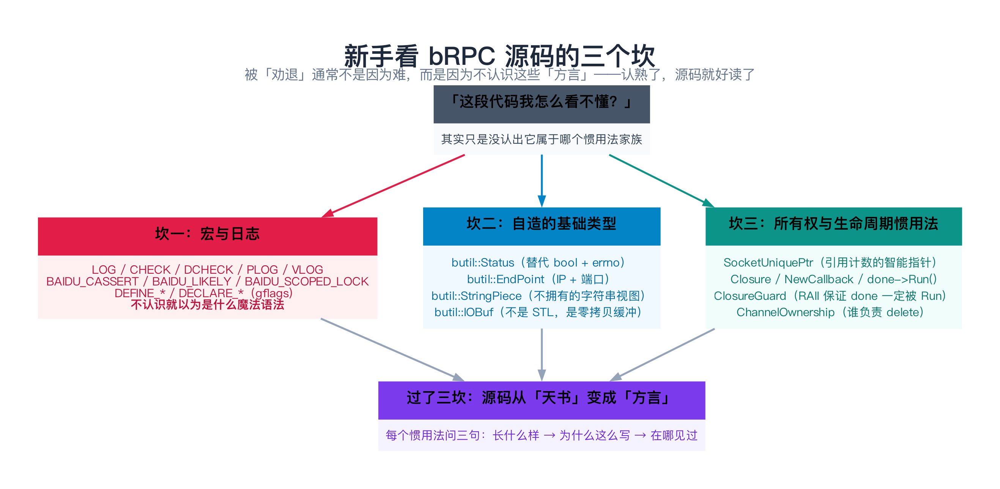
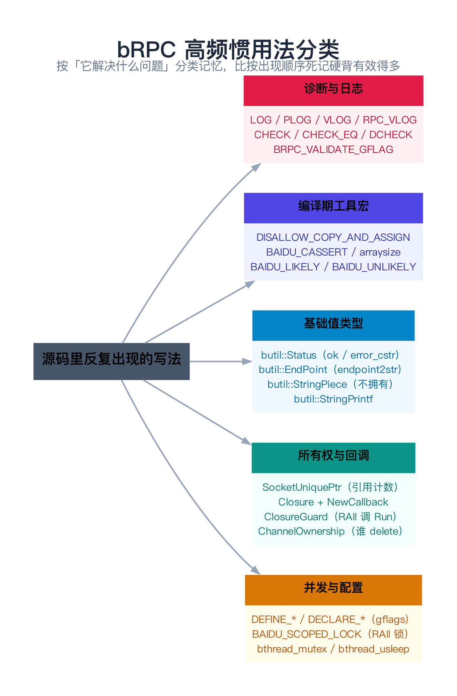
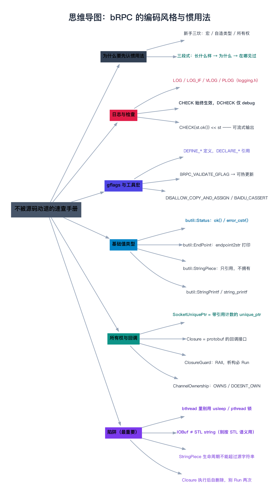

# bRPC 的编码风格与惯用法

> **一句话总结**：bRPC 源码里有一批**反复出现、但一望不知所云**的写法——`CHECK(st.ok()) << st`、`DEFINE_bool(enable_rpcz, ...)`、`SocketUniquePtr`、`NewCallback(...)`、`done->Run()`。它们不是语法奇技，而是**五个家族**的惯用法：**日志与检查、gflags 配置、编译期工具宏、自造基础类型、所有权与回调**。先把这五个家族认熟（每个都问「长什么样 → 为什么这么写 → 在哪见过」），后面 45 篇才不会被源码「劝退」。

---

## 阅读路径

- **快速版（约 5 分钟）**：直接跳到第 7 节「速查表」，再读第 8 节「陷阱」。日常读码 90% 的困惑，这两节就能解决。
- **深入版（约 30 分钟）**：按第 2～5 节逐个家族过一遍，**每个惯用法都回到源码里点开那一行看一眼**（本篇给了精确的 `文件:行号`）。第 4、5 节的类型与所有权，是后面 IOBuf、Socket、Controller 各篇的地基。

---

## 目录

1. [为什么先认惯用法，而不是先读逻辑](#1-为什么先认惯用法而不是先读逻辑)
2. [家族一：日志与检查宏](#2-家族一日志与检查宏)
3. [家族二：gflags 配置与编译期工具宏](#3-家族二gflags-配置与编译期工具宏)
4. [家族三：butil 的自造基础类型](#4-家族三butil-的自造基础类型)
5. [家族四：所有权与回调惯用法](#5-家族四所有权与回调惯用法)
6. [源码剖析：把惯用法钉到真实位置](#6-源码剖析把惯用法钉到真实位置)
7. [速查表（本篇精华）](#7-速查表本篇精华)
8. [边界、反例与失败路径：这些惯用法的陷阱](#8-边界反例与失败路径这些惯用法的陷阱)
9. [对比与选型](#9-对比与选型)
10. [常见问题 FAQ](#10-常见问题-faq)
11. [延伸阅读](#11-延伸阅读)
12. [思维导图总结](#12-思维导图总结)

---

## 1. 为什么先认惯用法，而不是先读逻辑

### 1.1 你被劝退的那一刻

假设你打开 `src/brpc/redis.cpp:101`，看到这么一行：

```cpp
CHECK(st.ok()) << st;
```

五个问题同时冒出来：

- `CHECK` 是什么？宏还是函数？为什么后面能 `<<`？
- `st.ok()` 里的 `st` 是什么类型？为什么有 `ok()`？
- `<<` 把一个对象流出去，输出的是什么？
- 这行是「断言」还是「日志」？失败了会怎样？
- `st` 定义在上面哪一行？

**如果每个这样的问题你都要停下来查五分钟，一页源码你能读一晚上。** 而这一页里，`CHECK`、`st.ok()`、`<<` 这三种写法，**在后面的 45 篇里你会看到成百上千次**。

> **类比：方言**。你去一个陌生地方，当地人说「吃了没」其实是打招呼、不是真问你饿不饿。你要是一句句按字面较真，就永远融不进对话。bRPC 的惯用法就是它的「方言」——**先学会方言，才能听懂它在说什么**。

### 1.2 新手看源码的三个坎

本篇把所有惯用法聚成**三个坎**：

| 坎 | 内容 | 为什么看不懂 |
|----|------|-------------|
| **坎一：宏与日志** | `LOG` / `CHECK` / `DCHECK` / `DEFINE_*` / `BAIDU_*` | 宏展开后是另一段代码，不知道它就不知道真实行为 |
| **坎二：自造的基础类型** | `butil::Status` / `EndPoint` / `StringPiece` / `IOBuf` | 名字像 STL，**其实不是 STL**，语义完全不同 |
| **坎三：所有权与回调** | `SocketUniquePtr` / `Closure` / `ClosureGuard` / `ChannelOwnership` | 牵扯「谁释放、谁能在什么时候用」，不认就理不清生命周期 |



### 1.3 每个惯用法都用「三段式」来讲

本篇对每个惯用法都回答三句话：

1. **长什么样**：源码里原样长什么样（给 `文件:行号`）。
2. **为什么这么写**：它替代了朴素写法的什么缺陷。
3. **在哪见过**：bRPC 里哪些文件/file:行号在用。

**这三句话记住了，下次见到就是「老朋友」，不用再查。**

---

## 2. 家族一：日志与检查宏

全部定义在 `src/butil/logging.h`（从 glog 精简改写而来）。

### 2.1 `LOG` / `LOG_IF` / `VLOG` / `PLOG`

**长什么样**（`src/butil/logging.h:484`）：

```cpp
#define LOG(severity)                                                   \
    BAIDU_LAZY_STREAM(LOG_STREAM(severity), LOG_IS_ON(severity))
```

用法就是 C++ 里最顺手的流式写法：

```cpp
LOG(INFO) << "Fail to initialize channel";
LOG(ERROR) << "Fail to start EchoServer";
LOG_IF(ERROR, cntl->is_used_by_rpc()) << "Controller=" << cntl << " was used by another RPC";
```

**为什么这么写**：日志要满足两个矛盾的需求——**调用点写起来要短**（一行流式），**没达到级别的日志要零成本**（连参数都不求值）。`BAIDU_LAZY_STREAM` 就是干这个的：

```cpp
// src/butil/logging.h:471
#define BAIDU_LAZY_STREAM(stream, condition)                            \
    !(condition) ? (void) 0 : ::logging::LogMessageVoidify() & (stream)
```

级别未达到时，三元表达式短路，**右边的 `stream`（连同里面的 `<<` 参数）压根不会求值**。

**四个 severity 的取舍**（`src/butil/logging.h:370-374` 定义了 `BLOG_INFO = 0`、`BLOG_NOTICE = 1`、`BLOG_WARNING = 2`、`BLOG_ERROR = 3`、`BLOG_FATAL = 4`）：

| 宏 | 用途 | 注意 |
|----|------|------|
| `LOG(INFO)` | 常规信息 | 生产环境可能被关掉 |
| `LOG(WARNING)` | 可恢复的异常 | —— |
| `LOG(ERROR)` | 出错了，但程序还能跑 | —— |
| `LOG(FATAL)` | **致命，会终止进程** | 慎用 |
| `PLOG(severity)` | 在 `LOG` 基础上**自动附上 `errno` 的描述** | `src/brpc/event_dispatcher_epoll.cpp:32`：`PLOG(FATAL) << "Fail to create epoll";` |
| `VLOG(n)` / `RPC_VLOG` | 按 verbosity 级别输出，默认关闭 | `RPC_VLOG_LEVEL` 定义在 `src/brpc/log.h:24`（值为 99） |

还有几个「限流」变体（`src/butil/logging.h:1261` 起）：`LOG_ONCE`、`LOG_EVERY_N`、`LOG_FIRST_N`、`LOG_EVERY_SECOND`——热路径日志的标准解法。

### 2.2 `CHECK` 家族：始终生效的断言

**长什么样**（`src/butil/logging.h:616`）：

```cpp
#define CHECK(condition)                                        \
    BAIDU_LAZY_STREAM(LOG_STREAM(FATAL).SetCheck(), !(condition))     \
    << "Check failed: " #condition ". "
```

用法：

```cpp
// src/brpc/channel.cpp:502
CHECK(cntl->protocol_param().empty());

// src/brpc/channel.cpp:520
CHECK_EQ(EINVAL, rc);

// src/brpc/socket.cpp:550
CHECK(Failed() || IsWriteShutdown());
```

**为什么这么写**：

- **`#condition` 是「字符串化」**：`CHECK(a == b)` 失败时会打印出源码文本 `Check failed: a == b.`，比只打印 `false` 有用得多。
- **`CHECK` 不受 `NDEBUG` 影响**（对比 `DCHECK`）。这是刻意的：它用来检查「绝不该发生、发生了就必须崩」的事。
- **可以流式补充信息**：`CHECK(expr) << "context=" << x;`。因为 `CHECK` 展开后返回一个 `ostream`。

`CHECK_EQ/NE/LE/LT/GE/GT`（`src/butil/logging.h:692-697`）是基于 `BAIDU_CHECK_OP` 的一组比较宏，失败时会**同时打印两个值**：

```cpp
CHECK_EQ(val1, val2) BAIDU_CHECK_OP(EQ, ==, val1, val2)
```

`CHECK_*` 的真正定义在 `src/butil/logging.h:673`（`BAIDU_DEFINE_CHECK_OP_IMPL`），核心是调 `Check##name##Impl` 生成一条 `"v1 == v2"` 形式的消息。

### 2.3 `DCHECK` 家族：只在 debug 生效

**长什么样**（`src/butil/logging.h:845`）：

```cpp
#define DCHECK(condition)                                               \
    BAIDU_LAZY_STREAM(LOG_STREAM(DCHECK), DCHECK_IS_ON() && !(condition)) \
    << "Check failed: " #condition ". "
```

`DCHECK_IS_ON()` 的实现（`src/butil/logging.h:700-702`）：

```cpp
#if defined(NDEBUG) && !defined(DCHECK_ALWAYS_ON)
#define DCHECK_IS_ON() 0
#else
#define DCHECK_IS_ON() 1
#endif
```

**为什么这么写**：`CHECK` 的代价是每次调用都要判断（哪怕在热路径上），而很多「不变量」只在开发阶段需要检查。`DCHECK` 让这些检查在 Release 下**被编译掉**，热路径零开销。

真实用法（`src/brpc/socket.cpp:510`、`src/brpc/controller.cpp:665`）：

```cpp
DCHECK(p->data.empty());      // socket.cpp:510，只在 debug 校验
DCHECK(cntl->Failed());       // controller.cpp:665
```

> **关键提醒**：即使 `DCHECK` 被关掉，**参数也会被求值**（为了不产生「变量未使用」警告）。所以**别把有副作用的表达式放进 `DCHECK`**——`DCHECK(++i < n)` 在 Release 下什么都不会发生。

### 2.4 一段真实的「读码」示例

回到开头那行 `src/brpc/redis.cpp:101`，现在你应该能一眼读懂：

```cpp
// src/brpc/redis.cpp:96-105
const butil::Status st = RedisCommandNoFormat(&_buf, command);
if (st.ok()) {
    ++_ncommand;
    return true;
} else {
    CHECK(st.ok()) << st;   // 一定是「不该失败却失败了」——日志里会带上 st 的内容
    _has_error = true;
    return false;
}
```

翻译成大白话：**「正常情况下 `st.ok()` 一定成立；如果不成立，说明有 bug，把 `st` 的错误信息打出来并崩掉。」** 这里的 `<< st` 之所以能工作，是因为 `butil::Status` 重载了 `operator<<`（`src/butil/status.h:150`）——**这是家族一和家族三的交汇**。

---

## 3. 家族二：gflags 配置与编译期工具宏

### 3.1 `DEFINE_*` / `DECLARE_*`：bRPC 的「配置系统」

bRPC 大量用 Google 的 gflags 作为配置系统。规则很简单：

- **`DEFINE_*` 定义**（只能有一处），**`DECLARE_*` 声明**（可以多处）。
- 命名约定：`FLAGS_` + 变量名。

**长什么样**（定义）：

```cpp
// src/brpc/builtin/rpcz_service.cpp:40
DEFINE_bool(enable_rpcz, false, "Turn on rpcz");

// src/brpc/channel.cpp:48
DEFINE_string(health_check_path, "", "Http path of health check call.");

// src/brpc/channel.cpp:53
DEFINE_int32(health_check_timeout_ms, 500, "The timeout for both establishing ...");
```

（声明）：

```cpp
// src/brpc/span.h:53
DECLARE_bool(enable_rpcz);

// src/brpc/protocol.h:57
DECLARE_bool(log_error_text);

// src/brpc/load_balancer.h:114-115
DECLARE_bool(show_lb_in_vars);
DECLARE_int32(default_weight_of_wlb);
```

**为什么这么写**：RPC 框架有几百个可调参数（超时、重试、连接类型、各种开关）。用 gflags 的三大好处：

1. **命令行/配置文件都能改**：`--enable_rpcz=true`、`--timeout_ms=100`。
2. **代码里随处可读**：`FLAGS_enable_rpcz`（注意前缀 `FLAGS_`）。
3. **能注册校验函数**（见下）。

### 3.2 `BRPC_VALIDATE_GFLAG`：让 flag 支持热更新

**长什么样**（`src/brpc/load_balancer.cpp:33`）：

```cpp
BRPC_VALIDATE_GFLAG(show_lb_in_vars, PassValidate);
```

宏本身的定义（`src/brpc/reloadable_flags.h:24`，转发到 `src/butil/reloadable_flags.h:38`）：

```cpp
#define BRPC_VALIDATE_GFLAG(flag, validate_fn) BUTIL_VALIDATE_GFLAG(flag, validate_fn)
```

**为什么这么写**：gflags 原生的 `RegisterFlagValidator` 要求**每个 flag 只能注册一个校验器**。bRPC 借这个限制做了个巧妙的「标记」——**只要一个 flag 注册过校验器，bRPC 就认为它可以被运行时修改**（即「reloadable」）。注释写得很直白（`src/butil/reloadable_flags.h:29-33`）：

```cpp
// Register an always-true valiator to a gflag so that the gflag is treated as
// reloadable by brpc. If a validator exists, abort the program.
//
//   DEFINE_int32(foo, 0, "blah blah");
//   BRPC_VALIDATE_GFLAG(foo, brpc::PassValidate);
```

所以 `BRPC_VALIDATE_GFLAG(x, PassValidate)` 里的 `PassValidate` 是「永远返回 true 的校验器」（`src/butil/reloadable_flags.h:48`），**注册它只是为了打标记**。

真实例子：

```cpp
// src/brpc/circuit_breaker.cpp:55 —— 用 NonNegativeInteger，因为负数无意义
BRPC_VALIDATE_GFLAG(circuit_breaker_half_open_window_size, NonNegativeInteger);
```

> 这也是为什么你能在浏览器里访问 `/flags` 页面（`builtin/flags_service.cpp`）**在线改某些 flag**——被改了还生效的，就是注册过 `BRPC_VALIDATE_GFLAG` 的那些。

### 3.3 `BAIDU_*` 工具宏

bRPC 里 `BAIDU_` 前缀的宏非常好认——**它们基本都是「名字里带 Baidu 是因为历史原因、实际是通用工具」**。高频的几个：

| 宏 | 定义位置 | 作用 | 真实用法 |
|----|---------|------|---------|
| `BAIDU_UNLIKELY(expr)` / `BAIDU_LIKELY(expr)` | `src/butil/compiler_specific.h:272` / `:271` | 告诉编译器分支预测方向 | `if (BAIDU_UNLIKELY(rc != 0)) { ... }` |
| `BAIDU_SCOPED_LOCK(lock)` | `src/butil/scoped_lock.h:33` | RAII 加锁，出作用域自动解锁 | `src/brpc/acceptor.cpp:78`：`BAIDU_SCOPED_LOCK(_map_mutex);` |
| `BAIDU_CASSERT(expr, msg)` | `src/butil/macros.h:196` | 编译期断言（C++11 下就是 `static_assert`） | 放进类里做静态检查 |
| `BAIDU_SYMBOLSTR(x)` | `src/butil/macros.h:348` | 把标识符变成字符串 | `TRACEPRINTF` 里拼 `文件:行号` |
| `BAIDU_GLOBAL_INIT()` | `src/butil/macros.h:453` | 在 `main` 前跑一段初始化代码 | 全局注册 |

`DISALLOW_COPY_AND_ASSIGN`（`src/butil/macros.h:54`）也是同族——它把拷贝构造和 `operator=` 声明为 deleted（C++11 下用 `BUTIL_DELETE_FUNCTION`，见 `macros.h:34`）：

```cpp
#define DISALLOW_COPY_AND_ASSIGN(TypeName)               \
    DISALLOW_COPY(TypeName);                             \
    DISALLOW_ASSIGN(TypeName)
```

`brpc::ClosureGuard`（`src/brpc/closure_guard.h:66`）、`Span`（`src/brpc/span.h:220`）等都用它禁止拷贝。

---

## 4. 家族三：butil 的自造基础类型

这一家族最容易踩坑，因为**它们的名字会让人误以为是 STL**。

### 4.1 `butil::Status`：替代 `bool` + `errno`

**长什么样**（`src/butil/status.h:42`）：

```cpp
class Status {
public:
    // Create a success status.
    Status() : _state(nullptr) { }
    static Status OK() { return Status(); }               // status.h:54

    // Create a failed status.
    Status(int code, const char* fmt, ...)                 // status.h:60
        __attribute__ ((__format__ (__printf__, 3, 4)));

    bool ok() const { return (_state == nullptr); }        // status.h:87
    int error_code() const { ... }                          // status.h:90
    const char* error_cstr() const { ... }                  // status.h:99
    std::string error_str() const;                          // status.h:106
    ...
};
```

**为什么这么写**：朴素的错误返回是 `return false;` 然后调用方去读全局 `errno`。缺陷很明显：

1. **`errno` 是线程局的、易被覆盖**，多线程下极易读错。
2. **错误信息只有一个整数**，定位问题得查手册。
3. **成功也要构造对象**（如果不做优化）。

`butil::Status` 的设计（注释在 `status.h:29-40`，灵感来自 leveldb）：

- **成功是「零分配」的**：`_state == nullptr` 就是 OK，不 `malloc`。
- **失败才分配**：内部 `State` 结构把 `code`、消息长度、消息文本一次性放在一块 `malloc` 出来的内存里（`status.h:44-49`）。所以注释特意警告：**失败要分配内存，失败很频繁时要小心**。
- **深拷贝**：`Status(const Status&)` 会 `copy_state`（`status.h:118`），不是浅拷贝指针。

**在哪见过**（真实三段式）：

```cpp
// 定义处：src/brpc/redis_command.cpp:101-105
butil::Status
RedisCommandFormatV(butil::IOBuf* outbuf, const char* fmt, va_list ap) {
    if (outbuf == nullptr || fmt == nullptr) {
        return butil::Status(EINVAL, "Param[outbuf] or [fmt] is NULL");
    }
    ...
    return butil::Status::OK();      // redis_command.cpp:295
}

// 使用处：src/brpc/redis.cpp:96-101
const butil::Status st = RedisCommandNoFormat(&_buf, command);
if (st.ok()) { ... } else { CHECK(st.ok()) << st; }
```

`<< st` 能工作，是因为 `status.h:150` 重载了 `operator<<`。

### 4.2 `butil::EndPoint`：IP + 端口

**长什么样**（`src/butil/endpoint.h:88`）：

```cpp
struct EndPoint {
    EndPoint() : ip(IP_ANY), port(0) {}
    EndPoint(ip_t ip2, int port2);
    explicit EndPoint(const sockaddr_in& in)
        : ip(in.sin_addr), port(ntohs(in.sin_port)) {}

    void reset(void);

    ip_t ip;
    int port;
};
```

配套的转换函数：

- `int str2endpoint(const char* ip_and_port_str, EndPoint* point)`（`endpoint.h:117`）
- `EndPointStr endpoint2str(const EndPoint&)`（`endpoint.h:113`），用 `.c_str()` 取字符串

**为什么这么写**：`EndPoint` 把「一个网络地址」封装成一个值类型，**方便当 `std::map` 的 key、方便打印**。注释里给了一个很实际的用法（`endpoint.h:112`）：

```cpp
// Example: printf("point=%s\n", endpoint2str(point).c_str());
```

**在哪见过**：`example/echo_c++/server.cpp:127` 里 `point = butil::EndPoint(butil::IP_ANY, FLAGS_port);`；`brpc::Controller` 的 `remote_side()` / `local_side()`（`src/brpc/controller.h:566` / `:572`）返回的都是 `EndPoint`。

### 4.3 `butil::StringPiece`：不拥有的字符串视图

**长什么样**（`src/butil/strings/string_piece.h:53`）：

```cpp
template <typename STRING_TYPE> class BasicStringPiece;
typedef BasicStringPiece<std::string> StringPiece;
```

它**只存一个指针 + 一个长度**（`string_piece.h:214-215` 的 `data()` / `size()`），**不拷贝、不拥有**：

```cpp
const value_type* data() const { return ptr_; }   // string_piece.h:214
size_type size() const { return length_; }         // string_piece.h:215
STRING_TYPE as_string() const {                     // string_piece.h:268，需要一份拷贝时才用
    return empty() ? STRING_TYPE() : STRING_TYPE(data(), size());
}
```

**为什么这么写**：函数参数如果写成 `const std::string&`，调用方传 `const char*` 时会**隐式构造一个临时 `std::string`**（一次内存分配 + 一次拷贝）。而绝大多数函数只是「读一读这个字符串」，根本不需要拥有它。`StringPiece` 让「读」变成零拷贝。

**在哪见过**：

```cpp
// src/brpc/redis.h:66-68
//   butil::StringPiece components[] = { "set", "key", "value" };
bool AddCommandByComponents(const butil::StringPiece* components, size_t n);

// src/brpc/restful.h:47
bool ParseRestfulPath(butil::StringPiece path_in, RestfulMethodPath* path_out);

// src/brpc/adaptive_protocol_type.h:47
explicit AdaptiveProtocolType(butil::StringPiece name) { *this = name; }
```

> **注意**：`StringPiece` 不拥有内存，**所以它指向的字符串必须活得比它久**。这是第 8 节要讲的陷阱之一。

### 4.4 `butil::StringPrintf` / `string_printf`

bRPC 有**两个**看似重名的 printf 工具，别搞混：

| 函数 | 位置 | 说明 |
|------|------|------|
| `butil::StringPrintf(fmt, ...)` | `src/butil/strings/stringprintf.h:18` | 来自 Chromium，返回 `std::string` |
| `butil::string_printf(fmt, ...)` | `src/butil/string_printf.h:27` | bRPC 自己的版本，另有 `string_printf(hint_size, ...)` 重载（`:31`） |

两者都做同一件事：**用 printf 风格拼字符串，但返回 `std::string`**。真实用法（`src/butil/logging.cc:1523`）：

```cpp
butil::StringPrintf(" (0x%X)", error_code);
```

**为什么要有它**：C++ 里最烦的事之一就是 `snprintf` 要先猜缓冲区大小、再 `std::string` 一次。`StringPrintf` 把这两步合成一行。它的实现通常先在栈上试一次小缓冲，不够再在堆上重试。

> 在 bRPC 源码里 `string_printf`（小写）出现得比 `StringPrintf` 更多，因为 `src/butil/macros.h:18` 就 `#include "butil/string_printf.h"`——**很多文件间接就带上了它**。

### 4.5 `butil::IOBuf`：不是 STL，是零拷贝缓冲

本篇只给「认脸」所需的最小信息，详解见第 08、09 篇。头文件的一句话定义（`src/butil/iobuf.h:61-63`）：

```cpp
// IOBuf is a non-continuous buffer that can be cut and combined w/o copying
// payload. It can be read from or flushed into file descriptors as well.
class IOBuf { ... };   // iobuf.h:68
```

**你必须知道的三件事**（避免把它当 `std::string`）：

1. **它是「非连续」的**——内部是一串 `BlockRef`（`iobuf.h:74` 附近），数据可能分散在多块内存里。
2. **`append` 语义不同**：`append(const void* data, size_t n)`（`iobuf.h:856`）会**拷贝**（小数据）；但 `append` 整个 `IOBuf` 时是**引用、不拷贝**。
3. **有 `cutn` / `pop_front` 这类「搬移」API**（`iobuf.h:136-148`），这是 STL 里没有的——协议解析靠它们零拷贝地「切」数据。要真拿一段连续内存，用 `copy_to`（`iobuf.h:314`）或 `to_string()`（`iobuf.h:329`）。

---

## 5. 家族四：所有权与回调惯用法

### 5.1 `SocketUniquePtr`：带引用计数的 `unique_ptr`

**长什么样**（`src/brpc/socket_id.h:50`）：

```cpp
typedef VersionedRefWithIdUniquePtr<Socket> SocketUniquePtr;
```

而 `VersionedRefWithIdUniquePtr` 就是标准 `unique_ptr` 加了个自定义 deleter（`src/brpc/versioned_ref_with_id.h:50`）：

```cpp
template<typename T>
using VersionedRefWithIdUniquePtr =
    std::unique_ptr<T, VersionedRefWithIdDeleter<T>>;
```

**为什么这么写**：这是 bRPC 里**最容易误解的惯用法**。关键在 `socket_id.h:26-31` 的注释：

```cpp
// Users shall store SocketId instead of Sockets and call Socket::Address()
// to convert the identifier to an unique_ptr at each access. Whenever a
// unique_ptr is not destructed, the enclosed Socket will not be recycled.
```

翻译成大白话：

- **不要长期持有 `Socket*` 裸指针**——因为连接可能随时被关掉、Socket 对象被回收。
- **要长期保存就存 `SocketId`**（一个「带版本号的 id」，`typedef VRefId SocketId`，`socket_id.h:33`）。
- **每次用之前调 `Socket::Address(id, &ptr)` 把它变成 `SocketUniquePtr`**。只要这个 `unique_ptr` 还活着，Socket 就不会被回收；`unique_ptr` 析构时自动「归还引用」。
- **版本号**是关键：即使一个 id 对应的 Socket 被回收、后来又被复用了同一个槽位，旧 id 也会因为版本对不上而 `Address` 失败——**避免「用了已经被回收、又被别人占用的对象」这类经典 bug**。

真实用法（`src/brpc/controller.cpp:1349`、`src/brpc/channel.cpp:684`）：

```cpp
SocketUniquePtr tmp_sock;
if (Socket::Address(_single_server_id, &tmp_sock) == 0 && tmp_sock->IsAvailable()) {
    ...
}
```

### 5.2 `Closure` + `NewCallback` + `done->Run()`：回调

`Closure` 是 **protobuf 提供的抽象接口**（只有一个 `Run()`），bRPC 沿用它作为「异步完成回调」。

**长什么样**（`NewCallback` 系列定义在 `src/brpc/callback.h:725` 起）：

```cpp
// src/brpc/callback.h:725
inline ::google::protobuf::Closure* NewCallback(void (*function)()) {
    return new internal::FunctionClosure0(function, true);
}
```

官方给的用法在 `callback.h:69` 附近：

```cpp
Closure* callback = NewCallback(&FooDone, response);
service->Foo(controller, request, response, callback);
```

**为什么这么写**：

- **`NewCallback` 创建的 Closure，执行一次后自动 delete**（`callback.h:94`）——所以**不能 `Run()` 两次**。需要重复执行的用 `NewPermanentCallback`（`callback.h:730`），并自己 `delete`。
- **参数类型必须精确匹配，且不能是引用**（`callback.h:101-110`）。`NewCallback(&Foo, "foo")` 不行（`const char*` ≠ `std::string`），要 `NewCallback(&Foo, string("foo"))`。
- `done->Run()` 是「这次 RPC 处理完了，通知框架收尾」的信号。你在写 service 实现时，**必须保证 `done` 最终被 `Run()` 一次**。

真实用法（`src/brpc/socket.cpp:1562`、`src/brpc/trackme.cpp:214`）：

```cpp
NewCallback(CheckConnectedAndKeepWrite, fd, err, data);   // socket.cpp:1562
::brpc::NewCallback(&HandleTrackMeResponse, cntl, res);   // trackme.cpp:214
```

### 5.3 `ClosureGuard`：用 RAII 保证 `done` 一定被调用

**长什么样**（`src/brpc/closure_guard.h:29`）：

```cpp
// RAII: Call Run() of the closure on destruction.
class ClosureGuard {
public:
    explicit ClosureGuard(google::protobuf::Closure* done) : _done(done) {}

    ~ClosureGuard() {                         // closure_guard.h:37
        if (_done) {
            _done->Run();
        }
    }

    void reset(google::protobuf::Closure* done);        // closure_guard.h:44
    google::protobuf::Closure* release() {               // closure_guard.h:52
        google::protobuf::Closure* const prev_done = _done;
        _done = nullptr;
        return prev_done;
    }
    ...
};
```

**为什么这么写**：写异步 service 时，最危险的 bug 是「某条 return 分支忘了 `done->Run()`」，会导致**调用方永久挂起**。`ClosureGuard` 把 `done` 包成局部对象，**无论函数怎么返回（包括异常、提前 return），析构时都会 `Run()`**。

标准写法（`src/brpc/builtin/status_service.cpp:47`，以及几乎每个 `builtin/*_service.cpp`）：

```cpp
void StatusService::default_method(..., google::protobuf::Closure* done) {
    ClosureGuard done_guard(done);      // 进来就包上
    ...
    // 函数结束时自动 done->Run()
}
```

**如果你要异步处理**（先返回、稍后再 `Run`），就 `done_guard.release()` 把所有权「解绑」，自己负责后面调 `done->Run()`。这是 `example/echo_c++/server.cpp:46` 注释里明确写的用法：

```cpp
// This object helps you to call done->Run() in RAII style. If you need
// to process the request asynchronously, pass done_guard.release().
```

### 5.4 `ChannelOwnership`：谁负责 `delete`

**长什么样**（`src/brpc/channel.h:274`）：

```cpp
enum ChannelOwnership {
    OWNS_CHANNEL,
    DOESNT_OWN_CHANNEL
};
```

**为什么这么写**：`SelectiveChannel` / `ParallelChannel` 会持有子 channel。**子 channel 可能是调用方 `new` 出来的，也可能是栈上的对象**——前者容器要负责 `delete`，后者绝对不能。所以用这个枚举把「所有权意图」显式写进接口。

真实用法（`src/brpc/selective_channel.h:61`）：

```cpp
ChannelOwnership ownership = OWNS_CHANNEL;   // 默认由 schan 负责删除
```

**在哪见过**：`AddChannel(..., ChannelOwnership ownership, ...)`（`src/brpc/parallel_channel.h:233`、`selective_channel.h` 的 `AddChannel`）。**这是 bRPC 里「显式表达所有权」的范本**——当所有权不明确时，宁可加个参数写清楚，也不靠文档约定。

---

## 6. 源码剖析：把惯用法钉到真实位置

下面这张表把本篇讲的每个惯用法，钉到它**被定义**和**至少一处被使用**的真实位置，方便你随手点开对照。

| 惯用法 | 定义位置 | 一个真实使用处 |
|--------|---------|--------------|
| `LOG` / `LOG_IF` | `src/butil/logging.h:484` / `:486` | `src/brpc/channel.cpp:525` |
| `PLOG` | `src/butil/logging.h:583` | `src/brpc/event_dispatcher_epoll.cpp:32` |
| `VLOG` | `src/butil/logging.h:532` | `src/brpc/restful.cpp:189` |
| `CHECK` | `src/butil/logging.h:616` | `src/brpc/socket.cpp:550` |
| `CHECK_EQ` | `src/butil/logging.h:692` | `src/brpc/channel.cpp:520` |
| `DCHECK` | `src/butil/logging.h:845` | `src/brpc/socket.cpp:510` |
| `DEFINE_*` | gflags | `src/brpc/builtin/rpcz_service.cpp:40` |
| `DECLARE_*` | gflags | `src/brpc/span.h:53` |
| `BRPC_VALIDATE_GFLAG` | `src/brpc/reloadable_flags.h:24` | `src/brpc/load_balancer.cpp:33` |
| `BAIDU_UNLIKELY` | `src/butil/compiler_specific.h:272` | 热路径分支判断 |
| `BAIDU_SCOPED_LOCK` | `src/butil/scoped_lock.h:33` | `src/brpc/acceptor.cpp:78` |
| `DISALLOW_COPY_AND_ASSIGN` | `src/butil/macros.h:54` | `src/brpc/closure_guard.h:66` |
| `butil::Status` | `src/butil/status.h:42` | `src/brpc/redis.cpp:96` |
| `butil::EndPoint` | `src/butil/endpoint.h:88` | `src/brpc/controller.h:566`（`remote_side`） |
| `butil::StringPiece` | `src/butil/strings/string_piece.h:53` | `src/brpc/restful.h:47` |
| `butil::StringPrintf` | `src/butil/strings/stringprintf.h:18` | `src/butil/logging.cc:1523` |
| `SocketUniquePtr` | `src/brpc/socket_id.h:50` | `src/brpc/controller.cpp:1349` |
| `NewCallback` | `src/brpc/callback.h:725` | `src/brpc/socket.cpp:1562` |
| `ClosureGuard` | `src/brpc/closure_guard.h:29` | `src/brpc/builtin/status_service.cpp:47` |
| `ChannelOwnership` | `src/brpc/channel.h:274` | `src/brpc/selective_channel.h:61` |

### 6.1 读一段「五族同框」的真实代码

`Channel::CallMethod`（`src/brpc/channel.cpp:482`）开头几行，一次用到了**全部五个家族**——把它当作本篇的「毕业考试」：

```cpp
void Channel::CallMethod(const google::protobuf::MethodDescriptor* method,
                         google::protobuf::RpcController* controller_base,
                         const google::protobuf::Message* request,
                         google::protobuf::Message* response,
                         google::protobuf::Closure* done) {          // ← 家族四：Closure 参数
    const int64_t start_send_real_us = butil::gettimeofday_us();      // ← 家族三：butil 工具
    Controller* cntl = static_cast<Controller*>(controller_base);
    cntl->OnRPCBegin(start_send_real_us);
    if (cntl->max_retry() == UNSET_MAGIC_NUM) {
        cntl->set_max_retry(_options.max_retry);
    }
    ...
    if (_options.protocol.has_param()) {
        CHECK(cntl->protocol_param().empty());                       // ← 家族一：CHECK
        cntl->protocol_param() = _options.protocol.param();
    }
    ...
    const CallId correlation_id = cntl->call_id();
    const int rc = bthread_id_lock_and_reset_range(                   // ← bthread（第 3 部分）
                    correlation_id, nullptr, 2 + cntl->max_retry());
    if (rc != 0) {
        CHECK_EQ(EINVAL, rc);                                        // ← 家族一：CHECK_EQ
        if (!cntl->FailedInline()) {
            cntl->SetFailed(EINVAL, "Fail to lock call_id=%" PRId64,  // ← 家族三：Status 风格错误码
                            correlation_id.value);
        }
        LOG_IF(ERROR, cntl->is_used_by_rpc())                        // ← 家族一：LOG_IF
            << "Controller=" << cntl << " was used by another RPC before. "
            "Did you forget to Reset() it before reuse?";
        ...
    }
```

**如果你能一眼读懂上面每一行的「方言」含义，这一篇就达到了目的。**

---

## 7. 速查表（本篇精华）

### 7.1 一句话总表

| 你看到 | 读作 | 记住这一点 |
|--------|------|-----------|
| `LOG(INFO) << x` | 打日志，默认级别起 | 参数在级别不够时不求值 |
| `PLOG(ERROR) << x` | 打日志 + 附带 `errno` | 排查系统调用失败时最有用 |
| `VLOG(n) << x` | 详细日志，默认关 | `RPC_VLOG` = `VLOG(99)` |
| `LOG_IF(sev, cond) << x` | 条件日志 | 等价于 `if (cond) LOG(sev)` |
| `LOG_EVERY_N(sev, N)` | 每 N 次打一次 | 热路径日志防刷屏 |
| `CHECK(cond) << x` | **永久断言**，失败即崩 | 不受 `NDEBUG` 影响 |
| `CHECK_EQ(a, b)` | 带值的断言 | 失败时打印 a 和 b |
| `DCHECK(cond)` | 仅 debug 的断言 | Release 下被编译掉，**参数仍求值** |
| `DEFINE_bool(x, ...)` | 定义配置项 | 读时用 `FLAGS_x` |
| `DECLARE_bool(x)` | 引用配置项 | 头文件里声明 |
| `BRPC_VALIDATE_GFLAG(x, PassValidate)` | 让 `x` 支持热更新 | 只是「打标记」 |
| `BAIDU_UNLIKELY(expr)` | 分支预测提示 | 几乎不成立的分支 |
| `BAIDU_SCOPED_LOCK(m)` | RAII 加锁 | 出作用域自动解锁 |
| `BAIDU_CASSERT(e, msg)` | 编译期断言 | C++11 下 = `static_assert` |
| `DISALLOW_COPY_AND_ASSIGN(T)` | 禁止拷贝/赋值 | 放在 `private:` 区 |
| `butil::Status` | 错误码 + 消息 | `.ok()` / `.error_cstr()` |
| `butil::EndPoint` | IP + 端口 | 打印用 `endpoint2str(p).c_str()` |
| `butil::StringPiece` | 不拥有的字符串视图 | **别越过源字符串的生命周期** |
| `butil::StringPrintf` / `string_printf` | 返回 `std::string` 的 `sprintf` | 大写来自 Chromium，小写是 bRPC 自带 |
| `butil::IOBuf` | 非连续零拷贝缓冲 | **不是 `std::string`** |
| `SocketId` | 长期保存的连接标识 | 用前先 `Socket::Address` |
| `SocketUniquePtr` | 已「借用」的 Socket 智能指针 | 活着期间 Socket 不会被回收 |
| `Closure` | 完成回调接口 | 有 `Run()` |
| `NewCallback(f, args...)` | 造一个 Closure | **执行一次后自删除** |
| `done->Run()` | 通知框架「处理完毕」 | 异步时必须自己保证调用一次 |
| `ClosureGuard g(done)` | RAII 保证 `Run()` | 异步场景用 `g.release()` |
| `ChannelOwnership` | 谁负责 delete | `OWNS_CHANNEL` / `DOESNT_OWN_CHANNEL` |

### 7.2 「三段式」浓缩

| 惯用法 | 长什么样 | 为什么这么写 | 在哪见过 |
|--------|---------|-------------|---------|
| `CHECK` | `CHECK(cond) << x;` | 崩得早、带上下文 | `socket.cpp:550`、`channel.cpp:502` |
| `DCHECK` | `DCHECK(cond);` | 热路径零开销 | `socket.cpp:510`、`controller.cpp:665` |
| `DEFINE_*` | `DEFINE_int32(x, 0, "...");` | 可配置、可热改 | `channel.cpp:53`、`rpcz_service.cpp:40` |
| `Status` | `butil::Status(EINVAL, "...")` | 替代 `bool`+`errno` | `redis_command.cpp:104`、`redis.cpp:96` |
| `StringPiece` | `ParseRestfulPath(StringPiece p, ...)` | 零拷贝读字符串 | `restful.h:47`、`redis.h:66` |
| `SocketUniquePtr` | `SocketUniquePtr p; Socket::Address(id,&p);` | 防止用已回收的连接 | `controller.cpp:1349` |
| `Closure` | `done->Run();` | 异步完成通知 | `closure_guard.h:39` |
| `ClosureGuard` | `ClosureGuard g(done);` | 保证一定收尾 | `status_service.cpp:47` |



---

## 8. 边界、反例与失败路径：这些惯用法的陷阱

**认出惯用法只是第一步，用错惯用法是灾难。** 下面每一条都是真实会踩的坑。

### 8.1 陷阱一：在 bthread 里误用 pthread 工具

**现象**：你的 service 实现里写了 `usleep(1000);` 或用了 `pthread_mutex_lock`。功能看起来正常，但**吞吐上不去、延迟抖动大**。

**为什么错**：bRPC 的 service 函数默认跑在 **bthread** 上（第 3 部分）。`usleep` 阻塞的是**整个 worker 线程**，而这个线程上还挂着几十上百个别的 bthread——**你睡 1ms，等于让几十个请求一起等 1ms**。`pthread_mutex_lock` 同理：它阻塞线程，而不是挂起协程。

**正确写法**：

```cpp
bthread_usleep(1000);          // 而不是 usleep
bthread_mutex_t m;             // 而不是 pthread_mutex_t
bthread_mutex_lock(&m);
```

**在哪见过 bRPC 自己怎么做**：`src/brpc/acceptor.cpp:126`、`src/brpc/server.cpp:388` 用的都是 `bthread_usleep`；`src/brpc/controller.cpp:949` 也是。**bRPC 自己从不在 bthread 里用 pthread 的阻塞工具。**

> 例外：`example/echo_c++/client.cpp:92` 里的 `usleep` 是**主线程**（`main`）里调的，主线程不是 worker，用 `usleep` 没问题。**「在不在 bthread 里」才是判据。**

### 8.2 陷阱二：把 `butil::IOBuf` 当 `std::string`

**现象**：你想「取第 3 个字节」，写下 `buf[3]` 或 `buf.data()[3]`——**编译不过或行为诡异**。

**为什么错**：`std::string` 保证数据连续；`butil::IOBuf` **不保证**（它本来就是为「非连续」设计的，`iobuf.h:61`）。`data()` 在 `IOBuf` 上返回的是「第一块的起始位置」，后面的数据在别的块里。

**正确写法**：

```cpp
buf.copy_to(&byte, 1, 3);      // 拷贝出第 3 个字节（iobuf.h:314）
std::string s = buf.to_string(); // 真要连续内存（iobuf.h:329），但这会拷贝全部
size_t n = buf.cutn(&out, 8);    // 协议解析：切走 8 字节（iobuf.h:147）
```

**判据**：看到 `IOBuf` 就提醒自己「**它是队列，不是数组**」。

### 8.3 陷阱三：`StringPiece` 悬垂

**现象**：

```cpp
butil::StringPiece p;
{
    std::string tmp = "hello";
    p = tmp;                // p 指向 tmp 的内部缓冲
}                           // tmp 析构，p 成了悬垂指针
LOG(INFO) << p;             // 未定义行为
```

**为什么错**：`StringPiece` **不拥有**数据（`string_piece.h:214` 只存 `ptr_`）。它适合**做函数参数**（调用期间源字符串一定活着），**不适合做成员变量或跨作用域保存**。

**正确写法**：跨作用域保存时，用 `p.as_string()`（`string_piece.h:268`）转成 `std::string` 拥有一份拷贝。

### 8.4 陷阱四：`Closure` 被 `Run` 两次

**现象**：`double free` 或 use-after-free。

**为什么错**：`NewCallback` 创建的 Closure **执行一次后自动 delete**（`callback.h:94`）：

```cpp
// Callbacks created with NewCallback() automatically delete themselves when
// executed.  They should be used when a callback is to be called exactly once
```

所以**你的 service 实现里 `done` 只能 `Run()` 一次**。如果一个分支已经 `Run` 了，另一个分支又 `Run`，第二次就是在已释放内存上操作。

**正确写法**：用 `ClosureGuard` 保证「只 Run 一次」，或用 `done_guard.release()` 明确交出所有权。要多次执行用 `NewPermanentCallback`（`callback.h:730`）并自己管理生命周期。

### 8.5 陷阱五：以为 `DCHECK` 在 Release 下还会检查

**现象**：本地（debug）一切正常，上线（release）后出诡异 bug——本该被 `DCHECK` 拦住的非法状态溜过去了。

**为什么错**：`DCHECK_IS_ON()` 在 `NDEBUG` 下是 `0`（`logging.h:700`），**整个 `DCHECK` 被编译掉**。

**正确写法**：对「绝不该发生、发生就该崩」的不变量，用 `CHECK`（`logging.h:616`，不受 `NDEBUG` 影响）；只在「开发期校验就够」的地方用 `DCHECK`。

### 8.6 陷阱六：直接把 `Socket*` 存起来长期用

**现象**：偶发 use-after-free，或「访问了一个已经属于别人连接的 Socket」。

**为什么错**：`Socket` 是**引用计数、会被回收**的（`socket_id.h:26-31`）。你直接存裸 `Socket*`，等于绕过了引用计数——连接一断、计数器归零，对象就没了。

**正确写法**：

```cpp
SocketId id = sock->id();          // 长期只存 id
...
SocketUniquePtr ptr;
if (Socket::Address(id, &ptr) == 0) {   // 用时再「借」出来
    // 在这个作用域内，Socket 保证活着
}
```

### 8.7 「陷阱」速查

| 陷阱 | 错误写法 | 正确写法 |
|------|---------|---------|
| bthread 阻塞 | `usleep` / `pthread_mutex_lock` | `bthread_usleep` / `bthread_mutex_lock` |
| IOBuf 当 STL | `buf.data()[3]` | `buf.copy_to(&b,1,3)` / `cutn` |
| StringPiece 悬垂 | 跨作用域保存 | `as_string()` 拷贝 |
| Closure 双 Run | 两个分支各 `Run()` | `ClosureGuard` 或 `release()` |
| DCHECK 当真 | 靠 `DCHECK` 守不变量 | 关键处用 `CHECK` |
| 裸存 Socket* | `Socket* s = ...;` | 存 `SocketId`，用前 `Address` |

---

## 9. 对比与选型

### 9.1 错误处理：`butil::Status` vs `bool` + `errno`

| | `bool` + `errno` | `butil::Status` |
|---|-----------------|----------------|
| 成功路径开销 | 0 | 0（`_state == nullptr`，不分配） |
| 失败路径开销 | 0 | 一次 `malloc`（存 code + 消息） |
| 错误信息 | 只有一个整数 | 整数 + 格式化消息 |
| 多线程安全 | `errno` 易被覆盖 | 值语义，随对象走 |
| 传递方式 | 靠返回值 + 全局 | 返回值直接带 |
| 适用 | 极热路径、错误罕见 | 需要可读错误信息的地方 |

**选型**：**热路径 + 错误极少**用 `bool` + `errno`；**需要把错误往上传递并最终展示给人**用 `butil::Status`。bRPC 的选择是：RPC 主流程用错误码（`Controller::SetFailed`），工具函数（如 redis 命令组装）用 `Status`。

> 注意 `status.h:39-40` 的警告：**失败要分配内存，失败频繁时要小心**。别在每秒失败百万次的路径上返回 `Status`。

### 9.2 连接引用：`Socket*` vs `SocketId` vs `SocketUniquePtr`

| | 裸 `Socket*` | `SocketId` | `SocketUniquePtr` |
|---|-------------|-----------|------------------|
| 能否长期保存 | 能，但**危险** | **推荐** | 能，但会「钉住」连接 |
| 连接关闭后 | 悬垂 | `Address` 失败 | 仍可用（对象不回收） |
| 需要配对操作 | 无 | 无 | 析构时自动归还引用 |
| 适用 | 调用栈内的临时使用 | 长期持有的标识 | 一次操作期间「借用」 |

**选型**：**跨函数长期保存 → `SocketId`；函数内使用中 → `SocketUniquePtr`；只在当前栈帧、且确定连接不会断 → 裸指针**。bRPC 自己遵循这个规则（见 `controller.cpp:1349`）。

### 9.3 收尾：`ClosureGuard` vs 手写 `done->Run()`

| | 手写 `done->Run()` | `ClosureGuard` |
|---|-------------------|----------------|
| 提前 return 时 | **容易忘** | 自动 `Run` |
| 抛异常时 | 不 `Run`（泄漏/挂起） | 自动 `Run` |
| 异步场景 | 本来就得手写 | `release()` 后再手写 |
| 代码量 | 每处 return 一行 | 一行（构造） |

**选型**：**同步处理一律用 `ClosureGuard`**；**异步处理用 `ClosureGuard` + `release()`**——既保住「忘记 Run」的兜底，又明确交出所有权。

---

## 10. 常见问题 FAQ

**Q1：`LOG` 失败会怎样？`CHECK` 失败会怎样？**
`LOG` 只是输出，程序继续跑（`FATAL` 级别除外）。`CHECK` 失败等于 `LOG(FATAL)` + 中止，**会产生 core dump**（`logging.h:616` 里用的是 `LOG_STREAM(FATAL)`）。

**Q2：`FLAGS_enable_rpcz = true;` 和 `--enable_rpcz=true` 有什么区别？**
前者是代码里直接改（编译期就认识这个符号，需要能看见 `DEFINE_` 或 `DECLARE_`），后者是命令行传参。二者最终写的是同一个 `FLAGS_enable_rpcz`。

**Q3：为什么 `DECLARE_bool` 和 `DEFINE_bool` 要分开？**
`DEFINE_` 会**分配存储并定义变量**，一个 flag 只能 `DEFINE` 一次；`DECLARE_` 只是 `extern` 声明。所以要定义在某个 `.cpp`，其它需要读它的文件 `DECLARE_`。例如 `enable_rpcz` 定义在 `rpcz_service.cpp:40`，`span.h:53` 只是声明。

**Q4：`butil::StringPiece` 和 C++17 的 `std::string_view` 是什么关系？**
思路完全一样（不拥有的视图），`string_piece.h:35-36` 甚至提供了从 `std::string_view` 构造的路径。bRPC 在 C++17 之前就实现了它，为的是**不强制用户升级到 C++17**。

**Q5：`ClosureGuard` 和 `SocketUniquePtr` 都是 RAII，为什么 bRPC 到处用 RAII？**
因为 bRPC 里「收尾动作」特别多：`done->Run()`、Socket 引用计数归还、锁释放、Span 提交……**只要忘记一次就是泄漏或挂起**。RAII 把「必须成对出现的操作」绑到对象生命周期上，是这类框架的必然选择。这也是为什么你在 bRPC 源码里会看到大量「`xxx_guard`」命名的局部变量。

**Q6：`butil::status.h` 里为什么说「失败要警惕频繁」？**
因为失败时 `Status` 要 `malloc` 存错误消息（`status.h:39-40`）。成功路径零成本，但**失败频繁的路径上，每次失败都是一次分配**。所以在「预期会大量失败」的地方（比如探测、探测重试），bRPC 更倾向用错误码而非 `Status`。

**Q7：我该按什么顺序记这些惯用法？**
按「**出现频率**」：先 `LOG`/`CHECK`（无处不在）→ 再 `DEFINE_`/`DECLARE_`（配置处处有）→ 再 `Status`/`EndPoint`/`StringPiece`（工具函数签名里）→ 最后 `SocketUniquePtr`/`Closure`（客户端/服务端路径里）。本篇第 2～5 节就是这个顺序。

---

## 11. 延伸阅读

- **源码**：`src/butil/logging.h`（日志与检查宏）、`src/butil/macros.h`（工具宏）、`src/butil/status.h`（`Status`）、`src/butil/endpoint.h`（`EndPoint`）、`src/butil/strings/string_piece.h`（`StringPiece`）、`src/butil/strings/stringprintf.h`（`StringPrintf`）、`src/brpc/callback.h`（`NewCallback`）、`src/brpc/closure_guard.h`（`ClosureGuard`）、`src/brpc/socket_id.h`（`SocketId` / `SocketUniquePtr`）。
- **gflags 官方文档**：<https://gflags.github.io/gflags/> —— `DEFINE_*` / `DECLARE_*` / validator 的权威说明。
- **leveldb 的 `Status`**：`src/butil/status.h:32` 注释明确说「inspired by leveldb::Status」，读 leveldb 的实现能更懂它的取舍。
- **protobuf 的 `Closure`**：`google/protobuf/stubs/callback.h` —— bRPC 的 `callback.h` 正是从 `google/protobuf/stubs/common.h`（protobuf 2.4）改写而来（见 `callback.h:37-42` 注释）。
- **第 04 篇**：《读源码的方法论：怎么跟调用栈不迷路》—— 本篇是那篇「工具层」的补充：那篇讲怎么走，本篇讲路上的标识牌怎么看。
- **第 06 篇**：《protobuf 是 bRPC 的骨架》—— `Closure` / `Controller` / `Service` 的接口为什么长这样，那篇给出答案。

---

## 12. 思维导图总结

```text
bRPC 的编码风格与惯用法
├── 为什么要先认惯用法
│   ├── 被劝退的三个坎：宏 / 自造类型 / 所有权
│   └── 三段式：长什么样 → 为什么这么写 → 在哪见过
├── 家族一：日志与检查宏（butil/logging.h）
│   ├── LOG / LOG_IF / VLOG / PLOG（流式；参数惰性求值）
│   ├── CHECK / CHECK_EQ（永久生效，失败即崩）
│   ├── DCHECK（仅 debug；参数仍求值）
│   └── 限流变体：LOG_ONCE / EVERY_N / FIRST_N / EVERY_SECOND
├── 家族二：gflags 与工具宏
│   ├── DEFINE_* 定义 / DECLARE_* 声明（读时用 FLAGS_x）
│   ├── BRPC_VALIDATE_GFLAG → 标记「可热更新」
│   ├── BAIDU_UNLIKELY / BAIDU_SCOPED_LOCK / BAIDU_CASSERT
│   └── DISALLOW_COPY_AND_ASSIGN
├── 家族三：butil 自造基础类型
│   ├── butil::Status：ok() / error_cstr()（替代 bool+errno）
│   ├── butil::EndPoint：IP+端口，endpoint2str 打印
│   ├── butil::StringPiece：只引用不拥有
│   ├── butil::StringPrintf / string_printf
│   └── butil::IOBuf：非连续零拷贝缓冲（≠ std::string）
├── 家族四：所有权与回调
│   ├── SocketId / SocketUniquePtr：带版本的引用计数
│   ├── Closure / NewCallback：执行一次后自删除
│   ├── ClosureGuard：RAII 保证 done->Run()
│   └── ChannelOwnership：OWNS / DOESNT_OWN
├── 速查表
│   ├── 一句话总表（30+ 条）
│   └── 三段式浓缩表
└── 陷阱（最重要）
    ├── bthread 里别用 usleep / pthread 锁
    ├── IOBuf ≠ STL（非连续）
    ├── StringPiece 不能越过源字符串生命周期
    ├── Closure 不能 Run 两次
    ├── DCHECK 在 Release 下不检查
    └── 别裸存 Socket*，要存 SocketId
```


