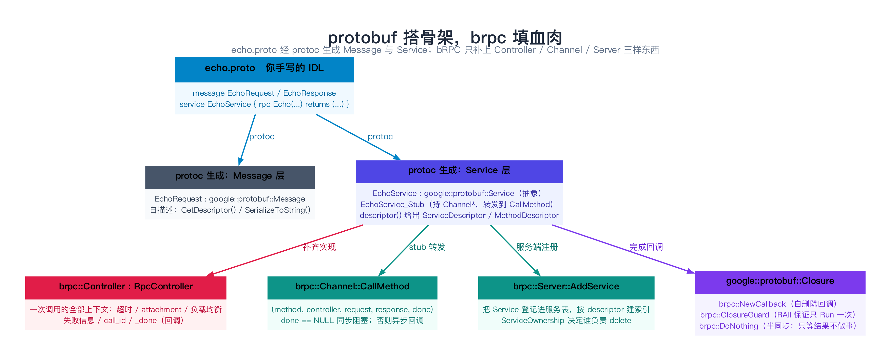
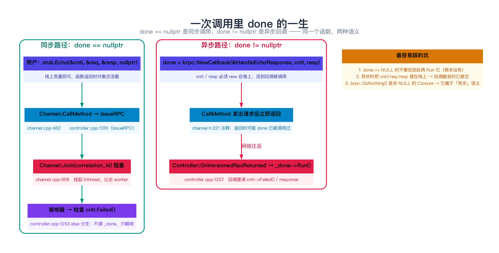
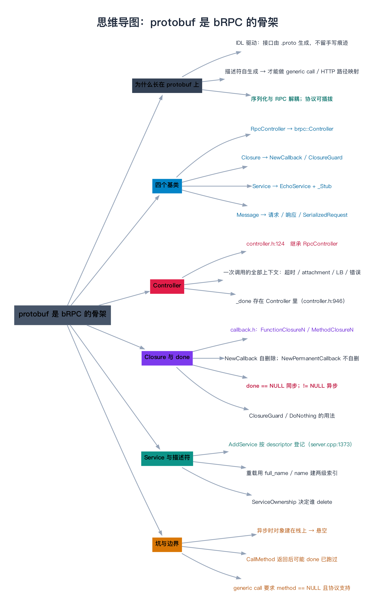

# protobuf 是 bRPC 的骨架

> **一句话总结**：bRPC 的接口之所以长得像 protobuf stub，是因为它**根本没有自己发明 RPC 的接口**——`RpcController`、`Closure`、`Service`、`Message` 这四个基类全部来自 protobuf，bRPC 只做了两件事：**实现它们**（`brpc::Controller : RpcController`）和**驱动它们**（`Channel::CallMethod`）。认不清这条「骨架」，你就读不懂 `controller.h` 里那几十个 `override`，也理解不了为什么 `done == nullptr` 是同步、`done != nullptr` 是异步。

---

## 阅读路径

- **快速版（约 5 分钟）**：读「一句话总结」+ 第 2 节「四个基类」+ 第 4 节「done 是分水岭」。
- **深入版（约 30 分钟）**：全文通读，重点吃透第 5 节（源码剖析，全部带 `文件:行号`）与第 8 节（边界与坑）。读完请动手把 `example/echo_c++/client.cpp` 的 `nullptr` 改成 `brpc::NewCallback(...)`，亲眼看到「同一个函数，两种语义」。

---

## 目录

1. [为什么 bRPC 要「长在」protobuf 上](#1-为什么-brpc-要长在-protobuf-上)
2. [四个基类：整个 bRPC 接口的骨架](#2-四个基类整个-brpc-接口的骨架)
3. [protoc 从 echo.proto 到底生成了什么](#3-protoc-从-echoproto-到底生成了什么)
4. [bRPC 补充了什么：done 是同步与异步的分水岭](#4-brpc-补充了什么done-是同步与异步的分水岭)
5. [源码剖析：Controller 继承体系与 done 的真实调用点](#5-源码剖析controller-继承体系与-done-的真实调用点)
6. [最小可跑示例：从 proto 到一次 echo](#6-最小可跑示例从-proto-到一次-echo)
7. [验证：用 gdb 亲眼看到两条路径的分叉](#7-验证用-gdb-亲眼看到两条路径的分叉)
8. [边界、反例与失败路径](#8-边界反例与失败路径)
9. [对比与选型：protobuf-RPC 不是唯一的路](#9-对比与选型protobuf-rpc-不是唯一的路)
10. [常见问题 FAQ](#10-常见问题-faq)
11. [延伸阅读](#11-延伸阅读)
12. [思维导图总结](#12-思维导图总结)

---

## 1. 为什么 bRPC 要长在 protobuf 上

### 1.1 痛点：如果不用 protobuf，RPC 框架要自己造多少东西

假设你从零写一个 C++ RPC 框架，且**不依赖 protobuf**。那么下面这些东西你都得自己发明：

| 要做的事 | 不依赖 protobuf 的话你得写 |
|---------|--------------------------|
| **IDL 与代码生成** | 自己设计 `.idl` 语法，自己写词法/语法分析器，自己写代码生成器 |
| **消息序列化** | 自己设计二进制格式（变长整数？字段 tag？向后兼容怎么做？） |
| **方法寻址** | 客户端怎么把「调用 `EchoService.Echo`」告诉服务端？服务端怎么从字符串映射到函数指针？ |
| **反射/自描述** | 想把请求打成 JSON 打印日志怎么办？想做 generic call（不编译 stub 也能调）怎么办？ |
| **接口约定** | 用户的 Service 类该继承谁？客户端 stub 该长什么样？ |

这五件事，**protobuf 一件不落地全做了**，而且是工业级、被验证了十几年的实现。bRPC 的选择是：**不重复造，直接站在 protobuf 的接口上**。

> **类比：RPC 框架 vs 序列化库，就像「快递公司」vs「标准集装箱」**。快递公司（bRPC）不该去发明集装箱（消息格式）的形状——因为全世界（protobuf）已经统一了集装箱尺寸。快递公司该做的事是：**怎么调度车辆、怎么选路线、怎么在中转站分拣**。所以 bRPC 的代码里，你几乎看不到「字节怎么排布」的逻辑，看到的全是「这条连接该发给谁、这次调用该超时多久」。

### 1.2 最硬的理由：描述符（Descriptor）是自动生成的

如果只挑一条理由，就是这一条：**protoc 会把 `.proto` 里的每个 service / method / message 编译成一个「描述符对象」，而 bRPC 的一切路由、监控、HTTP 映射都建立在这些描述符之上。**

看一个真实例子。服务端 `AddService` 时，bRPC 不做任何手工注册，而是直接问 protobuf 要描述符（`src/brpc/server.cpp:1380`）：

```cpp
const google::protobuf::ServiceDescriptor* sd = service->GetDescriptor();
```

然后按 `sd->method_count()` 逐个方法登记（`src/brpc/server.cpp:1414-1415`）：

```cpp
for (int i = 0; i < sd->method_count(); ++i) {
    const google::protobuf::MethodDescriptor* md = sd->method(i);
```

每个方法最终被存成 `MethodProperty`，它的核心就是两个裸指针（`src/brpc/server.h:438-439`）：

```cpp
google::protobuf::Service* service;
const google::protobuf::MethodDescriptor* method;
```

**服务端路由的全部秘密就是这两行**：一个 `MethodDescriptor` 就能同时给出 `full_name()`（`EchoService.Echo`）、`name()`（`Echo`）、`service()`（反查所属 service），于是「字符串 → 函数」的映射完全由描述符自动完成。

反过来说：**如果没有描述符，bRPC 就得要求用户在注册时手写「方法名字符串 → 函数指针」的映射表**——这正是很多玩具 RPC 框架干的事，也是它们做不了 generic call、做不了 HTTP 路径自动映射的原因。

### 1.3 第三条理由：generic call 与协议无关性

有了 `MethodDescriptor` 还不够。bRPC 更进一步：它允许你**根本不给 method**，把 `Channel::CallMethod` 的第一个参数传 `nullptr`（真实例子见 `example/baidu_proxy_and_generic_call/proxy.cpp:87`）：

```cpp
channel.CallMethod(nullptr, &call_cntl, request, response, nullptr);
```

这时请求体是一个 `brpc::SerializedRequest`（`src/brpc/serialized_request.h:28`），里面装的是「已经序列化好的字节 + 目标 service/method 名字」。服务端不需要任何编译期的 stub 就能转发。**这就是「网关 / 代理」场景的实现基础**。

代价是：协议实现必须显式处理 `method == NULL` 的分支。baidu_std 协议就是这么做的（`src/brpc/policy/baidu_rpc_protocol.cpp:1112-1131`）：

```cpp
if (method) {
    request_meta->set_service_name(... method->service()->full_name() ...);
    request_meta->set_method_name(method->name());
    ...
} else if (nullptr != cntl->sampled_request()) {
    // Replaying. Keep service-name as the one seen by server.
    request_meta->set_service_name(cntl->sampled_request()->meta.service_name());
    ...
} else {
    return cntl->SetFailed(ENOMETHOD, "%s.method is NULL", __func__ );
}
```

**注意最后那个 `else`**：不是所有协议都支持 generic call。传了 `nullptr` 又没有任何「已采样请求」做兜底时，bRPC 会直接 `SetFailed(ENOMETHOD)`。这是一个真实的失败路径，后面第 8 节会再展开。



---

## 2. 四个基类：整个 bRPC 接口的骨架

protobuf 的 C++ 运行时（`google/protobuf/service.h`、`message.h`）里，有四个抽象基类定义了「RPC 该长什么样」。bRPC 的整个用户接口，就是这四个基类的实现与驱动。

### 2.1 `google::protobuf::RpcController` —— 一次调用的上下文

它定义了 7 个纯虚函数，是「一次调用」的最小公共契约：

- `Reset()`
- `Failed()`
- `ErrorText()`
- `SetFailed(const std::string&)`
- `StartCancel()`
- `IsCanceled()`
- `NotifyOnCancel(Closure*)`

bRPC 的实现是 `brpc::Controller`，它把这 7 个全部 `override`（后面第 5 节给行号），并疯狂加料：超时、attachment、HTTP 头、负载均衡、重试次数、`call_id`、`_done`……

### 2.2 `google::protobuf::Closure` —— 「调用完成回调」

只有一个方法：

```cpp
virtual void Run() = 0;
```

没有参数、没有返回值——**就是「事情办完了，你去干你该干的」**。bRPC 把它当作 RPC 完成的回调载体，内部用 `_done` 指针保存（`src/brpc/controller.h:946`）：

```cpp
google::protobuf::Closure* _done;
```

### 2.3 `google::protobuf::Service` —— 服务端的服务抽象

它规定了一个 service 必须能回答：

- `GetDescriptor()`：我是谁（返回 `ServiceDescriptor*`）
- `CallMethod(method, controller, request, response, done)`：按描述符分发到具体方法
- `GetRequestPrototype(method)` / `GetResponsePrototype(method)`：给定方法，返回该方法的请求/响应**原型对象**（可以 `New()` 出一个新实例）

最后一条极其重要：**有了原型，框架才能在「不知道具体消息类型」的情况下 new 出正确类型的 request/response**。bRPC 的 `rpc_pb_message_factory.cpp:36-37` 就是这么干的：

```cpp
messages->request = service.GetRequestPrototype(&method).New();
messages->response = service.GetResponsePrototype(&method).New();
```

### 2.4 `google::protobuf::Message` —— 消息

请求和响应都继承它。它提供 `SerializeToString()`、`ParseFromString()`、`GetDescriptor()`。

bRPC 还额外造了一个 `brpc::SerializedRequest`（`src/brpc/serialized_request.h:28`），继承链是：

```text
SerializedRequest : NonreflectableMessage<SerializedRequest>
NonreflectableMessageBase : google::protobuf::Message   // src/brpc/nonreflectable_message.h:28,46
```

「Nonreflectable」意思是它没有反射信息——因为它装的是**原始字节**，本来就不需要反射。

### 2.5 还有一条隐形的骨架：`RpcChannel`

这是第 5 个基类，但容易漏掉。protoc 生成的 `EchoService_Stub` 构造函数接收一个 `google::protobuf::RpcChannel*`，然后在每个方法里调用：

```cpp
channel_->CallMethod(descriptor()->method(0), controller, request, response, done);
```

而 bRPC 的 `brpc::Channel` **本身就是 `RpcChannel` 的实现**（`src/brpc/channel_base.h:35`）：

```cpp
class ChannelBase : public google::protobuf::RpcChannel, public Describable {
```

`Channel` 又继承自 `ChannelBase`（`src/brpc/channel.h:179`）：

```cpp
class Channel : public ChannelBase {
```

**这就是「缝合点」**：protoc 生成的 stub 只认识抽象的 `RpcChannel`，bRPC 把 `Channel` 塞进去，从此「stub 调用」= 「bRPC 调用」。整个第 42–45 篇（客户端路径）讲的就是 `Channel::CallMethod` 之后发生了什么。

---

## 3. protoc 从 echo.proto 到底生成了什么

看真实 IDL。`example/echo_c++/echo.proto`：

```proto
syntax="proto2";
package example;

option cc_generic_services = true;   // ← 关键：打开 C++ service 代码生成

message EchoRequest {
      required string message = 1;
};

message EchoResponse {
      required string message = 1;
};

service EchoService {
      rpc Echo(EchoRequest) returns (EchoResponse);
};
```

`option cc_generic_services = true;` 是关键开关。bRPC 的所有手写 proto 都会打开它（仓库里 20+ 个 example 全部如此）。

### 3.1 protoc 生成的五个东西

对上面这份 proto 执行 `protoc --cpp_out=. echo.proto`，你会得到 `echo.pb.h` / `echo.pb.cc`，里面被生成的有：

| 生成物 | 作用 | 谁在用 |
|-------|------|-------|
| `class EchoRequest : public ::google::protobuf::Message` | 请求消息，带 `message()` / `set_message()` 访问器 | 用户 |
| `class EchoResponse : public ::google::protobuf::Message` | 响应消息 | 用户 |
| `class EchoService : public ::google::protobuf::Service`（抽象） | 含 `virtual void Echo(RpcController*, const EchoRequest*, EchoResponse*, Closure*)`、`static descriptor()`、`CallMethod()` 分发实现 | 服务端继承它 |
| `class EchoService_Stub : public EchoService` | 每个方法体是 `channel_->CallMethod(descriptor()->method(0), ...)` | 客户端持有它 |
| 静态描述符表 | `EchoService::descriptor()` 返回的 `ServiceDescriptor`，含 `MethodDescriptor` | **bRPC 的一切路由** |

注意 `EchoService::CallMethod(...)` 的默认实现长这样（伪代码，由 protoc 生成）：

```cpp
void EchoService::CallMethod(const MethodDescriptor* method, ...) {
  GOOGLE_DCHECK_EQ(method->service(), descriptor());
  switch (method->index()) {
    case 0:
      Echo(controller, DOWNCAST(request), DOWNCAST(response), done);  // 转发到虚函数
      return;
    default:
      GOOGLE_LOG(FATAL) << "Bad method index";
  }
}
```

**所以服务端的分发链是**：bRPC 拿到 `MethodDescriptor` → 调 `svc->CallMethod(md, ...)` → protoc 生成的 switch 按 `md->index()` 转到虚函数 `Echo(...)` → 用户重写的 `EchoImpl::Echo(...)` 被执行。

bRPC 真正调用的地方在 `src/brpc/policy/baidu_rpc_protocol.cpp:875-880`：

```cpp
return svc->CallMethod(method, cntl.release(), ...);
```

### 3.2 bRPC 又补充了什么

protoc **没有**生成的东西，全是 bRPC 补的：

| protoc 没给 | bRPC 补的 | 在哪 |
|------------|----------|------|
| `RpcController` 的具体实现 | `brpc::Controller` | `src/brpc/controller.h:124` |
| `RpcChannel` 的具体实现 | `brpc::Channel` / `ChannelBase` | `src/brpc/channel_base.h:35`、`channel.h:179` |
| 服务如何注册 | `Server::AddService` + `ServiceOwnership` | `src/brpc/server.h:507-517`、`332-335` |
| 回调怎么造 | `brpc::NewCallback` / `ClosureGuard` | `src/brpc/callback.h:725+`、`closure_guard.h:29` |
| 「只等结果、不做回调」 | `brpc::DoNothing()` | `src/brpc/controller.h:1037` |

**一句话**：protoc 给了**消息 + 接口 + 描述符**（骨架），bRPC 给了**传输 + 调度 + 上下文**（血肉）。

---

## 4. bRPC 补充了什么：done 是同步与异步的分水岭

这是本篇最重要的一节，也是「最经典的坑」。

### 4.1 一个函数，两种语义

`Channel::CallMethod` 的签名（`src/brpc/channel.h:225-229`）：

```cpp
void CallMethod(const google::protobuf::MethodDescriptor* method,
                google::protobuf::RpcController* controller,
                const google::protobuf::Message* request,
                google::protobuf::Message* response,
                google::protobuf::Closure* done);
```

它头部的官方注释已经把语义写死了（`src/brpc/channel.h:220-224`）：

> If `done` is not nullptr, this method returns after request was sent and `done->Run()` will be called when the call finishes, **otherwise caller blocks until the call finishes**.

翻译成两句话：

- **`done == nullptr` → 同步**：`CallMethod` 会一直阻塞，直到响应回来/失败/超时。
- **`done != nullptr` → 异步**：`CallMethod` 把请求丢出去就返回，调用完成时 bRPC 帮你调 `done->Run()`。

### 4.2 done 真的是唯一的判断依据吗

是。看真实代码 `src/brpc/channel.cpp:657-665`：

```cpp
    cntl->IssueRPC(start_send_real_us);
    if (done == nullptr) {
        // MUST wait for response when sending synchronous RPC. It will
        // be woken up by callback when RPC finishes (succeeds or still
        // fails after retry)
        Join(correlation_id);
        cntl->SubmitSpan();
        cntl->OnRPCEnd(butil::gettimeofday_us());
    }
}
```

**`if (done == nullptr)` 后面就是 `Join(correlation_id)`**——这就是「同步」的全部实现。注意 `done` 这个参数在此处之后**再也没有被用到**：它被提前存进了 `Controller::_done`（`controller.h:946`），由 `Controller` 在完成时统一调用。

那么 `Controller` 侧怎么区分？在 `OnVersionedRpcReturned` 的尾部（`src/brpc/controller.cpp:1221-1257`，节选）：

```cpp
    const CallId saved_cid = _correlation_id;
    if (_done) {                                   // 1222：异步分支
        if (!FLAGS_usercode_in_pthread || _done == DoNothing()) {
            OnRPCEnd(butil::gettimeofday_us());
            const bool destroy_cid_in_done = has_flag(FLAGS_DESTROY_CID_IN_DONE);
            _done->Run();                          // 1237：回调在这里被调用
            ...
            CHECK_EQ(0, bthread_id_unlock_and_destroy(saved_cid));
        } else {
            RunUserCode(RunDoneInBackupThread, this);   // 1248：pthread 模式下换个线程跑
        }
    } else {                                       // 1250：同步分支
        // OnRPCEnd for sync RPC is called in Channel::CallMethod to count in
        // latency of the context-switch.
        bthread_about_to_quit();
        CHECK_EQ(0, bthread_id_unlock_and_destroy(saved_cid));   // 1256：只解锁，不调 done
    }
```

**两条路径的分水岭就在这里：`if (_done)` 成立就 `_done->Run()`；不成立就只解锁 `bthread_id`，把阻塞在 `Join()` 里的协程唤醒。**

### 4.3 为什么 `DoNothing()` 被归到「异步」一侧

`brpc::DoNothing()` 返回一个**非 nullptr** 的闭包（`src/brpc/controller.cpp:1985-1990`）：

```cpp
class DoNothingClosure : public google::protobuf::Closure { ... };
google::protobuf::Closure* DoNothing() {
    return butil::get_leaky_singleton<DoNothingClosure>();
}
```

它什么都不做。但因为它**不是 NULL**，所以走的是**异步语义**——这正是「半同步」需求的实现方式（`src/brpc/controller.h:1032-1036`）：

```cpp
//   stub1.method1(&cntl1, &request1, &response1, brpc::DoNothing());
//   stub2.method2(&cntl2, &request2, &response2, brpc::DoNothing());
//   ...
//   brpc::Join(cntl1.call_id());
//   brpc::Join(cntl2.call_id());
```

发起 N 个调用（都不阻塞），最后统一 `Join` 等结果——**这就是「并发发 N 个请求」的最省事写法**。

> 注意 `controller.cpp:1223` 那个特判：`_done == DoNothing()` 时，即使开了 `-usercode_in_pthread` 也不切备份线程，因为「DoNothing 没什么可做的，切线程反而会引发 Join 死锁」。注释里写了一个完整的死锁场景，值得读原文。

### 4.4 时序图



---

## 5. 源码剖析：Controller 继承体系与 done 的真实调用点

### 5.1 `Controller` 继承 `RpcController`

`src/brpc/controller.h:124`：

```cpp
class Controller : public google::protobuf::RpcController/*non-copyable*/ {
```

它对 7 个纯虚函数的实现（全部带行号）：

| `RpcController` 接口 | `brpc::Controller` 实现位置 |
|---------------------|---------------------------|
| `void Reset()` | `controller.h:579` |
| `bool Failed() const` | `controller.h:597` |
| `std::string ErrorText() const` | `controller.h:601` |
| `void SetFailed(const std::string&)` | `controller.h:590` |
| `void StartCancel()` | `controller.h:756` |
| `bool IsCanceled() const` | `controller.h:456` |
| `void NotifyOnCancel(Closure*)` | `controller.h:465` |

> 注意 `SetFailed(const std::string&)` 后面还有一堆 bRPC 扩展的重载（`controller.h:591`），比如 `SetFailed(int error_code, const char* reason_fmt, ...)`——**这些不是 protobuf 接口，是 bRPC 加的**。区分「哪些是 protobuf 要求的、哪些是 bRPC 加的」，是读懂 `controller.h` 的关键。

### 5.2 `_done` 与 `_method` 就存在 `Controller` 里

`src/brpc/controller.h:945-946`：

```cpp
    google::protobuf::Message* _response;
    google::protobuf::Closure* _done;
```

`src/brpc/controller.h:963`：

```cpp
    const google::protobuf::MethodDescriptor* _method;
```

于是 `Channel::CallMethod` 开头做的事就是「把参数灌进 Controller」，比如 `_request_protocol`、`_retry_policy`、`max_retry` 等等（`src/brpc/channel.cpp:483-517`）。

### 5.3 `Controller` 是怎么拿到 `_done` 的

`Channel::CallMethod` 拿到 `controller_base` 后第一件事就是向下转型（`src/brpc/channel.cpp:488`）：

```cpp
Controller* cntl = static_cast<Controller*>(controller_base);
```

——**这就是 `Controller` 必须是 `RpcController` 子类的原因**：`Channel::CallMethod` 的签名被迫接受抽象基类，但它需要一大堆 protobuf 接口里没有的东西（超时、attachment、LB），只能 `static_cast`。

### 5.4 `NewCallback` / `ClosureGuard` / `DoNothing` 三个工具

**(a) `NewCallback`（`src/brpc/callback.h:725+`）**

它的实现是「返回一个自删除的 Closure」：

```cpp
inline ::google::protobuf::Closure* NewCallback(void (*function)()) {
  return new internal::FunctionClosure0(function, true);   // true = self_deleting
}
```

其中 `FunctionClosure0::Run()`（`src/brpc/callback.h:127-133`）：

```cpp
  void Run() override {
    bool needs_delete = self_deleting_;  // read in case callback deletes
    function_();
    if (needs_delete) delete this;
  }
```

注意那句注释 `read in case callback deletes`：先把 `self_deleting_` 读进局部变量，**再**调用用户函数，因为用户函数可能把自己 `delete` 掉。这个细节值得学习。

`callback.h` 里有 `FunctionClosure0..6` 和 `MethodClosure0..6` 共十余个模板类，分别对应「自由函数 / 成员函数」×「0~6 个绑定参数」。所有 `NewCallback` 都传 `self_deleting = true`，`NewPermanentCallback` 传 `false`（`src/brpc/callback.h:730`）。

> **为什么 bRPC 要重抄一份这个文件？** 文件头注释（`src/brpc/callback.h:36-42`）解释得很清楚：**protobuf 3.0 把 `NewCallback` 挪进了 `internal` 命名空间**，导致所有用户代码编译失败。bRPC 的应对是：把这份代码从 protobuf 2.4 抄出来放进 `brpc` 命名空间，用户只需把 `google::protobuf::NewCallback` 换成 `brpc::NewCallback`。

**(b) `ClosureGuard`（`src/brpc/closure_guard.h:29`）**

一个 RAII 包装器，析构时自动 `Run()`：

```cpp
    // Run internal closure if it's not nullptr.
    ~ClosureGuard() {
        if (_done) {
            _done->Run();
        }
    }
```

服务端最常用的写法（`example/echo_c++/server.cpp`）：

```cpp
brpc::ClosureGuard done_guard(done);
// ... 同步处理请求，函数返回时 done_guard 析构 → done->Run()
```

如果要**异步**处理（比如等一个外部系统回调），就用 `done_guard.release()` 把所有权交出去，稍后自己调 `done->Run()`。

**(c) `DoNothing`（`src/brpc/controller.cpp:1985-1990`）**

一个「什么都不做的单例闭包」，用于半同步（见 4.3）。注意它用的是 `butil::get_leaky_singleton`——**故意泄漏**，避免静态析构顺序问题。

### 5.5 一个容易搞混的点：没有 `brpc::NewClosure`

如果你在别的项目里见过 `NewClosure`，请注意：**在本篇对应 commit（`6ab8c0e`）的 bRPC 里，`NewClosure` 并不存在**。全仓库搜 `NewClosure` 没有任何结果。

bRPC 提供的是 `NewCallback` / `NewPermanentCallback`（`src/brpc/callback.h`）以及 `ClosureGuard`（`src/brpc/closure_guard.h`）。如果你要写一篇笔记引用 `NewClosure`，那是错的，请以源码为准。

---

## 6. 最小可跑示例：从 proto 到一次 echo

### 6.1 环境

```bash
# 依赖：protobuf、gflags、glog（或用 bRPC 自带 logging）、openssl、leveldb
git clone https://github.com/apache/brpc.git
cd brpc
./config_brpc.sh --headers=/usr/include --libs=/usr/lib   # 或直接用 CMake
make -j
```

本文只跟 `example/echo_c++/`，三个文件：`echo.proto`、`server.cpp`、`client.cpp`。

### 6.2 编译 proto

```bash
protoc --cpp_out=. echo.proto     # 生成 echo.pb.h / echo.pb.cc
```

### 6.3 服务端：`echo_service_impl` 继承了 protoc 生成的 `EchoService`

关键三处（`example/echo_c++/server.cpp`）：

```cpp
namespace example {
class EchoServiceImpl : public EchoService {          // ① 继承 protoc 生成的抽象类
public:
    virtual void Echo(google::protobuf::RpcController* cntl_base,
                      const EchoRequest* request,
                      EchoResponse* response,
                      google::protobuf::Closure* done) {  // ② 签名照抄生成的头文件
        brpc::ClosureGuard done_guard(done);              // ③ RAII 保证 done->Run()
        brpc::Controller* cntl = static_cast<brpc::Controller*>(cntl_base);
        response->set_message(request->message());
    }
};
}

int main(...) {
    brpc::Server server;
    example::EchoServiceImpl echo_service_impl;
    // 注意第二个参数：service 在栈上，所以不让 server 负责 delete
    server.AddService(&echo_service_impl, brpc::SERVER_DOESNT_OWN_SERVICE);
    ...
}
```

`brpc::SERVER_DOESNT_OWN_SERVICE` 就是 `ServiceOwnership` 枚举的值。看定义（`src/brpc/server.h:332-335`）：

```cpp
enum ServiceOwnership {
    SERVER_OWNS_SERVICE,
    SERVER_DOESNT_OWN_SERVICE
};
```

以及它的语义注释（`src/brpc/server.h:340-344`）：

```cpp
    // SERVER_OWNS_SERVICE: the service will be deleted by the server.
    // SERVER_DOESNT_OWN_SERVICE: the service shall be deleted by user after
    // stopping the server.
    // Default: SERVER_DOESNT_OWN_SERVICE
```

**这是一个真实的「所有权 bug 温床」**：如果你的 service 是 `new` 出来的却传了 `SERVER_DOESNT_OWN_SERVICE`，就会内存泄漏；如果是栈上的却传了 `SERVER_OWNS_SERVICE`，`Server` 析构时会 `delete` 一个栈地址 → crash。

### 6.4 客户端同步版：最后传 `nullptr`

```cpp
example::EchoService_Stub stub(&channel);   // ① stub 持有 brpc::Channel
brpc::Controller cntl;
example::EchoRequest request;
example::EchoResponse response;
request.set_message("hello world");

// Because `done'(last parameter) is nullptr, this function waits until
// the response comes back or error occurs(including timedout).
stub.Echo(&cntl, &request, &response, nullptr);   // ② 同步，阻塞

if (!cntl.Failed()) {
    LOG(INFO) << response.message() << " latency=" << cntl.latency_us() << "us";
}
```

栈上的 `request` / `response` / `cntl` 都合法——因为调用返回时一切都结束了。

### 6.5 客户端异步版：传 `NewCallback`

真实例子 `example/asynchronous_echo_c++/client.cpp`：

```cpp
void HandleEchoResponse(brpc::Controller* cntl, example::EchoResponse* response) {
    std::unique_ptr<brpc::Controller> cntl_guard(cntl);       // 回调里负责释放
    std::unique_ptr<example::EchoResponse> response_guard(response);
    if (cntl->Failed()) { ... return; }
    LOG(INFO) << response->message() << " latency=" << cntl->latency_us() << "us";
}

// 因为 done 不为 nullptr，这些对象必须活到回调被调用 → 一律 new 在堆上
example::EchoResponse* response = new example::EchoResponse();
brpc::Controller* cntl = new brpc::Controller();

// 这个 closure 只会被调用一次，之后自动 delete 自己
google::protobuf::Closure* done = brpc::NewCallback(
    &HandleEchoResponse, cntl, response);
stub.Echo(cntl, &request, response, done);   // 立刻返回
```

**把 6.4 和 6.5 并排看**：同一个 `stub.Echo`，只因为最后一个参数从 `nullptr` 变成 `done`，控制流、对象生命周期、错误处理位置**全部改变**。这就是为什么说「done 是分水岭」。

---

## 7. 验证：用 gdb 亲眼看到两条路径的分叉

不放心「`done == nullptr` 才阻塞」这句话？自己断点验证（编译请带 `-g`，见本系列第 02 篇）：

```bash
gdb ./echo_client
(gdb) break brpc::Channel::CallMethod
(gdb) run
(gdb) p done
$1 = (google::protobuf::Closure *) 0x0        # 同步：done 是空指针
(gdb) finish                                  # 让它返回
# 观察：从 CallMethod 返回耗时 ≈ 一次 RPC 的耗时
(gdb) p cntl.latency_us()
```

再把 `client.cpp` 的最后参数换成 `brpc::NewCallback(...)`，重复上面步骤：

```bash
(gdb) p done
$1 = (google::protobuf::Closure *) 0x60d0000000xx   # 异步：done 非空
(gdb) finish
# 观察：CallMethod 几乎立刻返回，耗时 ≈ 一次 write() 的量级
```

还可以在完成回调处下断点：

```bash
(gdb) break brpc/controller.cpp:1237        # _done->Run();
```

你会看到 gdb 停在 `controller.cpp:1237`，`bt` 一下就是完整的「epoll 就绪 → 收包 → 分发 → 唤醒 → 跑回调」调用栈。

**这个「亲眼看到」的体验，比读十遍文字管用。**

---

## 8. 边界、反例与失败路径

### 8.1 异步时把对象建在栈上 —— 最经典的 use-after-free

```cpp
brpc::Controller cntl;                 // 栈上！
example::EchoResponse response;        // 栈上！
stub.Echo(&cntl, &request, &response, brpc::NewCallback(&OnDone));
// 函数返回 → cntl / response 析构 → 回调触发时访问悬空内存 → 未定义行为
```

**规则**：`done != nullptr` 时，`controller` / `response` 的生命周期必须覆盖到回调被调用为止，**用 `new` 放堆上**，并在回调里 `delete`（或用 `unique_ptr` 兜住，见 6.5）。

### 8.2 `CallMethod` 返回后不能碰 `controller`

这是 `Channel` 头文件里的官方警告（`src/brpc/channel.h:246-249`，紧挨着 `CallMethodImpl` 的声明）：

```cpp
    // NOTE: DO NOT directly use `controller' after this call when
    // sending asynchronous RPC (controller->_done != nullptr) since
    // user callback `done' could be called when it returns and
    // therefore destroy the `controller' inside `done'
```

**哪怕 `CallMethod` 只是在「发送失败」时同步回调了 `done`，你的 `controller` 也可能已经没了。** 异步调用后的一切操作都要搬到回调里做。

### 8.3 `done == NULL` 时没有回调可跑，别去 `Run()` 一个空指针

服务端常见的错误写法：

```cpp
virtual void Echo(..., google::protobuf::Closure* done) {
    // 忘了写 ClosureGuard，然后手写：
    if (done) done->Run();
    ...
}
```

`if (done)` 是对的，但**顺序错了会出事**：如果在 `done->Run()` 之后还继续访问 `cntl`，就可能在 `done->Run()` 里已经释放了 `cntl`。正确姿势永远是 `brpc::ClosureGuard done_guard(done);` 放在函数**第一行**，让它负责最后一次 `Run()`。

### 8.4 服务端漏调 `done->Run()` → 客户端一直挂着

如果服务端实现了异步处理，写了 `done_guard.release()` 却**忘了在异步分支里调 `done->Run()`**，那么客户端的同步调用会**一直阻塞到超时**（或者干脆卡死，如果没设超时）。这是生产事故级别的问题。

排查手段：用 bRPC 内置的 `/rpcz` 页面看「未结束的 RPC」，能直接看到卡在哪个方法上。

### 8.5 generic call 不是所有协议的通行证

前面 1.3 提过：`CallMethod(nullptr, ...)` 时，如果协议实现没有兜底分支，会 `SetFailed(ENOMETHOD)`（`src/brpc/policy/baidu_rpc_protocol.cpp:1131`）。另外 `generic call` 走的是 `SerializedRequest` 而不是你自己的 Message，**协议适配层必须显式支持**。用之前先确认 `options.protocol` 对应的协议实现里有 `method == NULL` 的分支。

### 8.6 `Controller` 不是可拷贝的

`controller.h:124` 那句注释 `/*non-copyable*/` 是真的：`Controller` 的拷贝构造/赋值被禁掉了（`DISALLOW_COPY_AND_ASSIGN` 一类的机制）。不要试图 `brpc::Controller c = other;`。

---

## 9. 对比与选型：protobuf-RPC 不是唯一的路

| 维度 | protobuf + 手写 RPC（bRPC 走的路） | Thrift | gRPC | 纯自研 IDL |
|------|-----------------------------------|--------|------|-----------|
| IDL | `.proto` | `.thrift` | `.proto` | 自己发明 |
| 代码生成物 | Message + Service + Stub + Descriptor | 全套（含二进制协议） | Message + Stub | 取决于你 |
| 序列化格式 | protobuf（紧凑、向后兼容） | Thrift Binary/Compact | protobuf | 自己定 |
| 反射/描述符 | **有**（`Descriptor`） | 有限 | 有 | 通常没有 |
| generic call | **支持**（`method == nullptr`） | 支持 | 支持（`GenericStub`） | 很难 |
| bRPC 的位置 | 「protobuf 提供骨架，bRPC 提供传输与调度」 | 独立体系 | 独立体系（含 HTTP/2） | — |

**结论**：

- **要生态、要跨语言、要 HTTP/2 多路复用** → gRPC。
- **要极致性能、要 M:N 协程、要在同一进程里同时讲多种协议（baidu_std / HTTP / Redis / 自定义）** → bRPC。而 bRPC 之所以能做「多协议」，恰恰因为它把「序列化（protobuf）」和「传输（Protocol 插件）」彻底解耦了。
- **已经在用 protobuf，只想加一层 RPC** → bRPC 是最小改动量的方案，因为你的 `.proto` 一个字节都不用改，只要加 `option cc_generic_services = true;`。

> 这也是 bRPC 相比「自研 IDL 的框架」的巨大优势：**你的 proto 文件同时服务于 RPC、日志打印（json2pb）、存储、gRPC**。选 bRPC 不会把你的数据格式锁死在 bRPC 里。

---

## 10. 常见问题 FAQ

**Q1：为什么我的 Service 类必须继承 protoc 生成的 `EchoService`，而不是 bRPC 的某个基类？**
因为 bRPC 就**没有**自己的 Service 基类。`Server::AddService` 接收的是 `google::protobuf::Service*`（`src/brpc/server.h:507-517`），它只依赖 protobuf 的抽象。这保证了「不写 RPC 也能用 protobuf」，反之亦然。

**Q2：`brpc::Controller` 和 `google::protobuf::RpcController` 我该用哪个？**
写业务代码时**明确用 `brpc::Controller`**（栈上或堆上自己定义）。只有在实现 Service 的虚函数时，签名里被迫接收 `RpcController*`，第一件事就是 `static_cast<brpc::Controller*>(cntl_base)`（`src/brpc/channel.cpp:488` 同款写法）。

**Q3：`done == nullptr` 的同步调用，内部到底是阻塞线程还是阻塞协程？**
**阻塞 bthread 协程**，底层是 `Join(correlation_id)` → 挂起当前 bthread，让出 worker 线程去跑别的任务。所以「同步写法」并不会浪费一个系统线程——这正是 bthread 的价值（本系列第 14–24 篇）。**千万不要**在这个 bthread 里用 `usleep` 等 pthread 级阻塞原语。

**Q4：`NewCallback` 造出来的闭包，我需要手动 `delete` 吗？**
不需要。`NewCallback` 造的闭包 `self_deleting = true`，`Run()` 完自己 `delete this`（`src/brpc/callback.h:730`、`127-133`）。如果你**真的**需要多次调用或自己管生命周期，用 `NewPermanentCallback`（`self_deleting = false`），此时**你必须自己 delete**。

**Q5：服务端一定要用 `ClosureGuard` 吗？**
强烈建议。手写 `done->Run()` 在「函数中途 `return` 提前退出」时极易漏掉，导致客户端超时。`ClosureGuard` 是 RAII 的，无论从哪条路径退出都会跑一次。例外是异步处理：用 `done_guard.release()` 显式交出所有权（`example/echo_c++/server.cpp` 的注释就是这么说的）。

**Q6：我在服务端 `SetFailed()` 之后，还能继续跑吗？**
能，但没意义。应当尽快 `return`。`SetFailed` 只设置错误状态，不会中断控制流。注意 `ctrl->SetFailed()` 必须在 `done->Run()` **之前**调用——`done` 一跑，响应就发出去了。

**Q7：`_done` 存在 Controller 里而不是 `CallMethod` 的局部变量里，为什么？**
因为异步调用返回后 `CallMethod` 的栈帧就没了，而回调要在「网络往返之后」才发生。必须有个活到那个时候的对象持有它——`Controller` 就是那个对象。这也解释了为什么**异步时 `Controller` 必须活得比 `CallMethod` 长**。

---

## 11. 延伸阅读

- **protobuf 官方文档**：C++ Generated Code 一节，讲 `cc_generic_services` 生成的类结构；`service.h` 里 `Service` / `RpcController` / `RpcChannel` / `Closure` 的定义。
- **bRPC 官方文档**：`docs/cn/server.md`、`docs/cn/client.md`（在线版见 <https://brpc.apache.org/docs/>），里面有同步/异步/半同步的完整说明。
- **源码**（本篇核对过的文件）：
  - `src/brpc/controller.h`（`Controller` 定义、`_done`、`DoNothing`）
  - `src/brpc/controller.cpp`（`OnVersionedRpcReturned` 的 done 分支）
  - `src/brpc/channel.h` / `channel.cpp`（`CallMethod` 与同步 `Join`）
  - `src/brpc/channel_base.h`（`ChannelBase : RpcChannel`）
  - `src/brpc/callback.h`（`NewCallback` 系列）
  - `src/brpc/closure_guard.h`
  - `src/brpc/server.h` / `server.cpp`（`AddService` / `ServiceOwnership`）
  - `src/brpc/serialized_request.h`、`nonreflectable_message.h`
  - `src/brpc/policy/baidu_rpc_protocol.cpp`（generic call 的 `method == NULL` 分支）
- **示例**：`example/echo_c++/`（同步）、`example/asynchronous_echo_c++/`（异步）、`example/baidu_proxy_and_generic_call/`（generic call）。
- **邻篇**：本项目第 03 篇（从 example 反推调用栈）、第 44 篇（Controller 状态机，本篇只讲「骨架」，那篇讲「状态」）、第 45 篇（重试与超时挂在 `_done` 路径上的哪一环）。

---

## 12. 思维导图总结

```text
protobuf 是 bRPC 的骨架
├── 为什么长在 protobuf 上
│   ├── 不重复造：IDL / 序列化 / 方法寻址 / 反射 / 接口约定
│   ├── 描述符自动生成 → 路由、监控、HTTP 映射的底座
│   └── generic call：method 可为 NULL，靠 SerializedRequest
├── 四个（其实五个）基类
│   ├── RpcController  → brpc::Controller
│   ├── Closure        → NewCallback / ClosureGuard / DoNothing
│   ├── Service        → EchoService + EchoService_Stub
│   ├── Message        → 请求 / 响应 / SerializedRequest
│   └── RpcChannel     → ChannelBase → Channel（缝合点）
├── protoc 生成了什么
│   ├── Message 类 + 访问器
│   ├── Service 抽象类 + CallMethod 分发（switch by method->index()）
│   ├── Service_Stub（转发到 channel_->CallMethod）
│   └── 静态描述符表（ServiceDescriptor / MethodDescriptor）
├── bRPC 补了什么
│   ├── Controller：上下文 + 错误 + call_id + _done
│   ├── Channel::CallMethod：发送与等待
│   ├── Server::AddService：按描述符登记 + ServiceOwnership
│   └── done 是分水岭
│       ├── done == NULL  → 同步，Join 阻塞
│       └── done != NULL  → 异步，完成时 _done->Run()
├── 源码坐标
│   ├── controller.h:124  继承 RpcController
│   ├── controller.h:946  Closure* _done
│   ├── controller.cpp:1222/1237/1250  if (_done) 两条路径
│   ├── channel.cpp:488   static_cast<Controller*>
│   ├── channel.cpp:658   if (done == nullptr) Join
│   └── server.h:332      ServiceOwnership
└── 坑与边界
    ├── 异步时对象建在栈上 → 悬空
    ├── CallMethod 返回后不能再碰 controller
    ├── 服务端漏调 done->Run() → 客户端挂死
    └── generic call 需协议实现支持 method == NULL
```


