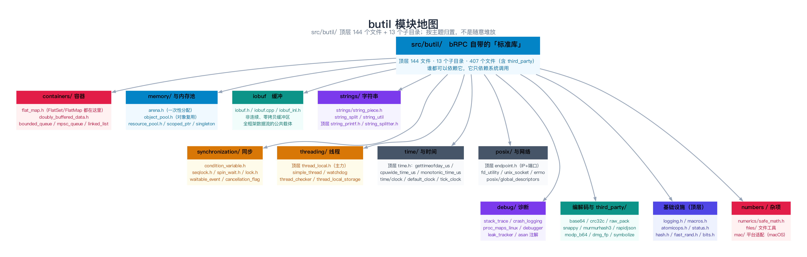
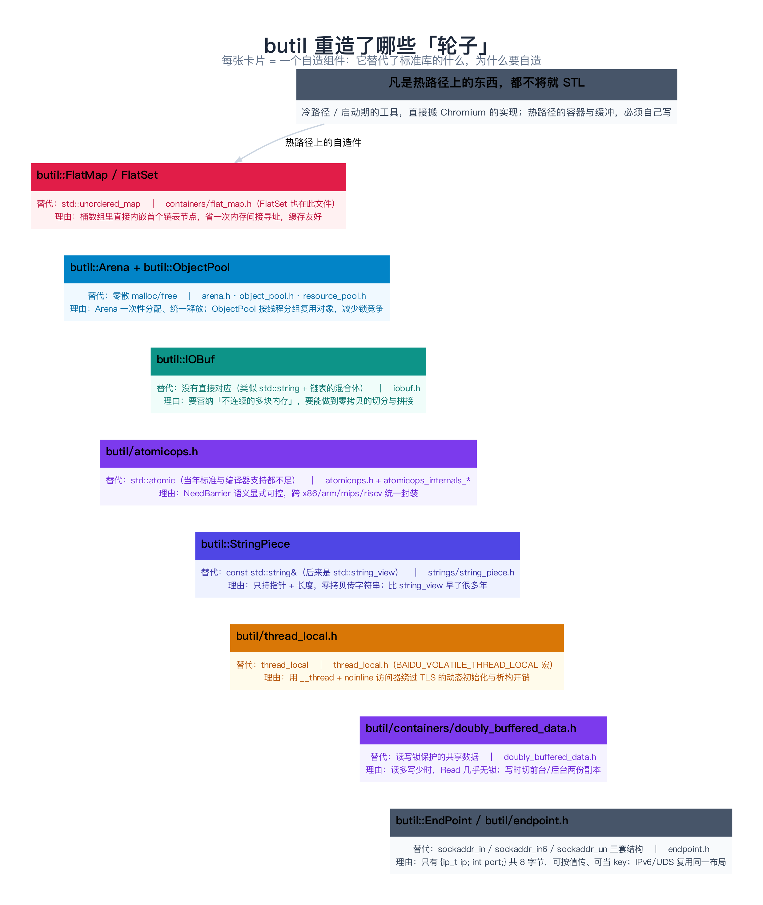
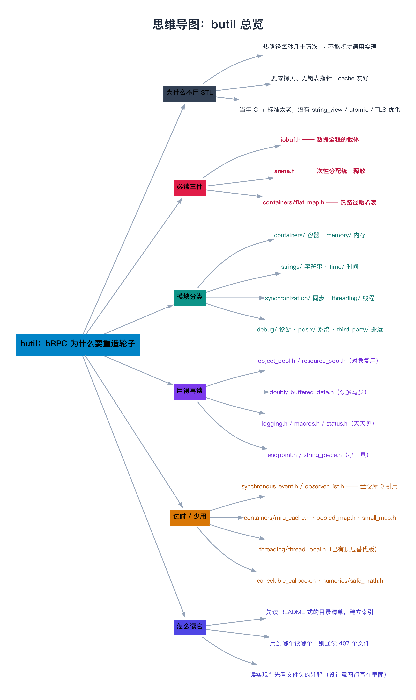

# butil 总览：bRPC 为什么要重造轮子

> **一句话总结**：`butil` 是 bRPC 自带的「标准库」——顶层 144 个文件 + 13 个子目录。它重造轮子的理由只有一条：**热路径上每秒要跑几十万次的容器和缓冲，通用 STL 实现不够快**；而冷路径上的工具（字符串、线程包装、调试），本可以直接从 Chromium 搬过来。先分清「哪些是原创（必须读）、哪些是搬运（用到再说）、哪些是dead code（别浪费时间）」，你才不会在 407 个文件里空转。

---

## 阅读路径

- **快速版（约 6 分钟）**：读「一句话总结」+ 第 2 节「家底清单」+ 第 6 节「阅读优先级」。
- **深入版（约 30 分钟）**：全文通读，重点看第 3 节（每个自造组件「替代了什么 / 为什么」）与第 8 节（边界与坑）。读完后请亲自跑一遍第 7 节的那条 `grep` 统计命令，把「谁在用谁」变成你自己的数据。

---

## 目录

1. [为什么不用 STL：一个真实的两难](#1-为什么不用-stl一个真实的两难)
2. [家底清单：butil 里到底有什么](#2-家底清单butil-里到底有什么)
3. [逐个点名：和 STL 有替代关系的组件](#3-逐个点名和-stl-有替代关系的组件)
4. [原理到实现：举一例讲透「为什么要自造」](#4-原理到实现举一例讲透为什么要自造)
5. [按主题分类走读](#5-按主题分类走读)
6. [阅读优先级：必读 / 用到再读 / 别浪费时间](#6-阅读优先级必读--用到再读--别浪费时间)
7. [数据验证：谁在引用谁](#7-数据验证谁在引用谁)
8. [边界、反例与失败路径](#8-边界反例与失败路径)
9. [对比与选型：butil 能不能单独拿走用](#9-对比与选型butil-能不能单独拿走用)
10. [常见问题 FAQ](#10-常见问题-faq)
11. [延伸阅读](#11-延伸阅读)
12. [思维导图总结](#12-思维导图总结)

---

## 1. 为什么不用 STL：一个真实的两难

### 1.1 场景：一个每秒被调用 50 万次的哈希表

假设你在写负载均衡：每个请求都要查一次「这个地址对应哪个 server」。用 `std::unordered_map<std::string, Server*>`，直观上完全没问题。但在 8 核、每秒 50 万 QPS 的压力下：

- `std::unordered_map` 的每个节点是**单独 `new` 出来的**（`__node`），一次查找要 **先解引用桶指针、再解引用节点指针**——两次随机内存访问，而每次访问都可能 cache miss。
- 节点里存着 `next` 指针、哈希值、键值对，**内存布局散落**。
- 节点频繁增删 → `malloc`/`free` 频繁 → 加锁。

在 RPC 的热路径上，这类「看起来没错但慢 3 倍」的选择会被放大成事故。

### 1.2 bRPC 的答案不是「换 better STL」，而是自己写

`butil::FlatMap` 的做法很朴素，但很有效：**把桶数组和链表的第一个节点合并成同一个数组元素**。看它的文件头注释（`src/butil/containers/flat_map.h:20-23`）：

```cpp
// This closed addressing hash-map puts first linked node in bucket array
// directly to save an extra memory indirection. As a result, this map yields
// close performance to raw array on nearly all operations, probably being the
// fastest hashmap for small-sized key/value ever.
```

而文件头里还直接贴了一组**作者自己跑的 benchmark**（`flat_map.h:27`）：

```text
// Sequentially inserting 100 into FlatMap/MultiFlatMap/std::map/butil::PooledMap/
//   std::unordered_map/std::unordered_multimap/butil::hash_map takes 20/20/300/290/2010/210/230
```

**注意把 `std::unordered_map` 那一列的 `2010` 和 `FlatMap` 的 `20` 放在一起看**——在「连续插入 100 个元素」这个小规模场景，差距是 **100 倍**。原因是 FlatMap 默认只用 16 个桶（`flat_map.h:129`：`#define BRPC_FLATMAP_DEFAULT_NBUCKET 16U`），且首个节点内嵌，小表时几乎就是一次数组寻址。

> **类比：FlatMap vs std::unordered_map，就像「一排连着的储物柜」vs「储物柜里放一张写着下一个柜子位置的纸条」**。前者推门就到，后者要顺着纸条一层层找。元素少的时候，前者几乎是常数时间。

### 1.3 更根本的原因：当年的 C++ 标准太老

bRPC 起步于 2014 年前后，当时的现实是：

| 现在你觉得理所应当的 | 当年 bRPC 要自己造 |
|-------------------|------------------|
| `std::string_view`（C++17） | `butil::StringPiece` |
| `std::atomic` 好用的内存序 API | `butil/atomicops.h`（从 Chromium 搬） |
| 高效的 `thread_local` | `butil/thread_local.h`（用 `__thread` + noinline 访问器） |
| 成熟的 protobuf Arena | `butil::Arena` |

**所以「butil 重造轮子」不是设计洁癖，而是「当年的轮子不够用 + 未来的轮子还没到」**。

---

## 2. 家底清单：butil 里到底有什么

先看清规模。在 commit `6ab8c0e` 上实测：

```bash
$ ls -p src/butil | grep -v / | wc -l     # 顶层文件
144
$ ls -d src/butil/*/ | wc -l              # 子目录
13
$ find src/butil -type f | wc -l          # 递归总文件（含 third_party）
407
```

13 个子目录分别是：

```text
src/butil/
├── containers/        容器：flat_map / doubly_buffered_data / bounded_queue / mpsc_queue ...
├── memory/            内存：scoped_ptr / scope_guard / singleton / ref_counted / weak_ptr
├── strings/           字符串：string_piece / string_split / string_util / utf_*
├── files/             文件：file / file_path / file_enumerator / scoped_temp_dir
├── synchronization/   同步：condition_variable / seqlock / spin_wait / lock.h
├── threading/         线程：simple_thread / watchdog / thread_checker / thread_local_storage
├── time/              时间：clock / default_clock / tick_clock
├── posix/             系统：global_descriptors / file_descriptor_shuffle
├── debug/             诊断：stack_trace / crash_logging / proc_maps_linux / debugger
├── numerics/          数值：safe_math / safe_conversions
├── details/           extended_endpoint.hpp（IPv6/UDS 的 EndPoint 扩展）
├── mac/               macOS 平台适配
└── third_party/       搬运的第三方：snappy / rapidjson / murmurhash3 / dmg_fp / icu ...
```

顶层则放着那些「用得太频繁、不值得再套一层目录」的东西：

```text
iobuf.h / iobuf.cpp / iobuf_inl.h      ← 全框架最重要的文件
arena.h / arena.cpp
object_pool.h / object_pool_inl.h
atomicops.h + atomicops_internals_*.h
endpoint.h / status.h / logging.h / macros.h
time.h / time.cpp / thread_local.h / fast_rand.h
string_printf.h / string_splitter.h / hash.h / bits.h ...
```



---

## 3. 逐个点名：和 STL 有替代关系的组件

这一节是**本篇的核心**。每个组件给出：真实头文件路径、它替代了什么、为什么要自造。**深入实现留给后续各篇**（第 08–13 篇）。

### 3.1 `butil::IOBuf` —— 零拷贝的非连续缓冲区

- **真实路径**：`src/butil/iobuf.h`（942 行）+ `src/butil/iobuf.cpp`（2279 行）+ `src/butil/iobuf_inl.h`
- **替代**：没有直接对应。它是 `std::string` 和「块链表」的混合体。
- **为什么自造**：文件头第一行就写着定位（`iobuf.h:18`）——

  ```cpp
  // iobuf - A non-continuous zero-copied buffer
  ```

  「non-continuous」要解决的是一个具体问题：**从 socket 读进来的数据天然不连续**。如果坚持用一个连续 `std::string`，那「把两块数据拼起来」就必须 `memcpy`。而 IOBuf 内部就是「一串 BlockRef 的队列」（`iobuf.h:89`）：

  ```cpp
      // IOBuf is essentially a tiny queue of BlockRefs.
      struct SmallView {
          BlockRef refs[2];
      };
  ```

  每个 `BlockRef` 只是一个 `{offset, length, block*}` 三元组（`iobuf.h:82-87`）。**拼接两块数据 = 加一个 BlockRef，不拷贝字节**。

- **深入**：第 08 篇（块结构与零拷贝）、第 09 篇（append / cut / 解析）。

### 3.2 `butil::FlatMap` / `butil::FlatSet` —— 热路径哈希表

- **真实路径**：`src/butil/containers/flat_map.h`（`FlatSet` 也定义在同一文件的 408 行，**不存在独立的 `flat_set.h`**）+ `flat_map_inl.h`
- **替代**：`std::unordered_map` / `std::unordered_set`
- **为什么自造**：`flat_map.h:20` 那句话——**桶数组里直接内嵌首节点**，省掉一次内存间接寻址，小表几乎等于数组速度。
- **重要纠正**：它**不是开放寻址**（open addressing），而是**链地址法（closed addressing / separate chaining）**的特化——只是把「首节点」从堆上挪进了桶数组。很多二手资料（包括本系列 README 的初稿）把它写成「开放寻址」，那是错的，请以 `flat_map.h:20` 的原文为准。
- **深入**：第 11 篇。

### 3.3 `butil::Arena` —— 一次性分配、统一释放

- **真实路径**：`src/butil/arena.h`（85 行）+ `src/butil/arena.cpp`
- **替代**：零散的 `malloc`/`free`
- **为什么自造**：注释写得很直白（`arena.h:20`）——

  ```cpp
  // Do small memory allocations on continuous blocks.
  ```

  核心接口就一个（`arena.h:79-81` 附近）：

  ```cpp
      inline void* Arena::allocate(size_t n) {
          if (_cur_block != nullptr && _cur_block->left_space() >= n) {
              void* ret = _cur_block->data + _cur_block->alloc_size;
              _cur_block->alloc_size += n;
              return ret;
          }
          return allocate_in_other_blocks(n);
      }
  ```

  **当前块还有空间就「指针往后挪 n 字节」返回**——这就是它比 `malloc` 快一个数量级的全部秘密：没有空闲链表、没有合并、没有锁。代价是**不能单独 `free`**，只能 `clear()` 整块回收。

- **深入**：第 10 篇。

### 3.4 `butil::ObjectPool` / `butil::ResourcePool` —— 对象复用

- **真实路径**：`src/butil/object_pool.h` + `object_pool_inl.h`；`src/butil/resource_pool.h` + `resource_pool_inl.h`
- **替代**：频繁 `new` / `delete`（或手写 free list）
- **为什么自造**：两个原因（`object_pool.h:40-52`）——

  1. **按块分配**：`ObjectPoolBlockMaxSize<T>::value = 64 * 1024`，一次要一大块内存再切开，减少 `malloc` 次数。
  2. **按线程分组释放**：`Free objects of each thread are grouped into a chunk before they are merged to the global list`——**先攒在自己线程的 free chunk 里，再批量并回全局列表**，避免每次 `return_object` 都去抢全局锁。

  接口极简：

  ```cpp
  T* p = butil::get_object<T>();      // 取一个
  butil::return_object(p);           // 还回去（不析构）
  ```

  注意 `return_object` 的注释（`object_pool.h`）：**对象不会被析构**，下次 `get_object` 拿到的还是同一个对象。所以拿到后要自己清零/重置。

- **深入**：第 12 篇。

### 3.5 `butil/atomicops.h` —— 原子操作

- **真实路径**：`src/butil/atomicops.h` + `atomicops_internals_{x86_gcc, arm_gcc, arm64_gcc, mips_gcc, riscv_gcc, loongarch64_gcc, mac, msvc, tsan}.h`
- **替代**：`std::atomic`（当年标准与编译器支持都不足）
- **来源**：直接从 Chromium 搬（`atomicops.h:1`：`Copyright (c) 2012 The Chromium Authors`）。
- **为什么自造**：它给的是一套**显式区分内存序**的 API（`atomicops.h:106-134`）：

  ```cpp
  void MemoryBarrier();
  void NoBarrier_Store(volatile Atomic32* ptr, Atomic32 value);
  void Release_Store(volatile Atomic32* ptr, Atomic32 value);
  Atomic32 Acquire_Load(volatile const Atomic32* ptr);
  Atomic32 Acquire_CompareAndSwap(...);
  ```

  「NoBarrier / Acquire / Release」的区分让调用方能**精确控制**在哪个方向上加 barrier，而不是笼统地「全都要」。这在 x86 这种强内存模型上能省下大量无谓的指令。

  文件头还有一段值得抄下来的警告（`atomicops.h:8-19`）：**如果你不是「有确凿的性能证据」或「没有别的选择」，就别用这些原语**——因为正确推理它们的内存序非常困难，而且「你几乎可以肯定不是在只为 x86 写代码」。

- **深入**：第 12 篇。

### 3.6 `butil::StringPiece` —— 零拷贝字符串视图

- **真实路径**：`src/butil/strings/string_piece.h` + `string_piece.cc`
- **替代**：`const std::string&`（以及后来的 `std::string_view`）
- **为什么自造**：它只持有一个指针 + 一个长度，**构造不拷贝**。在「拿一个子串做比较/查找」这种高频操作里，`std::string` 会产生临时对象，而 `StringPiece` 只是重新解释一段已有内存。

  bRPC 里到处是这种用法，比如接口签名直接收 `StringPiece`，避免调用方为了传参而构造 `std::string`。

  文件本身也说明了自己的来历（`string_piece.h` 注释提到 Chromium 的 `go/stringpiecebyvalue` 讨论）。

### 3.7 `butil::EndPoint` —— 统一 IPv4 / IPv6 / UDS 的地址

- **真实路径**：`src/butil/endpoint.h`（253 行）+ `endpoint.cpp`
- **替代**：`sockaddr_in` / `sockaddr_in6` / `sockaddr_un` 三套结构 + 到处出现的 `socklen_t`
- **为什么自造**：它只有一个布局（`endpoint.h:88-102`）：

  ```cpp
  struct EndPoint {
      EndPoint() : ip(IP_ANY), port(0) {}
      ...
      ip_t ip;
      int port;
  };
  ```

  `ip_t` 就是 `struct in_addr`（`endpoint.h:34`），所以整个结构 **8 字节**，可以按值传递、可以当 `FlatMap` 的 key。

  **但它有一个隐藏约定**，源码里明确写了（`endpoint.h:85-87`）：

  ```cpp
  // For IPv4 endpoint, ip and port are real things.
  // For UDS/IPv6 endpoint, to keep ABI compatibility, ip is ResourceId, and port
  // is a special flag.
  ```

  ——所以**看到 `EndPoint` 千万别直接 `printf("%d", ep.port)` 就以为拿到端口了**，IPv6/UDS 时它根本不是端口。这是一个非常容易踩的坑，第 8 节还会展开。

### 3.8 `butil::DoublyBufferedData` —— 读多写少的无锁读

- **真实路径**：`src/butil/containers/doubly_buffered_data.h`
- **替代**：`std::shared_mutex` / 读写锁保护的共享数据
- **为什么自造**：它的取舍非常鲜明（`doubly_buffered_data.h:39-43`）：

  ```cpp
  // This data structure makes Read() almost lock-free by making Modify()
  // *much* slower. It's very suitable for implementing LoadBalancers which
  // have a lot of concurrent read-only ops from many threads and occasional
  // modifications of data.
  ```

  **「让读几乎无锁，代价是写变得很慢」**——这在负载均衡器上完美契合：地址列表几分钟才变一次，但每毫秒有几千次 `SelectServer` 在读。

  注意它还带一个 `AllowBthreadSuspended` 模板参数，因为**在 bthread 里读这个结构时不允许挂起协程，否则可能死锁**。这条边界第 8 节细讲。

- **深入**：第 43 篇（LoadBalancer）。

### 3.9 `butil/thread_local.h` —— 加速的线程局部存储

- **真实路径**：`src/butil/thread_local.h`（115 行）
- **替代**：`thread_local`
- **为什么自造**：它给出的是**宏**，而不是模板：

  ```cpp
  #define BAIDU_THREAD_LOCAL __thread
  #define BAIDU_VOLATILE_THREAD_LOCAL(type, var_name, default_value)  \
    BAIDU_THREAD_LOCAL type var_name = default_value;                 \
    __attribute__((noinline, unused)) type get_##var_name(void) {     \
      asm volatile("");                                               \
      return var_name;                                                \
    }                                                                 \
    ...
  ```

  「`__thread` + `noinline` 访问器 + `asm volatile("")` 编译器屏障」这套组合拳，是为了**绕开 C++ `thread_local` 的动态初始化与析构注册开销**——在只有 POD 类型时，`__thread` 就是一条 `%fs` 相对寻址指令。

- **深入**：第 13 篇（含 `butil/time.h`）。

### 3.10 其他「替代关系」速查表

| butil 组件 | 真实路径 | 替代了 | 一句话理由 |
|-----------|---------|--------|-----------|
| `butil::Status` | `src/butil/status.h` | 错误码 + `std::string` 的组合 | 借鉴 leveldb（`status.h:32`），failed 时共享 state |
| `butil::Timer` / `gettimeofday_us()` | `src/butil/time.h` | `gettimeofday()` 裸用 | 缓存 + 单位换算工具齐全 |
| `butil::fast_rand()` | `src/butil/fast_rand.h` | `rand()` / `std::mt19937` | 无锁、无状态、极快 |
| `butil/scoped_lock.h` | `src/butil/scoped_lock.h` | `std::lock_guard` + `std::unique_lock` | 一个头把 RAII 锁工具全给了（全仓库引用 29 处） |
| `butil/endian.h` | `src/butil/endian.h` | `htonl` / `ntohl` 手写 | 网络序转换的常用工具集合 |
| `butil/macros.h` | `src/butil/macros.h` | 无 | `DISALLOW_COPY_AND_ASSIGN`（`macros.h:54`）等惯用法 |
| `butil/logging.h` | `src/butil/logging.h`（1344 行） | glog | 自实现一套；若编译期开了 `BRPC_WITH_GLOG` 则转发给 glog（`logging.h:35`） |



---

## 4. 原理到实现：举一例讲透「为什么要自造」

前面说了很多「为什么」，可能还是有点抽象。挑一个最有代表性的，把**收益量化到指令级**。

### 4.1 `std::unordered_map` 查找一次要走多少步

```cpp
Server* s = m["10.0.0.1:8000"];
```

`std::unordered_map`（libstdc++ 实现）大概要做：

1. 算 `std::hash<std::string>` → 一次完整的字符串哈希。
2. 取模定位到 `_M_buckets[i]` → **第 1 次内存访问**。
3. `_M_buckets[i]` 是 `__node*`，解引用拿到 `_M_nxt` → **第 2 次内存访问**。
4. 逐个比较 key（先比 `_M_hash_code`，再比字符串）→ 每比一个可能是 **第 3、4…次内存访问**。

**关键点：第 2 步和第 3 步是两次独立的、无法预取的指针追逐。** 在 1000 个元素的表里，`_M_buckets[i]` 和它指向的 `__node` 几乎必然不在同一个 cache line。

### 4.2 `FlatMap` 做了什么

`FlatMap` 把「链表的第一个节点」直接做成桶数组里的元素本身：

```text
std::unordered_map:
   _M_buckets:  [ ptr ][ ptr ][ ptr ][ ptr ] ...
                   |      |
                   v      v
                 node    node      ← 每个 node 都是堆上单独 new 的
                 (next)  (next)       bucket 数组与 node 完全分离

butil::FlatMap:
   _buckets:    [ Bucket{key,value,next} ][ Bucket{hit,next} ][ Bucket ][ ... ]
                     ↑
                     首个节点就长在桶数组里（inline），只对第 2 个及以后的
                     碰撞节点才 new 到堆上
```

于是**第 2 步和第 3 步合并成一次访问**：找到桶的位置，键值对就在那 8 字节后面。这在「小表 + 低碰撞率」时几乎是数组查找的代价——而 RPC 服务里绝大多数 map 都恰好是这种规模。

### 4.3 用作者自己的数据说话

`flat_map.h:27` 的作者 benchmark（`value = 8 bytes`，单位应为某计时单位）：

| 操作 | `FlatMap` | `std::unordered_map` | 倍数 |
|------|-----------|---------------------|------|
| 连续插入 100 个 | 20 | 2010 | **~100×** |
| 连续插入 1000 个 | 16 | 206 | ~13× |
| 查找 1000 个 | 13 | 77 | ~6× |

> ⚠️ **这些数字来自 `flat_map.h` 文件头的注释，不是我在本机复现的**。它们代表作者当年的测量环境与实现水平，请当作「数量级证据」，而不是精确结论。要复现请参考 bRPC 的 benchmark 目录（不在本期核对范围内）。

**结论**：收益不在于「算法更优」（两者都是 O(1)），而在于**常数因子里的 cache 行为**。这就是「热路径上不将就 STL」的真实含义。

---

## 5. 按主题分类走读

### 5.1 容器（`containers/`）

| 文件 | 是什么 | 值得读吗 |
|------|-------|---------|
| `flat_map.h` | FlatMap / FlatSet / SparseFlatMap / MultiFlatMap 全在这里 | ⭐⭐⭐ 必读（第 11 篇） |
| `doubly_buffered_data.h` | 双缓冲读多写少 | ⭐⭐⭐ 读（第 43 篇会用到） |
| `bounded_queue.h` | 有界队列（用于执行队列） | ⭐ 用到读 |
| `mpsc_queue.h` | 多生产者单消费者队列 | ⭐ 用到读 |
| `linked_list.h` | 侵入式链表 | ⭐ 用到读 |
| `case_ignored_flat_map.h` | 忽略大小写的 FlatMap（HTTP 头在用） | ⭐ 用到读 |
| `mru_cache.h` | LRU 风格缓存 | ❌ 全仓库无引用 |
| `pooled_map.h` | 池化 map | ❌ 全仓库无引用 |
| `small_map.h` | 小 map（≤N 个元素时用数组） | ❌ 全仓库无引用 |

### 5.2 内存（`memory/` + 顶层）

| 文件 | 是什么 |
|------|-------|
| `arena.h` | 一次性分配、统一释放（第 10 篇） |
| `object_pool.h` / `object_pool_inl.h` | 对象池，按线程分组（第 12 篇） |
| `resource_pool.h` / `resource_pool_inl.h` | 带 id 的对象池（Socket 用的就是它） |
| `memory/scoped_ptr.h` | `std::unique_ptr` 的前身 |
| `memory/scope_guard.h` | RAII 清理工具 |
| `memory/singleton.h` + `singleton_on_pthread_once.h` | 单例 |
| `single_threaded_pool.h` | FlatMap 内部用的无锁分配器 |

### 5.3 字符串（`strings/` + 顶层）

`strings/string_piece.h`（主力）、`strings/string_split.h`、`strings/string_util.h`、顶层 `string_printf.h`（格式化，引用 20 处）、`string_splitter.h`（引用 14 处）、`strings/safe_sprintf.h`。

还有一大票 UTF 相关（`utf_string_conversions`、`string16`、`nullable_string16`）——那是 Chromium 为了跨 Windows/UTF-16 而存在的，**在 Linux RPC 场景基本用不到**。

### 5.4 同步（`synchronization/`）

`condition_variable.h`（POSIX 版）、`seqlock.h`、`spin_wait.h`、`lock.h`、`waitable_event.h`、`cancellation_flag.h`。

> ⚠️ **重要边界**：这里的 `condition_variable` 是 **pthread 版**，不是 bthread 版。在 bthread 里用它阻塞会**堵死整个 worker 线程**。bthread 版的同步原语在 `src/bthread/` 下（第 21 篇）。这个区分是 bRPC 新手最大的坑，第 8 节和第 23 篇都会讲。

### 5.5 线程（`threading/`）

顶层的 `thread_local.h` 是主力（引用 8 处）。`threading/` 目录里则是 Chromium 搬来的包装：`simple_thread`、`watchdog`、`thread_checker`、`thread_local_storage`、`platform_thread`。

### 5.6 时间（`time/` + 顶层 `time.h`）

**顶层 `time.h`（424 行，引用 50 处）才是你天天要用的那个**，里面有：

```cpp
int64_t gettimeofday_us();     // 墙钟，微秒
int64_t cpuwide_time_us();     // 进程级 CPU 时间
int64_t monotonic_time_us();   // 单调时钟
uint64_t clock_cycles();       // 读 TSC 周期数（写 benchmark 用）
```

`time/` 目录里是 Chromium 的 `Clock` / `TickClock` 抽象，主要用于可测试的时间注入。

### 5.7 诊断（`debug/`）

`stack_trace`、`crash_logging`、`proc_maps_linux`（读 `/proc/self/maps`）、`debugger`、`leak_tracker`。
**你平时不会直接调它，但 bRPC 崩溃时打印的那些堆栈就是这里出的。**

### 5.8 第三方（`third_party/`）

```text
snappy/          压缩（第 41 篇会用到）
murmurhash3/     哈希（FlatMap 的 DefaultHasher 用它做分布）
rapidjson/       JSON 解析（json2pb 用）
dmg_fp/          浮点格式化（double → string 的最短表示）
icu/             UTF 码点处理
symbolize/       符号解析（堆栈打印）
superfasthash/   butil::Hash 背后的算法
dynamic_annotations/、valgrind/  工具适配
```

---

## 6. 阅读优先级：必读 / 用到再读 / 别浪费时间

**这张表是本文最实用的部分，建议截图。**

### 🔴 必读（不读这三个，后面很多篇会看不懂）

| 顺序 | 文件 | 为什么 | 对应篇 |
|------|------|-------|-------|
| 1 | `src/butil/iobuf.h` + `iobuf.cpp` | **全框架数据流的公共载体**，从 socket 到协议解析到附件，一路都是它 | 08、09 |
| 2 | `src/butil/arena.h` | 只有 85 行，半小时能读完；理解「一次性分配」这套思路 | 10 |
| 3 | `src/butil/containers/flat_map.h` | 热路径哈希表；也是理解 bRPC「为什么不用 STL」的最好样本 | 11 |

### 🟡 用到再读（跟代码时撞见了再翻）

| 文件 | 什么时候会撞见 |
|------|--------------|
| `object_pool.h` / `resource_pool.h` | 读 `Socket` 的创建/回收时（第 30、35 篇） |
| `atomicops.h` | 读引用计数、无锁结构时（到处都是） |
| `status.h` | 读任何返回 `Status` 的接口时 |
| `endpoint.h` | 读命名服务、负载均衡时（第 42、43 篇） |
| `doubly_buffered_data.h` | 读 `LoadBalancer` 的地址表更新时（第 43 篇） |
| `thread_local.h` | 读 `bthread` 的 TLS 或 `bvar` 的线程局部时 |
| `time.h` | 读超时、延迟统计时 |
| `logging.h` | 想知道 `LOG(INFO)` / `CHECK` 底层是什么时 |
| `containers/case_ignored_flat_map.h` | 读 HTTP 头解析时（第 38 篇） |

### ⚪ 暂时别碰

- `strings/utf_*`、`strings/string16*`、`strings/latin1_*`：Chromium 为了 Windows/UTF-16 留下的，Linux RPC 用不上。
- `third_party/*`：除非你就是在研究 snappy 或 rapidjson 本身。
- `mac/`：macOS 平台适配，只在 mac 上编译时参与。

---

## 7. 数据验证：谁在引用谁

「哪些组件重要、哪些已经没人用了」，不该靠感觉。下面是我在 commit `6ab8c0e` 上跑的统计——**统计方法：在 `src/` 下（排除 `src/butil/` 自身）搜索 `#include` 该头文件的文件数**，代表「被框架主体 `brpc` / `bthread` / `bvar` / `json2pb` / `mcpack2pb` 使用的程度」。

复现命令：

```bash
cd brpc
for f in logging.h iobuf.h macros.h time.h atomicops.h endpoint.h object_pool.h \
         thread_local.h status.h arena.h crc32c.h; do
  n=$(grep -rl "butil/$f" src/ | grep -v "^src/butil/" | wc -l)
  echo "$n  butil/$f"
done | sort -rn
```

结果（`src/butil/` 之外的其他源码文件数）：

| 引用数 | 头文件 | 解读 |
|-------|-------|------|
| 108 | `butil/logging.h` | 到处都在打日志，第一高频 |
| 73 | `butil/iobuf.h` | 数据流的核心载体 |
| 61 | `butil/macros.h` | `DISALLOW_COPY_AND_ASSIGN` 等惯用法 |
| 50 | `butil/time.h` | 计时、超时 |
| 32 | `butil/atomicops.h` | 引用计数与无锁 |
| 25 | `butil/strings/string_piece.h` | 零拷贝字符串视图 |
| 23 | `butil/containers/flat_map.h` | 热路径容器 |
| 20 | `butil/string_printf.h` | 格式化 |
| 15 | `butil/endpoint.h` | 地址 |
| 14 | `butil/string_splitter.h` | 切分 |
| 12 | `butil/containers/doubly_buffered_data.h` | 读多写少 |
| 12 | `butil/object_pool.h` | 对象复用 |
| 8 | `butil/thread_local.h` | TLS |
| 7 | `butil/reloadable_flags.h` | 可重载 flag |
| 6 | `butil/resource_pool.h` | 带 id 的对象池 |
| 5 | `butil/status.h`、`butil/arena.h` | 状态、Arena |
| 1 | `butil/crc32c.h` | 校验和 |

> **这个表的价值**：它把「必读列表」从主观判断变成了数据。
> `logging.h` / `macros.h` / `time.h` 高频不是因为它们难，而是因为它们**太平凡**——你会在每一篇的源码里看到它们，所以第 05 篇（编码风格速查）先读它们，读别的篇才不会被劝退。

### 7.1 反向指标：搜不到引用的那些

| 引用数（含 butil 内部） | 头文件 | 说明 |
|----------------------|-------|------|
| **0** | `butil/synchronous_event.h` | 全仓库搜不到任何引用 |
| **0** | `butil/observer_list.h` | 同上 |
| **0** | `butil/containers/pooled_map.h` | 同上 |
| **0** | `butil/containers/mru_cache.h` | 同上 |
| **0** | `butil/cancelable_callback.h` | 同上 |
| **0** | `butil/numerics/safe_math.h` | 同上 |
| 1 | `butil/recordio.h` | 几乎无人用 |
| 1 | `butil/bit_array.h` | 仅被 `flat_map.h` 内部使用 |

**注意措辞**：这只能说明「在本仓库这次快照里没有被 `src/` 和 `example/` 引用」，**不等于它们是废代码**——bRPC 会被下游项目（百度内部、各类分支）直接 include，也可能只被已移除的 `test/` 用。但**对读者而言，这些文件可以安全跳过**，这个结论是成立的。

---

## 8. 边界、反例与失败路径

### 8.1 `butil::Arena` 不是 protobuf 的 Arena，它自己都说自己是「原型」

`src/butil/arena.h:38` 有一句很诚实的话：

```cpp
// Just a proof-of-concept, will be refactored in future CI.
```

**别把它当成一块久经考验的内存管理基础设施。** 它的 `allocate_aligned()` 甚至直接标注 `// not implemented.`（`arena.h:45`）。如果你要在自己的项目里复用 Arena 思路，请理解它只是个极简实现；真正的生产级 Arena 请参考 protobuf 自己的 Arena。

### 8.2 在 bthread 里用 `butil/synchronization/` 的锁 —— 会堵死 worker

`butil/synchronization/condition_variable.h` 是 **pthread 版**。在 bthread 环境里：

```cpp
butil::ConditionVariable cv;   // ❌ pthread 实现
cv.Wait();                     // 阻塞的是「操作系统线程」，而这个线程上还挂着几十个别的 bthread
```

一旦阻塞，**这一整个 worker 线程上排队的其他 bthread 全部没法被调度**——表面上只是「一个协程在等」，实际是「一个 CPU 核停摆了」。

**正确做法**：在 bthread 环境里用 `bthread/bthread_cond.h` 等 bthread 版同步原语（第 21 篇）。这条规则在 bRPC 里没有编译期检查，只能靠纪律。

### 8.3 `EndPoint` 的 `port` 字段在 IPv6/UDS 时不是端口

回到 3.7 节那个坑。`src/butil/endpoint.h:85-87` 已经明说：

```cpp
// For IPv4 endpoint, ip and port are real things.
// For UDS/IPv6 endpoint, to keep ABI compatibility, ip is ResourceId, and port
// is a special flag.
```

**踩坑写法**：

```cpp
LOG(INFO) << "connecting to port " << ep.port;   // IPv6 时打出来的是个无意义的值
```

**正确写法**：用 `butil::endpoint2str(ep)` 拿字符串，或者先判断 `ep.ip == IP_ANY` / 用 `butil::EndpointType` 判断类型。别去读字段。

### 8.4 `ObjectPool::return_object` 不析构对象 —— 忘了重置就是脏数据

```cpp
T* p = butil::get_object<T>();
// ... 用了一会儿 ...
butil::return_object(p);
```

`object_pool.h` 的注释写得很清楚：对象**不会被析构**，会原样被下一次 `get_object` 拿走。所以：

- 如果你 `return` 之后**没清空**，下一个使用者会拿到你残留的数据 → 极难排查的「偶发脏数据」。
- `get_object` 的注释也提醒 `The object should be cleared before usage`。

**惯用法**：拿到就 `clear()`，或者干脆用一个 RAII 包装（bRPC 内部大量使用 `XxxUniquePtr` 这种带回收逻辑的智能指针，见第 35 篇）。

### 8.5 `DoublyBufferedData` 在 bthread 里读时不能挂起

`doubly_buffered_data.h:56-57` 明确写了：

```cpp
// But, when `AllowBthreadSuspended=false', it is not allowed to suspend bthread
// while reading. Otherwise, it may cause deadlock.
```

原因：`Modify()` 会**逐个锁住每个线程的局部互斥量**来确保「所有正在进行的 Read 都已结束」。如果一个 bthread 读到一半**挂起了**（比如里面调了会阻塞的 IO），而它持有的那个局部互斥量还没释放，`Modify()` 就会一直等它 → 死锁。

**规矩**：在 `Read()` 的 lambda 里**绝对不要做阻塞操作**。这也是它在设计上要求「只读、快进快出」的原因。

### 8.6 别把 butil 当「更快的 STL」无脑替换

`butil::FlatMap` 快，但有前提（`flat_map.h` 文件头也暗示了）：**小规模、低碰撞率**。它的默认桶数是 16，如果 key 数量到了几万且哈希分布不佳，桶内链表变长，性能会退化，而且**没有 `std::unordered_map` 那种成熟的 rehash 策略与内存回收**。

**选型判断**：

- 表小（几百~几千）、读多写少、热路径 → `butil::FlatMap`。
- 表大、增删频繁、需要强一致的内存表现 → 老实回去用 `std::unordered_map`，或者先 benchmark。

**「有数据再换」永远比「听说快就换」正确。**

---

## 9. 对比与选型：butil 能不能单独拿走用

### 9.1 butil 的可移植性

| 维度 | 情况 |
|------|------|
| 依赖 | 只依赖系统调用 + `third_party/` 里自带的库；**不依赖 brpc / bthread / bvar** |
| 构建 | `config_brpc.sh` / CMake 里 `BUTIL_SOURCES` 是独立的一组源文件（`CMakeLists.txt:531`） |
| 可独立使用 | ✅ 可以。很多项目只把 `butil` 拿出来当工具库用 |

这就是第 01 篇说的「`butil` 在最底、不依赖任何人」的实际价值。

### 9.2 什么时候该用 butil 而不是 STL

| 场景 | 建议 |
|------|------|
| 已经在写 bRPC 服务，跟着框架走 | **直接用 butil**（和框架内部保持一致，减少转换开销） |
| 独立项目，热路径有明确的 cache 瓶颈 | 可以借 `iobuf` / `flat_map`，但**先 benchmark** |
| 独立项目，只是想要几个小工具（`StringPiece`、`EndPoint`） | 用吧，但注意它们和现代 C++（`string_view`、`std::filesystem`）的差异 |
| 冷路径、启动期代码 | **别折腾**，用 STL。可读性更重要 |

### 9.3 与其他「自带基础库」的框架对比

| | bRPC (`butil`) | gRPC (`absl`) | Folly (Meta) |
|---|---|---|---|
| 缓冲 | 自研 `IOBuf`（非连续零拷贝） | `absl::Cord`（同思路） | `folly::IOBuf`（同思路，bRPC 名字的灵感） |
| 哈希表 | `FlatMap`（桶内嵌首节点） | `absl::flat_hash_map`（真·开放寻址） | `folly::F14` |
| 是否可独立使用 | ✅ | ✅（`absl` 本身是独立项目） | ✅ |
| 风格 | 自研 + 搬 Chromium | Google 基础设施下沉 | Meta 基础设施下沉 |

**共同点**：**凡是认真做性能的 C++ 框架，最后都会自己造一套基础库。** bRPC 的 `butil` 不是特例，而是这个规律的正常体现。

---

## 10. 常见问题 FAQ

**Q1：`butil` 和 `bthread` 是什么关系？我该先读哪个？**
`butil` 在下层，`bthread` 依赖它。**先读 `butil`**——因为 `bthread` 的源码里到处都是 `butil::` 的类型（`IOBuf`、`atomicops`、`EndPoint`…），不先认脸会处处卡壳。这也是本系列第 2 部分排在第 3 部分之前的原因。

**Q2：我看到 `butil::IOBuf`，它是线程安全的吗？**
**不是。** `IOBuf` 不是线程安全的容器，多个线程同时 append/cut 同一个 IOBuf 是未定义行为。它内部的确有引用计数（`Block` 的 `nshared`），那是为了让「拷贝 IOBuf」（浅拷贝共享块）安全，不是为了并发写安全。跨线程传数据请用 `std::move` 或 `swap`。

**Q3：为什么 `butil` 里有两个 `thread_local.h`？**
- `src/butil/thread_local.h` —— **顶层的那个**，bRPC 自研的宏（`BAIDU_VOLATILE_THREAD_LOCAL`），被引用 8 次。
- `src/butil/threading/thread_local.h` —— Chromium 搬来的类封装，**在 `src/` 里搜不到引用**。

**读的时候认准顶层那个**，别搞混。

**Q4：`butil::Status` 和 `brpc::Controller::ErrorText()` 是什么关系？**
两套独立的东西。`butil::Status` 是「函数返回值里的错误状态」（借鉴 leveldb，`status.h:32`），常用于工具函数；`Controller::ErrorText()` 是「一次 RPC 的错误描述」。你在业务代码里主要碰后者。

**Q5：`butil/hash.h` 和 `FlatMap` 的默认哈希是一回事吗？**
不是。`butil/hash.h` 里的 `Hash()` 用的是 `SuperFastHash`（`hash.h:18` 声明，`hash.h:27` 调用）。`FlatMap` 的 `DefaultHasher` 默认走 `murmurhash3`（见 `flat_map.h` 里对 `_Hash` 模板参数的注释：`Use src/butil/third_party/murmurhash3 to make better distributions`）。**FlatMap 用 murmurhash 是为了分布更均匀，减少碰撞；SuperFastHash 是给一次性哈希用的。** 而且 `hash.h` 在 `src/` 里引用数为 0，基本可以忽略。

**Q6：`butil` 里的代码风格怎么和 `brpc` 不太一样？**
因为你看到的很多是**从 Chromium 搬来的**：版权头写着 `Copyright (c) 2012 The Chromium Authors`、用 `BSD-style` 许可、命名风格是 Chromium 那套（`_impl.cc` 后缀、`DCHECK`、`SequencedWorkerPool` 风格）。**凡是版权头是 Chromium 的，都是搬运；版权头是 Apache/Baidu 的，才是 bRPC 原创。** 这条规律能帮你快速判断「这个文件值不值得精读」。

**Q7：既然有 `src/butil/strings/`，为什么顶层还有 `string_printf.h` / `string_splitter.h`？**
因为这两个用得太频繁（引用 20 次 / 14 次），bRPC 把它们提升到了顶层方便 include。`strings/` 目录里更多是 Chromium 的通用字符串工具（UTF 转换、string16 等），使用频率低得多。

---

## 11. 延伸阅读

- **源码**（本篇核对过的文件）：
  - `src/butil/iobuf.h`、`iobuf.cpp`、`iobuf_inl.h`
  - `src/butil/arena.h` / `arena.cpp`
  - `src/butil/containers/flat_map.h` / `flat_map_inl.h` / `doubly_buffered_data.h`
  - `src/butil/object_pool.h` / `object_pool_inl.h` / `resource_pool.h`
  - `src/butil/atomicops.h` + `atomicops_internals_*.h`
  - `src/butil/strings/string_piece.h`
  - `src/butil/endpoint.h`
  - `src/butil/thread_local.h`
  - `src/butil/time.h`、`src/butil/status.h`、`src/butil/logging.h`、`src/butil/macros.h`
- **构建**：`CMakeLists.txt:531` 的 `BUTIL_SOURCES`（看清哪些 `.cc`/`.cpp` 真的会被编译成库）。
- **benchmark 数据**：`src/butil/containers/flat_map.h` 文件头（作者自测）；`src/butil/iobuf.h` 文件头也可能有性能注释。
- **邻居参考**：Chromium 的 `base/` —— `butil` 里大量文件可直接对照 Chromium 源码理解（`scoped_ptr`、`thread_checker`、`string_piece` 都是同源）。
- **邻篇**：第 08、09 篇（IOBuf）、第 10 篇（Arena）、第 11 篇（FlatMap）、第 12 篇（atomicops / ObjectPool）、第 13 篇（thread_local / time）。

---

## 12. 思维导图总结

```text
butil 总览：bRPC 为什么要重造轮子
├── 为什么不用 STL
│   ├── 热路径每秒几十万次 → 通用实现不够快
│   ├── cache 行为：桶内嵌首节点省一次指针追逐
│   └── 当年的 C++ 标准太老（无 string_view / 好用 atomic / 高效 TLS）
├── 家底清单
│   ├── 顶层 144 文件
│   ├── 13 个子目录
│   └── 递归 407 文件（含 third_party）
├── 有替代关系的组件
│   ├── IOBuf        ← 非连续零拷贝缓冲区（iobuf.h）
│   ├── FlatMap/Set  ← 替代 unordered_map（containers/flat_map.h，链地址法而非开放寻址）
│   ├── Arena        ← 一次性分配统一释放（arena.h）
│   ├── ObjectPool   ← 对象复用，按线程分组（object_pool.h）
│   ├── atomicops    ← 替代 std::atomic（atomicops.h，来自 Chromium）
│   ├── StringPiece  ← 替代 const string&（strings/string_piece.h）
│   ├── EndPoint     ← 统一 IPv4/IPv6/UDS（endpoint.h，8 字节）
│   └── DoublyBufferedData ← 读几乎无锁（containers/doubly_buffered_data.h）
├── 原理到实现
│   └── unordered_map 的「桶指针→节点指针」两次追逐 vs FlatMap 的一次
├── 分类走读
│   ├── containers / memory / strings
│   ├── synchronization / threading / time
│   └── debug / posix / third_party
├── 阅读优先级
│   ├── 必读：iobuf.h · arena.h · containers/flat_map.h
│   ├── 用到再读：object_pool / atomicops / endpoint / doubly_buffered_data
│   └── 别浪费时间：utf_* / third_party/* / mac/
└── 边界与坑
    ├── butil::Arena 自称 proof-of-concept
    ├── synchronization/ 是 pthread 版，bthread 里不能用
    ├── EndPoint.port 在 IPv6/UDS 时不是端口
    ├── return_object 不析构 → 忘了重置就是脏数据
    └── FlatMap 适合小表低碰撞，别无脑替换 STL
```


