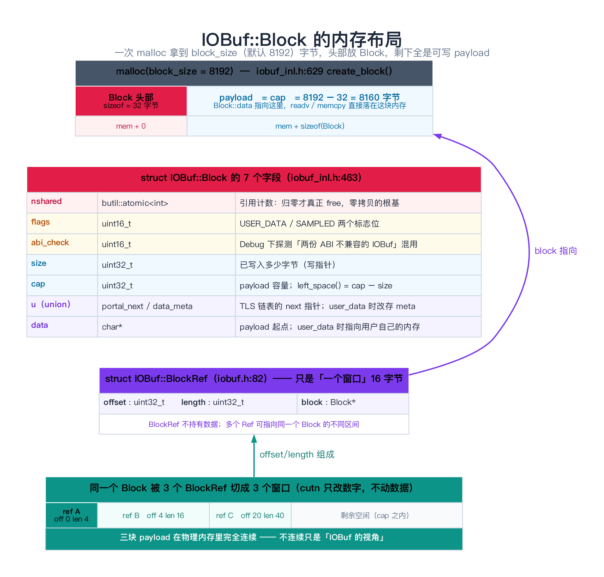
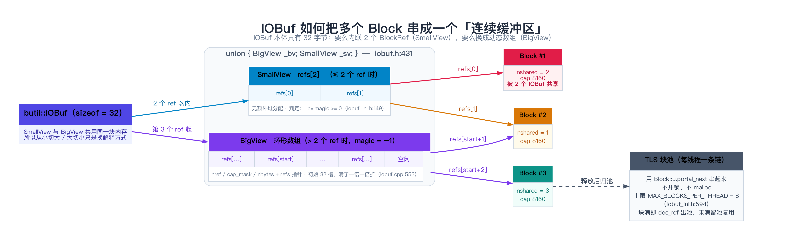
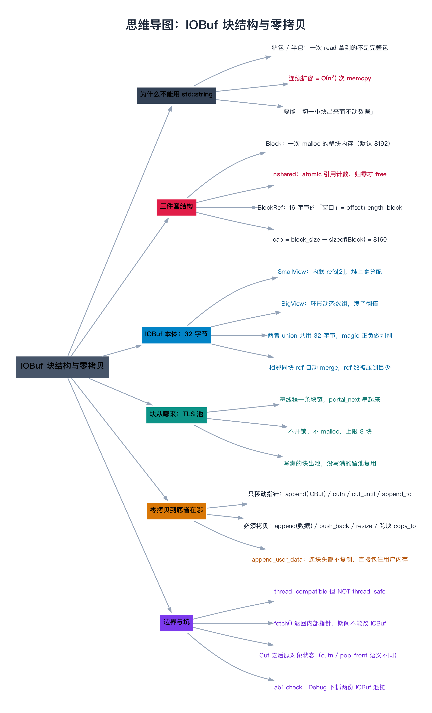

# IOBuf 源码剖析（一）：块结构与零拷贝

> **一句话总结**：`butil::IOBuf` 把「一段数据」拆成 **Block（一次 malloc 的整块内存）+ BlockRef（16 字节的"窗口"，只记 offset/length/block 指针）** 两层，`IOBuf` 本体只用 32 字节的 union 在「内联 2 个 ref（SmallView）」和「堆上动态数组（BigView）」之间切换；所以「把 A 的数据给 B」「从 A 切一段出来」这两件在 RPC 里每秒发生百万次的操作，代价是 **几次原子加减和一个 8 字节的整数改写**，而不是一次 `memcpy`。

---

## 阅读路径

- **快速版（约 6 分钟）**：读「一句话总结」+ 第 1 节（痛点）+ 第 2 节（三件套）+ 第 5 节（`Block` 真实字段）+ 第 8 节（坑）。
- **深入版（约 30 分钟）**：全文通读，重点吃透第 3 节（32 字节的 union 怎么装下两种视图）、第 4 节（为什么长这样）、第 7 节（把结构抽出来跑一遍，看引用计数真的只 +1）。

> 本篇只讲**内存长什么样**。`append` / `cutn` / 切包这些**操作**放在下一篇 [09 append 与切包](./09-IOBuf源码剖析（二）：append与切包.md)。

---

## 目录

1. [为什么 RPC 框架不能直接拿 std::string 当缓冲区](#1-为什么-rpc-框架不能直接拿-stdstring-当缓冲区)
2. [三件套：Block / BlockRef / IOBuf](#2-三件套block--blockref--iobuf)
3. [IOBuf 本体：32 字节的 union](#3-iobuf-本体32-字节的-union)
4. [原理到实现：为什么长这样](#4-原理到实现为什么长这样)
5. [源码剖析：Block 的真实字段](#5-源码剖析block-的真实字段)
6. [完整可复现的示例：同一份数据 append 到两个 IOBuf](#6-完整可复现的示例同一份数据-append-到两个-iobuf)
7. [实验：把结构抽出来跑一遍](#7-实验把结构抽出来跑一遍)
8. [边界、反例与失败路径](#8-边界反例与失败路径)
9. [对比与选型](#9-对比与选型)
10. [常见问题 FAQ](#10-常见问题-faq)
11. [延伸阅读](#11-延伸阅读)
12. [思维导图总结](#12-思维导图总结)

---

## 1. 为什么 RPC 框架不能直接拿 std::string 当缓冲区

### 1.1 先看不用它会怎样

一个 RPC 服务端，每来一次连接就读一次 socket，读到的数据要「攒够一个完整请求」才处理。最朴素的写法是：

```cpp
std::string read_buf;                    // 单一连续缓冲
ssize_t n = read(fd, tmp, sizeof(tmp));
read_buf.append(tmp, n);                 // 每次 read 都要把 tmp 拷进去
if (read_buf.size() < 12 + body_size) {
    return NOT_ENOUGH_DATA;              // 还不够一个包，下次再来
}
// 攒够了：把包从 read_buf 里切出来
std::string req = read_buf.substr(0, 12 + body_size);   // 又来一次拷贝
read_buf.erase(0, 12 + body_size);                      // 剩下的字节整体前移！
```

这段代码在功能上没错，但在 RPC 的热路径上有**三处致命开销**：

| 位置 | 问题 | 代价 |
|------|------|------|
| `append(tmp, n)` | 每个字节都被拷一次 | O(n) |
| `substr(...)` | 切出一个包 = 再拷一次 | O(包长) |
| `erase(0, k)` | 删掉头部后，**剩下的所有字节整体前移** | O(剩余长度)，且每次收到新数据都要来一遍 |

第三点最要命。假设一个客户端疯狂发小包，服务端每次都只读进来几百字节，`read_buf` 里长期积压着几 MB 没处理完的数据——那么**每读一次，就要搬运那几 MB 一次**。整体复杂度从 O(总字节数) 退化成 O(总字节数 × 排空次数)，也就是接近 **O(n²)**。

> **类比：图书馆还书**。
> `std::string` 的做法是「一整排书架，书必须连续摆放」。你要抽走中间的一摞，就得把右边的书**全部往左挪一格**。
> `IOBuf` 的做法是「给每摞书贴一张纸条，纸条上写『第 3 号书架的 40~100 页』」。抽走一摞，只是**把纸条改一改**——书架上的书一本都不动。

### 1.2 难点到底在哪

真正难的不是"怎么少拷一次"，而是**这三个需求互相打架**：

1. **要能"攒"**：数据是一段一段到的，得能不断往后追加；
2. **要能"切"**：切出前 n 个字节，剩下的还不能散架；
3. **要能"当连续内存用"**：解析协议时你得能 `p[0] == 'P' && p[1] == 'R'`，能直接丢给 `protobuf::ParseFromZeroCopyStream`。

如果只满足 1、2，用 `std::deque<char>` 或者链表就能做；如果只满足 3，`std::string` 就行。**IOBuf 的回答是：数据层是不连续的（一排 Block），但对外提供"连续"的访问接口（BlockRef 队列 + `copy_to`/`fetch` 这类一次性读取）。**

---

## 2. 三件套：Block / BlockRef / IOBuf

`IOBuf` 的世界里只有三个角色，认清楚它们，后面 2279 行代码就不会迷路。

| 角色 | 定义位置 | 是什么 | 谁分配 |
|------|---------|--------|--------|
| **`Block`** | `butil/iobuf_inl.h:463` | 一次 `malloc` 拿到的**整块内存**：头部是元数据，紧跟其后就是 payload | 按需（多数来自 TLS 池） |
| **`BlockRef`** | `butil/iobuf.h:82` | 一个 **16 字节的"窗口"**：`{ offset, length, block }`，描述"某块内存的某一段" | 内联在 IOBuf 里，或堆上数组 |
| **`IOBuf`** | `butil/iobuf.h:68` | **一个 BlockRef 的队列**（注释原话："IOBuf is essentially a tiny queue of BlockRefs"） | 栈上/成员变量，32 字节 |

关键认知：**`BlockRef` 不持有数据，`IOBuf` 也不持有数据。数据只在 `Block` 里。** 所以：

- 让两个 IOBuf 共享同一份数据 → 只要让它们的 BlockRef 指向同一个 Block，并给 Block 的引用计数 +1；
- 从 IOBuf 切一段出来 → 只要**复制一条 BlockRef**（16 字节）并改写 offset/length；
- 一个 Block 可以同时被**很多条** BlockRef 引用，各自覆盖不同的区间。



上面这张图是**本篇的核心**。左边一次 `malloc(8192)` 拿到的是一整块连续内存，前 32 字节是 `Block` 头部，后面 8160 字节全是可写的 payload；右边粉色的三个窗口示意：**同一块 payload 在物理内存里完全连续，"不连续"只是 IOBuf 的视角。**

---

## 3. IOBuf 本体：32 字节的 union

`IOBuf` 的成员只有一行（`butil/iobuf.h:431-435`）：

```cpp
private:
    union {
        BigView _bv;
        SmallView _sv;
    };
```

两种视图（`butil/iobuf.h:89-109`）：

```cpp
    // IOBuf is essentially a tiny queue of BlockRefs.
    struct SmallView {
        BlockRef refs[2];            // 内联两条 ref，堆上零分配
    };

    struct BigView {
        int32_t magic;               // = -1，用来区分是哪种视图
        uint32_t start;              // 环形数组的起始下标
        BlockRef* refs;              // 指向堆上的 BlockRef 数组
        uint32_t nref;               // 有效 ref 条数
        uint32_t cap_mask;           // 容量 - 1（容量必为 2 的幂）
        size_t nbytes;               // 总字节数（缓存起来，免得每次遍历求和）

        const BlockRef& ref_at(uint32_t i) const
        { return refs[(start + i) & cap_mask]; }
        uint32_t capacity() const { return cap_mask + 1; }
    };
```

两个视图大小必须相等，源码里有静态断言把这件事钉死（`butil/iobuf.cpp:448`）：

```cpp
BAIDU_CASSERT(sizeof(IOBuf::SmallView) == sizeof(IOBuf::BigView),
              sizeof_small_and_big_view_should_equal);
```

在 64 位平台上算一下：`BlockRef` = `uint32 + uint32 + 指针` = 4 + 4 + 8 = **16 字节**，所以 `SmallView` = 32 字节；`BigView` = 4 + 4 + 8 + 4 + 4 + 8 = 32 字节。**两边都是 32 字节，和 `sizeof(IOBuf)` 一致。**

于是 `IOBuf` 的一切操作，本质上都是**在这 32 字节里做文章**：

```cpp
// butil/iobuf_inl.h:149
inline bool IOBuf::_small() const {
    return _bv.magic >= 0;
}
```

`magic >= 0` 就是 SmallView。为什么？因为构造 IOBuf 时（`butil/iobuf_inl.h:77-80`）把两条 ref 都清零了，而 `refs[0].offset` 与 `BigView::magic` **占用同一段内存**，所以 magic 读出来就是 0，自然 `>= 0`。要转 BigView 时，代码显式写上 `_bv.magic = -1`（`butil/iobuf.cpp:542`）。



**从小到大、再从大到小**也是同样的思路：

- 第 3 条 ref 到来 → SmallView 装不下 → 在堆上开一个 `INITIAL_CAP = 32`（`butil/iobuf.h:76`）的数组，把老的两条搬过去，写 `magic = -1`（`butil/iobuf.cpp:534-547`）；
- 数组满了 → `capacity() * 2` 翻倍，把老的搬过去（`butil/iobuf.cpp:574-590`）；
- 从前面 pop 到只剩 2 条 → 搬回 SmallView，释放数组（`butil/iobuf.cpp:617-623`）。

注意：**这些"搬"搬的都是 16 字节的 ref，从不搬 payload。**

---

## 4. 原理到实现：为什么长这样

### 4.1 为什么要有 SmallView 这个特例

RPC 场景里绝大多数 IOBuf 只有 1~2 条 ref（一个小请求/小响应刚好装在一个 8KB 的块里）。如果所有 IOBuf 都用一个堆上的动态数组，那么**每创建一个 IOBuf 就多一次 `new`**——这在每秒百万次调用的路径上是不可接受的。

`SmallView` 把这两条最常见的情况**内联进 IOBuf 自己的 32 字节**，于是：

- 创建 IOBuf = 两条 ref 置零，**零次堆分配**；
- 追加第 1、2 条 ref = 直接写内存，**零次堆分配**；
- 只有第 3 条 ref 才触发一次 `new BlockRef[32]`（`butil/iobuf.cpp:429-432`）。

对称地，从 BigView 掉回 2 条时会转回 SmallView 并释放数组（`butil/iobuf.cpp:617-623`），让"切完包的空壳"不携带任何堆分配。

> 这是一套典型的 **SSO（Small String Optimization）** 思路——`std::string` 把短字符串内联在对象里，IOBuf 把"少量 ref"内联在对象里。区别是 std::string 内联的是**字符**，IOBuf 内联的是**指向数据的窗口**。

### 4.2 为什么必须用 union 而不是"两个成员二选一"

因为要**省那 32 字节**，更要**让"从小切大/大切小"变成零成本的类型切换**。如果是两个独立成员加一个 `bool is_big`，对象就变成 40+ 字节，且切换要来回赋两遍值。

用 union 的代价是：`_small()` 这件事**必须有一个可靠的判据**。源码选择把判据藏在 `magic` 里，靠 `refs[0].offset` 的初值为 0 来"自举"。这就是第 8 节要讲的坑之一。

### 4.3 为什么 BlockRef 要有 offset

因为一个 Block 会被切成很多段。典型场景：

- 协议解析：`read_buf` 里同时躺着 3.5 个包，每个包被 `cutn` 出去后，源 IOBuf 的 `refs[0].offset` 就往后挪；
- `IOPortal` 读 socket：一次 `readv` 往**同一个 Block** 里写多段；
- `append` 一个大 buffer 到已经写过一半的块尾。

offset 是 uint32、length 是 uint32，而不是 `size_t`——**一条 BlockRef 省下 8 字节**，且换来了 4.4 节要讲的"合并"能力。

### 4.4 为什么要有 Merge ref

看 `_push_or_move_back_ref_to_smallview` 里的这段（`butil/iobuf.cpp:510-531`）：

```cpp
    if (nullptr == refs[1].block) {
        if (refs[0].block == r.block &&
            refs[0].offset + refs[0].length == r.offset) { // Merge ref
            refs[0].length += r.length;                    // 直接把长度加上去
            ...
            return;
        }
        refs[1] = r;
        ...
    }
```

如果新 ref 和最后一条 ref **指向同一个 Block，并且首尾正好相接**，就不新增 ref，而是**把 length 加起来**。

为什么重要？因为 RPC 的写入模式就是「一次读一小段、紧挨着写进同一个块」。没有 merge 的话，读一个 8KB 请求会产生上百条 ref，逐个遍历的开销和 BigView 的堆分配开销都会爆炸。有了 merge，「一个块里连续写的所有字节」**永远只占 1 条 ref**。

### 4.5 块从哪来：TLS 池

块不是每次 `malloc` 出来的，而是从**每线程一条的块链**上拿（`butil/iobuf.cpp:341` `share_tls_block()`）：

```cpp
IOBuf::Block* share_tls_block() {
    TLSData& tls_data = g_tls_data;
    IOBuf::Block* const b = tls_data.block_head;
    if (b != nullptr && !b->full()) {      // 头块没写满，就直接接着写
        return b;
    }
    ...
    if (!new_block) {
        new_block = create_block();        // 池空了才真的 malloc
        ...
    }
    tls_data.block_head = new_block;
    return new_block;
}
```

三个要点：

1. **不开锁**。`g_tls_data` 是 `__thread` 的（`butil/iobuf.cpp:299`），每线程一份，天然免竞争；
2. **不反复 malloc**。写满的块才 `dec_ref` 出池，没写满的块留在池里下次接着用；
3. **有上限**。`MAX_BLOCKS_PER_THREAD = 8`（`butil/iobuf_inl.h:594`），防止某个线程把内存囤起来。超限时会走 `inc_g_num_hit_tls_threshold()` 计数，可以通过 `IOBuf::block_count_hit_tls_threshold()`（`butil/iobuf.cpp:444`）观察——**这个数长期不为 0 就说明追加性能在退化。**

池用 `Block::u.portal_next` 串成链（`butil/iobuf_inl.h:471-474` 的 union）。**这也解释了那个 union 的存在**：一个块要么在池里（用 `portal_next`），要么被 `append_user_data` 包着用户内存（用 `data_meta`），二者必居其一，所以可以复用同一段内存。

---

## 5. 源码剖析：Block 的真实字段

`Block` 声明在 `butil/iobuf.h:78`（`struct Block;`），定义在 `butil/iobuf_inl.h:463-578`。**完整抄下来**：

```cpp
struct IOBuf::Block {
    butil::atomic<int> nshared;
    uint16_t flags;
    uint16_t abi_check;  // original cap, never be zero.
    uint32_t size;
    uint32_t cap;
    // When flag is 0, portal_next is valid.
    // When flag & IOBUF_BLOCK_FLAGS_USER_DATA is non-0, data_meta is valid.
    union {
        Block* portal_next;
        uint64_t data_meta;
    } u;
    // When flag is 0, data points to `size` bytes starting at `(char*)this+sizeof(Block)'
    // When flag & IOBUF_BLOCK_FLAGS_USER_DATA is non-0, data points to the user data and
    // the deleter is put in UserDataExtension at `(char*)this+sizeof(Block)'
    char* data;
```

逐个字段说清楚（顺便纠正一个常见误解：**没有 `INLINE_BLOCK_SIZE` / `DEFAULT_BLOCK_SIZE` 这种宏**，真实的常量在别处，见本节末尾）：

| 字段 | 类型 | 含义 | 源码位置 |
|------|------|------|---------|
| `nshared` | `butil::atomic<int>` | **引用计数**。加引用 `fetch_add(1, relaxed)`；减引用 `fetch_sub(1, release)`，减到 0 才真正析构 + 释放 | `iobuf_inl.h:525-553` |
| `flags` | `uint16_t` | 两个标志位：`IOBUF_BLOCK_FLAGS_USER_DATA`(1<<0)、`IOBUF_BLOCK_FLAGS_SAMPLED`(1<<1) | `iobuf_inl.h:44-45` |
| `abi_check` | `uint16_t` | Debug 下探测「同一个进程里链了两份 ABI 不兼容的 IOBuf」 | `iobuf_inl.h:516-523` |
| `size` | `uint32_t` | **已写入**多少字节（写指针，从 payload 起点算） | — |
| `cap` | `uint32_t` | payload 容量 = `block_size - sizeof(Block)` | `iobuf_inl.h:638-639` |
| `u` | union | `portal_next`：TLS 链的下一个块；`data_meta`：user_data 块的元数据 | `iobuf_inl.h:471-474` |
| `data` | `char*` | payload 起点。普通块 = `(char*)this + sizeof(Block)`；user_data 块 = 用户自己的内存 | `iobuf_inl.h:475-478` |

**引用计数的两种释放路径**是分开的（`butil/iobuf_inl.h:533-553`）：

```cpp
void dec_ref() {
    check_abi();
    if (sampled()) { SubmitIOBufSample(this, -1); }
    if (nshared.fetch_sub(1, butil::memory_order_release) == 1) {
        butil::atomic_thread_fence(butil::memory_order_acquire);
        if (!is_user_data()) {
            iobuf::dec_g_nblock();
            iobuf::dec_g_blockmem();
            this->~Block();
            iobuf::blockmem_deallocate(this);      // 走可替换的分配器钩子
        } else if (flags & IOBUF_BLOCK_FLAGS_USER_DATA) {
            auto ext = get_user_data_extension();
            ext->deleter(data);                    // 调用用户给的析构回调
            ext->~UserDataExtension();
            this->~Block();
            free(this);                            // user_data 块固定用 malloc/free
        }
    }
}
```

注意 `fetch_sub(..., release)` 后面跟了一条 `acquire` 屏障——这是标准的手写引用计数内存序：**减到 0 的那一方要保证能看到其他线程在减引用之前做的所有写**，否则可能读到"半成品"再释放。

### 5.1 块大小与相关常量（真实名字）

| 常量 / 函数 | 真实值 | 位置 |
|------------|-------|------|
| 默认块大小 | `static size_t default_block_size = 8192;` | `butil/iobuf.cpp:47` |
| 读写它的 API | `size_t GetDefaultBlockSize()` / `void SetDefaultBlockSize(size_t)` | `iobuf.h:57-59`，实现 `iobuf.cpp:49-63` |
| SmallView 容量 | `static const size_t INITIAL_CAP = 32; // must be power of 2` | `butil/iobuf.h:76` |
| TLS 池上限 | `const int MAX_BLOCKS_PER_THREAD = 8;` | `butil/iobuf_inl.h:594` |
| 一次 writev 最多用几个 iovec | `static const size_t IOBUF_IOV_MAX = 256;` | `butil/iobuf.cpp:871` |
| `IOPortal` 一次 readv 最多准备几个 buffer | `const int MAX_APPEND_IOVEC = 64;` | `butil/iobuf.cpp:1525` |
| `reserve()` 的 Area 编码位宽 | `REF_INDEX_BITS=19 / REF_OFFSET_BITS=15 / AREA_SIZE_BITS=30` | `butil/iobuf.cpp:1229-1234` |
| 内存分配钩子 | `void* (*blockmem_allocate)(size_t) = ::malloc;` | `butil/iobuf_inl.h:458-459`（实现 `iobuf.cpp:217-218`） |

`SetDefaultBlockSize` 有个硬性校验（`butil/iobuf.cpp:53-63`）：**必须是 4096 的整数倍，且不能为 0**，否则直接 `LOG(FATAL)`。

于是默认情况下：**`sizeof(Block)` = 32 字节，payload cap = 8192 − 32 = 8160 字节。**

> **一个名字有历史包袱的地方**：`IOBuf::block_memory()`（`iobuf.h:359`，实现 `iobuf.cpp:255-257`）的**注释**写着 `block_memory = block_count * BLOCK_SIZE`，但实现里 `inc_g_blockmem()` / `dec_g_blockmem()` 每次只是 **+1 / −1**（`butil/iobuf.cpp:242-247`，调用点 `iobuf_inl.h:488-489, 542`），和 `g_nblock` 完全同步。所以 `block_memory()` 返回的是**块个数**而不是字节数。想看字节数，自己乘 `GetDefaultBlockSize()`。

---

## 6. 完整可复现的示例：同一份数据 append 到两个 IOBuf

### 6.1 源码依据

`append(const IOBuf&)` 的全部实现只有 6 行（`butil/iobuf.cpp:1075-1080`）：

```cpp
void IOBuf::append(const IOBuf& other) {
    const size_t nref = other._ref_num();
    for (size_t i = 0; i < nref; ++i) {
        _push_back_ref(other._ref_at(i));      // 只压 ref，不碰 payload
    }
}
```

而 `_push_back_ref` 最终会走到 `r.block->inc_ref()`（`butil/iobuf.cpp:506`）。**所以答案很明确：不拷贝，只加一次引用计数。**

### 6.2 用真实 bRPC 写的示例

```cpp
// iobuf_share.cpp —— 需要链接 libbrpc
#include <cstdio>
#include "butil/iobuf.h"

int main() {
    butil::IOBuf a;
    a.append("hello-iobuf", 11);        // ① 这次是真的 memcpy 进 Block

    butil::IOBuf b;
    b.append(a);                        // ② 零拷贝：只是 BlockRef + inc_ref

    printf("a = %s\n", a.to_string().c_str());        // hello-iobuf
    printf("b = %s\n", b.to_string().c_str());        // hello-iobuf
    printf("a.backing_block_num() = %zu\n", a.backing_block_num());   // 1
    printf("b.backing_block_num() = %zu\n", b.backing_block_num());   // 1

    // 用 backing_block(i) 拿到第 i 条 ref 覆盖的那段内存
    // （Block 本身是 IOBuf 的 public 嵌套类型，需要时可以直接访问其字段）
    butil::StringPiece ba = a.backing_block(0);
    butil::StringPiece bb = b.backing_block(0);
    printf("a/b 的 payload 指针是否相同: %s\n",
           (ba.data() == bb.data()) ? "是（同一个 Block，零拷贝）" : "否");
    return 0;
}
```

编译方式（假设你已经按第 02 篇编译过 brpc）：

```bash
# 仓库根目录下：先出静态库
sh config_brpc.sh --headers=/usr/include --libs=/usr/lib
make -j8                      # 产出 libbrpc.a，并复制到 output/lib
# 再编本例
g++ -std=c++11 iobuf_share.cpp -I output/include -L output/lib \
    -lbrpc -lprotobuf -lleveldb -lgflags -lssl -lcrypto -ldl -lz -lpthread -o iobuf_share
./iobuf_share
```

预期输出：

```text
a = hello-iobuf
b = hello-iobuf
a.backing_block_num() = 1
b.backing_block_num() = 1
a/b 的 payload 指针是否相同: 是（同一个 Block，零拷贝）
```

> **注意**：`a.append("hello-iobuf", 11)` 是**拷贝写**（数据从字面量拷进 Block）；`b.append(a)` 是**共享写**（只加引用计数）。两者名字都叫 `append`，语义完全不同——这是 IOBuf API 最容易踩的地方，下一篇会按参数类型把 `append` 家族拆开讲。

### 6.3 `append` 家族里谁拷贝、谁不拷贝

先给结论表（详细展开见下一篇）：

| 调用 | 拷贝？ | 依据 |
|------|-------|------|
| `append(void const* data, size_t count)` | **拷贝** | `iobuf.cpp:1131` 有 `iobuf::cp(...)` |
| `push_back(char c)` | **拷贝 1 字节** | `iobuf.cpp:1103` |
| `appendv(const_iovec*, n)` | **拷贝** | `iobuf.cpp:1152` |
| `append(const std::string& s)` | **拷贝** | `iobuf_inl.h:130-132` 转发到上面 |
| `append(const IOBuf& other)` | **不拷贝** | 只 `inc_ref`，`iobuf.cpp:1075-1080` |
| `append(const Movable& other)` | **不拷贝**（甚至可能直接 `swap`） | `iobuf.cpp:1082-1096` |
| `append_user_data(void*, size, deleter)` | **不拷贝**（连 Block 的数据区都不用，直接包住用户内存） | `iobuf.cpp:1167-1191` |
| `append_to(IOBuf* buf, n, pos)` | **不拷贝** | `iobuf.cpp:1315-1339`，只压 ref |
| `copy_to(void* buf, ...)` | **拷贝** | `iobuf.cpp:1357` 有 `iobuf::cp(...)` |
| `fetch(void* aux, n)` | **尽量不拷贝** | 若数据在单块内，直接返回内部指针（`iobuf.cpp:1400-1403`） |

内存分配钩子 `iobuf::blockmem_allocate / blockmem_deallocate`（`butil/iobuf_inl.h:458-459`）是可替换的函数指针，`reset_blockmem_allocate_and_deallocate()`（`iobuf.cpp:223-229`）可以恢复默认。想统计/接管 IOBuf 的内存，可以从这里下手——但要记得**替换前先把 TLS 池里已有的块清掉**，否则会用不匹配的分配器去释放。

---

## 7. 实验：把结构抽出来跑一遍

真实编译 bRPC 需要 gflags / protobuf / snappy / leveldb / openssl，如果你手头没有这些依赖，可以跑下面这个**从源码里抽出来的最小复现**——字段布局、`_small()` 判据、`Merge ref`、`cutn` 的指针运算**逐行照抄源码**，只删掉了 TLS 池、SSL 和 Profiler。

因为它等效于真实实现，跑一遍就能**亲眼看到引用计数只 +1、offset 只 +4**，比读代码有说服力。

```cpp
// iobuf_demo.cpp —— IOBuf 块结构的最小复现（完整代码）
// 字段布局 / 引用计数 / Merge ref / cutn 指针运算 全部照抄
// brpc/src/butil/iobuf.h、iobuf_inl.h、iobuf.cpp；只删掉 TLS 块池、SSL、Profiler。
// 编译：g++ -std=c++11 -O0 -g iobuf_demo.cpp -o iobuf_demo && ./iobuf_demo
#include <atomic>
#include <cstdint>
#include <cstdio>
#include <cstring>
#include <string>
#include <algorithm>

// ---------------- iobuf_inl.h:463  struct IOBuf::Block ----------------
struct Block {
    std::atomic<int> nshared;   // 引用计数：归零才 free
    uint16_t flags;
    uint16_t abi_check;
    uint32_t size;              // 已写入字节数
    uint32_t cap;               // payload 容量
    union { Block* portal_next; uint64_t data_meta; } u;
    char*    data;              // payload 起点

    Block(char* d, uint32_t c)
        : nshared(1), flags(0), abi_check(0), size(0), cap(c), u({nullptr}), data(d) {}
    void inc_ref() { nshared.fetch_add(1, std::memory_order_relaxed); }
    void dec_ref() {
        if (nshared.fetch_sub(1, std::memory_order_release) == 1) {
            std::atomic_thread_fence(std::memory_order_acquire);
            this->~Block(); ::free(this);
        }
    }
    int ref_count() const { return nshared.load(std::memory_order_relaxed); }
    bool full() const { return size >= cap; }
    size_t left_space() const { return cap - size; }
};

// ---------------- iobuf.h:82  struct IOBuf::BlockRef ----------------
struct BlockRef { uint32_t offset; uint32_t length; Block* block; };
struct SmallView { BlockRef refs[2]; };                    // iobuf.h:90
struct BigView {                                           // iobuf.h:94
    int32_t magic; uint32_t start; BlockRef* refs;
    uint32_t nref; uint32_t cap_mask; size_t nbytes;
    BlockRef& ref_at(uint32_t i) { return refs[(start + i) & cap_mask]; }
    const BlockRef& ref_at(uint32_t i) const { return refs[(start + i) & cap_mask]; }
};

static const size_t BLOCK_SIZE = 8192;                     // iobuf.cpp:47
static const size_t INITIAL_CAP = 32;                      // iobuf.h:76

// 对应 iobuf_inl.h:629 create_block()：整块内存 = Block 头 + payload
static Block* create_block() {
    char* mem = (char*)::malloc(BLOCK_SIZE);
    return new (mem) Block(mem + sizeof(Block), (uint32_t)(BLOCK_SIZE - sizeof(Block)));
}

struct IOBuf {
    union { BigView _bv; SmallView _sv; };                 // iobuf.h:432

    IOBuf() { reset(_sv.refs[0]); reset(_sv.refs[1]); }
    ~IOBuf() { clear(); }
    static void reset(BlockRef& r) { r.offset = 0; r.length = 0; r.block = nullptr; }

    bool   _small()   const { return _bv.magic >= 0; }      // iobuf_inl.h:149
    size_t _ref_num() const { return _small()                    // iobuf_inl.h:153
        ? (!!_sv.refs[0].block + !!_sv.refs[1].block) : _bv.nref; }
    size_t length()   const { return _small()                    // iobuf_inl.h:144
        ? (_sv.refs[0].length + _sv.refs[1].length) : _bv.nbytes; }
    BlockRef& _ref_at(size_t i) { return _small() ? _sv.refs[i] : _bv.ref_at(i); }
    const BlockRef& _ref_at(size_t i) const
    { return _small() ? _sv.refs[i] : _bv.ref_at(i); }

    // ==== iobuf.cpp:500  _push_or_move_back_ref_to_smallview<false> ====
    void _push_back_ref(const BlockRef& r) {
        BlockRef* const refs = _sv.refs;
        if (nullptr == refs[0].block) { refs[0] = r; r.block->inc_ref(); return; }
        if (nullptr == refs[1].block) {
            if (refs[0].block == r.block &&
                refs[0].offset + refs[0].length == r.offset) {
                refs[0].length += r.length;         // Merge ref：连起来了，不用新 ref
                return;
            }
            refs[1] = r; r.block->inc_ref(); return;
        }
        if (refs[1].block == r.block &&
            refs[1].offset + refs[1].length == r.offset) {
            refs[1].length += r.length; return;      // Merge ref
        }
        // 第 3 条 ref：SmallView 装不下 → 转 BigView
        BlockRef* nr = new BlockRef[INITIAL_CAP];
        nr[0] = refs[0]; nr[1] = refs[1]; nr[2] = r;
        const size_t nb = refs[0].length + refs[1].length + r.length;
        r.block->inc_ref();
        _bv.magic = -1; _bv.start = 0; _bv.refs = nr;
        _bv.nref = 3; _bv.cap_mask = INITIAL_CAP - 1; _bv.nbytes = nb;
    }

    // ==== iobuf.cpp:1075  append(const IOBuf& other)：payload 共享，不拷贝 ====
    void append(const IOBuf& other) {
        const size_t nref = other._ref_num();
        for (size_t i = 0; i < nref; ++i) _push_back_ref(other._ref_at(i));
    }

    // ==== iobuf.cpp:1117  append(const void*, size_t)：这一步才真的 memcpy ====
    int append(const void* data, size_t count) {
        size_t done = 0;
        while (done < count) {
            Block* b = create_block();
            // 真实源码这里是从 TLS 池拿块（iobuf.cpp:341 share_tls_block）；
            // 块在池里就已经持有 1 份引用，恰好等价于 ctor 里的 nshared(1)，
            // 所以下面 _push_back_ref 之后 nshared 从 1 变 2 —— 与真实源码一致。
            const size_t nc = std::min(count - done, b->left_space());
            memcpy(b->data + b->size, (const char*)data + done, nc);
            const BlockRef r = { (uint32_t)b->size, (uint32_t)nc, b };
            _push_back_ref(r);
            b->size += nc; done += nc;
        }
        return 0;
    }

    // ==== iobuf.cpp:596  _pop_front_ref ====
    int _pop_front_ref() {
        if (_small()) {
            if (_sv.refs[0].block) {
                _sv.refs[0].block->dec_ref();
                _sv.refs[0] = _sv.refs[1];
                reset(_sv.refs[1]);
                return 0;
            }
            return -1;
        }
        const uint32_t start = _bv.start;
        _bv.refs[start].block->dec_ref();
        if (--_bv.nref > 2) {
            _bv.start = (start + 1) & _bv.cap_mask;
            _bv.nbytes -= _bv.refs[start].length;
        } else {  // 落回 SmallView
            BlockRef* const s = _bv.refs;
            const uint32_t m = _bv.cap_mask;
            _sv.refs[0] = s[(start + 1) & m];
            _sv.refs[1] = s[(start + 2) & m];
            delete[] s;
        }
        return 0;
    }

    // ==== iobuf.cpp:744  cutn(IOBuf* out, size_t n)：只改 offset/length ====
    size_t cutn(IOBuf* out, size_t n) {
        const size_t len = length();
        if (n > len) n = len;
        const size_t saved_n = n;
        while (n) {
            BlockRef& r = _front_ref();
            if (r.length <= n) {
                n -= r.length;
                out->_push_back_ref(r);
                _moveout_front_ref();
            } else {
                const BlockRef cr = { r.offset, (uint32_t)n, r.block };
                out->_push_back_ref(cr);
                r.offset += n; r.length -= n;
                if (!_small()) _bv.nbytes -= n;
                return saved_n;
            }
        }
        return saved_n;
    }
    void _moveout_front_ref() { _pop_front_ref(); }

    // ==== iobuf.cpp:681  pop_front ====
    size_t pop_front(size_t n) {
        const size_t len = length();
        if (n >= len) { clear(); return len; }
        const size_t saved_n = n;
        while (n) {
            BlockRef& r = _front_ref();
            if (r.length > n) {
                r.offset += n; r.length -= n;
                if (!_small()) _bv.nbytes -= n;
                return saved_n;
            }
            n -= r.length; _pop_front_ref();
        }
        return saved_n;
    }
    BlockRef& _front_ref() { return _small() ? _sv.refs[0] : _bv.refs[_bv.start]; }

    // ==== iobuf.cpp:661  clear ====
    void clear() {
        if (_small()) {
            if (_sv.refs[0].block) {
                _sv.refs[0].block->dec_ref(); reset(_sv.refs[0]);
                if (_sv.refs[1].block) { _sv.refs[1].block->dec_ref(); reset(_sv.refs[1]); }
            }
        } else {
            for (uint32_t i = 0; i < _bv.nref; ++i) _bv.ref_at(i).block->dec_ref();
            delete[] _bv.refs;
            new (this) IOBuf;
        }
    }
    std::string to_string() const {
        std::string s;
        for (size_t i = 0; i < _ref_num(); ++i) {
            const BlockRef& r = _ref_at(i);
            s.append(r.block->data + r.offset, r.length);
        }
        return s;
    }
    void dump(const char* tag) const {
        printf("%-18s len=%-4zu refnum=%zu %-5s ", tag, length(), _ref_num(),
               _small() ? "small" : "big");
        for (size_t i = 0; i < _ref_num(); ++i) {
            const BlockRef& r = _ref_at(i);
            printf("[%p off=%-4u len=%-4u nshared=%d] ",
                   (void*)r.block, r.offset, r.length, r.block->ref_count());
        }
        std::string s = to_string();
        if (s.size() > 20) s = s.substr(0, 20) + "...";
        printf("data=\"%s\"\n", s.c_str());
    }
};

int main() {
    printf("sizeof(Block)   = %zu\n", sizeof(Block));
    printf("sizeof(BlockRef)= %zu\n", sizeof(BlockRef));
    printf("sizeof(SmallView)=%zu   sizeof(BigView)=%zu\n",
           sizeof(SmallView), sizeof(BigView));
    printf("BLOCK_SIZE=8192 -> payload cap=%zu\n", 8192 - sizeof(Block));

    printf("\n--- 实验 1：b.append(a) 有没有拷贝？---\n");
    IOBuf a;
    a.append("hello-iobuf", 11);       // 真 memcpy 一次
    a.dump("a");
    Block* pa = a._ref_at(0).block;
    IOBuf b;
    b.append(a);                       // 只是加引用计数
    b.dump("b = a 的副本");
    a.dump("a 原封不动");
    printf("b 的 block 指针 == a 的 block 指针 ? %s\n",
           (pa == b._ref_at(0).block) ? "是（零拷贝）" : "否");
    printf("a 的内容仍然是 \"%s\"\n", a.to_string().c_str());

    printf("\n--- 实验 2：cutn 前后指针怎么动 ---\n");
    IOBuf src;
    src.append("PRPC____BODYBODYBODY", 20);
    src.dump("src");
    Block* p0 = src._ref_at(0).block;
    IOBuf pkt;
    src.cutn(&pkt, 4);                 // 切出包头
    pkt.dump("pkt = cutn(4)");
    src.dump("src 剩下");
    printf("block 指针未变 ? %s；src.offset 0 -> %u\n",
           (p0 == src._ref_at(0).block) ? "是" : "否", src._ref_at(0).offset);
    return 0;
}
```

实测输出（macOS / Apple clang 14.0.3 / `-O0`）：

```text
sizeof(Block)   = 32
sizeof(BlockRef)= 16
sizeof(SmallView)=32   sizeof(BigView)=32
BLOCK_SIZE=8192 -> payload cap=8160

--- 实验 1：b.append(a) 有没有拷贝？---
a                  len=11   refnum=1 small [0x1011dee40 off=0    len=11   nshared=2] data="hello-iobuf"
b = a 的副本    len=11   refnum=1 small [0x1011dee40 off=0    len=11   nshared=3] data="hello-iobuf"
a 原封不动     len=11   refnum=1 small [0x1011dee40 off=0    len=11   nshared=3] data="hello-iobuf"
b 的 block 指针 == a 的 block 指针 ? 是（零拷贝）
a 的内容仍然是 "hello-iobuf"

--- 实验 2：cutn 前后指针怎么动 ---
src                len=20   refnum=1 small [0xb9d004000 off=0    len=20   nshared=2] data="PRPC____BODYBODYBODY"
pkt = cutn(4)      len=4    refnum=1 small [0xb9d004000 off=0    len=4    nshared=3] data="PRPC"
src 剩下         len=16   refnum=1 small [0xb9d004000 off=4    len=16   nshared=3] data="____BODYBODYBODY"
block 指针未变 ? 是；src.offset 0 -> 4
```

**读这张输出，抓住四个数字：**

1. `sizeof(Block) = 32`、`sizeof(BlockRef) = 16`、`sizeof(SmallView) == sizeof(BigView) == 32` —— 与第 3 节的推导一致；
2. `b.append(a)` 前后：**block 指针一模一样**（`0x1011dee40`），`nshared` 从 **2 → 3**。多出来的 1 是真实源码里 **TLS 池持有的那份引用**。整个操作只有一次 `fetch_add`；
3. `cutn(&pkt, 4)` 前后：block 指针一模一样（`0xb9d004000`），**`src.offset` 从 0 变成 4**，`pkt` 拿到 `{offset=0, length=4}` 的窗口，`nshared` 2 → 3。payload 未动；
4. `a` 在 `b.append(a)` 之后**内容完全没变**——因为 share 是只读的语义，谁都没权限改对方的字节。

### 7.1 顺带验证：TLS 池真的在复用块

把 TLS 池也补上的版本（完整实现照 `butil/iobuf.cpp:341`）跑出来是这样的：

```text
=== 实验 3：TLS 块复用 + 跨块切包 ===
big        len=9004 refnum=2 small [B0x81900a000 off=0 len=8160 nshared=1] [B0x81900c000 off=0 len=844 nshared=2]
head       len=9000 refnum=2 small [B0x81900a000 off=0 len=8160 nshared=1] [B0x81900c000 off=0 len=840 nshared=3]
big 剩下   len=4    refnum=1 small [B0x81900c000 off=840 len=4 nshared=3]
```

两个可验证的结论：

- **9004 字节只用了 2 个 Block**：第 1 个装 8160（写满），第 2 个装 844。且 `append("TAIL", 4)` 写进的是**第 2 个块**，与已有 ref `{0, 840}` 首尾相接 ⇒ 被 **merge 成一条 `{0, 844}` 的 ref**（`iobuf.cpp:556-564`）。所以 9004 字节只需要 **2 条 ref**，分块的开销被压到最低；
- `cutn(&head, 9000)` 之后，`head` 拿到 2 条 ref，`big` 只剩第 2 个块的尾巴 `{offset=840, length=4}`——**又一次，只有数字在动。**

---

## 8. 边界、反例与失败路径

### 8.1 线程安全：thread-compatible ≠ thread-safe

`butil/iobuf.h:63-67` 的注释把边界写得很清楚，值得原样记住：

```cpp
// IOBuf is [thread-compatible]. Namely using different IOBuf in different
// threads simultaneously is safe, and reading a static IOBuf from different
// threads is safe as well.
// IOBuf is [NOT thread-safe]. Modifying a same IOBuf from different threads
// simultaneously is unsafe and likely to crash.
```

拆开说：

| 场景 | 安全？ |
|------|-------|
| 不同线程各用各的 IOBuf | ✅ 安全（`nshared` 是原子的） |
| 多线程**只读**同一个静态 IOBuf | ✅ 安全 |
| 多线程**同时改**同一个 IOBuf（append/cut/pop） | ❌ **会崩**，`_push_back_ref` 里的 refs 数组、`magic`、`nbytes` 全无保护 |
| 线程 A 持有 `backing_block()` 返回的指针，线程 B 同时 `clear()` 这个 IOBuf | ❌ 悬垂指针，Block 可能已被 `dec_ref` 释放 |

### 8.2 `fetch()` / `fetch1()` / `backing_block()` 返回的指针是"借来的"

`fetch` 的注释（`butil/iobuf.h:331-341`）写得很直白：

```cpp
    //   internal buffer -  the bytes are stored continuously in the internal
    //                      buffer, no copying is needed. This function does not
    //                      add additional reference to the underlying block,
    //                      so user should not change this IOBuf during using
    //                      the internal buffer.
```

**拿到 `fetch()` 的返回值之后，但凡对这个 IOBuf 做一次 `append` / `cutn` / `pop_front` / 赋值，指针就可能立刻失效。**正确姿势是"用完立刻读走，不留指针"。

`backing_block(i)`（`iobuf.cpp:1455-1461`）同理，`IOBufBytesIterator` 的注释也写了 "During iteration, the iobuf should NOT be changed"（`butil/iobuf.h:890-891`）。

### 8.3 `Block::u` 的 union：写错一个字段就毁数据

```cpp
    // When flag is 0, portal_next is valid.
    // When flag & IOBUF_BLOCK_FLAGS_USER_DATA is non-0, data_meta is valid.
    union {
        Block* portal_next;
        uint64_t data_meta;
    } u;
```

`append_user_data_with_meta` 造出来的块（`flags` 含 `USER_DATA`）里，`u` 存的是 `data_meta`。如果某个地方把它当成 TLS 链表节点写了 `u.portal_next`，**meta 就被静默改掉**，而且不会立刻崩——`get_first_data_meta()`（`iobuf.cpp:1193-1202`）之后返回一个错的值，排查起来极其痛苦。

### 8.4 `abi_check`：Debug 下抓"两份 IOBuf 链在一起"

`check_abi()`（`butil/iobuf_inl.h:516-523`）：

```cpp
inline void check_abi() {
#ifndef NDEBUG
    if (abi_check != 0) {
        LOG(FATAL) << "Your program seems to wrongly contain two "
            "ABI-incompatible implementations of IOBuf";
    }
#endif
}
```

什么情况会触发？**同一个进程里链了两份 IOBuf 实现**——比如主程序和某个 .so 各自静态链接了不同版本的 brpc，把 A 版本创建的 Block 交给 B 版本的 `inc_ref` 去加。因为 `Block` 的内存布局在两边不一致，会导致野指针。

`Release` 编译（`NDEBUG`）下这个检查**被完全编译掉**，于是同一份错误会以"随机崩溃"的形式出现。**这类 bug 一旦在线上出现，先把所有静态链接 brpc 的库统一版本。**

### 8.5 `refs[0].offset` 与 `BigView::magic` 复用内存的隐含约束

`_small()` 的实现是 `_bv.magic >= 0`（`butil/iobuf_inl.h:149`），而 `magic` 与 `refs[0].offset` 在 union 里占同一段内存（都是偏移 0 处的 4 字节）。也就是说：**SmallView 下 `refs[0].offset` 的符号位一旦是 1，这个 IOBuf 就会被误判成 BigView，后续所有访问都会拿垃圾指针去解引用。**

默认块是 8KB，`offset` 撑死也就几千，完全够用。但如果你调 `SetDefaultBlockSize()` 把块设成 **2GB 以上**，就可以构造出 `offset >= 2^31` 的场景——而 `SetDefaultBlockSize` 只校验"是 4096 的倍数且大于 0"（`butil/iobuf.cpp:53-63`），并不会拦住你。

> 这不是一个"已知 bug"，而是这套 union 技巧的**隐含前提**：块大小必须显著小于 2^31。知道这一点的价值在于——当你看到 `_small()` 这样写的时候，能立刻意识到它依赖的不只是"初值是 0"，而是"offset 不会涨到符号位"。

### 8.6 TLS 池的"阈值命中"

`block_count_hit_tls_threshold()`（`iobuf.cpp:444`）统计的是"因为本线程 TLS 池已满 8 块，只能把块直接 `dec_ref` 掉"的次数。`butil/iobuf.cpp:307-309` 的注释直说了：

```cpp
// Number of blocks that can't be returned to TLS which has too many block
// already. This counter should be 0 in most scenarios, otherwise performance
// of appending functions in IOPortal may be lowered.
```

**如果这个数长期不为 0，说明你这一类的追加操作在反复 malloc/free。**对应的调优方向是让每个 IOBuf 的块数下降（比如减小并发 IOBuf 数量，或者拆线程）。

### 8.7 一个反例：不要指望 `IOBuf` 省下"解析时必然要拷的那一次"

IOBuf 省掉的是**"整块数据在模块之间搬运"**的拷贝，不是所有拷贝。以下这些该拷还是得拷：

- `copy_to(buf, n)`：要把跨块的数据拼成连续内存给只认 `void*` 的老接口；
- `cutn(void* out, n)`：切到裸指针；
- `to_string()`：直接产出一个 `std::string`；
- `copy_to_cstr`：给 C 风格 API 用。

**判断标准**：接收方能接受"分块的缓冲区"（IOBuf、`iovec`、`ZeroCopyStream`），就有机会零拷贝；接收方只接受"一段连续内存"，就必然要拷。bRPC 里到处是 `IOBufAsZeroCopyInputStream` / `IOBufAsZeroCopyOutputStream`（`iobuf.h:564, 594`），本质就是**把协议解析/序列化改造成"接受分块输入"**，从而把这次拷贝也省掉。同理还有 `IOBufAsSnappySource` / `IOBufAsSnappySink`（`iobuf.h:774, 796`）和 `IOBufAsInputStreamBuf` / `IOBufAsOutputStreamBuf`（`iobuf.h:623, 692`）。

---

## 9. 对比与选型

| 方案 | 能装不连续内存 | 切包零拷贝 | 追加摊销 | 能直接当连续内存用 | 额外内存开销 | 适合 |
|------|:---:|:---:|:---:|:---:|---|---|
| `std::string` | ❌ | ❌（`erase` 要前移） | O(1) 摊还但会 realloc 拷贝 | ✅ 天然 | 1× | 小数据、一次性拼装 |
| `std::vector<char>` | ❌ | ❌ | 同上 | ✅ | 1× | 已经知道总长度 |
| `std::deque<char>` | ✅（分块） | 半（`erase` 仍要逐块 move） | O(1) | ❌ 不能 | 每块一个指针 + 无 `writev` 支持 | 只需要队列语义 |
| 裸 `iovec[]` | ✅ | ✅ | ❌ 要用户自己管内存与生命周期 | ❌ | 每段 16 字节 | 一次性 `writev` |
| **`butil::IOBuf`** | ✅ | ✅ | ✅（TLS 池 + ref 合并） | 半（`copy_to`/`fetch` 按需） | 每块 32 字节头 + ref 队列 | RPC/网络框架的通用缓冲区 |
| Netty `ByteBuf`（Java） | ✅（`CompositeByteBuf`） | ✅ | ✅（池化 + 无锁缓存） | 半 | 每段一个对象头 | 同场景，JVM 生态 |

**选型建议：**

- **写 RPC / 网络框架**：`IOBuf` 这类"引用计数 + 分块 + 窗口"的结构基本是唯一选择。它同时解决粘包、零拷贝、`writev` 批量发三个问题。
- **只是缓存一下 HTTP 响应体**、数据量确定且小：`std::string` 更简单，别为了"零拷贝"上 IOBuf，`to_string()` 一来一回反而更慢。
- **一次性的 `writev`**：直接构造 `iovec` 数组，不需要 IOBuf 的引用计数——但你要自己保证数据在 `writev` 返回前一直有效。
- **需要在多个模块间反复传递同一份数据**（比如：网关收包 → 解压 → 转发）：这正是 IOBuf 的主场，`append(const IOBuf&)` 会把拷贝次数降为 0。

---

## 10. 常见问题 FAQ

**Q1：`IOBuf` 和 `std::string` 最大的区别是什么？**
`std::string` 保证**数据连续**（代价是扩容和 `erase` 要搬内存）；`IOBuf` 保证**操作廉价**（代价是数据可以不连续，你要"连续"时得自己调 `copy_to`）。前者是容器语义，后者是**视图 + 所有权**语义。

**Q2：`append(const IOBuf&)` 之后，改 `b` 会影响到 `a` 吗？**
不会——IOBuf 没有任何"写同一个 Block"的写时复制机制，**改 `b` 只会改 `b` 自己的 BlockRef 队列**，`a` 的 ref 队列是独立的（虽然指向同一个 Block）。但要注意：如果你通过 `append(Movable)` 把 `a` 的 ref **移走**，`a` 就被清空了（`iobuf.cpp:1082-1096`）。

**Q3：一个 IOBuf 最多能有多少个 Block？**
没有硬上限（BigView 数组会翻倍扩容），但有**实际性能拐点**：ref 越多，遍历/`copy_to`/`writev` 的成本越高。经验法则是——**尽量别让单个 IOBuf 跨几十个块**。`cut_into_file_descriptor` 只在一次 `writev` 里用前 `IOBUF_IOV_MAX = 256`（`iobuf.cpp:871`）条 ref，超出的部分下次再发。

**Q4：为什么 `BlockRef` 里 `offset`/`length` 用 `uint32_t`？**
省内存（一条 ref 16 字节而不是 24）、以及让 `refs` 数组更小。代价是单块容量不能超 4GB。注意真实源码里 **length 用的是 uint32**，但 `IOBuf::length()` 返回 `size_t`——总长度可以超过 4GB，**单个块不行**。

**Q5：`IOBuf::block_count()` 和 `block_memory()` 有什么区别？**
看完第 5.1 节你就知道：**目前没有区别**，两个计数器同步递增（`iobuf.cpp:235-247`），`block_memory()` 返回的是块个数。想看字节数请乘 `GetDefaultBlockSize()`。这是历史命名留的包袱，不要被名字骗了。

**Q6：`IOBuf` 的析构会不会把 Block 还给系统？**
不一定。`clear()`（`iobuf.cpp:661-679`）只是 `dec_ref`；只有 `IOPortal::return_cached_blocks()`（`iobuf_inl.h:64-69`）才把块**还回 TLS 池**。所以 `IOPortal` 读 socket 的典型用法是：切完包、`read_buf` 空了之后，显式调一次 `return_cached_blocks()`，让下一个请求能复用到这些块。源码注释也说得很清楚（`iobuf.h:482-487`）：**"Calling this function after each call to append_xxx does not make sense and may hurt performance."**

**Q7：为什么 `Block` 里要有一个 `abi_check` 字段？它占 2 字节不浪费吗？**
它是**调试期的安全带**。bRPC 被静态链接进各种 .so 时，很容易出现"同一进程里两份 IOBuf"，此时 `Block` 布局不一致会变成随机崩溃。`abi_check` 让 Debug 版本在 `inc_ref/dec_ref` 时立刻 `LOG(FATAL)` 报出真正的原因。Release 下这个字段和检查一起被编译掉。

---

## 11. 延伸阅读

- **源码**：`src/butil/iobuf.h`（942 行）—— 先通读**头文件里的注释**，作者把设计意图都写在注释里了；`src/butil/iobuf_inl.h`（652 行）—— `Block` 的定义、TLS 池、`IOBufCutter` 的内联实现都在这里；`src/butil/iobuf.cpp`（2279 行）—— 重头戏是 `_push_or_move_back_ref_to_smallview/bigview`、`cutn`、`append` 三组函数。
- **设计文档**：仓库 `docs/` 下的 `io.md`（若存在）与 `README_cn.md` 中对 IOBuf 的描述。
- **同类实现**：
  - Netty 的 `ByteBuf` / `CompositeByteBuf` / `PooledByteBufAllocator`——同样的"引用计数 + 分块 + 池化"思路，Java 生态里最成熟的对照物；
  - `folly::IOBuf`（Facebook）——名字都相同，但 `folly::IOBuf` 用**环形缓冲区 + 单链表**，`butil::IOBuf` 用**数组式 ref 队列**，正好可以对比两种做法的取舍；
  - Linux 内核的 `sk_buff`——网络栈里的"分块缓冲区"，`skb_shared_info` 的片段列表与 IOBuf 的 ref 队列异曲同工。
- **相关篇目**：本篇的"操作"部分见 [09 append 与切包](./09-IOBuf源码剖析（二）：append与切包.md)；`input_messenger` 怎么用 IOBuf 切包见第 32 篇；socket 怎么用 ref 数组拼 `iovec` 发数据见第 33 篇；`butil` 的整体地图见第 07 篇。
- **源码地址**：[github.com/apache/brpc](https://github.com/apache/brpc)

---

## 12. 思维导图总结

```text
IOBuf 块结构与零拷贝
├── 为什么不能用一个 std::string
│   ├── 粘包 / 半包：一次 read 拿到的不是完整包
│   ├── 连续扩容 + erase 前移 = 接近 O(n²) 次 memcpy
│   └── 三个互相打架的需求：能攒 / 能切 / 能当连续内存用
├── 三件套结构
│   ├── Block：一次 malloc 的整块内存（默认 8192 字节）
│   │   ├── 头部 32 字节：nshared / flags / abi_check / size / cap / u / data
│   │   ├── payload = block_size − sizeof(Block) = 8160
│   │   └── nshared 是 atomic，减到 0 才 free（零拷贝的根基）
│   ├── BlockRef：16 字节的「窗口」= offset + length + block 指针
│   └── IOBuf：一个 BlockRef 的队列，本体只有 32 字节
├── IOBuf 本体：32 字节的 union
│   ├── SmallView：内联 refs[2]，堆上零分配（≤ 2 条 ref）
│   ├── BigView：堆上环形数组，初始 32 槽，满了翻倍
│   ├── 判据：_bv.magic >= 0 即 SmallView（magic 与 refs[0].offset 复用内存）
│   └── 静态断言钉死 sizeof(SmallView) == sizeof(BigView)（iobuf.cpp:448）
├── 块从哪来：TLS 块池
│   ├── 每线程一条链，用 Block::u.portal_next 串起来
│   ├── 不开锁、不反复 malloc，上限 MAX_BLOCKS_PER_THREAD = 8
│   └── 写满的块出池，没写满的留池复用
├── 零拷贝到底省在哪
│   ├── 只移动指针：append(IOBuf) / append(Movable) / cutn / append_to
│   ├── 必须拷贝：append(数据) / push_back / appendv / resize / copy_to
│   ├── 连块头都不要：append_user_data（包住用户内存 + 析构回调）
│   └── 想让解析也零拷贝：IOBufAsZeroCopyInput/OutputStream 系列
├── 边界与坑
│   ├── thread-compatible 但 NOT thread-safe
│   ├── fetch() / backing_block() 返回的是借来的指针
│   ├── Block::u 的 union 写错字段会静默毁数据
│   ├── abi_check 在 Release 下被编译掉
│   ├── refs[0].offset 与 magic 复用内存 ⇒ 块不能大到 2^31
│   ├── block_count_hit_tls_threshold 长期不为 0 = 追加在退化
│   └── block_memory() 返回的是块个数，不是字节数
└── 对比与选型
    ├── std::string / vector：连续优先，切包必拷
    ├── 裸 iovec：够快但要自己管生命周期
    └── IOBuf：RPC 框架的通用缓冲区（对照 Netty ByteBuf / folly::IOBuf）
```



> **下一篇**：[09 IOBuf 源码剖析（二）：append 与切包](./09-IOBuf源码剖析（二）：append与切包.md) —— 把这套结构真正用起来：`append` 家族的多个重载谁拷谁不拷、`cutn` / `cut_until` 怎么支撑协议切包、以及 `writev` 怎么用它一次把数据发出去。
