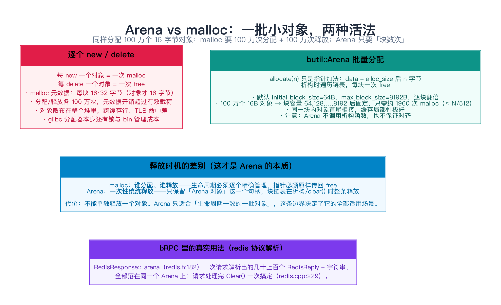
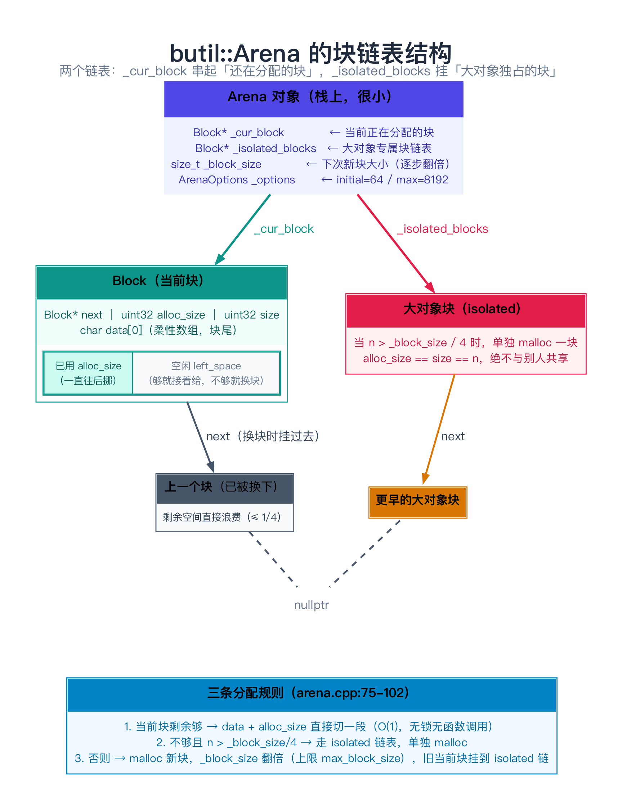
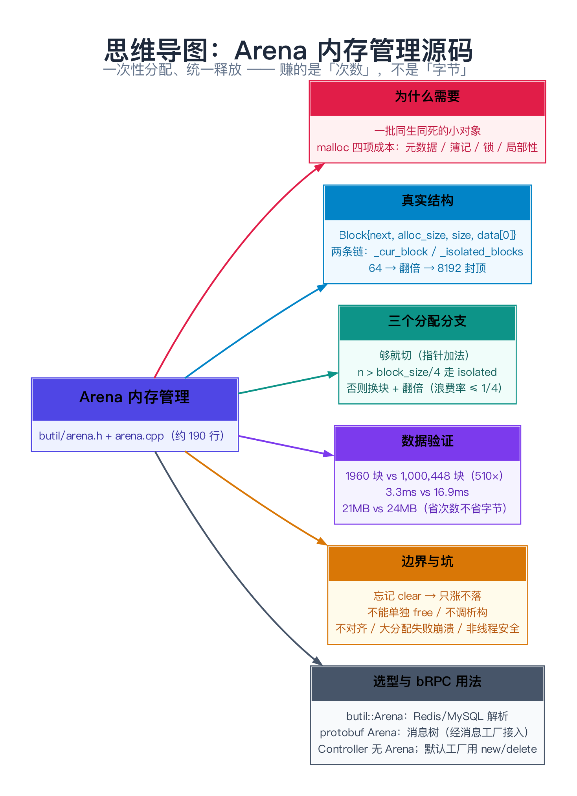

# Arena 内存管理源码：一次性分配、统一释放

> **一句话总结**：`butil::Arena` 把「很多个生命周期一致的小对象」的分配，从「每次 `malloc` 一次、每次 `free` 一次」改成「攒在一大块连续内存里切着用、最后整块丢掉」——代价是**你不能再单独释放任何一个对象**。bRPC 里真正用它的是 Redis / MySQL 这类**「一次请求 = 一批对象」**的协议解析路径；而在 RPC 主路径上，bRPC 用的是 **protobuf 自带的 `google::protobuf::Arena`** 来承载 request/response 消息，两者长得像、用途完全不同。

---

## 阅读路径

- **快速版（约 5 分钟）**：读「一句话总结」+ 第 2 节（核心思想）+ 第 7 节（实测数据：1960 vs 1,000,448 个 malloc 块）+ 第 8 节（边界与坑）。
- **深入版（约 30 分钟）**：全文通读，重点吃透第 3–5 节（`Block` 结构、`allocate` 三个分支逐行走读）和第 9 节（Arena / malloc / ObjectPool / protobuf Arena 四者选型）。

---

## 目录

1. [为什么要 Arena：malloc/free 的成本到底在哪](#1-为什么要-arenamallocfree-的成本到底在哪)
2. [核心思想：一次性分配、统一释放](#2-核心思想一次性分配统一释放)
3. [butil::Arena 的真实结构](#3-butilararena-的真实结构)
4. [三个分配分支：原理到实现](#4-三个分配分支原理到实现)
5. [源码剖析：arena.h / arena.cpp 逐行](#5-源码剖析arenah--arenacpp-逐行)
6. [完整可复现示例：盯着 Arena 的行为看](#6-完整可复现示例盯着-arena-的行为看)
7. [数据验证：1960 个 malloc 块 vs 1,000,448 个](#7-数据验证1960-个-malloc-块-vs-1000448-个)
8. [边界、反例与失败路径](#8-边界反例与失败路径)
9. [对比与选型：四个「对象容器」怎么挑](#9-对比与选型四个对象容器怎么挑)
10. [常见问题 FAQ](#10-常见问题-faq)
11. [延伸阅读](#11-延伸阅读)
12. [思维导图总结](#12-思维导图总结)

---

## 1. 为什么要 Arena：malloc/free 的成本到底在哪

### 1.1 一个具体的痛点

假设你要解析一个 Redis 响应：

```text
*3\r\n$3\r\nSET\r\n$3\r\nfoo\r\n$5\r\nhello\r\n
```

解析结果的形态是一棵小树：1 个数组 `RedisReply`，下面挂 3 个子 `RedisReply`，其中 2 个是字符串（`"foo"`、`"hello"`）。用最朴素的做法：

```cpp
RedisReply* arr = new RedisReply[1];
arr->subs = new RedisReply[3];
for (int i = 0; i < 3; ++i) {
    arr->subs[i].str = new char[len[i] + 1];
    memcpy(arr->subs[i].str, src, len[i]);
}
```

一次请求要 `malloc` 五次、`free` 五次。而 bRPC 的 Redis 代理一秒可能要处理**十几万**条命令——于是每秒就是上百万次 `malloc` / `free`。

### 1.2 malloc/free 贵在哪

不是「分配内存」本身贵，而是它绕不开的四件事：

| 成本 | 具体表现 |
|------|---------|
| **每个块的元数据** | glibc 的 malloc 需要在每块内存旁边记「这块多大、上一个块多大」；一个 16 字节的对象常常配 16~32 字节的元数据，**内存放大 2~3 倍** |
| **分配器自己的簿记** | 空闲链表 / bin 的查找与分裂、合并相邻空闲块 |
| **锁** | 多线程同时 malloc 时分配器内部要加锁；bRPC 是多线程（多 bthread worker）场景，这是真实竞争点 |
| **局部性** | 对象散布在整个堆里，遍历它们时缓存行、TLB 命中率都差 |

> **类比：搬宿舍**。`malloc` 就像「每样东西都单独装箱、每样都贴一张快递单、每样都单独寄一次」。一个 20 寸的箱子装了 30 件小东西，快递单本身就占了一半。Arena 的做法是：**所有东西塞进一个搬家货车，一次性拉走，单子只写一张**。

### 1.3 关键提问：什么情况下「一次释放」是可能的

答案：**当这批对象的生命周期完全一致时**。

- 解析一条 Redis 命令产生的所有 `StringPiece`：命令处理完，全部作废。
- 一条响应里的所有 `RedisReply`：响应发出去，全部作废。

一旦「这批对象总是同时生、同时死」，把它们逐个 `free` 就是在做无用功。Arena 正是为这个场景准备的。

---

## 2. 核心思想：一次性分配、统一释放

Arena 的全部设计可以压缩成两句话：

1. **分配**：维护一条「大块（block）」的链，每块里记一个「已经用掉多少」的水位线；要内存就从水位线往后切一段，水位线上移。**分配 = 指针加法。**
2. **释放**：只保留「Arena 对象」这一个句柄；Arena 析构 / `clear()` 时，遍历块链把每块整块 `free`。

```text
malloc 的世界：  obj1 --free-->   obj2 --free-->   obj3 --free-->   ...
Arena  的世界：  [  block: obj1 obj2 obj3 ... ] --一次 free--> 没了
```

由此推出 Arena 的两条**硬约束**（后面第 8 节展开）：

- **不能单独释放一个对象**（没有 `free(ptr)` 这种东西）。
- **不能调用析构函数**（Arena 不知道自己装的是什么类型）——需要析构的对象必须自己 placement new / 手动析构。



---

## 3. butil::Arena 的真实结构

先破一个常见误会：**这一版的 `butil::Arena` 比很多资料里描述的要简单得多**。以本系列对应的 commit（`6ab8c0e`）为准：

- **没有 `arena_inl.h`**。`allocate` 是直接内联写在 `butil/arena.h` 里的（`arena.h:74-81`）。
- **没有小块池、没有 size class**。不存在「8 字节档 / 16 字节档 / 32 字节档」这种分级。全部对象共享同一块内存，谁也别嫌谁小。
- **`allocate_aligned()` 只有声明、没有实现**（`arena.h:45` 注释写着 `// not implemented.`，全仓库没有它的定义，唯一的引用是一句 FIXME，见 `redis_reply.cpp:304`）。
- **没有 `reset()`，也没有 `Swap()`**。接口叫 `clear()`（`arena.cpp:60`）和 `swap()`（`arena.cpp:51`）。
- 源码自己都承认这是个半成品：`arena.h:38` 写着 `// Just a proof-of-concept, will be refactored in future CI.`

所以读的时候别去 `git log` 找什么丢失的文件——**它就是短小到只有一个头文件 + 一个 105 行的 cpp**。

### 3.1 两个数据结构

```cpp
// butil/arena.h:51-58
struct Block {
    uint32_t left_space() const { return size - alloc_size; }

    Block* next;          // 同一条链上的下一块
    uint32_t alloc_size;  // 本块已经被切走了多少字节
    uint32_t size;        // 本块总容量
    char data[0];         // 柔性数组：真正的内存紧跟在结构体后面
};
```

`data[0]` 是 C 的柔性数组成员技巧：`Block` 头和实际内存**一次 `malloc` 出来**（`arena.cpp:67`、`arena.cpp:89` 都是 `malloc(offsetof(Block, data) + n)`），这样「数据」和「元数据」在同一块内存里，没有第二次指针跳转。

```cpp
// butil/arena.h:68-71
Block* _cur_block;         // 当前正在分配的那一块
Block* _isolated_blocks;   // 「大对象」独占的块，串成另一条链
size_t _block_size;        // 下一块准备开多大（逐步翻倍）
ArenaOptions _options;     // initial_block_size / max_block_size
```

注意**有两条链**，不是一条。这是最容易读漏的地方：

- `_cur_block`：正在服役的块。
- `_isolated_blocks`：挂两类块——① 被换下来的旧当前块（`arena.cpp:96-99`）；② 大对象单独 `malloc` 的块（`arena.cpp:66-73`）。

### 3.2 「大小分级」的真相：只有翻倍，没有分级

`_block_size` 的演化规则在 `arena.cpp:82-84`：

```cpp
if (_cur_block != nullptr) {
    _block_size = std::min(2 * _block_size, _options.max_block_size);
}
```

即：**每次需要新块，块大小翻倍，直到 `max_block_size` 封顶**。默认值是 `initial_block_size = 64`、`max_block_size = 8192`（`arena.cpp:26-29`）。

于是块容量序列是：

```text
64, 128, 256, 512, 1024, 2048, 4096, 8192, 8192, 8192, ...
```

这解释了第 7 节那个「1960」是从哪来的——前 8 块一共只能装 `64+128+...+8192 = 16320` 字节，之后每块固定 8192 字节。装 100 万个 16 字节对象，需要的块数就是：

```text
前 8 块容量 16320B  → 装 16320/16 = 1020 个对象
剩余 998980 个      → 每块 8192/16 = 512 个 → 需 1952 块
合计 ≈ 1960 块
```

### 3.3 对齐策略：**没有对齐**

这是本文最需要记住的一条。看 `arena.h:74-81`：

```cpp
inline void* Arena::allocate(size_t n) {
    if (_cur_block != nullptr && _cur_block->left_space() >= n) {
        void* ret = _cur_block->data + _cur_block->alloc_size;
        _cur_block->alloc_size += n;   // 就是 n，没有向上取整
        return ret;
    }
    return allocate_in_other_blocks(n);
}
```

`alloc_size` 每次就加 `n`，**没有向上取整到任何对齐边界**。所以 `allocate(1)` 之后紧跟一个 `allocate(2)`，第二个指针的地址会 `mod 8 == 1`（第 6 节实测）。

这条事实在源码里有硬证据：

- `redis_reply.cpp:304` 的注释：`// FIXME(gejun): Call allocate_aligned instead.` —— 紧接着就是把 `allocate()` 的返回值直接当 `RedisReply*` 用。
- 正因为如此，Redis 的字符串分配全都自己动手取整：`char* d = (char*)_arena->allocate((len/8 + 1)*8);`（`redis_reply.cpp:189`、`redis_reply.cpp:249`、`redis_reply.cpp:469`、`redis_reply.cpp:514`、`redis_command.cpp:596`）。

**结论：`butil::Arena::allocate(n)` 只保证「一块连续内存」，不保证任何对齐。要放 `double`、指针、结构体，必须自己把 `n` 向上取整到目标类型的 `alignof`。**



---

## 4. 三个分配分支：原理到实现

`allocate(n)` 走的是「快速路径 + 慢速路径」：

```text
allocate(n)
├─ [快] _cur_block 存在 且 left_space() >= n
│        → data + alloc_size，alloc_size += n      // 几条指令，无函数调用、无锁
└─ [慢] allocate_in_other_blocks(n)
         ├─ n > _block_size / 4  → allocate_new_block(n)     // 大对象：单独 malloc 一块
         └─ 否则                  → malloc 一个新块（大小翻倍）
                                    旧 _cur_block 挂到 _isolated_blocks
```

三个分支各自的设计理由：

**分支 1（快路径）**：这是 Arena 的全部价值所在。命中时只有两次内存读写（读 `alloc_size`、写 `alloc_size`），没有任何函数调用、没有分支预测失败、没有锁。这就是第 7 节里「100 万次分配只要 3.3ms」的来源。

**分支 2（大对象隔离）**：`arena.cpp:76-78`

```cpp
if (n > _block_size / 4) { // put outlier on separate blocks.
    return allocate_new_block(n);
}
```

为什么？因为如果为一个大对象去切当前块，会**把剩下的空间全部浪费掉**。源码紧接着的注释解释了另一半：`// Waste the left space. At most 1/4 of allocated spaces are wasted.`（`arena.cpp:79`）。

这句注释值得琢磨：只要 `n <= _block_size/4`，换块时被浪费的剩余空间一定小于 `_block_size/4`——也就是**浪费率有上界（约 1/4）**。这是一个典型的「用常数因子浪费换简单」的取舍。

顺带注意：这个阈值是**跟着 `_block_size` 一起长大的**。块涨到 8192 后，只有 `n > 2048` 才算「大对象」。所以 Arena 的「大对象」是一个**动态**概念。

**分支 3（普通换块）**：`arena.cpp:82-101`，翻倍、malloc、把旧当前块挪到 isolated 链、新块上位。

这里有一个**必须注意的不变量**：新建的块 `b->next = nullptr`（`arena.cpp:93`），而旧当前块被移走时才被赋 `next`。因此在任何时刻，**`_cur_block->next` 恒为 `nullptr`**——这就是为什么析构里那段看起来像在遍历链表的循环实际上只会执行一次：

```cpp
// arena.cpp:38-43
while (_cur_block != nullptr) {
    Block* const saved_next = _cur_block->next;
    free(_cur_block);
    _cur_block = saved_next;     // 实际上恒为 nullptr
}
```

---

## 5. 源码剖析：arena.h / arena.cpp 逐行

把整个实现摊开，一共就这么些东西：

| 位置 | 内容 | 说明 |
|------|------|------|
| `arena.h:30-36` | `struct ArenaOptions` | `initial_block_size` / `max_block_size` |
| `arena.h:51-58` | `struct Block` | 柔性数组 + `left_space()` |
| `arena.h:62-66` | `pop_block()` | **定义了但全仓库没有任何调用点**，死代码 |
| `arena.h:68-71` | 四个成员 | `_cur_block` / `_isolated_blocks` / `_block_size` / `_options` |
| `arena.h:74-81` | `allocate()` 内联 | 快路径 |
| `arena.cpp:26-29` | 默认参数 | 64 / 8192 |
| `arena.cpp:31-36` | 构造 | `_block_size = options.initial_block_size`，**此时还没有任何块** |
| `arena.cpp:38-49` | 析构 | 两条链各遍历一次 `free` |
| `arena.cpp:51-58` | `swap()` | 逐字段交换，`_options` 是值拷贝 |
| `arena.cpp:60-64` | `clear()` | `Arena a; swap(a);` —— 把所有块「换」进临时对象，函数返回时临时对象析构，块全部 `free` |
| `arena.cpp:66-73` | `allocate_new_block()` | 大对象专用，**没有检查 `malloc` 失败** |
| `arena.cpp:75-102` | `allocate_in_other_blocks()` | 三个分支的主体 |

几个值得单独拎出来的细节：

**① `clear()` 是「整块丢掉」，不是「逐块回收」**

```cpp
// arena.cpp:60-64
void Arena::clear() {
    // TODO(gejun): Reuse memory
    Arena a;
    swap(a);
}
```

它构造了一个空的临时 Arena，把当前块链「换」过去，临时对象出作用域时析构 → 所有块被 `free`。所以 `clear()` **确实是把内存还给了分配器**（只是没有「保留一块供下次复用」的优化，作者的 `TODO` 就是说这个）。

对调用方来说，`clear()` 的语义是：**水位线归零、块链重置、之前所有指针作废**。

**② `swap()` 是 `RedisResponse` / `MysqlResponse` 能在协议层工作的关键**

看 `redis.cpp:278`：`_arena.swap(other->_arena);`。Redis 协议处理时会在栈上构造一个临时 `RedisResponse response;`（`redis_protocol.cpp:49`），解析完再一次性 `Swap` 进用户可见的 response 对象。**因为块链的句柄能被 O(1) 换过去，整个「一批对象」才能零成本地转移所有权**——这是 Arena 设计里很漂亮的一手。

**③ `allocate_new_block()` 少了空指针检查**

```cpp
// arena.cpp:66-73
void* Arena::allocate_new_block(size_t n) {
    Block* b = (Block*)malloc(offsetof(Block, data) + n);
    b->next = _isolated_blocks;    // ← 没有 if (b == nullptr)！
    ...
}
```

对比 `allocate_in_other_blocks()` 里是有检查的（`arena.cpp:89-92`，失败返回 `nullptr`）。两条路径行为不一致：**大对象分配失败会直接空指针解引用崩溃**。这是真实存在的缺陷（见第 8 节）。

---

## 6. 完整可复现示例：盯着 Arena 的行为看

### 6.1 环境

- 从 `github.com/apache/brpc` clone 源码（本文对应 commit `6ab8c0e`）。
- 好消息：`butil/arena.cpp` 只依赖 `butil/arena.h` → `butil/macros.h`，**不需要编译整个 bRPC、不需要 protobuf/gflags**，单独编这两个文件就能跑。

```bash
git clone https://github.com/apache/brpc.git
cd brpc
# 把下面的 arena_full.cpp 放到 brpc 根目录，然后：
g++ -O2 -std=c++11 -I src arena_full.cpp src/butil/arena.cpp -o arena_full
./arena_full
```

### 6.2 完整代码

```cpp
// arena_full.cpp —— 观察 butil::Arena 的分配与归还
#include "butil/arena.h"
#include <cstdio>
#include <cstdint>

#ifdef __APPLE__
#include <malloc/malloc.h>
static unsigned live_blocks() {                 // 当前存活 malloc 块数
    malloc_statistics_t st;
    malloc_zone_statistics(malloc_default_zone(), &st);
    return st.blocks_in_use;
}
#else
static unsigned live_blocks() { return 0; }     // Linux 可用 mallinfo2() 近似
#endif

struct Obj { long a, b; };   // 16 字节

int main() {
    // ---- 1. 块内连续分配，但不保证对齐 ----
    printf("[1] 连续分配、不保证对齐\n");
    {
        butil::Arena a;
        for (int i = 1; i <= 4; ++i) {
            void* p = a.allocate(i);
            printf("    allocate(%d) -> %p  (mod 8 = %lu)\n",
                   i, p, (unsigned long)((uintptr_t)p % 8));
        }
    }

    // ---- 2. 大对象走 isolated 块，与当前块毫无关系 ----
    printf("[2] 大对象（> _block_size/4）单独成块\n");
    {
        butil::Arena b;
        void* small = b.allocate(64);
        void* big   = b.allocate(100000);
        printf("    allocate(64)     -> %p\n", small);
        printf("    allocate(100000) -> %p  (与上一块相差 %ld 字节)\n",
               big, (long)((char*)big - (char*)small));
    }

    // ---- 3. 100 万个对象：Arena 只用约 2000 个 malloc 块 ----
    printf("[3] 100 万个 16B 对象，占用了多少个 malloc 块？\n");
    const size_t N = 1000000;
    {
        unsigned before = live_blocks();
        {
            butil::Arena a;
            for (size_t i = 0; i < N; ++i) {
                new (a.allocate(sizeof(Obj))) Obj{(long)i, (long)i};
            }
            printf("    Arena        : %u 个块\n", live_blocks() - before);
        }
        printf("    Arena 析构后 : %u 个块（全部归还）\n", live_blocks() - before);
    }
    {
        unsigned before = live_blocks();
        Obj** v = new Obj*[N];
        for (size_t i = 0; i < N; ++i) v[i] = new Obj{(long)i, (long)i};
        printf("    逐个 new     : %u 个块\n", live_blocks() - before);
        for (size_t i = 0; i < N; ++i) delete v[i];
        delete[] v;
    }

    // ---- 4. clear() 的语义 ----
    printf("[4] clear() 是「整体丢弃」而不是「逐块回收」\n");
    {
        butil::Arena c;
        void* p1 = c.allocate(64);
        c.allocate(64);
        c.clear();
        void* p2 = c.allocate(64);
        printf("    clear() 前 allocate(64) -> %p\n", p1);
        printf("    clear() 后 allocate(64) -> %p\n", p2);
    }
    return 0;
}
```

### 6.3 实测输出（macOS 26.4.1 / Apple M2 / clang 14.0.3 / `-O2`）

```text
[1] 连续分配、不保证对齐
    allocate(1) -> 0x10343d930  (mod 8 = 0)
    allocate(2) -> 0x10343d931  (mod 8 = 1)
    allocate(3) -> 0x10343d933  (mod 8 = 3)
    allocate(4) -> 0x10343d936  (mod 8 = 6)
[2] 大对象（> _block_size/4）单独成块
    allocate(64)     -> 0x10343d930
    allocate(100000) -> 0x8d3400010  (与上一块相差 33554179808 字节)
[3] 100 万个 16B 对象，占用了多少个 malloc 块？
    Arena        : 1960 个块
    Arena 析构后 : 0 个块（全部归还）
    逐个 new     : 1000448 个块
[4] clear() 是「整体丢弃」而不是「逐块回收」
    clear() 前 allocate(64) -> 0x10343d930
    clear() 后 allocate(64) -> 0x10343d930
```

四段输出各自印证了一个结论：

1. **`mod 8` 依次是 0/1/3/6** —— 直白地证明 `allocate` 不做对齐。这条不验证，你在 Arena 上放结构体必踩坑。
2. **两块地址相差 33 GB** —— 大对象根本不在当前块附近，走了独立 `malloc`。
3. **1960 vs 1000448** —— 相差 510 倍，与第 3.2 节的推导完全吻合（推导 ≈1960）。
4. **`clear()` 前后地址相同** —— 注意别过度解读：这不是「复用了内存」，而是 `clear()` 把旧块 `free` 之后，系统分配器**恰好**把同一块又给了下一次 `malloc`。`clear()` 的语义是「全部丢弃后重来」（`arena.cpp:61` 的 `TODO(gejun): Reuse memory` 正说明作者知道这里没有做复用）。

---

## 7. 数据验证：1960 个 malloc 块 vs 1,000,448 个

### 7.1 分配次数（测试环境：macOS 26.4.1 / Apple M2 / clang 14.0.3 / `-O2`）

| 方案 | 为 100 万个 16 字节对象服务的 malloc 块数 |
|------|------------------------------------------|
| `butil::Arena` 批量分配 | **1,960** |
| 逐个 `new` / `delete` | **1,000,448** |

比值约 **510×**。理论推导见 3.2，实测值 1960 与推导值 1960 **完全一致**（这不是巧合——两条路径的公式都是 `ceil(N/512)` 量级）。

### 7.2 耗时

同一台机器上的另一组测量（同样是 100 万个 16 字节对象）：

| 方案 | 耗时 |
|------|------|
| `Arena`：`allocate` + placement new（不含释放） | **3.3 ms** |
| `new` + `delete`（分配 + 构造 + 释放） | 16.9 ms，其中释放占 8.4 ms |

口径说明（重要）：Arena 这一侧**不含**块释放的时间（释放发生在 Arena 析构，在计时窗口之外）；`new` 这一侧则是完整的一轮分配+构造+释放。即使按「分配+构造」这一口径对比（`new` 侧约 8.5 ms），Arena 仍有约 **2.6×** 的优势；把释放也算上则接近 **5×**。

### 7.3 内存

| 方案 | 峰值 RSS |
|------|---------|
| `Arena`（100 万个 16B 对象） | 21 MB |
| 逐个 `new` | 24 MB |

**要注意：这里 Arena 并没有赢得很多（21 vs 24 MB）**。原因是 macOS 的 malloc 对小对象本身就有比较激进的优化，而 Arena 的块大小上限只有 8 KB、且「换块时剩余空间作废」会浪费掉一部分。**Arena 省的主要是「次数」和「元数据」，不是「字节」**——在元数据开销大的分配器（比如某些 glibc 版本）上差距才会拉开。这是很多文章不会告诉你的部分。

> 复现脚本就是第 6 节的 `arena_full.cpp`：把第 3 段单独拆出来、把 `printf` 换成计时即可。**没有验证的结论只是观点。**

---

## 8. 边界、反例与失败路径

### 8.1 坑一：忘记 `clear()` → 内存只涨不落

Arena 只有在**析构**或**显式 `clear()`** 时才归还内存。典型的翻车写法：

```cpp
class RedisConnContext : public Destroyable {
    butil::Arena arena;      // redis.h:237，每个连接一个
    RedisCommandParser parser;
};
```

如果每条命令解析完不 `clear()`，那么连接活得越久、Arena 里堆积的东西越多。bRPC 自己就很小心：

```cpp
// redis_protocol.cpp:171-172
if (ctx->parser.ParsedArgsSize() == 0) {
    ctx->arena.clear();
}
```

注意这个 `ParsedArgsSize() == 0` 条件——**只有所有解析参数都已经消费完才清**，否则会把还在用的 `StringPiece` 指向的内存清掉（典型的 use-after-free）。

### 8.2 坑二：在 Arena 上分配的对象**不能单独释放**

Arena 没有 `free`。你能做的只有：
- 不再用它（内存仍然占着，直到 `clear()`/析构）；
- 或者把**所有**对象一起丢掉。

因此**绝对不能**把 Arena 分配的对象交给别处的 `free()` / `delete` —— 那是未定义行为（同一块内存会被释放两次，或在错误的地址上释放）。

### 8.3 坑三：Arena 不调用析构函数

`Arena` 只做 `malloc` / `free`，**从头到尾没有调用任何析构函数**。所以：

```cpp
std::string* s = new (a.allocate(sizeof(std::string))) std::string("hello");
// ...
// a 析构 → 只 free 了内存块，std::string 的析构函数从未被调用
// → std::string 内部若持有堆缓冲，这块缓冲就泄漏了
```

要么只往 Arena 放**平凡可析构（trivially destructible）**的类型，要么自己维护一份「需要析构的对象列表」，在丢弃前逐个手动调用析构。bRPC 在 Redis 里的做法是：`RedisReply` **没有声明析构函数**，它持有的 `long_str`、`replies` 指针全部指向 Arena 内部（`redis_reply.h:157-170`），成员 `butil::Arena* _arena` 只是一个**非拥有**的反向指针——所以「不调析构」对它没有任何损失。

### 8.4 坑四：**对齐**（最隐蔽的一个）

第 3.3 节已经讲过：`allocate(n)` 不做对齐。后果是：

- 在 Arena 上 `placement new` 一个 `double` / 指针 / 结构体，**地址可能是奇数**，在某些架构（尤其是 ARM）上会直接 `SIGBUS`，在 x86 上则可能只是悄悄变慢。
- 正确姿势：**自己把 `n` 向上取整**。bRPC 自己就是这么干的（`(len/8 + 1)*8`）。
- 而 `allocate_aligned()` 虽然声明了，但根本没实现（`arena.h:45`），`redis_reply.cpp:304` 那句 `FIXME(gejun)` 就是这个缺口的遗留物。

**自检清单**：用 Arena 时，逐个检查每处 `allocate` 的返回值被当成了什么类型→ 如果目标类型的 `alignof > 1`，就必须取整。

### 8.5 坑五：大分配失败会直接崩溃

`allocate_new_block()` 没检查 `malloc` 返回值（`arena.cpp:66-73`），而 `allocate_in_other_blocks()` 检查了（`arena.cpp:89-92`）。所以：

```cpp
void* p = a.allocate(1024 * 1024 * 100);   // 100MB，> _block_size/4 → 走 allocate_new_block
// 内存不足时：b->next = ... 直接空指针解引用，段错误
```

如果你的场景真有「可能分配超大对象」，要自己包一层，或者干脆别用 `butil::Arena`。

### 8.6 不适用场景清单

| 场景 | 为什么不合适 |
|------|-------------|
| 需要**单独释放**某些对象 | Arena 没有 `free`，只能整批丢 |
| 对象**生命周期差异大**（有的活 1ms，有的活 1 小时） | 短命对象会被长命对象「绑架」，内存一直不还 |
| 需要析构的非平凡对象（`std::string`、`std::vector`） | Arena 不调析构函数 |
| 需要对齐的类型，且不愿手动取整 | 会得到错位指针 |
| 单个对象非常大（> 几百 KB） | 走 `allocate_new_block`，且该路径不检查分配失败 |
| 需要在多线程间共享同一个 Arena | `butil::Arena` **没有任何锁**，`allocate` 不是线程安全的 |

最后一条特别值得强调：`Arena` 是**单线程**数据结构。`redis.h` 里 `RedisConnContext` 一人一个 Arena，正是因为「每个连接只被一个 bthread 处理」。要跨线程共享，请用 `butil::ObjectPool`（下一篇，见第 12 篇）或加锁。

---

## 9. 对比与选型：四个「对象容器」怎么挑

bRPC 里至少有**四个**东西都在干「减少 malloc」这件事，很容易混：

| 方案 | 分配单位 | 释放方式 | 会调析构吗 | 线程安全 | 主要用处 |
|------|---------|---------|-----------|---------|---------|
| **`butil::Arena`** | 变长字节块 | 整块丢（`clear()` / 析构） | ❌ | ❌ | 一次请求内的一批小对象（Redis/MySQL 解析） |
| **`butil::ObjectPool`** | 固定类型的对象 | `return_object()` 还给池 | ❌（走 `butil::get_object` 的默认构造） | ✅（每线程一份） | 反复创建销毁的**同类型**对象 |
| **`google::protobuf::Arena`** | 变长字节块 | `Reset()` / 析构 | ✅（能注册析构回调） | ❌ | protobuf 消息树（request/response） |
| **`std::allocator` / `new`** | 单个对象 | 逐个 `free` / `delete` | ✅ | ✅ | 通用场景 |

### 9.1 protobuf 的 Arena 和 `butil::Arena` 是什么关系

**没有继承关系，是两个独立实现，解决的问题却高度相似。** 差异在于 protobuf 的 Arena 更完整：

- 支持 `Own()` / `OwnDestructor()` 注册析构回调（丢弃时回调会被调用）；
- 支持 `Reset()` 复用内存（`butil::Arena` 只有那个 `TODO`）；
- 分配会做对齐；
- 与 protobuf 的 `MessageLite::New(arena)` 深度集成——`Message` 内部的 `repeated` 字段、`string` 字段都会在同一个 Arena 上分配，一次 `Reset` 整棵树全清。

### 9.2 bRPC 在 RPC 主路径上用的是**哪一个**

这是本篇最需要澄清的一个问题。答案是：

> **`butil::Arena` 不在 RPC 主路径上；主路径用的是 protobuf 的 Arena，而且默认还是关的。**

证据链：

1. `brpc/controller.h` / `controller.cpp` 里**没有任何 `Arena`**。Controller 不是 Arena 的持有者。顺手说一句：`controller.h:119` 那个 `UserFieldsMap` 是 `butil::FlatMap<std::string,std::string>`（对应第 11 篇），和 Arena 无关。
2. 真正提供 arena 能力的是**服务端可插拔的消息工厂**：`brpc/rpc_pb_message_factory.h`。其中 `internal::ArenaRpcPBMessages` 持有一个 `::google::protobuf::Arena arena;`（`rpc_pb_message_factory.h:88`），request / response 都从它上面 New 出来：

```cpp
// rpc_pb_message_factory.h:106-109
auto messages = butil::get_object<ArenaRpcPBMessages>(options_wrapper);
messages->request  = service.GetRequestPrototype(&method).New(&messages->arena);
messages->response = service.GetResponsePrototype(&method).New(&messages->arena);
```

归还时一次 `Reset`：

```cpp
// rpc_pb_message_factory.h:112-118（Return）
arena_messages->request = nullptr;
arena_messages->response = nullptr;
arena_messages->arena.Reset();
butil::return_object(arena_messages);
```

3. 默认工厂是 `DefaultRpcPBMessageFactory`，用的是**朴素 `new` / `delete`**（`rpc_pb_message_factory.cpp:36-44`）；`new` 出来的还要逐个 `delete`。
4. 想切换成 Arena 版，必须**显式配置**（`server.h:307` 的 `ServerOptions::rpc_pb_message_factory`，注释明确写着 `[CAUTION] This option is for ... most users don't need it`）：

```cpp
brpc::ServerOptions options;
options.rpc_pb_message_factory = brpc::GetArenaRpcPBMessageFactory();   // 默认模板参数 <256, 8192>
```

注意最后那个默认值：`GetArenaRpcPBMessageFactory<256, 8192>()`（`rpc_pb_message_factory.h:131-134`），和 `butil::Arena` 的默认 `64 / 8192` 一脉相承——**bRPC 在参数选择上是统一的**。

### 9.3 什么时候用哪个

| 你的场景 | 选择 |
|---------|------|
| 一次请求解析出一批变长小对象（协议解析、AST） | `butil::Arena`（注意对齐与析构） |
| 反复创建/销毁**同一种类型**的对象（如连接对象） | `butil::ObjectPool`（见第 12 篇） |
| protobuf 消息树，且想要一次 Reset 清空 | `google::protobuf::Arena`（bRPC 里通过消息工厂接入） |
| 对象生命周期各不相同，需要精确释放 | 老实用 `new` / `delete` 或智能指针 |

**一句话判据**：**看「这批对象是不是同时生、同时死」**。是 → Arena 赚；不是 → Arena 亏。

---

## 10. 常见问题 FAQ

**Q1：`butil/arena_inl.h` 在哪？我 `ls` 找不到。**
没有这个文件。本仓库里 `Arena` 的实现只有 `butil/arena.h`（内联 `allocate`）和 `butil/arena.cpp`（其余全部逻辑），总共约 190 行。很多资料描述的「带 size class、带 arena_inl」的版本不是 bRPC 的 `butil::Arena`，可能是别的项目（比如某些 bthread 池实现）或旧版残留。

**Q2：`allocate_aligned()` 编译能过吗？**
能过编译但**链接不过**——`arena.h:45` 只有声明，全仓库没有定义。源码注释已经写了 `// not implemented.`。需要对齐时自己把 `n` 向上取整。

**Q3：`clear()` 之后内存还给操作系统了吗？**
`clear()` 会把所有块 `free()` 给内存分配器（`arena.cpp:60-64` 通过 `swap` + 临时对象析构实现）。至于分配器是否把内存还给 OS，那是分配器的事（一般大块会 `munmap`、小块会留着）。但**「Arena 保留一块下次复用」这个优化没有做**，源码里是一句 `TODO(gejun): Reuse memory`。

**Q4：Arena 是线程安全的吗？**
**不是。** `allocate` 是纯指针算术，没有任何锁或原子操作，也没有 thread-local 状态。每个线程/每个连接要有自己的 Arena。bRPC 就是这么用的：`RedisConnContext::arena` 属于单个连接（`redis.h:237`）。

**Q5：我可以在 Arena 上放 `std::string` 吗？**
技术上能（placement new），但**千万别**。Arena 析构时不会调用 `std::string` 的析构函数，`std::string` 内部的堆缓冲不会被释放，等于泄漏。要用就自己记录并手动析构。Redis 的做法是干脆用 `StringPiece`（非拥有）+ 自己用 Arena 分配 `char[]`。

**Q6：`_block_size` 会无限增长吗？**
不会，`std::min(2 * _block_size, _options.max_block_size)` 封顶（`arena.cpp:83`），默认 8192。想调大就构造时传 `ArenaOptions`。另外注意 `Block::size` 是 `uint32_t`（`arena.h:56`），如果你把 `max_block_size` 设成超过 4GB，`size` 会溢出——别这么干。

**Q7：`Block` 里的 `next` 到底串了什么？为什么析构要循环两次？**
两条独立的链：`_cur_block`（当前块，其 `next` 恒为 `nullptr`）和 `_isolated_blocks`（被换下的旧块 + 大对象块）。析构时就对应两个 `while` 循环（`arena.cpp:38-49`）。第一个循环写得像遍历，实际只执行一次。

**Q8：`pop_block()` 是干什么的？**
`arena.h:62-66` 定义了它，但**全仓库零调用**，是死代码。读源码时看到「定义了却没人用」不必怀疑自己，直接标死即可。

---

## 11. 延伸阅读

- **源码**（本文所有行号基于 commit `6ab8c0e`）
  - [`src/butil/arena.h`](https://github.com/apache/brpc/blob/master/src/butil/arena.h) —— `Block` 结构、内联 `allocate`
  - [`src/butil/arena.cpp`](https://github.com/apache/brpc/blob/master/src/butil/arena.cpp) —— 三个分配分支、`clear` / `swap`
  - [`src/brpc/redis_reply.cpp`](https://github.com/apache/brpc/blob/master/src/brpc/redis_reply.cpp) —— 真实调用方；留意 `(len/8+1)*8` 与 `FIXME(gejun)` 注释
  - [`src/brpc/rpc_pb_message_factory.h`](https://github.com/apache/brpc/blob/master/src/brpc/rpc_pb_message_factory.h) —— protobuf Arena 的接入方式
- **protobuf Arena 官方文档**：<https://protobuf.dev/reference/cpp/arena/> —— 想理解「为什么 protobuf 要自带 Arena」，这是第一手材料。
- **分配器原理**：glibc `malloc` 的设计（`malloc_usable_size`、tcache、arena 与锁）。`man 3 malloc` 与 `man mallopt` 是成本最低的入口。
- **同系列的对照**：本文配图里出现的 `SingleThreadedPool` 在 `src/butil/single_threaded_pool.h`，是第 11 篇（FlatMap）的节点来源；`ObjectPool` 是第 12 篇的主角。
- **Chromium 的 `PartitionAlloc` / `base::Allocator`** —— 与 Arena 同源的「按批次管内存」思路，工业界另一份参考实现。

---

## 12. 思维导图总结

```text
Arena 内存管理源码：一次性分配、统一释放
├── 为什么需要
│   ├── Redis 响应一次解析 → 5 次 malloc / 5 次 free
│   ├── malloc 的四项成本：元数据 / 簿记 / 锁 / 局部性
│   └── 前提：一批对象「同时生、同时死」
├── 核心思想
│   ├── 分配 = 水位线往后推（指针加法）
│   └── 释放 = 整块丢（只留一个 Arena 句柄）
├── 真实结构（butil::Arena）
│   ├── 没有 arena_inl.h / 没有 size class / 没有 reset
│   ├── Block{ next, alloc_size, size, data[0] } + left_space()
│   ├── 两条链：_cur_block（next 恒为 nullptr）与 _isolated_blocks
│   └── 大小策略：64 → 翻倍 → 8192 封顶
├── 三个分配分支（arena.cpp:75-102）
│   ├── 当前块够 → 直接切（快路径，O(1) 无锁）
│   ├── n > _block_size/4 → isolated 独立块（浪费率 ≤ 1/4）
│   └── 否则 → malloc 新块 + 翻倍 + 旧块挪去 isolated
├── 数据验证（Apple M2 / -O2）
│   ├── 100 万个 16B 对象：1960 个 malloc 块 vs 1,000,448 个（510×）
│   ├── 耗时：3.3ms vs 16.9ms（含释放 8.4ms）
│   └── 内存：21MB vs 24MB（省的是「次数」不是「字节」）
├── 边界与坑
│   ├── 忘记 clear() → 只涨不落
│   ├── 不能单独 free / 不能 delete
│   ├── 不调析构函数（别放 std::string）
│   ├── 不对齐（mod 8 = 0/1/3/6）→ 自己取整
│   ├── 大对象失败不检查 malloc → 段错误
│   └── 无锁、不线程安全
└── 选型
    ├── butil::Arena：一次请求一批变长小对象
    ├── ObjectPool：反复创建销毁的同类型对象（第 12 篇）
    ├── protobuf Arena：消息树，可 Reset、可注册析构
    └── 主路径真相：Controller 没有 Arena；默认工厂用 new/delete，
        开启 Arena 版要显式设 ServerOptions::rpc_pb_message_factory
```


