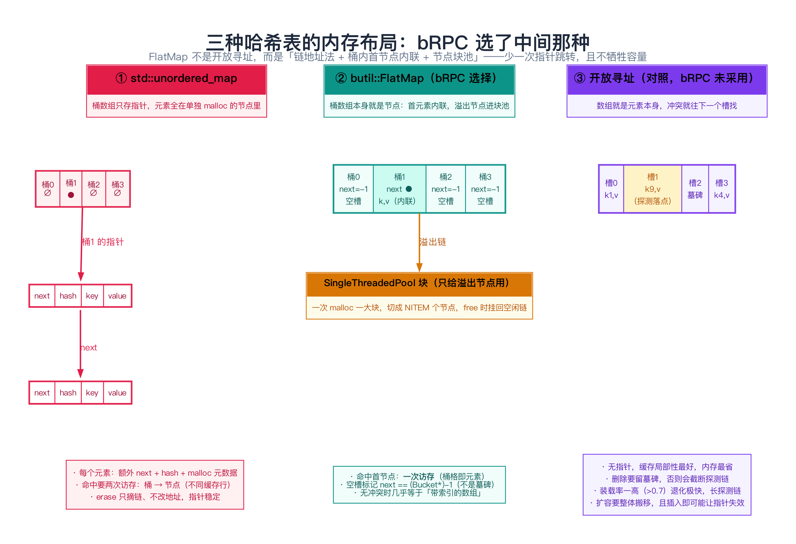
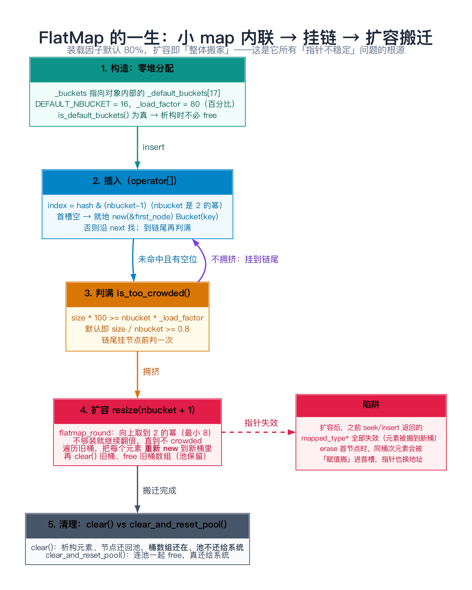
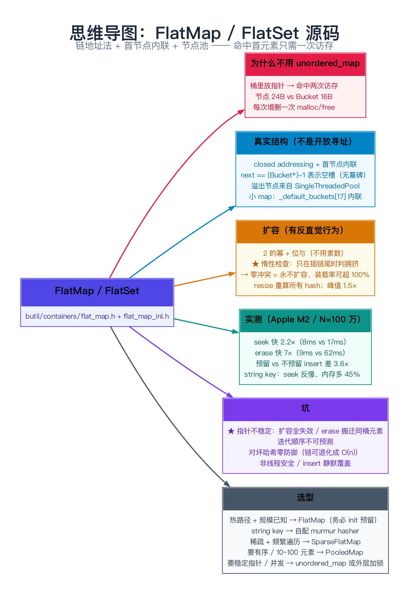

# FlatMap / FlatSet 源码：为什么 bRPC 不用 std::unordered_map

> **一句话总结**：`butil::FlatMap` 把哈希桶的**首元素直接内联在桶格里**（而不是像 `std::unordered_map` 那样桶里只放一个指针、元素另开一块堆内存），冲突时再挂到块池分配出来的溢出节点上——于是「命中首元素」的查找只需要**一次访存**，元素内存占用从 24 字节降到 16 字节，`erase` 也不用 `free`。代价是**扩容会让所有指向元素的指针失效**，而且桶数组按 2 的幂取整、在装载率偏高时会浪费内存。

> ⚠️ **先纠正一个流行说法**：网上（包括一些 bRPC 导读）常说「FlatMap 是开放寻址哈希」。**这是错的。** bRPC 源码自己在 `flat_map.h:20-23` 写得明明白白：`This closed addressing hash-map puts first linked node in bucket array directly to save an extra memory indirection.`——它用的是 **closed addressing（链地址法）**，只是做了「首节点内联」这个优化。全文第 2 节会用源码把这个误区彻底拆掉。

---

## 阅读路径

- **快速版（约 5 分钟）**：读「一句话总结」+ ⚠️ 纠正框 + 第 2 节（真实结构）+ 第 8 节（指针稳定的坑）+ 第 6 节的三张对比表。
- **深入版（约 30 分钟）**：全文通读，重点吃透第 3 节（`Bucket` 与空槽表示）、第 4 节（扩容与负载因子的真实行为，这一段有源码级别的「反直觉」发现）、第 5 节（`insert` / `seek` / `erase` 逐行走读）。

---

## 目录

1. [为什么要自己写一个哈希表](#1-为什么要自己写一个哈希表)
2. [真实数据结构：它是链地址法，不是开放寻址](#2-真实数据结构它是链地址法不是开放寻址)
3. [空槽、墓碑与迭代：没有墓碑，但有 thumbnail](#3-空槽墓碑与迭代没有墓碑但有-thumbnail)
4. [扩容：负载因子、2 的幂与「惰性检查」](#4-扩容负载因子2-的幂与惰性检查)
5. [源码剖析：insert / seek / erase 逐行](#5-源码剖析insert--seek--erase-逐行)
6. [完整可复现的对比 benchmark](#6-完整可复现的对比-benchmark)
7. [数据验证：复杂度与常数因子](#7-数据验证复杂度与常数因子)
8. [边界、反例与失败路径](#8-边界反例与失败路径)
9. [对比与选型](#9-对比与选型)
10. [常见问题 FAQ](#10-常见问题-faq)
11. [延伸阅读](#11-延伸阅读)
12. [思维导图总结](#12-思维导图总结)

---

## 1. 为什么要自己写一个哈希表

### 1.1 先用数据说话：`std::unordered_map` 慢在哪

`std::unordered_map` 是链地址法（separate chaining）：桶数组存指针，每个 `{key, value}` 单独 `new` 一个节点挂上去。这个设计通用、稳定，但在 RPC 这种「热路径上被调用几百万次」的场景里，有两个常数因子问题：

1. **每个元素多一次指针跳转**。查一个 key：先访问桶数组（第一次访存），拿到指针后再访问节点（第二次访存）。这两块内存**通常不在同一个缓存行里**，L1 很容易 miss。
2. **每个元素多一块 malloc 元数据 + 一个 `next` 指针**。libc++ 上 `unordered_map` 的一个节点是 24 字节（实测，见第 7 节），而键值对本身只要 8 字节——**元数据是有效载荷的 2 倍**。
3. **每次 insert / erase 都是一次 malloc / free**，多线程下直接变成分配器锁竞争。

`flat_map.h:20-23` 的作者注释把第 1 点讲得很直白：*"puts first linked node in bucket array directly to save an extra memory indirection"*——**把首个节点直接放进桶数组，省掉一次内存间接寻址**。

### 1.2 设计目标

`FlatMap` 想同时拿到「数组的局部性」和「哈希表的 O(1)」：

| 目标 | 手段 |
|------|------|
| 命中要快 | 首元素内联在桶格里 → **一次访存** |
| 无冲突时不退化 | 无冲突时，FlatMap 几乎等价于「带索引的数组」 |
| 插入/删除要快 | 溢出节点的分配走 `SingleThreadedPool`（块池），不是每次 malloc |
| 小 map 不该有开销 | 小 map 优化：默认 16 个桶内联在 `FlatMap` 对象里，**零堆分配** |

> **类比**：`std::unordered_map` 像「图书馆：索引卡上写书在哪个书架，你得再走一趟去取书」。`FlatMap` 像「索引卡上直接写正文，绝大多数情况下一眼就看完」。当然，正文长到卡片写不下时（哈希冲突），还是得另找地方。

---

## 2. 真实数据结构：它是链地址法，不是开放寻址

### 2.1 三个方案并排看



| | 桶数组里放什么 | 元素放哪 | 命中首元素要几次访存 |
|---|---|---|---|
| `std::unordered_map` | 一个指针 | 每次插入 `new` 一个节点 | 2 |
| **`butil::FlatMap`** | **就是节点本身**（`next` + `key` + `value`） | 首元素在桶格里；溢出元素在块池里 | **1** |
| 开放寻址（bRPC 未采用） | 就是元素本身 | 桶数组里 | 1（但冲突要线性探测） |

### 2.2 `Bucket` 结构（`flat_map.h:282-317`）

```cpp
struct Bucket {
    Bucket() : next((Bucket*)-1UL) {}          // flat_map.h:283
    explicit Bucket(const _K& k) : next(nullptr) {
        element_space_.Init(k);
    }

    bool is_valid() const { return next != (const Bucket*)-1UL; }  // :291
    void set_invalid() { next = (Bucket*)-1UL; }                   // :292

    Element& element() { return *element_space_; }                 // :294

    Bucket* next;                                                  // :313
private:
    ManualConstructor<Element> element_space_;                     // :316
};
```

关键点逐条：

- **`next` 既是「链指针」又是「有效性标记」**：空桶的 `next` 是 `(Bucket*)-1`（一个不可能被 `malloc` 出的地址），有效桶的 `next` 要么是下一个节点，要么是 `nullptr`（链尾）。这一手很省——**不需要额外的 has_value 布尔位**。
- **`element_space_` 用的不是 `Element` 而是 `ManualConstructor<Element>`**：因为桶数组是**一次性 `malloc` 一大片**的，那些格子里的 `Element` 还没被构造，不能按 `Element` 的构造语义去初始化（`_K` 可能是非 POD）。`ManualConstructor` 提供「裸内存 + 手动 `Init` / `Destroy`」，配合 placement new 使用。
- **`Element` = `FlatMapElement<_K,_T>`**（`flat_map.h:476-514`），内部就是 `_K _key; T _value;` 两个成员，并提供了 `value_ref()` 把 `this` 直接 `reinterpret_cast` 成 `std::pair<const K,T>&`（`flat_map.h:498`）——为了让 `for (auto& kv : map)` 拿到 `kv.first` / `kv.second`。

### 2.3 桶数组与节点池（`flat_map.h:379-392`）

```cpp
static const size_t default_nthumbnail = BIT_ARRAY_LEN(DEFAULT_NBUCKET);
// Note: need an extra bucket to let iterator know where buckets end.
Bucket _default_buckets[DEFAULT_NBUCKET + 1];      // :382  小 map 优化
uint64_t _default_thumbnail[default_nthumbnail];   // :383  Sparse 专用位图
size_t _size;
size_t _nbucket;
Bucket* _buckets;                                  // :386  要么指向 _default_buckets，要么指向堆
uint64_t* _thumbnail;
u_int _load_factor;                                // :388  默认 80（百分数）
bool _is_default_load_factor;
hasher _hashfn;
key_equal _eql;
SingleThreadedPool<sizeof(Bucket), 1024, 16, allocator_type> _pool;   // :392
```

两个「外面不容易看出来」的设计：

**① 多一个哨兵桶**：`_default_buckets` 和堆上的桶数组都是 `nbucket + 1` 个（`flat_map.h:381`、`flat_map_inl.h:730`）。第 `nbucket` 个桶的 `next` 被设为 `nullptr`（`flat_map.h:373`），它**只服务于迭代器**——`end()` 就是 `iterator(this, _nbucket)`（`flat_map_inl.h:827-829`），迭代器的 `find_and_set_valid_node()` 靠这个哨兵保证循环终止（`flat_map_inl.h:137-140`）。

**② 溢出节点来自 `SingleThreadedPool`**：`SingleThreadedPool<sizeof(Bucket), 1024, 16>` 意思是「每个元素大小 = `sizeof(Bucket)`，一次向系统要 1024 字节左右的一大块，切成若干节点」。`get()` 是纯粹的「从空闲链摘一个 / 从块里切一个」（`single_threaded_pool.h:78-94`），`back()` 把节点挂回空闲链（`single_threaded_pool.h:98-104`）——**`erase` 时不 `free`，只是挂回去**。这就是第 6 节里 `erase` 比 `unordered_map` 快 6~7 倍的直接原因。

### 2.4 它为什么不是开放寻址

开放寻址的定义是：**所有元素都放在桶数组内部，冲突时按探测序列（线性 / 二次 / 双重哈希）去试下一个槽**。`FlatMap` 显然不是：

- 溢出元素放在 `_pool` 里（`flat_map.h:392`），**不在桶数组里**；
- 每个 `Bucket` 有一个 `next` 指针（`flat_map.h:313`），这是链地址法的标志；
- 源码注释和类文档都自称 `closed addressing hash-map`（`flat_map.h:20`）。

那么「开放寻址」这个误传是怎么来的？多半是因为**名字**：`FlatMap` 里的 "Flat" 让人联想到「扁平数组 = 开放寻址」。实际上这里的 "Flat" 指的是**「桶格本身就是节点、扁平地摊在一起」**，是相对于 `std::map`（红黑树）和「桶 + 外部节点」而言的。

### 2.5 顺带回答：bRPC 里到底有没有开放寻址的表

有一个**形态上接近**的东西，但它不是 FlatMap：`src/butil/containers/hash_tables.h` 是 Chromium 风格的兼容层，把 `butil::hash_map` 映射到 `__gnu_cxx::hash_map` / `std` 的哈希表，**并不是一个自研的开放寻址实现**。bRPC 没有在核心路径上使用开放寻址哈希表——原因也不难猜：开放寻址对**装载率上限**非常敏感（通常要压到 0.5~0.7 才能保住探测链长度），而 RPC 场景里的表经常是「长生命周期、负载不可预测」的，链地址法的退化更可控。

---

## 3. 空槽、墓碑与迭代：没有墓碑，但有 thumbnail

### 3.1 空槽的表示法：`next == (Bucket*)-1`

```cpp
bool is_valid() const { return next != (const Bucket*)-1UL; }   // flat_map.h:291
void set_invalid() { next = (Bucket*)-1UL; }                    // flat_map.h:292
```

**没有墓碑（tombstone）。** 墓碑是开放寻址的专属需求：删除一个元素后必须留个「已删除」标记，否则会截断探测链、让后面的元素永远查不到。链地址法是**真的把节点从链上摘掉**（`flat_map_inl.h:437`：`last_p->next = p->next;`），摘掉之后那个桶自然回到「空」状态，不需要任何中间标记。

所以：**问「FlatMap 的墓碑怎么表示」时，正确答案是「不需要墓碑」**——这是判断「它到底是开放寻址还是链地址」最快的一个试金石。

### 3.2 迭代：跳过空桶的两种做法

朴素迭代器 `FlatMapIterator` 每走一步都要检查桶是否有效（`flat_map_inl.h:137-140`）：

```cpp
void find_and_set_valid_node() {
    for (; !_entry->is_valid(); ++_entry);
    _node = _entry;
}
```

当桶数组很大、元素很稀疏时（比如 `nbucket = 2^21` 而只有 2 万个元素），这个循环会白白扫过大量空桶。于是有了 `SparseFlatMap`：**额外维护一个 `bit_array`（thumbnail），一个 bit 标记一个桶是否非空**（`flat_map.h:383`、`flat_map.h:387`）。迭代时用 `bit_array_first1()` 一次跳过 64 个空桶（`flat_map_inl.h:206`）：

```cpp
if (!_map->_buckets[_pos].is_valid()) {
    _pos = bit_array_first1(_map->_thumbnail, _pos + 1, _map->_nbucket);
}
```

代价是每次插入/删除空桶状态变化时都要同步维护位图（`flat_map.h:374-376`、`flat_map_inl.h:596-599`、`flat_map_inl.h:402-404`）。**这是一个典型的「用写入时的一点代价换遍历时的巨大收益」的取舍**，也解释了为什么参数里要有一个 `bool _Sparse`。

### 3.3 多趟「不一致」迭代：`save_iterator` / `restore_iterator`

这是 `FlatMap` 一个很独特的能力（`flat_map.h:241-269`）。场景是：一张大表，要在**加锁/解锁交替**的情况下把它遍历完（避免长时间持锁）。`save_iterator` 把当前位置存进一个 `PositionHint`：

```cpp
// flat_map.h:162-167
struct PositionHint {
    size_t nbucket;   // 存的时候的桶数，用来判断有没有扩容
    size_t offset;    // 当前在哪个桶
    bool at_entry;    // 是在桶的首节点上，还是在溢出链上
    key_type key;     // 迭代到哪个 key 了
};
```

`restore_iterator`（`flat_map_inl.h:676-710`）恢复时有三条分支：桶数变了（扩容过）→ 从头重来；原位置被删了 → 从该桶重来；否则定位回原来的 key。文档明确说这是 **"inconsistent"** 迭代：*元素可能被漏掉、可能被重复访问*（`flat_map.h:242-246`）。

> 这个接口的存在本身说明了一件事：**作者很清楚「遍历 + 扩容」这对组合有多难缠**，干脆把「不一致」的语义做成显式 API，而不是假装能保证一致性。

---

## 4. 扩容：负载因子、2 的幂与「惰性检查」

这一段是本文最有意思的部分——**`FlatMap` 的扩容行为和一个想当然的模型不一样**，必须读源码才能发现。

### 4.1 桶数：2 的幂（默认）

```cpp
// flat_map_inl.h:61-68
inline size_t flatmap_round(size_t nbucket) {
#ifdef FLAT_MAP_ROUND_BUCKET_BY_USE_NEXT_PRIME
    return find_next_prime(nbucket);
#else
    return nbucket <= 8 ? 8 : find_power2(nbucket);
#endif
}

// flat_map_inl.h:70-76
inline size_t flatmap_mod(size_t hash_code, size_t nbucket) {
#ifdef FLAT_MAP_ROUND_BUCKET_BY_USE_NEXT_PRIME
    return hash_code % nbucket;
#else
    return hash_code & (nbucket - 1);     // 位与，比取模快
#endif
}
```

默认走**「向上取整到 2 的幂 + 位与取桶」**。源码里给这个选择的理由写得很实在（`flat_map_inl.h:56-60`）：

> *"Using next prime is slower for 10ns on average (due to %). If quality of the hash code is good enough, primeness of nbucket is not important. We choose to trust the hash code ... and still stick to round-to-power-2 solution right now."*

翻译：**用素数取模平均慢 10ns**，而只要哈希函数质量够好，桶数是不是素数并不重要。这是一个「相信使用者会提供好哈希」的赌注——第 8 节会讲这个赌注的风险。

### 4.2 负载因子与「拥挤」的判定

```cpp
// flat_map.h:348-353
bool is_too_crowded(size_t size) const {
    return is_too_crowded(size, _nbucket, _load_factor);
}
static bool is_too_crowded(size_t size, size_t nbucket, u_int load_factor) {
    return size * 100 >= nbucket * load_factor;      // 默认 load_factor = 80
}
```

即默认「**元素数 ≥ 桶数 × 0.8**」算拥挤（`flat_map.h:225` 初始化为 80）。也可以自定义：`init(nbucket, load_factor)`（`flat_map.h:186`，合法范围 10~100，`flat_map_inl.h:321`）。

### 4.3 关键发现：扩容检查是「惰性」的

看插入的代码（`flat_map_inl.h:592-620`，非 Multi 版 `operator[]`）：

```cpp
const size_t index = flatmap_mod(_hashfn(key), _nbucket);
Bucket& first_node = _buckets[index];
if (!first_node.is_valid()) {          // 落在空桶上
    ++_size;
    new (&first_node) Bucket(key);     // ← 直接放，完全不检查 is_too_crowded！
    return first_node.element().second_ref();
}
Bucket *p = &first_node;
while (true) {
    if (_eql(p->element().first_ref(), key)) return p->element().second_ref();
    if (nullptr == p->next) {                       // 走到链尾
        if (is_too_crowded(_size) && resize(_nbucket + 1)) {   // ←:609 只有这里检查
            return operator[](key);
        }
        ++_size;
        Bucket* newp = new (_pool.get()) Bucket(key);
        p->next = newp;
        return newp->element().second_ref();
    }
    p = p->next;
}
```

**`is_too_crowded` 只在「插入到一个非空桶的链尾」时才会被调用。** 这意味着：

> **如果哈希函数完美（永不冲突），`FlatMap` 永远不会扩容，即使装载率已经超过 100%。**

这不是理论推演，第 6 节有实测：把 `0..15` 这 16 个连续的 int 插进默认 16 桶的 map，装载率一路涨到 **100%**，`bucket_count()` 仍然是 16；直到插入第 17 个 key（必然与桶 0 冲突）才触发扩容。

这个行为有两个后果，一好一坏：

- **好**：哈希质量好时，桶不会被无谓地扩大——内存更省。
- **坏**：**装载率的上界是不受控的**。你没法通过 `load_factor` 参数保证「桶数一定 ≥ size/0.8」。

### 4.4 扩容到底扩到多大

```cpp
// flat_map_inl.h:717-724
size_t bump = 0;
do {
    new_nbucket = flatmap_round(new_nbucket + bump);
    bump = 1;
} while (is_too_crowded(size, new_nbucket, _load_factor));
if (_nbucket == new_nbucket) return nullopt;     // 没变化，不折腾
```

调用点是 `resize(_nbucket + 1)`（`flat_map_inl.h:609`）——**先加 1，再靠 `flatmap_round` 向上取整到 2 的幂**。`+1` 的作用是：当 `_nbucket` 本身已是 2 的幂时，`flatmap_round(_nbucket)` 会返回它自己，于是「没有扩张」，循环永远出不来；加 1 强制跳到下一个 2 的幂。然后用一个 `do...while` 反复翻倍，直到按**当前 size** 算不拥挤为止。

### 4.5 搬迁过程与内存峰值

```cpp
// flat_map_inl.h:755-793（resize 的主体）
for (iterator it = begin(); it != end(); ++it) {
    const key_type& key = Element::first_ref_from_value(*it);
    const size_t index = flatmap_mod(_hashfn(key), info->nbucket);   // ← 重新算 hash！
    ...
}
size_t saved_size = _size;
clear();                                     // 旧桶数组上的元素被销毁
if (!is_default_buckets()) {
    get_allocator().Free(_buckets);          // 旧桶数组才在这里释放
    ...
}
```

三个要点：

1. **重建时对每个 key 重新调用 `_hashfn`**（`flat_map_inl.h:763`）。`FlatMap` **不保存每个元素的计算好的 hash 值**（对比 `std::unordered_map` 在某些实现里会存）。省了内存，代价是**每次 rehash 都要把所有 key 重新哈希一遍**——对 `std::string` 这种 key 来说，这是一次完整的 O(总字符数) 操作。
2. **搬迁期间新旧桶数组同时存在**，所以**峰值内存会是稳态的约 1.5 倍**（旧 1× + 新 2×，释放旧的之后落到 2×）。第 6 节的 RSS 数据（75MB vs 40MB）就是这么来的。
3. 旧桶数组直到 `clear()` 之后才 `Free`（`flat_map_inl.h:782-787`）。

### 4.6 `clear()` 不还内存给系统

```cpp
// flat_map.h:210-214
// Remove all items. Allocated spaces are NOT returned by system.
void clear();
// Remove all items and return all allocated spaces to system.
void clear_and_reset_pool();
```

`clear()`（`flat_map_inl.h:512-536`）只析构元素、把溢出节点挂回池，**桶数组和节点池都留着**——适合「反复清空再填充」的场景。要真正还给系统，用 `clear_and_reset_pool()`（`flat_map_inl.h:540-543`，内部调 `_pool.reset()`）。



---

## 5. 源码剖析：insert / seek / erase 逐行

### 5.1 `insert` 就是 `operator[]` 加一次赋值

```cpp
// flat_map_inl.h:370-375
template <...> _T* FlatMap<...>::insert(const key_type& key, const mapped_type& value) {
    mapped_type *p = &operator[](key);
    *p = value;
    return p;
}
```

**返回值是 `mapped_type*`，不是 `std::pair<iterator,bool>`**——接口风格和 STL 完全不同。这个设计有双重含义：一是少一次构造（`operator[]` 已经默认构造了 `T`），二是**把「指针」这个危险的东西直接交到用户手上**（第 8 节展开）。

### 5.2 `seek`：命中路径只有一次桶访问

```cpp
// flat_map_inl.h:548-564
template <typename K2>
_T* FlatMap<...>::seek(const K2& key) const {
    Bucket& first_node = _buckets[flatmap_mod(_hashfn(key), _nbucket)];   // 唯一一次桶数组访存
    if (!first_node.is_valid()) return nullptr;
    if (_eql(first_node.element().first_ref(), key)) {
        return &first_node.element().second_ref();                        // 首节点命中：结束
    }
    Bucket *p = first_node.next;                                          // 否则沿链走
    while (p) {
        if (_eql(p->element().first_ref(), key)) return &p->element().second_ref();
        p = p->next;
    }
    return nullptr;
}
```

无冲突（`next == nullptr`）时，整个查找就是「算 hash → 访存一次 → 比一次 key」。这就是它相对 `unordered_map` 少掉的那一次间接寻址。

注意 `seek` 是 **template<typename K2>** 的：`K2` 可以是 `const char*` 或 `StringPiece`，不必先构造出 `std::string`。配合 `find_cstr` / `find_lowered_cstr`（`flat_map.h:586-634`）就直接支持「用 C 字符串查 map」。`DefaultEqualTo<std::string>` 也相应提供了和 `StringPiece`、`const char*` 比较的重载（`flat_map.h:576-583`）。

### 5.3 `erase`：首节点会被「赋值搬走」——这是最烧脑的一段

```cpp
// flat_map_inl.h:395-426
if (_eql(first_node.element().first_ref(), key)) {
    if (old_value) *old_value = first_node.element().second_movable_ref();
    if (first_node.next == nullptr) {
        first_node.destroy_element();
        first_node.set_invalid();                 // 整条链空了，桶置空
        if (_S) bit_array_unset(_thumbnail, index);
    } else {
        // A seemingly correct solution is to copy the memory of *p to
        // first_node directly like this:
        //   first_node.destroy_element();
        //   first_node = *p;
        // It works at most of the time, but is wrong generally.
        // If _T references self inside like this: ...
        Bucket* p = first_node.next;
        first_node.next = p->next;
        const_cast<_K&>(first_node.element().first_ref()) = p->element().first_ref();
        first_node.element().second_ref() = p->element().second_movable_ref();
        p->destroy_element();
        _pool.back(p);
    }
    --_size;
    return 1UL;
}
```

要删的是「桶格里的首节点」时，**不能**直接 `Bucket= *p` 做内存拷贝——源码注释给了反例：如果 `T` 内部有自引用指针（`T* p = &this->field`），memcpy 之后指针会指向旧地址。所以只能**用 `operator=` 把下一个节点的 key/value「搬」过来**，再把下一个节点还给池。

这段代码有两个重要副作用（第 8 节详述）：

- **被搬的那个元素的地址变了**：它从原来的池节点，变成了桶格。所以 `seek` 拿到的指针在 `erase` 之后**可能失效**。
- `_K` 的赋值要 `const_cast`（因为 `value_type` 是 `std::pair<const K, T>`）——这是把 key 变成可写的必要之恶。

链中间的删除就简单多了：找到前驱，改 `next`，把节点还池（`flat_map_inl.h:430-446`）。

### 5.4 迭代顺序与 `flat_map.h` 里的那 70 行基准测试

`FlatMap` 的迭代顺序 = **桶数组顺序 + 每个桶内的链顺序**，而链是**头插**的（`flat_map_inl.h:614` 用的是尾插，Multi 版 `flat_map_inl.h:656-657` 用头插）。总之：**迭代顺序与插入顺序完全无关，而且任何一次扩容都会彻底改变它**。别写依赖顺序的代码。

顺带一提，`flat_map.h:26-91` 有一段 70 行的作者自测数据（2013 年，由 bRPC 作者 gejun 留下的），格式是：

```text
Sequentially inserting 100 into FlatMap/MultiFlatMap/std::map/butil::PooledMap/std::unordered_map/std::unordered_multimap/butil::hash_map takes 20/20/300/290/2010/210/230
```

这是官方给出的「为什么快」的原始依据。**但请注意两点**：① 这是 2013 年的机器和当时的 libstdc++；② 现代 libc++ / libstdc++ 的 `unordered_map` 已经优化了很多。第 6 节是**我在 2026 年的机器上重做的测量**——结论方向一致，但差距远比那 100 倍小。**引用旧数据时一定要标年份和平台。**

---

## 6. 完整可复现的对比 benchmark

### 6.1 环境

```text
macOS 26.4.1 / Apple M2 (8 核) / Apple clang 14.0.3 / libc++ / -O2 / C++14
bRPC commit 6ab8c0e
```

### 6.2 怎么把它编出来（不需要编译整个 bRPC）

`flat_map.h` 的依赖链里最麻烦的一环是 `butil/logging.h`，它 `<include>` 了 `butil/config.h`（构建时生成）和 `gflags/gflags_declare.h`。想单独跑 benchmark，做一个**最小桩**即可（不修改 brpc 源码，全部放在单独的 `inc/` 目录里）：

```bash
mkdir -p demo/inc/butil demo/inc/gflags && cd demo

# 桩 1：butil/config.h（构建系统负责生成的东西）
cat > inc/butil/config.h <<'EOF'
#ifndef BUTIL_CONFIG_H
#define BUTIL_CONFIG_H
#endif
EOF

# 桩 2：gflags/gflags_declare.h（只用到了 DECLARE_int32）
cat > inc/gflags/gflags_declare.h <<'EOF'
#ifndef GFLAGS_DECLARE_H_
#define GFLAGS_DECLARE_H_
#include <cstdint>
#define DECLARE_bool(name)   extern bool     FLAGS_##name
#define DECLARE_int32(name)  extern int32_t  FLAGS_##name
#define DECLARE_string(name) extern char* const FLAGS_##name
#endif
EOF

# 桩 3：logging 里被模板实例化引用到的几个符号
cat > logstub.cpp <<'EOF'
#include "butil/logging.h"
namespace logging {
int GetMinLogLevel() { return 0; }
LogMessage::LogMessage(const char* file, int line, const char* func,
                       LogSeverity severity) : _stream(nullptr) {
    (void)file; (void)line; (void)func; (void)severity;
}
LogMessage::~LogMessage() {}
}
EOF
```

（`LogMessage` 的构造函数签名抄自 `butil/logging.h` 的类声明；它只被 `new_buckets_and_thumbnail` 里那句 `LOG(FATAL)` 引用。）

### 6.3 benchmark 代码

```cpp
// bench.cpp —— FlatMap vs std::unordered_map（int -> int）
#include "butil/containers/flat_map.h"
#include <unordered_map>
#include <vector>
#include <string>
#include <random>
#include <chrono>
#include <cstdio>
#include <cstdlib>
#include <sys/resource.h>

static double now_us() {
    using namespace std::chrono;
    return duration_cast<duration<double, std::micro>>(
               steady_clock::now().time_since_epoch()).count();
}
static long peak_rss_mb() {
    struct rusage ru; getrusage(RUSAGE_SELF, &ru);
#ifdef __APPLE__
    return ru.ru_maxrss / (1024 * 1024);   // macOS: ru_maxrss 是字节
#else
    return ru.ru_maxrss / 1024;            // Linux: KB
#endif
}

int main(int argc, char** argv) {
    const std::string which = argv[1];               // flatmap | flatmap-init | unordered
    const size_t N = strtoul(argv[2], nullptr, 10);
    std::mt19937_64 rng(12345);                      // 固定种子，可复现
    std::vector<uint32_t> keys(N);
    for (auto& k : keys) k = (uint32_t)rng();

    if (which == "flatmap" || which == "flatmap-init") {
        butil::FlatMap<uint32_t, uint32_t> m;
        if (which == "flatmap-init") m.init(N * 5 / 4);   // 预留，避免扩容
        else                         m.init(16);          // 默认：从小长到大
        double t0 = now_us();
        for (size_t i = 0; i < N; ++i) m.insert(keys[i], 100);
        double t1 = now_us();
        volatile uint64_t sink = 0;
        for (size_t i = 0; i < N; ++i) { uint32_t* p = m.seek(keys[i]); if (p) sink += *p; }
        double t2 = now_us();
        for (size_t i = 0; i < N; ++i) m.erase(keys[i]);
        double t3 = now_us();
        printf("[%-12s] N=%zu insert=%.1fms seek=%.1fms erase=%.1fms peakRSS=%ldMB\n",
               which.c_str(), N, (t1-t0)/1000, (t2-t1)/1000, (t3-t2)/1000, peak_rss_mb());
    } else {
        std::unordered_map<uint32_t, uint32_t> m;
        m.reserve(N);                                // 公平起见，两边都预留
        double t0 = now_us();
        for (size_t i = 0; i < N; ++i) m.emplace(keys[i], 100);
        double t1 = now_us();
        volatile uint64_t sink = 0;
        for (size_t i = 0; i < N; ++i) {
            auto it = m.find(keys[i]);
            if (it != m.end()) sink += it->second;
        }
        double t2 = now_us();
        for (size_t i = 0; i < N; ++i) m.erase(keys[i]);
        double t3 = now_us();
        printf("[%-12s] N=%zu insert=%.1fms seek=%.1fms erase=%.1fms peakRSS=%ldMB\n",
               which.c_str(), N, (t1-t0)/1000, (t2-t1)/1000, (t3-t2)/1000, peak_rss_mb());
    }
    return 0;
}
```

> 注意最后一句「两边都预留」：`std::unordered_map` 侧我调了 `reserve(N)`，而 `FlatMap` 侧**故意跑两个版本**（默认从小长到大 vs 预 `init`），这样才能看清「扩容成本」到底有多贵。

编译：

```bash
BRPC=/path/to/brpc
g++ -O2 -std=c++14 -I inc -I $BRPC/src -I $BRPC bench.cpp logstub.cpp -o bench
```

### 6.4 实测结果（int key，N = 1,000,000，跑 3 轮）

| 方案 | insert | seek | erase | 峰值 RSS |
|------|--------|------|-------|---------|
| `FlatMap`（默认 `init(16)`，边插边长） | 47.8 / 57.1 / 49.0 ms | **8.2 / 8.5 / 8.9 ms** | **9.0 / 9.4 / 9.1 ms** | 75 MB |
| `FlatMap`（`init(N*5/4)` 预留） | **13.2 / 13.7 / 13.2 ms** | **7.1 / 7.9 / 7.6 ms** | **8.8 ms** | 40 MB |
| `std::unordered_map`（`reserve(N)`） | 47.4 / 47.8 / 48.8 ms | 17.3 / 17.6 / 17.6 ms | 61.3 / 62.1 / 66.9 ms | 43 MB |

### 6.5 这组数据在说什么

1. **`seek`：FlatMap 快约 2.2×**（7~9ms vs 17ms）。这正是「省掉一次内存间接寻址」的收益。
2. **`erase`：FlatMap 快约 7×**（9ms vs 62ms）。因为 `erase` 只是「改指针 + 节点还池」，`unordered_map` 则是每个元素一次 `free`。
3. **`insert`：预留与否差 3.6×**（13ms vs 48ms）。**默认构造的 `FlatMap` 要反复扩容**：`init(16)` 一路长到 2^20 桶，中间经历了 16 次 resize，每次都要重新哈希 100 万个 key。**结论：知道规模就一定要 `init()` 预留**——这比换数据结构更划算。
4. **内存：预留的 FlatMap 反而最省（40MB vs unordered 43MB）**。因为 `unordered_map` 每个元素是 24 字节的节点（第 7 节实测），而 `FlatMap` 是 16 字节。
5. **不预留的 FlatMap 峰值 75MB**——这就是 4.5 节说的「新旧桶数组同时存在」。

### 6.6 换成 `std::string` key：结论会反转

| 方案（N = 1,000,000，key 长约 20 字符） | insert | seek | 峰值 RSS |
|------|--------|------|---------|
| `FlatMap`（`init(N*5/4)`） | 49 / 50 / 59 ms | 81 / 82 / 86 ms | 112 MB |
| `std::unordered_map`（`reserve(N)`） | 79 / 80 / 84 ms | 69 / 70 / 70 ms | 77 MB |

**`insert` 仍然快 1.6×，但 `seek` 反而慢了约 17%，内存还多用了 45%。** 两个原因：

- `FlatMap` 对 `std::string` 的默认哈希是 `result * 101 + c`（`flat_map.h:545-569`），**比 libc++ 给 `std::string` 用的 murmur 哈希弱**（实测见第 7 节：`hash("ab") == 9895`，完全可预测）。弱哈希 → 冲突更多 → 链更长。
- 我给的 `init(N*5/4)` 被 `flatmap_round` 向上取整到 **2^21 = 2,097,152 个桶**（实际只用 100 万），而 `unordered_map` 的 `reserve` 是按需给的——**2 的幂取整在这里浪费了约一倍桶数组**（实测 `nbucket=2097152, size=1000000, load=47.7%`）。

> **这就是本篇最实用的一条经验**：`FlatMap` 的性能**高度依赖你给的哈希函数和初始桶数**。默认配置在 `std::string` 上并不占优；要榨出优势，得（a）自己写一个 murmur 风格的 hasher（源码注释 `flat_map.h:136-137` 也是这么建议的），（b）把桶数算准，别被 2 的幂取整坑掉一半。

---

## 7. 数据验证：复杂度与常数因子

### 7.1 复杂度

| 操作 | 期望复杂度 | 最坏 | 常数因子的差别 |
|------|-----------|------|--------------|
| `seek` | O(1 + α)，α = 平均链长 | O(n)（全冲突） | FlatMap 命中首节点 1 次访存；unordered 恒定 2 次 |
| `insert` | O(1) 摊还 | O(n)（rehash） | FlatMap 溢出节点走块池；unordered 每次 malloc |
| `erase` | O(1 + α) | O(n) | FlatMap 不 `free`；unordered `free` |
| `resize` | O(n) | O(n) | **FlatMap 要重算所有 hash；unordered（部分实现）把 hash 存进了节点** |

α 是装载率。因为 `is_too_crowded` 用的是 80%，**正常情况下 α ≤ 0.8**，期望链长不到 1——所以命中首节点的概率很高。实测确认：100 万个 int key 插进默认配置，结果是 `bucket_info() = {maxb=1, avgb=1.00}`——**一条链都没超过 1 个元素**（见 7.3 的解释）。

### 7.2 每个元素占多少字节（实测 `sizeof`）

| 结构 | 字节 |
|------|------|
| `sizeof(butil::FlatMap<int,int>::Bucket)` | **16** |
| `sizeof(std::__hash_node<std::pair<const int,int>, void*>)`（libc++） | **24** |
| `sizeof(std::pair<const int,int>)` | 8 |

`Bucket` = `next` 指针（8）+ `Element`（8，含 `_key`/`_value` 各 4）。**没有多余的 hash 字段、没有 malloc 头**。`unordered_map` 的节点是 8（`next`）+ 8（libc++ 的 `__hash_node` 头部）+ 8（键值）= 24。

（口径提醒：这是 `sizeof`，不是真正的 malloc 尺寸——分配器还会向上取整，所以实际占用可能更大。但两边的比较方向是可靠的。）

顺带一个**期望落空**的实测：`sizeof(FlatMap<int, FlatMapVoid>::Bucket)` **也是 16**，并没有比 map 省。`FlatSet` 的 `Element` 特化（`flat_map.h:516-539`）确实只存了 key（4 字节），但 `Bucket` 要对齐到指针宽度，`8 + 4` 被补到 16——**所以「FlatSet 更省内存」这个想当然的说法，对 int 这类小 key 并不成立**。

### 7.3 用实测数据验证「惰性扩容」

```text
start: nbucket=16
insert(12) -> nbucket=     16  size=13  size*100/nbucket=81%     ← 已超过 80%！
insert(15) -> nbucket=     16  size=16  size*100/nbucket=100%    ← 装载率 100%，仍不扩容
insert(16) -> nbucket=     32  size=17  size*100/nbucket=53%     ← 第一次冲突，才扩容
```

再换一个**故意坏掉**的 hasher（恒返回 0，所有 key 撞同一个桶）：

```text
insert(12) -> nbucket=    16  size=13  maxb=13
insert(13) -> nbucket=    32  size=14  maxb=14     ← 第一次扩容
insert(19) -> nbucket=    32  size=20  maxb=20     ← 之后再不扩容，链长 = n
```

两段输出合起来说明：**扩容由「是否真的发生冲突」触发，而不是由装载率触发**；`load_factor` 参数只影响「触发时扩到多大」。这是读 `FlatMap` 源码最容易漏掉的一层。

100 万个随机 `uint32_t` key 的最终状态（实测）：

```text
nbucket=1048576  size=1000000  load=95.4%   bucket_info={maxb=1, avgb=1.00}
```

`maxb=1` 且 `nbucket = 2^20`（而不是按 80% 算出的 2^21）——完美印证了 4.3 节的结论。

### 7.4 默认哈希函数的成色（实测）

```text
hash(0)=0  hash(1)=1  hash(2)=2 ...        ← DefaultHasher<int> 就是恒等函数
hash("a")=97      hash("b")=98
hash("ab")=9895                            ← 97*101 + 98
hash("hello")=10927454832                  ← 手算 result*101+c 完全一致
```

`DefaultHasher<int>` 是**恒等映射**（libc++ 把 `std::hash<int>` 实现成 identity），`DefaultHasher<std::string>` 就是 `flat_map.h:545-569` 里那个 `result * 101 + c`。

这两件事合起来解释了一个看起来矛盾的现象：**为什么 int key 一个冲突都没有（`maxb=1`），而 string key 会有 `maxb=4`**。连续 int 经过恒等哈希 + 「2 的幂取桶 + 位与」= 完美分布；而 `*101` 这种「类 Java 31」的哈希**雪崩性质很差**，长相似字符串（比如 `key_1_abcdefgh` / `key_2_abcdefgh`）容易撞在一起。

> 结论：**用 `FlatMap` 一定要审哈希**。bRPC 自己在 `flat_map.h:136-137` 的注释里就建议：*"Use src/butil/third_party/murmurhash3 to make better distributions."* 而 bRPC 内部真正需要注意分布的场合（如 HTTP/2 的 HPACK 索引表、命名服务表）都传了自定义 hasher（`hpack.cpp:214`、`naming_service_thread.cpp:57`）。

---

## 8. 边界、反例与失败路径

### 8.1 坑一：指针/引用**极不稳定**（这是最大的坑）

`seek()` / `insert()` / `operator[]` 都返回 `mapped_type*`。**这个指针什么时候失效？** 从源码能推出三种：

**① 扩容 → 全部失效。** `resize` 把每个元素 `new` 到新桶数组里，旧桶数组被 `Free`。原来的指针全部悬垂。

**② `erase` 首节点 → 同桶的另一个元素会换地址。** 见 5.3：删掉桶格里那个首节点时，代码把「下一个节点」的 key/value **赋值搬进**桶格，然后把那个节点还池。于是「下一个元素」的地址从池节点变成了桶格。

**③ 池 `reset()` / `clear_and_reset_pool()` → 溢出节点全部失效。**

实测（细节见下面这段输出）：

```text
== A. resize 之后，先前拿到的指针不再指向 map 里的元素 ==
  insert(1,111) -> p=0x16ee6ab5c, *p=111
  写 *p=999 之后，m.seek(1) = 111 （map 里仍是旧值）

== B. erase 首节点时，第二个元素被「搬」进首槽 ==
  seek(2) -> p2=0x100fc6ecc, *p2=20
  erase(1) 后 re-seek(2) -> q2=0x16ee6ab4c, *q2=20
  p2 == q2 ? 否  -> 元素被搬了家，p2 已成悬垂指针
```

A 这个案例特别阴险：**写 `*p` 不报错、读 `*p` 还能读出 111**——因为那块内存虽然已被 `clear()` 释放，字节还没被覆盖。你会以为一切正常，直到某天它被别的分配覆盖掉，才变成一个「偶发、不可复现」的 bug。B 则直接证明地址变了（`p2 != q2`）。

**正确姿势**：

| 想做的事 | 该用什么 |
|---------|---------|
| 想长期持有某个 value | 存 **key** 或 **value 的副本**，不要存指针 |
| 想原地修改 value | 每次都 `*m.seek(key)` 重新取；或短暂持有、不做插入 |
| 想遍历中改元素 | 可以（`iterator::operator*` 返回引用），但**不能在遍历中 insert 触发扩容** |
| 想跨线程长期共享一条数据 | 存 `std::shared_ptr<T>`（`FlatMap<K, std::shared_ptr<T>>`） |

### 8.2 坑二：迭代顺序不可预测，且扩容后完全改变

`FlatMap` 的迭代顺序由「桶下标 + 链内位置」决定。扩容会改变所有元素所在桶，于是顺序彻底打乱。**任何「依赖插入顺序」或「依赖两次遍历顺序相同」的逻辑都是 bug**——包括「先遍历一遍收集 key，再遍历第二遍做别的事」这种写法（两次遍历中间只要有人插入，顺序就可能变）。

（`save_iterator` / `restore_iterator` 应对的是另一个场景——「加解锁交替的多趟遍历」，且它明确承诺是 *inconsistent* 的。）

### 8.3 坑三：对坏哈希毫无防御

对比 Java 8 的 `HashMap`——链长超过阈值会把链**转成红黑树**，保证最坏 O(log n)。`FlatMap` **没有任何这类兜底**。7.3 节的实验显示：用恒定 hasher 时链长就等于元素个数，`seek` 直接退化成 O(n) 链表扫描。

**自检清单**（用 `FlatMap` 前逐条过）：

- [ ] 我的 key 类型是不是用户自定义的？→ 有没有给一个像样的 `hasher`？
- [ ] 用 `std::string` 且 key 有大量共同前缀？→ `*101` 会撞，换 murmur。
- [ ] 表可能被**外部输入**构造 key 吗？（如 HTTP header 名、用户 ID）→ 存在哈希碰撞攻击面（DoS）。
- [ ] 表稳定后跑一次 `bucket_info()` 看看 `maxb` 有没有异常。

```cpp
// 上线前的一次性体检：maxb 明显大于 4~5 就该换 hasher 了
butil::BucketInfo bi = m.bucket_info();
LOG_IF(WARNING, bi.longest_length > 5) << "hash too weak: " << bi;
```

（`bucket_info()` 会 `O(nbucket + size)` 扫全表，别放进热路径。）

### 8.4 坑四：`FlatMap` 不是线程安全的

所有操作都是裸读裸写，**没有任何锁、没有任何原子操作**。bRPC 的用法是**在外部加锁**（读多写少时用 `butil::DoublyBufferedData` 包装，或者干脆用 `std::shared_mutex`）。别指望「读不会修改结构所以读操作线程安全」——扩容时读线程会读到正在被 `Free` 的旧桶数组。

### 8.5 坑五：`erase` 的返回值与 `_Multi` 版语义不同

```cpp
// flat_map.h:198-208
template <typename K2, bool Multi = _Multi>
typename std::enable_if<!Multi, size_t>::type erase(const K2& key, mapped_type* old_value = nullptr);
template <typename K2, bool Multi = _Multi>
typename std::enable_if<Multi, size_t>::type erase(const K2& key, std::vector<mapped_type>* old_values = nullptr);
```

同一个函数名，`_Multi=false` 时第二个参数是 `mapped_type*`，`_Multi=true` 时是 `std::vector<mapped_type>*`，靠 SFINAE 切换。写模板代码时会遇到「明明签名对不上却能编译」的困惑——其实是 `enable_if` 在起作用。另外 `erase` 的返回值含义也随 `_Multi` 变（见 `flat_map.h:200` / `flat_map.h:205` 的注释）。

### 8.6 坑六：`insert` 会**默默覆盖**已有 key

`insert` 就是 `operator[]` + 赋值（`flat_map_inl.h:370-375`），所以它**不检查 key 是否已存在**——已存在就覆盖，且**不会告诉你**（不像 `std::unordered_map::insert` 返回 `pair<iterator,bool>` 让你知道有没有插进去）。想要「不存在才插」的语义，必须自己 `seek` 判断，或者用 `MultiFlatMap`（`_Multi=true` 会保留多份）。

### 8.7 不适用场景清单

| 场景 | 为什么不合适 |
|------|-------------|
| 需要**稳定指针**（比如把 value 地址存到别处） | 扩容 / erase 都会让指针失效 |
| 需要**按 key 有序迭代** | FlatMap 无序；用 `std::map` / `PooledMap` |
| key 是可被外部构造的字符串，且表很大 | 弱哈希 → 碰撞退化 / DoS 风险 |
| 表极小（< 10 个元素） | `PooledMap` 的注释就说：**< 10 个元素时 PooledMap 都可能更慢**；更小干脆用 `std::vector` 线性找 |
| 多线程并发读写同一张表 | 无锁保护；外层必须自己加锁 |
| 存的类型很大（几百字节的 value） | 「首节点内联」的红利被稀释，收益变小 |

---

## 9. 对比与选型

### 9.1 bRPC 内部的四个「map」

| 容器 | 底层 | 顺序 | 指针稳定性 | 典型用途 |
|------|------|------|-----------|---------|
| `butil::FlatMap` | 链地址 + 首节点内联 + 块池 | 无序 | ❌ | 热路径查找（HTTP/2 header 索引、LB 的 id 集合、`Controller::UserFieldsMap`） |
| `butil::FlatSet` | 同上（value 是 `FlatMapVoid`，`flat_map.h:403-458`） | 无序 | ❌ | 去重 / 存在性判断 |
| `butil::SparseFlatMap` | FlatMap + thumbnail 位图 | 无序 | ❌ | 桶很多但元素稀疏、且要频繁遍历 |
| `butil::PooledMap` | `std::map` + 池化分配器（`pooled_map.h:31-39`） | **有序** | ✅ | 10~100 个元素的**有序**场景；>100 个官方建议换 FlatMap |
| `std::unordered_map` | 链地址（桶里存指针） | 无序 | ✅（除 rehash） | 通用、要求标准、可移植 |

> 注意 **`FlatSet` 没有独立的 `flat_set.h`**——它和 `FlatMap` 在同一个 `flat_map.h` 里（`flat_map.h:403-458`），内部就是 `FlatMap<_K, FlatMapVoid, ...>`。找文件的时候别以为漏了。

### 9.2 到底该用哪个

```text
需要有序遍历？ ── 是 ──→ 元素数 10~100 ？ ── 是 ──→ butil::PooledMap
        │                        └── 否 ──→ std::map / std::set
        否
        ↓
元素数 < 10 ？ ── 是 ──→ std::vector 线性找（最快的其实往往是它）
        │
        否
        ↓
是热路径、且能接受「指针不稳定」？ ── 是 ──→ butil::FlatMap
        │                                        ├─ 大小已知 → 一定要 init(n) 预留
        │                                        ├─ key 是 string → 自己配 murmur hasher
        │                                        └─ 稀疏且要遍历 → SparseFlatMap
        否
        ↓
std::unordered_map
```

bRPC 自己的选择印证了这张图：`Controller::UserFieldsMap`（`controller.h:119`）、HTTP/2 的 HPACK 索引表（`hpack.cpp:214`）、命名服务表（`naming_service_thread.cpp:57`）、一致性哈希 LB 的 `FlatSet<ServerId>`（`consistent_hashing_load_balancer.cpp:205`）、加权随机 LB 的 `FlatSet<SocketId>`（`weighted_randomized_load_balancer.cpp:130`）——**全是热路径上「查多写少、规模可预估」的表，且大小都靠 `init()` 预设**（例如 `id_set.init(servers.size() * 2)`，`consistent_hashing_load_balancer.cpp:206`）。这就是标准用法。

### 9.3 与「开放寻址」方案的对比（顺带回答标题里的问题）

如果 bRPC 当年选了开放寻址，会怎样？

| | 链地址（FlatMap 的选择） | 开放寻址 |
|---|---|---|
| 装载率上界 | 可以到 1.0+（只是链变长） | 必须留出空槽（通常 ≤ 0.7），否则探测链爆炸 |
| 每个元素额外开销 | 一个 `next`（8B） | 0（但需要空槽，等效也是开销） |
| `erase` | 直接摘链，无副作用 | 必须写墓碑，且墓碑会累积、拖慢探测 |
| 迭代 | 天然按桶顺序 | 要跳空槽 |
| 指针稳定性 | 差（扩容 + erase 搬迁） | 更差（插入即可能触发 rehash 搬全部元素） |
| 缓存友好度 | 好（命中首节点 1 次访存） | **最好**（纯数组，prefetch 友好） |

结论：**开放寻址在「只读、预知规模、能容忍低装载率」的场景确实更快**（比如 Google 的 `dense_hash_map`、Rust 的 hashbrown）。但 RPC 框架里的表常常是**长生命周期 + 负载不可预测 + 需要删除**——链地址法的退化更温和。bRPC 选择链地址是一种**面向不确定性的保守**，而不是性能上的最优解。

---

## 10. 常见问题 FAQ

**Q1：FlatMap 到底是不是开放寻址？**
不是。它是 **closed addressing（链地址法）**，证据是 `flat_map.h:20` 的作者注释、`Bucket::next` 指针（`flat_map.h:313`）、以及溢出节点存在 `SingleThreadedPool` 里（`flat_map.h:392`）。「首元素内联」是链地址法的一个优化变体，和开放寻址是两码事。

**Q2：那 `flat_set.h` 在哪？**
不存在。`FlatSet` 定义在 `flat_map.h:403-458` 里。

**Q3：`seek` 和 `find` 有什么区别？**
`FlatMap` 里只有 `seek`（`flat_map.h:219`）。**`find` 是 `butil::find_cstr` 这类自由函数**（`flat_map.h:586-596`），专门用于「`std::string` key + `const char*` 查询」的场景。找不到时 `seek` 返回 `nullptr`。

**Q4：为什么 `insert` 返回 `T*` 而不是 `pair<iterator,bool>`？**
因为它就是 `operator[]` + 赋值（`flat_map_inl.h:370-375`），从没打算告诉你「是不是新插入的」。想判断，先 `seek` 再 `insert`。

**Q5：`erase` 之后，我的指针还能用吗？**
**不能保证。** 如果删的是同桶的首节点，另一个元素会被「赋值搬进」首槽，地址变了（见 8.1 的实测 B）。删链中间的元素，其他元素的地址不变，但那个被删节点已还给池，可能被下一次插入复用。**结论：任何 `erase` 之后，之前拿到的指针一律当作失效。**

**Q6：为什么我的 map 装载率到了 100% 还不扩容？**
因为扩容检查（`is_too_crowded`）在 `operator[]` 里**只在「插入到非空桶的链尾」时才执行**（`flat_map_inl.h:609`）。哈希完美、零冲突时永远不会走到那一行。详见第 4.3 节与 7.3 节的实测。

**Q7：怎么知道我的哈希好不好？**
调 `bucket_info()`（`flat_map_inl.h:798-810`），看 `longest_length`。正常应该在 1~3；如果是 5 以上，说明哈希太弱或装载率太高。注意这个函数会全表扫描。

**Q8：`SparseFlatMap` 什么时候用？**
当 `nbucket` 很大而元素稀疏、且你要**频繁遍历**时。它用位图跳过空桶（`flat_map_inl.h:204-209`），但每次插入/删除都要维护位图。元素密度高时它只是纯开销。

**Q9：能不能把 key 设计成非 `std::string`？**
能，而且往往更快（省掉字符串哈希和比较）。bRPC 的 `Controller::UserFieldsMap` 因为要存 HTTP header 名才用 string；而 LB 里用的是 `SocketId` / `ServerId` 这类 POD，配合自定义/默认 hasher，性能更好。

**Q10：`FlatMap` 能在 bthread 里用吗？**
能——只要理解「它本身无锁」，并且**别在 bthread 里做会阻塞的事**（这是 bthread 的通用约束，见第 23 篇）。但更要注意的是 8.4：一张表被多个 bthread 并发访问时，必须自己加锁或改用 `DoublyBufferedData`。

---

## 11. 延伸阅读

- **源码**（行号基于 commit `6ab8c0e`）
  - [`src/butil/containers/flat_map.h`](https://github.com/apache/brpc/blob/master/src/butil/containers/flat_map.h) —— `Bucket`、`FlatSet`、`DefaultHasher`；**第 26-91 行是作者 2013 年的自测数据**
  - [`src/butil/containers/flat_map_inl.h`](https://github.com/apache/brpc/blob/master/src/butil/containers/flat_map_inl.h) —— `flatmap_round` / `flatmap_mod` / `insert` / `seek` / `erase` / `resize`
  - [`src/butil/single_threaded_pool.h`](https://github.com/apache/brpc/blob/master/src/butil/single_threaded_pool.h) —— 溢出节点从哪来
  - [`src/butil/bit_array.h`](https://github.com/apache/brpc/blob/master/src/butil/bit_array.h) —— `SparseFlatMap` 的 thumbnail
  - [`src/butil/containers/case_ignored_flat_map.h`](https://github.com/apache/brpc/blob/master/src/butil/containers/case_ignored_flat_map.h) —— 大小写不敏感变体，示范了「怎么配一个自定义 hasher」
- **对照实现**
  - `absl::flat_hash_map`（Google）——真正用开放寻址 + SIMD 探测的现代实现，可以感受两条路线的差异
  - `rustc_hash` / `hashbrown`（Rust）——SwissTable 的经典设计与论文
  - `std::unordered_map` 在 libstdc++ / libc++ 下的节点布局（用 `sizeof` 和调试器看，比读标准更直观）
- **哈希函数**
  - `src/butil/third_party/murmurhash3/` —— bRPC 自带、且注释推荐用于 `FlatMap` 的哈希
  - `flat_map_inl.h:56-60` 关于「2 的幂 vs 素数」的性能讨论，是一手的设计权衡记录
- **相关篇章**：`SingleThreadedPool` 与 `ObjectPool` 的对比见第 12 篇；`DoublyBufferedData` 用于读多写少场景；`Controller::UserFieldsMap` 的实际使用见第 44 篇。

---

## 12. 思维导图总结

```text
FlatMap / FlatSet 源码：为什么 bRPC 不用 std::unordered_map
├── 为什么不用 unordered_map
│   ├── 桶里只放指针 → 命中要两次访存
│   ├── 每个元素 24B 节点（libc++）vs FlatMap 16B
│   └── 每次 insert/erase 一次 malloc/free
├── 真实结构（不是开放寻址！）
│   ├── closed addressing：first linked node in bucket array
│   ├── Bucket{ next, ManualConstructor<Element> }
│   │   ├── next == (Bucket*)-1 表示空槽（没有墓碑）
│   │   └── 多一个哨兵桶给迭代器用
│   ├── 溢出节点来自 SingleThreadedPool<sizeof(Bucket),1024,16>
│   └── 小 map 优化：_default_buckets[17] 内联在对象里
├── 扩容
│   ├── flatmap_round → 2 的幂；flatmap_mod → hash & (n-1)
│   ├── is_too_crowded：size*100 >= nbucket*load_factor(80)
│   ├── ★ 惰性检查：只在「插入非空桶链尾」时才判（永无冲突 = 永不扩容）
│   ├── resize 要重算所有 key 的 hash（不存 hash 值）
│   └── 搬迁期间新旧桶数组共存 → 峰值 1.5×
├── API
│   ├── insert 就是 operator[] + 赋值，返回 T*，会静默覆盖
│   ├── seek / find_cstr（支持 const char* 查询）
│   ├── erase：首节点会被「赋值搬走」；节点还池不 free
│   ├── clear（不还系统）vs clear_and_reset_pool
│   └── save/restore_iterator（显式的不一致多趟遍历）
├── 实测（Apple M2 / -O2 / N=100 万 int）
│   ├── seek 快 2.2×（7~9ms vs 17ms）
│   ├── erase 快 7×（9ms vs 62ms）
│   ├── 预留 vs 不预留 insert 差 3.6×（13ms vs 48ms）
│   └── string key：seek 反慢 17%、内存多 45%（弱哈希 + 2 的幂取整）
├── 坑
│   ├── ★ 指针不稳定：扩容全失效 / erase 首节点会搬迁同桶元素
│   ├── 迭代顺序不可预测，扩容后重排
│   ├── 对坏哈希零防御（链可退化成长链表）
│   ├── 非线程安全
│   └── FlatSet 的 Bucket 也是 16B，不比 map 省
└── 选型
    ├── 默认 FlatMap；大小已知一定 init(n) 预留
    ├── string key → 自配 murmur hasher
    ├── 稀疏 + 频繁遍历 → SparseFlatMap
    ├── 要有序 / 10~100 元素 → PooledMap
    └── 要稳定指针 / 并发 → std::unordered_map 或外层加锁
```


