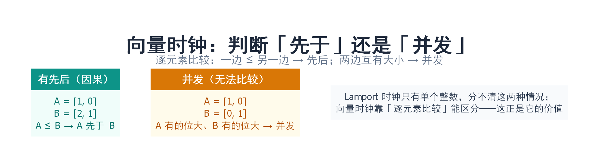
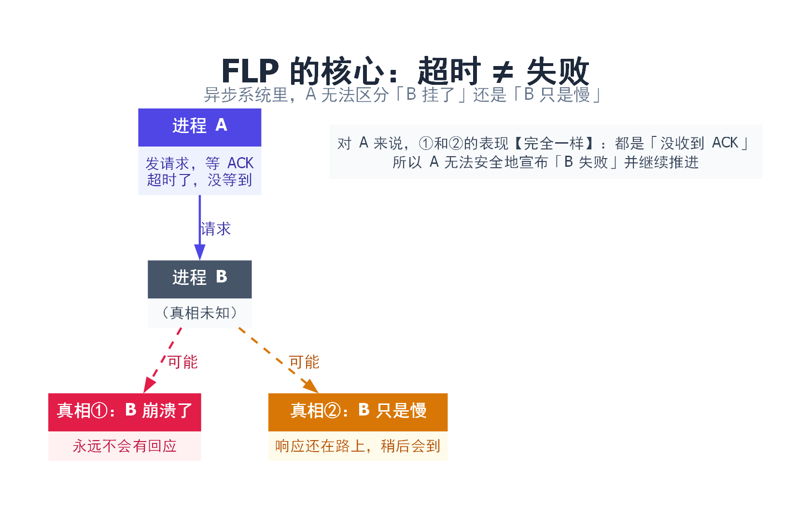
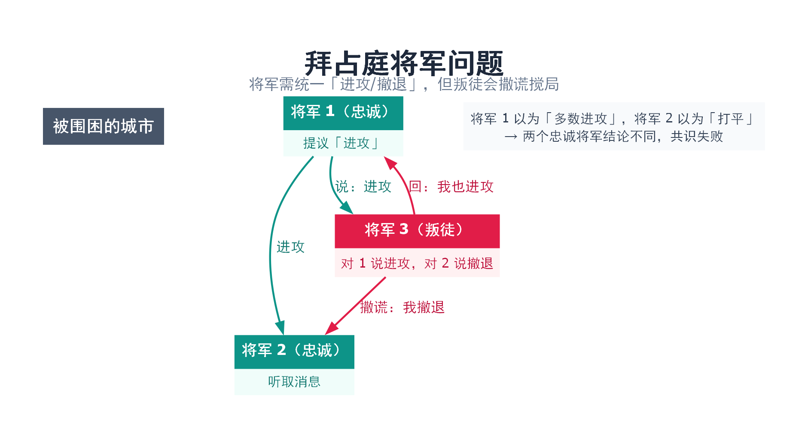

# 基础概念与故障模型

订单服务发出请求后，仓库服务迟迟没有响应。发起方能判断仓库已经宕机吗？

[返回目录](../README.md) · [下一篇：一致性与 CAP](../02-%E4%B8%80%E8%87%B4%E6%80%A7%E4%B8%8E%20CAP/%E4%B8%80%E8%87%B4%E6%80%A7%E4%B8%8E%20CAP.md)

阅读前了解进程、网络请求和数据库的基本读写即可。

**阅读准备：** 了解进程、线程、网络请求和数据库事务的基本含义；文中的 C++ 实验需要能读懂函数、容器和基本控制流。

**快速阅读：**先读“一次超时背后有哪些可能”，再读“面试表达”和 Q&A；遇到说不清原因的结论，回到对应原理小节。

**深入学习：**按正文顺序推演每一步，运行文内完整示例，修改故障发生位置并核对结果。模拟程序只验证写明的假设；真实网络、磁盘和组件行为需按文中的验证步骤另行测试。

<details>
<summary>本文目录</summary>

- [一次超时背后有哪些可能](#section-01)
- [部分失败](#section-02)
- [因果顺序](#section-03)
- [安全性与活性](#section-04)
- [同样的超时，两种真实结果](#section-05)
- [什么是分布式系统](#section-06)
- [目标与权衡](#section-07)
- [故障模型：系统会怎么坏（核心）](#section-08)
- [系统模型：关于「时间」的三种假设](#section-09)
- [完整可复现的示例（C++）](#section-10)
- [happens-before：先搞懂「先后」](#section-11)
- [Lamport 时钟](#section-12)
- [向量时钟](#section-13)
- [FLP 不可能性](#section-14)
- [拜占庭将军问题](#section-15)
- [面试表达](#section-16)
- [Q&A（常见问题与解答）](#section-17)
- [进一步阅读](#section-18)
- [思维导图总结](#section-19)

</details>

<a id="section-01"></a>

## 一次超时背后有哪些可能

设下单服务发送扣库存请求 K，并在 200 毫秒后停止等待。把服务端的处理拆成三步，可以看出这 200 毫秒并没有告诉客户端哪一步完成了。

| 请求停在哪里 | 仓库里的状态 | 再发一次 K 会怎样 |
| --- | --- | --- |
| 请求没到仓库 | 库存未变 | 可能第一次成功处理 |
| 仓库正在执行 | 扣减结果未定 | 两份请求可能并发执行 |
| 仓库已经提交，回复丢失 | 库存已经减少 | 无去重时可能再扣一次 |

心跳也面临同样的观察限制。连续漏掉三次心跳，可能是仓库宕机，也可能是它停顿了三秒。监控可以记录“暂时失联”，接管资源还要另外证明新节点有权写入。否则，恢复后的旧节点和新节点都可能继续扣库存。

再看时间。A 发出消息前的逻辑时钟为 4，发送时记为 5。B 本地已经数到 9，接收时记为 max(9, 5) + 1 = 10，所以 A 的发送一定排在 B 的接收之前。另一个节点 C 恰好也数到 6，这个数字无法证明 C 看过 A 的消息。后续讨论一致性时，要用消息依赖或读写历史确定顺序。

<a id="section-02"></a>

## 部分失败

超时只能说明在期限内没收到答复。仓库可能已经扣库存，也可能还没收到请求。链路延迟、消息丢失、节点暂停和节点崩溃，对调用方都可能表现为沉默。网络分区指部分节点之间无法通信。双方若都认为自己可以接管同一资源，才会出现脑裂。

<a id="section-03"></a>

## 因果顺序

两台机器的时钟可能偏移。把收到消息的时刻当成操作真正发生的时刻，可能把先后顺序排错。Lamport 时钟在本地事件时递增，收到消息时取本地和对方计数的较大值再加一。它能保证因果在前的事件计数更小。计数更小也可能只是两个无关事件碰巧如此，向量时钟可以进一步区分并发事件。

<a id="section-04"></a>

## 安全性与活性

先说清系统假设，再谈保证。安全性问“会不会出现两次扣款”，活性问“请求最终能否推进”。在完全异步的消息传递模型中，即使只有一个进程可能崩溃，确定性共识也无法保证总能终止。实际系统用超时推动选举，并依赖网络最终足够稳定来继续推进。

<a id="section-05"></a>

## 同样的超时，两种真实结果

请求 A 已到仓库并扣掉一件商品，回复丢失。请求 B 在到达仓库前丢失。调用者看到的都是超时。如果直接重试，A 可能扣两件，B 则可能正常完成。记录请求编号并查询业务状态，才有办法区分这两种情况。


<a id="section-06"></a>

## 什么是分布式系统

**定义**：由**多台独立的计算机（节点）**组成，节点之间**通过网络通信**协同工作，对外呈现为一个**统一的整体**。

三个关键词，缺一不可：

1. **多台独立机器**：节点之间**没有共享内存**、**没有共享时钟**；
2. **通过网络通信**：唯一的交流方式是「发消息」，而网络不可靠；
3. **对外像一台机器**：用户感知不到「背后是一堆机器」。

> **类比：一个人 vs 一个团队**。
>
> - **单机** = **一个人干活**——记忆（内存）、手速（CPU）、笔记（磁盘）全在自己身上，速度快、协调零成本。
> - **分布式** = **一群人组成团队**——每个人各干各的，只能靠**喊话（网络消息）**协调。人多了能干的活多了，但「喊话」会听不清（丢包）、会延迟（网络慢）、有人请假（宕机）、有人重复说（消息重复），协调成本暴涨。

记住「一个人 vs 一群喊话协作的人」这组意象，分布式系统的几乎所有难点都源于此。

<a id="section-07"></a>

## 目标与权衡

面对上面的挑战，分布式系统追求四个目标，但它们**相互冲突，必须权衡**：

| 目标 | 含义 |
|------|------|
| **可扩展性 Scalability** | 加机器就能扛更多流量 |
| **可用性 Availability** | 部分节点挂了，系统仍能响应 |
| **可靠性 Reliability** | 数据不丢、不出错 |
| **一致性 Consistency** | 各副本数据一致 |

最著名的权衡就是 **CAP 定理**（第 02 篇详讲）：

> **网络分区发生时，一致性（C）和可用性（A）不可兼得，只能二选一。**

<a id="section-08"></a>

## 故障模型：系统会怎么坏（核心）

下面从节点是否恢复、消息是否丢失、行为是否任意三个角度讨论故障。这些是不同维度，不能简单排成一条严格的包含链。

### 崩溃-停止（Crash-stop）

**定义**：节点崩溃后**永久停止**，不再发送任何消息，也不恢复。

- **运行期间**：行为完全正确（诚实）；
- **崩溃之后**：彻底静默，不产生任何副作用。

> **类比**：同事突然**辞职并彻底失联**——他不会回你消息，但也**不会害你**、不会给你假信息。你只需处理「他没回音」这一件事。

这是**最友好**的故障。一个「崩溃-停止」的节点，一旦崩了就不会再「捣乱」——不会发矛盾消息、不会篡改数据。只要你能**检测到它崩了**（能不能检测，取决于下文的系统模型），就能安全地把它排除在外。

> **注**：严格说 `fail-stop` 比 `crash-stop` 多一个性质——「故障**可被其他节点检测到**」。日常讨论常混用，本系列统一用「崩溃-停止」指代「崩了就不动了、且行为诚实」这一档。

### 崩溃-恢复（Crash-recovery）

**定义**：节点崩溃后能**重启恢复**，但会**丢失内存状态**（失忆，amnesia）。

这是真实系统里**最常见**的故障——进程崩了、机器重启、然后重新加入集群。麻烦在于：

> **恢复后的节点「忘了」崩溃前做过什么决定。** 比如它崩溃前已经告诉别人「我提交了这笔交易」，重启后却「不记得自己提交过」，于是可能做出**矛盾**的行为。

解决办法是**持久化**：把关键状态写进磁盘（日志 + 快照），重启后从磁盘恢复。很多存储系统「写盘」的根本原因，就是为了对付这个「失忆」。

> **类比**：同事**突然昏倒、送医后醒了**，但**失忆了**——不记得昏倒前答应过你什么。你只能靠他随身带的**笔记本（持久化日志）**帮他「找回记忆」。

### 遗漏故障（Omission）

**定义**：节点或链路**漏掉了一些消息**——该发的没发，或该收的没收到。

细分两种：

- **发送遗漏（send-omission）**：节点本应发送某条消息，但没发出去；
- **接收遗漏（receive-omission）**：消息到达了，但节点没处理（或网络层就丢了）。

> **类比**：同事**还在、也清醒**，但时不时**忘回你消息**——不是辞职，就是「漏了」。

**关键点**：遗漏故障和崩溃故障，从外部观察**几乎无法区分**——两者都表现为「没回应」。这是分布式系统最经典的一个「不可判定」难题（下文的 C++ 示例会直观演示）。

### 网络分区（Partition）

**定义**：网络被切成**两个或多个互相无法通信的部分**。每部分内部的节点**都活着、都正常**，只是**跨部分的消息全丢了**。

网络分区本质上是**链路层的批量遗漏**，但重要到必须单独讲：

> **类比**：两座岛之间唯一的桥**塌了**。岛上的人都**活得好好的**，只是谁也过不去。从 A 岛看 B 岛，「整座岛都失联了」——就像 B 岛上所有人**同时**发生了遗漏故障。这正是「网络分区」和「单节点故障」的本质区别：**分区是「一群节点一起失联」**。

分区可能导致的一种后果是——**脑裂**：分区两边的节点都以为对方挂了，各自选出一个领导者，于是两个 leader 同时写数据，把状态改乱。

### 拜占庭故障（Byzantine / Arbitrary）

**定义**：节点**任意行为**——撒谎、对不同节点发矛盾消息、篡改数据、冒充别人、假装崩溃。总之「想干嘛干嘛」。

注意拜占庭故障**包含两种情况**，别只理解成「恶意攻击」：

1. **恶意**：节点被黑客控制，故意捣乱；
2. **非恶意但等效**：节点出现 bug 或内存损坏（如比特翻转、越界写），导致**行为错乱**——从系统角度看，它就是在「撒谎」。

> **类比**：同事是个**内鬼**——他不仅不回你消息，还会**主动给你假情报**，对你说「进攻」、对别人说「撤退」，目的就是让你们内部打起来。

拜占庭故障是**最难**的：节点会撒谎，意味着你**不能相信任何一条消息**，即使它「看起来正常」。所以绝大多数分布式系统**都假设节点不会撒谎**——只处理「崩溃/遗漏」这类**诚实的**故障。至于「节点会撒谎时该怎么办」，后面有专门的章节讨论，这里先记住：**它属于另一个难度量级**。

### 故障模型应该分别声明哪些假设


崩溃停止关心节点停止后不再恢复；崩溃恢复还要考虑重启后的持久状态。遗漏和分区关心消息是否能到达。拜占庭故障允许参与者偏离协议。描述系统时应明确组合，例如“节点可以重启，已同步日志不会丢失，网络可以分区，节点不伪造协议消息”。

`fail-stop` 还假设其他节点能够可靠识别故障，比普通 crash-stop 多了故障检测能力。真实网络中，超时只能触发怀疑，不能仅凭超时获得这个保证。

分区和恢复不是“更不老实”：一个完全按协议工作的节点，也可能被网络隔离或突然重启。算法必须处理哪些情况，取决于声明的故障假设。


<a id="section-09"></a>

## 系统模型：关于「时间」的三种假设

故障模型讲「坏的方式」，系统模型讲「**时间的规则**」。它之所以重要，是因为它决定了**「超时」到底能不能作为判断依据**——这正是第 01 篇「超时 ≠ 失败」的延伸。


### 同步模型（Synchronous）

**定义**：系统运行在严格的**时间上界**之内：

- 消息传递延迟 ≤ 已知上界 **Δ**；
- 进程每步执行耗时 ≤ 已知上界；
- 时钟漂移 ≤ 已知上界。

**推论**：如果你在 Δ 时间内没收到对方的回复，就能**百分百确定**对方已经崩溃（它若活着，消息一定在 Δ 内到达）。**超时是可靠的故障检测器。**

> **类比**：你和同事约好「**5 秒内必回**」。超过 5 秒没回，你就可以断定他出事了（而不是「可能还在打字」）。

**问题**：真实网络**不是同步的**——消息延迟可能因拥塞、GC 停顿而飙到任意高。所以同步模型是**理想化、不现实**的，主要价值是「简化分析」。

### 异步模型（Asynchronous）

**定义**：**没有任何时间上界**：

- 消息最终会到达（若无故障），但可以**任意慢**；
- 进程可以**任意长时间**暂停（GC、swap、调度器饥饿）；
- 时钟可以任意漂移。

**推论**：**超时不能作为任何证据**。你没收到回复，**无法区分**「对方挂了」还是「对方只是慢」。**故障不可检测。**

> **类比**：同事没约定回消息时间。他没回你，可能死了，也可能在开一个 3 小时的会。**你永远不知道。**

异步模型是「最坏情况」——它把「超时」这个唯一的直觉判断工具都剥夺了。后面会看到，在这种模型下，很多「看起来理所当然」的事情会变得**异常困难**。

### 部分同步模型（Partial synchronous）

**定义**：**大部分时间**系统像同步的，但存在**有限长的「异步期」**。

这是 Dwork、Lynch、Stockmeyer 1988 年提出的模型，是**最贴近现实**的。形式化表述：

> 存在一个未知时刻 **GST（Global Stabilization Time，全局稳定时刻）**：GST 之后，消息延迟有上界、时钟同步，系统**永久**表现为同步；GST **之前**，系统可以任意异步（消息想多慢就多慢）。

**推论**：超时「**通常**」可靠，但在异步期可能**误判**。算法必须能「熬过」异步期、在同步期重新达成一致。

> **类比**：平时你和同事配合默契（同步），但偶尔**网络抽风、谁都联系不上谁**（异步期），过一会儿又恢复。你要做的，是「网络抽风时别做傻事（别乱下结论、别乱选主），恢复后再对齐」。

### 为什么「真实世界是部分同步」

| 证据 | 说明 |
|------|------|
| 正常延迟很低 | 数据中心内 RTT 通常 < 1ms，看起来「同步」 |
| 偶尔长尾 | GC 停顿、磁盘慢、网络拥塞会让延迟飙到秒级 |
| 网络分区 | 交换机/链路故障让整段网络不可达（异步期） |
| 时钟漂移 | NTP 校准精度取决于网络、时钟和部署，不能当作精确事件顺序 |

**结论**：算法**不能**假设「同步」（太乐观，现实会打脸），也**不必**假设「纯异步」（太悲观，等于放弃超时）。**部分同步**是「恰到好处」的假设。

<a id="section-10"></a>

## 完整可复现的示例（C++）

下面用一段 C++ 直观演示前文故障模型中的一个结论：**「没回应」背后可能是完全不同的故障**——崩溃和遗漏，从发送方看一模一样。

### 环境

- **系统**：macOS / Linux 均可
- **编译器**：`g++` 或 `clang++`，支持 **C++11**（只用了 `enum class` 和范围 for）
- **无第三方依赖**，纯标准库

### 完整代码

```cpp
// 文件名：fault_models.cpp
// 演示：同一个「无回应」，背后可能是完全不同的故障
#include <iostream>
#include <string>

enum class Fault { OK, CRASH_STOP, OMISSION, BYZANTINE };

const char* fault_name(Fault f) {
    switch (f) {
        case Fault::OK:         return "正常";
        case Fault::CRASH_STOP: return "崩溃-停止";
        case Fault::OMISSION:   return "遗漏(消息丢失)";
        case Fault::BYZANTINE:  return "拜占庭(撒谎)";
    }
    return "未知";
}

// 对端处理「提案」后给出的表态。
// 返回空串 = 无回应（发送方只会看到「超时」）。
std::string respond(Fault f, const std::string& honest_value) {
    switch (f) {
        case Fault::OK:         return honest_value;   // 诚实回答
        case Fault::CRASH_STOP: return "";             // 崩溃：静默
        case Fault::OMISSION:   return "";             // 消息丢了：也是静默
        case Fault::BYZANTINE:  return "撤退(假话)";     // 撒谎
    }
    return "";
}

int main() {
    const std::string proposal = "进攻";
    Fault faults[] = {Fault::OK, Fault::CRASH_STOP, Fault::OMISSION, Fault::BYZANTINE};

    std::cout << "你向对端发送提案：「" << proposal << "」\n\n";
    for (Fault f : faults) {
        std::string reply = respond(f, proposal);
        std::cout << "故障模型：" << fault_name(f) << "\n";
        if (reply.empty())
            std::cout << "  → 你看到：超时（无回应）\n";
        else
            std::cout << "  → 你看到：回复「" << reply << "」\n";
    }

    std::cout << "\n关键结论：\n";
    std::cout << "  ① 「崩溃-停止」和「遗漏」从发送方看一模一样——都是超时，无法区分。\n";
    std::cout << "  ② 只有「拜占庭」会回话，但回的是假话（甚至对不同人回不同假话）。\n";
    return 0;
}
```

### 编译与运行

```bash
g++ -std=c++11 fault_models.cpp -o fault_models
./fault_models
```

### 预期输出

```text
你向对端发送提案：「进攻」

故障模型：正常
  → 你看到：回复「进攻」
故障模型：崩溃-停止
  → 你看到：超时（无回应）
故障模型：遗漏(消息丢失)
  → 你看到：超时（无回应）
故障模型：拜占庭(撒谎)
  → 你看到：回复「撤退(假话)」

关键结论：
  ① 「崩溃-停止」和「遗漏」从发送方看一模一样——都是超时，无法区分。
  ② 只有「拜占庭」会回话，但回的是假话（甚至对不同人回不同假话）。
```

### 解读（关键）

- **正常**和**拜占庭**都会「回话」，但拜占庭回的是**假话**——所以「有回应」不等于「可信任」；
- **崩溃-停止**和**遗漏**都表现为「超时」——所以「超时」**无法**告诉你对方到底怎么了；
- 把这条和第 04 篇的「超时重试」串起来：**「超时 ≠ 失败」**，而「超时了怎么办」正是由系统模型决定的。

> 想更进一步？把 `respond` 里的 `BYZANTINE` 改成「对不同节点返回不同值」，你会看到拜占庭节点如何在集群里「挑拨离间」——那正是拜占庭故障最危险的地方。

### 常见报错排查

| 报错 | 原因 | 解决 |
|------|------|------|
| `scoped enums require -std=c++11` | 用了 `enum class` 但没开 C++11 | 加 `-std=c++11` |
| `range-based 'for' loops ... -std=c++11` | 范围 for 需要 C++11 | 加 `-std=c++11` |
| 中文输出乱码 | 终端编码非 UTF-8 | `export LANG=zh_CN.UTF-8` 或用英文 |

<a id="section-11"></a>

## happens-before：先搞懂「先后」

在讲具体的时钟之前，必须先搞清楚一个更根本的问题：**什么叫「事件 A 发生在事件 B 之前」？**

Lamport 定义了 **happens-before（先后）** 关系，记为 **A → B**（读作「A 先于 B」），它只有三种来源：

1. **程序顺序（同一进程内）**：同一个进程里，A 先执行、B 后执行，则 A → B。
2. **消息传递**：A 是「发送消息 m」的事件，B 是「接收消息 m」的事件，则 A → B（发送必然在接收之前）。
3. **传递性**：若 A → B 且 B → C，则 A → C。

如果两个事件 A、B 之间**既没有 A → B，也没有 B → A**，那它们就是**并发（concurrent）**的，记作 **A ‖ B**。

⚠️ 注意一个容易误解的点：**并发 ≠ 同时发生**。「并发」的真正含义是「**无法确定先后**」——没有任何信息能推断出谁先谁后。

> **类比：happens-before 是「谁先谁后」的推理链**。你在群里发了一条消息，他看到后又转发了一条，那么「你发」先于「他转发」。但如果你们俩几乎同时各发了一条**互不相干**的消息，就「分不清谁先」——这就是并发。


<a id="section-12"></a>

## Lamport 时钟

Lamport 时钟（也叫**逻辑时钟**）是第一个「给事件发号」的算法，由 Lamport 在 1978 年提出。核心思想：**每个进程维护一个整数计数器，本地事件发生时递增；跨进程时，通过消息把计数器带过去对齐。**

### 算法

每个进程 P 维护一个计数器 `C`（初始 0）：

1. **本地事件**：`C = C + 1`；
2. **发送消息**：`C = C + 1`，然后把 `C` 的值附带在消息里发出去；
3. **接收消息**（消息里带的时间戳为 `t`）：`C = max(C, t) + 1`。

关键在接收时的 `max(C, t) + 1`：它保证「发送方的时间戳比我大，我就把时钟跳到比它还大」，从而维持「发送 → 接收」的先后关系。

用 C++ 模拟两个进程的消息传递：

将以下独立示例保存为 `lamport_clock.cpp`，用 `g++ -std=c++11 -Wall -Wextra lamport_clock.cpp -o lamport_clock` 编译，再运行 `./lamport_clock`。每段代码单独编译，不要把多个 `main()` 合并到同一文件。

```cpp
#include <iostream>
#include <string>
#include <algorithm>

struct Process {
    int clock = 0;                    // Lamport 逻辑时钟
    std::string name;
    Process(const std::string& n) : name(n) {}

    void event(const std::string& what) {          // 本地事件：+1
        ++clock;
        std::cout << name << " 发生事件「" << what << "」，时钟 = " << clock << "\n";
    }
    int send() {                                   // 发送：先 +1，再返回附带的时间戳
        ++clock;
        std::cout << name << " 发送消息，时钟 = " << clock << "\n";
        return clock;
    }
    void receive(int msg_ts) {                     // 接收：max + 1
        clock = std::max(clock, msg_ts) + 1;
        std::cout << name << " 收到消息(时间戳 " << msg_ts << ")，时钟 = " << clock << "\n";
    }
};

int main() {
    Process A("进程A"), B("进程B");

    A.event("写数据");       // A.clock = 1
    int ts = A.send();       // A.clock = 2，消息附带时间戳 2
    B.receive(ts);           // B.clock = max(0,2)+1 = 3
    B.event("处理数据");     // B.clock = 4
    B.send();                // B.clock = 5（发给 A，A 收到后会跳到 6）
    return 0;
}
```

### 核心保证

> 如果 A → B（A 先于 B），那么 **C(A) < C(B)**。

但反过来**不成立**：`C(A) < C(B)` **不能**推出 `A → B`。因为两个**并发**的事件，也可能碰巧一个时钟大、一个时钟小。这就是 Lamport 时钟的**最大局限——它无法判断并发**。

> **类比：排队取号**。取到 3 号和 5 号，3 号肯定在 5 号前面（这对应「先于」）。但如果两个人在**不同的窗口**各自取号，你拿到 3 号、他拿到 5 号，其实你俩可能**同时在办业务**，只是号数碰巧不同而已——**号数的大小分不清谁先谁后**。


<a id="section-13"></a>

## 向量时钟

向量时钟解决了 Lamport 时钟「无法判断并发」的问题。核心思想：**每个进程维护一个向量，向量的每一位，记录「这个进程所认知的、每个进程各自的时钟值」**。

### 算法

N 个进程，进程 i 维护向量 `VC`（长度 N，初始全 0）：

1. **本地事件**：`VC[i] = VC[i] + 1`；
2. **发送消息**：`VC[i] = VC[i] + 1`，把**整个向量**附带在消息里发出；
3. **接收消息**（消息带向量 `t`）：`VC = max(VC, t)`（逐元素取 max），然后 `VC[i] = VC[i] + 1`。

### 怎么判断先后

比较两个向量 `VC(A)` 和 `VC(B)`（逐元素）：

- `VC(A) ≤ VC(B)` 且至少一位严格小 → **A 先于 B**（A → B）；
- `VC(B) ≤ VC(A)` 且至少一位严格小 → **B 先于 A**；
- 两边「你有我大、我有你大」（无法比较）→ **A 和 B 并发**。

用 C++ 实现并判断并发：

将以下独立示例保存为 `vector_clock.cpp`，用 `g++ -std=c++11 -Wall -Wextra vector_clock.cpp -o vector_clock` 编译，再运行 `./vector_clock`。每段代码单独编译，不要把多个 `main()` 合并到同一文件。

```cpp
#include <iostream>
#include <vector>
#include <algorithm>

using Clock = std::vector<int>;   // 向量时钟，长度 = 进程数

void tick(Clock& vc, int pid) { vc[pid]++; }                    // 本地事件
void merge(Clock& vc, const Clock& other) {                     // 接收：逐元素取 max
    for (size_t i = 0; i < vc.size(); ++i)
        vc[i] = std::max(vc[i], other[i]);
}

// 比较两个向量：返回 -1 表示 a 先于 b，1 表示 b 先于 a，0 表示并发
int compare(const Clock& a, const Clock& b) {
    bool a_le_b = true, b_le_a = true;
    for (size_t i = 0; i < a.size(); ++i) {
        if (a[i] > b[i]) a_le_b = false;
        if (b[i] > a[i]) b_le_a = false;
    }
    if (a_le_b && !b_le_a) return -1;   // a 先于 b
    if (b_le_a && !a_le_b) return 1;    // b 先于 a
    return 0;                            // 并发
}

int main() {
    Clock a = {1, 0}, b = {0, 1};   // 两个互相不知道对方的事件 → 并发
    int r = compare(a, b);
    std::cout << (r == 0 ? "并发" : (r < 0 ? "a 先于 b" : "b 先于 a")) << "\n";
    return 0;
}
```

### 优势与代价

- **优势**：能精确判断「先于」还是「并发」。
- **代价**：向量长度 = 节点数 N。节点一多（上千个），每个消息都要带一个长度 N 的向量，**空间和带宽开销大**。所以向量时钟只在「节点数较少」的场景用（如因果一致性、多副本冲突检测、Dynamo 的版本向量）。



<a id="section-14"></a>

## FLP 不可能性

### 前提：异步模型

FLP 定理（1985 年，由 Fischer、Lynch、Paterson 三人提出，取姓氏首字母）针对的是**异步系统**。先搞清楚什么叫「异步」：

| 模型 | 特点 |
|------|------|
| **同步模型** | 消息与处理耗时有**已知上界**；在这些假设成立时，可由超时判定模型中的故障 |
| **异步模型** | 消息延迟**无上界**、时钟不同步、**无法判断对方是挂了还是慢** |

FLP 研究的是**异步模型**——也就是最贴近真实网络、也最难的那个模型（回忆 01 篇：网络不可靠，超时 ≠ 失败）。

### FLP 的结论

FLP 定理说：

> 在异步系统中，即使只有**一个**进程可能崩溃（crash-stop，崩溃后就停止、不再发任何消息），也**不存在一个确定性的共识算法**，能**同时**保证下面三个性质：

1. **终止性（Termination）**：每个正确的进程**最终都会**做出决定；
2. **一致性（Agreement）**：所有正确进程做出的决定**相同**；
3. **有效性（Validity）**：决定的值必须是**某个进程提议过**的值。

换句话说：在满足有效性等前提下，**不能在所有允许的异步执行中同时保证终止性和一致性**——要么保证一致性、但可能永不终止（陷入活锁）；要么保证终止、但可能不一致。

### 为什么不可能（核心直觉）

为什么异步系统里「一定终止」这么难？根源还是 01 篇那个点——**超时 ≠ 失败**。

设想一个共识算法，进程 A 在等进程 B 的回应。等了一会儿没等到，A 该不该「宣布 B 已失败、不等它了、直接做决定」？

- 如果 A 宣布「B 失败了」并做决定，但 B 其实**只是慢**（消息还在路上），那么 B 之后也会做出决定——两个决定可能**冲突**（牺牲一致性）。
- 如果 A 为了保险**一直等** B，但 B 其实**已经崩溃**了，那么 A 会**永远等下去**（牺牲终止性）。

**关键就在于：在异步系统里，A 无法区分「B 崩溃了」和「B 只是慢」。** 这个「无法区分」让任何确定性算法都做不到「既一定终止、又一定一致」。

> **类比：打电话没接**。你打给同事，响了很久没人接。你该挂断（宣布他「不在」）还是继续等？挂断吧，可能他只是在开会、等会就回你，你们俩会得出矛盾结论；继续等吧，可能他今天根本没来公司，你会一直傻等。**没有铃声上限，你就永远无法确定。**



### FLP 的现实意义

FLP 听起来很绝望，但它**不是**说「共识无解」，而是划清了一个边界：

实际共识协议通常让安全性不依赖消息准时到达，但要恢复进展，需要多数节点能通信、处理与网络足够稳定等额外条件。随机超时帮助减少反复竞争，不会把完全异步网络变成有确定时延上界的网络。FLP 说明的是某些允许执行下无法保证终止，不是说每次运行都会失败，也不能直接得出线上失败概率很低。

<a id="section-15"></a>

## 拜占庭将军问题

### 场景

拜占庭将军问题（1982 年 Lamport 等人提出，用「拜占庭帝国」比喻）：几支军队的将军包围了一座城，他们必须**统一**行动——要么一起进攻，要么一起撤退。任何「一部分进攻、一部分撤退」都会失败。

将军之间只能通过**信使**传递消息。麻烦在于：**其中可能有叛徒**。叛徒会故意发送**错误、矛盾**的消息（对这个人说「进攻」，对那个人说「撤退」），目的是搅乱忠诚将军的判断。

问题就是：**在存在叛徒的情况下，忠诚的将军们怎么才能达成一致？**



### 拜占庭故障 vs 崩溃故障

这里引入一个重要的故障分类：

| 故障类型 | 行为 | 难度 | 常见假设 |
|----------|------|------|----------|
| **崩溃故障（CFT 模型）** | 节点崩溃后**停止**，不再发任何消息（诚实但可能缺席） | 相对容易 | Paxos、Raft 假设节点不任意偏离协议，恢复时须保存必要状态 |
| **拜占庭故障（Byzantine / BFT）** | 节点**任意行为**：撒谎、发矛盾消息、假装崩溃、篡改数据 | 极难 | 区块链、PBFT |

> **类比**：崩溃故障是「**同事突然失联**」——他不再回你消息，但不会骗你。拜占庭故障是「**同事是个内鬼**」——他会故意告诉你错误信息，对你说一套、对别人说另一套，目的就是让你俩吵起来。

**FLP 处理的是崩溃故障，拜占庭将军处理的是拜占庭故障。** 后者难得多。

### 结论：n ≥ 3f + 1

拜占庭将军问题的核心结论（在「口信模型」下，即消息无法伪造、但叛徒可以谎报内容）：

> 要容忍 `f` 个叛徒，全部将军的总数 `n`（包括叛徒） 必须满足 **`n ≥ 3f + 1`**。

比如：容忍 1 个叛徒（f=1），至少需要 3×1+1 = **4** 个将军。这就是为什么「3 个将军里有 1 个叛徒」**无法**达成一致。

用 C++ 演示「3 个将军、1 个叛徒」为什么会失败：

将以下独立示例保存为 `byzantine_views.cpp`，用 `g++ -std=c++11 -Wall -Wextra byzantine_views.cpp -o byzantine_views` 编译，再运行 `./byzantine_views`。每段代码单独编译，不要把多个 `main()` 合并到同一文件。

```cpp
#include <iostream>
#include <string>
#include <vector>

// 3 个将军：1、2 忠诚，3 是叛徒。f=1，但 n=3 < 3f+1=4，所以无法达成一致。

int main() {
    // 将军 1 提议「进攻」，通过信使广播给所有人。
    // 叛徒将军 3 撒谎：对将军 1 说「我也进攻」，对将军 2 说「我主张撤退」。

    // 每个忠诚将军「看到的表态」：
    std::vector<std::string> g1_sees = {"进攻(自己)", "进攻(将军3说的)"};  // 将军 1 以为 2:0 支持进攻
    std::vector<std::string> g2_sees = {"进攻(将军1)", "撤退(将军3说的)"};  // 将军 2 以为 1:1 打平

    std::cout << "将军 1（忠诚）看到：" << g1_sees[0] << "、" << g1_sees[1]
              << " → 以为多数支持进攻，决定【进攻】\n";
    std::cout << "将军 2（忠诚）看到：" << g2_sees[0] << "、" << g2_sees[1]
              << " → 以为打成平手，犹豫不决\n";

    std::cout << "结果：两个忠诚将军得出【不同的结论】→ 共识失败\n";
    std::cout << "（这就是为什么 n=3、f=1 不行，必须 n>=4）\n";
    return 0;
}
```

### 现实意义：CFT vs BFT

- **绝大多数分布式系统（Paxos、Raft、ZooKeeper、etcd）只处理崩溃故障（CFT）**——它们假设节点「要么正确、要么崩溃停止」，不会撒谎。这个假设在「可信内网」里基本成立。
- **只有「节点可能被恶意控制」的场景才需要拜占庭容错（BFT）**——典型是**区块链**（节点互不信任）、以及一些高安全系统。BFT 算法（如 PBFT）的代价极高（通信开销大、性能低）。

一句话：**你的节点可信吗？** 可信 → 用 CFT（Raft/Paxos）；不可信 → 用 BFT（PBFT/区块链共识）。


<a id="section-16"></a>

## 面试表达

分布式系统最难的是部分失败：请求超时，既可能是服务没执行，也可能是执行成功后响应丢了。我会先明确系统允许哪些故障，再用请求编号、持久记录和状态查询处理结果未知。机器时钟不能直接证明事件先后，需要根据通信建立因果关系。代价是系统要保留更多状态，并在无法取得可靠证据时等待或拒绝，不能把每次超时都当成失败重做。

<a id="section-17"></a>

## Q&A（常见问题与解答）

### 超时为什么不能等同宕机？

有限时间没收到消息，也可能来自拥塞、暂停或响应丢失。超时能触发怀疑和恢复动作，但动作仍要保护重复执行与旧进程恢复。

### 逻辑时钟小就一定先发生吗？

Lamport 时钟保留因果方向，反方向不成立。两个无因果关系的事件也会有数值大小；要辨别并发需更多依赖信息，例如向量时钟。

### 为什么要先说安全性再说活性？

安全性规定不能发生什么错误，活性规定什么工作最终能完成。分区时停止写可能保护安全却牺牲活性，必须明确讨论的是哪一种承诺。

**为什么超时后不能直接判断“库存没扣”？**

计时器记录的是客户端等了多久。库存是否提交要由仓库的业务记录回答，查询时应沿用原请求编号。

**心跳超时能证明对方死了吗？**

不能。暂停或网络延迟也会造成超时。选举还需要任期、投票等规则约束接管。

[延伸阅读](https://groups.csail.mit.edu/tds/papers/Lynch/jacm85.pdf)

<a id="section-18"></a>

## 进一步阅读

- [Lamport 逻辑时钟论文](https://lamport.azurewebsites.net/pubs/time-clocks.pdf)：核对正文中的模型、状态和失败边界。
- [部分同步模型](https://groups.csail.mit.edu/tds/papers/Lynch/jacm88.pdf)：核对正文中的模型、状态和失败边界。

关联笔记：[一致性与 CAP](../02-%E4%B8%80%E8%87%B4%E6%80%A7%E4%B8%8E%20CAP/%E4%B8%80%E8%87%B4%E6%80%A7%E4%B8%8E%20CAP.md)、[副本、共识与 Raft](../03-%E5%89%AF%E6%9C%AC%E3%80%81%E5%85%B1%E8%AF%86%E4%B8%8E%20Raft/%E5%89%AF%E6%9C%AC%E3%80%81%E5%85%B1%E8%AF%86%E4%B8%8E%20Raft.md)。

下一篇要回答的问题是：用户改完收货地址，刷新页面却看到旧地址。系统承诺的“一致”具体指什么？

<a id="section-19"></a>

## 思维导图总结

```text
基础概念与故障模型
├── 故障与超时
│   ├── 部分失败；响应丢失不代表未执行
│   └── 崩溃停止、恢复、遗漏与分区分开描述
├── 时间与顺序
│   ├── 物理时钟有误差；单调时钟测时长
│   └── Lamport 保留因果方向；向量时钟识别并发
├── 理论边界
│   ├── 安全性不出错；活性最终推进
│   └── FLP 的异步假设；BFT 的故障假设
└── 实验与验证
    ├── 相同超时对应不同真实结果
    └── 观察模拟边界，不把仿真当协议证明
```


