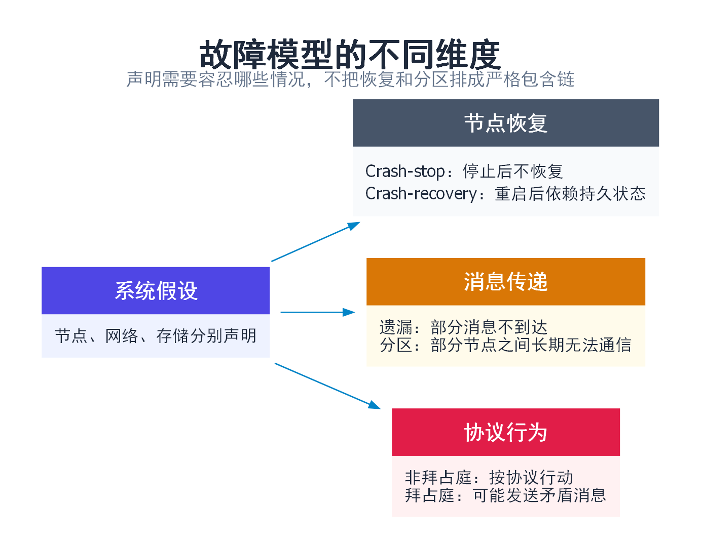
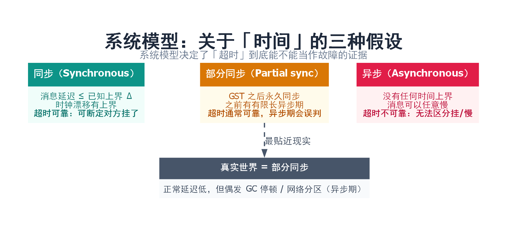
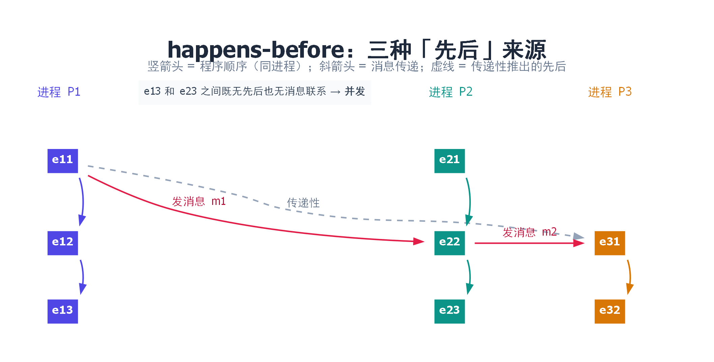
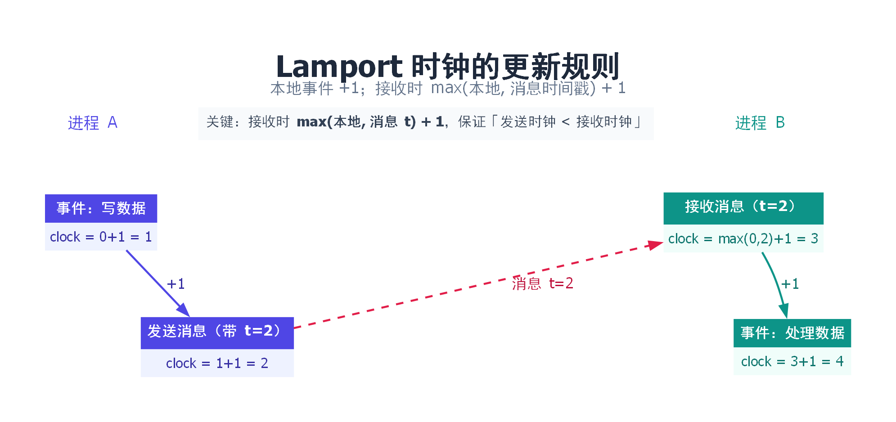
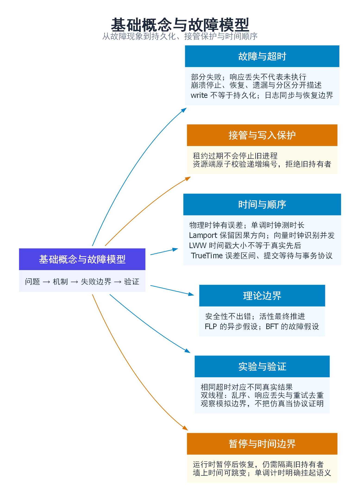

# 基础概念与故障模型

订单服务发出请求后，仓库服务迟迟没有响应。发起方能判断仓库已经宕机吗？

[返回目录](../README.md) · [下一篇：一致性与 CAP](../02-%E4%B8%80%E8%87%B4%E6%80%A7%E4%B8%8E%20CAP/%E4%B8%80%E8%87%B4%E6%80%A7%E4%B8%8E%20CAP.md)

**阅读准备：** 了解进程、线程、网络请求和数据库事务的基本含义；文中的 C++ 实验需要能读懂函数、容器和基本控制流。

**快速阅读：** 先读“一次超时背后有哪些可能”，再读“面试表达”和 Q&A；遇到说不清原因的结论，回到对应原理小节。

**深入学习：** 按正文顺序推演每一步，运行文内完整示例，修改故障发生位置并核对结果。模拟程序只验证写明的假设；真实网络、磁盘和组件行为需按文中的验证步骤另行测试。

实验前先核对[环境、依赖与验证边界](../README.md#lab-compatibility)，各篇已执行与待执行的状态以对应实验说明为准。

<details>
<summary>本文目录（含小节）</summary>

- [基础概念与故障模型](#基础概念与故障模型)
  - [一次超时背后有哪些可能](#一次超时背后有哪些可能)
  - [部分失败](#部分失败)
  - [因果顺序](#因果顺序)
  - [安全性与活性](#安全性与活性)
  - [同样的超时，两种真实结果](#同样的超时两种真实结果)
  - [什么是分布式系统](#什么是分布式系统)
  - [目标与权衡](#目标与权衡)
  - [故障模型：系统会怎么坏（核心）](#故障模型系统会怎么坏核心)
    - [崩溃-停止（Crash-stop）](#崩溃-停止crash-stop)
    - [崩溃-恢复（Crash-recovery）](#崩溃-恢复crash-recovery)
      - [`write()` 成功后，重启为什么还可能丢数据？](#write-成功后重启为什么还可能丢数据)
    - [遗漏故障（Omission）](#遗漏故障omission)
    - [网络分区（Partition）](#网络分区partition)
      - [已经选出新主节点，旧主节点为什么还可能写入？](#已经选出新主节点旧主节点为什么还可能写入)
    - [拜占庭故障（Byzantine / Arbitrary）](#拜占庭故障byzantine--arbitrary)
    - [故障模型应该分别声明哪些假设](#故障模型应该分别声明哪些假设)
  - [进程还活着，为什么也会失去租约？](#进程还活着为什么也会失去租约)
  - [系统模型：关于「时间」的三种假设](#系统模型关于时间的三种假设)
    - [同步模型（Synchronous）](#同步模型synchronous)
    - [异步模型（Asynchronous）](#异步模型asynchronous)
    - [部分同步模型（Partial synchronous）](#部分同步模型partial-synchronous)
    - [为什么「真实世界是部分同步」](#为什么真实世界是部分同步)
  - [完整可复现的示例（C++）](#完整可复现的示例c)
    - [环境](#环境)
    - [完整代码](#完整代码)
    - [编译与运行](#编译与运行)
    - [预期输出](#预期输出)
    - [解读（关键）](#解读关键)
    - [常见报错排查](#常见报错排查)
  - [happens-before：先搞懂「先后」](#happens-before先搞懂先后)
  - [Lamport 时钟](#lamport-时钟)
    - [算法](#算法)
    - [核心保证](#核心保证)
  - [向量时钟](#向量时钟)
    - [算法](#算法-1)
    - [怎么判断先后](#怎么判断先后)
    - [优势与代价](#优势与代价)
  - [物理时钟：LWW 与 TrueTime](#物理时钟lww-与-truetime)
    - [“最后写入胜出”为什么可能留下旧值？](#最后写入胜出为什么可能留下旧值)
    - [TrueTime 为什么返回一个区间？](#truetime-为什么返回一个区间)
    - [TrueTime 和事务怎么配合？一次提交等待的完整例子](#truetime-和事务怎么配合一次提交等待的完整例子)
    - [外部一致性和线性一致性是什么关系？](#外部一致性和线性一致性是什么关系)
  - [校时、闰秒与单调时钟分别影响什么？](#校时闰秒与单调时钟分别影响什么)
    - [墙上时钟：报“几点”，但会被改动](#墙上时钟报几点但会被改动)
    - [NTP 校时：机器的钟怎么被纠正](#ntp-校时机器的钟怎么被纠正)
    - [单调时钟：只保证一直往前走](#单调时钟只保证一直往前走)
    - [闰秒：UTC 偶尔多出一秒](#闰秒utc-偶尔多出一秒)
    - [该怎么选](#该怎么选)
  - [双线程实验：乱序、响应丢失与重试](#双线程实验乱序响应丢失与重试)
    - [完整代码与运行方法](#完整代码与运行方法)
    - [顺着一次运行检查时钟](#顺着一次运行检查时钟)
    - [可以验证什么，不能证明什么？](#可以验证什么不能证明什么)
  - [FLP 不可能性](#flp-不可能性)
    - [前提：异步模型](#前提异步模型)
    - [FLP 的结论](#flp-的结论)
    - [为什么不可能（核心直觉）](#为什么不可能核心直觉)
    - [FLP 的现实意义](#flp-的现实意义)
  - [拜占庭将军问题](#拜占庭将军问题)
    - [场景](#场景)
    - [拜占庭故障 vs 崩溃故障](#拜占庭故障-vs-崩溃故障)
    - [结论：n ≥ 3f + 1](#结论n--3f--1)
    - [现实意义：CFT vs BFT](#现实意义cft-vs-bft)
  - [面试表达](#面试表达)
  - [Q\&A（常见问题与解答）](#qa常见问题与解答)
    - [换成单调时钟后，租约就一定安全吗？](#换成单调时钟后租约就一定安全吗)
    - [进程没退出，为什么还要按故障处理？](#进程没退出为什么还要按故障处理)
    - [超时为什么不能等同宕机？](#超时为什么不能等同宕机)
    - [逻辑时钟小就一定先发生吗？](#逻辑时钟小就一定先发生吗)
    - [为什么要先说安全性再说活性？](#为什么要先说安全性再说活性)
    - [有了租约，为什么还要 fencing？](#有了租约为什么还要-fencing)
    - [新主拿到编号 42 的瞬间，编号 41 就不能写了吗？](#新主拿到编号-42-的瞬间编号-41-就不能写了吗)
    - [多副本能代替本机持久化吗？](#多副本能代替本机持久化吗)
    - [所有副本都选中了同一个 LWW 胜出值，是否说明没丢更新？](#所有副本都选中了同一个-lww-胜出值是否说明没丢更新)
    - [把普通系统时钟换成 TrueTime，就能获得外部一致性吗？](#把普通系统时钟换成-truetime就能获得外部一致性吗)
    - [双线程实验通过，是否证明不会发生竞态或重复扣款？](#双线程实验通过是否证明不会发生竞态或重复扣款)
  - [进一步阅读](#进一步阅读)
  - [思维导图总结](#思维导图总结)

</details>

<a id="section-01"></a>

## 一次超时背后有哪些可能

设下单服务发送扣库存请求 K，并在 200 毫秒后停止等待。把服务端的处理拆成三步，可以看出这 200 毫秒并没有告诉客户端哪一步完成了。

| 请求停在哪里 | 仓库里的状态 | 再发一次 K 会怎样 |
| --- | --- | --- |
| 请求没到仓库 | 库存未变 | 可能第一次成功处理 |
| 仓库正在执行 | 扣减结果未定 | 两份请求可能并发执行 |
| 仓库已经提交，回复丢失 | 库存已经减少 | 无去重时可能再扣一次 |

心跳也面临同样的观察限制。连续漏掉三次心跳，可能是仓库宕机，也可能是它停顿了三秒。监控可以记录“暂时失联”，接管资源还要另外证明新节点有权写入。否则，恢复后的旧节点和新节点都可能继续扣库存。

这段话的核心意思是：监控看到“没收到心跳”，只能说明“暂时没联系上”，不能断定对方彻底死了；而且让新节点接管时，还必须在真正改数据的存储层做“资格校验”，否则旧节点缓过神来继续写，就会出现两个节点同时扣库存的乱象。

1. **没收到心跳 ≠ 机器真挂了**
仓库服务连续漏回三次心跳，既可能是真宕机了，也可能是它自己卡住、暂停了 3 秒（比如 GC 停顿、卡顿或网络抖动）。从外面看，这两种情况表现一模一样。


2. **监控只能记“失联”，不能直接拍板“已死亡并安全接管”**
监控系统发现收不到心跳，只能说“这台机器暂时失联了”。如果贸然认为它死了，立刻让新节点顶上，却没有配套的隔离机制，就会出事。


3. **新节点接管，必须证明自己“有写权限”（通常是靠递增的隔离令牌/编号）**
新节点想接管库存写入，不能光靠“我上位了”就开干，还得在真正保存库存的存储端把接管编号往前推（比如从 41 变成 42），让存储端认准“现在只有拿新编号的请求才算合法”。


4. **不加这道防线，就会“双写扣库存”**
如果旧节点只是停顿了 3 秒，缓过来之后并不知道自己已经“被取代”了，依然拿着旧资格去扣库存；与此同时，新节点也开始扣库存——结果两边都在扣，库存就乱套了。


**举个生活中的例子：**
你和同事轮流记账。同事连续 3 分钟没回你消息，可能是去上厕所/开小差了（暂停），也可能是电脑死机了（宕机）。你不能直接抢过账本就写，还必须在账本上写明“现在是第 2 任记账人，第 1 任的记录作废”；否则同事回过神来接着在旧页上往下记，你俩的账就对不上了。


<a id="section-02"></a>

## 部分失败

“部分失败”指的是在分布式系统里，一部分节点或链路出了问题，但另一部分还在正常运转，系统既不是“全好”，也不是“全死”，而是处于一种状态不完整、结果不确定的中间态。

超时只能说明在期限内没收到答复。仓库可能已经扣库存，也可能还没收到请求。链路延迟、消息丢失、节点暂停和节点崩溃，对调用方都可能表现为沉默。网络分区指部分节点之间无法通信。双方若都认为自己可以接管同一资源，才会出现脑裂。

1. **超时只能说明在期限内没收到答复。仓库可能已经扣库存，也可能还没收到请求。**
这是部分失败最直接的体现：调用方和被调方之间隔着网络，调用方只看到了“没回信”，却不知道失败发生在哪一步——是请求没到、仓库正在处理，还是仓库已经扣完库存但回执丢了。

2. **链路延迟、消息丢失、节点暂停和节点崩溃，对调用方都可能表现为沉默。**
这说明“部分失败的原因有很多，但外部观察到的表象可能一样”。链路慢、丢包、节点卡住停顿、节点彻底宕机，在调用方看来都是“等不到响应”。

3. **网络分区指部分节点之间无法通信。**
网络分区就是一种典型的“部分失败”：不是整个网络瘫痪，而是网络被切成了几块，块内能通、块间不通。

4. **双方若都认为自己可以接管同一资源，才会出现脑裂。**
这是部分失败（尤其是网络分区）最危险的后果之一。因为彼此联系不上，两边各自以为对方出了事、自己有权接管同一份资源（比如主节点或库存写入权），结果两边同时干活，把数据改乱。
<a id="section-03"></a>

## 因果顺序

两台机器的时钟可能偏移。把收到消息的时刻当成操作真正发生的时刻，可能把先后顺序排错。Lamport 时钟在本地事件时递增，收到消息时取本地和对方计数的较大值再加一。它能保证因果在前的事件计数更小。计数更小也可能只是两个无关事件碰巧如此，向量时钟可以进一步区分并发事件。

1. **为什么不能直接用机器时钟排先后?**
两台机器的钟可能快慢不一致（有时钟偏移）。如果直接用“收到消息的时刻”当成“事情真正发生的时刻”，很容易把因果顺序排反。

2. **Lamport 时钟是怎么记数的？**
它不依赖真实时间，而是给事件发递增的逻辑编号：   自己发生本地事件，计数器就 +1。   收到对方的消息时，先看自己和对方谁的计数更大，取较大值再 +1（这样能保证“收到”一定排在“发出”之后）。  

3. **Lamport 时钟的强项与局限是什么？**
能保证的：如果事件 A 确实导致/先于事件 B（有因果关系），那么 A 的计数一定比 B 小。   不能保证的：反过来不成立。A 的计数小，不一定说明 A 真的先于 B，也可能是两个互不相干的事件碰巧计数刚好一前一后。

4. **向量时钟补了什么缺口？**
Lamport 时钟只有一个数字，分不清“有因果先后”还是“互不相干的并发”；向量时钟给每个节点都留一个位置记录各自认知的进度，从而能进一步判断两个事件是“谁先于谁”还是“并发”。

<a id="section-04"></a>

## 安全性与活性

先说清系统假设，再谈保证。安全性问“会不会出现两次扣款”，活性问“请求最终能否推进”。在完全异步的消息传递模型中，即使只有一个进程可能崩溃，确定性共识也无法保证总能终止。实际系统用超时推动选举，并依赖网络最终足够稳定来继续推进。

1. **先说清系统假设，再谈保证**
脱离前提谈保证是没有意义的。比如网络能不能丢包、消息延迟有没有上限、节点挂了会不会失忆或撒谎——前提不同，系统能承诺的保证就不同。

2. **安全性（Safety） vs 活性（Liveness）**
安全性：关心“坏事会不会发生”，比如“会不会出现两次扣款”。强调的是系统在任何情况下都不能破坏底线规则。
活性：关心“好事最终能不能发生”，比如“请求最终能否推进、最后能不能得出结果”。

3. **在完全异步模型里，确定性共识无法保证总能终止**
在完全异步的模型下，消息可能无限慢，节点也可能停顿任意久，导致你分不清对方是“真挂了”还是“只是太慢”。这时候，即使只有一个进程可能崩溃停止，确定性共识算法也做不到“既保证结果不错，又保证每次都一定能结束并拍板”。

4. **真实系统是怎么实际往前走的？**
现实中的系统不会干等理论上的“完美条件”，而是用超时来触发重新选举或切换推进，并依赖网络最终足够稳定（比如度过抖动或分区期）来让请求继续往下走。   

<a id="section-05"></a>

## 同样的超时，两种真实结果

请求 A 已到仓库并扣掉一件商品，回复丢失。请求 B 在到达仓库前丢失。调用者看到的都是超时。如果直接重试，A 可能扣两件，B 则可能正常完成。记录请求编号并查询业务状态，才有办法区分这两种情况。

不能只靠“没收到回复”就猜没做成，而是要给请求带上唯一的请求编号，去查仓库里的实际业务状态，看这笔编号到底有没有处理过，再决定是当成已成功处理，还是安全地重做/去重。


<a id="section-06"></a>

## 什么是分布式系统

**定义**：由**多台独立的计算机（节点）** 组成，节点之间**通过网络通信**协同工作，对外呈现为一个**统一的整体**。

三个关键词，缺一不可：

1. **多台独立机器**：节点之间**没有共享内存**、**没有共享时钟**；
2. **通过网络通信**：唯一的交流方式是「发消息」，而网络不可靠；
3. **对外像一台机器**：用户感知不到「背后是一堆机器」。

> **类比：一个人 vs 一个团队**。
>
> - **单机** = **一个人干活**——记忆（内存）、手速（CPU）、笔记（磁盘）全在自己身上，速度快、协调零成本。
> - **分布式** = **一群人组成团队**——每个人各干各的，只能靠**喊话（网络消息）** 协调。人多了能干的活多了，但「喊话」会听不清（丢包）、会延迟（网络慢）、有人请假（宕机）、有人重复说（消息重复），协调成本暴涨。

记住「一个人 vs 一群喊话协作的人」这组意象，分布式系统的几乎所有难点都源于此。

<a id="section-07"></a>

## 目标与权衡

面对上面的挑战，分布式系统追求四个目标，但它们**相互冲突，必须权衡**：

| 目标 | 含义 |
|------|------|
| **可扩展性 Scalability** | 加机器就能扛更多流量 |
| **可用性 Availability** | 部分节点挂了，系统仍能响应 |
| **可靠性 Reliability** | 数据不丢、不出错 |
| **一致性 Consistency** | 各副本数据一致 |

最著名的权衡就是 **CAP 定理**（第 02 篇详讲）：

<a id="section-08"></a>

## 故障模型：系统会怎么坏（核心）

下面从节点是否恢复、消息是否丢失、行为是否任意三个角度讨论故障。这些是不同维度，不能简单排成一条严格的包含链。

1. **节点是否恢复** 比如崩溃后永不恢复的“崩溃-停止”，还是崩溃后能重启、但可能丢失内存状态的“崩溃-恢复”。
2. **消息是否丢失** 比如该发没发、该收没收的“遗漏故障”，以及把网络切成互不通气的几块的“网络分区”。
3. **行为是否任意** 节点是不是老老实实按规则走，还是会出现发矛盾消息、乱改数据、甚至像“内鬼”一样撒谎的“拜占庭故障”。   

<a id="detail-01-1"></a>

### 崩溃-停止（Crash-stop）

**定义**：节点崩溃后**永久停止**，不再发送任何消息，也不恢复。

- **运行期间**：行为完全正确（诚实）；
- **崩溃之后**：彻底静默，不产生任何副作用。

> **类比**：同事突然**辞职并彻底失联**——他不会回你消息，但也**不会害你**、不会给你假信息。你只需处理「他没回音」这一件事。

这是**最友好**的故障。一个「崩溃-停止」的节点，一旦崩了就不会再「捣乱」——不会发矛盾消息、不会篡改数据。只要你能**检测到它崩了**（能不能检测，取决于下文的系统模型），就能安全地把它排除在外。

> **注**：严格说 `fail-stop` 比 `crash-stop` 多一个性质——「故障**可被其他节点检测到**」。日常讨论常混用，本系列统一用「崩溃-停止」指代「崩了就不动了、且行为诚实」这一档。

<a id="detail-01-2"></a>

### 崩溃-恢复（Crash-recovery）

**定义**：节点崩溃后能**重启恢复**，但会**丢失内存状态**（失忆，amnesia）。

这是真实系统里**最常见**的故障——进程崩了、机器重启、然后重新加入集群。麻烦在于：

> **恢复后的节点「忘了」崩溃前做过什么决定。** 比如它崩溃前已经告诉别人「我提交了这笔交易」，重启后却「不记得自己提交过」，于是可能做出**矛盾**的行为。

解决办法是**持久化**：把关键状态写进磁盘（日志 + 快照），重启后从磁盘恢复。很多存储系统「写盘」的根本原因，就是为了对付这个「失忆」。

> **类比**：同事**突然昏倒、送医后醒了**，但**失忆了**——不记得昏倒前答应过你什么。你只能靠他随身带的**笔记本（持久化日志）** 帮他「找回记忆」。

<a id="detail-01-3"></a>

#### `write()` 成功后，重启为什么还可能丢数据？

设节点收到“扣减库存”的请求，先把记录写入日志，再回复成功。这里必须问清楚：回复时，记录究竟已经到了磁盘，还是只到了内存？以 Linux 普通文件的缓冲写入为例，数据通常经过：

```text
程序自己的缓冲区 → write() → 内核页缓存 → 存储设备
```

**页缓存**是内核用来暂存文件内容的内存。`write()` 成功通常只说明相应字节已被内核接收，不说明断电后还能恢复。若只杀掉服务进程，内核还在，脏页可能继续写回；若整台机器掉电，内存中的未持久化数据就可能丢失。所以“杀进程后记录还在”不能证明掉电安全。`write()` 也可能只写入部分字节，程序需要检查返回值并补写剩余部分。[write(2)](https://man7.org/linux/man-pages/man2/write.2.html)

若承诺在机器重启后保留已经确认的日志，应先写完记录，再调用 `fsync(fd)`，检查成功后才把这一步视为本机持久化完成。它要求把文件数据及相关元数据同步到存储设备，并等待设备报告完成。`fdatasync()` 则省去与恢复文件内容无关的元数据同步。如果使用 C++ 流或 `stdio`，还要先把用户态缓冲区的数据交给内核；只做 `flush()` 或 `fflush()` 不等于落盘。新建文件、替换快照涉及目录项，还需要按文件系统语义同步所在目录。[fsync(2)](https://man7.org/linux/man-pages/man2/fsync.2.html)

下面几种机制解决的问题不同：

| 机制 | 解决什么问题 | 不能据此承诺什么 |
| --- | --- | --- |
| 双缓冲：一个缓冲区收集新记录，另一个交给写盘线程 | 让收集数据与写盘重叠，减少等待 | 两块缓冲区都是内存；切换缓冲区不代表记录已持久化 |
| `O_DIRECT`：直接 I/O | 在支持的文件系统上减少页缓存参与，便于数据库自己管理缓存 | 不等于同步落盘；仍需相应的同步写入或刷盘机制，且有地址、长度等对齐要求 |
| `fsync()` / `fdatasync()` | 等待所需的文件内容完成同步 | 不会自动复制到其他节点，也不会把一组业务修改自动变成原子事务 |

日志和快照还要能识别写到一半的记录，例如保存记录长度、校验和与版本。恢复时先加载完整快照，再重放后续有效日志。制作新快照时，应先完成新文件的写入和同步，再发布它，不能先删掉唯一可恢复的旧快照。具体顺序取决于文件系统和存储格式。

工程验证应分别覆盖进程崩溃、机器重启、写盘失败和日志尾部不完整。`fsync()` 成功的保证也以存储设备正确兑现刷新要求为前提；它解决本机持久化，整个集群何时能回复提交成功，还取决于副本协议。详见[副本、共识与 Raft](../03-副本、共识与%20Raft/副本、共识与%20Raft.md)。

<a id="detail-01-4"></a>

### 遗漏故障（Omission）

**定义**：节点或链路**漏掉了一些消息**——该发的没发，或该收的没收到。

细分两种：

- **发送遗漏（send-omission）**：节点本应发送某条消息，但没发出去；
- **接收遗漏（receive-omission）**：消息到达了，但节点没处理（或网络层就丢了）。

> **类比**：同事**还在、也清醒**，但时不时**忘回你消息**——不是辞职，就是「漏了」。

**关键点**：遗漏故障和崩溃故障，从外部观察**几乎无法区分**——两者都表现为「没回应」。这是分布式系统最经典的一个「不可判定」难题（下文的 C++ 示例会直观演示）。

<a id="detail-01-5"></a>

### 网络分区（Partition）

**定义**：网络被切成**两个或多个互相无法通信的部分**。每部分内部的节点**都活着、都正常**，只是**跨部分的消息全丢了**。

网络分区本质上是**链路层的批量遗漏**，但重要到必须单独讲：

> **类比**：两座岛之间唯一的桥**塌了**。岛上的人都**活得好好的**，只是谁也过不去。从 A 岛看 B 岛，「整座岛都失联了」——就像 B 岛上所有人**同时**发生了遗漏故障。这正是「网络分区」和「单节点故障」的本质区别：**分区是「一群节点一起失联」**。

分区可能导致的一种后果是——**脑裂**：分区两边的节点都以为对方挂了，各自选出一个领导者，于是两个 leader 同时写数据，把状态改乱。

<a id="detail-01-6"></a>

#### 已经选出新主节点，旧主节点为什么还可能写入？

分布式排他锁希望让同一资源只有一个持有者。为了避免持有者宕机后永久占锁，锁服务常使用**租约（Lease）**：持有资格有期限，持有者需要续期，过期后其他节点可以接管。问题是，锁服务宣布租约过期，不会让远处的旧进程自动停止。

例如 A 拿到锁后长时间暂停，租约过期，B 接管。A 恢复后可能继续执行暂停前的写入；即使 A 在发请求前检查过租约，请求也可能在网络中延迟，到达时已经过期。因此，客户端“先检查，再写入”之间仍有空隙。

**Fencing Token（隔离令牌）** 让真正接收写入的存储系统拒绝旧持有者。每次授予新的持有资格，协调服务发放一个更大的编号；写请求必须携带这个编号。可把它理解成“第几次接管”的编号，不能用普通随机 UUID 代替。

| 顺序 | 发生什么 | 存储端应怎样处理 |
| --- | --- | --- |
| 1 | A 持有编号 41，随后暂停 | 此时尚未建立新一轮接管的隔离 |
| 2 | A 的租约过期，B 获得编号 42 | 仅在锁服务中发放 42，不代表存储端已知道它 |
| 3 | B 向存储端登记 42，存储端确认生效 | 存储端把该资源允许的编号推进到 42，此后拒绝 41 |
| 4 | A 恢复，携带 41 写入 | 拒绝旧请求，不能覆盖 B 的结果 |

比较编号与执行修改必须由资源端作为一个原子操作完成；否则可能先检查通过，再被另一个接管操作插入，最后仍写入旧数据。编号不能因协调服务重启而倒退，资源端记录的接管状态也必须在恢复后保持有效。接管方应在确认资源端隔离生效后再对外提供服务。这里保护的是**被校验覆盖的资源写入**，不是阻止两个进程同时运行；绕过校验的写入、无法校验编号的外部接口，仍需其他保护。[分布式锁与 fencing 的原理](https://martin.kleppmann.com/2016/02/08/how-to-do-distributed-locking.html)
 
租约的期限和续期还有时钟、暂停与网络延迟方面的假设。若依赖客户端判断租约是否有效，就必须说明这些假设及安全余量。fencing 可以挡住旧一轮持有者，但同一编号下的请求重复或乱序，还需要请求去重、版本检查等业务规则。它也不防御能伪造有效编号的恶意节点。进一步的锁实现与选型见[分布式锁、租约与 ID](../05-分布式锁、租约与%20ID/分布式锁、租约与%20ID.md)。

<a id="detail-01-7"></a>

### 拜占庭故障（Byzantine / Arbitrary）

**定义**：节点**任意行为**——撒谎、对不同节点发矛盾消息、篡改数据、冒充别人、假装崩溃。总之「想干嘛干嘛」。

注意拜占庭故障**包含两种情况**，别只理解成「恶意攻击」：

1. **恶意**：节点被黑客控制，故意捣乱；
2. **非恶意但等效**：节点出现 bug 或内存损坏（如比特翻转、越界写），导致**行为错乱**——从系统角度看，它就是在「撒谎」。

> **类比**：同事是个**内鬼**——他不仅不回你消息，还会**主动给你假情报**，对你说「进攻」、对别人说「撤退」，目的就是让你们内部打起来。

拜占庭故障是**最难**的：节点会撒谎，意味着你**不能相信任何一条消息**，即使它「看起来正常」。所以绝大多数分布式系统**都假设节点不会撒谎**——只处理「崩溃/遗漏」这类**诚实的**故障。至于「节点会撒谎时该怎么办」，后面有专门的章节讨论，这里先记住：**它属于另一个难度量级**。

<a id="detail-01-8"></a>

### 故障模型应该分别声明哪些假设



崩溃停止关心节点停止后不再恢复；崩溃恢复还要考虑重启后的持久状态。遗漏和分区关心消息是否能到达。拜占庭故障允许参与者偏离协议。描述系统时应明确组合，例如“节点可以重启，已同步日志不会丢失，网络可以分区，节点不伪造协议消息”。

`fail-stop` 还假设其他节点能够可靠识别故障，比普通 crash-stop 多了故障检测能力。真实网络中，超时只能触发怀疑，不能仅凭超时获得这个保证。

分区和恢复不是“更不老实”：一个完全按协议工作的节点，也可能被网络隔离或突然重启。算法必须处理哪些情况，取决于声明的故障假设。


<a id="runtime-pauses"></a>

## 进程还活着，为什么也会失去租约？

设 A 每秒续租一次，租约有效期为 5 秒。A 在一次续租后暂停了 8 秒：协调服务会让租约到期，B 可以接管；A 恢复时，内存里的“我持有锁”却可能还是旧值。暂停不会清空进程状态，所以它与“崩溃后重新启动”需要分别演练。

垃圾回收（GC）回收程序不再使用的对象；其中暂停应用线程的阶段常称为 Stop-The-World。Java、Go、V8 等运行时的收集器和暂停范围不同，不能笼统说它们每次 GC 都会暂停数秒。Go 的收集过程有大量并发工作，也有暂停阶段。具体延迟应查看所用版本的 GC 日志或运行时追踪。[Go GC 指南](https://go.dev/doc/gc-guide)

暂停也不只来自 GC：CPU 配额耗尽、线程长期得不到调度、虚拟机挂起，以及事件循环执行了耗时同步任务，都可能使心跳或续租来不及发送。C++ 没有托管 GC，也会遇到后面这些情况。远端在超时窗口内只能看到没有回复，不能据此区分这些原因。

| 故障时间线 | 需要观察的证据 | 恢复时必须保持的约束 |
| --- | --- | --- |
| 暂停超过续租间隔，但未超过有效期限 | 续租耗时、剩余期限、应用停顿 | 是否仍有效由租约协议判断，不能只看进程是否存在 |
| 暂停超过租约期限，B 已接管 | 协调端持有者、接管编号、存储写入记录 | A 恢复后的旧编号写入被资源端拒绝 |
| 只有业务线程暂停，续租线程仍在运行 | 业务进度与续租进度分别记录 | 防止任务永远不前进却一直占锁，增加业务截止时间 |

演练可在隔离环境中暂停整个工作进程，再恢复它；这验证的是“暂停后恢复”路径，不等同于测出了 GC 的真实行为。验收既要看 B 能接管，也要检查 A 恢复后不能覆盖 B 的写入。把超时调大只能改变误判概率和接管延迟，不能代替资源端隔离。

<a id="section-09"></a>

## 系统模型：关于「时间」的三种假设

故障模型讲「坏的方式」，系统模型讲「**时间的规则**」。它之所以重要，是因为它决定了 **「超时」到底能不能作为判断依据**——这正是第 01 篇「超时 ≠ 失败」的延伸。



<a id="detail-01-9"></a>

### 同步模型（Synchronous）

**定义**：系统运行在严格的**时间上界**之内：

- 消息传递延迟 ≤ 已知上界 **Δ**；
- 进程每步执行耗时 ≤ 已知上界；
- 时钟漂移 ≤ 已知上界。

**推论**：如果你在 Δ 时间内没收到对方的回复，就能**百分百确定**对方已经崩溃（它若活着，消息一定在 Δ 内到达）。**超时是可靠的故障检测器。**

> **类比**：你和同事约好「**5 秒内必回**」。超过 5 秒没回，你就可以断定他出事了（而不是「可能还在打字」）。

**问题**：真实网络**不是同步的**——消息延迟可能因拥塞、GC 停顿而飙到任意高。所以同步模型是**理想化、不现实**的，主要价值是「简化分析」。

<a id="detail-01-10"></a>

### 异步模型（Asynchronous）

**定义**：**没有任何时间上界**：

- 消息最终会到达（若无故障），但可以**任意慢**；
- 进程可以**任意长时间**暂停（GC、swap、调度器饥饿）；
- 时钟可以任意漂移。

**推论**：**超时不能作为任何证据**。你没收到回复，**无法区分**「对方挂了」还是「对方只是慢」。**故障不可检测。**

> **类比**：同事没约定回消息时间。他没回你，可能死了，也可能在开一个 3 小时的会。**你永远不知道。**

异步模型是「最坏情况」——它把「超时」这个唯一的直觉判断工具都剥夺了。后面会看到，在这种模型下，很多「看起来理所当然」的事情会变得**异常困难**。

<a id="detail-01-11"></a>

### 部分同步模型（Partial synchronous）

**定义**：**大部分时间**系统像同步的，但存在**有限长的「异步期」**。

这是 Dwork、Lynch、Stockmeyer 1988 年提出的模型，是**最贴近现实**的。形式化表述：

> 存在一个未知时刻 **GST（Global Stabilization Time，全局稳定时刻）**：GST 之后，消息延迟有上界、时钟同步，系统**永久**表现为同步；GST **之前**，系统可以任意异步（消息想多慢就多慢）。

**推论**：超时「**通常**」可靠，但在异步期可能**误判**。算法必须能「熬过」异步期、在同步期重新达成一致。

> **类比**：平时你和同事配合默契（同步），但偶尔**网络抽风、谁都联系不上谁**（异步期），过一会儿又恢复。你要做的，是「网络抽风时别做傻事（别乱下结论、别乱选主），恢复后再对齐」。

<a id="detail-01-12"></a>

### 为什么「真实世界是部分同步」

| 证据 | 说明 |
|------|------|
| 正常延迟很低 | 数据中心内 RTT 通常 < 1ms，看起来「同步」 |
| 偶尔长尾 | GC 停顿、磁盘慢、网络拥塞会让延迟飙到秒级 |
| 网络分区 | 交换机/链路故障让整段网络不可达（异步期） |
| 时钟漂移 | NTP 校准精度取决于网络、时钟和部署，不能当作精确事件顺序 |

**结论**：算法**不能**假设「同步」（太乐观，现实会打脸），也**不必**假设「纯异步」（太悲观，等于放弃超时）。**部分同步**是「恰到好处」的假设。

<a id="section-10"></a>

## 完整可复现的示例（C++）

下面用一段 C++ 直观演示前文故障模型中的一个结论：**「没回应」背后可能是完全不同的故障**——崩溃和遗漏，从发送方看一模一样。

<a id="detail-01-13"></a>

### 环境

- **系统**：macOS / Linux 均可
- **编译器**：`g++` 或 `clang++`，支持 **C++11**（只用了 `enum class` 和范围 for）
- **无第三方依赖**，纯标准库

<a id="detail-01-14"></a>

### 完整代码

将以下代码保存为 `fault_models.cpp`，用 `g++ -std=c++11 -Wall -Wextra fault_models.cpp -o fault_models` 编译，再运行 `./fault_models`。本文每个完整示例都单独保存、单独编译。

```cpp
// 文件名：fault_models.cpp
// 演示：同一个「无回应」，背后可能是完全不同的故障
#include <iostream>
#include <string>

enum class Fault { OK, CRASH_STOP, OMISSION, BYZANTINE };

const char* fault_name(Fault f) {
    switch (f) {
        case Fault::OK:         return "正常";
        case Fault::CRASH_STOP: return "崩溃-停止";
        case Fault::OMISSION:   return "遗漏(消息丢失)";
        case Fault::BYZANTINE:  return "拜占庭(撒谎)";
    }
    return "未知";
}

// 对端处理「提案」后给出的表态。
// 返回空串 = 无回应（发送方只会看到「超时」）。
std::string respond(Fault f, const std::string& honest_value) {
    switch (f) {
        case Fault::OK:         return honest_value;   // 诚实回答
        case Fault::CRASH_STOP: return "";             // 崩溃：静默
        case Fault::OMISSION:   return "";             // 消息丢了：也是静默
        case Fault::BYZANTINE:  return "撤退(假话)";     // 撒谎
    }
    return "";
}

int main() {
    const std::string proposal = "进攻";
    Fault faults[] = {Fault::OK, Fault::CRASH_STOP, Fault::OMISSION, Fault::BYZANTINE};

    std::cout << "你向对端发送提案：「" << proposal << "」\n\n";
    for (Fault f : faults) {
        std::string reply = respond(f, proposal);
        std::cout << "故障模型：" << fault_name(f) << "\n";
        if (reply.empty())
            std::cout << "  → 你看到：超时（无回应）\n";
        else
            std::cout << "  → 你看到：回复「" << reply << "」\n";
    }

    std::cout << "\n关键结论：\n";
    std::cout << "  ① 「崩溃-停止」和「遗漏」从发送方看一模一样——都是超时，无法区分。\n";
    std::cout << "  ② 只有「拜占庭」会回话，但回的是假话（甚至对不同人回不同假话）。\n";
    return 0;
}
```

<a id="detail-01-15"></a>

### 编译与运行

```bash
g++ -std=c++11 -Wall -Wextra fault_models.cpp -o fault_models
./fault_models
```

<a id="detail-01-16"></a>

### 预期输出

```text
你向对端发送提案：「进攻」

故障模型：正常
  → 你看到：回复「进攻」
故障模型：崩溃-停止
  → 你看到：超时（无回应）
故障模型：遗漏(消息丢失)
  → 你看到：超时（无回应）
故障模型：拜占庭(撒谎)
  → 你看到：回复「撤退(假话)」

关键结论：
  ① 「崩溃-停止」和「遗漏」从发送方看一模一样——都是超时，无法区分。
  ② 只有「拜占庭」会回话，但回的是假话（甚至对不同人回不同假话）。
```

<a id="detail-01-17"></a>

### 解读（关键）

- **正常**和**拜占庭**都会「回话」，但拜占庭回的是**假话**——所以「有回应」不等于「可信任」；
- **崩溃-停止**和**遗漏**都表现为「超时」——所以「超时」**无法**告诉你对方到底怎么了；
- 把这条和第 04 篇的「超时重试」串起来：**「超时 ≠ 失败」**，而「超时了怎么办」正是由系统模型决定的。

> 想更进一步？把 `respond` 里的 `BYZANTINE` 改成「对不同节点返回不同值」，你会看到拜占庭节点如何在集群里「挑拨离间」——那正是拜占庭故障最危险的地方。

<a id="detail-01-18"></a>

### 常见报错排查

| 报错 | 原因 | 解决 |
|------|------|------|
| `scoped enums require -std=c++11` | 用了 `enum class` 但没开 C++11 | 加 `-std=c++11` |
| `range-based 'for' loops ... -std=c++11` | 范围 for 需要 C++11 | 加 `-std=c++11` |
| 中文输出乱码 | 终端编码非 UTF-8 | `export LANG=zh_CN.UTF-8` 或用英文 |

<a id="section-11"></a>

## happens-before：先搞懂「先后」

在讲具体的时钟之前，必须先搞清楚一个更根本的问题：**什么叫「事件 A 发生在事件 B 之前」？**

Lamport 定义了 **happens-before（先后）** 关系，记为 **A → B**（读作「A 先于 B」），它只有三种来源：

1. **程序顺序（同一进程内）**：同一个进程里，A 先执行、B 后执行，则 A → B。
2. **消息传递**：A 是「发送消息 m」的事件，B 是「接收消息 m」的事件，则 A → B（发送必然在接收之前）。
3. **传递性**：若 A → B 且 B → C，则 A → C。

如果两个事件 A、B 之间**既没有 A → B，也没有 B → A**，那它们就是**并发（concurrent）** 的，记作 **A ‖ B**。

⚠️ 注意一个容易误解的点：**并发 ≠ 同时发生**。「并发」的真正含义是「**无法确定先后**」——没有任何信息能推断出谁先谁后。

> **类比：happens-before 是「谁先谁后」的推理链**。你在群里发了一条消息，他看到后又转发了一条，那么「你发」先于「他转发」。但如果你们俩几乎同时各发了一条**互不相干**的消息，就「分不清谁先」——这就是并发。



<a id="section-12"></a>

## Lamport 时钟

Lamport 时钟（也叫**逻辑时钟**）是第一个「给事件发号」的算法，由 Lamport 在 1978 年提出。核心思想：**每个进程维护一个整数计数器，本地事件发生时递增；跨进程时，通过消息把计数器带过去对齐。**

<a id="detail-01-19"></a>

### 算法

每个进程 P 维护一个计数器 `C`（初始 0）：

1. **本地事件**：`C = C + 1`；
2. **发送消息**：`C = C + 1`，再把更新后的 `C` 随消息发出去（这个值就是消息携带的计数）；
3. **接收消息**（消息携带的计数记作 `C_msg`）：`C = max(C, C_msg) + 1`。

关键在接收时的 `max(C, C_msg) + 1`：它保证「发送方的计数比我大，我就把时钟跳到比它还大」，从而维持「发送 → 接收」的先后关系。

用 C++ 模拟两个进程的消息传递：

将以下独立示例保存为 `lamport_clock.cpp`，用 `g++ -std=c++11 -Wall -Wextra lamport_clock.cpp -o lamport_clock` 编译，再运行 `./lamport_clock`。每段代码单独编译，不要把多个 `main()` 合并到同一文件。

```cpp
#include <iostream>
#include <string>
#include <algorithm>

struct Process {
    int clock = 0;                    // Lamport 逻辑时钟
    std::string name;
    Process(const std::string& n) : name(n) {}

    void event(const std::string& what) {          // 本地事件：+1
        ++clock;
        std::cout << name << " 发生事件「" << what << "」，时钟 = " << clock << "\n";
    }
    int send() {                                   // 发送：先 +1，再返回附带的时间戳
        ++clock;
        std::cout << name << " 发送消息，时钟 = " << clock << "\n";
        return clock;
    }
    void receive(int msg_ts) {                     // 接收：max + 1
        clock = std::max(clock, msg_ts) + 1;
        std::cout << name << " 收到消息(时间戳 " << msg_ts << ")，时钟 = " << clock << "\n";
    }
};

int main() {
    Process A("进程A"), B("进程B");

    A.event("写数据");       // A.clock = 1
    int ts = A.send();       // A.clock = 2，消息附带时间戳 2
    B.receive(ts);           // B.clock = max(0,2)+1 = 3
    B.event("处理数据");     // B.clock = 4
    B.send();                // B.clock = 5（发给 A，A 收到后会跳到 6）
    return 0;
}
```

<a id="detail-01-20"></a>

### 核心保证

> 如果 A → B（A 先于 B），那么 **C(A) < C(B)**。

但反过来**不成立**：`C(A) < C(B)` **不能**推出 `A → B`。因为两个**并发**的事件，也可能碰巧一个时钟大、一个时钟小。这就是 Lamport 时钟的**最大局限——它无法判断并发**。

> **类比：排队取号**。取到 3 号和 5 号，3 号肯定在 5 号前面（这对应「先于」）。但如果两个人在**不同的窗口**各自取号，你拿到 3 号、他拿到 5 号，其实你俩可能**同时在办业务**，只是号数碰巧不同而已——**号数的大小分不清谁先谁后**。



<a id="section-13"></a>

## 向量时钟

向量时钟解决了 Lamport 时钟「无法判断并发」的问题。核心思想：**每个进程维护一个向量，向量的每一位，记录「这个进程所认知的、每个进程各自的时钟值」**。

<a id="detail-01-21"></a>

### 算法

N 个进程，进程 i 维护向量 `VC`（长度 N，初始全 0）：

1. **本地事件**：`VC[i] = VC[i] + 1`；
2. **发送消息**：`VC[i] = VC[i] + 1`，把**整个向量**附带在消息里发出；
3. **接收消息**（消息携带的向量记作 `VC_msg`）：`VC = max(VC, VC_msg)`（逐元素取 max），然后 `VC[i] = VC[i] + 1`。

<a id="detail-01-22"></a>

### 怎么判断先后

比较两个向量 `VC(A)` 和 `VC(B)`（逐元素）：

- `VC(A) ≤ VC(B)` 且至少一位严格小 → **A 先于 B**（A → B）；
- `VC(B) ≤ VC(A)` 且至少一位严格小 → **B 先于 A**；
- 两边「你有我大、我有你大」（无法比较）→ **A 和 B 并发**；
- 所有分量相等 → 两份时钟状态相同，不能按“无法比较”报告为并发。

用 C++ 实现并判断并发：

将以下独立示例保存为 `vector_clock.cpp`，用 `g++ -std=c++11 -Wall -Wextra vector_clock.cpp -o vector_clock` 编译，再运行 `./vector_clock`。每段代码单独编译，不要把多个 `main()` 合并到同一文件。

```cpp
#include <iostream>
#include <vector>
#include <algorithm>

using Clock = std::vector<int>;   // 向量时钟，长度 = 进程数

void tick(Clock& vc, int pid) { vc[pid]++; }                    // 本地事件
void merge(Clock& vc, const Clock& other) {                     // 接收：逐元素取 max
    for (size_t i = 0; i < vc.size(); ++i)
        vc[i] = std::max(vc[i], other[i]);
}

// 同一组节点、相同长度的向量：-1 为先于，1 为后于，0 为相等，2 为并发
int compare(const Clock& a, const Clock& b) {
    bool a_le_b = true, b_le_a = true;
    for (size_t i = 0; i < a.size(); ++i) {
        if (a[i] > b[i]) a_le_b = false;
        if (b[i] > a[i]) b_le_a = false;
    }
    if (a_le_b && !b_le_a) return -1;   // a 先于 b
    if (b_le_a && !a_le_b) return 1;    // b 先于 a
    return a_le_b && b_le_a ? 0 : 2;       // 相等与并发分开处理
}

int main() {
    Clock a = {1, 0}, b = {0, 1};   // 两个互相不知道对方的事件 → 并发
    int r = compare(a, b);
    std::cout << (r == 2 ? "并发" : (r == 0 ? "相等" : (r < 0 ? "a 先于 b" : "b 先于 a"))) << "\n";
    return 0;
}
```

<a id="detail-01-23"></a>

### 优势与代价

- **优势**：能精确判断「先于」还是「并发」。
- **代价**：向量长度 = 节点数 N。节点一多（上千个），每个消息都要带一个长度 N 的向量，**空间和带宽开销大**。实际系统会限制跟踪范围、压缩元数据或管理成员变化，不能简单理解为节点多就绝对不能使用。


<a id="physical-clock"></a>

## 物理时钟：LWW 与 TrueTime

<a id="detail-01-24"></a>

### “最后写入胜出”为什么可能留下旧值？

用户先把地址改成“北京”，收到成功回复后，又改成“上海”。如果两次请求由不同机器打时间戳，而机器的钟不一致，后一次操作不一定得到更大的时间戳。

**LWW（Last-Write-Wins，最后写入胜出）** 通常按写入携带的时间戳选保留值。这里的“最后”是时间戳比较结果，不一定是真实时间上的最后。下面数字只用于说明大小关系：

| 真实发生顺序 | 写入值 | 打时间戳的机器 | 写入携带的时间戳 |
| --- | --- | --- | --- |
| 先发生，且已返回成功 | 北京 | A 的钟偏快 | 110 |
| 后发生 | 上海 | B 的钟偏慢 | 101 |

合并时若只保留较大时间戳，系统会留下“北京”。即使副本最终完全一致，用户后一次修改仍可能被丢弃。这个问题不要求极端高并发；只要两次操作的间隔小于相关时钟误差，就可能出现。

Cassandra 的普通写入冲突处理采用时间戳规则，时间戳可由客户端或协调节点提供。不能把这个结论推广成“所有 Dynamo 风格系统都使用 LWW”：原始 Dynamo 还涉及版本向量与冲突协调。[Cassandra 数据版本说明](https://cassandra.apache.org/doc/latest/cassandra/architecture/dynamo.html#data-versioning)

校时可以降低风险，但不能证明每次写入的时间戳都符合业务顺序。若“不能丢掉这次修改”是硬要求，应根据场景使用版本条件更新、事务，或保留冲突版本再合并；仅保留一个胜出值会主动舍弃其他版本。时间戳相等时还需要确定的决胜规则，但该规则也不能还原用户意图。

<a id="detail-01-25"></a>

### TrueTime 为什么返回一个区间？

先问一个问题：程序让机器报“现在几点”，机器真的知道吗？晶振会漂移，校时本身有误差，虚拟机暂停或 CPU 抢占还会让本地时钟落后。所以“精确到毫秒的一个数字”经常是假的：程序以为现在是 102 ms，真实时间可能已经 108 ms。照这个数去排先后，就可能把已经发生的事排到后面。

TrueTime 的做法是承认这份不确定，而不是猜一个数。`TT.now()` 一次返回两个数 `[earliest, latest]`，承诺真实时间落在这个区间里。Spanner 用 GPS 和原子钟作为时间源，由时间主控持续测量各台机器的偏差，这个区间就是误差上界的体现。[Spanner 论文第 3、4 节](https://www.usenix.org/system/files/conference/osdi12/osdi12-final-16.pdf)

**类比**：老式手表每天慢几秒，你只知道“现在大概在 10 点差 20 秒到 10 点整之间”。有人问“10 点整是不是已经过了”，你只能答“不确定”。区间就是把这句“不确定”写进返回值，而不是随便报一个数让对方以为你清楚。

有了区间，就能把三种判断分清楚。前两种可以下结论，第三种只能等：

| 想判断的事 | 用区间怎么比 | 结论 |
| --- | --- | --- |
| 现在肯定还没到 X | `latest < X` | 能确定 |
| 现在肯定已经过了 X | `earliest > X` | 能确定 |
| 区间跨过 X | `earliest ≤ X ≤ latest` | 不能确定，只能等或换手段 |

**举个数字**：某次读数返回 `[100, 106]`。真实时间一定在 100～106 ms 之间，但具体是多少不知道。如果业务要求“确认 105 ms 已经过去”，此刻给不出答案，因为下界才 100。等到读数变成 `[107, 113]`，下界 107 已经越过 105，才能确定。这就是“区间”能带来确定结论的方式：不是把时间测得更准，而是把“什么时候能确定”说清楚。

**代价**：区间越宽，能下结论的时刻越晚，需要等待的时间越长；要把区间压窄，得有 GPS 天线、原子钟和持续的误差测量。这些成本换来的是“可以安全地按时间排先后”，而不是“知道精确时间”。

下一节用一笔账户事务，看这个区间在提交时具体怎么用。

<a id="truetime-txn"></a>

### TrueTime 和事务怎么配合？一次提交等待的完整例子

事务提交时要定一个时间戳，这个时间戳决定“别人什么时候能看见它”。问题就出在这里：`TT.now().latest()` 可能比真实时间超前。A 机器在真实时间 10 ms 读到区间 [5, 15]，提交时间戳就是 15 ms，可真实时间才走到 10 ms。

如果这时立刻回复“成功”，客户端 11 ms 就在另一台机器 B 上发起下一个事务。B 的误差只有 ±1 ms，读到区间 [10, 12]，取到时间戳 12 ms，比 15 ms 小。按 12 ms 去读快照，当然看不到按 15 ms 提交的那次写入——用户看到的现象就是“钱刚加上，再查还是旧值”。

**提交等待**解决的就是这一步：提交之后先不回复，等到 `TT.now().earliest() > s`（`s` 是提交时间戳），也就是真实时间肯定已经越过这个时间戳了，再说“成功”。

| 真实时间 | 发生了什么 | 取值 | 结果 |
| --- | --- | --- | --- |
| 10 ms | T1 在 A 上提交，A 读到区间 [5, 15] | s1 = 15 | 写入 balance=100 |
| 21 ms | A 读到区间 [16, 26]，下界 16 > 15，这才回成功 | 客户端此时才知道提交完成 | — |
| 22 ms | 客户端在 B 上发起 T2，B 读到区间 [21, 23] | s2 = 23 | 23 > 15，读到 100 |

**类比**：合同上写“15 号生效”，可今天才 10 号。你 10 号就告诉对方“已经生效”，对方 11 号去查，多半查不到；等过了 15 号再说生效，对方就一定能看到。提交等待就是把“宣布时间”推到“生效时间”之后。

**为什么这样一定对**，三句话：

- 真实时间永远落在 `[earliest, latest]` 区间内，所以 `latest` 不会小于真实时间。
- 等到 `earliest > s1`，说明真实时间已经越过 `s1` 了。
- 之后才开始的事务，取到的时间戳不会小于真实时间，因此一定大于 `s1`，它的快照必然包含这次提交。

把上面的过程写成模拟：

将以下独立示例保存为 `truetime_commit_wait.cpp`，用 `g++ -std=c++11 -Wall -Wextra truetime_commit_wait.cpp -o truetime_commit_wait` 编译，再运行 `./truetime_commit_wait`。

```cpp
// truetime_commit_wait.cpp —— 用两台误差不同的机器演示“提交等待”
#include <iostream>
#include <string>
#include <utility>
#include <vector>

// 简化 TrueTime：只知道本机近似时间和误差上界，对外只暴露区间
struct TrueTime {
    long long now;   // 本机读到的近似时间（毫秒）
    long long eps;   // 误差上界：真实时间落在 [now-eps, now+eps]
    long long earliest() const { return now - eps; }
    long long latest()   const { return now + eps; }
};

// 单键余额的简化多版本存储：每次提交追加一个 (提交时间戳, 值)
struct Balance {
    std::vector<std::pair<long long, std::string> > versions;

    void commit(long long ts, const std::string& value) {
        versions.push_back(std::make_pair(ts, value));
    }
    // 读 read_ts 时刻的快照：取提交时间戳不超过它的最新版本
    std::string read(long long read_ts) const {
        std::string value = "(空)";
        for (std::size_t i = 0; i < versions.size(); ++i)
            if (versions[i].first <= read_ts) value = versions[i].second;
        return value;
    }
};

// 提交等待：一直等到本机区间的下界超过提交时间戳 s
long long wait_until_after(long long s, long long eps) {
    for (long long t = 0;; ++t)
        if (TrueTime{t, eps}.earliest() > s) return t;
}

void run(const char* title, bool do_wait) {
    std::cout << "== " << title << " ==\n";
    const long long eps_a = 5, eps_b = 1;   // A 的误差 5ms，B 的误差 1ms
    Balance balance;
    balance.commit(0, "0");                 // 初始余额

    // T1 在 A 上执行：真实时间 10ms，提交时间戳取此刻的 latest
    const long long s1 = TrueTime{10, eps_a}.latest();   // 10 + 5 = 15
    balance.commit(s1, "100");
    long long success_at = 10;              // 不等待就立刻回成功
    if (do_wait) success_at = wait_until_after(s1, eps_a);   // 等到 21ms
    std::cout << "T1 提交时间戳 s1 = " << s1
              << "，客户端在真实时间 " << success_at << "ms 看到成功\n";

    // 客户端看到成功后，才在 B 上发起 T2（真实时间晚 1ms）
    const long long true2 = success_at + 1;
    const long long s2 = TrueTime{true2, eps_b}.latest();
    std::cout << "T2 在真实时间 " << true2 << "ms 开始，读取时间戳 s2 = " << s2 << "\n";
    std::cout << "T2 读到的余额 = " << balance.read(s2) << "（"
              << (s2 > s1 ? "s2 > s1，看得到 T1" : "s2 < s1，看不到 T1") << "）\n\n";
}

int main() {
    run("不等待：提交完立刻回成功", false);
    run("等待：区间下界超过 s1 才回成功", true);
    return 0;
}
```

**预期输出**（本机 GCC 16.1.0 运行结果）：

```text
== 不等待：提交完立刻回成功 ==
T1 提交时间戳 s1 = 15，客户端在真实时间 10ms 看到成功
T2 在真实时间 11ms 开始，读取时间戳 s2 = 12
T2 读到的余额 = 0（s2 < s1，看不到 T1）

== 等待：区间下界超过 s1 才回成功 ==
T1 提交时间戳 s1 = 15，客户端在真实时间 21ms 看到成功
T2 在真实时间 22ms 开始，读取时间戳 s2 = 23
T2 读到的余额 = 100（s2 > s1，看得到 T1）
```

两次运行只差一个开关：不等待时 T1 已经回成功，T2 仍读到 0；等待后 T2 才一定读到 100。这就是“提交成功”不能按本机时间戳立刻宣布的原因。

这个例子只演示时间戳顺序，不是 Spanner 的完整实现：省略了并发控制（T2 只读不冲突）、复制（真实提交要先经 Paxos），误差也不是固定值。真实 Spanner 的误差上界由时间主控用 GPS 和原子钟保证；误差越大等待越久，等待时长与误差上界同一量级（本例约 2×5 = 10 ms）。事务整体的可串行化还要靠快照隔离或两阶段锁，TrueTime 只负责让时间戳的先后与真实时间一致。

<a id="detail-01-26"></a>

### 外部一致性和线性一致性是什么关系？

设事务 T1 已经返回成功，此后客户端才发起事务 T2。外部一致性要求：事务整体看起来像按某个顺序逐个执行，而且这个顺序把 T1 放在 T2 前面。事务语境下，通常称为**严格可串行化**。线性一致性也要求尊重真实时间先后，通常描述单个对象操作；不能只保证每次单独读写的线性一致性，就认为多条读写组成的事务已经具备同样保证。

1. **什么是“外部一致性 / 严格可串行化”？**
如果事务 T1 已经成功返回给客户端，之后客户端才发起事务 T2，那么整个系统表现出来的执行效果，必须像是一笔笔逐个串行执行的，而且 T1 必须排在 T2 前面。不能出现“用户明明看到 T1 已经成功了，T2 却没看到 T1 的结果”这种违背现实时间顺序的情况。

2. **线性一致性是什么？它和外部一致性有什么关系？**
线性一致性同样要求尊重真实时间上的先后顺序，但它通常针对的是单个对象上的单次操作（比如单个键/寄存器的读或写）。外部一致性则是在事务层面提出类似的时间顺序约束。

3. **为什么“每次单独读写都线性一致” ≠ “事务具备外部一致性”？**
事务往往包含多条读写。如果只盯着每一次单独的读写各自满足线性一致性，并不自动代表多条读写拼起来的事务整体也满足事务级的串行与真实时间顺序要求。 

4. **这里讨论 Spanner 默认或显式选择可串行化隔离时的外部一致性承诺，不把它推广到所有隔离级别。**
TrueTime 提供时间依据，完整数据库协议负责兑现事务保证。[Spanner 官方说明](https://cloud.google.com/spanner/docs/true-time-external-consistency)

| 机制 | 提供什么信息 | 主要边界或代价 |
| --- | --- | --- |
| Lamport 时钟 | 因果在前的事件，其逻辑时间更小 | 数值大小不能反推因果关系 |
| 向量时钟 | 在所声明的进程与事件模型中识别因果与并发 | 需要携带多个分量，并处理成员变化 |
| 普通物理时间戳 + LWW | 按时间戳选择保留版本 | 时钟误差可能丢掉真实时间上更晚的修改 |
| TrueTime + 事务协议 | 利用有界时间不确定性约束事务顺序 | 依赖时间误差保证、提交等待和完整事务机制 |

<a id="clock-steps"></a>

## 校时、闰秒与单调时钟分别影响什么？

先看现象：假设请求开始时系统时间是 12:00:10，运行期间时钟被调回 12:00:05。一秒后再次读时间，直接相减就得到负的耗时。日志按时间戳排序后可能倒序，按时间戳选胜出值的 LWW 也可能丢掉后发生的修改。

要解释这些现象，需要先分清“报几点”的钟和“量多久”的钟，以及校时和闰秒这两件会动时间的事。

### 墙上时钟：报“几点”，但会被改动

机器上那个回答“现在几点”的钟，Linux 里叫 `CLOCK_REALTIME`，C++ 里对应 `std::chrono::system_clock`，数值从 1970 年 1 月 1 日 00:00:00 UTC 起算。它的用途是给事件打绝对时间标记：这条日志是哪一刻写的，这笔订单是什么时候创建的。

它有两个特点，都来自“要跟真实时间对齐”这件事：

- **会漂移**：晶振频率受温度、电压和老化影响，一天差几秒很常见，机器只能靠外部时间源纠正。
- **会被校准改动**：纠正的办法就是改它。改动可能是一点点调整走速，也可能是一次性跳到正确值。

所以墙上时钟不单调，它可能后退。凡是拿两个墙上时刻相减算耗时、或者假设“后写入的时间戳一定更大”的代码，都可能被这一点咬到。

### NTP 校时：机器的钟怎么被纠正

NTP（Network Time Protocol）就是校时协议：机器定期和网络里的时间服务器对表，发出请求并记下发送时刻，服务器返回自己的时间，本机用往返时间估算偏差，再调整本机钟。常见实现有 chrony、ntpd、systemd-timesyncd，很多系统默认开着。

调整方式有两种，区别直接决定了“校时会不会把时间拨回去”：

- **缓慢调整（slew）**：把本机时钟的走速调快或调慢一点，让它在几十秒到几分钟里追上正确时间。过程中时间仍然前进，只是走得快慢不同。
- **直接跳变（step）**：偏差太大时直接把时间设成正确值。它可能往前跳，也可能往后跳，往后跳就是时刻倒退。

两种方式都受同一个前提限制：对表精度取决于网络延迟、服务器质量和本机负载。所以校时只能把误差压小，不能保证两台机器的时钟完全一致。

### 单调时钟：只保证一直往前走

单调时钟（C++ `std::chrono::steady_clock`，Linux `CLOCK_MONOTONIC`）不回答“现在几点”，只保证读数不会倒退，用来量“从 A 到 B 过了多久”。它通常从开机起计数，不受墙上时钟被 step 的影响。

量耗时、设置本机超时、算重试间隔，都应该用它。换成墙上时钟，一旦遇到回拨，就可能算出负耗时，或者得到一个永远等不到的截止时间。

它解决不了跨机器的问题：两台机器的单调时钟起点不同，读数不能直接相减；进程重启后读数也失去意义。它也不证明远端租约还有效，更不能保证线程在截止时刻一定被调度。

还有一个容易忽略的选择：机器休眠或挂起期间，这段时间算不算进超时？[Linux 时钟接口](https://man7.org/linux/man-pages/man2/clock_gettime.2.html)

| Linux 时钟 | 系统挂起期间 | 适合用来约束 |
| --- | --- | --- |
| `CLOCK_MONOTONIC` | 停走，不计入 | 只在运行中计时，例如本机任务超时 |
| `CLOCK_BOOTTIME` | 继续走，计入 | 从某刻起的真实经过时间，例如缓存过期 |

C++ 标准只规定 `steady_clock` 单调、`system_clock` 是墙上时间，并没有规定“挂起算不算”，这取决于平台实现。

### 闰秒：UTC 偶尔多出一秒

原子钟走得很均匀，但地球自转在变慢。为了让 UTC 与地球昼夜对得上，时间标准偶尔要在 UTC 里插入一秒，这就是闰秒，由国际地球自转服务（IERS）宣布。

插入的方式是让 UTC 出现 `23:59:60` 这一秒，或者在某些系统的表示里让 `23:59:59` 出现两次。后果很具体：

- 以为时间戳唯一或严格递增的代码会出问题：排序出现重复、去重把两条不同记录当成一条、拿时间戳当主键的唯一索引冲突。
- 按时间戳选胜出值的 LWW 遇到两个相等的时间戳，需要额外的决胜规则，否则结果取决于实现细节。
- 少数程序会因为解析不了“这一秒”而直接报错退出。

一种缓解办法是把这一秒摊到一段时间里慢慢加，业界叫 **leap smear**，Google 公开过自己的做法。代价是：采用不同 smear 策略或不同时间源的机器，在调整期间彼此会多出偏差，混用时间源就会出错，同一套系统要统一时间源。[Google 闰秒平滑说明](https://developers.google.com/time/smear)

### 该怎么选

| 要回答的问题 | 用什么 | 为什么 |
| --- | --- | --- |
| 这条日志发生在哪一刻 | 墙上时钟 | 只有它能给出绝对日期时间；接受它会跳，跨节点排序别只靠它 |
| 这次请求等了多久 | 单调时钟 | 不受校时跳变影响，差值不会为负 |
| 机器休眠算不算超时 | 明确选 `CLOCK_MONOTONIC` 或 `CLOCK_BOOTTIME` | 两者对挂起的处理不同，选错会让超时在休眠后立刻触发或迟迟不触发 |
| 两个事件谁先发生 | 逻辑时钟或因果信息 | 跨机器时钟有误差，还可能叠加闰秒与 smear 偏差 |

验收时分别注入墙上时间前跳、回拨和运行时暂停：检查耗时不为负、截止时间能正确终止本机等待、旧持有者仍会被隔离。不要在生产主机上直接改时钟来试验。
<a id="concurrent-lab"></a>

## 双线程实验：乱序、响应丢失与重试

前面的串行示例适合手算时钟，但节点没有真正独立执行。下面让 A、B 各运行在一个线程中，通过受互斥锁保护的队列传递消息。A 放入请求后不用等 B 立即处理；两个线程由操作系统独立调度。

为了每次都能观察相同故障，程序明确安排两件事：先创建请求 1、2，却先投递 2，再投递 1，模拟消息乱序；B 首次处理请求 1 后丢弃回复，模拟响应丢失。A 等不到回复就重试同一个请求编号，B 检查已处理编号，避免再次执行业务。**重试本身是新的发送事件，所以逻辑时间会增加；请求编号不变，表示业务意图没有变。**

<a id="detail-01-27"></a>

### 完整代码与运行方法

读代码前先认识四个部分，注释里会反复提到它们：

- **`Channel`**：加锁的队列，模拟两个节点之间的单向信道。`pop()` 一直等，`pop_for()` 最多等 40 ms。
- **`receive()`**：处理“收到一条消息”，按 Lamport 规则更新本节点时钟，并顺手检查因果。
- **`node_a` / `node_b`**：两个线程，各自扮演一个节点，按注释里安排的故障顺序执行。
- **末尾的 `checks`**：把运行结果逐项对上前面的预期输出。

环境：支持 C++11 的 GCC 或 Clang，使用标准库线程，无第三方库。Linux 的 GCC 编译命令如下；`-pthread` 同时提供线程相关编译和链接设置。只把下面的 C++ 代码块保存为 `concurrent_clock.cpp`。

```bash
g++ -std=c++11 -Wall -Wextra -pthread concurrent_clock.cpp -o concurrent_clock
./concurrent_clock
```

```cpp
// concurrent_clock.cpp —— 两个线程分别扮演节点 A 和节点 B：消息乱序、回复丢失、超时重试
// 编译：g++ -std=c++11 -Wall -Wextra -pthread concurrent_clock.cpp -o concurrent_clock
#include <algorithm>          // std::max
#include <chrono>             // 等待超时
#include <condition_variable>
#include <deque>              // 队列
#include <iostream>
#include <map>                // A 记录“每个请求编号最近一次发送的时间戳”
#include <mutex>
#include <set>                // B 记录“哪些请求编号已经处理过”
#include <thread>
#include <vector>

// 一条消息 = 业务请求编号 + 这次发送事件的 Lamport 时间。
// id 表示“哪个业务请求”，重试时不变；timestamp 表示“这一次发送”，重试会变。
struct Message {
    int id;
    int timestamp;
};

// 加锁的队列，模拟两个节点之间的单向信道。
// A 把请求放进 to_b，B 从 to_b 取；B 把回复放进 to_a，A 从 to_a 取。
class Channel {
    std::mutex mutex_;              // 保护 messages_：两个线程会同时访问它
    std::condition_variable ready_; // 队列由空变非空时，用它唤醒等待取消息的线程
    std::deque<Message> messages_;
public:
    void push(Message message) {
        {
            // 只在改动队列的这几行里持锁，push_back 完成就释放
            std::lock_guard<std::mutex> lock(mutex_);
            messages_.push_back(message);
        }
        ready_.notify_one();        // 先改数据、后通知；顺序反了会让等待方白等
    }

    // 一直等，直到队列非空才取：没消息时线程真正睡着，不占 CPU
    Message pop() {
        std::unique_lock<std::mutex> lock(mutex_);
        // 带谓词的 wait：先检查条件，被唤醒后再检查一次。
        // 这样遇到虚假唤醒、或消息被别人先取走，也不会读到空队列。
        ready_.wait(lock, [this] { return !messages_.empty(); });
        Message message = messages_.front();
        messages_.pop_front();
        return message;
    }

    // 最多等 timeout：等到就返回 true，超时返回 false。
    // A 就是靠这个返回值判断“回复是不是没来”，再决定要不要重试。
    bool pop_for(Message& message, std::chrono::milliseconds timeout) {
        std::unique_lock<std::mutex> lock(mutex_);
        if (!ready_.wait_for(lock, timeout,
                             [this] { return !messages_.empty(); })) {
            return false;
        }
        message = messages_.front();
        messages_.pop_front();
        return true;
    }
};

// 每个节点自己的运行结果。A 只写 a，B 只写 b，主线程 join 之后才读，所以不用加锁。
struct Result {
    int clock = 0;              // 本节点的 Lamport 时钟
    int applied = 0;            // 真正执行了多少次业务修改
    int retries = 0;            // 发起过几次重试
    int duplicates = 0;         // 收到多少条“编号已处理过”的重复请求
    bool order_ok = true;       // 收到的回复，其发送时间是否晚于我方对应请求的发送时间
    std::vector<int> received;  // 收到的消息编号，用来核对先后顺序
};

// 处理一次“收到消息”：本地时钟 = max(本地时钟, 消息携带的时间) + 1。
// 注意这里只能做这一步——它是 Lamport 规则本身。
// 如果想验证“因果关系真的成立”，必须拿另一方的值来比，不能在这里自己跟刚算出的结果比。
void receive(Result& node, Message message) {
    node.clock = std::max(node.clock, message.timestamp) + 1;
    node.received.push_back(message.id);
}

int main() {
    Channel to_b, to_a;   // to_b：A 发给 B；to_a：B 回复 A
    Result a, b;          // 两个节点的结果，各由一个线程独占写

    // ---------------- 节点 B 的线程 ----------------
    std::thread node_b([&] {
        std::set<int> done;             // 已处理过的编号，用来做幂等
        // 正好处理 3 条：请求 2、请求 1、请求 1 的重试
        for (int i = 0; i < 3; ++i) {
            Message request = to_b.pop();  // 阻塞，直到收到一条
            receive(b, request);           // 接收事件：B 的时钟按 max 规则 +1

            bool first = done.insert(request.id).second;  // true 表示编号是新的
            if (first) {
                ++b.applied;               // 第一次见到：执行一次业务修改
            } else {
                ++b.duplicates;            // 编号已处理过：只回重复回复，绝不再改数据
            }

            Message reply{request.id, ++b.clock};  // 发送事件：先 +1，再把这个时间带出去
            if (request.id == 1 && first) {
                continue;                  // 故障安排：请求 1 的第一次回复故意丢在半路
            }
            to_a.push(reply);
        }
    });

    // ---------------- 节点 A 的线程 ----------------
    std::thread node_a([&] {
        std::map<int, int> sent_ts;   // 请求编号 → 我方最近一次发送它的时间戳

        // 两个业务请求的发送事件，把 A 的时钟依次推进到 1、2
        Message first{1, ++a.clock};
        Message second{2, ++a.clock};
        sent_ts[first.id] = first.timestamp;
        sent_ts[second.id] = second.timestamp;

        // 故障安排：后产生的请求 2 先入队、先到达，模拟网络乱序
        to_b.push(second);
        to_b.push(first);

        // A 先收到请求 2 的回复。跨节点检查：B 的发送时间必须晚于我方请求的发送时间。
        // 这个条件不是废话——它拿的是对方的 timestamp，和本地时钟的更新是两件事。
        Message reply2 = to_a.pop();
        receive(a, reply2);
        a.order_ok = a.order_ok && reply2.timestamp > sent_ts[reply2.id];

        // 等请求 1 的回复；40ms 内没等到，就按“结果未知”处理，用原编号重试
        Message reply{};
        if (!to_a.pop_for(reply, std::chrono::milliseconds(40))) {
            ++a.retries;                        // 记一次重试
            Message retry{1, ++a.clock};        // 重试是新的发送事件，时间要更新；id 不变
            sent_ts[retry.id] = retry.timestamp;
            to_b.push(retry);
            reply = to_a.pop();                 // 本实验保证重试的回复一定能到
        }
        receive(a, reply);
        a.order_ok = a.order_ok && reply.timestamp > sent_ts[reply.id];
    });

    node_a.join();   // 等两个线程都结束再读结果，避免数据竞争
    node_b.join();

    // 统一在最后打印，避免两个线程的输出互相穿插
    std::cout << "B receive order:";
    for (int id : b.received) std::cout << ' ' << id;
    std::cout << "\nA replies:";
    for (int id : a.received) std::cout << ' ' << id;
    std::cout << "\nretries=" << a.retries << " applied=" << b.applied
              << " duplicates=" << b.duplicates
              << "\nA clock=" << a.clock << " B clock=" << b.clock << '\n';

    // 逐项核对，每一项都对应前文解释过的一个现象
    bool ok = a.order_ok                                // 回复晚于对应请求的发送
        && b.received == std::vector<int>({2, 1, 1})  // B 收到顺序：2、1、1（重试）
        && a.received == std::vector<int>({2, 1})     // A 收到回复：2、1
        && a.retries == 1                             // 只重试一次
        && b.applied == 2                             // 业务只执行两次（请求 1、2）
        && b.duplicates == 1                          // 重试那次被识别成重复
        && a.clock == 9 && b.clock == 8;              // 两边最终的 Lamport 时间
    std::cout << "checks=" << (ok ? "PASS" : "FAIL") << '\n';
    return ok ? 0 : 1;
}
```

预期输出如下。40 毫秒是本例的重试等待阈值，不是一次运行耗时的保证；线程调度可能让等待更长。

```text
B receive order: 2 1 1
A replies: 2 1
retries=1 applied=2 duplicates=1
A clock=9 B clock=8
checks=PASS
```

验证记录：本次在 Windows/MSYS2、GCC 16.1.0 下编译运行本文 5 个示例；双线程示例连续运行 20 次均得到上述结果。Linux 命令使用标准 C++ 线程接口，但本次没有在 Linux 上执行，也没有进行真实网络或掉电验证。

<a id="detail-01-28"></a>

### 顺着一次运行检查时钟

| 事件 | 更新后的本地时钟 |
| --- | --- |
| A 创建请求 1、2 的发送事件 | A 分别为 1、2 |
| B 先收到请求 2，回复它 | B 接收时为 3，发送回复时为 4 |
| B 收到请求 1，生成被丢弃的回复 | B 接收时为 5，发送回复时为 6 |
| A 收到请求 2 的回复 | A 为 `max(2, 4) + 1 = 5` |
| A 超时后重试请求 1 | A 为 6 |
| B 收到重试，发现编号已处理，重新回复 | B 接收时为 7，发送回复时为 8 |
| A 收到重试回复 | A 为 9 |

表中 B 处理请求 1 与 A 收到请求 2 的回复可以交错发生，不需要全局串行执行。队列的互斥锁保护的是共享容器；每个节点的时钟只由自己的线程访问。如果同一节点改用多个工作线程，就必须另外同步“更新时钟并取出发送时间戳”这一步，不能只给队列加锁。

本例的 Lamport 事件定义是应用层发送与接收消息，不把每次条件变量等待或每条 C++ 语句都计为独立事件。

还要注意一处容易误判的“检查”：`receive()` 里如果写 `node.clock > message.timestamp`，这个条件恒为真，因为它由上一行的 `max(...) + 1` 直接推出——它只能当回归守卫（万一以后有人把 `+ 1` 删了会失败），验证不了任何外部事实。真正有信息量的是 `order_ok`：它拿 B 的回复时间戳，和 A 记录下的、自己发送对应请求的时间戳比较，确认 B 确实在收到请求之后才发回复。即便如此，它也只说明本次运行符合预期，不证明业务请求按编号顺序执行。

<a id="detail-01-29"></a>

### 可以验证什么，不能证明什么？

这里真实使用了线程与同步，但丢包和乱序是明确注入的故障，没有真实网络，也没有随机调度穷举。不要故意删除互斥锁来“制造分布式故障”：那会让程序产生 C++ 数据竞争，行为未定义，无法据此解释分布式协议。

可在实验副本中暂时把去重分支改为每次都增加 `b.applied`。同一故障安排会得到三次业务执行，最终检查失败。恢复去重后应回到两次。这对比说明：保护队列的互斥锁不会自动解决业务重复执行，业务编号和去重规则仍然必要。

生产实现还需要补上以下部分：

- **有界等待和退出机制**：本例按固定故障脚本接收三次请求，阻塞接收没有关闭机制。若修改脚本导致永久丢包，它会一直等待。真实系统需要截止时间、重试预算、取消和队列关闭。
- **持久化去重**：`done` 只是内存集合，进程重启就丢失。业务修改和去重记录应原子提交，并能返回原请求的结果；否则“写了业务但没记下编号”的崩溃仍会重复执行。
- **资源限制与故障覆盖**：真实队列要限制容量，处理过载；网络、磁盘失败与节点重启要分别注入。这个实验没有实现选举、租约、持久化或完整共识协议。

若出现线程相关链接错误，先检查是否使用支持标准线程的编译器并添加 `-pthread`。如果输出卡住，检查是否改掉了“三次请求、两次回复”的故障安排；不要先把等待时间无限调大。

<a id="section-14"></a>

## FLP 不可能性

<a id="detail-01-30"></a>

### 前提：异步模型

FLP 定理（1985 年，由 Fischer、Lynch、Paterson 三人提出，取姓氏首字母）针对的是**异步系统**。先搞清楚什么叫「异步」：

| 模型 | 特点 |
|------|------|
| **同步模型** | 消息与处理耗时有**已知上界**；在这些假设成立时，可由超时判定模型中的故障 |
| **异步模型** | 消息延迟**无上界**、时钟不同步、**无法判断对方是挂了还是慢** |

FLP 研究的是**异步模型**——也就是最贴近真实网络、也最难的那个模型（回忆 01 篇：网络不可靠，超时 ≠ 失败）。

<a id="detail-01-31"></a>

### FLP 的结论

FLP 定理说：

> 在异步系统中，即使只有**一个**进程可能崩溃（crash-stop，崩溃后就停止、不再发任何消息），也**不存在一个确定性的共识算法**，能**同时**保证下面三个性质：

1. **终止性（Termination）**：每个正确的进程**最终都会**做出决定；
2. **一致性（Agreement）**：所有正确进程做出的决定**相同**；
3. **有效性（Validity）**：决定的值必须是**某个进程提议过**的值。

换句话说：在满足有效性等前提下，**不能在所有允许的异步执行中同时保证终止性和一致性**——要么保证一致性、但可能永不终止（陷入活锁）；要么保证终止、但可能不一致。

<a id="detail-01-32"></a>

### 为什么不可能（核心直觉）

为什么异步系统里「一定终止」这么难？根源还是 01 篇那个点——**超时 ≠ 失败**。

设想一个共识算法，进程 A 在等进程 B 的回应。等了一会儿没等到，A 该不该「宣布 B 已失败、不等它了、直接做决定」？

- 如果 A 宣布「B 失败了」并做决定，但 B 其实**只是慢**（消息还在路上），那么 B 之后也会做出决定——两个决定可能**冲突**（牺牲一致性）。
- 如果 A 为了保险**一直等** B，但 B 其实**已经崩溃**了，那么 A 会**永远等下去**（牺牲终止性）。

**关键就在于：在异步系统里，A 无法区分「B 崩溃了」和「B 只是慢」。** 这个「无法区分」让任何确定性算法都做不到「既一定终止、又一定一致」。

> **类比：打电话没接**。你打给同事，响了很久没人接。你该挂断（宣布他「不在」）还是继续等？挂断吧，可能他只是在开会、等会就回你，你们俩会得出矛盾结论；继续等吧，可能他今天根本没来公司，你会一直傻等。**没有铃声上限，你就永远无法确定。**


<a id="detail-01-33"></a>

### FLP 的现实意义

FLP 听起来很绝望，但它**不是**说「共识无解」，而是划清了一个边界：

实际共识协议通常让安全性不依赖消息准时到达，但要恢复进展，需要多数节点能通信、处理与网络足够稳定等额外条件。随机超时帮助减少反复竞争，不会把完全异步网络变成有确定时延上界的网络。FLP 说明的是某些允许执行下无法保证终止，不是说每次运行都会失败，也不能直接得出线上失败概率很低。

<a id="section-15"></a>

## 拜占庭将军问题

<a id="detail-01-34"></a>

### 场景

拜占庭将军问题（1982 年 Lamport 等人提出，用「拜占庭帝国」比喻）：几支军队的将军包围了一座城，他们必须**统一**行动——要么一起进攻，要么一起撤退。任何「一部分进攻、一部分撤退」都会失败。

将军之间只能通过**信使**传递消息。麻烦在于：**其中可能有叛徒**。叛徒会故意发送**错误、矛盾**的消息（对这个人说「进攻」，对那个人说「撤退」），目的是搅乱忠诚将军的判断。

问题就是：**在存在叛徒的情况下，忠诚的将军们怎么才能达成一致？**


<a id="detail-01-35"></a>

### 拜占庭故障 vs 崩溃故障

这里引入一个重要的故障分类：

| 故障类型 | 行为 | 难度 | 常见假设 |
|----------|------|------|----------|
| **崩溃故障（CFT 模型）** | 节点崩溃后**停止**，不再发任何消息（诚实但可能缺席） | 相对容易 | Paxos、Raft 假设节点不任意偏离协议，恢复时须保存必要状态 |
| **拜占庭故障（Byzantine / BFT）** | 节点**任意行为**：撒谎、发矛盾消息、假装崩溃、篡改数据 | 极难 | 区块链、PBFT |

CFT 与 BFT 是两个缩写，名字说的是“这套系统能容忍哪一类故障”。CFT 是 Crash Fault Tolerance，中文常译「崩溃容错」；BFT 是 Byzantine Fault Tolerance，即「拜占庭容错」。CFT 只要求节点坏掉时会停下来、不会发出错误内容；BFT 还要求即使节点故意使坏、对外说不同的话，系统仍然正确。

> **类比**：崩溃故障是「**同事突然失联**」——他不再回你消息，但不会骗你。拜占庭故障是「**同事是个内鬼**」——他会故意告诉你错误信息，对你说一套、对别人说另一套，目的就是让你俩吵起来。

**FLP 处理的是崩溃故障，拜占庭将军处理的是拜占庭故障。** 后者难得多。

<a id="detail-01-36"></a>

### 结论：n ≥ 3f + 1

拜占庭将军问题的核心结论（在「口信模型」下，即消息无法伪造、但叛徒可以谎报内容）：

> 要容忍 `f` 个叛徒，全部将军的总数 `n`（包括叛徒） 必须满足 **`n ≥ 3f + 1`**。

比如：容忍 1 个叛徒（f=1），至少需要 3×1+1 = **4** 个将军。这就是为什么「3 个将军里有 1 个叛徒」**无法**达成一致。

具体怎么失败，看 3 个将军、1 个叛徒的情形：将军 1 提议「进攻」，叛徒将军 3 对将军 1 说「我也进攻」，转头对将军 2 说「我主张撤退」。结果将军 1 看到两票进攻，认为可以打；将军 2 看到一票进攻、一票撤退，无法判断该听谁的。两个忠诚将军得出不同结论，行动统一不起来。

将军数达到 `3f + 1` 之后，忠诚将军之间可以通过多轮转发互相核对彼此收到的消息，把叛徒制造的矛盾对出来，这就是「口信算法」要做的事，本文不展开推导。

<a id="detail-01-37"></a>

### 现实意义：CFT vs BFT

- **绝大多数分布式系统（Paxos、Raft、ZooKeeper、etcd）只处理崩溃故障（CFT）**——它们假设节点「要么正确、要么崩溃停止」，不会撒谎。这个假设在「可信内网」里基本成立。
- **只有「节点可能被恶意控制」的场景才需要拜占庭容错（BFT）**——典型是**区块链**（节点互不信任）、以及一些高安全系统。BFT 算法（如 PBFT）的代价极高（通信开销大、性能低）。

一句话：**你的节点可信吗？** 可信 → 用 CFT（Raft/Paxos）；不可信 → 用 BFT（PBFT/区块链共识）。


<a id="section-16"></a>

## 面试表达

分布式系统最难的是部分失败：请求超时，既可能是服务没执行，也可能是执行成功后响应丢了。我会先明确系统允许哪些故障，再用请求编号、持久记录和状态查询处理结果未知。机器时钟不能直接证明事件先后，需要根据通信建立因果关系。代价是系统要保留更多状态，并在无法取得可靠证据时等待或拒绝，不能把每次超时都当成失败重做。

进一步落到工程上：租约过期后旧进程可能恢复，所以由资源端校验接管编号，拒绝旧持有者写入；节点承诺恢复后记得某项决定，就需要完整的日志写入与同步流程。物理时间戳选出的“最新”未必符合真实顺序，TrueTime 则显式界定时间误差，并与事务协议和提交等待配合。代价分别是资源端校验、持久化开销，以及时间基础设施和等待延迟。

进一步追问工程边界时，我会补充：运行时暂停后恢复，仍需隔离旧持有者；墙上时间可跳变；单调计时明确挂起语义。故障验证既检查恢复进度，也检查恢复后是否仍满足原来的业务承诺。

<a id="section-17"></a>

## Q&A（常见问题与解答）

<a id="detail-01-38"></a>

### 换成单调时钟后，租约就一定安全吗？

不一定。单调性只解决本机读数不倒退，租约仍需约束漂移、暂停、续约与投票时机，并由资源端拒绝过期持有者。

<a id="detail-01-39"></a>

### 进程没退出，为什么还要按故障处理？

远端只能观察截止时间内是否响应。长暂停会使租约或领导资格失效；恢复后的进程保留旧内存状态，因此必须检查资格，而不能直接接着写。

<a id="detail-01-40"></a>

### 超时为什么不能等同宕机？

有限时间没收到消息，也可能来自拥塞、暂停或响应丢失。超时能触发怀疑和恢复动作，但动作仍要保护重复执行与旧进程恢复。

<a id="detail-01-41"></a>

### 逻辑时钟小就一定先发生吗？

Lamport 时钟保留因果方向，反方向不成立。两个无因果关系的事件也会有数值大小；要辨别并发需更多依赖信息，例如向量时钟。

<a id="detail-01-42"></a>

### 为什么要先说安全性再说活性？

安全性规定不能发生什么错误，活性规定什么工作最终能完成。分区时停止写可能保护安全却牺牲活性，必须明确讨论的是哪一种承诺。

**为什么超时后不能直接判断“库存没扣”？**

计时器记录的是客户端等了多久。库存是否提交要由仓库的业务记录回答，查询时应沿用原请求编号。

**心跳超时能证明对方死了吗？**

不能。暂停或网络延迟也会造成超时。选举还需要任期、投票等规则约束接管。

[延伸阅读](https://groups.csail.mit.edu/tds/papers/Lynch/jacm85.pdf)

<a id="detail-01-43"></a>

### 有了租约，为什么还要 fencing？

租约规定持有资格什么时候到期，不会强制暂停中的旧进程停机。资源端确认更高编号后，原子拒绝旧编号写入，才能隔离旧持有者。只在客户端检查租约，挡不住检查后的暂停和请求延迟。

<a id="detail-01-44"></a>

### 新主拿到编号 42 的瞬间，编号 41 就不能写了吗？

不一定。发号服务和业务存储可能是两个系统。存储端尚未接纳 42 时，还可能允许 41。接管协议必须明确何时完成资源端隔离，不能把“拿到新编号”当成“所有资源已经拒绝旧编号”。

<a id="detail-01-45"></a>

### 多副本能代替本机持久化吗？

要看故障承诺。多份纯内存副本可能扛住一个进程故障，但集群同时断电仍会丢数据。若承诺确认后的数据可跨重启恢复，就要说明哪些副本持久化了哪些记录，以及什么时候允许回复成功。

<a id="detail-01-46"></a>

### 所有副本都选中了同一个 LWW 胜出值，是否说明没丢更新？

不是。收敛只说明副本最终一致，LWW 的规则本来就会丢弃其他版本。时钟误差还可能让真实时间上较早的值获胜。业务不能接受这种舍弃时，需要条件更新、事务或冲突合并。

<a id="detail-01-47"></a>

### 把普通系统时钟换成 TrueTime，就能获得外部一致性吗？

不能。TrueTime 提供时间不确定性的界限，事务协议还要负责选定时间戳、处理并发冲突、复制提交和必要的等待。外部一致性是整个系统的承诺。

<a id="detail-01-48"></a>

### 双线程实验通过，是否证明不会发生竞态或重复扣款？

它验证了一个确定的乱序与丢回复场景。队列同步避免本例的共享容器数据竞争；请求去重避免本轮运行的重复业务执行。它没有验证重启后去重、真实网络故障或所有线程调度，因此不是完整协议的正确性证明。

<a id="section-18"></a>

## 进一步阅读

- [Lamport 逻辑时钟论文](https://lamport.azurewebsites.net/pubs/time-clocks.pdf)：核对正文中的模型、状态和失败边界。
- [部分同步模型](https://groups.csail.mit.edu/tds/papers/Lynch/jacm88.pdf)：核对正文中的模型、状态和失败边界。

关联笔记：[一致性与 CAP](../02-%E4%B8%80%E8%87%B4%E6%80%A7%E4%B8%8E%20CAP/%E4%B8%80%E8%87%B4%E6%80%A7%E4%B8%8E%20CAP.md)、[副本、共识与 Raft](../03-%E5%89%AF%E6%9C%AC%E3%80%81%E5%85%B1%E8%AF%86%E4%B8%8E%20Raft/%E5%89%AF%E6%9C%AC%E3%80%81%E5%85%B1%E8%AF%86%E4%B8%8E%20Raft.md)。

下一篇要回答的问题是：用户改完收货地址，刷新页面却看到旧地址。系统承诺的“一致”具体指什么？

<a id="section-19"></a>

## 思维导图总结

```text
基础概念与故障模型
├── 暂停与时间边界
│   ├── 运行时暂停后恢复，仍需隔离旧持有者
│   └── 墙上时间可跳变；单调计时明确挂起语义
├── 故障与超时
│   ├── 部分失败；响应丢失不代表未执行
│   ├── 崩溃停止、恢复、遗漏与分区分开描述
│   └── write 不等于持久化；日志同步与恢复边界
├── 接管与写入保护
│   ├── 租约过期不会停止旧进程
│   └── 资源端原子校验递增编号，拒绝旧持有者
├── 时间与顺序
│   ├── 物理时钟有误差；单调时钟测时长
│   ├── Lamport 保留因果方向；向量时钟识别并发
│   ├── LWW 的时间戳大小不等于真实先后
│   └── TrueTime 误差区间、提交等待与事务协议
├── 理论边界
│   ├── 安全性不出错；活性最终推进
│   └── FLP 的异步假设；BFT 的故障假设
└── 实验与验证
    ├── 相同超时对应不同真实结果
    ├── 双线程注入乱序与响应丢失，检查重试去重
    └── 观察模拟边界，不把仿真当协议证明
```



