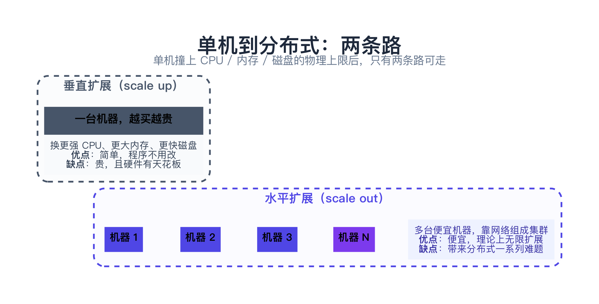
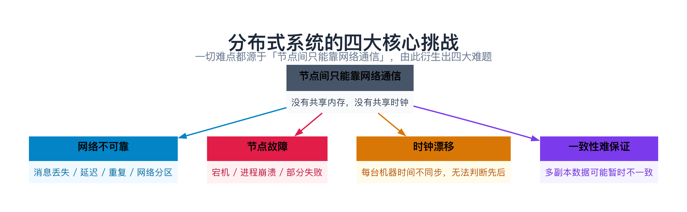
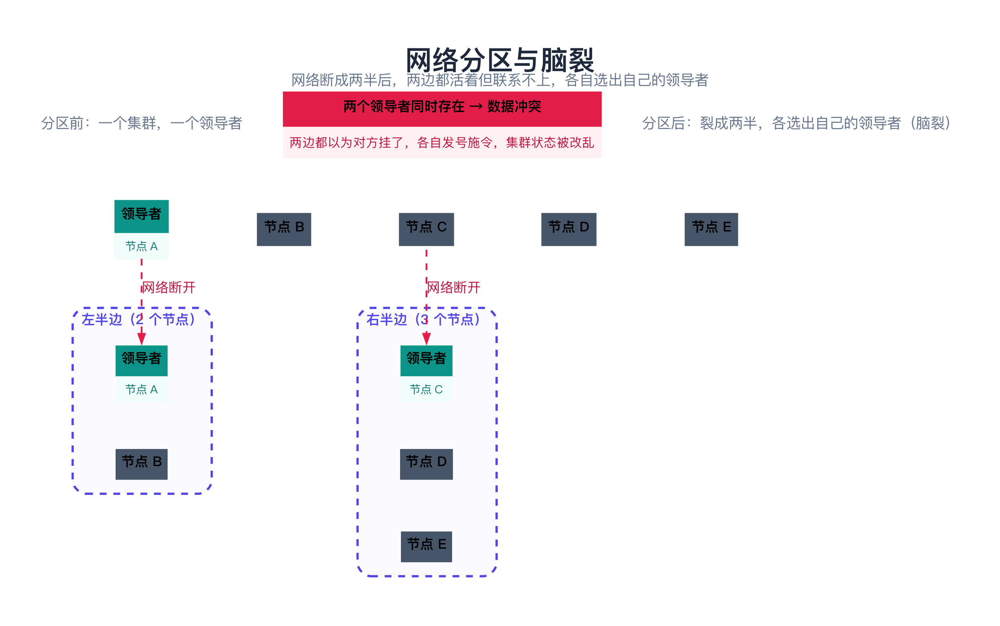
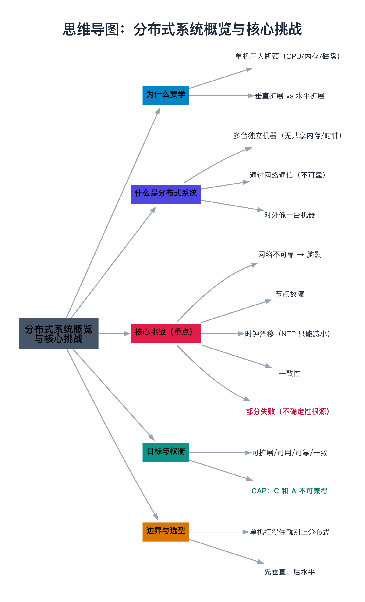

# 分布式系统概览与核心挑战

> **一句话总结**：分布式系统 = **一堆通过网络连接的独立机器，协作对外表现得像一台机器**。难就难在「网络不可靠、机器会挂、时钟会漂」这三座大山，它们共同导致一个根本问题——**你永远无法确定另一台机器此刻是什么状态**。

---

## 阅读路径

- **快速版（约 5 分钟）**：读「一句话总结」+ 第 3 节「核心挑战」+ 第 7 节「对比与选型」。
- **深入版（约 30 分钟）**：全文通读，重点吃透第 3.5 节「部分失败」和第 4 节的 C++ 示例。

---

## 目录

1. [为什么要学分布式系统](#1-为什么要学分布式系统)
2. [什么是分布式系统](#2-什么是分布式系统)
3. [核心挑战（重点）](#3-核心挑战重点)
4. [完整可复现的示例](#4-完整可复现的示例)
5. [边界、反例与失败路径](#5-边界反例与失败路径)
6. [目标与权衡](#6-目标与权衡)
7. [对比与选型](#7-对比与选型)
8. [常见问题 FAQ](#8-常见问题-faq)
9. [延伸阅读](#9-延伸阅读)
10. [思维导图总结](#10-思维导图总结)

---

## 1. 为什么要学分布式系统

### 1.1 先说痛点：单机是有极限的

任何一台机器，都在三个维度上有物理上限：

| 维度 | 上限来自 | 撞墙的表现 |
|------|----------|-----------|
| **CPU 算力** | 单核主频、核心数有限 | 计算密集任务跑不动 |
| **内存容量** | 内存条插槽有限 | 数据放不下、频繁换页 |
| **磁盘/IO** | 磁盘带宽有天花板 | 读写成为瓶颈 |

**不用分布式会怎样？** 三个后果：

1. **扛不住增长**：业务量一涨，单机直接被打爆（CPU 100%、内存 OOM）；
2. **单点故障**：这台机器一挂，整个服务全停，没有备份；
3. **放不下数据**：TB、PB 级数据，一块磁盘根本装不下。

> **类比：餐厅生意爆了**。要么**换更大的厨房**（垂直扩展），要么**开分店**（水平扩展）。换厨房省心，但厨房总有大小极限；开分店能无限扩张，但要解决「几家店怎么分工、菜谱怎么保持一致、账怎么对得上」——这就是分布式要解决的问题。

### 1.2 两条路：垂直扩展 vs 水平扩展

当单机扛不住，只有两条路：



- **垂直扩展（scale up）**：换更贵的机器（更强 CPU、更大内存）。简单，程序不用改，但**贵、有天花板**。
- **水平扩展（scale out）**：加更多便宜机器组成集群。便宜、可无限扩展，但**引入了分布式的一系列难题**。

**结论**：分布式是被「单机扛不住」逼出来的。它用「复杂度暴涨」换来「可扩展、可用、容灾」。所以业界有句名言：

> 分布式系统就是「**用一堆不可靠的机器，拼出一个可靠的系统**」。

---

## 2. 什么是分布式系统

**定义**：由**多台独立的计算机（节点）**组成，节点之间**通过网络通信**协同工作，对外呈现为一个**统一的整体**。

三个关键词，缺一不可：

1. **多台独立机器**：节点之间**没有共享内存**、**没有共享时钟**；
2. **通过网络通信**：唯一的交流方式是「发消息」，而网络不可靠；
3. **对外像一台机器**：用户感知不到「背后是一堆机器」。

> **类比：一个人 vs 一个团队**。
>
> - **单机** = **一个人干活**——记忆（内存）、手速（CPU）、笔记（磁盘）全在自己身上，速度快、协调零成本。
> - **分布式** = **一群人组成团队**——每个人各干各的，只能靠**喊话（网络消息）**协调。人多了能干的活多了，但「喊话」会听不清（丢包）、会延迟（网络慢）、有人请假（宕机）、有人重复说（消息重复），协调成本暴涨。

记住「一个人 vs 一群喊话协作的人」这组意象，分布式系统的几乎所有难点都源于此。

---

## 3. 核心挑战（重点）

所有难点，几乎都源于一个事实：**节点之间只能靠网络通信，而网络不可靠**。由此衍生出四大挑战：



### 3.1 网络不可靠：消息可能丢失、延迟、重复

单机里，调用函数**一定会返回**；分布式里，发消息可能**石沉大海**：

- **消息丢失**：丢包、交换机故障；
- **消息延迟**：拥塞、排队，可能几十毫秒甚至几秒；
- **消息重复**：超时重传导致对端收到两份；
- **网络分区（network partition）**：最可怕——网络断成两半，两半无法通信。

**网络分区**尤其值得单独讲：此时**两边的节点都还活着**，只是联系不上了。

> **类比：两座岛之间只有一座桥**。桥塌了（分区）——两座岛上的人**都活得好好的**，但谁也到不了对岸、看不到对岸。每座岛只能瞎猜：「对岸是不是出事了？」

但真正的麻烦在下面这个更致命的事实：

**「联系不上」有两种完全不同的原因，而你无法区分**：

1. 对方**真的挂了**（宕机）；
2. 对方**活着**，只是网络断了（分区）。

这两种情况，从你的角度看**一模一样**——都是「发消息过去，没有回应」。

**为什么这很危险**：正因为你「不知道」，两边都可能做出错误决定——比如**两边都以为对方挂了、各自选出一个领导者**，于是同时出现两个领导者，各自发号施令，把数据改乱。这就是臭名昭著的「**脑裂（split brain）**」。



### 3.2 节点故障：机器随时可能挂

单机里进程崩溃会**立即**被发现；分布式里，节点挂了，其他节点**无法区分**「它挂了」还是「网络慢了」。

- **宕机（crash）**：进程崩溃、断电、磁盘损坏、OOM 被杀；
- **部分失败（partial failure）**：节点活着但行为异常——极慢、返回错误结果。

> **类比：团队里有人突然失联**。是辞职了？路上堵车？手机没电？你**不知道**，只能等待或猜测。分布式系统必须设计成「任何人随时失联，团队都能继续运转」——这就是「容错」。

### 3.3 时钟漂移：时间不可靠

每台机器靠**晶振**计时，晶振有误差，时间一长各台机器的表越差越多。为了缓解，机器用 **NTP（Network Time Protocol，网络时间协议）** 定期校准时钟——让每台机器向「标准时间源」（原子钟、GPS）对齐：

> **类比**：就像手表不准了，定期听收音机整点报时来对表。NTP 就是机器「定期对表」的机制。

但 NTP 有两个先天缺陷，决定了它**只能减小、无法消除**误差：

1. **网络延迟不确定**：问时间服务器「现在几点」，它回「10:00:00」，但这条回复走了多久你无法精确知道——若走了 50ms，你收到时真实时间已是 10:00:00.050 了；
2. **两次校准之间继续漂移**：NTP 只是定期对表，两次之间晶振继续漂，误差又累积回来。

所以 NTP 只能把误差压到「毫秒到几十毫秒」，做不到零误差。这意味着**无法用「时间戳」判断跨机器的先后顺序**：A 机器 10:00 记的事，可能实际**早于** B 机器 09:59 记的事——因为 A 的表走得快、B 的表走得慢。这正是 Lamport 时钟、向量时钟要解决的问题（见第 05 篇）。

### 3.4 一致性难保证：多副本可能不一致

为提高可用性和容灾，同一份数据通常有**多个副本**。网络延迟和故障会导致各副本**暂时不一致**。

> **类比：两个前台各记一本访客登记簿**。同一访客进来，两个前台可能记的顺序不一样、甚至有人漏记。怎么让两本簿子最终对上，就是一致性要解决的问题（见第 03 篇）。

### 3.5 部分失败：不确定性的根源（最重要）

上面四大挑战，最终都汇聚成一个**本质区别**——这是分布式和单机最根本的差异：

- **单机**：失败是「全有或全无」——要么成功、要么整个进程崩溃，结果**明确**；
- **分布式**：失败是「**部分失败**」——一部分成功、一部分失败、一部分**未知**。

> **类比**：单机是「一个人要么把任务干完、要么当场昏倒」。分布式是「十个人协作，可能五个干完了、三个失败了、两个失联了」——你**甚至不知道那两个人到底干没干完**。

**请牢牢记住**：分布式编程的核心难点，不是「机器会挂」，而是「**你永远无法确定另一台机器此刻是什么状态**」。

---

## 4. 完整可复现的示例

下面用一段 C++ 代码，直观感受「网络不可靠」和「超时 ≠ 失败」。

### 4.1 环境

- **系统**：macOS / Linux 均可
- **编译器**：`g++` 或 `clang++`，需支持 **C++11**（用到了 `<random>`）
- **无第三方依赖**，纯标准库

### 4.2 完整代码

```cpp
// 文件名：net_unreliable.cpp
#include <iostream>
#include <random>
#include <string>

int received_count = 0;  // 接收方实际处理的次数

bool packet_lost() {
    static std::mt19937 rng(2024);  // 固定种子，结果可复现
    return (rng() % 5) == 0;         // 20% 丢包率
}

// 发送一次请求并等待 ACK。返回值表示「是否收到 ACK」。
// 关键：返回 false（超时）不代表「对端没收到」——可能是请求丢了，也可能是 ACK 丢了。
bool send_and_wait_ack(const std::string& msg) {
    if (packet_lost()) return false;   // 情况①：请求在去程丢了
    ++received_count;                  // 请求到达，对端处理了一次
    if (packet_lost()) return false;   // 情况②：对端收到了，但 ACK 在回程丢了
    return true;                       // 收到 ACK，发送确定成功
}

int main() {
    std::string msg = "下单请求";
    for (int retry = 0; retry < 3; ++retry) {
        if (send_and_wait_ack(msg)) {
            std::cout << "发送成功（收到 ACK）\n";
            break;
        }
        std::cout << "超时，第 " << retry + 1 << " 次重试...\n";
    }
    std::cout << "对端实际处理的次数：" << received_count << "\n";
    return 0;
}
```

### 4.3 编译与运行

```bash
g++ -std=c++17 net_unreliable.cpp -o net_unreliable
./net_unreliable
```

### 4.4 预期输出

（用固定种子 `2024`，结果**完全确定**，任何人跑都是一样的）

```
超时，第 1 次重试...
超时，第 2 次重试...
超时，第 3 次重试...
对端实际处理的次数：3
```

### 4.5 解读（关键）

这个输出极其反直觉，值得反复体会：

- 发送方视角：**3 次全部超时，看起来「彻底失败」**；
- 但最后一行：**对端实际处理了 3 次**！

也就是说，三次「超时」其实是「**请求都到了、但 ACK 全丢了**」——对端每次都处理了，发送方却以为失败了、重试了 3 次。**如果这是「下单」，对端就会下 3 单！**

这就是两个分布式基础问题的来源：

- **重试**：超时了要重发；
- **幂等**：重发会导致重复，接收方必须能识别「这是同一个请求，别再处理了」（见第 32 篇）。

而这一切的根源，就是那句「**超时 ≠ 失败**」——发送方永远分不清是「请求丢了」还是「ACK 丢了」。

### 4.6 常见报错排查

| 报错 | 原因 | 解决 |
|------|------|------|
| `no member named 'mt19937' in namespace 'std'` | 忘了 `#include <random>`，或用了 C++98 | 加头文件 / 用 `-std=c++11` 以上 |
| `std::mt19937 rng(2024)` 编译报错 | 编译器不支持 C++11 | 升级编译器或加 `-std=c++11` |
| 输出每次都不一样 | 你改了种子或用了 `random_device` | 用固定种子保证可复现 |

---

## 5. 边界、反例与失败路径

### 5.1 什么时候**不该**用分布式

分布式不是银弹，很多场景用了反而更糟：

- **数据量小、单机完全扛得住**：单机就能跑，引入分布式纯属自找复杂度（要处理网络、一致性、故障）；
- **强一致 + 数据量小**：银行核心账务这种「错一分都不行」的场景，单机数据库 + 事务反而更简单可靠；
- **强事务、强 ACID 需求**：分布式事务（第 14 篇）极难做好，能用单机就别折腾。

> 一句话：**先问「单机真的扛不住了吗」，扛得住就别上分布式。**

### 5.2 常见坑（失败案例往往比成功案例更有价值）

| 坑 | 场景 | 后果 |
|----|------|------|
| **脑裂** | 网络分区后两边各自选主 | 两个 leader 同时写，数据冲突 |
| **超时误判** | 把「慢」当成「挂了」 | 误杀正常节点、重复处理 |
| **时钟漂移** | 用本地时间戳排序 | 事件顺序错乱 |
| **重复消息** | 超时重试 + 对端已处理 | 重复下单、重复扣款 |
| **部分失败** | 只拿到部分节点的响应 | 不确定哪些成功了 |

---

## 6. 目标与权衡

面对上面的挑战，分布式系统追求四个目标，但它们**相互冲突，必须权衡**：

| 目标 | 含义 |
|------|------|
| **可扩展性 Scalability** | 加机器就能扛更多流量 |
| **可用性 Availability** | 部分节点挂了，系统仍能响应 |
| **可靠性 Reliability** | 数据不丢、不出错 |
| **一致性 Consistency** | 各副本数据一致 |

最著名的权衡就是 **CAP 定理**（第 03 篇详讲）：

> **网络分区发生时，一致性（C）和可用性（A）不可兼得，只能二选一。**

---

## 7. 对比与选型

### 7.1 垂直扩展 vs 水平扩展

| | 垂直扩展（scale up） | 水平扩展（scale out） |
|---|---|---|
| 做法 | 换更强的机器 | 加更多机器 |
| 成本 | 贵（高端机器价格陡增） | 便宜（普通机器即可） |
| 复杂度 | 低（程序不用改） | 高（要处理一致性/故障） |
| 扩展上限 | 有（硬件天花板） | 理论上无限 |
| 容错 | 差（单点故障） | 好（多副本冗余） |
| 典型 | 数据库升级硬件 | 微服务、大数据集群 |

### 7.2 选型建议

- **选垂直**：数据量小、追求简单、预算充足、团队没有分布式经验；
- **选水平**：数据量大、追求弹性伸缩、成本敏感、能接受分布式复杂度。

**现实中**：通常**先垂直扩展扛住当前，等真到天花板了再上水平扩展**——不要一上来就分布式。

---

## 8. 常见问题 FAQ

**Q1：分布式一定比单机好吗？**
不一定。分布式只在「单机扛不住」时才划算，它带来的是**复杂度暴涨**（一致性、故障、并发）。数据量小的时候，单机又快又简单。

**Q2：多少台机器才算分布式？**
没有硬性数字。核心是「**多台独立机器通过网络协作**」，2 台也算。但通常说的分布式指几十上百台的大规模集群。

**Q3：分布式和微服务是什么关系？**
微服务是分布式的一种**组织形态**——把一个大系统拆成多个独立部署的服务，服务之间通过网络通信。所以微服务天然是分布式系统，会踩分布式所有的坑。

**Q4：学分布式需要什么前置知识？**
网络编程（socket、TCP/UDP）、操作系统（进程/线程/锁）、数据结构（哈希表、日志、树）。

---

## 9. 延伸阅读

- **论文**（奠基之作，强烈建议读原文）：
  - Leslie Lamport《Time, Clocks, and the Ordering of Events in a Distributed System》（1978）—— 逻辑时钟、happens-before 的出处；
  - Fischer, Lynch, Paterson《Impossibility of Distributed Consensus with One Faulty Process》（1985）—— FLP 定理；
  - Lamport, Shostak, Pease《The Byzantine Generals Problem》（1982）—— 拜占庭将军问题。
- **书籍**：Martin Kleppmann《数据密集型应用系统设计》（DDIA）—— 分布式系统入门到进阶的最佳读物。
- **课程**：MIT 6.824《Distributed Systems》—— 配合 Lab 手写 Raft，理论与实践结合。
- **在线资源**：[raft.github.io](https://raft.github.io) —— Raft 共识算法的可视化交互演示。

---

## 10. 思维导图总结

```text
分布式系统概览与核心挑战
├── 为什么要学
│   ├── 单机三大瓶颈：CPU / 内存 / 磁盘
│   ├── 垂直扩展（贵、有天花板）vs 水平扩展（便宜、但难）
│   └── 分布式 = 用不可靠机器拼出可靠系统
├── 什么是分布式系统
│   ├── 多台独立机器（无共享内存/时钟）
│   ├── 通过网络通信（不可靠）
│   └── 对外像一台机器
├── 核心挑战（重点）
│   ├── 网络不可靠：丢失 / 延迟 / 重复 / 网络分区 → 脑裂
│   ├── 节点故障：宕机 / 部分失败
│   ├── 时钟漂移：NTP 只能减小不能消除 → 无法判断先后
│   ├── 一致性：多副本可能不一致
│   └── 部分失败：不确定性的根源（最核心）
├── 目标与权衡
│   └── 可扩展 / 可用 / 可靠 / 一致 → CAP 不可兼得
└── 边界与选型
    ├── 什么时候不该用：单机扛得住就别上
    └── 先垂直、后水平
```


