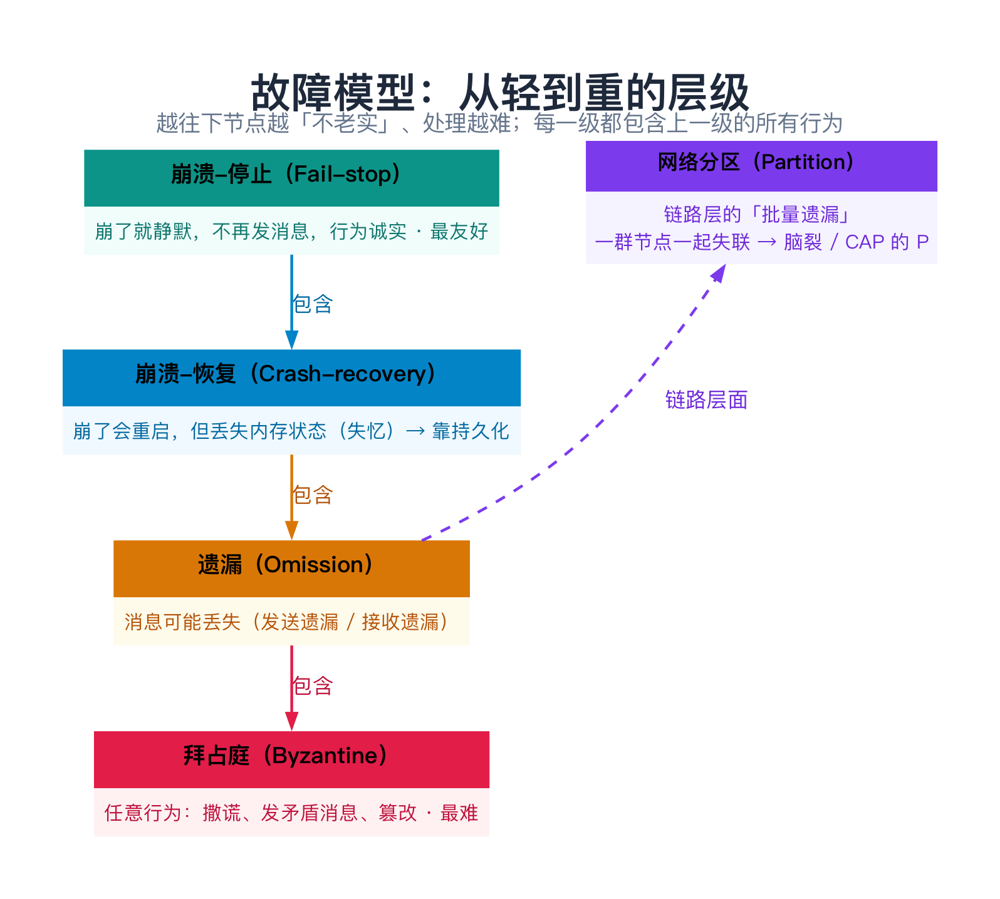
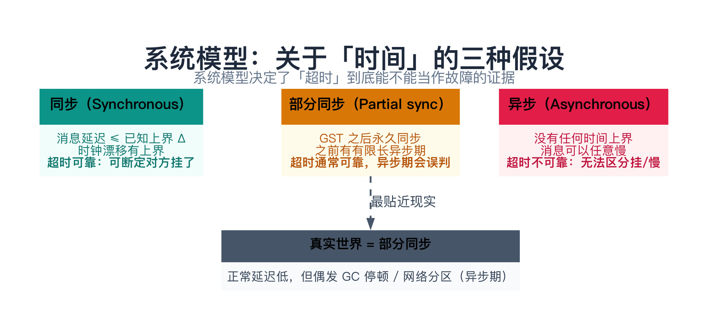
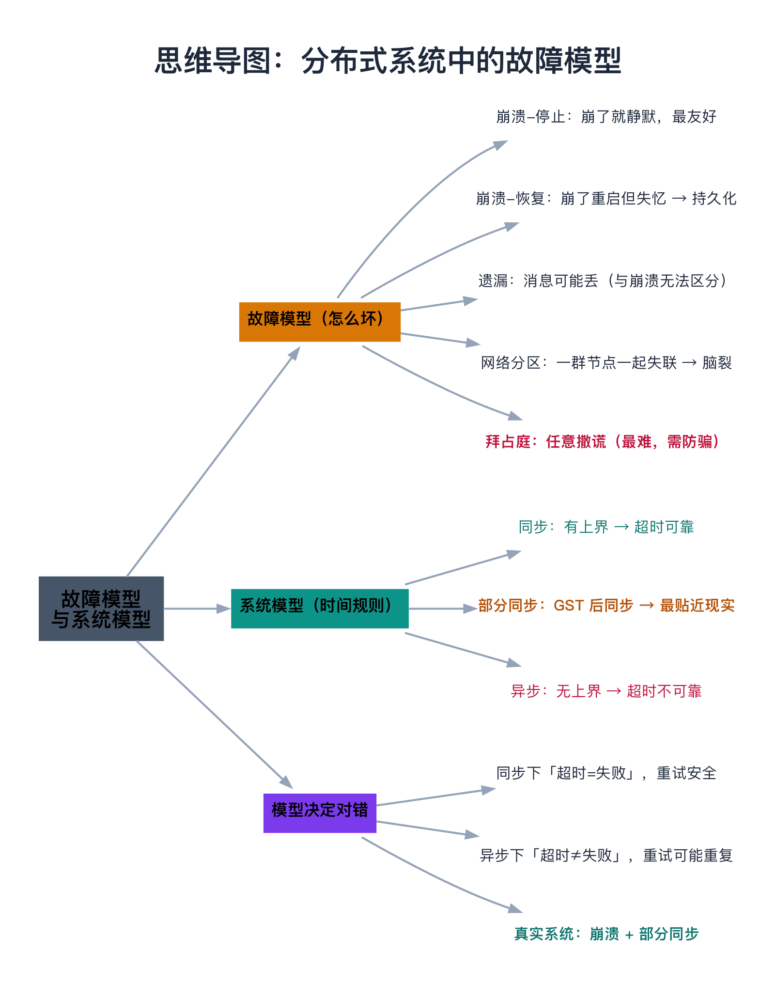

# 分布式系统中的故障模型

> **一句话总结**：要讨论「分布式系统能不能正常工作」，得先约定两件事——**故障模型**（系统会怎么坏：从诚实的崩溃、遗漏，到会撒谎的拜占庭，难度逐级上升）和**系统模型**（关于时间的假设：同步 / 异步 / 部分同步，它决定了「超时」到底能不能当判断依据）。这两个约定是讨论一切分布式算法正确性的「公共语言」——同一套操作，在不同的约定下，对错可能完全相反。

---

## 阅读路径

- **快速版（约 5 分钟）**：读「一句话总结」+ 第 2 节「故障模型」+ 第 3 节「系统模型」。
- **深入版（约 30 分钟）**：全文通读，重点吃透第 2.6 节「层级图」和第 4 节「为什么模型是前提」——这两块是全篇的骨架。

---

## 目录

1. [为什么要先定义「故障」和「时间」](#1-为什么要先定义故障和时间)
2. [故障模型：系统会怎么坏（核心）](#2-故障模型系统会怎么坏核心)
   - 2.1 崩溃-停止（Crash-stop / Fail-stop）
   - 2.2 崩溃-恢复（Crash-recovery）
   - 2.3 遗漏故障（Omission）
   - 2.4 网络分区（Partition）
   - 2.5 拜占庭故障（Byzantine / Arbitrary）
   - 2.6 一张图看清：从轻到重的层级
3. [系统模型：关于「时间」的三种假设](#3-系统模型关于时间的三种假设)
   - 3.1 同步模型
   - 3.2 异步模型
   - 3.3 部分同步模型
   - 3.4 为什么「真实世界是部分同步」
4. [为什么这两个模型是「前提」](#4-为什么这两个模型是前提)
5. [完整可复现的示例（C++）](#5-完整可复现的示例c)
6. [边界、反例与失败路径](#6-边界反例与失败路径)
7. [小结与 FAQ](#7-小结与-faq)
8. [延伸阅读](#8-延伸阅读)
9. [思维导图总结](#9-思维导图总结)

---

## 1. 为什么要先定义「故障」和「时间」

### 1.1 单机出错是明确的，分布式出错是「千奇百怪」的

在**单机**程序里，出错是「明确」的：

- 函数要么**正常返回**，要么**抛异常**，要么**进程崩溃**（core dump）；
- 每一行代码，要么执行了，要么没执行，**没有中间态**；
- 崩了，你立刻能知道（进程没了）。

在**分布式**系统里，这一切都变了。回忆第 01 篇：节点之间只能靠网络通信，而网络不可靠。于是一个节点「没回你消息」，可能是：

1. 它**崩溃了**；
2. 它**活着**，但消息在网络上**丢了**；
3. 它**活着**，只是**太慢**（GC 停顿、磁盘 IO 卡住、被调度器挂起）；
4. 它**活着**，却**故意回了假话**（被黑客控制，或有个 bug 让它乱发消息）。

从你的视角看，这四种情况**全都长一个样**——「发了消息，没得到预期的回应」。

### 1.2 不约定，就没法讨论「对错」

这就引出一个根本问题：

> **如果不先定义「系统会怎么坏」，就根本无法讨论「系统能不能正常工作」。**

> **类比：签合同先定「违约条款」**。两个人合伙做生意，如果合同不写清楚「哪些算违约、违约了怎么处理」，一旦出事就扯不清。分布式算法也一样——一篇算法的论文，**开篇第一句永远是「我们假设故障模型是 XXX，系统模型是 YYY」**，然后才在这个前提下证明「我能容忍多少个节点出问题」。

为什么非要这样？因为**「正确」是相对于「模型」的**：

- 同一个算法，在「节点只会崩溃」的假设下是**正确**的；
- 换成「节点会撒谎」的假设，它就**错**了。

不把模型说清楚，所有关于「正确性」的讨论都是空中楼阁。

### 1.3 两个约定，先分清楚：一个讲「信使」，一个讲「路」

用「寄信」来理解最直观——你要和远方的人协作，只能靠**信使送信**。要讨论「这套协作靠不靠谱」，得先回答两个**互不相干**的问题：

**问题一：对方和信使「会怎么出毛病」？—— 这是故障模型（failure model）**

- 信使可能**死了**（崩溃）；
- 信使可能**把信弄丢**（遗漏）；
- 信使可能**故意篡改信的内容**（拜占庭）。

它约定的是「**坏的方式**」：节点和网络会以什么方式「不老实」。

**问题二：路「有没有时限保证」？—— 这是系统模型（system model）**

- 信**保证 3 天内到**（同步）；
- 信可能**永远在路上**（异步）；
- 平时 3 天到、偶尔堵车拖很久（部分同步）。

它约定的是「**时间的规则**」：消息传递有没有速度上界——这直接决定了「等多久没回音，能断定对方出事了」。

**关键：这两个维度是正交的，可以自由组合。** 同样是「信使会死」，配上不同的「路」，结论完全不同：

| 组合 | 含义 |
|------|------|
| 崩溃故障 + 同步模型 | 信使会死，但路保证时限 → 超时就能断定「死了」 |
| 崩溃故障 + 异步模型 | 信使会死，但路无时限 → 超时无法断定「死了还是堵车」 |
| 拜占庭故障 + 同步模型 | 信使会篡改信，但路保证时限 → 还要额外防「假信」 |

**一句话记忆：故障模型讲「坏的方式」，系统模型讲「时间的规则」，两者各自独立、组合起来才构成完整的假设。** 下面分别展开。

---

## 2. 故障模型：系统会怎么坏（核心）

故障从「最克制」到「最放纵」分五个等级。抓住它们的**包含关系**是关键：后面每一级都比前面一级「更不老实」，处理起来也更难。

### 2.1 崩溃-停止（Crash-stop / Fail-stop）

**定义**：节点崩溃后**永久停止**，不再发送任何消息，也不恢复。

- **运行期间**：行为完全正确（诚实）；
- **崩溃之后**：彻底静默，不产生任何副作用。

> **类比**：同事突然**辞职并彻底失联**——他不会回你消息，但也**不会害你**、不会给你假信息。你只需处理「他没回音」这一件事。

这是**最友好**的故障。一个「崩溃-停止」的节点，一旦崩了就不会再「捣乱」——不会发矛盾消息、不会篡改数据。只要你能**检测到它崩了**（能不能检测，取决于第 3 节的系统模型），就能安全地把它排除在外。

> **注**：严格说 `fail-stop` 比 `crash-stop` 多一个性质——「故障**可被其他节点检测到**」。日常讨论常混用，本系列统一用「崩溃-停止」指代「崩了就不动了、且行为诚实」这一档。

### 2.2 崩溃-恢复（Crash-recovery）

**定义**：节点崩溃后能**重启恢复**，但会**丢失内存状态**（失忆，amnesia）。

这是真实系统里**最常见**的故障——进程崩了、机器重启、然后重新加入集群。麻烦在于：

> **恢复后的节点「忘了」崩溃前做过什么决定。** 比如它崩溃前已经告诉别人「我提交了这笔交易」，重启后却「不记得自己提交过」，于是可能做出**矛盾**的行为。

解决办法是**持久化**：把关键状态写进磁盘（日志 + 快照），重启后从磁盘恢复。很多存储系统「写盘」的根本原因，就是为了对付这个「失忆」。

> **类比**：同事**突然昏倒、送医后醒了**，但**失忆了**——不记得昏倒前答应过你什么。你只能靠他随身带的**笔记本（持久化日志）**帮他「找回记忆」。

### 2.3 遗漏故障（Omission）

**定义**：节点或链路**漏掉了一些消息**——该发的没发，或该收的没收到。

细分两种：

- **发送遗漏（send-omission）**：节点本应发送某条消息，但没发出去；
- **接收遗漏（receive-omission）**：消息到达了，但节点没处理（或网络层就丢了）。

> **类比**：同事**还在、也清醒**，但时不时**忘回你消息**——不是辞职，就是「漏了」。

**关键点**：遗漏故障和崩溃故障，从外部观察**几乎无法区分**——两者都表现为「没回应」。这是分布式系统最经典的一个「不可判定」难题（第 5 节的 C++ 示例会直观演示）。

### 2.4 网络分区（Partition）

**定义**：网络被切成**两个或多个互相无法通信的部分**。每部分内部的节点**都活着、都正常**，只是**跨部分的消息全丢了**。

网络分区本质上是**链路层的批量遗漏**，但重要到必须单独讲：

> **类比**：两座岛之间唯一的桥**塌了**。岛上的人都**活得好好的**，只是谁也过不去。从 A 岛看 B 岛，「整座岛都失联了」——就像 B 岛上所有人**同时**发生了遗漏故障。这正是「网络分区」和「单节点故障」的本质区别：**分区是「一群节点一起失联」**。

分区最麻烦的后果，第 01 篇已经讲过——**脑裂**：分区两边的节点都以为对方挂了，各自选出一个领导者，于是两个 leader 同时写数据，把状态改乱。

### 2.5 拜占庭故障（Byzantine / Arbitrary）

**定义**：节点**任意行为**——撒谎、对不同节点发矛盾消息、篡改数据、冒充别人、假装崩溃。总之「想干嘛干嘛」。

注意拜占庭故障**包含两种情况**，别只理解成「恶意攻击」：

1. **恶意**：节点被黑客控制，故意捣乱；
2. **非恶意但等效**：节点出现 bug 或内存损坏（如比特翻转、越界写），导致**行为错乱**——从系统角度看，它就是在「撒谎」。

> **类比**：同事是个**内鬼**——他不仅不回你消息，还会**主动给你假情报**，对你说「进攻」、对别人说「撤退」，目的就是让你们内部打起来。

拜占庭故障是**最难**的：节点会撒谎，意味着你**不能相信任何一条消息**，即使它「看起来正常」。所以绝大多数分布式系统**都假设节点不会撒谎**——只处理「崩溃/遗漏」这类**诚实的**故障。至于「节点会撒谎时该怎么办」，后面有专门的章节讨论，这里先记住：**它属于另一个难度量级**。

### 2.6 一张图看清：从轻到重的层级



五个等级的**包含关系**（从弱到强）：

```
崩溃-停止  ⊂  崩溃-恢复  ⊂  遗漏  ⊂  拜占庭
```

含义是：一个「崩溃-停止」的节点，做的事是「崩溃-恢复」节点的**子集**；「崩溃-恢复」又比「遗漏」更「老实」……一直到「拜占庭」，节点的行为**完全不受约束**，包含了前面所有可能。

> **一句话**：故障模型越「重」，节点越不老实，算法越难设计。**崩溃模型只需要「容错」，拜占庭模型还需要「防骗」。**

---

## 3. 系统模型：关于「时间」的三种假设

故障模型讲「坏的方式」，系统模型讲「**时间的规则**」。它之所以重要，是因为它决定了**「超时」到底能不能作为判断依据**——这正是第 01 篇「超时 ≠ 失败」的延伸。



### 3.1 同步模型（Synchronous）

**定义**：系统运行在严格的**时间上界**之内：

- 消息传递延迟 ≤ 已知上界 **Δ**；
- 进程每步执行耗时 ≤ 已知上界；
- 时钟漂移 ≤ 已知上界。

**推论**：如果你在 Δ 时间内没收到对方的回复，就能**百分百确定**对方已经崩溃（它若活着，消息一定在 Δ 内到达）。**超时是可靠的故障检测器。**

> **类比**：你和同事约好「**5 秒内必回**」。超过 5 秒没回，你就可以断定他出事了（而不是「可能还在打字」）。

**问题**：真实网络**不是同步的**——消息延迟可能因拥塞、GC 停顿而飙到任意高。所以同步模型是**理想化、不现实**的，主要价值是「简化分析」。

### 3.2 异步模型（Asynchronous）

**定义**：**没有任何时间上界**：

- 消息最终会到达（若无故障），但可以**任意慢**；
- 进程可以**任意长时间**暂停（GC、swap、调度器饥饿）；
- 时钟可以任意漂移。

**推论**：**超时不能作为任何证据**。你没收到回复，**无法区分**「对方挂了」还是「对方只是慢」。**故障不可检测。**

> **类比**：同事没约定回消息时间。他没回你，可能死了，也可能在开一个 3 小时的会。**你永远不知道。**

异步模型是「最坏情况」——它把「超时」这个唯一的直觉判断工具都剥夺了。后面会看到，在这种模型下，很多「看起来理所当然」的事情会变得**异常困难**。

### 3.3 部分同步模型（Partial synchronous）

**定义**：**大部分时间**系统像同步的，但存在**有限长的「异步期」**。

这是 Dwork、Lynch、Stockmeyer 1988 年提出的模型，是**最贴近现实**的。形式化表述：

> 存在一个未知时刻 **GST（Global Stabilization Time，全局稳定时刻）**：GST 之后，消息延迟有上界、时钟同步，系统**永久**表现为同步；GST **之前**，系统可以任意异步（消息想多慢就多慢）。

**推论**：超时「**通常**」可靠，但在异步期可能**误判**。算法必须能「熬过」异步期、在同步期重新达成一致。

> **类比**：平时你和同事配合默契（同步），但偶尔**网络抽风、谁都联系不上谁**（异步期），过一会儿又恢复。你要做的，是「网络抽风时别做傻事（别乱下结论、别乱选主），恢复后再对齐」。

### 3.4 为什么「真实世界是部分同步」

| 证据 | 说明 |
|------|------|
| 正常延迟很低 | 数据中心内 RTT 通常 < 1ms，看起来「同步」 |
| 偶尔长尾 | GC 停顿、磁盘慢、网络拥塞会让延迟飙到秒级 |
| 网络分区 | 交换机/链路故障让整段网络不可达（异步期） |
| 时钟漂移 | NTP 校准只能压到毫秒级，无法消除（第 01 篇） |

**结论**：算法**不能**假设「同步」（太乐观，现实会打脸），也**不必**假设「纯异步」（太悲观，等于放弃超时）。**部分同步**是「恰到好处」的假设。

---

## 4. 为什么这两个模型是「前提」

模型不是学术名词游戏，它**实实在在决定「对错」**。用「超时重试」这个最基础的操作来说明——几乎所有分布式系统都会「发请求 → 等回复 → 超时了重试」：

| | 同步模型 | 异步模型 |
|---|---|---|
| 超时意味着什么 | 对方**确定**已崩溃 | 对方**可能**崩溃，也可能只是慢 |
| 重试安全吗 | ✅ 安全（对方没处理过） | ❌ 有风险（对方可能已处理，只是回复慢） |
| 结果 | 重试不会重复 | 重试可能导致**重复处理** |

同一个「超时重试」：

- 在**同步模型**下是**正确**的——超时即失败，重试无副作用；
- 在**异步模型**下是**可能出错**的——对方也许早已处理完，只是 ACK 慢了，你一重试，它就**重复处理**（比如重复下单、重复扣款）。

**看出问题了吗：不先定模型，你甚至无法判断「超时重试」这个最基础的操作是安全的还是危险的。**

这就是为什么所有分布式算法的讨论，**第一件事永远是声明模型**。模型一变，同一个操作、同一个算法的「对错」就可能颠倒。你只需要先记住这条原则：**「正确」永远是一个「相对于模型」的判断。**

---

## 5. 完整可复现的示例（C++）

下面用一段 C++ 直观演示第 2 节的一个结论：**「没回应」背后可能是完全不同的故障**——崩溃和遗漏，从发送方看一模一样。

### 5.1 环境

- **系统**：macOS / Linux 均可
- **编译器**：`g++` 或 `clang++`，支持 **C++11**（只用了 `enum class` 和范围 for）
- **无第三方依赖**，纯标准库

### 5.2 完整代码

```cpp
// 文件名：fault_models.cpp
// 演示：同一个「无回应」，背后可能是完全不同的故障
#include <iostream>
#include <string>

enum class Fault { OK, CRASH_STOP, OMISSION, BYZANTINE };

const char* fault_name(Fault f) {
    switch (f) {
        case Fault::OK:         return "正常";
        case Fault::CRASH_STOP: return "崩溃-停止";
        case Fault::OMISSION:   return "遗漏(消息丢失)";
        case Fault::BYZANTINE:  return "拜占庭(撒谎)";
    }
    return "未知";
}

// 对端处理「提案」后给出的表态。
// 返回空串 = 无回应（发送方只会看到「超时」）。
std::string respond(Fault f, const std::string& honest_value) {
    switch (f) {
        case Fault::OK:         return honest_value;   // 诚实回答
        case Fault::CRASH_STOP: return "";             // 崩溃：静默
        case Fault::OMISSION:   return "";             // 消息丢了：也是静默
        case Fault::BYZANTINE:  return "撤退(假话)";     // 撒谎
    }
    return "";
}

int main() {
    const std::string proposal = "进攻";
    Fault faults[] = {Fault::OK, Fault::CRASH_STOP, Fault::OMISSION, Fault::BYZANTINE};

    std::cout << "你向对端发送提案：「" << proposal << "」\n\n";
    for (Fault f : faults) {
        std::string reply = respond(f, proposal);
        std::cout << "故障模型：" << fault_name(f) << "\n";
        if (reply.empty())
            std::cout << "  → 你看到：超时（无回应）\n";
        else
            std::cout << "  → 你看到：回复「" << reply << "」\n";
    }

    std::cout << "\n关键结论：\n";
    std::cout << "  ① 「崩溃-停止」和「遗漏」从发送方看一模一样——都是超时，无法区分。\n";
    std::cout << "  ② 只有「拜占庭」会回话，但回的是假话（甚至对不同人回不同假话）。\n";
    return 0;
}
```

### 5.3 编译与运行

```bash
g++ -std=c++11 fault_models.cpp -o fault_models
./fault_models
```

### 5.4 预期输出

```
你向对端发送提案：「进攻」

故障模型：正常
  → 你看到：回复「进攻」
故障模型：崩溃-停止
  → 你看到：超时（无回应）
故障模型：遗漏(消息丢失)
  → 你看到：超时（无回应）
故障模型：拜占庭(撒谎)
  → 你看到：回复「撤退(假话)」

关键结论：
  ① 「崩溃-停止」和「遗漏」从发送方看一模一样——都是超时，无法区分。
  ② 只有「拜占庭」会回话，但回的是假话（甚至对不同人回不同假话）。
```

### 5.5 解读（关键）

- **正常**和**拜占庭**都会「回话」，但拜占庭回的是**假话**——所以「有回应」不等于「可信任」；
- **崩溃-停止**和**遗漏**都表现为「超时」——所以「超时」**无法**告诉你对方到底怎么了；
- 把这条和第 4 节的「超时重试」串起来：**「超时 ≠ 失败」**，而「超时了怎么办」正是由系统模型决定的。

> 想更进一步？把 `respond` 里的 `BYZANTINE` 改成「对不同节点返回不同值」，你会看到拜占庭节点如何在集群里「挑拨离间」——那正是拜占庭故障最危险的地方。

### 5.6 常见报错排查

| 报错 | 原因 | 解决 |
|------|------|------|
| `scoped enums require -std=c++11` | 用了 `enum class` 但没开 C++11 | 加 `-std=c++11` |
| `range-based 'for' loops ... -std=c++11` | 范围 for 需要 C++11 | 加 `-std=c++11` |
| 中文输出乱码 | 终端编码非 UTF-8 | `export LANG=zh_CN.UTF-8` 或用英文 |

---

## 6. 边界、反例与失败路径

### 6.1 故障模型是「简化」，不是「全貌」

真实世界的故障往往**超出**任何单一模型：

- 一个节点可能**先崩溃、再恢复、恢复后行为错乱**（多个模型叠加）；
- 「拜占庭故障」可能不是恶意，而是**内存比特翻转**或 **bug**——你以为节点「可信」，它却冷不丁撒个谎；
- **故障是关联的**：一台交换机挂掉，会导致它后面**一堆节点同时**「失联」，这不是「单个节点崩溃」能描述的。

> **教训**：模型是用来**分析正确性**的，不是用来**假设现实一定如此**的。工程上要「按最坏情况设计，按最好情况优化」。

### 6.2 常见坑（失败案例比成功案例更有价值）

| 坑 | 场景 | 后果 |
|----|------|------|
| **假设同步、用了硬超时** | 把「慢」当成「崩溃」 | 误杀正常节点、重复处理 |
| **忽略「崩溃-恢复」** | 只按「崩溃-停止」设计 | 恢复的节点「失忆」，做出矛盾行为 |
| **在不可信环境假设节点诚实** | 公网、暴露在外的服务 | 恶意节点撒谎即可搞乱整个系统 |
| **在可信环境过度防骗** | 内网也上最重的防拜占庭机制 | 性能白白损失 |
| **忽略网络分区** | 只考虑「单节点挂」 | 分区导致脑裂，数据冲突 |

### 6.3 什么时候「过度建模」是错的

- **内网可信集群**：按「崩溃 + 部分同步」设计就够了，硬上「防拜占庭」的机制是**自找性能损失**；
- **纯研究**：可以假设同步模型来简化证明，但**别把结论直接搬到生产**；
- **快速原型**：先按「崩溃-停止」写，跑通了再补「恢复」「遗漏」的兜底，**不要一上来就套最重的模型**。

---

## 7. 小结与 FAQ

### 7.1 一张表收尾

**故障模型**（从轻到重）：

| 故障模型 | 节点行为 | 处理难度 | 典型场景 |
|---------|---------|---------|---------|
| 崩溃-停止 | 崩了就静默 | ★ | 教学、理论分析 |
| 崩溃-恢复 | 崩了会重启、失忆 | ★★ | 主流存储/共识系统 |
| 遗漏 | 可能丢消息 | ★★★ | 网络丢包、UDP |
| 网络分区 | 一群节点一起失联 | ★★★★ | 脑裂、跨机房 |
| 拜占庭 | 任意撒谎 | ★★★★★ | 防篡改、不可信环境 |

**系统模型**：

| 系统模型 | 时间假设 | 超时能否当证据 | 现实性 |
|---------|---------|--------------|--------|
| 同步 | 有上界 | ✅ 能（可靠） | 理想化，不现实 |
| 部分同步 | GST 后同步 | ⚠️ 通常能，异步期会误判 | **最贴近现实** |
| 异步 | 无上界 | ❌ 不能 | 理论最坏情况 |

### 7.2 选型（两个问题就够了）

```
你的节点可能撒谎吗？
├── 不撒谎（可信内网、同一方运维）
│   └── 按「崩溃 + 部分同步」设计 → 够用、高效
└── 可能撒谎（公网、不可信、要防篡改）
    └── 必须额外处理「拜占庭」→ 难度和代价陡增

你的网络会分区吗？
├── 会（异地 / 跨机房 / 公网）
│   └── 提前想清楚「分区时怎么办」（脑裂是最大的坑）
└── 不会（单机房、链路冗余充分）
    └── 可以把分区当「罕见的异步期」，按部分同步处理
```

**一句话选型**：**节点可信 → 崩溃模型；节点不可信 → 拜占庭模型；网络可能分区 → 先想清楚分区时怎么办。**

### 7.3 FAQ

**Q1：崩溃故障和遗漏故障到底怎么区分？**
**区分不了**（在部分同步/异步下）。两者从外部看都是「没回应」。这是分布式系统的根本困境之一。算法只能**统一按「不确定」处理**，而不能假设「没回应 = 崩溃」。

**Q2：为什么大多数系统假设「节点不撒谎」？**
因为它们运行在**可信的内网**（数据中心内部、节点由同一方运维、有访问控制）。在这个前提下，节点「被恶意控制」的概率极低，为它付出高昂代价不划算。**信任边界内用崩溃模型，信任边界外才需要拜占庭模型。**

**Q3：网络分区是一种「故障模型」吗？**
严格说是**链路故障**（批量遗漏），不是单个节点的行为故障。但因为它导致脑裂，通常**单独拎出来**讨论。

**Q4：为什么「部分同步」不是「有时快有时慢」的简单说法？**
部分同步有精确定义（GST）：**存在某个时刻，之后系统永久同步**。这比「随机时快时慢」更强——它给了算法一个「熬过异步期后总能收敛」的保证。很多算法的「最终一定能达成一致」正依赖于此。

**Q5：既然现实是部分同步，为什么还要学异步模型？**
因为**异步模型是「最坏情况」**。先理解最坏情况有多难，你才能明白为什么现实算法要「牺牲一点东西」来换取可行。异步模型是理论的「基准线」。

---

## 8. 延伸阅读

- **论文**（奠基之作，强烈建议读原文）：
  - Lamport, Shostak, Pease《The Byzantine Generals Problem》（1982）—— 拜占庭故障的出处；
  - Fischer, Lynch, Paterson《Impossibility of Distributed Consensus with One Faulty Process》（1985）—— 异步模型下共识的「不可能」结论；
  - Dwork, Lynch, Stockmeyer《Consensus in the Presence of Partial Synchrony》（1988）—— **部分同步**模型 + GST 的出处；
  - Schlichting & Schneider《Fail-Stop Processors》（1983）—— fail-stop 概念的原始定义。
- **书籍**：Martin Kleppmann《数据密集型应用系统设计》（DDIA）第 8 章「分布式系统的麻烦」—— 对故障模型和「不可靠网络」讲得极透彻。
- **课程**：MIT 6.824 第 1~2 讲，讲故障模型、脑裂，以及「崩溃 + 部分同步」这个最常用的假设组合。

---

## 9. 思维导图总结

```text
分布式系统中的故障模型
├── 为什么先约定
│   ├── 单机出错明确，分布式出错千奇百怪
│   └── 不约定就无从谈「对错」
├── 故障模型（坏的方式，从轻到重）
│   ├── 崩溃-停止：崩了就静默，最友好
│   ├── 崩溃-恢复：崩了重启但失忆 → 靠持久化
│   ├── 遗漏：消息可能丢（与崩溃无法区分）
│   ├── 网络分区：一群节点一起失联 → 脑裂
│   └── 拜占庭：任意撒谎（最难，需防骗）
├── 系统模型（时间的规则）
│   ├── 同步：有上界 → 超时可靠
│   ├── 异步：无上界 → 超时不可靠
│   └── 部分同步：GST 后同步 → 最贴近现实
└── 模型决定对错
    ├── 同步下「超时=失败」，重试安全
    ├── 异步下「超时≠失败」，重试可能重复
    └── 真实系统：崩溃 + 部分同步
```


