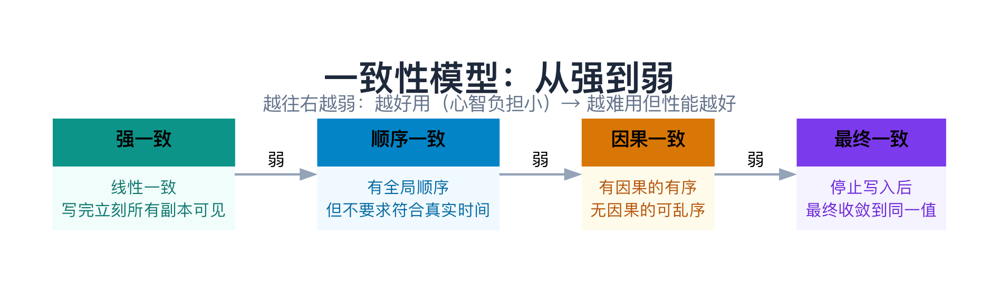
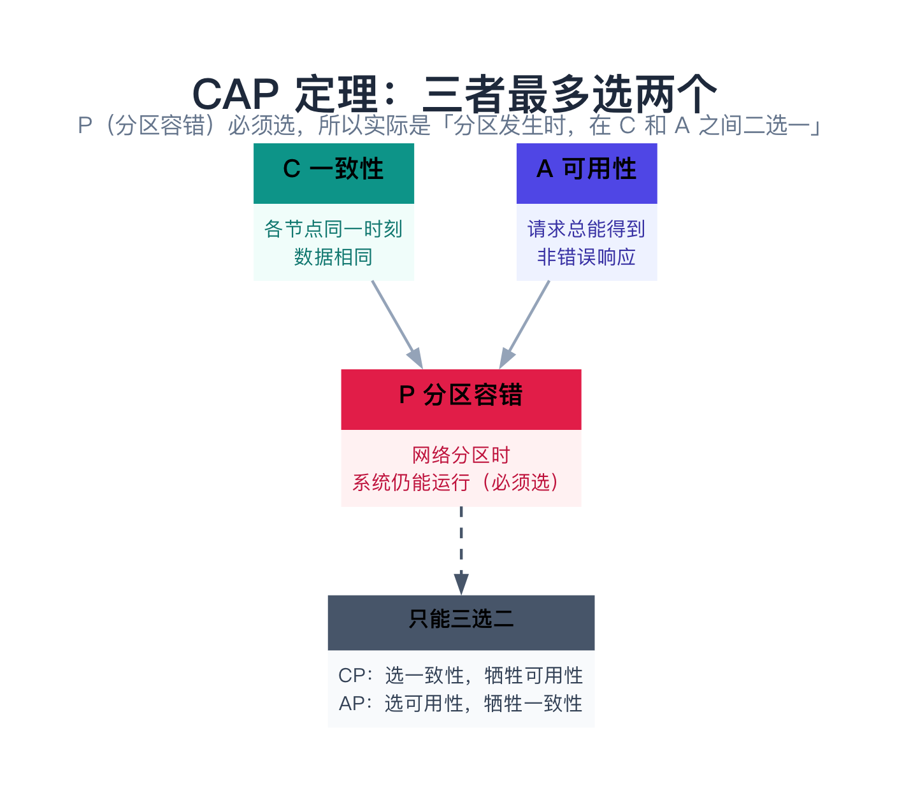
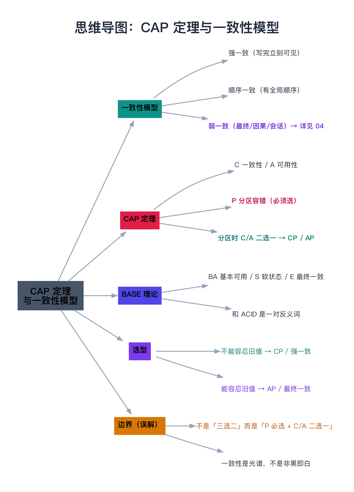

# CAP 定理与一致性模型

> **一句话总结**：分布式系统里同一份数据通常有多个副本，于是「写完一个值后，读操作能不能读到它」就成了问题——**一致性模型**就是回答这个问题的规格说明，从「强一致」到「弱一致」有一条清晰光谱；而 **CAP 定理**则划出一条硬边界：当网络分区发生时（第 02 篇讲的「一群节点一起失联」），系统只能在「一致性」和「可用性」之间二选一，没法两全。

---

## 阅读路径

- **快速版（约 5 分钟）**：读「一句话总结」+ 第 2 节「CAP 定理」+ 第 4 节「实际怎么选」。
- **深入版（约 30 分钟）**：全文通读，重点吃透第 1.2 节「强一致」、第 2.3 节「分区时 C/A 为什么冲突」，以及第 5.1 节「CAP 的三个常见误解」。

---

## 目录

1. [一致性模型：先搞懂「一致」到底指什么](#1-一致性模型先搞懂一致到底指什么)
   - 1.1 为什么会有「一致」这个问题
   - 1.2 强一致（线性一致）
   - 1.3 顺序一致
   - 1.4 弱一致：最终一致、因果一致…（简述）
   - 1.5 一致性模型频谱
   - 1.6 用 C++ 感受「强一致 vs 最终一致」
   - 1.7 数据验证：强一致到底慢多少
2. [CAP 定理](#2-cap-定理)
   - 2.1 三个字母的含义
   - 2.2 为什么「三选二」，而且 P 必须选
   - 2.3 分区时 C 和 A 为什么冲突
   - 2.4 CP vs AP 的选择
3. [BASE 理论](#3-base-理论)
4. [实际怎么选](#4-实际怎么选)
5. [边界、反例与失败路径](#5-边界反例与失败路径)
6. [常见问题 FAQ](#6-常见问题-faq)
7. [延伸阅读](#7-延伸阅读)
8. [思维导图总结](#8-思维导图总结)

---

## 1. 一致性模型：先搞懂「一致」到底指什么

### 1.1 为什么会有「一致」这个问题

单机里没有这个问题——数据就存在**一块内存、一块磁盘**上，你写进去，再读出来，读到的就是你刚写的。但分布式里，同一份数据通常有**多个副本**（为了容灾、为了就近读取），于是「一致」就成了问题：

**你写了一个新值到某个副本，随后的读操作（可能读的是另一个副本），能不能读到这个新值？**

「一致性模型」就是用来回答这个问题的**规格说明**——它定义了「写和读之间，系统给出什么保证」。

> **类比：只有一个账本 vs 多个账本**。
>
> - **单机** = 全公司只有**一个账本**，谁记账都记在这本上，任何人翻账本看到的都是最新一笔。
> - **分布式多副本** = 公司有**多个账本**（每个分店一本），你记到分店 A 的账本上，别人翻分店 B 的账本，可能暂时看不到这笔。**「一致性模型」就是在规定：什么时候 B 的账本才能看到 A 记的这笔账。**

下面从「最强」到「最弱」介绍几种常见的一致性模型。

### 1.2 强一致（线性一致，Linearizability）

**最强的一致性**。它要求：**一旦某个写操作完成，之后所有读操作都必须读到这个新值**——系统表现得就像「只有一个副本」一样，尽管背后其实有多个。

> **类比**：强一致就像**所有分店的账本是一本**（或者同步得如此之快，看起来就像一本）。你在 A 分店记了账，任何人立刻在 B 分店翻账本，都能看到这笔。

强一致的代价是**性能**：写操作必须等所有副本都确认，或者用复杂的协议保证顺序，所以**慢**。这也是后面 CAP 里「选 C」的代价。

### 1.3 顺序一致（Sequential Consistency）

比线性一致**弱一档**。它不要求「和真实时间一致」，只要求「**所有操作看起来是按某种全局顺序执行的，且每个进程内部的操作顺序不变**」。

听起来绕，记住一个区别就够：线性一致要求「**符合真实时间**」（写完成了，之后的读必须看到），顺序一致只要求「**有一个一致的先后顺序**」，不关心这个顺序是否和真实时间吻合。

> 本文不深入展开顺序一致的细节，知道它「介于强一致和最终一致之间」即可。真正要搞透的是两头的**强一致**和**最终一致**。

### 1.4 弱一致：最终一致、因果一致…（简述）

从「顺序一致」再往下，就是各种**弱一致**模型。它们**不保证**「写完立刻全局可见」，只保证「在某种条件下，副本最终会对上」。常见的有：

- **最终一致（Eventual Consistency）**：停止写入后，副本**最终**收敛到同一个值。它**不承诺「多久」收敛**，也不承诺「收敛前读到什么」——收敛前可能读到旧值。**这是工程上最常用的一种。**
- **因果一致（Causal Consistency）**：有**因果关系**的操作保持顺序，无因果关系的可乱序（比如「发帖 → 评论」，评论一定在帖子之后可见）。
- **会话一致、单调读、单调写**：更细的「读自己刚写的、读到的不回退」等保证。

> 这些弱一致模型的**细节、对比和选型**，是第 04 篇的主题。这里你只需记住两件事：① 它们都比「强一致」弱，换来更好的性能和可用性；② **「弱一致」的核心代表是「最终一致」**，也是后面 CAP 里「选 A」时实际得到的东西。

### 1.5 一致性模型频谱

把上面几种模型排成一个「从强到弱」的谱系：



记住一个关键规律：**越强的一致性，越好用（程序员心智负担小），但性能越差、延迟越高**；反之越弱的一致性，性能越好，但程序员要自己处理「读到旧值」的情况。

### 1.6 用 C++ 感受「强一致 vs 最终一致」

下面用一段代码直观感受这两个「极端」的区别。

**环境**：macOS / Linux 均可；编译器 `g++` 或 `clang++`，支持 **C++11**；无第三方依赖，纯标准库。

```cpp
#include <iostream>
#include <string>
#include <vector>

// 三个副本（初始都是空字符串）
std::vector<std::string> replicas(3, "");

// 强一致写：等所有副本都更新完才返回（慢，但写完后任何副本都能读到新值）
void strong_write(const std::string& val) {
    for (auto& r : replicas) r = val;
}

// 最终一致写：只更新主副本就返回，其余副本「异步」慢慢同步（快，但可能读到旧值）
void eventual_write(const std::string& val) {
    replicas[0] = val;   // 只写主副本
    // 副本 1、2 此刻还是旧值，等「同步」之后才会变成新值
}

std::string read(int replica_id) {
    return replicas[replica_id];
}

int main() {
    std::cout << "===== 最终一致写 =====\n";
    eventual_write("新值");
    std::cout << "写完后立刻读：\n";
    std::cout << "  副本 0（主）: \"" << read(0) << "\"\n";  // 新值
    std::cout << "  副本 1:       \"" << read(1) << "\"\n";  // 旧值（还没同步）
    std::cout << "  副本 2:       \"" << read(2) << "\"\n";  // 旧值（还没同步）

    std::cout << "===== 强一致写 =====\n";
    strong_write("另一个新值");
    std::cout << "写完后立刻读：\n";
    std::cout << "  副本 0: \"" << read(0) << "\"\n";  // 新值
    std::cout << "  副本 1: \"" << read(1) << "\"\n";  // 新值（已同步）
    std::cout << "  副本 2: \"" << read(2) << "\"\n";  // 新值（已同步）
    return 0;
}
```

**编译与运行**：

```bash
g++ -std=c++11 cap_demo.cpp -o cap_demo
./cap_demo
```

**预期输出**：

```
===== 最终一致写 =====
写完后立刻读：
  副本 0（主）: "新值"
  副本 1:       ""
  副本 2:       ""
===== 强一致写 =====
写完后立刻读：
  副本 0: "另一个新值"
  副本 1: "另一个新值"
  副本 2: "另一个新值"
```

**解读**：**最终一致**写完后，副本 1、2 读到的是旧值（空串，还没同步）；**强一致**写完后，三个副本立刻都是新值。这就是两者最直观的区别——**强一致「写完立即可见」，最终一致「过一会儿才对得上」**。

**常见报错排查**：

| 报错 | 原因 | 解决 |
|------|------|------|
| `no member named 'vector'` / `string` 未声明 | 忘 `#include <vector>` / `<string>` | 补上头文件 |
| range-based `for` 编译报错 | 用了 C++98 | 加 `-std=c++11` |
| 输出乱码 | 终端编码非 UTF-8 | `export LANG=zh_CN.UTF-8` |

### 1.7 数据验证：强一致到底慢多少

上面说「强一致性能差」，空口无凭。下面用一个最小 benchmark 量化：模拟「同步等副本确认」的强一致写 vs 「只写主副本」的最终一致写，各测 50 次。

```cpp
#include <iostream>
#include <vector>
#include <string>
#include <chrono>
#include <thread>

const int RTT_MS = 5;   // 模拟一次网络往返 5ms

void strong_write(std::vector<std::string>& reps, const std::string& val) {
    reps[0] = val;
    for (size_t i = 1; i < reps.size(); ++i) {
        std::this_thread::sleep_for(std::chrono::milliseconds(RTT_MS)); // 等副本 i 确认
        reps[i] = val;
    }
}

void eventual_write(std::vector<std::string>& reps, const std::string& val) {
    reps[0] = val;   // 只写主副本，其余后台异步同步
}

template <typename F>
long long time_it(F f, int n) {
    auto s = std::chrono::high_resolution_clock::now();
    for (int i = 0; i < n; ++i) f();
    auto e = std::chrono::high_resolution_clock::now();
    return std::chrono::duration_cast<std::chrono::milliseconds>(e - s).count();
}

int main() {
    const int N = 50;
    std::vector<std::string> a(3, ""), b(3, "");
    long long ts = time_it([&]{ strong_write(a, "v"); }, N);
    long long te = time_it([&]{ eventual_write(b, "v"); }, N);
    std::cout << "强一致写 " << N << " 次（同步等 2 个副本确认）：" << ts << " ms\n";
    std::cout << "最终一致写 " << N << " 次（只写主副本）：" << te << " ms\n";
    return 0;
}
```

**编译与运行**：

```bash
g++ -std=c++11 -pthread cap_bench.cpp -o cap_bench   # Linux 需要 -pthread
./cap_bench
```

**预期输出**（机器不同略有差异）：

```
强一致写 50 次（同步等 2 个副本确认）：约 620 ms
最终一致写 50 次（只写主副本）：0 ms
```

**解读**：强一致写要**同步等待每个副本的确认**（每副本一次网络往返），副本越多越慢；最终一致写只写主副本、不等待，几乎零开销。**这就是「强一致贵、最终一致便宜」的量化依据**——也解释了为什么 CAP 里「选 C」要付出性能代价。

> **数据说明**：测试环境 macOS（Apple Silicon），编译器 `clang++ -std=c++11`，`RTT_MS=5` 仅为模拟值；真实系统里强一致还要叠加锁、日志落盘、共识协议等开销，差距只会更大。

---

## 2. CAP 定理

CAP 定理（2000 年由 Eric Brewer 提出，后来被证明）是分布式系统最著名的一条定理：

> **一个分布式系统，无法同时满足「一致性（Consistency）」「可用性（Availability）」「分区容错性（Partition tolerance）」三者，最多只能同时满足两个。**



### 2.1 三个字母的含义

| 字母 | 含义 | 通俗解释 |
|------|------|----------|
| **C**（Consistency） | 一致性 | 所有节点在同一时刻看到**同样的数据**（这里指强一致/线性一致） |
| **A**（Availability） | 可用性 | 每个请求**在合理时间内都能得到「非错误」的响应**（可以不是最新数据，但必须有响应，不能一直卡着） |
| **P**（Partition tolerance） | 分区容错性 | 网络分区（部分节点间无法通信）发生时，系统**仍能继续运行** |

### 2.2 为什么「三选二」，而且 P 必须选

很多人误以为 CAP 是「三个里随便挑两个」。**大错特错**。真相是：

**P（分区容错）必须选，没有商量的余地**——因为网络分区**一定会发生**（第 02 篇讲过：网络会被切成几段，一群节点一起失联，这就是「脑裂」的根源）。你无法「放弃 P」，除非你假设网络永远不出问题，但那是自欺欺人。

所以 CAP 实际上说的是：**当网络分区发生时，你在 C（一致性）和 A（可用性）之间二选一**。

> **类比：银行的两个网点，中间的电话线断了（分区）**。
>
> 这时有个顾客要来取钱，两个网点都可能有账本。你只有两个选择：
>
> - **选 C（一致性）**：为了保证两个网点账本一致，只能让**一个网点**营业，另一个网点**关门**（拒绝服务）。顾客可能遇到「本网点暂停服务」，但绝不会出现「两本账对不上」。
> - **选 A（可用性）**：两个网点**都继续营业**，顾客到哪都能取钱，但两个网点各自记账，可能「两边都把同一笔钱取走了」（账本暂时不一致）。

### 2.3 分区时 C 和 A 为什么冲突

上面这个类比已经点出了本质。更精确地说，分区后集群被劈成两半，两半之间无法通信：

- **要保证 C**：写操作必须让两半的副本都一致。但两半无法通信，这个「都一致」做不到——唯一的办法是**只允许一半接受写**，另一半拒绝（牺牲 A）。
- **要保证 A**：两半都继续接受请求。但两半各自写自己的，数据就**不一致**了（牺牲 C）。

**所以 C 和 A 在分区时不可兼得**，这不是实现不努力，而是**逻辑上不可能**。

### 2.4 CP vs AP 的选择

既然 P 必须选，实际系统分成两大阵营：

| 阵营 | 含义 | 分区时的行为 | 典型场景 |
|------|------|--------------|----------|
| **CP** | 选一致性，牺牲可用性 | 宁可拒绝服务，也不返回旧数据 | 账户余额、元数据这类「错一条就出大问题」的数据 |
| **AP** | 选可用性，牺牲一致性 | 宁可返回旧数据，也不拒绝服务 | 点赞数、浏览数、缓存、库存展示这类「暂时不准没关系」的数据 |

> 记住一个记忆点：**「错不得」的数据走 CP**（宁可暂时不可用，也不能返回错/旧数据）；**「暂时不准没关系」的数据走 AP**（宁可用、旧，也不能让用户干等）。

---

## 3. BASE 理论

CAP 定理告诉你「C 和 A 只能选一个」，但没有告诉你「选 A 之后怎么办」。**BASE** 就是「选了 A（牺牲强一致）之后」的一套工程实践，可以看作 **AP 的具体落地**。

BASE 三个字母：

| 字母 | 含义 | 解释 |
|------|------|------|
| **BA**（Basically Available） | 基本可用 | 系统异常时**仍能响应**，但可能「降级」——比如返回缓存、返回默认值、响应变慢 |
| **S**（Soft state） | 软状态 | 允许系统存在「**中间状态**」，数据不是一锤定音的「硬」值，会随时间变化 |
| **E**（Eventually consistent） | 最终一致 | 系统停止写入后，各副本**最终会收敛到一致** |

**BASE 和 ACID 是一对反义词**：

| | ACID（传统数据库的事务） | BASE（分布式高可用） |
|---|---|---|
| 核心 | **强一致**，事务原子性 | **最终一致**，可用性优先 |
| 典型场景 | 转账、订单扣款（错不得） | 点赞数、浏览数、缓存（暂时不准没关系） |
| 读到的数据 | 永远是「正确」的 | 可能暂时是「旧」的 |

> **类比：转账 vs 点赞**。转账必须 ACID——转出去和收到必须同时成立，一分不能差。点赞数可以 BASE——你看到「9999 赞」，实际可能是「9998」，过几秒就对了，没人会因此投诉。**关键是：业务能不能容忍「暂时的不一致」。**

---

## 4. 实际怎么选

理解了 CAP 和 BASE，落到工程上就一句话：

> **先问自己：这个数据，能不能容忍「暂时读到旧值」？**

- **不能**（账户余额、库存扣减、元数据这类「错不得」的数据）→ 选 **CP / 强一致**，接受分区时可能拒绝服务、接受更高的延迟。
- **能**（点赞、浏览、缓存、推荐）→ 选 **AP / 最终一致（BASE）**，换来更高的可用性和更低的延迟。

没有银弹，一切都是**在一致性、可用性、性能之间做权衡**。

下一章进入 [04 弱一致性模型：最终一致性、因果一致性](04-弱一致性模型：最终一致性、因果一致性.md)，把弱一致这一端拆开讲透——最终一致、因果一致、会话一致、单调读/写分别是什么，各自有哪些取舍、怎么选。

---

## 5. 边界、反例与失败路径

### 5.1 CAP 的三个常见误解

1. **误解「三选二 = 随便挑两个」**：真相是 **P 必选**（分区一定会发生），所以 CAP 实际说的是「分区发生时 C 和 A 二选一」，不是「从三个里随便挑两个」。

2. **误解「系统非 CP 即 AP、且永远如此」**：CAP 描述的是「**分区发生时**」的行为，不是「永远」的状态——**没有分区时，系统完全可以同时满足 C 和 A**。而且同一个系统，可以按「数据」或「操作」粒度做不同选择：比如「账户余额」走强一致、「点赞数」走最终一致。

3. **误解「一致性是二元的（要么一致要么不一致）」**：实际一致性是一条**光谱**（线性一致 → 顺序一致 → 因果一致 → 最终一致），不是非黑即白。CAP 里的 C **特指「线性一致」这一档**，比它弱的「最终一致」其实已经属于「放弃 C」。

### 5.2 常见坑（失败案例比成功案例更有价值）

| 坑 | 场景 | 后果 |
|----|------|------|
| 把「最终一致」当「强一致」用 | 用最终一致存账户余额 | 读到旧余额 → 超卖、重复扣款 |
| 分区时两边都接受写 | 没做「只让一边写」 | 脑裂，两边各写各的，恢复后数据冲突 |
| 追求「全库强一致」 | 所有数据都强一致 | 性能极差、可用性低 |
| 忽略「多久才最终一致」 | 以为最终一致「很快」 | 用户长时间看到旧数据，体验差 |
| 只谈 CP/AP、不谈分区 | 不考虑分区场景 | 分区一旦发生，系统行为不可预期 |

### 5.3 什么时候**不该**上强一致 / 最终一致

- **不该上强一致**：数据量大、读多写少、能容忍短暂旧值（点赞、浏览、推荐）——强一致白花性能；
- **不该上最终一致**：涉及钱、库存、唯一性约束这类「错了要出事」的数据——最终一致的「暂时旧值」会让你付出业务代价（超卖、对不上账）。

---

## 6. 常见问题 FAQ

**Q1：CAP 是「三选二」吗？**
不准确。更准确的说法是「**P 必选，分区发生时 C 和 A 二选一**」。因为网络分区一定会发生，你没得选「不要 P」，所以实际选择发生在 C 和 A 之间。

**Q2：没有分区的时候，能同时满足 C 和 A 吗？**
能。CAP 只约束「分区发生时」的行为。网络正常时，一个系统完全可以做到「既一致又可用」——这时你往往还能兼顾不错的性能。

**Q3：线性一致和顺序一致到底差在哪？**
线性一致要求「**符合真实时间**」：一个写一旦完成，之后所有读必须看到它。顺序一致只要求「存在一个全局顺序」，不要求这个顺序和真实发生的先后吻合。一句话：**线性一致 = 顺序一致 + 真实时间约束**。

**Q4：是不是 CP 一定比 AP 好？**
不是。CP 保证「读到的一定对」，代价是分区时可能不可用、延迟高；AP 保证「一定能用」，代价是可能读到旧值。**选哪个取决于业务能不能容忍「暂时旧值」**——钱不能容忍（CP），点赞数能容忍（AP）。

**Q5：BASE 和 CAP 是什么关系？**
CAP 是「理论边界」（告诉你 C/A 不可兼得），BASE 是「工程实践」（告诉你选了 A 之后，用「基本可用 + 软状态 + 最终一致」把它落地）。**BASE ≈ AP 的具体做法。**

**Q6：CAP 里的 C 和「一致性模型」里的强一致是一回事吗？**
基本是一回事。CAP 的 C 特指「线性一致（强一致）」这一档。如果你用的是「最终一致」，那其实已经「放弃了 C」，属于 AP 阵营。

---

## 7. 延伸阅读

- **论文 / 文章**：
  - Eric Brewer《Towards Robust Distributed Systems》（PODC 2000）—— CAP 猜想的原始出处；
  - Gilbert & Lynch《Brewer's Conjecture and the Feasibility of Consistent, Available, Partition-Tolerant Web Services》（2002）—— CAP 的形式化证明；
  - Martin Kleppmann《请停止称呼数据库为 CP 或 AP》（2015）—— **强烈推荐**，纠正对 CAP 的几种常见误解（本文 5.1 节的主要来源）；
  - Herlihy & Wing《Linearizability: A Correctness Condition for Concurrent Objects》（1990）—— 线性一致（强一致）的精确定义。
- **书籍**：Martin Kleppmann《数据密集型应用系统设计》（DDIA）第 9 章「一致性与共识」—— 对线性一致、顺序一致、因果一致的讲解极透彻。
- **在线资源**：[jepsen.io](https://jepsen.io/consistency) —— 用可视化方式对比各种一致性模型的含义。

---

## 8. 思维导图总结

```text
CAP 定理与一致性模型
├── 一致性模型（写后读能看到什么）
│   ├── 强一致（线性一致）：写完立刻所有副本可见
│   ├── 顺序一致：有全局顺序，但不要求符合真实时间
│   └── 弱一致（最终/因果/会话）：详见第 04 篇
├── CAP 定理（三者最多选两个）
│   ├── C 一致性 / A 可用性 / P 分区容错
│   ├── P 必须选（分区一定会发生）
│   └── 分区时 C/A 二选一 → CP / AP
├── BASE 理论（AP 的工程落地）
│   ├── BA 基本可用 / S 软状态 / E 最终一致
│   └── 和 ACID 是一对反义词
├── 选型
│   ├── 不能容忍旧值 → CP / 强一致
│   └── 能容忍旧值 → AP / 最终一致
└── 边界（常见误解）
    ├── 不是「三选二」而是「P 必选 + C/A 二选一」
    └── 一致性是光谱，不是非黑即白
```


