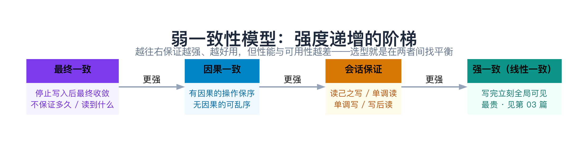
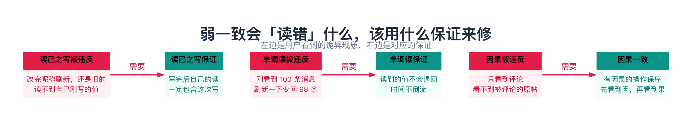
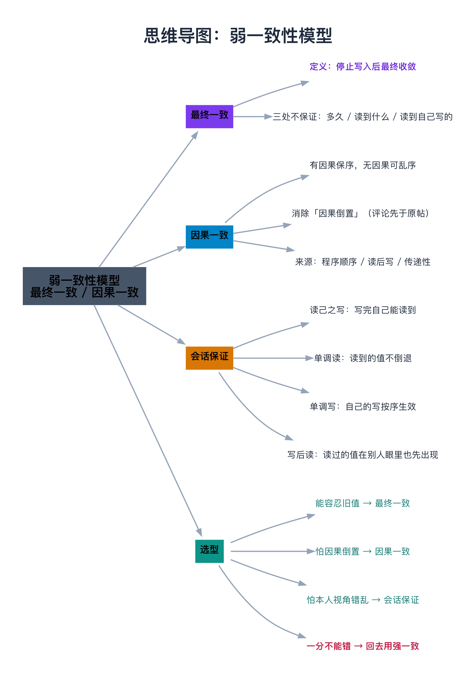

# 弱一致性模型：最终一致性、因果一致性

> **一句话总结**：当「强一致」（第 03 篇）太贵、太慢——写要等所有副本确认、分区时还得拒绝服务——系统就会退一步，只承诺「**副本最终会对齐**」，这就是**弱一致**。它不是一个点，而是一族：最弱的**最终一致**只保证「停止写入后最终收敛」；往上一档是**因果一致**（有因果关系的操作保持顺序）；再往上，是四种「以客户端为中心」的**会话保证**（读己之写、单调读、单调写、写后读），专门消除「用户自己视角错乱」这种最刺眼的问题。强度递增，越好用，也越贵——选型的核心是问：**业务到底需要哪一种保证？**

---

## 阅读路径

- **快速版（约 5 分钟）**：读「一句话总结」+ 第 2 节「最终一致」+ 第 5 节「完整谱系」+ 第 9 节「对比与选型」。
- **深入版（约 30 分钟）**：全文通读，重点吃透第 3 节「因果一致」和第 4 节「会话保证」——这两块是弱一致里最容易被忽略、却最能决定「用户会不会觉得系统坏了」的部分。

---

## 目录

1. [为什么需要弱一致](#1-为什么需要弱一致)
2. [最终一致（Eventual Consistency）](#2-最终一致eventual-consistency)
3. [因果一致（Causal Consistency）](#3-因果一致causal-consistency)
4. [会话保证（Session Guarantees）](#4-会话保证session-guarantees)
5. [完整谱系：从强到弱一次看清](#5-完整谱系从强到弱一次看清)
6. [C++ 示例：亲手制造三种「读错」](#6-c-示例亲手制造三种读错)
7. [数据验证：最终一致「到底要等多久」](#7-数据验证最终一致到底要等多久)
8. [边界、反例与失败路径](#8-边界反例与失败路径)
9. [对比与选型](#9-对比与选型)
10. [常见问题 FAQ](#10-常见问题-faq)
11. [延伸阅读](#11-延伸阅读)
12. [思维导图总结](#12-思维导图总结)

---

## 1. 为什么需要弱一致

### 1.1 强一致的代价，你未必付得起

回忆第 03 篇：**强一致（线性一致）要求「一次写完成后，之后所有读都必须看到它」**，实现上通常要等所有副本确认，于是：

- **慢**：03 篇的 benchmark 里，强一致写比最终一致写慢了**几个数量级**（同步等 2 个副本确认，50 次写耗时约 620ms，而最终一致近乎 0ms）；
- **分区时不可用**：CAP 告诉我们，分区发生时强一致必须**拒绝服务**来保证「不返回旧值」——可用性被牺牲。

问题是：**很多业务根本不需要强一致。** 一个点赞数、一条浏览记录、一个「最近活跃时间」，短暂的旧值无人在意。为它们付出强一致的代价，是「杀鸡用牛刀」。

### 1.2 弱一致想解决什么

于是系统退一步，**不追求「任何时刻都一致」，只承诺一个更弱、但足够用的保证**。最核心的一条是：

> **如果不再有新的写入，经过足够长的时间，所有副本最终会收敛到同一个值。**

这就是「最终一致」，也是弱一致家族的地基。

> **类比：分店对账**（延续第 03 篇的「账本」意象）。
>
> - **强一致** = 所有分店**电话实时连线**——每次记账都要立刻广播给所有分店、等大家确认才算记完。快不了，还怕断线。
> - **弱一致** = 各分店**各记各的，每天用快递互寄账本对账**——记账飞快，但今天 A 记的，B 可能要明天才知道。**只要不再有新账，账本最终会对上。**

### 1.3 弱一致是「一族」，不是「一种」

千万别把「弱一致」当成一个东西。它是一整条**光谱**，从最弱到稍强：

```
最终一致  →  因果一致  →  会话保证  →（再往上就是强一致，属于第 03 篇）
```

**越往右越强、越好用，但也越贵。** 本篇要做的，就是把这条光谱上「强一致以下」的部分讲清楚。

---

## 2. 最终一致（Eventual Consistency）

### 2.1 定义

**最终一致**：**如果系统停止写入，经过足够长的时间，所有副本最终会收敛到同一个值。**

它是**最弱**的一致性，也是**工程上最常用**的一种（第 03 篇讲过，它就是 BASE 里的那个「E」）。

### 2.2 它「不保证」什么（关键）

最终一致听起来很美，但必须看清它的**三处留白**，否则会吃亏：

| 不保证 | 含义 | 后果 |
|--------|------|------|
| **不保证「多久」收敛** | 「最终」可能是毫秒，也可能是几秒甚至更久 | 用户可能长时间看到旧数据 |
| **不保证「收敛前读到什么」** | 收敛之前，读操作可能读到任意一个旧值 | 余额、库存这类数据会出错 |
| **不保证「读到自己刚写的」** | 你写到副本 A，转头读副本 B，可能读不到 | 用户改完资料刷新，还是旧的 |

> **类比**：分店 A 记完账，你立刻跑到分店 B 翻账本——**B 还没收到快递**，看到的是旧账。最终一致只承诺「快递总会到」，没承诺「你跑过去的这一瞬间它到了」。

### 2.3 什么时候它够用

只要业务能容忍「短暂旧值」，最终一致就是性价比之王：

- 点赞数、浏览数、转发数；
- 用户在线状态、「最近一次登录时间」；
- 推荐结果、排行榜（差几秒无所谓）；
- 社交动态的可见性（你发的朋友圈，朋友晚几秒看到完全可接受）。

---

## 3. 因果一致（Causal Consistency）

### 3.1 最终一致解决不了的一个「诡异」

最终一致能容忍旧值，但有一类乱序**特别刺眼**——**因果倒置**：

> 你发了帖子，又评论了「出门记得带伞」。朋友打开一看：**评论在，原帖却还没同步过来**——一条「评论」凭空挂在空气里。或者更糟：**你先看到「回复」，才看到「提问」**。

这种「结果先于原因」的乱序，比单纯的「旧值」更让用户觉得「系统坏了」。**因果一致**就是为了消除它。

### 3.2 定义

**因果一致**：**有「因果关系」的操作，所有节点看到的顺序保持一致；没有因果关系的操作，可以任意乱序。**

关键在于分清「有因果」和「无因果」：

> **类比：朋友圈**。
>
> - 「发帖」→「评论」这两条**有因果关系**（先有帖才有评）。所有朋友都必须**先看到帖、再看到评论**。
> - 你朋友的「今天吃了火锅」和你的「今天下雨」**没有因果**——谁先显示、晚显示几秒，都无所谓。

### 3.3 「因果」从哪来：三种依赖

因果关系不是玄学，它由三种依赖构成：

1. **程序顺序**：同一个节点上，先写 X 再写 Y → X 因果先于 Y；
2. **读后写**：读了 X，然后基于 X 写了 Y → X 因果先于 Y；
3. **传递性**：若 A 因果先于 B，B 因果先于 C，则 A 因果先于 C。

（如何**追踪**这些依赖、判断两个事件的先后，是第 05 篇「分布式时钟与事件排序」的主题，本篇只讲「要保证什么」。）

### 3.4 为什么它值得单独一档

因果一致比最终一致**强**（消除了因果倒置），但比顺序一致、线性一致**弱**（不要求全体操作一个全局顺序）。它是一笔**很划算的买卖**：

- **比最终一致好**：用户不会再看到「评论悬空」「回复先于提问」；
- **比强一致便宜**：不需要全局协调、不要求所有副本实时同步。

很多面向用户的分布式存储，都会提供「至少是因果一致」的保证。

---

## 4. 会话保证（Session Guarantees）

### 4.1 换一个视角：关心「这一个客户端」

因果一致是**全局**的保证（对所有节点成立）。但很多时候，我们其实只关心**「这个用户自己的视角别错乱」**——这就引出四种**「以客户端为中心」**的会话保证。它们**只在同一个客户端会话内生效**，因此比全局因果一致**更便宜**，却解决了用户最能感知的问题。

### 4.2 四种保证

| 保证 | 一句话定义 | 用户感知的「反例」 |
|------|-----------|-------------------|
| **读己之写**<br>Read Your Writes | 你写完之后，你自己**后续的读**一定能读到（至少）你写的那次更新 | 改完昵称，刷新一看还是旧的 |
| **单调读**<br>Monotonic Reads | 你一旦读到过某个新值，**之后就再也不会读到更旧的**（时间不倒流） | 刚看到 100 条消息，刷新一下变回 98 条 |
| **单调写**<br>Monotonic Writes | 你自己发起的写，在系统里**按你发起的顺序生效** | 先改密码再改昵称，结果昵称的修改被密码覆盖 |
| **写后读**<br>Writes Follow Reads | 你读到 X 之后、基于 X 写了 Y，那么在**别人**的视角里，X 也先于 Y 出现 | 你回复了某条评论，别人却看到你的回复「凭空出现」 |

> **类比**：你在手机上改了个昵称。
>
> - **读己之写**：改完刷新，能看到新昵称（不会还显示旧的）；
> - **单调读**：看过新昵称后，不会又「退回」到旧昵称；
> - **单调写**：你连续改了两次，最终生效的一定是**后改的那次**；
> - **写后读**：你回复了朋友的动态，别人看到的是「先有动态、后有你的回复」。

### 4.3 它会「顺带」满足其他保证吗

会，而且这四者之间有**强弱关系**，选型时很有用：

- **读了就能写对（读己之写）** + **单调读** → 往往能推出「写后读」的效果；
- 但**单调写**和**单调读**是**互相独立**的两个方向（一个管「写不回退」，一个管「读不倒流」），要分别确认。

> 记住一句：**会话保证是「廉价的因果一致替身」**——在只需要「同一个用户别看到错乱」的场景下，它比全局因果一致划算得多。

---

## 5. 完整谱系：从强到弱一次看清

把第 03 篇的强一致和本篇的弱一致拼在一起，得到完整光谱：



| 一致性模型 | 保证 | 强度 | 性能/可用性 | 典型场景 |
|-----------|------|------|------------|---------|
| **强一致（线性一致）** | 写完立刻全局可见 | 最强 | 最差 | 余额、库存扣减 |
| **顺序一致** | 有全局顺序（不要求符合真实时间） | 强 | 差 | 较少单独使用 |
| **因果一致** | 有因果的操作有序 | 中 | 中 | 评论、协作编辑 |
| **会话保证** | 单个客户端视角不错乱 | 中偏弱 | 较好 | 用户资料、消息列表 |
| **最终一致** | 停止写入后最终收敛 | 最弱 | 最好 | 点赞、浏览、推荐 |

**一条铁律**：**保证越强，性能与可用性越差；保证越弱，程序员要处理的「错乱」越多。** 选型就是在「用户体验」和「成本」之间找平衡点。

---

## 6. C++ 示例：亲手制造三种「读错」

光看定义不够，下面用一段 C++ **亲手制造**三种典型的弱一致「读错」，建立直觉。三种「读错」和对应的「解药」可以先看这张图：



**环境**：macOS / Linux 均可；编译器 `g++` 或 `clang++`，支持 **C++11**；无第三方依赖。

```cpp
// 文件名：weak_demo.cpp
// 演示最终一致下三种让用户「觉得系统坏了」的读错
#include <iostream>
#include <string>

int main() {
    std::cout << "===== 违反一：读己之写 =====\n";
    std::string replicaA = "旧值";
    std::string replicaB = "旧值";
    replicaA = "新值";                       // 客户端写入副本 A
    std::cout << "写入副本 A：\"新值\"\n";
    std::cout << "立刻从副本 B 读：" << replicaB
              << "  ← 读不到自己刚写的（读己之写被违反）\n\n";

    std::cout << "===== 违反二：单调读 =====\n";
    std::string replicaC = "旧值";
    replicaB = "新值";                       // 副本 B 先同步了
    std::cout << "从副本 B 读：" << replicaB << "（新值）\n";
    std::cout << "再从副本 C 读：" << replicaC
              << "  ← 时间倒流了（单调读被违反）\n\n";

    std::cout << "===== 违反三：因果乱序 =====\n";
    std::string post_visible = "（原帖还没同步过来）";
    std::string comment_visible = "出门带伞";
    std::cout << "你看到的内容：\n";
    std::cout << "  原帖：" << post_visible << "\n";
    std::cout << "  评论：" << comment_visible
              << "  ← 评论先于原帖可见（因果被违反）\n";
    return 0;
}
```

**编译与运行**：

```bash
g++ -std=c++11 weak_demo.cpp -o weak_demo
./weak_demo
```

**预期输出**：

```
===== 违反一：读己之写 =====
写入副本 A："新值"
立刻从副本 B 读：旧值  ← 读不到自己刚写的（读己之写被违反）

===== 违反二：单调读 =====
从副本 B 读：新值（新值）
再从副本 C 读：旧值  ← 时间倒流了（单调读被违反）

===== 违反三：因果乱序 =====
你看到的内容：
  原帖：（原帖还没同步过来）
  评论：出门带伞  ← 评论先于原帖可见（因果被违反）
```

**解读**：三种「读错」对应三种保证——

- 「读己之写被违反」→ 需要 **读己之写** 保证来修；
- 「时间倒流」→ 需要 **单调读** 保证来修；
- 「评论先于原帖」→ 需要 **因果一致** 来修。

**常见报错排查**：

| 报错 | 原因 | 解决 |
|------|------|------|
| `string 未声明` | 忘 `#include <string>` | 补上头文件 |
| 中文乱码 | 终端编码非 UTF-8 | `export LANG=zh_CN.UTF-8` |
| 编译报 `-std` 相关错误 | 用了 C++98 | 加 `-std=c++11` |

---

## 7. 数据验证：最终一致「到底要等多久」

第 2 节说最终一致「**不保证多久收敛**」。空口无凭，下面用一个仿真量化：3 个副本，每个副本的异步复制延迟服从**均值 50ms 的指数分布**，测量「写入到**所有副本都可见**」要多久（即所有副本里最慢的那个）。

```cpp
// 文件名：converge_bench.cpp
#include <iostream>
#include <vector>
#include <random>
#include <algorithm>

int main() {
    const int TRIALS = 100000;
    std::mt19937 rng(42);
    // 每个副本的异步复制延迟服从指数分布，均值 50ms
    std::exponential_distribution<double> lag(1.0 / 50.0);

    std::vector<int> conv;  // 每次写入「所有副本都可见」的耗时
    conv.reserve(TRIALS);
    for (int t = 0; t < TRIALS; ++t) {
        double worst = 0;
        for (int r = 0; r < 3; ++r)             // 3 个副本
            worst = std::max(worst, lag(rng));  // 全部可见 = 最慢那个
        conv.push_back((int)worst);
    }
    std::sort(conv.begin(), conv.end());
    auto pct = [&](double p) { return conv[(int)(TRIALS * p)]; };

    std::cout << "单副本复制延迟均值 50ms，3 副本；\n";
    std::cout << "写入到「所有副本都可见」的耗时分布：\n";
    std::cout << "  P50 = " << pct(0.50) << " ms\n";
    std::cout << "  P95 = " << pct(0.95) << " ms\n";
    std::cout << "  P99 = " << pct(0.99) << " ms\n";
    std::cout << "  Max = " << conv.back() << " ms\n";
    return 0;
}
```

**编译与运行**：

```bash
g++ -std=c++11 converge_bench.cpp -o converge_bench
./converge_bench
```

**预期输出**（固定种子，结果可复现）：

```
单副本复制延迟均值 50ms，3 副本；
写入到「所有副本都可见」的耗时分布：
  P50 = 78 ms
  P95 = 204 ms
  P99 = 285 ms
  Max = 709 ms
```

**解读**（这张表非常有信息量）：

- **中位数才 78ms，但 P99 已到 285ms、最大 709ms**——**收敛时间是一条长尾分布**。这正是「最终一致不承诺多久」的量化含义：多数情况很快，但**偶尔会慢到几百毫秒甚至更久**。
- 注意这是**单副本延迟均值仅 50ms** 的理想情况。真实系统里延迟更大、副本更多、还可能叠加网络抖动，**尾部只会更夸张**。
- 工程含义：**「最终一致」必须按「最坏情况」设计**——比如用户刚改完昵称，UI 上要么自己兜底（本地先显示新值，即「读己之写」），要么就别让用户依赖「立刻可见」。

> **数据说明**：测试环境 macOS（Apple Silicon），`clang++ -std=c++11`，固定随机种子 `42`。指数分布用于模拟「大部分快、偶尔很慢」的复制延迟，均值 50ms 为设定值。

---

## 8. 边界、反例与失败路径

### 8.1 什么时候弱一致会「翻车」

| 场景 | 用的保证 | 后果 |
|------|---------|------|
| 库存扣减 | 最终一致 | 两个请求都按旧库存扣减 → **超卖** |
| 账户余额 | 最终一致 | 读到旧余额 → **超额消费 / 重复扣款** |
| 用户名唯一性 | 最终一致 | 两个用户同时注册同名 → **唯一性被破坏** |
| 消息列表 | 无单调读 | 用户刷新后**消息变少** → 以为消息丢了 |
| 评论 / 协作 | 无因果一致 | 评论**先于原帖**出现 → 用户困惑 |

> **一句话**：**凡是有「唯一性约束」「计数不能出错」「顺序不能乱」的地方，都要小心弱一致。**

### 8.2 常见坑

| 坑 | 场景 | 后果 |
|----|------|------|
| 把「最终一致」当「很快一致」 | 指望秒级收敛 | 尾部延迟下用户看到旧值很久 |
| 忽略「读己之写」 | 写后立刻从别的副本读 | 用户「改完没生效」，反复重试 |
| 用「先删缓存再更新库」等土办法补一致 | 想手动保证一致性 | 引入更隐蔽的竞态问题 |
| 全局都要因果一致 | 明明只需「本人视角正确」 | 白白付出全局协调的开销 |
| 只测平均延迟 | 用均值评估弱一致 | 忽略长尾，线上事故往往出在 P99 |

### 8.3 什么时候**不该**用弱一致

- **涉及钱、库存、唯一性**：错的概率再小也不能接受 → 用强一致（第 03 篇的 CP）；
- **有明确因果、且用户会直接感知**：如协作编辑、聊天消息 → 至少要因果一致或会话保证；
- **对「读到最新」有硬需求的场景**：如「下单后立刻查订单」→ 需要读己之写乃至强一致。

---

## 9. 对比与选型

### 9.1 弱一致家族对比

| 模型 | 保证的核心 | 相对强度 | 成本 | 适合 |
|------|-----------|---------|------|------|
| 最终一致 | 停止写入后最终收敛 | 最弱 | 最低 | 点赞、浏览、推荐 |
| 因果一致 | 因果序不乱 | 中 | 中 | 评论、协作 |
| 会话保证 | 本人视角不错乱 | 中偏弱 | 较低 | 用户资料、消息列表 |
| 强一致（对照） | 写完立刻全局可见 | 最强 | 最高 | 余额、库存 |

### 9.2 选型决策树

```
这份数据「短暂不一致」会让用户/业务受损吗？
├── 会（钱、库存、唯一性）
│   └── 用强一致（CP）——不要用本篇的任何弱一致模型
└── 不会（点赞、浏览、推荐、动态）
    ├── 用户会直接看到「因果倒置」吗？（如评论、回复）
    │   ├── 会 → 至少用因果一致
    │   └── 不会 → 往下看
    ├── 用户会看到「自己刚写的没生效 / 数据倒退」吗？
    │   ├── 会 → 加会话保证（读己之写、单调读）
    │   └── 不会 → 最终一致即可
    └── 以上都不在乎 → 最终一致（最省成本）
```

**一句话选型**：**能容忍旧值 → 最终一致；怕「因果倒置」→ 因果一致；怕「本人视角错乱」→ 会话保证；一分不能错 → 回去用强一致。**

---

## 10. 常见问题 FAQ

**Q1：最终一致是不是「很不靠谱」？**
不是。它只是**保证较弱**，但在它适用范围内（点赞、浏览等）非常划算。关键是**别把它用在不该用的地方**（钱、库存）。它是一种**权衡**，不是缺陷。

**Q2：最终一致和 BASE 是什么关系？**
最终一致就是第 03 篇 BASE 里的那个 **E（Eventually consistent）**。BASE 是「选了 AP 之后怎么落地」的工程实践，最终一致是其中的核心保证。

**Q3：因果一致和会话保证有什么区别？**
**因果一致是全局的**（对所有节点成立）；**会话保证只对「同一个客户端会话」生效**。所以会话保证更便宜，但只解决「本人视角」的问题，不管别人看到什么。

**Q4：单调读和单调写是一回事吗？**
不是，方向相反、互相独立。**单调读**管「读不倒流」（不会读到越来越旧的值）；**单调写**管「写不回退」（你自己的写按顺序生效）。要分别确认。

**Q5：读己之写怎么实现？**
常见做法是：客户端记住「我最近写过哪个版本/时间戳」，读的时候挑选一个「至少包含这个版本」的副本；或者写完之后**固定从同一个副本读**。核心是「别让刚写完的人读到比他自己写之前还旧的数据」。

**Q6：本篇的弱一致和「数据复制」的关系？**
本篇讲的是「**要保证什么**」（一致性模型的语义）；「**具体怎么复制**」是后面数据存储部分的主题。同一套复制机制可以叠加不同的一致性保证，别把「机制」和「保证」混为一谈。

**Q7：强一致和弱一致能混用吗？**
可以，而且很常见——按**数据**或**操作**分：账户余额走强一致，点赞数走最终一致。同一个系统里不同数据用不同保证，是标准做法。

---

## 11. 延伸阅读

- **书籍**：
  - Martin Kleppmann《数据密集型应用系统设计》（DDIA）第 5 章「复制」、第 9 章「一致性与共识」—— 对最终一致、因果一致、会话保证（书中称「以客户端为中心的一致性」）讲得极其透彻，**首推**；
  - Terry 等《Replicated Data Management for Mobile Computing》—— 会话保证四种（读己之写、单调读、单调写、写后读）的原始出处。
- **论文**：
  - Vogels《Eventually Consistent》（2008）—— 亚马逊 CTO 对最终一致的经典阐述；
  - Lamport《Time, Clocks, and the Ordering of Events in a Distributed System》（1978）—— 因果关系与「因果序」的奠基之作（第 05 篇会深入）；
  - Lloyd 等《Don't Settle for Eventual: Scalable Causal Consistency for Wide-Area Storage》（2011）—— 因果一致的工程实现。
- **在线资源**：[jepsen.io/consistency](https://jepsen.io/consistency) —— 各种一致性模型（含会话保证）的可视化对比。

---

## 12. 思维导图总结

```text
弱一致性模型：最终一致性、因果一致性
├── 为什么需要弱一致
│   ├── 强一致太贵（慢 + 分区时不可用）
│   └── 很多业务根本不需要强一致
├── 最终一致（最弱、最常用）
│   ├── 定义：停止写入后副本最终收敛
│   └── 三处不保证：多久 / 收敛前读到什么 / 读到自己写的
├── 因果一致
│   ├── 有因果的操作保序，无因果的可乱序
│   ├── 消除「因果倒置」（评论先于原帖）
│   └── 因果来源：程序顺序 / 读后写 / 传递性
├── 会话保证（以客户端为中心）
│   ├── 读己之写：写完自己能读到
│   ├── 单调读：读到的值不倒退
│   ├── 单调写：自己的写按序生效
│   └── 写后读：读过的值在别人眼里也先出现
├── 完整谱系
│   └── 强一致 → 顺序一致 → 因果一致 → 会话保证 → 最终一致
└── 选型
    ├── 能容忍旧值 → 最终一致
    ├── 怕因果倒置 → 因果一致
    ├── 怕本人视角错乱 → 会话保证
    └── 一分不能错 → 回去用强一致（第 03 篇）
```


