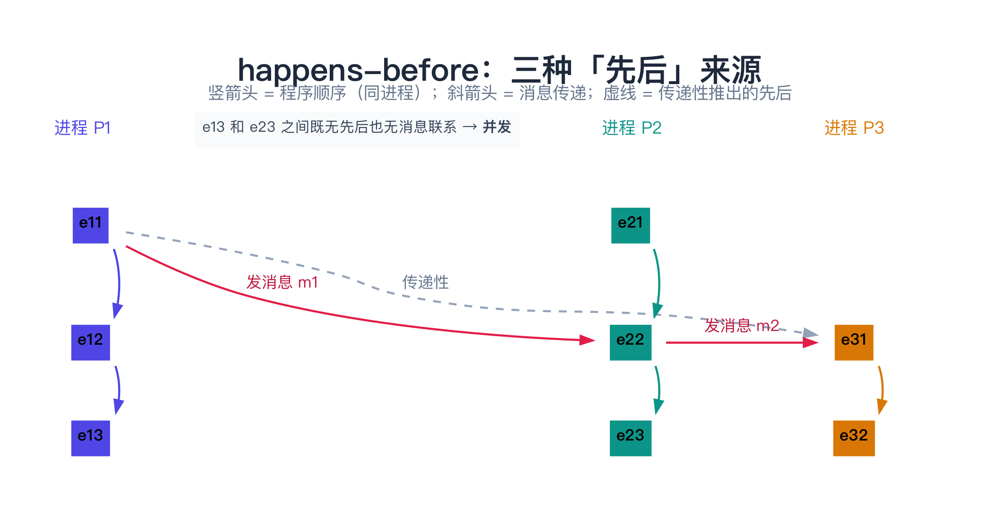
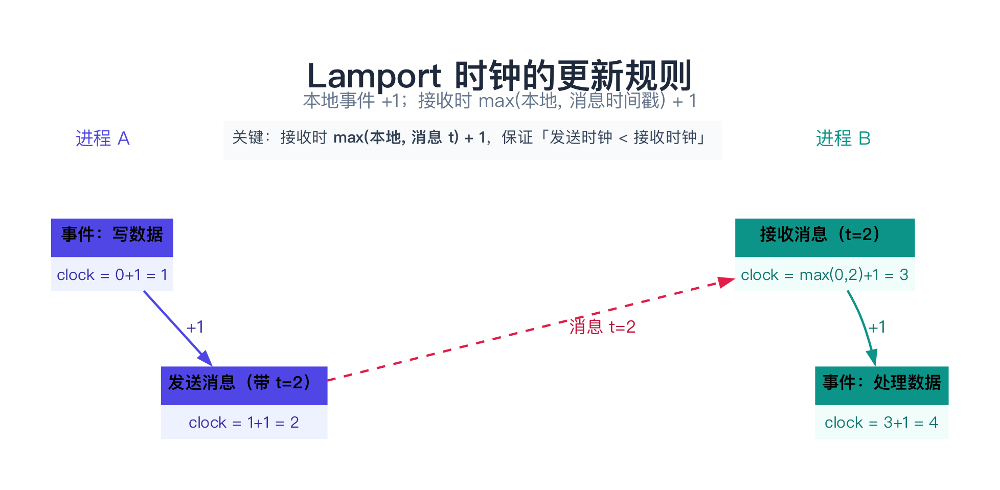
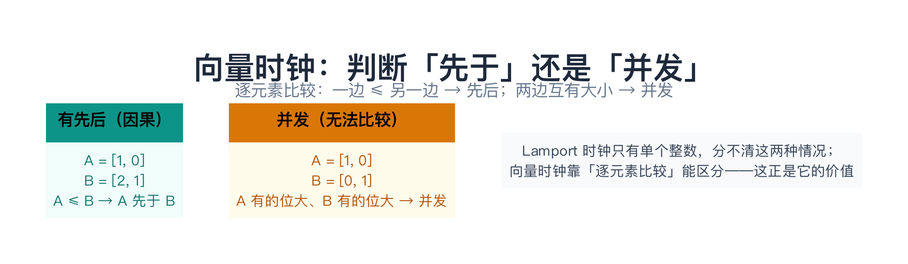
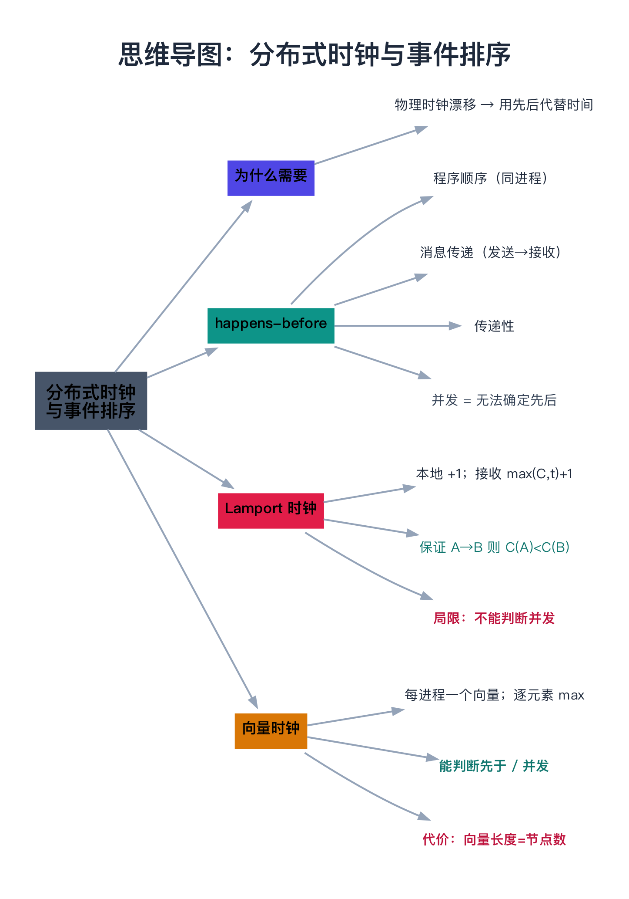

# 分布式时钟与事件排序

> 一句话：物理时钟不可靠（会漂移），所以分布式系统用「**逻辑时钟**」——它不记录真实时间，只记录事件的**先后关系**。Lamport 时钟给出偏序，向量时钟能判断并发。

---

## 目录

1. [为什么需要逻辑时钟](#1-为什么需要逻辑时钟)
2. [happens-before：先搞懂「先后」](#2-happens-before先搞懂先后)
3. [Lamport 时钟](#3-lamport-时钟)
4. [向量时钟](#4-向量时钟)
5. [总结对比](#5-总结对比)
6. [延伸阅读](#6-延伸阅读)
7. [思维导图总结](#7-思维导图总结)

---

## 1. 为什么需要逻辑时钟

回顾 01 篇：物理时钟靠晶振计时会漂移，NTP 只能减小、不能消除误差。所以「看表」来判断两个跨机器事件的先后，是**不可靠**的。

那怎么办？关键洞察是：**很多场景里，我们根本不需要知道「真实时间」，只需要知道「事件的先后顺序」**。比如：

- 两个客户端同时修改同一个数据，谁先谁后？
- 一个操作是否「看到」了另一个操作的结果？
- 多个节点各自产生事件，怎么给它们排个一致的顺序？

这些问题的答案，用「逻辑时钟」就够了。**逻辑时钟不记录真实时间（几时几分），只记录「事件之间的先后关系」。**

> **类比：不是看表，而是发号**。就像银行排队取号——你拿到 3 号，他拿到 5 号，你们**不需要知道现在是几点**，只需要知道「3 号排在 5 号前面」。逻辑时钟就是给每个事件「发一个号」。

---

## 2. happens-before：先搞懂「先后」

在讲具体的时钟之前，必须先搞清楚一个更根本的问题：**什么叫「事件 A 发生在事件 B 之前」？**

Lamport 定义了 **happens-before（先后）** 关系，记为 **A → B**（读作「A 先于 B」），它只有三种来源：

1. **程序顺序（同一进程内）**：同一个进程里，A 先执行、B 后执行，则 A → B。
2. **消息传递**：A 是「发送消息 m」的事件，B 是「接收消息 m」的事件，则 A → B（发送必然在接收之前）。
3. **传递性**：若 A → B 且 B → C，则 A → C。

如果两个事件 A、B 之间**既没有 A → B，也没有 B → A**，那它们就是**并发（concurrent）**的，记作 **A ‖ B**。

⚠️ 注意一个容易误解的点：**并发 ≠ 同时发生**。「并发」的真正含义是「**无法确定先后**」——没有任何信息能推断出谁先谁后。

> **类比：happens-before 是「谁先谁后」的推理链**。你在群里发了一条消息，他看到后又转发了一条，那么「你发」先于「他转发」。但如果你们俩几乎同时各发了一条**互不相干**的消息，就「分不清谁先」——这就是并发。



---

## 3. Lamport 时钟

Lamport 时钟（也叫**逻辑时钟**）是第一个「给事件发号」的算法，由 Lamport 在 1978 年提出。核心思想：**每个进程维护一个整数计数器，本地事件发生时递增；跨进程时，通过消息把计数器带过去对齐。**

### 算法

每个进程 P 维护一个计数器 `C`（初始 0）：

1. **本地事件**：`C = C + 1`；
2. **发送消息**：`C = C + 1`，然后把 `C` 的值附带在消息里发出去；
3. **接收消息**（消息里带的时间戳为 `t`）：`C = max(C, t) + 1`。

关键在接收时的 `max(C, t) + 1`：它保证「发送方的时间戳比我大，我就把时钟跳到比它还大」，从而维持「发送 → 接收」的先后关系。

用 C++ 模拟两个进程的消息传递：

```cpp
#include <iostream>
#include <string>
#include <algorithm>

struct Process {
    int clock = 0;                    // Lamport 逻辑时钟
    std::string name;
    Process(const std::string& n) : name(n) {}

    void event(const std::string& what) {          // 本地事件：+1
        ++clock;
        std::cout << name << " 发生事件「" << what << "」，时钟 = " << clock << "\n";
    }
    int send() {                                   // 发送：先 +1，再返回附带的时间戳
        ++clock;
        std::cout << name << " 发送消息，时钟 = " << clock << "\n";
        return clock;
    }
    void receive(int msg_ts) {                     // 接收：max + 1
        clock = std::max(clock, msg_ts) + 1;
        std::cout << name << " 收到消息(时间戳 " << msg_ts << ")，时钟 = " << clock << "\n";
    }
};

int main() {
    Process A("进程A"), B("进程B");

    A.event("写数据");       // A.clock = 1
    int ts = A.send();       // A.clock = 2，消息附带时间戳 2
    B.receive(ts);           // B.clock = max(0,2)+1 = 3
    B.event("处理数据");     // B.clock = 4
    B.send();                // B.clock = 5（发给 A，A 收到后会跳到 6）
    return 0;
}
```

### 核心保证

> 如果 A → B（A 先于 B），那么 **C(A) < C(B)**。

但反过来**不成立**：`C(A) < C(B)` **不能**推出 `A → B`。因为两个**并发**的事件，也可能碰巧一个时钟大、一个时钟小。这就是 Lamport 时钟的**最大局限——它无法判断并发**。

> **类比：排队取号**。取到 3 号和 5 号，3 号肯定在 5 号前面（这对应「先于」）。但如果两个人在**不同的窗口**各自取号，你拿到 3 号、他拿到 5 号，其实你俩可能**同时在办业务**，只是号数碰巧不同而已——**号数的大小分不清谁先谁后**。



---

## 4. 向量时钟

向量时钟解决了 Lamport 时钟「无法判断并发」的问题。核心思想：**每个进程维护一个向量，向量的每一位，记录「这个进程所认知的、每个进程各自的时钟值」**。

### 算法

N 个进程，进程 i 维护向量 `VC`（长度 N，初始全 0）：

1. **本地事件**：`VC[i] = VC[i] + 1`；
2. **发送消息**：`VC[i] = VC[i] + 1`，把**整个向量**附带在消息里发出；
3. **接收消息**（消息带向量 `t`）：`VC = max(VC, t)`（逐元素取 max），然后 `VC[i] = VC[i] + 1`。

### 怎么判断先后

比较两个向量 `VC(A)` 和 `VC(B)`（逐元素）：

- `VC(A) ≤ VC(B)` 且至少一位严格小 → **A 先于 B**（A → B）；
- `VC(B) ≤ VC(A)` 且至少一位严格小 → **B 先于 A**；
- 两边「你有我大、我有你大」（无法比较）→ **A 和 B 并发**。

用 C++ 实现并判断并发：

```cpp
#include <iostream>
#include <vector>
#include <algorithm>

using Clock = std::vector<int>;   // 向量时钟，长度 = 进程数

void tick(Clock& vc, int pid) { vc[pid]++; }                    // 本地事件
void merge(Clock& vc, const Clock& other) {                     // 接收：逐元素取 max
    for (size_t i = 0; i < vc.size(); ++i)
        vc[i] = std::max(vc[i], other[i]);
}

// 比较两个向量：返回 -1 表示 a 先于 b，1 表示 b 先于 a，0 表示并发
int compare(const Clock& a, const Clock& b) {
    bool a_le_b = true, b_le_a = true;
    for (size_t i = 0; i < a.size(); ++i) {
        if (a[i] > b[i]) a_le_b = false;
        if (b[i] > a[i]) b_le_a = false;
    }
    if (a_le_b && !b_le_a) return -1;   // a 先于 b
    if (b_le_a && !a_le_b) return 1;    // b 先于 a
    return 0;                            // 并发
}

int main() {
    Clock a = {1, 0}, b = {0, 1};   // 两个互相不知道对方的事件 → 并发
    int r = compare(a, b);
    std::cout << (r == 0 ? "并发" : (r < 0 ? "a 先于 b" : "b 先于 a")) << "\n";
    return 0;
}
```

### 优势与代价

- **优势**：能精确判断「先于」还是「并发」。
- **代价**：向量长度 = 节点数 N。节点一多（上千个），每个消息都要带一个长度 N 的向量，**空间和带宽开销大**。所以向量时钟只在「节点数较少」的场景用（如因果一致性、多副本冲突检测、Dynamo 的版本向量）。



---

## 5. 总结对比

| | Lamport 时钟 | 向量时钟 |
|---|---|---|
| 记录什么 | 一个整数 | 一个向量（长度 = 节点数） |
| 能否判断「先于」 | 能（A→B 则 C(A)<C(B)） | 能（精确） |
| 能否判断「并发」 | **不能** | **能** |
| 开销 | 极小（一个整数） | 大（每个消息带 N 长度向量） |
| 典型用途 | 全序排序、版本号 | 因果一致性、冲突检测 |

一句话：**Lamport 时钟便宜但只能给偏序；向量时钟贵但能判断并发。** 选哪个，看你要「便宜」还是「精确」。

> 进阶：还有「混合逻辑时钟 HLC」（把物理时钟和逻辑时钟结合）和「Google Spanner 的 TrueTime」（用原子钟 + GPS 给物理时钟上界）等方案，这里不展开。

下一章进入 [06 分布式系统理论基础（FLP 与拜占庭将军）](06-分布式系统理论基础（FLP与拜占庭将军）.md)，搞懂「为什么分布式共识这么难」的两个理论根基。

---

## 6. 延伸阅读

- **论文**（三篇奠基之作，建议至少读第一篇的原文）：
  - Leslie Lamport《Time, Clocks, and the Ordering of Events in a Distributed System》（1978）—— happens-before 与 Lamport 时钟的出处，也是分布式系统领域被引用最多的论文之一；
  - Colin Fidge《Timestamps in Message-Passing Systems That Preserve the Partial Ordering》（1988）与 Friedemann Mattern《Virtual Time and Global States of Distributed Systems》（1988）—— 向量时钟由两人在**同一年各自独立提出**，两篇都值得对照读；
  - Kulkarni 等《Logical Physical Clocks and Consistent Snapshots in Globally Distributed Databases》（2014）—— 混合逻辑时钟 **HLC**：把物理时钟的"接近真实"和逻辑时钟的"保证因果"合二为一，是工业界最常用的折中。
- **工程实现**：
  - Corbett 等《Spanner: Google's Globally-Distributed Database》（OSDI 2012）—— **TrueTime** 用原子钟 + GPS 把时钟不确定区间压到个位数毫秒，是「用硬件买物理时钟」的极致案例（对应第 22 篇）；
  - [RFC 5905](https://www.rfc-editor.org/rfc/rfc5905.txt)（NTPv4）—— 工程上时钟同步具体怎么做、精度能到多少；
  - CockroachDB 官方文档的 *Transaction Layer* 一节 —— 看 HLC 在真实数据库里怎么落地（它选择了 HLC 而不是 TrueTime，因为不想依赖专用硬件）。
- **书籍 / 课程**：Martin Kleppmann《数据密集型应用系统设计》（DDIA）第 8 章「分布式系统的麻烦」中「不可靠的时钟」一节；MIT 6.824 关于逻辑时钟与因果性的讲义。
- **顺着往下读**：因果序在工程上有两个主要去处——[18 CRDT 与无冲突复制数据类型](../03-协调、事务与一致性/18-CRDT与无冲突复制数据类型.md)（用因果序让副本冲突自动收敛）与 [20 分布式快照](../03-协调、事务与一致性/20-分布式快照（Chandy-Lamport算法）.md)（用因果序拍一张全局一致的快照）。

---

## 7. 思维导图总结

```text
分布式时钟与事件排序
├── 为什么需要逻辑时钟
│   └── 物理时钟漂移不可靠 → 用「先后关系」代替「真实时间」
├── happens-before（先后关系）
│   ├── 程序顺序：同进程内先执行者先
│   ├── 消息传递：发送先于接收
│   └── 传递性：A→B 且 B→C 则 A→C
│       └── 并发 = 无法确定先后（不是「同时」）
├── Lamport 时钟
│   ├── 算法：本地 +1；接收时 max(C,t)+1
│   ├── 保证：A→B 则 C(A)<C(B)
│   └── 局限：C(A)<C(B) 不代表 A→B（不能判断并发）
└── 向量时钟
    ├── 算法：每进程一个向量；本地 VC[i]++；接收时逐元素 max
    ├── 优势：能精确判断「先于」还是「并发」
    └── 代价：向量长度 = 节点数，开销大
```


