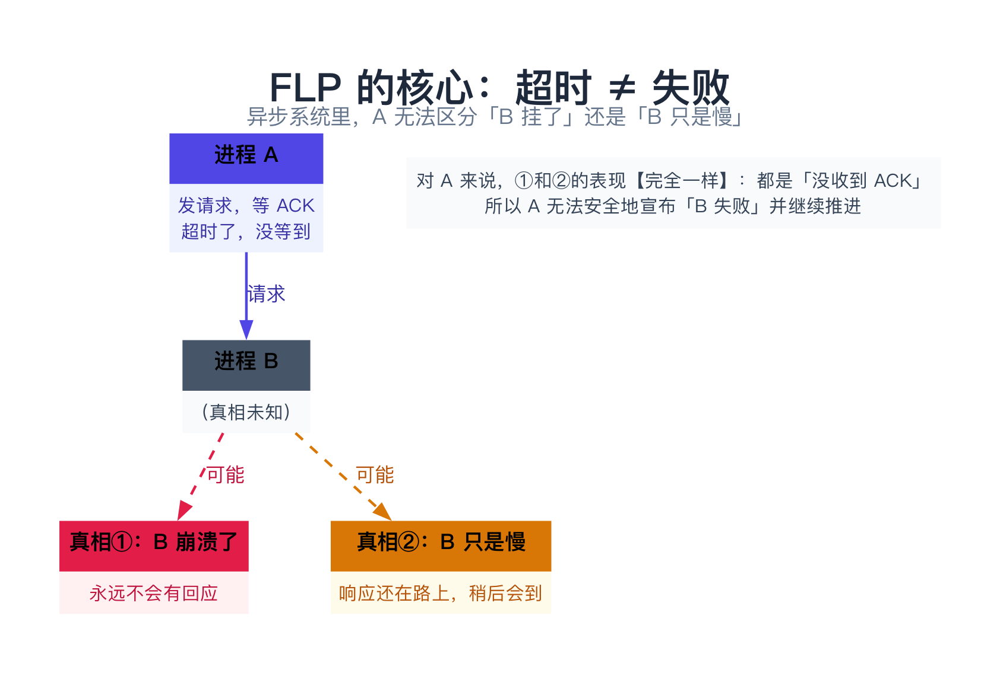
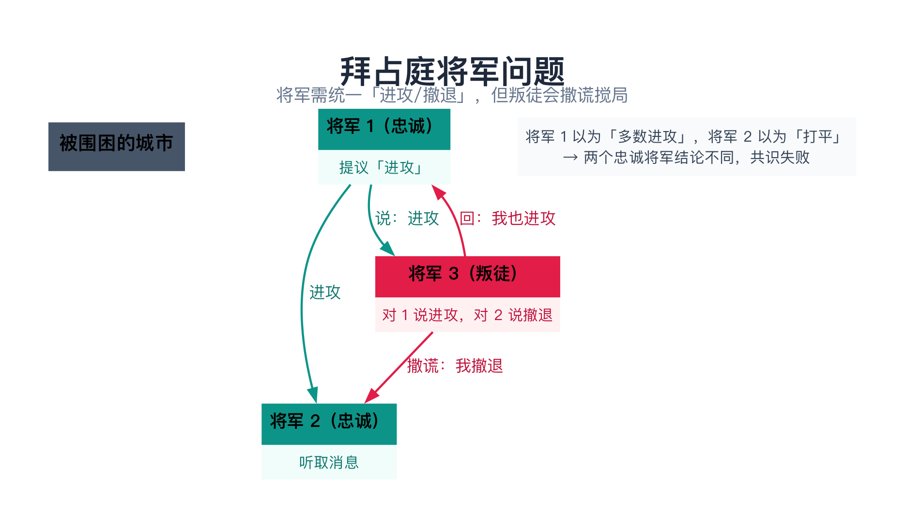
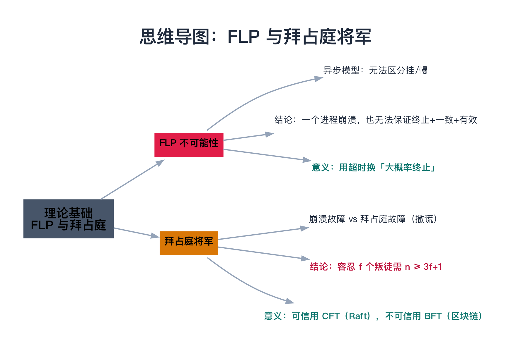

# 分布式系统理论基础（FLP 与拜占庭将军）

> 一句话：**FLP 定理**说「异步系统里，即使只有一个节点可能崩溃，也不存在能保证一定终止的共识算法」；**拜占庭将军问题**说「如果节点会撒谎，共识要难得多，需要 `n ≥ 3f+1` 才能容忍 `f` 个叛徒」。这两个理论，一个划出「崩溃故障」的下限，一个划出「恶意故障」的下限。

---

## 目录

1. [这两个理论回答什么问题](#1-这两个理论回答什么问题)
2. [FLP 不可能性](#2-flp-不可能性)
   - 2.1 前提：异步模型
   - 2.2 FLP 的结论
   - 2.3 为什么不可能（核心直觉）
   - 2.4 FLP 的现实意义
3. [拜占庭将军问题](#3-拜占庭将军问题)
   - 3.1 场景
   - 3.2 拜占庭故障 vs 崩溃故障
   - 3.3 结论：n ≥ 3f + 1
   - 3.4 现实意义：CFT vs BFT
4. [总结](#4-总结)
5. [延伸阅读](#5-延伸阅读)
6. [思维导图总结](#6-思维导图总结)

---

## 1. 这两个理论回答什么问题

「共识（consensus）」——让多个节点对某个值达成一致——是分布式系统的**核心难题**（下一章会形式化定义它）。而 FLP 和拜占庭将军这两个理论，分别回答了一个前置问题：

> **共识到底有多难？有没有理论上的「下限」？**

- **FLP 不可能性**：在「节点可能崩溃（但不撒谎）」的前提下，共识能有多可靠？
- **拜占庭将军问题**：在「节点可能恶意撒谎」的前提下，共识需要多少节点才能达成？

搞懂这两个理论，你就理解了为什么 Paxos、Raft 那些算法「长得那么复杂」——它们都是在理论划出的边界里，尽可能逼近最优。

---

## 2. FLP 不可能性

### 2.1 前提：异步模型

FLP 定理（1985 年，由 Fischer、Lynch、Paterson 三人提出，取姓氏首字母）针对的是**异步系统**。先搞清楚什么叫「异步」：

| 模型 | 特点 |
|------|------|
| **同步模型** | 消息延迟有**已知上界**、时钟同步、可以靠「超时」准确判断「对方挂了」 |
| **异步模型** | 消息延迟**无上界**、时钟不同步、**无法判断对方是挂了还是慢** |

FLP 研究的是**异步模型**——也就是最贴近真实网络、也最难的那个模型（回忆 01 篇：网络不可靠，超时 ≠ 失败）。

### 2.2 FLP 的结论

FLP 定理说：

> 在异步系统中，即使只有**一个**进程可能崩溃（fail-stop，崩溃后就停止、不再发任何消息），也**不存在一个确定性的共识算法**，能**同时**保证下面三个性质：

1. **终止性（Termination）**：每个正确的进程**最终都会**做出决定；
2. **一致性（Agreement）**：所有正确进程做出的决定**相同**；
3. **有效性（Validity）**：决定的值必须是**某个进程提议过**的值。

换句话说：**「终止性」和「一致性」在异步 + 崩溃故障下不可兼得**——要么保证一致性、但可能永不终止（陷入活锁）；要么保证终止、但可能不一致。

### 2.3 为什么不可能（核心直觉）

为什么异步系统里「一定终止」这么难？根源还是 01 篇那个点——**超时 ≠ 失败**。

设想一个共识算法，进程 A 在等进程 B 的回应。等了一会儿没等到，A 该不该「宣布 B 已失败、不等它了、直接做决定」？

- 如果 A 宣布「B 失败了」并做决定，但 B 其实**只是慢**（消息还在路上），那么 B 之后也会做出决定——两个决定可能**冲突**（牺牲一致性）。
- 如果 A 为了保险**一直等** B，但 B 其实**已经崩溃**了，那么 A 会**永远等下去**（牺牲终止性）。

**关键就在于：在异步系统里，A 无法区分「B 崩溃了」和「B 只是慢」。** 这个「无法区分」让任何确定性算法都做不到「既一定终止、又一定一致」。

> **类比：打电话没接**。你打给同事，响了很久没人接。你该挂断（宣布他「不在」）还是继续等？挂断吧，可能他只是在开会、等会就回你，你们俩会得出矛盾结论；继续等吧，可能他今天根本没来公司，你会一直傻等。**没有铃声上限，你就永远无法确定。**



### 2.4 FLP 的现实意义

FLP 听起来很绝望，但它**不是**说「共识无解」，而是划清了一个边界：

> **纯异步系统里，「一定终止」做不到；但现实系统可以引入「超时」这种（部分）同步假设，牺牲「一定终止」去换「大概率终止」。**

- Paxos 可能活锁（永远无法达成一致，但概率极低），Raft 靠「选举超时」把活锁概率压到极小——它们都**不保证 100% 终止**，但工程上够用。
- 所以 FLP 的意义是：**别追求「完美的异步共识」，要理解现实系统靠什么假设绕过了它**。

---

## 3. 拜占庭将军问题

### 3.1 场景

拜占庭将军问题（1982 年 Lamport 等人提出，用「拜占庭帝国」比喻）：几支军队的将军包围了一座城，他们必须**统一**行动——要么一起进攻，要么一起撤退。任何「一部分进攻、一部分撤退」都会失败。

将军之间只能通过**信使**传递消息。麻烦在于：**其中可能有叛徒**。叛徒会故意发送**错误、矛盾**的消息（对这个人说「进攻」，对那个人说「撤退」），目的是搅乱忠诚将军的判断。

问题就是：**在存在叛徒的情况下，忠诚的将军们怎么才能达成一致？**



### 3.2 拜占庭故障 vs 崩溃故障

这里引入一个重要的故障分类：

| 故障类型 | 行为 | 难度 | 常见假设 |
|----------|------|------|----------|
| **崩溃故障（fail-stop / CFT）** | 节点崩溃后**停止**，不再发任何消息（诚实但可能缺席） | 相对容易 | Paxos、Raft 都只处理这种 |
| **拜占庭故障（Byzantine / BFT）** | 节点**任意行为**：撒谎、发矛盾消息、假装崩溃、篡改数据 | 极难 | 区块链、PBFT |

> **类比**：崩溃故障是「**同事突然失联**」——他不再回你消息，但不会骗你。拜占庭故障是「**同事是个内鬼**」——他会故意告诉你错误信息，对你说一套、对别人说另一套，目的就是让你俩吵起来。

**FLP 处理的是崩溃故障，拜占庭将军处理的是拜占庭故障。** 后者难得多。

### 3.3 结论：n ≥ 3f + 1

拜占庭将军问题的核心结论（在「口信模型」下，即消息无法伪造、但叛徒可以谎报内容）：

> 要容忍 `f` 个叛徒，忠诚将军的总数 `n` 必须满足 **`n ≥ 3f + 1`**。

比如：容忍 1 个叛徒（f=1），至少需要 3×1+1 = **4** 个将军。这就是为什么「3 个将军里有 1 个叛徒」**无法**达成一致。

用 C++ 演示「3 个将军、1 个叛徒」为什么会失败：

```cpp
#include <iostream>
#include <string>
#include <vector>

// 3 个将军：1、2 忠诚，3 是叛徒。f=1，但 n=3 < 3f+1=4，所以无法达成一致。

int main() {
    // 将军 1 提议「进攻」，通过信使广播给所有人。
    // 叛徒将军 3 撒谎：对将军 1 说「我也进攻」，对将军 2 说「我主张撤退」。

    // 每个忠诚将军「看到的表态」：
    std::vector<std::string> g1_sees = {"进攻(自己)", "进攻(将军3说的)"};  // 将军 1 以为 2:0 支持进攻
    std::vector<std::string> g2_sees = {"进攻(将军1)", "撤退(将军3说的)"};  // 将军 2 以为 1:1 打平

    std::cout << "将军 1（忠诚）看到：" << g1_sees[0] << "、" << g1_sees[1]
              << " → 以为多数支持进攻，决定【进攻】\n";
    std::cout << "将军 2（忠诚）看到：" << g2_sees[0] << "、" << g2_sees[1]
              << " → 以为打成平手，犹豫不决\n";

    std::cout << "结果：两个忠诚将军得出【不同的结论】→ 共识失败\n";
    std::cout << "（这就是为什么 n=3、f=1 不行，必须 n>=4）\n";
    return 0;
}
```

### 3.4 现实意义：CFT vs BFT

- **绝大多数分布式系统（Paxos、Raft、ZooKeeper、etcd）只处理崩溃故障（CFT）**——它们假设节点「要么正确、要么崩溃停止」，不会撒谎。这个假设在「可信内网」里基本成立。
- **只有「节点可能被恶意控制」的场景才需要拜占庭容错（BFT）**——典型是**区块链**（节点互不信任）、以及一些高安全系统。BFT 算法（如 PBFT）的代价极高（通信开销大、性能低）。

一句话：**你的节点可信吗？** 可信 → 用 CFT（Raft/Paxos）；不可信 → 用 BFT（PBFT/区块链共识）。

---

## 4. 总结

两个理论合起来，划出了分布式共识的「难度地图」：

| | FLP 不可能性 | 拜占庭将军问题 |
|---|---|---|
| 故障类型 | 崩溃故障（fail-stop） | 拜占庭故障（任意撒谎） |
| 核心结论 | 异步下「一定终止」做不到 | 需 `n ≥ 3f+1` 才能容忍 f 个叛徒 |
| 对工程的启示 | 引入超时，牺牲「一定终止」换「大概率终止」 | 可信环境用 CFT，不可信环境用 BFT |
| 对应的实际系统 | Paxos / Raft（可能活锁） | PBFT / 区块链共识 |

**记住两句话**：

1. FLP 告诉我们：**异步系统里，别指望「百分百一定终止」的共识，现实系统都用超时做了妥协。**
2. 拜占庭告诉我们：**节点会撒谎时，共识难得多，要多花 3 倍的节点才能容忍同样的故障。**

下一章进入 [07 共识问题与复制状态机](../02-共识算法/07-共识问题与复制状态机.md)，把「共识」这个问题形式化定义清楚，并引入「复制状态机」这个把共识落到实处的通用框架。

---

## 5. 延伸阅读

- **FLP 不可能性**：
  - Fischer, Lynch, Paterson《Impossibility of Distributed Consensus with One Faulty Process》（JACM 1985）—— 原文只有 12 页，且论证是构造性的，**强烈建议读一遍**；
  - Dwork, Lynch, Stockmeyer《Consensus in the Presence of Partial Synchrony》（JACM 1988）—— 「部分同步」模型的出处，也是「GST（全局稳定时间）之后必须终止」这个说法的来源，本篇 2.4 节那句"引入超时"的正式版本；
  - Chandra & Toueg《Unreliable Failure Detectors for Reliable Distributed Systems》（JACM 1996）—— 用「故障检测器」这个抽象把 FLP 绕开，是 Paxos/Raft 里"超时"的理论包装，**想真正理解工程妥协必读**。
- **拜占庭将军**：
  - Pease, Shostak, Lamport《Reaching Agreement in the Presence of Faults》（JACM 1980）—— `n ≥ 3f+1` 的最初证明；
  - Lamport, Shostak, Pease《The Byzantine Generals Problem》（TOPLAS 1982）—— 更著名的散文版，口信模型与签名模型的区别讲得最清楚；
  - Lamport《The Weak Byzantine Generals Problem》（1983）—— 放松「必须知道叛徒是谁」之后的边界，想深入 BFT 再看；
  - Castro & Liskov《Practical Byzantine Fault Tolerance》（OSDI 1999）—— BFT 从理论走向可用的起点（第 13 篇会展开）。
- **书籍 / 课程**：Cachin, Guerraoui & Rodrigues《Introduction to Reliable and Secure Distributed Programming》第 2 章（系统模型）与第 5 章（共识）—— 把 FLP、故障检测器、BFT 串成一条完整链条；MIT 6.824 关于 FLP 的讲义。
- **顺着往下读**：[07 共识问题与复制状态机](../02-共识算法/07-共识问题与复制状态机.md)（把"共识"形式化）与 [13 拜占庭容错共识](../02-共识算法/13-拜占庭容错共识（PBFT、Tendermint、HotStuff）.md)（BFT 的可用算法）。

---

## 6. 思维导图总结

```text
分布式系统理论基础（FLP 与拜占庭将军）
├── 回答什么
│   └── 共识有多难的理论下限
├── FLP 不可能性
│   ├── 前提：异步模型（消息延迟无上界、无法判断挂/慢）
│   ├── 结论：即使一个进程崩溃，也无法同时保证「终止性+一致性+有效性」
│   ├── 核心直觉：超时 ≠ 失败（无法区分「挂了」还是「慢」）
│   └── 意义：别追求完美异步共识，用超时换「大概率终止」
└── 拜占庭将军问题
    ├── 场景：将军需统一行动，叛徒会撒谎搅局
    ├── 崩溃故障（fail-stop）vs 拜占庭故障（任意撒谎）
    ├── 结论：容忍 f 个叛徒需 n ≥ 3f + 1
    └── 意义：可信环境用 CFT（Raft），不可信用 BFT（区块链）
```


