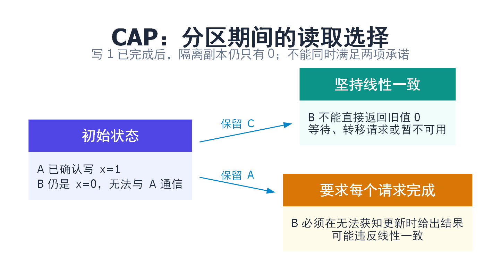
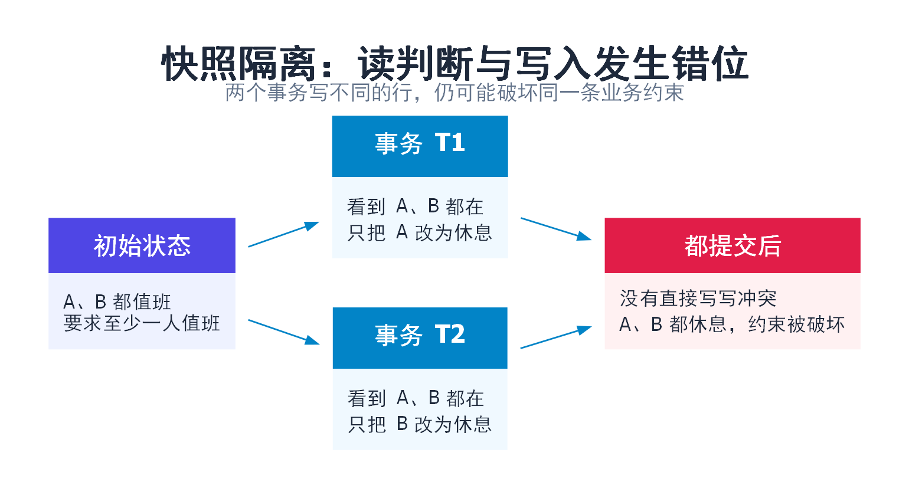

# 一致性与 CAP

用户改完收货地址，刷新页面却看到旧地址。系统承诺的“一致”具体指什么？

[上一篇：基础概念与故障模型](../01-%E5%9F%BA%E7%A1%80%E6%A6%82%E5%BF%B5%E4%B8%8E%E6%95%85%E9%9A%9C%E6%A8%A1%E5%9E%8B/%E5%9F%BA%E7%A1%80%E6%A6%82%E5%BF%B5%E4%B8%8E%E6%95%85%E9%9A%9C%E6%A8%A1%E5%9E%8B.md) · [返回目录](../README.md) · [下一篇：副本、共识与 Raft](../03-%E5%89%AF%E6%9C%AC%E3%80%81%E5%85%B1%E8%AF%86%E4%B8%8E%20Raft/%E5%89%AF%E6%9C%AC%E3%80%81%E5%85%B1%E8%AF%86%E4%B8%8E%20Raft.md)

上一篇用仓库超时说明，节点只能看到局部信息。本篇把这个限制放到读写上，看看两个副本能向读者承诺什么。

**阅读准备：** 先读上一篇的主线案例；本文涉及的 C++ 实验需要理解函数、容器与基本线程同步。

**快速阅读：**先读“先写出允许的读写历史”，再读“面试表达”和 Q&A；遇到说不清原因的结论，回到对应原理小节。

**深入学习：**按正文顺序推演每一步，运行文内完整示例，修改故障发生位置并核对结果。模拟程序只验证写明的假设；真实网络、磁盘和组件行为需按文中的验证步骤另行测试。

实验前先核对[环境、依赖与验证边界](../README.md#lab-compatibility)，各篇已执行与待执行的状态以对应实验说明为准。

<details>
<summary>本文目录（含小节）</summary>

- [先写出允许的读写历史](#section-01)
- [读取承诺](#section-02)
- [分区时的选择](#section-03)
- [事务隔离](#section-04)
- [用一次读取检查承诺](#section-05)
- [CAP：分区期间，为什么有些请求必须等待](#section-06)
  - [为什么多数派能继续服务，却仍然牺牲 CAP 可用性](#detail-02-1)
  - [怎样把这个限制写进接口约定](#detail-02-2)
- [BASE 与 ACID：分别回答不同的问题](#section-07)
- [四种一致性，用同一组操作比较](#section-08)
- [会话保证（Session Guarantees）](#section-09)
  - [换一个视角：关心「这一个客户端」](#detail-02-3)
  - [四种保证](#detail-02-4)
  - [它会「顺带」满足其他保证吗](#detail-02-5)
- [切换机房后，怎样继续兑现会话保证？](#geo-session)
- [C++ 示例：亲手制造三种「读错」](#section-10)
- [数据验证：最终一致「到底要等多久」](#section-11)
- [对比与选型](#section-12)
  - [从业务约束出发选机制](#detail-02-6)
- [快照隔离为什么仍会写错：两名值班医生](#section-13)
- [PACELC：网络正常时也有代价](#section-14)
- [面试表达](#section-15)
- [Q&A（常见问题与解答）](#section-16)
  - [线性一致是否要求所有客户端的钟完全同步？](#detail-02-7)
  - [粘性会话为什么挡不住跨机房旧读？](#detail-02-8)
  - [PACELC 是否要求整个产品只能选一种一致性？](#detail-02-9)
  - [读己之写是否覆盖别人刚完成的写？](#detail-02-10)
  - [快照隔离为什么仍会写偏斜？](#detail-02-11)
- [进一步阅读](#section-17)
- [思维导图总结](#section-18)

</details>

<a id="section-01"></a>

## 先写出允许的读写历史

假设地址最初为 A，随后用户把它改成 B。记录每次操作的开始和结束，才能判断读到 A 是否违规。

| 观察顺序 | 对线性一致性的判断 |
| --- | --- |
| 修改完成，之后才发起读取，读到 A | 违规，读开始时 B 已经生效 |
| 修改已经发出但还没完成，读取与修改重叠，读到 A | 可能合法，读取可排在修改之前 |
| 同一用户修改完成后从另一个副本读到 A | 违反读己之写，也违反上述线性一致要求 |

实际服务可以给修改返回一个版本号，例如 17。该用户后续读取附带最低版本 17，读副本只有 16 时就等待追赶、切换到足够新的副本，或按产品约定返回暂不可读。这个办法解释了会话保证怎样落地，其他用户的读取仍按自己的保证处理。

两地分区时，B 机房缺少 A 刚提交的新版本。继续提供旧版本查询与拒绝该查询各有业务代价。商品介绍可能允许陈旧，付款结果可能要求先查到确认记录。设计时应按操作写清读写承诺、旧值是否可接受，以及失败如何呈现给用户。

<a id="section-02"></a>

## 读取承诺

假设写入新地址已经返回成功，之后发起的读取若要求线性一致，就必须读到这次写入或更新的值。若业务只要求当前用户能看到自己的修改，可以用读己之写约束该用户的后续读取。因果一致则关注存在依赖的操作，例如看到回复时应该也能看到被回复的消息。最终一致关心停止更新且传播完成后副本能否收敛。

<a id="section-03"></a>

## 分区时的选择

把地址存到两个机房，两边突然失联。A 接受了修改并回复成功，B 无法得知新地址。若 B 继续回答读取，就可能返回旧值。若要求所有读都尊重已经完成的写，B 只能拒绝或等待。CAP 讨论的正是分区期间这个冲突，其中可用性要求非故障节点收到的请求最终得到符合操作语义的响应。

<a id="section-04"></a>

## 事务隔离

单次读写的顺序与一组事务能否串行解释是两个问题。可串行化要求并发事务的结果等价于某个串行执行顺序。严格可串行化还约束事务的实时先后。设计时先写出允许用户看到的结果，再选择复制、路由或事务机制。

<a id="section-05"></a>

## 用一次读取检查承诺

10:00 写入地址 B 并返回成功，随后读取却得到 A。如果要求线性一致，这条执行历史违规。若读取发生在写入仍未完成时，两者有重叠，读取可以排在写入之前。判断依据是调用与返回形成的先后关系。


<a id="section-06"></a>

## CAP：分区期间，为什么有些请求必须等待

设 A、B 两个机房最初都保存 `x=0`，随后两边失联。客户端在 A 写入 `x=1` 并收到成功，再到 B 读取。B 没收到这次更新，也无法向 A 查询。如果要求它一定完成这次读取，它可能只能返回旧值；如果要求它保证读到最新已完成的写入，它就不能立即给出这个旧值。

这就是 CAP 的冲突。这里的 C 是**线性一致性**：每个操作像是在调用和返回之间某一瞬间生效，已经完成的操作必须排在随后开始的操作之前。它不要求每块磁盘在每一刻都相同。A 是非故障节点收到的每个操作最终都能完成，不能用一律返回“服务不可用”满足它；它也不是“99.99% 可用率”或“200 ms 内响应”的指标。P 表示模型允许跨分区消息丢失。以上是定理中的条件，不是三个可以随意勾选的产品功能。[Gilbert 与 Lynch 的 CAP 论文](https://groups.csail.mit.edu/tds/papers/Gilbert/Brewer6.pdf)



<a id="detail-02-1"></a>

### 为什么多数派能继续服务，却仍然牺牲 CAP 可用性

三副本 A、B、C 中，A、B 还能通信，C 被隔离。采用正确的共识协议时，A、B 组成多数派，可以确认新的写入；C 不能独自确认写入，也不能无条件回答线性一致读。服务对多数用户可能仍可用，但 C 收到的请求不能都正常完成，所以不满足 CAP 对所有非故障节点的可用性要求。

若分区两侧都没有形成协议要求的仲裁集合，可能两侧都停止写入。并不存在“一定选一半继续写”的通用规则。分区也不必然造成脑裂；只有双方都继续行使不应同时拥有的写入权，才会产生相互冲突的主节点行为。

<a id="detail-02-2"></a>

### 怎样把这个限制写进接口约定

| 操作 | 分区时的明确行为 | 需要付出的代价 |
| --- | --- | --- |
| 确认扣款 | 无法获得必要确认时返回结果未知或暂不可用，之后查询结果 | 用户可能需要等待，重试必须幂等 |
| 查询商品介绍 | 允许读取缓存，显示更新时间 | 可能看到旧内容 |
| 修改个人资料 | 根据业务选择拒绝，或记录待同步修改 | 若允许并发修改，要解决冲突 |

同一个系统可以为不同接口提供不同保证。允许读旧值也不自动等于完整的 AP 方案：还要说明写入是否能接受、冲突如何合并、网络恢复后如何传播。

<a id="section-07"></a>

## BASE 与 ACID：分别回答不同的问题

BASE 用“基本可用、软状态、最终一致”描述一种设计思路。例如订单已提交，配送状态还在等待消息更新，后台持续重试后逐步收敛。**最终一致需要传播、重试和冲突处理，不能靠等时间自然获得。** 无法投递的事件要报警、对账，而不是无限显示“处理中”。

ACID 描述事务的原子性、一致性、隔离性和持久性。其中一致性指事务维护业务约束，并不等于跨副本的线性一致性。一个订单事务完全可以在本地使用 ACID，同时通过消息让搜索索引最终一致。因此不能把两者说成反义词，也不能说使用 ACID 就会在任意隔离级别下永远读到最新值。

<a id="section-08"></a>

## 四种一致性，用同一组操作比较

把系统想成多个人共同修改的公告板。关注的是读者**允许看到的操作顺序**，而不只是机器中的字节是否相同。

| 保证 | 必须保留什么顺序 | 不保证什么 |
| --- | --- | --- |
| 线性一致 | 所有操作能排成一个合法顺序，并尊重“完成后才开始”的真实先后 | 不自动把多个独立操作变成一个事务 |
| 顺序一致 | 所有人看到同一个合法总顺序，保留每个进程自己的操作顺序 | 不要求保留不同进程间的真实时间顺序 |
| 因果一致 | 有依赖的操作按因果顺序可见，如先有帖子再有回复 | 无关的并发更新不必对所有人呈现同一个顺序 |
| 最终一致 | 停止更新且系统完成必要传播、冲突处理后，各副本收敛 | 不承诺收敛时间上限，也不自动保证读己之写 |

例如 P 写入 `x=1` 返回后，Q 才读取 `x` 并得到 0。它违反线性一致；如果 P、Q 没有其他顺序约束，顺序一致可以把 Q 的读排在 P 的写之前。若 Q 先看到一条明确依赖该写入的消息，之后却看不到对应前置更新，还需要检查因果保证。

这里的“真实时间先后”指调用历史中的先完成、后发起，不要求客户端拥有完全同步的物理钟。线性一致只约束互不重叠操作的这类先后；时间上重叠的操作，只要满足对象语义，可以选择合法的先后顺序。顺序一致则保留每个进程自己的程序顺序，不额外保留不同进程之间仅由真实时间确定的先后。

这些模型不是可以一律逐项排列的“性能等级”。选型要列出业务禁止的执行历史，再检查具体接口能否排除它们。


<a id="section-09"></a>

## 会话保证（Session Guarantees）

<a id="detail-02-3"></a>

### 换一个视角：关心「这一个客户端」

因果一致是**全局**的保证（对所有节点成立）。但很多时候，我们其实只关心**「这个用户自己的视角别错乱」**——这就引出四种**「以客户端为中心」**的会话保证。它们**只在同一个客户端会话内生效**，实现时可能减少协调范围，却解决了用户最能感知的问题。

<a id="detail-02-4"></a>

### 四种保证

| 保证 | 一句话定义 | 用户感知的「反例」 |
|------|-----------|-------------------|
| **读己之写**<br>Read Your Writes | 你写完之后，你自己**后续的读**一定能读到（至少）你写的那次更新 | 改完昵称，刷新一看还是旧的 |
| **单调读**<br>Monotonic Reads | 你一旦读到过某个新值，**之后就再也不会读到更旧的**（时间不倒流） | 刚看到 100 条消息，刷新一下变回 98 条 |
| **单调写**<br>Monotonic Writes | 你自己发起的写，在系统里**按你发起的顺序生效** | 先将昵称改为 A，再改为 B，系统却先应用 B、后应用 A |
| **读后写**<br>Writes Follow Reads | 你读到 X 之后、基于 X 写了 Y，那么在**别人**的视角里，X 也先于 Y 出现 | 你回复了某条评论，别人却看到你的回复「凭空出现」 |

> **类比**：你在手机上改了个昵称。
>
> - **读己之写**：改完刷新，能看到新昵称（不会还显示旧的）；
> - **单调读**：看过新昵称后，不会又「退回」到旧昵称；
> - **单调写**：你连续改了两次，最终生效的一定是**后改的那次**；
> - **读后写**：你回复了朋友的动态，别人看到的是「先有动态、后有你的回复」。

<a id="detail-02-5"></a>

### 它会「顺带」满足其他保证吗

不能从名字相似就推出彼此包含。读己之写约束本会话后续读取，单调读约束读到的版本不倒退，两者都没有单独约束新写发往哪台副本。

例如用户在 R1 读到评论 X，随后把回复 Y 写入尚未收到 X 的 R2。仅保证该用户的读己之写和单调读，仍不足以让 R2 先处理 X 再处理 Y。读后写（WFR）需要把已读版本或依赖集合随写请求传递，并由接收方等待或拒绝未满足依赖的写。能否同时提供四项保证，要检查读路由、写路由和版本传播协议。

<a id="geo-session"></a>

## 切换机房后，怎样继续兑现会话保证？

用户在机房 A 修改地址，服务返回已提交版本 17；下一次请求被路由到机房 B，而 B 只有版本 16。只把用户固定在 A 可以减少这种情况，但 A 故障后仍要切换，粘性会话本身没有解决接管后的旧读。

| 步骤 | 请求或副本状态 | 正确处理 |
| --- | --- | --- |
| A 写入完成 | 回复携带版本 17 | 客户端保存本会话已经确认的版本 |
| 客户端到 B 读取 | 请求携带最低版本 17，B 只有 16 | B 等待追赶、转发到足够新的副本，或在期限内无法满足时返回不可用 |
| B 已应用版本 18 | B 能证明已包含版本 17 的更新 | 可以回复，并将会话要求推进到本次实际读到的版本 |

“18 比 17 大”只在协议定义了可比较的版本关系时有意义。多分片可能需要每分片进度，多个写入源可能需要依赖集合，不能把任意两台机器的本地计数器直接比较。版本必须表示已应用且可供本次读取的状态，而不只是消息已经收到了。

粘性路由是减少跨区等待的优化；版本验证才决定是否可以回答。跨设备是否共用会话上下文、令牌是否过期、依赖无法补齐时等待还是报错，都需要接口约定。如果令牌由客户端携带，还要校验来源、大小和有效范围，避免伪造极大版本导致无限等待。

演练时在 A 写完后暂停到 B 的复制，再把同一用户切到 B。验收结果应是符合契约的等待、转发或失败，不能悄悄返回版本 16。若系统承诺在 A 完全失效后仍保留已确认写，还需要复制持久性保证；路由和会话令牌无法找回所有副本都丢失的数据。

<a id="section-10"></a>

## C++ 示例：亲手制造三种「读错」

光看定义不够，下面用一段 C++ **亲手制造**三种典型的弱一致「读错」，建立直觉。三种「读错」和对应的「解药」可以先看这张图：


**环境**：macOS / Linux 均可；编译器 `g++` 或 `clang++`，支持 **C++11**；无第三方依赖。

```cpp
// 文件名：weak_demo.cpp
// 演示最终一致下三种让用户「觉得系统坏了」的读错
#include <iostream>
#include <string>

int main() {
    std::cout << "===== 违反一：读己之写 =====\n";
    std::string replicaA = "旧值";
    std::string replicaB = "旧值";
    replicaA = "新值";                       // 客户端写入副本 A
    std::cout << "写入副本 A：\"新值\"\n";
    std::cout << "立刻从副本 B 读：" << replicaB
              << "  ← 读不到自己刚写的（读己之写被违反）\n\n";

    std::cout << "===== 违反二：单调读 =====\n";
    std::string replicaC = "旧值";
    replicaB = "新值";                       // 副本 B 先同步了
    std::cout << "从副本 B 读：" << replicaB << "（新值）\n";
    std::cout << "再从副本 C 读：" << replicaC
              << "  ← 时间倒流了（单调读被违反）\n\n";

    std::cout << "===== 违反三：因果乱序 =====\n";
    std::string post_visible = "（原帖还没同步过来）";
    std::string comment_visible = "出门带伞";
    std::cout << "你看到的内容：\n";
    std::cout << "  原帖：" << post_visible << "\n";
    std::cout << "  评论：" << comment_visible
              << "  ← 评论先于原帖可见（因果被违反）\n";
    return 0;
}
```

**编译与运行**：

```bash
g++ -std=c++11 weak_demo.cpp -o weak_demo
./weak_demo
```

**预期输出**：

```text
===== 违反一：读己之写 =====
写入副本 A："新值"
立刻从副本 B 读：旧值  ← 读不到自己刚写的（读己之写被违反）

===== 违反二：单调读 =====
从副本 B 读：新值（新值）
再从副本 C 读：旧值  ← 时间倒流了（单调读被违反）

===== 违反三：因果乱序 =====
你看到的内容：
  原帖：（原帖还没同步过来）
  评论：出门带伞  ← 评论先于原帖可见（因果被违反）
```

**解读**：三种「读错」对应三种保证——

- 「读己之写被违反」→ 需要 **读己之写** 保证来修；
- 「时间倒流」→ 需要 **单调读** 保证来修；
- 「评论先于原帖」→ 需要 **因果一致** 来修。

**常见报错排查**：

| 报错 | 原因 | 解决 |
|------|------|------|
| `string 未声明` | 忘 `#include <string>` | 补上头文件 |
| 中文乱码 | 终端编码非 UTF-8 | `export LANG=zh_CN.UTF-8` |
| 编译报 `-std` 相关错误 | 用了 C++98 | 加 `-std=c++11` |

<a id="section-11"></a>

## 数据验证：最终一致「到底要等多久」

前文说最终一致「**不保证多久收敛**」。空口无凭，下面用一个仿真量化：3 个副本，每个副本的异步复制延迟服从**均值 50ms 的指数分布**，测量「写入到**所有副本都可见**」要多久（即所有副本里最慢的那个）。

```cpp
// 文件名：converge_bench.cpp
#include <iostream>
#include <vector>
#include <random>
#include <algorithm>

int main() {
    const int TRIALS = 100000;
    std::mt19937 rng(42);
    // 每个副本的异步复制延迟服从指数分布，均值 50ms
    std::exponential_distribution<double> lag(1.0 / 50.0);

    std::vector<int> conv;  // 每次写入「所有副本都可见」的耗时
    conv.reserve(TRIALS);
    for (int t = 0; t < TRIALS; ++t) {
        double worst = 0;
        for (int r = 0; r < 3; ++r)             // 3 个副本
            worst = std::max(worst, lag(rng));  // 全部可见 = 最慢那个
        conv.push_back((int)worst);
    }
    std::sort(conv.begin(), conv.end());
    auto pct = [&](double p) { return conv[(int)(TRIALS * p)]; };

    std::cout << "单副本复制延迟均值 50ms，3 副本；\n";
    std::cout << "写入到「所有副本都可见」的耗时分布：\n";
    std::cout << "  P50 = " << pct(0.50) << " ms\n";
    std::cout << "  P95 = " << pct(0.95) << " ms\n";
    std::cout << "  P99 = " << pct(0.99) << " ms\n";
    std::cout << "  Max = " << conv.back() << " ms\n";
    return 0;
}
```

**编译与运行**：

```bash
g++ -std=c++11 converge_bench.cpp -o converge_bench
./converge_bench
```

**预期输出**（固定种子，结果可复现）：

```text
单副本复制延迟均值 50ms，3 副本；
写入到「所有副本都可见」的耗时分布：
  P50 = 78 ms
  P95 = 204 ms
  P99 = 285 ms
  Max = 709 ms
```

**解读**（这张表非常有信息量）：

- **中位数才 78ms，但 P99 已到 285ms、最大 709ms**——**收敛时间是一条长尾分布**。这正是「最终一致不承诺多久」的量化含义：多数情况很快，但**偶尔会慢到几百毫秒甚至更久**。
- 注意这是**单副本延迟均值仅 50ms** 的理想情况。真实系统的分布取决于部署、负载、批处理和故障，不能由这组模拟数值直接推断。
- 工程含义：**「最终一致」必须按「最坏情况」设计**——比如用户刚改完昵称，UI 可以先显示本地已提交结果，但后续服务端读取仍须有版本或路由机制，才能提供读己之写，要么就别让用户依赖「立刻可见」。

> **数据说明**：本轮复核环境 Windows / MSYS2 UCRT64 GCC，`-std=c++17`，固定随机种子 `42`。指数分布用于模拟「大部分快、偶尔很慢」的复制延迟，均值 50ms 为设定值。

<a id="section-12"></a>

## 对比与选型

<a id="detail-02-6"></a>

### 从业务约束出发选机制

| 业务需求 | 需要检查的机制 | 仍要补什么 |
| --- | --- | --- |
| 改资料后本人不读旧值 | 会话版本、等待追赶或路由到足够新的副本 | 会话失效、切换设备时的约定 |
| 回复不能先于帖子出现 | 因果依赖跟踪与可见性控制 | 无关并发修改的合并规则 |
| 成功写入后的任意读取不倒退 | 线性一致接口和正确读路径 | 多步业务还需事务或条件更新 |
| 库存不能超卖 | 原子条件扣减、串行化或受控额度分配 | 跨服务失败后的释放与补偿 |
| 搜索索引允许稍晚更新 | 可靠事件传播与最终收敛 | 延迟目标、重试、监控和对账 |

模型描述保证，具体代价由实现和负载决定。不能把最终一致一律叫“成本最低”，也不能把钱和库存的所有接口一律归到 CP：余额展示可以允许有标注的旧值，扣款决定却必须维护余额约束。

<a id="section-13"></a>

## 快照隔离为什么仍会写错：两名值班医生

假设约束是“至少一名医生值班”。A、B 最初都值班。事务 T1 查询到两人值班，于是把 A 改为休息；T2 同时查询到同样的旧快照，于是把 B 改为休息。两者修改不同的行，都可能成功提交，最后没有人值班。这个问题叫**写偏斜**：每次修改单看都合理，合起来却破坏了跨行约束。

MVCC（多版本并发控制）保留同一行的多个版本，让读事务根据快照选择可见版本，减少读写互相等待。快照解决“本次读取能看到哪个版本”，并不自动解决“两个事务根据旧判断分别写入后是否矛盾”。快照隔离通常阻止直接的写写冲突，上面的冲突却来自读条件与其他事务写入之间的依赖。



| 时间 | T1 | T2 |
| --- | --- | --- |
| 1 | 读到 A、B 都值班 | 读到 A、B 都值班 |
| 2 | 判断 B 还在，把 A 设为休息 | 判断 A 还在，把 B 设为休息 |
| 3 | 提交 A 的修改 | 提交 B 的修改 |
| 结果 | 两行无直接写冲突 | 跨行约束已被破坏 |

解决方式必须覆盖**用于判断的条件**。可以将所有调整集中到同一条排班控制记录上串行处理，也可以对相关记录按固定顺序加锁后重新检查，或使用可串行化隔离并处理事务重试。若条件覆盖未来插入的行，仅锁住当前已有行未必足够，还要考虑谓词或范围保护。

不同数据库对隔离级别的实现不同。以 PostgreSQL 为例，Repeatable Read 使用快照隔离；Serializable 会检测危险依赖，必要时中止事务。收到序列化失败后，要从事务开始重新读取并判断，不能只重试最后一条 UPDATE。[PostgreSQL 事务隔离说明](https://www.postgresql.org/docs/current/transaction-iso.html)

这也解释了为什么 2PC 不能替代隔离：2PC 协调参与者一起提交或一起放弃，但参与者内部仍需要正确的并发控制。


<a id="section-14"></a>

## PACELC：网络正常时也有代价

两个机房相隔很远，即使没有断网，跨机房通信也要时间。写订单时立即在本地返回，另一个机房可能暂时读到旧订单；等远端参与确认再返回，写入延迟就增加。这是正常运行时的取舍，CAP 的分区结论本身不回答它。

PACELC 用两组问题提醒设计者：发生分区 P 时怎样权衡可用性 A 与一致性 C；其他时候 E，怎样权衡延迟 L 与一致性 C。它是分析架构的框架，不是给产品贴永久标签。一个系统可以对余额要求协调读取，对商品浏览允许读本地旧副本，两条接口的承诺不同。[Abadi 的 PACELC 讨论](https://www.cs.umd.edu/~abadi/papers/abadi-pacelc.pdf)

选型时先写出读取允许落后多久、写入成功表示哪些副本已确认，再测跨机房 RTT 和 P99。若用户要求“全球任意机房立刻读到最后一次成功写入”，就不能同时把所有操作都解释成完全不通信的本地请求。优化缓存、批量或放置位置能减少开销，但不能消除未知远端更新需要通信这一事实。


<a id="section-15"></a>

## 面试表达

一致性首先是接口对读写结果的承诺。余额读取可能要求看到此前已经成功的写入，浏览量则可以允许短暂落后。分区时若还要求每侧都完成请求，就不能同时保证线性一致；平时跨机房协调也会增加延迟。会话保证通过传播版本保护同一用户的操作顺序，但不能凭名称推导其他保证。选型要明确容忍的旧读、等待和失败，而不是只给数据库贴 CP 或 AP 标签。

进一步追问工程边界时，我会补充：切换携带最低已见版本，副本验证应用进度；粘性路由减少等待，不替代版本与持久性保证。故障验证既检查恢复进度，也检查恢复后是否仍满足原来的业务承诺。

<a id="section-16"></a>

## Q&A（常见问题与解答）

<a id="detail-02-7"></a>

### 线性一致是否要求所有客户端的钟完全同步？

不要求。它约束操作完成与后续发起之间的真实先后，不要求用准确时间戳实现。重叠操作可按对象语义选择合法顺序。

<a id="detail-02-8"></a>

### 粘性会话为什么挡不住跨机房旧读？

机房故障或路由切换会打破粘性。新副本必须验证已包含会话要求的版本；不满足时等待、转发或失败。版本无法恢复已经丢失的数据。

<a id="detail-02-9"></a>

### PACELC 是否要求整个产品只能选一种一致性？

不要求。不同接口、数据和部署方式可以采用不同协调路径，应逐项写出延迟、旧读与失败行为。

<a id="detail-02-10"></a>

### 读己之写是否覆盖别人刚完成的写？

不一定。它保护自己的已知写入；线性一致还必须满足所有已完成操作的实时先后，因此保证更广。

<a id="detail-02-11"></a>

### 快照隔离为什么仍会写偏斜？

两个事务可从同一快照读到条件成立，却修改不同记录，不触发单行写冲突。跨行约束需串行化、显式锁或合适的条件保护。

**快照隔离是否等于可串行化？**

不等于。两名医生分别退出值班的例子没有直接写写冲突，却破坏了跨行约束。必须保护判断条件，或使用可串行化隔离并重试被中止的整个事务。

**读到最新值一次，是否就能证明系统线性一致？**

一次读取只能验证该次历史。还要测试切换、并发写入和分区等时序，检查每次读写是否能排出符合实时顺序的历史。

**最终一致意味着最多几秒能同步吗？**

仅凭最终一致无法推出具体时限。若业务要求三秒内可见，还需要独立的延迟目标与测量。

[延伸阅读](https://jepsen.io/consistency/models)

<a id="section-17"></a>

## 进一步阅读

- [会话保证原论文](https://www.cs.cornell.edu/courses/cs734/2000FA/cached%20papers/SessionGuaranteesPDIS_1.html)：核对正文中的模型、状态和失败边界。
- [PACELC](https://www.cs.umd.edu/~abadi/papers/abadi-pacelc.pdf)：核对正文中的模型、状态和失败边界。
- [一致性模型对照](https://jepsen.io/consistency/models)：核对正文中的模型、状态和失败边界。

关联笔记：[基础概念与故障模型](../01-%E5%9F%BA%E7%A1%80%E6%A6%82%E5%BF%B5%E4%B8%8E%E6%95%85%E9%9A%9C%E6%A8%A1%E5%9E%8B/%E5%9F%BA%E7%A1%80%E6%A6%82%E5%BF%B5%E4%B8%8E%E6%95%85%E9%9A%9C%E6%A8%A1%E5%9E%8B.md)、[副本、共识与 Raft](../03-%E5%89%AF%E6%9C%AC%E3%80%81%E5%85%B1%E8%AF%86%E4%B8%8E%20Raft/%E5%89%AF%E6%9C%AC%E3%80%81%E5%85%B1%E8%AF%86%E4%B8%8E%20Raft.md)。

下一篇要回答的问题是：订单已经返回创建成功，主节点马上宕机。新主还能找到这笔订单吗？

<a id="section-18"></a>

## 思维导图总结

```text
一致性与 CAP
├── 跨机房会话
│   ├── 切换携带最低已见版本，副本验证应用进度
│   └── 粘性路由减少等待，不替代版本与持久性保证
├── 一致性模型
│   ├── 线性一致保留实时先后；顺序一致保留进程顺序
│   └── 因果依赖与最终收敛分别约束
├── CAP 与 BASE
│   ├── 分区时不能兼得线性一致与所有请求完成
│   └── BASE 可与本地 ACID 事务结合
├── 会话保证
│   ├── 读己之写、单调读、单调写、读后写
│   └── 版本随请求传播；落后时等待或换副本
├── 事务隔离
│   ├── MVCC 快照不能自动阻止写偏斜
│   └── 可串行化与条件保护；失败后重试整个事务
├── 实验与反例
│   ├── 构造旧读、因果乱序和收敛延迟
│   └── 区分仿真分布与线上承诺
└── 正常运行时的取舍
    ├── PACELC：跨机房协调与延迟
    └── 会话保证不能凭名称推导包含关系
```


