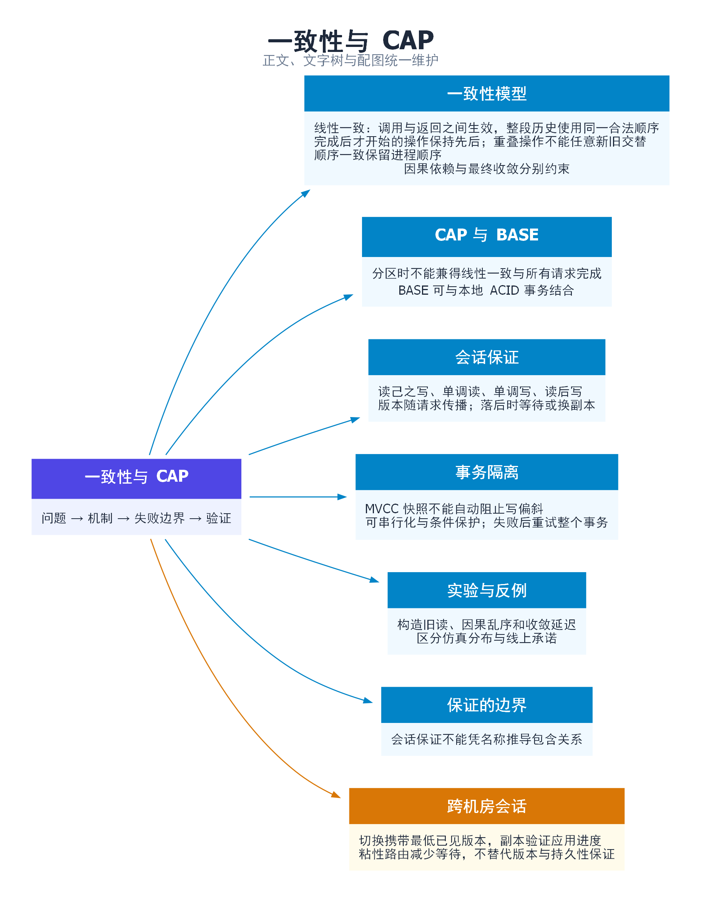

# 一致性与 CAP

用户改完收货地址，刷新页面却看到旧地址。系统承诺的“一致”具体指什么？

[上一篇：基础概念与故障模型](../01-%E5%9F%BA%E7%A1%80%E6%A6%82%E5%BF%B5%E4%B8%8E%E6%95%85%E9%9A%9C%E6%A8%A1%E5%9E%8B/%E5%9F%BA%E7%A1%80%E6%A6%82%E5%BF%B5%E4%B8%8E%E6%95%85%E9%9A%9C%E6%A8%A1%E5%9E%8B.md) · [返回目录](../README.md) · [下一篇：副本、共识与 Raft](../03-%E5%89%AF%E6%9C%AC%E3%80%81%E5%85%B1%E8%AF%86%E4%B8%8E%20Raft/%E5%89%AF%E6%9C%AC%E3%80%81%E5%85%B1%E8%AF%86%E4%B8%8E%20Raft.md)

上一篇用仓库超时说明，节点只能看到局部信息。本篇把这个限制放到读写上，看看两个副本能向读者承诺什么。

**阅读准备：** 先读上一篇的主线案例；本文涉及的 C++ 实验需要理解函数、容器与基本线程同步。

**快速阅读：** 先读“线性一致：修改成功后，读取能看到什么？”，再读“面试表达”和 Q&A；遇到说不清原因的结论，回到对应原理小节。

**深入学习：** 按正文顺序推演每一步，运行文内完整示例，修改故障发生位置并核对结果。模拟程序只验证写明的假设；真实网络、磁盘和组件行为需按文中的验证步骤另行测试。

实验前先核对[环境、依赖与验证边界](../README.md#lab-compatibility)，各篇已执行与待执行的状态以对应实验说明为准。

<details>
<summary>本文目录（含小节）</summary>

- [一致性与 CAP](#一致性与-cap)
  - [1 线性一致：修改成功后，读取能看到什么？](#1-线性一致修改成功后读取能看到什么)
    - [1.1 什么是线性一致：像在同一份登记簿上办理业务](#11-什么是线性一致像在同一份登记簿上办理业务)
    - [1.2 写完再读：为什么不能返回旧地址](#12-写完再读为什么不能返回旧地址)
    - [1.3 边写边读：为什么旧值、新值都可能合法](#13-边写边读为什么旧值新值都可能合法)
    - [1.4 只有当前用户要看到修改，是否必须用线性一致](#13-只有当前用户要看到修改是否必须用线性一致)
  - [2 读取承诺](#2-读取承诺)
  - [3 分区时的选择](#3-分区时的选择)
  - [4 事务隔离](#4-事务隔离)
  - [5 用一次读取检查承诺](#5-用一次读取检查承诺)
  - [6 CAP：网络分区期间，为什么保证一致性可能需要等待或拒绝请求](#6-cap网络分区期间为什么保证一致性可能需要等待或拒绝请求)
    - [6.1 为什么多数派能继续服务，却仍然牺牲 CAP 可用性](#61-为什么多数派能继续服务却仍然牺牲-cap-可用性)
    - [6.2 怎样把这个限制写进接口约定](#62-怎样把这个限制写进接口约定)
  - [7 BASE 与 ACID：分别回答不同的问题](#7-base-与-acid分别回答不同的问题)
  - [8 四种一致性，用同一组操作比较](#8-四种一致性用同一组操作比较)
    - [8.1 先固定一个场景：写成功以后，另一个人来读](#81-先固定一个场景写成功以后另一个人来读)
    - [8.2 线性一致：修改已经成功，后来的读取就必须承认它](#82-线性一致修改已经成功后来的读取就必须承认它)
    - [8.3 顺序一致：大家的操作能排成同一个顺序，但不必遵守跨客户端的现实时间先后](#83-顺序一致大家的操作能排成同一个顺序但不必遵守跨客户端的现实时间先后)
    - [8.4 因果一致：先有前因，才能看到依赖它的后果](#84-因果一致先有前因才能看到依赖它的后果)
    - [8.5 最终一致：中间可以不同，满足同步条件后最终要收敛](#85-最终一致中间可以不同满足同步条件后最终要收敛)
    - [8.6 把同一个问题放在一起比较](#86-把同一个问题放在一起比较)
    - [8.7 理解检查：几个容易混淆的问题](#87-理解检查几个容易混淆的问题)
  - [9 会话保证（Session Guarantees）](#9-会话保证session-guarantees)
    - [9.1 换一个视角：关心「这一个客户端」](#91-换一个视角关心这一个客户端)
    - [9.2 四种保证](#92-四种保证)
    - [9.3 它会「顺带」满足其他保证吗](#93-它会顺带满足其他保证吗)
  - [10 切换机房后，怎样继续兑现会话保证？](#10-切换机房后怎样继续兑现会话保证)
  - [11 C++ 示例：亲手制造三种「读错」](#11-c-示例亲手制造三种读错)
  - [12 数据验证：最终一致「到底要等多久」](#12-数据验证最终一致到底要等多久)
  - [13 读写一致性与事务隔离：分别保护什么](#13-读写一致性与事务隔离分别保护什么)
  - [14 面试表达](#14-面试表达)
  - [15 Q\&A（常见问题与解答）](#15-qa常见问题与解答)
    - [15.1 线性一致是否要求所有客户端的钟完全同步？](#151-线性一致是否要求所有客户端的钟完全同步)
    - [15.2 粘性会话为什么挡不住跨机房旧读？](#152-粘性会话为什么挡不住跨机房旧读)
    - [15.3 读己之写是否覆盖别人刚完成的写？](#153-读己之写是否覆盖别人刚完成的写)
    - [15.4 快照隔离为什么仍会写偏斜？](#154-快照隔离为什么仍会写偏斜)
    - [15.5 快照隔离是否等于可串行化？](#155-快照隔离是否等于可串行化)
    - [15.6 写入还没返回成功，读取就看到新值，是否违规？](#156-写入还没返回成功，读取就看到新值，是否违规)
    - [15.7 单个地址的读写线性一致，是否就能保证多步业务更新正确？](#157-单个地址的读写线性一致，是否就能保证多步业务更新正确)
    - [15.8 读到最新值一次，是否就能证明系统线性一致？](#158-读到最新值一次，是否就能证明系统线性一致)
    - [15.9 最终一致意味着最多几秒能同步吗？](#159-最终一致意味着最多几秒能同步吗)
  - [16 进一步阅读](#16-进一步阅读)
  - [17 思维导图总结](#17-思维导图总结)

</details>

<a id="section-01"></a>

<a id="线性一致修改成功后读取能看到什么"></a>

## 1 线性一致：修改成功后，读取能看到什么？

用户把地址从 A 改成 B，页面提示“保存成功”，随后家人在另一台设备上查询，却又看到了 A。问题不只是“副本同步慢”：接口到底允许谁在什么时候看到旧地址？要回答这个问题，需要先记录操作的调用、返回及读取结果。这份记录就叫读写历史。

<a id="什么是线性一致像在同一份登记簿上办理业务"></a>

### 1.1 什么是线性一致：像在同一份登记簿上办理业务

想象多个办事窗口共用一本地址登记簿。修改和查询可以同时排队，但对外必须能解释成登记簿上一次一次办理的结果：修改已经办完，后来才开始的查询就不能再查到修改前的地址。这个类比描述的是用户看到的效果；实际系统可以保存多个副本，也可以并行处理请求，不要求真的共用一份存储或一把全局锁。

**先记住线性一致（Linearizability）最直观的要求：地址已经修改成功，别人随后才开始查询，就应该看到修改后的地址。** 这里假设中间没有人再次修改地址。例如，地址原来是 A，你改成 B 并收到“保存成功”；家人之后才点开查询，无论请求发到哪个副本，都应该查到 B，不能因为“这个副本还没同步”就返回 A。

如果家人在你修改的过程中查询，情况就不同了。查询可能赶在修改生效之前，读到 A；也可能发生在修改生效之后，读到 B。这两种结果都可能合理，因为两个请求的处理时间有重叠，仅看谁先发出请求，还不能确定谁先完成了实际的读或写。

那么，怎样判断一组并发请求的结果是否合理？可以把这些读写暂时想成排队办理，试着给它们排出一个先后顺序：

- 读排在“改成 B”之前，就应该返回 A；读排在“改成 B”之后，就应该返回 B。如果后来又改成 C，排在那次修改之后的读就应该返回 C。
- 已经发生的先后关系不能颠倒：你已经收到修改成功，家人才开始查询，就不能为了替旧值 A 找理由，把家人的查询排到修改之前。
- 处理时间有重叠的请求，可以尝试不同排法，但必须找到同一个顺序，能够解释每一次读取的结果。不能解释第一条查询时说“修改已经生效”，解释后面才开始的查询时又说“修改还没生效”。后文会用“先读到 B、再读回 A”的反例说明这一点。

**如果所有读写都能按这些要求排出一个顺序，这段读写历史就符合线性一致。** 这也解释了“像操作同一份登记簿”的含义：用户看到的每个结果，都能对应到登记簿上某一步修改之前或之后，而不是不同窗口各自回答互相矛盾的内容。

再来看定义中的“在调用与返回之间的某个瞬间生效”。“调用”就是客户端发出请求，“返回”就是客户端收到结果。请求在这段时间里可能经历网络传输、排队、复制等多个步骤，但分析结果时，我们可以把一次修改看成在其中某一刻完成了从 A 到 B 的切换：排在它之前的查询看到 A，排在它之后的查询看到 B。这个用来确定操作先后的位置，就叫作**线性化点**。读取也可以看成在自己发出请求到收到结果之间的某一刻取到了值。

线性化点用来描述对外效果，不要求整个请求真的只执行一条机器指令，也不要求接口返回一个精确时间戳。客户端的钟不必完全同步；这里关注的是“一个请求已经返回，另一个请求才发出”这样的实际先后。

这里先讨论已返回成功的写入和正常返回的读取。写入超时只说明客户端没有收到确定结果，不能据此断定写入未生效；判断包含超时的历史时，还需考虑该写入可能已经生效。

<a id="写完再读为什么不能返回旧地址"></a>

### 1.2 写完再读：为什么不能返回旧地址

以下场景都假设地址初始为 A，只有一次写入 B，没有其他修改。时间按事件编号向后推进，不依赖机器上的时间戳。

```text
事件    用户甲                         用户乙
1       发起：把地址改为 B
2       收到：修改成功
3                                      发起：查询地址
4                                      收到：地址 B

唯一合法的操作顺序：写 B → 读 B
若事件 4 返回 A，则违反线性一致。
```

甲的写入已经完成，乙才开始读取，所以不能把乙的读排到写入前面。乙使用另一台设备、请求另一个副本，也不会改变这个要求。服务若承诺这个地址接口线性一致，就需要通过正确的复制、读路由或协调机制保证结果；单纯从任意副本读取本地值，无法排除旧读。

<a id="边写边读为什么旧值新值都可能合法"></a>

### 1.3 边写边读：为什么旧值、新值都可能合法

```text
事件    用户甲                         用户乙
1       发起：把地址改为 B
2                                      发起：查询地址
3                                      收到：地址 A 或 B
4       收到：修改成功

读到 A 的合法解释：读 A → 写 B
读到 B 的合法解释：写 B → 读 B
```

两个操作的执行区间重叠，因此两种结果在这段历史中都可能合法。读到 B 并不要求甲已经收到成功响应：写入可以先在服务端生效，响应随后才到达客户端。所以“最新值”不能只按哪个响应先返回判断。

但重叠并不意味着每次读取都能随意选择新旧值。考虑下面的历史：

```text
事件    用户甲                         用户乙               用户丙
1       发起：把地址改为 B
2                                      发起：查询地址
3                                      收到：地址 B
4                                                           发起：查询地址
5                                                           收到：地址 A
6       收到：修改成功
```

这段历史不合法。乙读到 B，要求写 B 排在乙的读取之前；乙的读取返回后，丙才发起读取，要求乙的读取排在丙之前。合起来只能是“写 B → 乙读 B → 丙读”，所以丙也必须读到 B。虽然两次读取都与写入重叠，也不能分别选择互相矛盾的排序。如果中间确实有人把地址重新写成 A，则要把那次写入纳入分析，不能只凭“读值回退”认定违规。

| 观察顺序 | 对线性一致性的判断（初始为 A，仅写入一次 B） |
| --- | --- |
| 修改完成，之后才发起读取，读到 A | 违规，读取必须排在写 B 之后 |
| 读取与修改重叠，单次读到 A 或 B | 都可能合法，还要检查整段历史能否使用同一个合法顺序解释 |
| 一次读取返回 B，之后才发起的读取返回 A | 违规，前一次读已把写 B 的位置约束在自己之前 |
| 同一用户修改完成后从另一个副本读到 A | 违反读己之写，也违反线性一致要求 |

上述定义约束接口行为，不规定具体复制算法，也不自动把“先读余额、再写余额”两个操作合成一个原子事务。两个客户端仍可能先后读到同一个余额，再分别覆盖写入；要保护这样的业务更新，需要原子加减、比较并交换或合适的事务机制。线性一致也不单独规定断电后的数据持久性，持久化承诺需要另外说明。[Herlihy 与 Wing 的线性一致原论文，第 1—2 节](https://cs.brown.edu/people/mph/HerlihyW90/p463-herlihy.pdf)

<a id="只有当前用户要看到修改是否必须用线性一致"></a>

### 1.4 只有当前用户要看到修改，是否必须用线性一致

实际服务可以给修改返回一个版本号，例如 17。该用户后续读取附带最低版本 17，读副本只有 16 时就等待追赶、切换到足够新的副本，或按产品约定返回暂不可读。这个办法可以保证携带版本要求的用户看到自己的修改，但不会自动保证其他用户也看到这次修改。例如，你修改地址后拿到版本号 17，随后查询时要求至少读取版本 17；家人查询时如果没有携带这个要求，而接口允许读取尚未同步的副本，就可能查到旧地址。这可以满足你的“读己之写”，却不满足所有用户的线性一致读取。若接口承诺线性一致，那么家人在修改成功后才发起的查询，也必须看到这次修改或后续更新，不能因为没有携带版本号就返回旧地址。

两地分区时，B 机房缺少 A 刚提交的新版本。继续提供旧版本查询与拒绝该查询各有业务代价。商品介绍可能允许陈旧，付款结果可能要求先查到确认记录。设计时应按操作写清读写承诺、旧值是否可接受，以及失败如何呈现给用户。

<a id="section-02"></a>

<a id="读取承诺"></a>

## 2 读取承诺

假设写入新地址已经返回成功，之后发起的读取若要求线性一致，就必须读到这次写入或更新的值。若业务只要求当前用户能看到自己的修改，可以用读己之写约束该用户的后续读取。因果一致则关注存在依赖的操作，例如看到回复时应该也能看到被回复的消息。最终一致关心停止更新且传播完成后副本能否收敛。

<a id="section-03"></a>

<a id="分区时的选择"></a>

## 3 分区时的选择

把地址存到两个机房，两边突然失联。A 接受了修改并回复成功，B 无法得知新地址。若 B 继续回答读取，就可能返回旧值。若要求所有读都尊重已经完成的写，B 只能拒绝或等待。CAP 讨论的正是分区期间这个冲突，其中可用性要求非故障节点收到的请求最终得到符合操作语义的响应。

<a id="section-04"></a>

<a id="事务隔离"></a>

## 4 事务隔离

单次读写的顺序与一组事务能否串行解释是两个问题。可串行化要求并发事务的结果等价于某个串行执行顺序。严格可串行化还约束事务的实时先后。设计时先写出允许用户看到的结果，再选择复制、路由或事务机制。可串行化保证并发事务的结果等价于某个串行执行顺序；严格可串行化进一步要求这个顺序尊重实际时间：一个事务完成之后才开始的事务，必须排在它后面。对于时间上重叠的事务，可以选择任一符合读写结果的串行顺序。

<a id="section-05"></a>

<a id="用一次读取检查承诺"></a>

## 5 用一次读取检查承诺

10:00 写入地址 B 并返回成功，随后读取却得到 A。如果要求线性一致，这条执行历史违规。若读取发生在写入仍未完成时，两者有重叠，读取可以排在写入之前。判断依据是调用与返回形成的先后关系。


<a id="section-06"></a>

<a id="cap分区期间为什么有些请求必须等待"></a>

## 6 CAP：网络分区期间，为什么保证一致性可能需要等待或拒绝请求

本节解释 CAP 中的 C、A、P 分别表示什么，以及为什么网络分区时，保证一致性可能需要让部分请求等待或失败。这里需要用到前面介绍的线性一致性：已经完成的写入，必须排在随后才开始的读取之前。

先想象两家银行网点：两边都开着门，也都能接待客户，但网点之间的电话和网络断了。某位客户在一家网点完成存款，另一家网点却无法获知这笔存款。它应该按旧余额回答，还是等到能够确认余额后再回答？

对应到数据库，就是两个副本 A、B 自身还在运行，客户端也能分别访问它们，但副本之间无法通信。这叫**网络分区**，不是把数据表拆成几个分片。银行类比只帮助理解通信中断；数据库实际通过复制消息、确认和协调协议同步状态。

**C：一致性（Consistency），这里通常指线性一致性。** 每个操作看起来都在调用和返回之间的某一瞬间生效，所有操作能排成一个符合数据读写规则的顺序，而且这个顺序尊重实际时间先后。整个系统因此表现得像在操作同一份数据。

例如，客户端向 A 写入 `x=1` 并收到成功响应，另一个客户端随后才向 B 读取。在没有其他写入的情况下，B 不能返回旧值 `0`。C 不要求每块磁盘在每一刻的内容都相同，但要求系统不能把这种尚未同步的旧值作为上述读取的结果返回。它也不是“最终同步就行”，更不是 ACID 中维护业务约束的 C。

**A：可用性（Availability），要求每个到达非故障节点的请求，最终都能得到符合操作语义的响应。** B 没有宕机、客户端也能访问 B，那么系统就应能完成发给 B 的读写请求，不能因为联系不上 A 就无限等待，也不能只返回“服务不可用”来宣称满足了 A。

这里的“最终”没有规定必须在多少毫秒内响应。因此，CAP 的 A 不等同于低延迟，也不等同于工程中统计的“99.99% 可用率”。短暂等待本身不一定违反 A；问题在于网络分区可能一直持续，如果完成请求必须等待网络恢复，系统就无法保证请求最终完成。

**P：分区容错性（Partition tolerance），表示系统需要面对节点之间发生网络分区的故障条件。** 在 CAP 的模型中，跨分区的消息可能丢失，系统不能假设各节点之间总能通信。P 并不承诺分区后所有请求都成功，也不代表自动满足 C 或 A；CAP 要讨论的正是在这种故障条件下，C 和 A 能否同时保证。

**既然考虑网络分区可能发生（P），就要面对一个限制：分区期间，无法同时保证线性一致性（C）和所有非故障节点上的请求最终正常完成（A）。**

用一个读写过程把三者连起来。设最初两个副本都保存 `x=0`：

```text
1. 副本 A：x=0          副本 B：x=0
2. A、B 之间发生网络分区，更新消息无法传递。
3. 客户端向 A 写入 x=1，A 返回成功。
4. 另一个客户端随后向 B 读取 x，B 只有旧值 0。
```

此时 B 无法区分“A 已经更新为 1”和“A 没有发生更新”这两种情况。它不能靠猜一个值来保证线性一致性：猜 0 可能漏掉已完成的写入，猜 1 又可能返回从未写入的值。

| B 的处理方式 | 对 C、A 的影响 |
| --- | --- |
| 直接返回本地旧值 `0` | 请求完成了，但违反 C：已经成功的写入没有被后续读取看到 |
| 等到能确认正确值再回答 | 可以保护 C，但分区一直不恢复时，请求可能一直无法完成，无法保证 A |
| 返回“暂时无法提供服务” | 避免返回不符合一致性要求的数据，但这次请求没有正常完成，不满足 CAP 的 A |

也可以在第 3 步就让 A 的写入等待或失败，不让它返回成功。这样能避免这条执行历史中的旧读问题，但代价依然是部分请求无法完成。若客户端有可用路径访问能够安全处理请求的节点，可以尝试转移请求；CAP 不保证这种路径总是存在。

所以，**网络分区发生后，如果要求两边都持续完成请求，就无法保证所有操作都满足线性一致性；如果坚持线性一致性，就可能需要让无法安全完成的请求等待或失败。** 不是所有请求都必须停止，下一节会用多数派说明哪些节点可能继续服务。

CAP 不是任何时候都“只能三选二”。它的核心结论是：**在允许网络分区的模型下，系统无法同时保证 C 和 A。** 以上是定理中的条件，不是三个可以随意勾选的产品功能。[Gilbert 与 Lynch 的 CAP 论文](https://groups.csail.mit.edu/tds/papers/Gilbert/Brewer6.pdf)


<a id="detail-02-1"></a>

<a id="为什么多数派能继续服务却仍然牺牲-cap-可用性"></a>

### 6.1 为什么多数派能继续服务，却仍然牺牲 CAP 可用性

三副本 A、B、C 中，A、B 还能通信，C 被隔离。采用正确的共识协议时，A、B 组成多数派，可以确认新的写入；C 不能独自确认写入，也不能无条件回答线性一致读。服务对多数用户可能仍可用，但 C 收到的请求不能都正常完成，所以不满足 CAP 对所有非故障节点的可用性要求。

网络分区后，并不保证一定有一侧能继续写入。对于需要多数派确认写入的协议，只有能够形成多数派并满足协议条件的一侧，才能继续确认写入；如果所有分区都无法形成多数派，就都不能确认新的写入。

<a id="detail-02-2"></a>

<a id="怎样把这个限制写进接口约定"></a>

### 6.2 怎样把这个限制写进接口约定

| 操作 | 分区时的明确行为 | 需要付出的代价 |
| --- | --- | --- |
| 确认扣款 | 无法获得必要确认时返回结果未知或暂不可用，之后查询结果 | 用户可能需要等待，重试必须幂等 |
| 查询商品介绍 | 允许读取缓存，显示更新时间 | 可能看到旧内容 |
| 修改个人资料 | 根据业务选择拒绝，或记录待同步修改 | 若允许并发修改，要解决冲突 |

同一个系统可以为不同接口提供不同保证。允许读旧值也不自动等于完整的 AP 方案：还要说明写入是否能接受、冲突如何合并、网络恢复后如何传播。

<a id="section-07"></a>

<a id="base-与-acid分别回答不同的问题"></a>

## 7 BASE 与 ACID：分别回答不同的问题

假设用户已经提交订单，但订单系统发给配送系统的消息暂时没有送达。如果要求所有相关系统都完成更新才响应用户，配送系统的故障就可能阻塞下单。另一种设计是先确认订单已提交，明确展示配送尚待处理，再由后台可靠地推进后续步骤。BASE 描述的就是允许暂时不同步、通过后续处理完成收敛的一种设计思路。能否这样设计，要看业务是否允许这些中间状态；它不能直接套用于必须立即满足的余额、库存等约束。

**这里的 BASE 是三个术语组合成的缩写，不是把英文单词 base 翻译为“基本”。**

| 缩写 | 英文 | 含义与例子 |
| --- | --- | --- |
| **BA** | Basically Available | **基本可用**：发生故障时，允许部分功能降级，尽量保住核心服务。例如推荐服务故障后，商品页面仍能打开，只是改为展示默认推荐。具体保住哪些功能、允许怎样降级，需要业务明确约定。 |
| **S** | Soft State | **软状态**：允许系统暂时处于尚未同步完成的中间状态。例如订单已经提交，但配送系统尚未收到消息，页面显示“待创建配送单”。 |
| **E** | Eventually Consistent | **最终一致**：停止新的更新后，在更新能够传播、冲突得到处理等条件下，同一份逻辑数据的各副本最终收敛到一致状态。 |

“软状态”里的“软”，可以理解为**当前状态允许在后续同步过程中继续变化**。用户没有再次操作，后台消息到达后，配送状态也会从“待创建”变成“已创建”。它不是说数据可以随意出错，更不是放弃业务约束。订单与配送是不同业务对象，它们的状态不需要变成相同的字符串；这个例子强调的是相关业务状态最终衔接，同一份逻辑数据的副本收敛则是最终一致性的典型讨论对象。

三点连起来，就是：**故障时尽量保住核心服务，允许数据暂时没有同步完成，再通过后台传播、重试等机制推动数据最终一致。** BASE 的“基本可用”是工程设计思路，不等于 CAP 中要求所有非故障节点收到的请求最终正常完成的 A；不能因为保住了核心服务，就认为满足了 CAP 可用性。

**最终一致需要传播、重试和必要的冲突处理，不能靠等时间自然获得。** 在订单例子中，需要可靠地记录待投递事件，失败后重试，并让消费端能够安全处理重复消息。无法投递的事件要报警、对账和补偿，而不是无限显示“处理中”。这些机制是在落实收敛条件，BASE 这个名称本身不会提供它们。

ACID 主要描述事务内部的正确性保证，BASE 则描述允许暂时不同步、再推动数据收敛的设计思路。一个系统可以用本地 ACID 事务保证订单和库存按业务规则一起更新，再通过消息异步更新搜索索引。还要注意，ACID 中的一致性指维护业务约束，不等于 CAP 的线性一致性；读取能看到哪个版本，需要结合隔离级别和具体实现判断。

<a id="section-08"></a>

<a id="四种一致性用同一组操作比较"></a>

## 8 四种一致性，用同一组操作比较

本节解决一个问题：**多人通过不同副本读写同一份数据时，哪些结果允许出现，哪些不允许？** 前置知识是副本：同一份逻辑数据存放在多台服务器上，更新需要通过网络传递。先读下面的共同场景，再逐个比较；最后用表格回顾区别。

可以把副本想成几块记录同一件事的公告板。有人修改一块公告板后，其他公告板需要收到更新。我们真正关心的是：读者什么时候可以看到旧内容，不同读者看到的先后顺序能否不同。这个类比只用于建立直觉；真实数据库需要通过复制、协调或依赖跟踪等机制兑现保证，不是让公告板自己慢慢变一致。

### 8.1 先固定一个场景：写成功以后，另一个人来读

假设数据库有两个副本，最初都保存 `x=0`，此后只有下面这一次写入：

```text
实际时间向下推进：

小王：向一个副本写入 x=1。
小王：收到“写入成功”的响应。

小李：此时才向另一个副本发起读取。
小李：读取 x，可能得到什么？
```

这里“写入成功”只是系统已经向客户端确认成功，不预先假设所有副本都已经更新。另一个副本上暂时只有 `0` 时，能不能直接返回它，要由一致性保证决定。

### 8.2 线性一致：修改已经成功，后来的读取就必须承认它

**在上述场景中，线性一致要求小李读到 `1`，不能读到 `0`。** 因为写入已经完成，读取才开始，系统不能把读取解释成发生在写入之前。

把它想成大家共用一个柜台：小王已经办完修改，小李随后来查询，柜台就不能按修改前的数据回答。虽然底层有多个副本，但对客户端而言，所有读写必须表现得像在操作同一份数据。

更准确地说，所有操作必须能排成一个符合读写规则的顺序，每个操作看起来在调用与返回之间的某一瞬间生效；如果一个操作已经完成，另一个操作才开始，这个顺序必须把前者放在后者前面。

```text
必须能解释为：写 x=1 → 读 x=1
不能解释为：  读 x=0 → 写 x=1
原因：现实中写已经完成，读才开始。
```

因此，本地副本只有旧值时，系统不能直接把它作为这次读取的结果返回。实现可能向能够确认正确状态的节点查询，或者等待必要的同步；无法安全完成时，可能需要拒绝请求。具体方式取决于协议，线性一致性本身不规定必须用哪一种算法。

**如果读写在时间上重叠，读取可以排在写入之前，也可以排在之后。** 例如小王还没收到写入响应时，小李已经发起读取，这次读取可能得到 `0`，也可能得到 `1`，但全部操作仍须能用同一个合法顺序解释。

线性一致性要求：如果一个操作已经返回结果，另一个操作才发起，那么前者必须排在后者前面。这里说的是操作实际发生的先后，不是比较不同客户端的本地时间戳，因此不要求客户端时钟完全同步。

### 8.3 顺序一致：大家的操作能排成同一个顺序，但不必遵守跨客户端的现实时间先后

**回到共同场景，顺序一致允许小李读到 `0`。** 原因是系统可以把两个不同客户端的操作解释为：

```text
读 x=0 → 写 x=1
```

这个解释不符合现实中的“写先完成、读才开始”，但顺序一致没有要求保留不同客户端之间仅由现实时间确定的先后。

不过，它不能随便排序。它要求：**所有操作能排进同一个合法的总顺序，并保留每个客户端自己的操作顺序。** “合法”指读取结果符合这个顺序中的写入：例如没有其他写入时，读必须返回排在它前面的最近一次写入值。

所以，如果换成小王自己先写再读，结果就不同了：

```text
小王自己的操作：写 x=1，收到成功响应 → 读 x
没有其他写入时：必须读到 1。
```

系统不能为了让读取返回 `0`，把小王自己的读取排到他自己的写入之前。这里假定一个客户端代表一条有明确先后顺序的执行流；同一用户的两台独立设备不自动属于同一条执行流。

“同一个总顺序”还意味着不同客户端不能对写入顺序产生无法调和的观察。例如小王依次写入 `1`、`2`，没有其他写入，读者只做读取：

```text
读者甲：读到 1 → 读到 2       可以。
读者乙：读到 2 → 又读到 1    不可以。
```

因为小王的写入顺序只能是 `1 → 2`，而读者乙自己的读取顺序也必须保留，无法排出同时符合这些条件的合法总顺序。

因此，**线性一致比顺序一致多保留了一类关系：不同客户端之间，一个操作完成之后另一个操作才开始的现实先后。**

### 8.4 因果一致：先有前因，才能看到依赖它的后果

**仅仅因为小王在现实中先写成功，小李后来才读，不足以让因果一致要求小李读到 `1`。** 如果小李没有读到这次更新，也没有接收到携带相应依赖的信息，那么两人的操作没有因此自动建立系统需要保留的因果关系，小李可能读到 `0`。

“因果关系”不是泛指现实中的早晚，而是指操作之间存在可追踪的依赖。典型来源包括同一客户端的操作顺序、读取了某次写入产生的值，以及这些依赖的传递。用帖子和回复更容易理解：

```text
① 小王发布帖子 P。
② 小李读取到帖子 P。
③ 小李根据 P 发布回复 R。

依赖链：发布 P → 读到 P → 发布 R
```

**因果一致要求：其他客户端能够看到回复 R 时，帖子 P 也必须已经可见。** 不能因为副本之间同步速度不同，就让人先看到回复，却还读不到它所依赖的帖子。这里假设帖子没有被删除，也没有权限变化等额外因素；“可见”指数据可以被读取，不是要求用户先点击帖子再点击回复。

真实系统通常需要随操作传播版本或依赖信息。接收方若先收到回复，却缺少帖子，就需要先补齐依赖或暂缓让回复可见。系统不会仅凭内容就自动理解“这是一条回复”，应用与存储协议必须能够表达需要保留的依赖。

但如果小王和小张各自发布互不依赖的帖子 P、Q，因果一致允许不同读者看到不同顺序：

```text
读者甲：先看到 P，再看到 Q。
读者乙：先看到 Q，再看到 P。
```

这正是与顺序一致的区别：顺序一致要求所有操作存在统一的总顺序；因果一致只要求保留有依赖的顺序，无关的并发操作不必在所有地方按相同顺序可见。

### 8.5 最终一致：中间可以不同，满足同步条件后最终要收敛

**回到共同场景，最终一致允许小李暂时读到 `0`。** 如果之后没有新的写入，更新能够传播，必要的冲突得到处理，那么各副本最后都应收敛为 `x=1`。

最终一致关注的是“最后会不会相同”，单独不约束收敛前每次读取的顺序。比如客户端被路由到不同副本时，可能出现：

```text
第一次读取：1     访问已经收到更新的副本。
第二次读取：0     切换到尚未收到更新的副本。
同步完成之后：1   各副本最终收敛。
```

仅凭“最终一致”这一项保证，不能排除这样的读取倒退，也不能排除先看到回复、后看到帖子的过程。如果业务不接受这些现象，需要额外提供因果一致、下一节介绍的会话保证等约束。

它也不承诺“五秒内一定同步完成”。传播、重试、冲突处理等机制决定是否收敛，具体协议和环境决定收敛速度。如果消息永久丢失且没有补偿，导致副本一直不同，就没有实现最终一致，不能用“再等等”代替修复。

### 8.6 把同一个问题放在一起比较

先看共同场景：小王写 `x=1` 已经成功，小李随后读取，没有其他写入，也没有额外的客户端间依赖。

| 一致性保证 | 小李能读到 `0` 吗？ | 原因 |
| --- | --- | --- |
| 线性一致 | 不能 | 已完成的写入必须排在随后开始的读取之前 |
| 顺序一致 | 可以 | 可以把不同客户端的小李读取排在小王写入之前 |
| 因果一致 | 可以 | 单凭现实中一前一后，不足以建立因果依赖 |
| 最终一致 | 暂时可以 | 允许尚未同步；满足传播等条件后必须收敛为 `1` |

**一个例子可能同时符合多种保证，不能只看到一次读旧值，就判断系统究竟是哪一种模型。** 还要检查下面这些区别：

| 保证 | 必须保住什么 | 单独不保证什么 |
| --- | --- | --- |
| 线性一致 | 合法的统一操作顺序，以及先完成、后开始的现实先后 | 多个独立读写自动组成原子事务 |
| 顺序一致 | 合法的统一操作顺序，以及每个客户端自己的操作顺序 | 不同客户端之间的现实时间先后 |
| 因果一致 | 客户端操作、读到的更新及传递关系形成的因果依赖顺序 | 无关并发操作在所有地方按相同顺序可见 |
| 最终一致 | 停止更新并完成必要传播、冲突处理后，各副本收敛 | 收敛前的读取顺序、因果顺序、收敛时间上限 |

选型时先写出业务不能接受的结果。例如修改已成功后，其他用户的后续读取不能返回旧值，需要考虑线性一致；不能出现“有回复却没有原帖”，需要表达并保留因果依赖；只要求后台副本最后相同，则需要落实最终收敛的机制。更强的约束通常需要更多协调或依赖处理，但不能据此把四种模型机械地当成固定的性能排名。

面试时可以这样表达：

> 一致性模型规定并发读写允许出现什么结果。线性一致要求所有操作有合法的统一顺序，并尊重先完成、后开始的现实时间关系；顺序一致保留统一顺序和每个客户端自己的顺序，但不要求跨客户端的现实时间先后。因果一致只要求有依赖的操作按依赖顺序可见，无关操作可以有不同顺序。最终一致则主要承诺停止更新并满足同步条件后副本收敛，单独不约束中间的读取顺序。选择时要先明确业务不能接受哪种结果，再评估协调、等待和故障时无法完成请求的代价。

### 8.7 理解检查：几个容易混淆的问题

**问：顺序一致允许小李读旧值，为什么又不允许小王自己先写后读得到旧值？**

答：顺序一致必须保留每个客户端自己的操作顺序。小王的写和读不能颠倒；不同客户端之间如果没有其他约束，小李的读则可以排在小王的写之前。以上都假设没有其他写入。

**问：因果一致是不是“现实中先发生的操作都要先看到”？**

答：不是。现实中的先后本身不足以形成因果依赖。读到某次写入、同一客户端的操作顺序及其传递关系，才形成这里讨论的依赖；互不依赖的并发更新可以有不同可见顺序。

**问：最终一致能不能同时保证先有帖子、后有回复？**

答：可以额外提供因果一致保证。最终一致讨论收敛，因果一致讨论依赖顺序，两类要求可以同时落实。不能从“最终一致”这四个字本身推出因果保证，也不能只凭因果顺序保证就认定所有并发冲突都会自动合并收敛。

**问：这些保证要求所有副本在每一刻都相同吗？**

答：不要求。副本内部可以暂时不同，关键是对外返回的结果必须符合所承诺的模型。例如线性一致系统不能因为本地副本落后，就把不符合要求的旧值返回给后来的读取。

参考：前文第 6 节链接的 CAP 论文给出了线性一致性的定义；[Lamport：顺序一致性的原始论文](https://www.microsoft.com/en-us/research/publication/make-multiprocessor-computer-correctly-executes-multiprocess-programs/)讨论统一顺序与处理器自身顺序；[COPS 论文](https://www.cs.cmu.edu/~dga/papers/cops-sosp2011.pdf)介绍因果依赖跟踪及其与并发更新收敛结合的实现；[Dynamo 论文](https://www.allthingsdistributed.com/files/amazon-dynamo-sosp2007.pdf)展示异步复制、版本与冲突处理中的工程取舍。

<a id="section-09"></a>

<a id="会话保证session-guarantees"></a>

## 9 会话保证（Session Guarantees）

<a id="detail-02-3"></a>

<a id="换一个视角关心这一个客户端"></a>

### 9.1 换一个视角：关心「这一个客户端」

因果一致是**全局**的保证（对所有节点成立）。但很多时候，我们其实只关心 **「这个用户自己的视角别错乱」**——这就引出四种 **「以客户端为中心」** 的会话保证。它们**只在同一个客户端会话内生效**，实现时可能减少协调范围，却解决了用户最能感知的问题。

<a id="detail-02-4"></a>

<a id="四种保证"></a>

### 9.2 四种保证

| 保证 | 一句话定义 | 用户感知的「反例」 |
|------|-----------|-------------------|
| **读己之写**<br>Read Your Writes | 你写完之后，你自己**后续的读**一定能读到（至少）你写的那次更新 | 改完昵称，刷新一看还是旧的 |
| **单调读**<br>Monotonic Reads | 你一旦读到过某个新值，**之后就再也不会读到更旧的**（时间不倒流） | 刚看到 100 条消息，刷新一下变回 98 条 |
| **单调写**<br>Monotonic Writes | 你自己发起的写，在系统里**按你发起的顺序生效** | 先将昵称改为 A，再改为 B，系统却先应用 B、后应用 A |
| **读后写**<br>Writes Follow Reads | 你读到 X 之后、基于 X 写了 Y，那么在**别人**的视角里，X 也先于 Y 出现 | 你回复了某条评论，别人却看到你的回复「凭空出现」 |

> **类比**：你在手机上改了个昵称。
>
> - **读己之写**：改完刷新，能看到新昵称（不会还显示旧的）；
> - **单调读**：看过新昵称后，不会又「退回」到旧昵称；
> - **单调写**：你连续改了两次，最终生效的一定是**后改的那次**；
> - **读后写**：你回复了朋友的动态，别人看到的是「先有动态、后有你的回复」。

<a id="detail-02-5"></a>

<a id="它会顺带满足其他保证吗"></a>

### 9.3 它会「顺带」满足其他保证吗

不能从名字相似就推出彼此包含。读己之写约束本会话后续读取，单调读约束读到的版本不倒退，两者都没有单独约束新写发往哪台副本。

例如用户在 R1 读到评论 X，随后把回复 Y 写入尚未收到 X 的 R2。仅保证该用户的读己之写和单调读，仍不足以让 R2 先处理 X 再处理 Y。读后写（WFR）需要把已读版本或依赖集合随写请求传递，并由接收方等待或拒绝未满足依赖的写。能否同时提供四项保证，要检查读路由、写路由和版本传播协议。

<a id="geo-session"></a>

<a id="切换机房后怎样继续兑现会话保证"></a>

## 10 切换机房后，怎样继续兑现会话保证？

用户在机房 A 修改地址，服务返回已提交版本 17；下一次请求被路由到机房 B，而 B 只有版本 16。只把用户固定在 A 可以减少这种情况，但 A 故障后仍要切换，粘性会话本身没有解决接管后的旧读。

| 步骤 | 请求或副本状态 | 正确处理 |
| --- | --- | --- |
| A 写入完成 | 回复携带版本 17 | 客户端保存本会话已经确认的版本 |
| 客户端到 B 读取 | 请求携带最低版本 17，B 只有 16 | B 等待追赶、转发到足够新的副本，或在期限内无法满足时返回不可用 |
| B 已应用版本 18 | B 能证明已包含版本 17 的更新 | 可以回复，并将会话要求推进到本次实际读到的版本 |

判断副本是否足够新，要检查本次读取所依赖的更新是否都已经可见。数据分在多个分片时，可能要分别检查各分片进度；更新来自多个独立来源时，可能要分别记录各来源的依赖。不同机器独立产生的编号不能直接比较大小。此外，“收到更新消息”不等于“查询已经能读到更新”，版本检查必须以本次读取真正能看到的数据为准。

粘性路由是减少跨区等待的优化；版本验证才决定是否可以回答。跨设备是否共用会话上下文、令牌是否过期、依赖无法补齐时等待还是报错，都需要接口约定。如果令牌由客户端携带，还要校验来源、大小和有效范围，避免伪造极大版本导致无限等待。

演练时在 A 写完后暂停到 B 的复制，再把同一用户切到 B。验收结果应是符合契约的等待、转发或失败，不能悄悄返回版本 16。若系统承诺在 A 完全失效后仍保留已确认写，还需要复制持久性保证；路由和会话令牌无法找回所有副本都丢失的数据。

<a id="section-10"></a>

<a id="c-示例亲手制造三种读错"></a>

## 11 C++ 示例：亲手制造三种「读错」

光看定义不够，下面用一段 C++ **亲手制造**三种典型的弱一致「读错」，建立直觉。三种「读错」和对应的「解药」可以先看这张图：


**环境**：macOS / Linux 均可；编译器 `g++` 或 `clang++`，支持 **C++11**；无第三方依赖。

```cpp
// 文件名：weak_demo.cpp
// 演示最终一致下三种让用户「觉得系统坏了」的读错
#include <iostream>
#include <string>

int main() {
    std::cout << "===== 违反一：读己之写 =====\n";
    std::string replicaA = "旧值";
    std::string replicaB = "旧值";
    replicaA = "新值";                       // 客户端写入副本 A
    std::cout << "写入副本 A：\"新值\"\n";
    std::cout << "立刻从副本 B 读：" << replicaB
              << "  ← 读不到自己刚写的（读己之写被违反）\n\n";

    std::cout << "===== 违反二：单调读 =====\n";
    std::string replicaC = "旧值";
    replicaB = "新值";                       // 副本 B 先同步了
    std::cout << "从副本 B 读：" << replicaB << "（新值）\n";
    std::cout << "再从副本 C 读：" << replicaC
              << "  ← 时间倒流了（单调读被违反）\n\n";

    std::cout << "===== 违反三：因果乱序 =====\n";
    std::string post_visible = "（原帖还没同步过来）";
    std::string comment_visible = "出门带伞";
    std::cout << "你看到的内容：\n";
    std::cout << "  原帖：" << post_visible << "\n";
    std::cout << "  评论：" << comment_visible
              << "  ← 评论先于原帖可见（因果被违反）\n";
    return 0;
}
```

**编译与运行**：

```bash
g++ -std=c++11 weak_demo.cpp -o weak_demo
./weak_demo
```

**预期输出**：

```text
===== 违反一：读己之写 =====
写入副本 A："新值"
立刻从副本 B 读：旧值  ← 读不到自己刚写的（读己之写被违反）

===== 违反二：单调读 =====
从副本 B 读：新值（新值）
再从副本 C 读：旧值  ← 时间倒流了（单调读被违反）

===== 违反三：因果乱序 =====
你看到的内容：
  原帖：（原帖还没同步过来）
  评论：出门带伞  ← 评论先于原帖可见（因果被违反）
```

**解读**：三种「读错」对应三种保证——

- 「读己之写被违反」→ 需要 **读己之写** 保证来修；
- 「时间倒流」→ 需要 **单调读** 保证来修；
- 「评论先于原帖」→ 需要 **因果一致** 来修。

**常见报错排查**：

| 报错 | 原因 | 解决 |
|------|------|------|
| `string 未声明` | 忘 `#include <string>` | 补上头文件 |
| 中文乱码 | 终端编码非 UTF-8 | `export LANG=zh_CN.UTF-8` |
| 编译报 `-std` 相关错误 | 用了 C++98 | 加 `-std=c++11` |

<a id="section-11"></a>

<a id="数据验证最终一致到底要等多久"></a>

## 12 数据验证：最终一致「到底要等多久」

前文说最终一致「**不保证多久收敛**」。空口无凭，下面用一个仿真量化：3 个副本，每个副本的异步复制延迟服从**均值 50ms 的指数分布**，测量「写入到**所有副本都可见**」要多久（即所有副本里最慢的那个）。

```cpp
// 文件名：converge_bench.cpp
#include <iostream>
#include <vector>
#include <random>
#include <algorithm>

int main() {
    const int TRIALS = 100000;
    std::mt19937 rng(42);
    // 每个副本的异步复制延迟服从指数分布，均值 50ms
    std::exponential_distribution<double> lag(1.0 / 50.0);

    std::vector<int> conv;  // 每次写入「所有副本都可见」的耗时
    conv.reserve(TRIALS);
    for (int t = 0; t < TRIALS; ++t) {
        double worst = 0;
        for (int r = 0; r < 3; ++r)             // 3 个副本
            worst = std::max(worst, lag(rng));  // 全部可见 = 最慢那个
        conv.push_back((int)worst);
    }
    std::sort(conv.begin(), conv.end());
    auto pct = [&](double p) { return conv[(int)(TRIALS * p)]; };

    std::cout << "单副本复制延迟均值 50ms，3 副本；\n";
    std::cout << "写入到「所有副本都可见」的耗时分布：\n";
    std::cout << "  P50 = " << pct(0.50) << " ms\n";
    std::cout << "  P95 = " << pct(0.95) << " ms\n";
    std::cout << "  P99 = " << pct(0.99) << " ms\n";
    std::cout << "  Max = " << conv.back() << " ms\n";
    return 0;
}
```

**编译与运行**：

```bash
g++ -std=c++11 converge_bench.cpp -o converge_bench
./converge_bench
```

**预期输出**（固定种子，结果可复现）：

```text
单副本复制延迟均值 50ms，3 副本；
写入到「所有副本都可见」的耗时分布：
  P50 = 78 ms
  P95 = 204 ms
  P99 = 285 ms
  Max = 709 ms
```

**解读**（这张表非常有信息量）：

- **中位数才 78ms，但 P99 已到 285ms、最大 709ms**——**收敛时间是一条长尾分布**。这正是「最终一致不承诺多久」的量化含义：多数情况很快，但**偶尔会慢到几百毫秒甚至更久**。
- 注意这是**单副本延迟均值仅 50ms** 的理想情况。真实系统的分布取决于部署、负载、批处理和故障，不能由这组模拟数值直接推断。
- 工程含义：**「最终一致」必须按「最坏情况」设计**——比如用户刚改完昵称，UI 可以先显示本地已提交结果，但后续服务端读取仍须有版本或路由机制，才能提供读己之写，要么就别让用户依赖「立刻可见」。

> **数据说明**：本轮复核环境 Windows / MSYS2 UCRT64 GCC，`-std=c++17`，固定随机种子 `42`。指数分布用于模拟「大部分快、偶尔很慢」的复制延迟，均值 50ms 为设定值。

<a id="section-13"></a>

<a id="快照隔离为什么仍会写错两名值班医生"></a>

## 13 读写一致性与事务隔离：分别保护什么

前面的线性一致、因果一致等模型，主要帮助我们判断读写结果和操作顺序是否符合接口承诺。事务隔离则还要回答：多个事务各自先读取、再判断、再修改时，交错执行会不会破坏业务约束。单次读写满足线性一致，并不自动让整段业务逻辑成为一个不可分割的事务。

例如，业务要求至少一名医生值班。两个事务可能都读到“两名医生在岗”，随后分别让不同医生退出值班。即使各自的修改都成功保存，最终也可能无人值班。这里需要保护的是“读取条件并据此修改”的完整过程，而不只是让副本传播得更快。

本篇先记住边界：**不能从单次读写的一致性，直接推出多步事务的业务约束一定成立。** 快照隔离、写偏斜以及为什么原子提交不能替代隔离，放到[《事务与跨服务业务一致性》6.4 节](../06-事务与跨服务业务一致性/事务与跨服务业务一致性.md#isolation-write-skew)完整展开；在那里先理解 2PC，再对照它能解决和不能解决的问题。

<a id="section-15"></a>

<a id="面试表达"></a>

## 14 面试表达

一致性首先是接口对读写结果的承诺。线性一致让并发操作表现得像依次操作同一份数据：每个操作在调用到返回之间生效，已经完成的操作排在随后开始的操作之前，重叠操作也必须能用同一个合法顺序解释。余额读取可能要求看到此前已经成功的写入，浏览量则可以允许短暂落后。分区时若还要求每侧都完成请求，就不能同时保证线性一致。会话保证通过传播版本保护同一用户的操作顺序，但不能凭名称推导其他保证。选型要明确容忍的旧读、等待和失败，而不是只给数据库贴 CP 或 AP 标签。

进一步追问工程边界时，我会补充：切换携带最低已见版本，副本验证应用进度；粘性路由减少等待，不替代版本与持久性保证。故障验证既检查恢复进度，也检查恢复后是否仍满足原来的业务承诺。

<a id="section-16"></a>

<a id="qa常见问题与解答"></a>

## 15 Q&A（常见问题与解答）

<a id="detail-02-7"></a>

<a id="线性一致是否要求所有客户端的钟完全同步"></a>

### 15.1 线性一致是否要求所有客户端的钟完全同步？

不要求。它约束操作完成与后续发起之间的真实先后，不要求用准确时间戳实现。重叠操作可按对象语义选择合法顺序。

<a id="detail-02-8"></a>

<a id="粘性会话为什么挡不住跨机房旧读"></a>

### 15.2 粘性会话为什么挡不住跨机房旧读？

机房故障或路由切换会打破粘性。新副本必须验证已包含会话要求的版本；不满足时等待、转发或失败。版本无法恢复已经丢失的数据。

<a id="detail-02-10"></a>

<a id="读己之写是否覆盖别人刚完成的写"></a>

### 15.3 读己之写是否覆盖别人刚完成的写？

不一定。它保护自己的已知写入；线性一致还必须满足所有已完成操作的实时先后，因此保证更广。

<a id="detail-02-11"></a>

<a id="快照隔离为什么仍会写偏斜"></a>

### 15.4 快照隔离为什么仍会写偏斜？

两个事务可从同一快照读到条件成立，却修改不同记录，不触发单行写冲突。跨行约束需串行化、显式锁或合适的条件保护。

### 15.5 快照隔离是否等于可串行化？

不等于。[两名医生分别退出值班的完整案例](../06-事务与跨服务业务一致性/事务与跨服务业务一致性.md#isolation-write-skew)没有直接写写冲突，却破坏了跨行约束。必须保护判断条件，或使用可串行化隔离并重试被中止的整个事务。

### 15.6 写入还没返回成功，读取就看到新值，是否违规？

不违规。写入可以已经生效，只是响应尚未送到客户端。与它重叠的读取可以排在写入之后。但是，后续在这次读取返回后才发起的读取，不能在没有其他写入的情况下又读到旧值。

### 15.7 单个地址的读写线性一致，是否就能保证多步业务更新正确？

不能。两个客户端都可能读到 A，再分别写入 B 和 C；每一步都能线性排序，却仍可能覆盖彼此的业务修改。需要把检查与修改放进一次条件更新、原子操作或事务里，并核对接口保证覆盖的范围。

### 15.8 读到最新值一次，是否就能证明系统线性一致？

一次读取只能验证该次历史。还要测试切换、并发写入和分区等时序，检查每次读写是否能排出符合实时顺序的历史。

### 15.9 最终一致意味着最多几秒能同步吗？

仅凭最终一致无法推出具体时限。若业务要求三秒内可见，还需要独立的延迟目标与测量。

[延伸阅读](https://jepsen.io/consistency/models)

<a id="section-17"></a>

<a id="进一步阅读"></a>

## 16 进一步阅读

- [线性一致原论文](https://cs.brown.edu/people/mph/HerlihyW90/p463-herlihy.pdf)：第 1—2 节说明线性化点、合法顺序与调用历史。
- [会话保证原论文](https://www.cs.cornell.edu/courses/cs734/2000FA/cached%20papers/SessionGuaranteesPDIS_1.html)：核对正文中的模型、状态和失败边界。
- [一致性模型对照](https://jepsen.io/consistency/models)：核对正文中的模型、状态和失败边界。

关联笔记：[基础概念与故障模型](../01-%E5%9F%BA%E7%A1%80%E6%A6%82%E5%BF%B5%E4%B8%8E%E6%95%85%E9%9A%9C%E6%A8%A1%E5%9E%8B/%E5%9F%BA%E7%A1%80%E6%A6%82%E5%BF%B5%E4%B8%8E%E6%95%85%E9%9A%9C%E6%A8%A1%E5%9E%8B.md)、[副本、共识与 Raft](../03-%E5%89%AF%E6%9C%AC%E3%80%81%E5%85%B1%E8%AF%86%E4%B8%8E%20Raft/%E5%89%AF%E6%9C%AC%E3%80%81%E5%85%B1%E8%AF%86%E4%B8%8E%20Raft.md)。

下一篇要回答的问题是：订单已经返回创建成功，主节点马上宕机。新主还能找到这笔订单吗？

<a id="section-18"></a>

<a id="思维导图总结"></a>

## 17 思维导图总结

```text
一致性与 CAP
├── 跨机房会话
│   ├── 切换携带最低已见版本，副本验证应用进度
│   └── 粘性路由减少等待，不替代版本与持久性保证
├── 一致性模型
│   ├── 线性一致：调用与返回之间生效，整段历史使用同一合法顺序
│   ├── 完成后才开始的操作保持先后；重叠操作不能任意新旧交替
│   ├── 顺序一致保留进程顺序
│   └── 因果依赖与最终收敛分别约束
├── CAP 与 BASE
│   ├── 分区时不能兼得线性一致与所有请求完成
│   └── BASE 可与本地 ACID 事务结合
├── 会话保证
│   ├── 读己之写、单调读、单调写、读后写
│   └── 版本随请求传播；落后时等待或换副本
├── 事务隔离
│   ├── MVCC 快照不能自动阻止写偏斜
│   └── 可串行化与条件保护；失败后重试整个事务
├── 实验与反例
│   ├── 构造旧读、因果乱序和收敛延迟
│   └── 区分仿真分布与线上承诺
└── 保证的边界
    └── 会话保证不能凭名称推导包含关系
```


