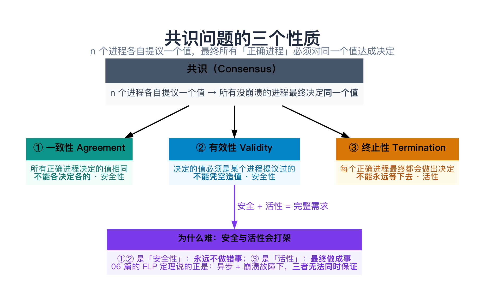
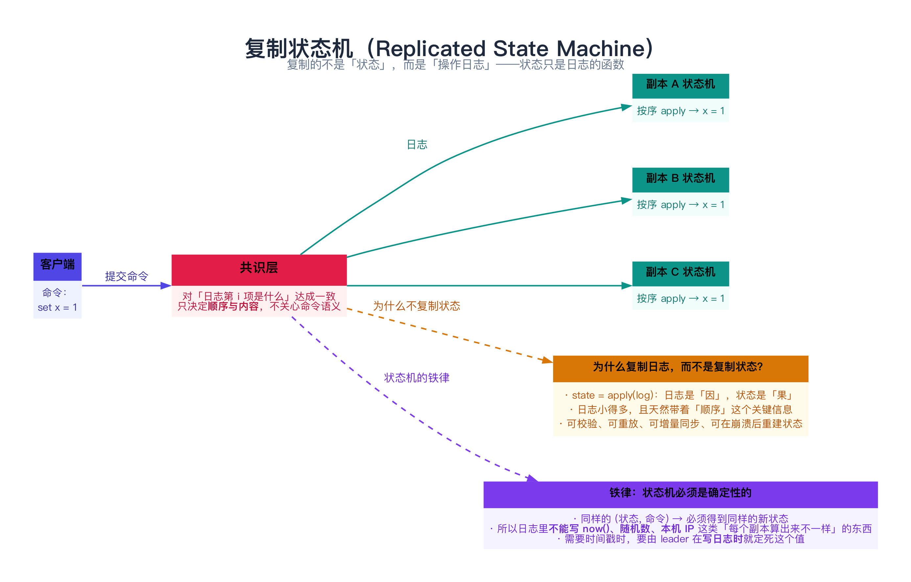
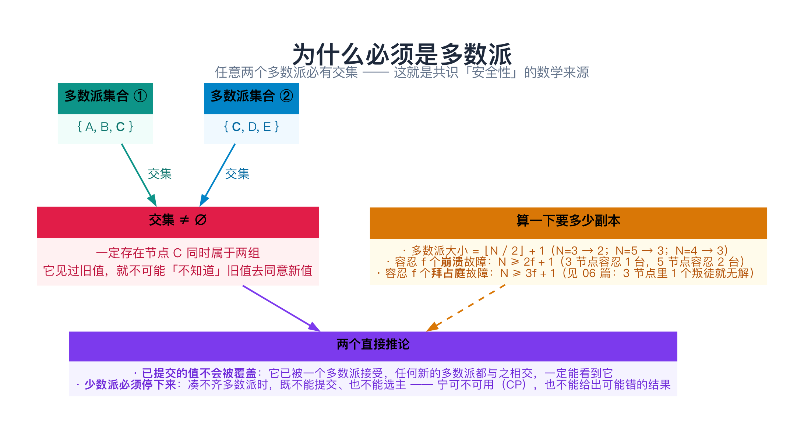
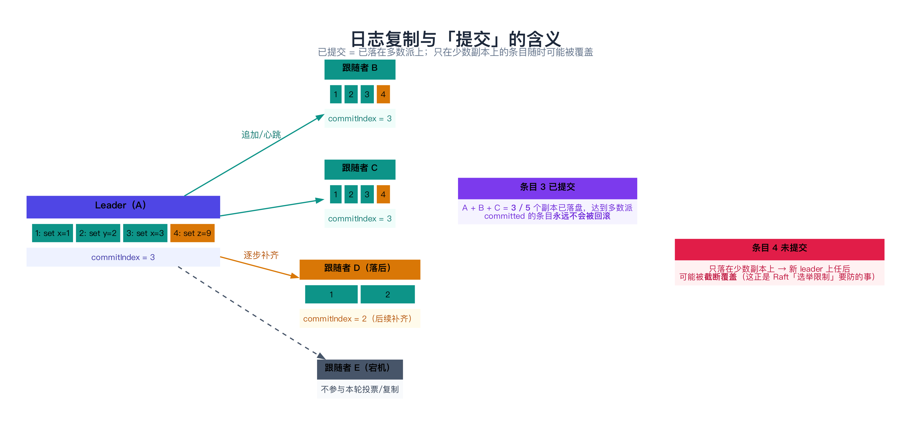
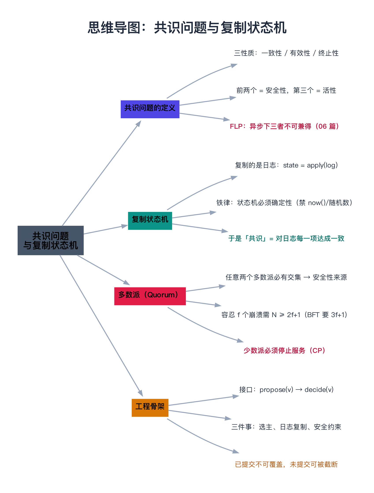

# 共识问题与复制状态机

> 一句话：**共识（consensus）** 是「n 个进程对同一个值达成一致」这个问题，它要同时满足**一致性、有效性、终止性**三个性质；而**复制状态机（RSM）** 是把共识落地成可用系统的通用套路——**把「对状态达成一致」转化为「对一串操作日志的顺序达成一致」**。理解了这两件事，Paxos / Raft 就不再是一堆零散的规则，而是同一个问题的两种解法。

---

## 目录

1. [共识问题：到底在解决什么](#1-共识问题到底在解决什么)
   - [1.1 先从一个小场景说起](#11-先从一个小场景说起)
   - [1.2 形式化：三个性质](#12-形式化三个性质)
   - [1.3 安全性与活性](#13-安全性与活性)
2. [复制状态机：共识的落地形态](#2-复制状态机共识的落地形态)
   - [2.1 类比：三台计算器算同一串操作](#21-类比三台计算器算同一串操作)
   - [2.2 为什么复制「日志」而不是「状态」](#22-为什么复制日志而不是状态)
   - [2.3 铁律：状态机必须确定性](#23-铁律状态机必须确定性)
   - [2.4 于是共识 = 对「日志每一项」达成一致](#24-于是共识-对日志每一项达成一致)
3. [为什么必须是多数派](#3-为什么必须是多数派)
   - [3.1 交集：安全性的数学来源](#31-交集安全性的数学来源)
   - [3.2 2f+1 与 3f+1](#32-2f1-与-3f1)
   - [3.3 少数派必须停下来](#33-少数派必须停下来)
4. [动手：一个最小的复制状态机（C++）](#4-动手一个最小的复制状态机c)
   - [4.1 代码](#41-代码)
   - [4.2 运行结果与解读](#42-运行结果与解读)
   - [4.3 从骨架到 Paxos / Raft 还差什么](#43-从骨架到-paxos-raft-还差什么)
5. [常见误解与坑](#5-常见误解与坑)
6. [总结](#6-总结)
7. [延伸阅读](#7-延伸阅读)
8. [思维导图总结](#8-思维导图总结)

---

## 1. 共识问题：到底在解决什么

上一篇（06）讲了两个坏消息：**异步系统里「一定终止」做不到（FLP）**、**节点会撒谎时开销翻三倍（拜占庭）**。既然这么难，那「共识」这个问题本身到底长什么样？先把它精确定义出来——**定义不清，后面的 Paxos / Raft 就只能靠背**。

### 1.1 先从一个小场景说起

假设有 5 台机器，每台都维护一份「当前主节点是谁」的配置。某天原来的主节点挂了，5 台机器各自提议一个候选人：

```text
A 说：主节点应该是 A
B 说：主节点应该是 C
C 说：主节点应该是 C
D 说：主节点应该是 C
E 说：主节点应该是 A
```

我们希望最终的结果是：

- **所有还活着的机器，最后认为的主节点是同一个**（不能 A 以为是自己、B 以为还是老主）；
- 而且这个结果**必须是有人真的提议过的**（不能商量出个谁都没提名过的 F）；
- 而且**要在有限时间内给出结果**（不能永远僵在那里）。

这三条，就是共识问题的三个性质。

### 1.2 形式化：三个性质

一个共识算法要解决的问题可以写成：**n 个进程各自提议（propose）一个值，算法最终让所有「正确进程」决定（decide）某个值**，并且满足：

| 性质 | 含义 | 违反它会怎样 |
|------|------|--------------|
| **① 一致性（Agreement）** | 所有正确进程决定的值**相同** | 两台机器认为的主节点不同 → 出现双主、数据分裂 |
| **② 有效性（Validity）** | 决定的值必须是**某个进程提议过的** | 凭空造出一个没人提过的值 → 结果不可解释、可能违反业务约束 |
| **③ 终止性（Termination）** | 每个正确进程**最终都会**做出决定 | 永远僵持不决 → 系统不可用 |

> 有些教材还会列出第四条 **完整性（Integrity）**：一个进程**最多决定一次**，且决定后不再改口。它通常被并入 ①② 一起讨论，本文不单独展开。



### 1.3 安全性与活性

这三个性质不是并列关系，而是分成两类——**这个分类是理解一切共识算法的钥匙**：

| 类别 | 包含 | 一句话 | 违反的后果 |
|------|------|--------|-----------|
| **安全性（Safety）** | ① 一致性、② 有效性 | **永远不做错事** | 一旦违反，**已经发生的错误无法撤销**（双主已经把数据写花了） |
| **活性（Liveness）** | ③ 终止性 | **最终能做成事** | 违反只是「暂时不可用」，等网络恢复还能继续 |

为什么这个区分重要？因为它决定了工程上的取舍方向：

> **安全性绝对不能破，活性可以妥协。**

现实系统（Raft、ZooKeeper、etcd）在网络分区时宁可**停止服务**（牺牲活性），也绝不返回一个可能错误的结果（牺牲安全性）。这就是 03 篇 CAP 里说的 **CP 选择**。

而 06 篇的 FLP 定理说的正是：在**纯异步 + 崩溃故障**下，**安全和活性无法同时保证**。所以现实系统都引入「部分同步」假设（选举超时、心跳超时），用「大概率终止」换「绝对安全」。

---

## 2. 复制状态机：共识的落地形态

定义清楚了，下一个问题是：**光对一个值达成一致，能干什么？** 比如「主节点是谁」是选出来了，但业务数据怎么办？答案是**复制状态机**——这是分布式系统里最优雅的一个抽象。

### 2.1 类比：三台计算器算同一串操作

想象你面前有 3 台**完全相同**的计算器，初始都是 0。你在每台上面**按完全相同的顺序**按同一串键：

```text
第 1 步：+5     → 三台都显示 5
第 2 步：×2     → 三台都显示 10
第 3 步：-3     → 三台都显示 7
```

只要**起点相同、操作序列相同、顺序相同**，三台计算器的显示**一定永远相同**——哪怕中间某台断电过，通电后把漏掉的按键补上就行。

这就是复制状态机的全部内容：

> **复制状态机 = 起始状态相同 + 按相同顺序执行相同的命令 → 所有副本状态必然一致。**



### 2.2 为什么复制「日志」而不是「状态」

既然目标是「状态一致」，为什么不直接把状态复制过去（每做一次修改就把整份数据发给其他机器）？

因为**日志是更好的复制单位**：

| 维度 | 复制状态 | 复制日志（操作） |
|------|----------|------------------|
| 数据量 | 全量，状态越大越笨重 | 增量，一条命令通常几十字节 |
| 顺序信息 | **丢失**（「x=3」这个结果本身不含顺序） | **天然携带**（日志的第几项就是顺序） |
| 冲突处理 | 两个状态不同时，无法判断谁对 | 两条日志不一致时，可以精确定位到**哪一项**开始分叉并截断重放 |
| 恢复能力 | 只能拿到最后一刻的快照 | 可以重放、可以增量补齐、可以校验 |

一句话记牢：

> **state = apply(log)**。日志是「因」，状态是「果」。复制的成本花在「因」上，远比重传「果」划算。

这也解释了一个工程常识：Raft / etcd / Kafka 这些系统里，**日志才是唯一真相（source of truth）**，状态机（内存里的 map、B+ 树）只是日志的一个缓存，崩了重放即可。

### 2.3 铁律：状态机必须确定性

复制日志能成立，靠的是一个隐含前提：

> **确定性（deterministic）**：同一个状态 + 同一条命令，必须永远得到同一个新状态。

一旦不满足，副本就会**算出不同的结果**，日志相同也救不了。所以**日志里绝对不能出现「每个副本算出来不一样」的东西**：

- ❌ `now()`——各机器时钟不同，写进命令就是灾难；
- ❌ 随机数、`rand()`——每个副本取到的值不同；
- ❌ 本机 IP、进程号、本地文件路径；
- ❌ map 的遍历顺序（不同实现/不同插入历史下顺序可能不同）。

正确的做法是：**需要这些「不确定值」时，由 leader 在写日志之前就把它们定死，作为命令的一部分写进日志**。比如「给这条记录打时间戳」，应该是：

```text
❌ 日志里写： SET ts = now()          // 每个副本自己取 now()，结果不同
✅ 日志里写： SET ts = 1735689600     // leader 取一次，把具体数值写进日志
```

### 2.4 于是共识 = 对「日志每一项」达成一致

现在把两件事接起来：

- 复制状态机要求：**所有副本执行同一个日志**（内容相同、顺序相同）；
- 共识算法提供的正是：**让一群机器对某个值达成一致**。

所以只要**把「日志的第 i 项是什么」当成要共识的那个值**，跑一次共识决定一项，循环下去——就得到了一个「**复制日志**」：

```text
日志索引:   1          2          3          4
共识决定:  "set x=1"  "set y=2"  "del z"    "set x=3"
             ↑ 第 1 次共识  ↑ 第 2 次     ↑ 第 3 次  ↑ 第 4 次
```

这个「对一串值逐个达成一致」的问题，叫 **multi-decree consensus（多轮共识）**；只决定一次的叫 **single-decree consensus（单轮共识）**。Paxos 原文先解决单轮（Synod），再扩展到多轮（Multi-Paxos）；Raft 则直接从「复制日志」这个整体出发。

> **顺带一个等价结论**：在崩溃故障模型下，「共识」与「原子广播（Atomic Broadcast / 全序广播）」是**可互相归约**的——能实现全序广播就能实现共识，反之亦然。所以当你看到「全序广播」「复制日志」「共识」时，说的基本上是同一件事的不同侧面。

---

## 3. 为什么必须是多数派

不管 Paxos 还是 Raft，都有一条绕不开的规则：**决议必须得到「多数派」的同意**。为什么不是「全体一致同意」（那样任何一个节点挂了就瘫痪），也不是「随便几个节点同意就行」？

### 3.1 交集：安全性的数学来源

关键在**交集**性质：

> **任意两个多数派，必然至少有一个共同的节点。**

以 5 个节点为例，多数派大小是 3，任取两组：

```text
多数派 ① = { A, B, C }
多数派 ② = { C, D, E }
              ↑
           交集非空：C 同时在两组里
```

这个「必有交集」直接推出了共识最重要的安全性质：

> **一个值一旦被多数派接受（提交），就不可能被另一组多数派覆盖。**

因为任何新的一组多数派里，**至少有一个节点见过旧值**，它不会（也不允许）同意一个与之冲突的新值。这就是「已提交的条目永远不回滚」的数学依据。



如果不要求多数派，比如「任意 2 个节点同意就算数」，那么：

```text
决议 ① = { A, B }       决议 ② = { C, D }       交集 = ∅
```

两组决议可以同时存在、互相冲突——系统立刻分裂。**多数派的作用，就是用数学强制「新旧决议必然相关」。**

### 3.2 2f+1 与 3f+1

由此得到两个必须记住的公式：

| 故障类型 | 需要多少节点 | 例子 | 出处 |
|----------|--------------|------|------|
| **崩溃故障（CFT）** | **N = 2f + 1** | 容忍 1 台挂 → 3 节点（票数 2）；容忍 2 台挂 → 5 节点（票数 3） | Paxos / Raft / ZooKeeper |
| **拜占庭故障（BFT）** | **N = 3f + 1** | 容忍 1 个叛徒 → 4 节点 | PBFT / 区块链（见 06 篇） |

为什么 CFT 是 2f+1？因为要保证「**剩下的节点仍能凑出多数派**」：N 个节点里有 f 个挂了，剩下 N-f 个，必须仍然大于 N/2：

```text
N - f > N/2   →   N > 2f   →   N ≥ 2f + 1
```

一个常被忽略的推论：**偶数节点没有意义**。

| 节点数 | 多数派票数 | 能容忍几台挂 | 结论 |
|--------|-----------|--------------|------|
| 3 | 2 | 1 | ✅ 最省的容错配置 |
| 4 | 3 | **也是 1** | ❌ 多花一台机器，容错没提升 |
| 5 | 3 | 2 | ✅ |

4 个节点要 3 票，挂 2 台就只剩 2 票——容错能力和 3 节点**完全一样**。所以生产上推荐 **3、5、7** 这种奇数。

### 3.3 少数派必须停下来

多数派规则还有另一面，很多人第一次遇到会困惑：**网络分区后，少数派那一侧的节点为什么「什么都不干」？**

因为它凑不齐多数派：

- **不能提交新决议**——票不够，提交了就不安全；
- **不能选出新主**——票不够，选出来的主没有合法性；
- **只能等**——等网络恢复，或者被多数派一侧的 leader 通过日志复制追平。

这就是 CP 系统在分区时的典型表现：

> **少数派一侧拒绝服务（牺牲活性），多数派一侧继续工作（保住安全性 + 活性）。**

如果业务不能接受「少数派不可用」，那它就**不该用共识系统**——而应该选择 AP 路线（无主复制 + 最终一致，如 Dynamo / Cassandra），代价是所有冲突都得在应用层自己解决。这个取舍在 03 篇 CAP、后面的 [21 数据复制与一致性](../04-数据与存储/21-数据复制与一致性.md) 里还会展开。

---

## 4. 动手：一个最小的复制状态机（C++）

理论讲完了，用一个约 130 行的程序把上面所有概念跑一遍：**5 个副本、多数派提交、网络分区、少数派停止、多数派换主、未提交条目被截断**。

### 4.1 代码

```cpp
// 一个最小的「复制状态机 + 多数派提交」模拟：5 个副本，看提交、网络分区与换主。
// 编译：g++ -std=c++11 -Wall -Wextra -O2 -o rsm_demo rsm_demo.cpp
#include <iostream>
#include <string>
#include <utility>
#include <vector>

struct Entry {
    int term;
    std::string cmd;
};

struct Replica {
    std::string name;
    std::vector<Entry> log;   // 本地日志（真实实现里必须先持久化，再回 ACK）
    int commitIndex;          // 已提交位置：>= 0 表示前 commitIndex+1 条已提交
    int group;                // 网络分区编号：0 = 同一张网，>0 = 被隔开的某一侧

    // C++11 里「带默认成员初始值的类」不再是聚合类型，不能写 Replica{...}，
    // 所以这里显式写构造函数（C++14 才放宽了这条限制）。
    explicit Replica(std::string n) : name(std::move(n)), commitIndex(-1), group(0) {}
};

class Cluster {
public:
    Cluster(std::initializer_list<std::string> names) : leader_(0), term_(1) {
        for (const auto& n : names) replicas_.emplace_back(n);
    }

    std::size_t quorum() const { return replicas_.size() / 2 + 1; }   // 多数派大小

    // 把集群切成两组，模拟网络分区
    void partition(std::initializer_list<std::string> sideA, std::initializer_list<std::string> sideB) {
        setGroup(sideA, 1);
        setGroup(sideB, 2);
    }
    void heal() { for (auto& r : replicas_) r.group = 0; }

    // leader 追加一条命令：消息只能到达「与 leader 同分区」的副本
    bool append(const std::string& cmd) {
        const int g = replicas_[leader_].group;
        Entry e{term_, cmd};
        std::size_t acks = 0;
        for (auto& r : replicas_) {
            if (r.group != g) continue;          // 跨分区的消息到不了
            r.log.push_back(e);                  // 简化：真实实现要先做日志一致性检查
            ++acks;
        }
        std::cout << "  leader " << replicas_[leader_].name << " 追加 \"" << cmd << "\" → "
                  << acks << "/" << replicas_.size() << " 个副本落盘（提交需要 " << quorum() << "）\n";
        if (acks >= quorum()) {
            for (auto& r : replicas_)
                if (r.group == g) r.commitIndex = static_cast<int>(r.log.size()) - 1;
            std::cout << "  ✓ 达到多数派 → 条目已提交\n";
            return true;
        }
        std::cout << "  ✗ 凑不齐多数派 → 条目【未提交】，随时可能被新 leader 覆盖\n";
        return false;
    }

    // 在指定分区里选主：候选人日志必须最全（Raft「选举限制」的简化版）
    bool electLeaderIn(int group) {
        int best = -1;
        std::size_t n = 0;
        for (std::size_t i = 0; i < replicas_.size(); ++i) {
            if (replicas_[i].group != group) continue;
            ++n;
            if (best < 0 || replicas_[i].log.size() > replicas_[best].log.size())
                best = static_cast<int>(i);
        }
        if (best < 0 || n < quorum()) {
            std::cout << "  分区 " << group << " 只有 " << n << " 个节点（少于 " << quorum()
                      << "），选不出 leader\n";
            return false;
        }
        leader_ = best;
        ++term_;
        std::cout << "  分区 " << group << " 选出新 leader = " << replicas_[best].name
                  << "（任期 " << term_ << "，日志长度 " << replicas_[best].log.size() << "）\n";
        return true;
    }

    // leader 把日志对齐到同分区的所有副本：不一致的后缀一律截断（会丢掉未提交条目）
    void replicate() {
        const Replica& L = replicas_[leader_];
        for (auto& r : replicas_) {
            if (r.group != L.group || r.name == L.name) continue;
            std::size_t i = 0;
            while (i < r.log.size() && i < L.log.size() && r.log[i].cmd == L.log[i].cmd) ++i;
            if (i < r.log.size()) {
                std::cout << "  " << r.name << " 截断未提交的日志后缀（第 " << i + 1 << " 条起）\n";
                r.log.resize(i);
            }
            while (r.log.size() < L.log.size()) r.log.push_back(L.log[r.log.size()]);
            r.commitIndex = L.commitIndex;
        }
    }

    void printLogs(const std::string& title) const {
        std::cout << "  " << title << "\n";
        for (const auto& r : replicas_) {
            std::cout << "    " << r.name << " [";
            for (std::size_t i = 0; i < r.log.size(); ++i) {
                if (i) std::cout << " | ";
                std::cout << i + 1 << ":" << r.log[i].cmd
                          << (static_cast<int>(i) <= r.commitIndex ? "(已提交)" : "(未提交)");
            }
            std::cout << "]\n";
        }
    }

private:
    void setGroup(std::initializer_list<std::string> names, int g) {
        for (auto& r : replicas_)
            for (const auto& n : names)
                if (r.name == n) r.group = g;
    }

    std::vector<Replica> replicas_;
    int leader_;
    int term_;
};

int main() {
    Cluster c{"A", "B", "C", "D", "E"};
    std::cout << "5 副本，多数派 = " << c.quorum() << "\n\n";

    std::cout << "① 正常情况：leader A 连续提交两条命令\n";
    c.append("set x = 1");
    c.append("set y = 2");
    c.printLogs("此刻各副本日志：");

    std::cout << "\n② 网络分区：{A, B} 在一侧，{C, D, E} 在另一侧\n";
    c.partition({"A", "B"}, {"C", "D", "E"});
    c.append("set x = 999");          // A 这边只有 2 台，凑不齐多数派
    c.printLogs("分区后（A、B 上多了一条未提交的 999）：");

    std::cout << "\n③ 多数派一侧（C、D、E）选出新 leader 并继续提交\n";
    if (c.electLeaderIn(2)) {
        c.replicate();
        c.append("set x = 3");
    }
    c.printLogs("新 leader 提交之后：");

    std::cout << "\n④ 分区恢复，新 leader 把日志推给落后的 A、B\n";
    c.heal();
    c.replicate();
    c.printLogs("最终各副本日志：");

    std::cout << "\n结论：已提交的条目 1、2 从未丢失；A 本地那条未提交的 999 被截断覆盖。\n";
    return 0;
}
```

### 4.2 运行结果与解读

```text
5 副本，多数派 = 3

① 正常情况：leader A 连续提交两条命令
  leader A 追加 "set x = 1" → 5/5 个副本落盘（提交需要 3）
  ✓ 达到多数派 → 条目已提交
  leader A 追加 "set y = 2" → 5/5 个副本落盘（提交需要 3）
  ✓ 达到多数派 → 条目已提交
  此刻各副本日志：
    A [1:set x = 1(已提交) | 2:set y = 2(已提交)]
    B [1:set x = 1(已提交) | 2:set y = 2(已提交)]
    C [1:set x = 1(已提交) | 2:set y = 2(已提交)]
    D [1:set x = 1(已提交) | 2:set y = 2(已提交)]
    E [1:set x = 1(已提交) | 2:set y = 2(已提交)]

② 网络分区：{A, B} 在一侧，{C, D, E} 在另一侧
  leader A 追加 "set x = 999" → 2/5 个副本落盘（提交需要 3）
  ✗ 凑不齐多数派 → 条目【未提交】，随时可能被新 leader 覆盖
  分区后（A、B 上多了一条未提交的 999）：
    A [1:set x = 1(已提交) | 2:set y = 2(已提交) | 3:set x = 999(未提交)]
    B [1:set x = 1(已提交) | 2:set y = 2(已提交) | 3:set x = 999(未提交)]
    C [1:set x = 1(已提交) | 2:set y = 2(已提交)]
    D [1:set x = 1(已提交) | 2:set y = 2(已提交)]
    E [1:set x = 1(已提交) | 2:set y = 2(已提交)]

③ 多数派一侧（C、D、E）选出新 leader 并继续提交
  分区 2 选出新 leader = C（任期 2，日志长度 2）
  leader C 追加 "set x = 3" → 3/5 个副本落盘（提交需要 3）
  ✓ 达到多数派 → 条目已提交
  新 leader 提交之后：
    A [1:set x = 1(已提交) | 2:set y = 2(已提交) | 3:set x = 999(未提交)]
    B [1:set x = 1(已提交) | 2:set y = 2(已提交) | 3:set x = 999(未提交)]
    C [1:set x = 1(已提交) | 2:set y = 2(已提交) | 3:set x = 3(已提交)]
    D [1:set x = 1(已提交) | 2:set y = 2(已提交) | 3:set x = 3(已提交)]
    E [1:set x = 1(已提交) | 2:set y = 2(已提交) | 3:set x = 3(已提交)]

④ 分区恢复，新 leader 把日志推给落后的 A、B
  A 截断未提交的日志后缀（第 3 条起）
  B 截断未提交的日志后缀（第 3 条起）
  最终各副本日志：
    A [1:set x = 1(已提交) | 2:set y = 2(已提交) | 3:set x = 3(已提交)]
    B [1:set x = 1(已提交) | 2:set y = 2(已提交) | 3:set x = 3(已提交)]
    C [1:set x = 1(已提交) | 2:set y = 2(已提交) | 3:set x = 3(已提交)]
    D [1:set x = 1(已提交) | 2:set y = 2(已提交) | 3:set x = 3(已提交)]
    E [1:set x = 1(已提交) | 2:set y = 2(已提交) | 3:set x = 3(已提交)]

结论：已提交的条目 1、2 从未丢失；A 本地那条未提交的 999 被截断覆盖。
```

对照本文的概念，逐条看这个输出：

| 输出片段 | 印证了哪条原理 |
|----------|----------------|
| ① `5/5 落盘 → 提交` | **多数派**：5 个全到，当然 ≥ 3，提交 |
| ② `2/5 落盘 → 未提交` | **少数派必须停下来**：A、B 一侧只有 2 票，凑不齐 3 票 |
| ② A、B 日志里出现 `(未提交)` 的 999 | **未提交 ≠ 已生效**：它只是 leader 本地的意向，随时可能被覆盖 |
| ③ `选出新 leader = C（日志长度 2）` | **选举限制**：C 的日志不比任何多数派成员短，所以它有资格当主 |
| ③ `3/5 落盘 → 提交` | 多数派一侧**活性没有受影响**，继续对外服务 |
| ④ `A、B 截断未提交的后缀` | **已提交不可覆盖、未提交可被截断**——这就是日志复制的一致性检查 |
| ④ 五个副本最终完全一致 | **复制状态机**：相同日志 → 相同状态 |



### 4.3 从骨架到 Paxos / Raft 还差什么

上面这 130 行把「骨架」搭出来了，但离能上生产还差**几类关键机制**——这也正好解释了为什么真实算法看起来那么复杂：

| 缺什么 | 真实算法怎么做 | 不做的后果 |
|--------|----------------|------------|
| **日志一致性检查** | `AppendEntries` 带 `prevLogIndex` / `prevLogTerm`，对不上就回退，逐次往前找分叉点 | 上图我用「逐条比 cmd」简化了；真实场景必须用「任期 + 索引」定位，因为不同任期的相同命令也要区分 |
| **选举限制（election restriction）** | 投票时检查「我的日志至少和你一样新」，否则拒票 | 不加这条，一个日志落后的节点可能当上 leader，把已提交的条目覆盖掉 |
| **提交规则的限制** | Raft 规定：leader **只能通过提交「当前任期的条目」来间接提交旧任期条目**（Figure 8 问题） | 直接按「多数派有就算提交」会误提交只存在于少数节点上的旧条目 |
| **持久化** | `currentTerm` / `votedFor` / `log[]` 必须在**回 ACK 之前**落盘（fsync） | 崩溃重启后可能重复投票 → 一个任期选出两个主 → 安全性直接破 |
| **快照与日志压缩** | 日志不能无限长，定期做快照，截断旧日志 | 内存/磁盘无限增长；重启要重放几百万条日志 |
| **成员变更** | 用 joint consensus 或单节点变更，保证变更期间不会出现两个多数派 | 动态扩缩容时出现「双多数派」，可能选出两个主 |
| **客户端会话 / 去重** | 请求带唯一 ID + 会话表，重复请求只执行一次 | 客户端超时重试导致命令被执行两次（幂等性问题，见 [38 分布式设计模式](../06-服务治理/38-分布式设计模式（幂等、重试、超时）.md)） |

所以：

> **Paxos / Raft 并不神秘——它们就是在「共识三性质 + 多数派 + 复制状态机」这套骨架外面，补齐了上面这些工程约束。**

下一章（[08 Paxos 算法](../02-共识算法/08-Paxos算法.md)）先看 Paxos 怎么用最少的假设解决**单轮共识**，再看它怎么扩展成 Multi-Paxos；之后 Raft 篇会把这些约束一条条讲清楚。

---

## 5. 常见误解与坑

**① 把「共识」和「一致性模型」混为一谈**

- **共识**是一个**协议问题**：一群机器怎么对一个值达成一致。
- **线性一致性（linearizability）**是一个**对外语义**：并发操作看起来像在某个瞬间按顺序发生。

它们的关系是：**共识常被用来实现线性一致**（比如 Raft 让 etcd 提供线性一致的读写），但「达成共识」本身不等于「对外表现为线性一致」——中间还差「读也要走一遍共识/租约」这类设计。

**② 以为多数派就等于「所有人都同步了」**

不是。**多数派只需保证「能凑够票」**，落后的少数副本可以慢慢追。所以：

- 写延迟由**第 ⌈(N+1)/2⌉ 快**的那个副本决定，而不是最慢的；
- `N=5` 时允许 2 个副本落后/宕机而不影响可用性；
- 监控上要看的是 **`commitIndex` 的差距**（replication lag），而不是「是否全部一致」。

**③ 用偶数节点「提高可靠性」**

见 3.2 节：4 个节点的容错能力和 3 个一样（都只能挂 1 台），却多花一台机器、多一份网络开销。**要奇数**。

**④ 认为「共识 = 区块链」**

区块链用的是**拜占庭容错共识**（PBFT / HotStuff / PoW），针对的是「节点不可信」。绝大多数内部系统用的是**崩溃容错共识**（Paxos / Raft），它们**完全不能防作恶**——一个被攻陷的节点可以随意伪造日志。所以「我们用 Raft，所以很安全」是个危险的误解。

**⑤ 在需要 AP 的场景硬上共识**

共识系统在分区时**少数派必然不可用**。如果你的业务是「全球多写、允许冲突、最终一致」（比如购物车、社交动态），硬上 Raft 只会得到一堆跨机房选举和延迟。那种场景该用无主复制 + 冲突解决（CRDT / LWW），见 [18 CRDT 与无冲突复制数据类型](../03-协调、事务与一致性/18-CRDT与无冲突复制数据类型.md)、[21 数据复制与一致性](../04-数据与存储/21-数据复制与一致性.md)。

**⑥ 忽略「状态机确定性」这条铁律**

把 `now()`、`uuid()`、`rand()` 直接写进日志，是复制状态机最经典的翻车方式。测试环境往往看不出来（机器时钟一致、流量小），上线后一旦出现毫秒级时钟漂移，副本状态就会**永久分叉**——而且很难定位，因为日志看起来「完全一样」。

---

## 6. 总结

| 概念 | 一句话 | 关键点 |
|------|--------|--------|
| **共识三性质** | 一致性 + 有效性 + 终止性 | 前两个是安全性（不能错），第三个是活性（不能停） |
| **安全性 vs 活性** | 宁可停，不能错 | 分区时少数派停止服务（CP） |
| **复制状态机** | `state = apply(log)` | 复制日志而非状态；状态机必须确定性 |
| **多轮共识** | 对日志每一项共识一次 | Paxos / Raft 都是这么干的 |
| **多数派** | 任意两个多数派必有交集 | 已提交的值不会被覆盖；`N ≥ 2f+1`（BFT 是 `3f+1`） |
| **未提交 ≠ 已生效** | 只在少数副本上的条目随时可能被截断 | 所以客户端要等「提交确认」再认为写成功 |

**记住三句话**：

1. **共识 = 一组机器对同一个值达成一致**；它必须在「不能出错（安全）」和「不能停摆（活性）」之间做取舍，而现实系统一律**保安全、让活性**。
2. **复制状态机是共识的落地形态**：把「状态一致」转化为「日志一致」，`state = apply(log)`；能不能这样做，取决于状态机是否**确定性**。
3. **多数派不是拍脑袋的规定**，而是「任意两个多数派必有交集」这条数学性质的工程化——它就是「已提交永不回滚」的全部理由。

下一章进入 [08 Paxos 算法](../02-共识算法/08-Paxos算法.md)，看这个「难到出了名」的算法，是怎么用最朴素的假设把单轮共识解出来的。

---

## 7. 延伸阅读

- **原始论文**：Leslie Lamport, *The Part-Time Parliament*（1998）与 *Paxos Made Simple*（2001）——Paxos 的原始版与通俗版。
- **Raft 论文**：Diego Ongaro & John Ousterhout, *In Search of an Understandable Consensus Algorithm*（USENIX ATC 2014）；Ongaro 的博士论文 *Consensus: Bridging Theory and Practice* 把成员变更、快照讲得最细。另有 [raft.github.io](https://raft.github.io/) 的可视化演示。
- **复制状态机**：Fred Schneider, *Implementing Fault-Tolerant Services Using the State Machine Approach*（1990）——RSM 的经典论文。
- **共识与原子广播的等价性**：Vassos Hadzilacos & Sam Toueg, *Fault-Tolerant Broadcasts and Related Problems*（1994）。
- **教材**：Cachin, Guerraoui & Rodrigues, *Introduction to Reliable and Secure Distributed Programming*（共识、原子广播、BFT 的体系化推导）；《数据密集型应用系统设计》（DDIA）第 9 章「一致性与共识」是很好的工程视角补充。
- **课程**：MIT 6.824 *Distributed Systems*——Lab 2 就是手写 Raft，做完这篇的所有概念都会变成肌肉记忆。
- **验证**：Jepsen 的系列报告（见 [54 一致性验证](../08-可观测性与工程保障/54-一致性验证（Jepsen与线性一致性测试）.md)）——看真实系统在分区下栽过哪些跟头。

---

## 8. 思维导图总结

```text
共识问题与复制状态机
├── 共识问题的定义
│   ├── 三性质：一致性 Agreement / 有效性 Validity / 终止性 Termination
│   ├── 前两个是安全性（永远不做错事），第三个是活性（最终做成事）
│   └── FLP：异步 + 崩溃故障下三者不可兼得（06 篇）
├── 复制状态机（RSM）
│   ├── 复制的是日志：state = apply(log)，日志是因、状态是果
│   ├── 铁律：状态机必须确定性（日志里禁止 now()/随机数/本机信息）
│   └── 于是「共识」= 对日志第 i 项达成一致（多轮共识）
├── 多数派（Quorum）
│   ├── 任意两个多数派必有交集 → 已提交的值不可能被覆盖
│   ├── 容忍 f 个崩溃需 N ≥ 2f+1；拜占庭需 N ≥ 3f+1；偶数节点无意义
│   └── 少数派必须停下来（CP）：宁可不可用，也不给错结果
└── 工程骨架
    ├── 接口：propose(v) → decide(v)；循环决定每一项
    ├── 三件核心事：选主、日志复制、安全约束（选举限制 + 提交规则）
    └── 已提交不可覆盖，未提交可被截断；持久化必须在回 ACK 之前
```


