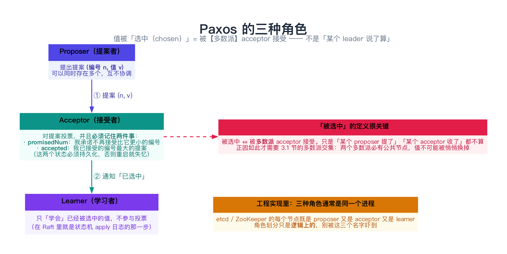
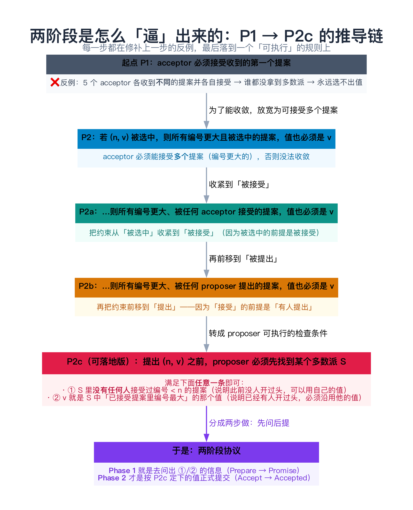
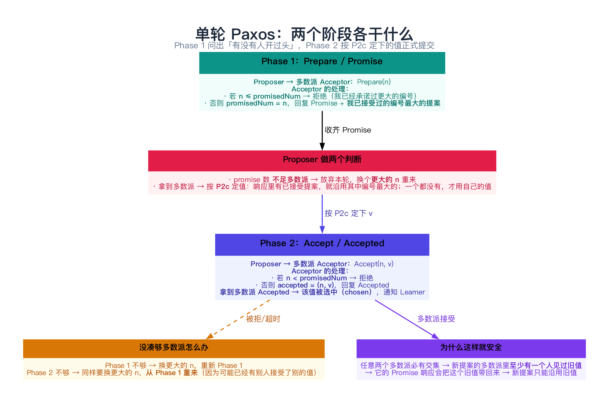
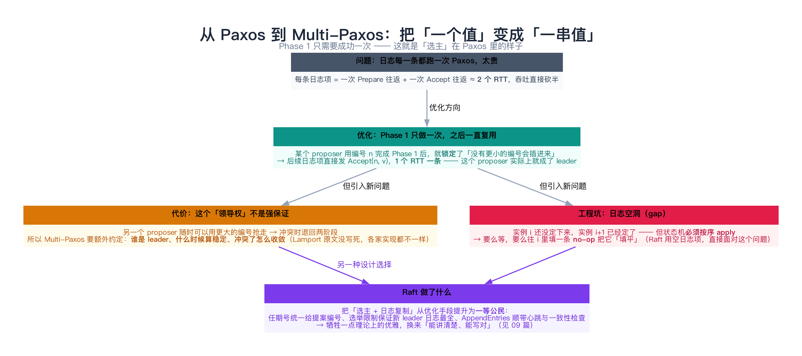
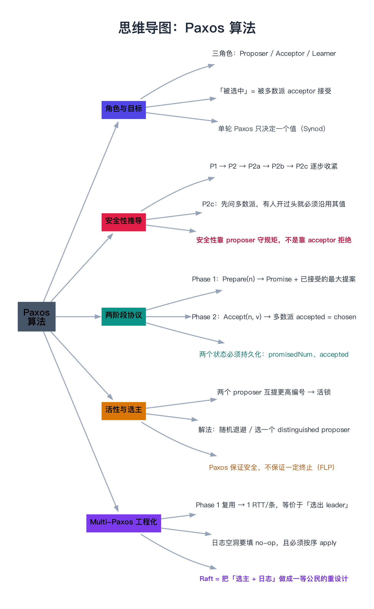

# Paxos 算法

> 一句话：Paxos 用**最弱的假设**（不需要 leader、不需要全局时钟、不需要同步网络）解决**单个值的共识**；它的安全性只依赖三件事——**多数派、提案编号单调递增、以及 proposer 提出前必须先问一遍（P2c）**。而「难懂」主要来自它几乎不说话的那部分：**Multi-Paxos 怎么选主、日志空洞怎么填**——那才是工程实现的真正战场。

---

## 目录

1. [先搞清楚 Paxos 解决什么问题](#1-先搞清楚-paxos-解决什么问题)
   - [1.1 三个角色](#11-三个角色)
   - [1.2 「被选中」的严格含义](#12-被选中的严格含义)
   - [1.3 为什么不能「直接投票」](#13-为什么不能直接投票)
2. [单轮 Paxos 的推导：P1 → P2c](#2-单轮-paxos-的推导p1-p2c)
   - [2.1 P1 与它的反例](#21-p1-与它的反例)
   - [2.2 P2 → P2a → P2b：一步步收紧约束](#22-p2-p2a-p2b一步步收紧约束)
   - [2.3 P2c：终于变成一个可执行的规则](#23-p2c终于变成一个可执行的规则)
3. [两阶段协议](#3-两阶段协议)
   - [3.1 Phase 1：Prepare / Promise](#31-phase-1prepare-promise)
   - [3.2 Phase 2：Accept / Accepted](#32-phase-2accept-accepted)
   - [3.3 完整走一遍](#33-完整走一遍)
   - [3.4 为什么这样就安全](#34-为什么这样就安全)
4. [活性：Paxos 可能活锁](#4-活性paxos-可能活锁)
5. [动手：单轮 Paxos 的 C++ 模拟](#5-动手单轮-paxos-的-c-模拟)
   - [5.1 代码](#51-代码)
   - [5.2 运行结果与解读](#52-运行结果与解读)
6. [从 Paxos 到 Multi-Paxos](#6-从-paxos-到-multi-paxos)
   - [6.1 每条日志跑一次太贵](#61-每条日志跑一次太贵)
   - [6.2 Phase 1 复用 = 事实上的选主](#62-phase-1-复用-事实上的选主)
   - [6.3 日志空洞](#63-日志空洞)
   - [6.4 Paxos vs Raft：为什么 Raft 更好懂](#64-paxos-vs-raft为什么-raft-更好懂)
7. [常见误解与坑](#7-常见误解与坑)
8. [总结](#8-总结)
9. [延伸阅读](#9-延伸阅读)
10. [思维导图总结](#10-思维导图总结)

---

## 1. 先搞清楚 Paxos 解决什么问题

上一篇（[07 共识问题与复制状态机](../02-共识算法/07-共识问题与复制状态机.md)）把问题定义清楚了：**n 个进程各自提议一个值，最终所有正确进程决定同一个值**，并且要满足一致性、有效性、终止性。

**Paxos 解决的是这个问题的「单轮」版本**——只决定**一个**值。听起来不够用？恰恰相反：07 篇讲过，只要把「日志的第 i 项是什么」当成那个值，循环跑下去就是复制日志。所以单轮 Paxos 是地基，**Multi-Paxos 往上加的不是新算法，而是「怎么少跑几轮」的工程优化**。

### 1.1 三个角色

Paxos 里有三种逻辑角色（注意：**逻辑**角色，工程实现里一个进程通常同时扮演三种）：



| 角色 | 干什么 | 关键状态 |
|------|--------|----------|
| **Proposer（提案者）** | 提出提案 `(编号 n, 值 v)`，推动它被接受 | 自己的提案编号（必须全局唯一且单调递增） |
| **Acceptor（接受者）** | 对提案投票，并**记住**投过什么 | `promisedNum`（承诺不再接受更小的编号）、`accepted`（已接受的编号最大的提案） |
| **Learner（学习者）** | 学习已被选中的值，不参与投票 | 已学会的值 |

**两个状态必须持久化**——这是工程上最容易被忽略、后果最严重的一点：acceptor 一旦重启就"失忆"，它可能对同一个编号重复投票、或接受一个更小的编号，安全性直接破。etcd/Raft 里对应的是「`votedFor` 和 `log` 必须先 fsync 再回 ACK」。

### 1.2 「被选中」的严格含义

日常说法里，我们容易把下面几件事混为一谈，但 Paxos 里它们**完全不同**：

| 说法 | 含义 | 是否等于「定了」 |
|------|------|------------------|
| 某个 proposer **提出了** v | 只是有人喊了一嗓子 | ❌ 不算 |
| 某个 acceptor **接受了** v | 一个节点投了票 | ❌ 不算（少数派随时可能被覆盖，见 07 篇的模拟） |
| **多数派 acceptor 接受了 v** | 值被**选中（chosen）** | ✅ 这才算 |

> **记住这个定义**：`chosen ⇔ 被多数派接受`。后面所有的安全性论证，都建立在「任意两个多数派必有交集」这一条上。

### 1.3 为什么不能「直接投票」

最朴素的想法是：让所有 acceptor 对提案投票，过半就通过。问题在于**并发和超时**：

- 两个 proposer 同时提议，各自拉到一部分票，**都没过半**；
- 网络抖动导致部分投票"迟到"，你以为失败重试，其实对方已经在推进；
- 一旦有人提出新提案，**凭什么要求别人放弃已经投过的票**？

Paxos 的推导，就是**从一个最天真的规则开始，每次遇到反例就补一条约束**，最后逼出一个可执行的协议。下面这一节是全文最"硬"的部分，但也是最值得读的部分——**看懂推导，就不需要背协议**。

---

## 2. 单轮 Paxos 的推导：P1 → P2c



### 2.1 P1 与它的反例

最开始的想法（Lamport 称之为 **P1**）：

> **P1：一个 acceptor 必须接受它收到的第一个提案。**

这条规则保证"只要有人提，就一定有值被接受"。但它有个立刻能看出的反例：

```text
5 个 acceptor，两个 proposer 几乎同时提案（值不同）：
  A 接受了提案 (1, "X")
  B 接受了提案 (1, "X")
  C 接受了提案 (1, "Y")
  D 接受了提案 (1, "Y")
  E 接受了提案 (1, "Z")
→ 没有任何一个值拿到 3 票 → 谁都没被选中
```

**根因**：acceptor 只能接受一个提案（编号相同就更没法区分），大家各投各的，收不了口。

### 2.2 P2 → P2a → P2b：一步步收紧约束

修反例的方向是：**允许 acceptor 接受多个提案**（用编号区分），于是有了编号单调的玩法。但这立刻带来新风险——**会不会两个不同的值先后都被选中？** 于是有了目标性质 **P2**：

> **P2**：如果一个值为 v 的提案被选中，那么**所有编号更大且被选中**的提案，值也必须是 v。

P2 保证了「选中的值唯一」。但它不好直接执行（"被选中"是个结果，不是某个节点的动作）。于是往下钻两层：

> **P2a**：如果一个值为 v 的提案被选中，那么**所有编号更大、被任何 acceptor 接受**的提案，值也必须是 v。
>
> （因为"被选中"的前提是"被接受"，所以约束"被接受"就够强了。）

> **P2b**：如果一个值为 v 的提案被选中，那么**所有编号更大、被任何 proposer 提出**的提案，值也必须是 v。
>
> （同理，约束"被提出"更强——毕竟"接受"之前一定有人"提出"。）

**P2b 已经变成了对 proposer 的要求**：你提新提案前，得先确认"不会覆盖掉一个已经被选中的值"。

### 2.3 P2c：终于变成一个可执行的规则

怎么确认？P2b 太强、太模糊。Lamport 把它收紧成一个**可检查的条件**：

> **P2c**：对于一个要提出的提案 `(n, v)`，必须存在一个**多数派集合 S**，使得下面**任意一条**成立：
>
> - **①** S 中**没有任何 acceptor** 接受过编号小于 n 的提案；**或**
> - **②** v 是 S 中所有「编号小于 n 的、已被接受的提案」里**编号最大的那个**的**值**。

翻译成人话：

| 条件 | 含义 | proposer 该怎么办 |
|------|------|------------------|
| ① | 大家手里都是空的，之前没人开过头 | **可以用自己的值** |
| ② | 已经有人接受过某个值了 | **必须沿用那个值**（编号最大的那个） |

**这就是 Paxos 安全性的全部秘密**：如果你要提的编号 n 覆盖到了某个可能已被选中的值，那么"多数派的交集"保证你的 S 里一定有人见过它，而 P2c 强制你**沿用**它，于是**已选中的值永远不会被改掉**。

---

## 3. 两阶段协议

把 P2c 落地，就需要**先问一遍、再提一次**——这就是两阶段。



### 3.1 Phase 1：Prepare / Promise

```text
Proposer                              Acceptor
   │  ── Prepare(n) ──────────────▶   │
   │                                   │  若 n ≤ promisedNum → 拒绝（我承诺过更大的）
   │                                   │  否则 promisedNum = n（做出承诺）
   │  ◀── Promise(n) ───────────────   │
   │      + 我已接受过的编号最大的提案   │
```

两个细节别漏：

- **Prepare 的判定是 `n > promisedNum` 才答应**（严格大于）。这样编号相同、来自不同 proposer 的重复 Prepare 会被拒绝，避免"两个提案共用同一编号"的歧义。
- **Promise 的响应里必须带上「我已接受过的编号最大的提案」**——这正是 P2c 需要的输入。少了这个字段，协议就不安全（后面 5.2 节的反例会演示）。

### 3.2 Phase 2：Accept / Accepted

```text
Proposer                              Acceptor
   │  拿到多数派 Promise 后，按 P2c 定下 v
   │  ── Accept(n, v) ────────────▶   │
   │                                   │  若 n < promisedNum → 拒绝
   │                                   │  否则 accepted = (n, v)
   │  ◀── Accepted(n, v) ───────────   │
   │  拿到多数派 Accepted → v 被选中（chosen）→ 通知 Learner
```

失败重试的规则也要记准：

| 卡在哪 | 怎么办 |
|--------|--------|
| Promise 不够多数派 | 换一个**更大的编号** n，重新走 Phase 1 |
| Accept 不够多数派 | 同样要换更大的编号**从 Phase 1 重来**——不能直接重发 Accept，因为中途可能有别人接受了别的值 |

### 3.3 完整走一遍

假设 5 个 acceptor，多数派 = 3：

```text
① Proposer P1 用编号 1 提 "X"
   Phase 1：Prepare(1) → A~E 全部承诺（此前没人接受过任何提案）
   Phase 2：Accept(1, "X") → A、B、C 接受 → 拿到 3 票 = 多数派 → ✅ "X" 被选中
   （D、E 的 Accepted 还没到，但不影响结论）

② 此时 Proposer P2 想提 "Y"，用编号 2
   Phase 1：Prepare(2) → A~E 全部承诺，并汇报：
              A、B、C 说「我已接受过 (1, "X")」
   → P2 读到了 (1, "X")，按 P2c 规则②，它【必须】改提 "X"（不能用 "Y"！）
   Phase 2：Accept(2, "X") → 多数派接受 → ✅ 选中的仍然是 "X"

③ 结果：换人、换更大的编号，"X" 依然没被覆盖 —— 这就是 Paxos 的安全性
```

**注意第 ② 步**：P2 自己的意愿是 "Y"，但协议要求它放弃自己的值。这是 Paxos 最反直觉、也最关键的一点——**proposer 的"想法"不重要，协议要求它先读后写**。

### 3.4 为什么这样就安全

把 3.3 的推理抽象一下，安全性的证明其实只有三句话：

1. 一个值要被选中，必须被**多数派**接受；
2. 任意两个多数派**必有交集**（07 篇 3.1 节）；
3. 所以任何更大编号的提案，在 Phase 1 的多数派里**至少会碰到一个见过旧值的 acceptor**，P2c 强制它沿用旧值。

> 反过来记更清楚：**Paxos 的安全性依赖 proposer 遵守 P2c，而不是依赖 acceptor 拒绝。** acceptor 只看编号大小，它根本不关心值是什么。这一条在 5.2 节会被一个反例亲手验证。

---

## 4. 活性：Paxos 可能活锁

Paxos **保证安全，但不保证一定终止**——这正是 07 篇讲的 FLP 结论在具体算法上的体现。经典活锁场景：

```text
P1 用编号 1 走完 Phase 1，正要发 Accept
                                        P2 用编号 2 走完 Phase 1（P1 的 Promise 还没生效）
P1 的 Accept(1, ...) 被拒（对方已承诺 2），P1 换成编号 3 重新 Prepare
                                        P2 的 Accept(2, ...) 被拒，P2 换成编号 4 重新 Prepare
                    ↑↓ 两人永远在"提更高的编号"，永远走不到 Phase 2
```

**解法**（都是"打破对称"）：

| 做法 | 说明 | 谁在用 |
|------|------|--------|
| **选一个 distinguished proposer** | 约定同一时刻只有一个节点主动提案，其他节点不抢 | Multi-Paxos 的标准做法（也就是"选主"） |
| **随机退避** | 被拒后随机等一段时间再重试，降低编号"撞车"概率 | 简单实现、教学实现常用 |
| **编号里带节点 ID** | 用 `(轮次, 节点ID)` 组成编号，避免两个 proposer 生成相同编号 | 几乎所有工程实现 |

> **一句话**：Paxos 是"安全优先"的算法——它宁可停下来，也不会给出两个不同的决定。

---

## 5. 动手：单轮 Paxos 的 C++ 模拟

下面这个程序把 1~3 节的全部概念跑一遍，包括**那个最关键的"如果不守 P2c 会怎样"**。

### 5.1 代码

```cpp
// 单轮 Paxos（Synod）的最小模拟：5 个 acceptor。
// 演示两件事：
//   ① 一个值一旦被多数派接受（chosen），后续更高编号的提案必须沿用同一个值；
//   ② 如果 proposer 无视 Phase 1 读到的值（违反 P2c），安全性会被破坏。
// 编译：g++ -std=c++11 -Wall -Wextra -O2 -o paxos_demo paxos_demo.cpp
#include <iostream>
#include <string>
#include <utility>
#include <vector>

struct Proposal {
    int num;              // 提案编号：全局唯一、单调递增（工程上常用 (轮次, 节点ID) 组合）
    std::string value;
    Proposal() : num(0), value("(无)") {}
    Proposal(int n, std::string v) : num(n), value(std::move(v)) {}
};

struct Acceptor {
    std::string name;
    int promisedNum;      // 承诺：不再接受编号 < promisedNum 的提案
    Proposal accepted;    // 已接受的「编号最大」的提案

    explicit Acceptor(std::string n) : name(std::move(n)), promisedNum(0) {}

    // Phase 1：收到 Prepare(n)。返回 false = 拒绝；否则通过 highest 汇报自己已接受的最大提案
    bool onPrepare(int n, Proposal* highest) {
        if (n <= promisedNum) return false;   // 编号不够大，拒绝承诺
        promisedNum = n;
        *highest = accepted;
        return true;
    }

    // Phase 2：收到 Accept(n, v)。只要编号不小于承诺过的值就接受
    bool onAccept(int n, const std::string& v) {
        if (n < promisedNum) return false;
        accepted = Proposal(n, v);
        return true;
    }
};

class Cluster {
public:
    explicit Cluster(std::vector<std::string> names) {
        for (auto& n : names) acceptors_.emplace_back(n);
    }

    std::size_t quorum() const { return acceptors_.size() / 2 + 1; }

    // 跑一轮完整的 Paxos。honorP2c = false 用来演示「proposer 不守规矩」的后果
    bool propose(int num, const std::string& myValue, bool honorP2c = true) {
        std::cout << "  Proposer 发起 Prepare(n=" << num << ")，自己想提的值是 \"" << myValue << "\"\n";

        // ---------- Phase 1: Prepare / Promise ----------
        std::size_t promises = 0;
        Proposal highest;                     // 所有 promise 响应里编号最大的已接受提案
        for (auto& a : acceptors_) {
            Proposal h;
            if (a.onPrepare(num, &h)) {
                ++promises;
                std::cout << "    " << a.name << " 承诺不再接受 < " << num << " 的提案";
                if (h.num > 0) std::cout << "，并汇报：我已接受过 (" << h.num << ", " << h.value << ")";
                std::cout << "\n";
                if (h.num > highest.num) highest = h;
            } else {
                std::cout << "    " << a.name << " 拒绝（已承诺过不小于 " << num << " 的编号）\n";
            }
        }
        if (promises < quorum()) {
            std::cout << "  ✗ 只拿到 " << promises << " 个 promise（需要 " << quorum()
                      << "），本轮放弃，换个更大的编号重试\n";
            return false;
        }

        // ---------- P2c：决定本轮到底提什么值 ----------
        std::string value = myValue;
        if (highest.num > 0) {
            std::cout << "  → P2c 规则：已有 (" << highest.num << ", " << highest.value
                      << ") 被接受过，本轮必须沿用编号最大的那个值\n";
            if (honorP2c) {
                value = highest.value;
            } else {
                std::cout << "  ⚠ 本次演示故意无视 P2c，坚持提交自己的值 \"" << myValue << "\"\n";
            }
        }

        // ---------- Phase 2: Accept / Accepted ----------
        std::size_t accepted = 0;
        for (auto& a : acceptors_)
            if (a.onAccept(num, value)) ++accepted;
        std::cout << "  Accept(n=" << num << ", v=" << value << ") → " << accepted << " 个 accepted";
        if (accepted >= quorum()) {
            std::cout << " → ✓ 该值被选中（chosen）\n";
            return true;
        }
        std::cout << " → ✗ 不足多数派，未选中\n";
        return false;
    }

    void dump() const {
        std::cout << "  各 acceptor 状态：";
        for (const auto& a : acceptors_)
            std::cout << " " << a.name << "(承诺" << a.promisedNum << "/已接受"
                      << (a.accepted.num ? std::to_string(a.accepted.num) + ":" + a.accepted.value : "无")
                      << ")";
        std::cout << "\n";
    }

private:
    std::vector<Acceptor> acceptors_;
};

int main() {
    Cluster c({"A", "B", "C", "D", "E"});
    std::cout << "5 个 acceptor，多数派 = " << c.quorum() << "\n\n";

    std::cout << "① 只有一个 proposer：它提 \"X\"\n";
    c.propose(1, "X");
    c.dump();

    std::cout << "\n② 另一个 proposer 用更大的编号 2 发起，它想提 \"Y\"\n";
    std::cout << "   （但 Phase 1 会读到 X，按 P2c 必须改提 X）\n";
    c.propose(2, "Y");
    c.dump();

    std::cout << "\n③ 反例：同样的场景，但 proposer 无视 P2c，坚持提 \"Y\"\n";
    c.propose(3, "Y", /*honorP2c=*/false);
    c.dump();

    std::cout << "\n结论：① 选中 X 后，② 里即使换人、换更大的编号，选中的仍然是 X —— 这就是 Paxos 的安全性；\n";
    std::cout << "      ③ 一旦 proposer 不遵守 P2c，Y 也能被多数派接受，系统里就同时存在两个「被选中」的值，安全性崩塌。\n";
    return 0;
}
```

### 5.2 运行结果与解读

```text
5 个 acceptor，多数派 = 3

① 只有一个 proposer：它提 "X"
  Proposer 发起 Prepare(n=1)，自己想提的值是 "X"
    A 承诺不再接受 < 1 的提案
    B 承诺不再接受 < 1 的提案
    C 承诺不再接受 < 1 的提案
    D 承诺不再接受 < 1 的提案
    E 承诺不再接受 < 1 的提案
  Accept(n=1, v=X) → 5 个 accepted → ✓ 该值被选中（chosen）
  各 acceptor 状态： A(承诺1/已接受1:X) B(承诺1/已接受1:X) C(承诺1/已接受1:X) D(承诺1/已接受1:X) E(承诺1/已接受1:X)

② 另一个 proposer 用更大的编号 2 发起，它想提 "Y"
   （但 Phase 1 会读到 X，按 P2c 必须改提 X）
  Proposer 发起 Prepare(n=2)，自己想提的值是 "Y"
    A 承诺不再接受 < 2 的提案，并汇报：我已接受过 (1, X)
    B 承诺不再接受 < 2 的提案，并汇报：我已接受过 (1, X)
    C 承诺不再接受 < 2 的提案，并汇报：我已接受过 (1, X)
    D 承诺不再接受 < 2 的提案，并汇报：我已接受过 (1, X)
    E 承诺不再接受 < 2 的提案，并汇报：我已接受过 (1, X)
  → P2c 规则：已有 (1, X) 被接受过，本轮必须沿用编号最大的那个值
  Accept(n=2, v=X) → 5 个 accepted → ✓ 该值被选中（chosen）
  各 acceptor 状态： A(承诺2/已接受2:X) B(承诺2/已接受2:X) C(承诺2/已接受2:X) D(承诺2/已接受2:X) E(承诺2/已接受2:X)

③ 反例：同样的场景，但 proposer 无视 P2c，坚持提 "Y"
  Proposer 发起 Prepare(n=3)，自己想提的值是 "Y"
    A 承诺不再接受 < 3 的提案，并汇报：我已接受过 (2, X)
    B 承诺不再接受 < 3 的提案，并汇报：我已接受过 (2, X)
    C 承诺不再接受 < 3 的提案，并汇报：我已接受过 (2, X)
    D 承诺不再接受 < 3 的提案，并汇报：我已接受过 (2, X)
    E 承诺不再接受 < 3 的提案，并汇报：我已接受过 (2, X)
  → P2c 规则：已有 (2, X) 被接受过，本轮必须沿用编号最大的那个值
  ⚠ 本次演示故意无视 P2c，坚持提交自己的值 "Y"
  Accept(n=3, v=Y) → 5 个 accepted → ✓ 该值被选中（chosen）
  各 acceptor 状态： A(承诺3/已接受3:Y) B(承诺3/已接受3:Y) C(承诺3/已接受3:Y) D(承诺3/已接受3:Y) E(承诺3/已接受3:Y)

结论：① 选中 X 后，② 里即使换人、换更大的编号，选中的仍然是 X —— 这就是 Paxos 的安全性；
      ③ 一旦 proposer 不遵守 P2c，Y 也能被多数派接受，系统里就同时存在两个「被选中」的值，安全性崩塌。
```

逐条对照原理：

| 输出片段 | 印证了什么 |
|----------|-----------|
| ① `Prepare(1)` 全票承诺、`Accept(1, X)` 5 个 accepted | **Phase 1 的作用**：确认"此前没人开过头"（对应 P2c 的条件①），于是可以用自己的值 |
| ② `Prepare(2)` 的响应里带着 `已接受过 (1, X)` | **Promise 必须携带"已接受的最大提案"**——这就是 P2c 的输入 |
| ② `P2c 规则：必须沿用编号最大的那个值` → 最终 `Accept(2, X)` | **P2c 条件②**：有人开过头，就必须沿用。P2 说的"更高编号的提案值也必须相同"在这里落地了 |
| ③ `⚠ 无视 P2c` → `Accept(3, Y)` 也被多数派接受 | **安全性不是 acceptor 守住的**：acceptor 只看编号，3 > 2 它就接受，它根本不知道这会覆盖掉 X |
| ③ 结尾"同时存在两个被选中的值" | 这正是 Paxos 要避免的**唯一**坏事；它靠 **proposer 遵守 P2c** 来避免 |

> **这一节最值得记住的一句话**：`Phase 1` 不是"走个形式"，它是**读阶段**——proposer 必须**先读后写**。任何"跳过 Phase 1 直接 Accept"的优化（包括 Multi-Paxos 的复用），都必须先证明"这个 proposer 的编号已经不会被打断"。

---

## 6. 从 Paxos 到 Multi-Paxos



### 6.1 每条日志跑一次太贵

复制状态机要决定的是**一串**值（日志的第 1、2、3…项）。如果每一项都独立跑一次单轮 Paxos：

- 每条日志 = 一次 Prepare 往返 + 一次 Accept 往返 ≈ **2 个 RTT**；
- 而 Raft 复制一条日志只要 **1 个 RTT**（AppendEntries + 响应）。

差一倍吞吐，这也是"Paxos 理论上优雅、工程上要先优化"的原因。

### 6.2 Phase 1 复用 = 事实上的选主

关键的优化点：**Phase 1 的目的只是"确认没有更小的编号会插进来"。一旦某个 proposer 用编号 n 成功完成了 Phase 1，这个结论对后续所有提案都成立**（只要没有别人用更大的编号来抢）。

于是：

```text
第 1 条日志：Prepare(n) → Promise（多数派）→ Accept(n, v1) → Accepted
第 2 条日志：                                 Accept(n, v2) → Accepted     ← 省掉 Phase 1
第 3 条日志：                                 Accept(n, v3) → Accepted     ← 省掉 Phase 1
...
```

**这个"一直用同一个编号 n 发 Accept"的 proposer，事实上就是 leader。** 所以：

> **Multi-Paxos 里的"选主"，本质就是"谁成功跑完了 Phase 1"。**

但要注意两个工程现实：

1. **领导权不是强保证**：别的 proposer 随时可以用更大的编号抢走（这也是它比 Raft 难实现的核心原因——Raft 把"选主"变成了一等公民，有明确的 term 和选举规则）；
2. **原论文没规定细节**：Lamport 只说了"用一个 distinguished proposer"，至于"怎么选、什么时候换、冲突了怎么办"，各家实现（Chubby、ZooKeeper 的 ZAB、etcd 的 Raft）都不一样——**这正是"Paxos 难实现"的真正来源：不是算法难，而是它留白太多**。

### 6.3 日志空洞

Multi-Paxos 里每条日志项是"独立的一个 Paxos 实例"，于是可能出现：

```text
日志索引:   1      2      3      4
状态:      已定    ???    已定   已定
                   ↑ 实例 2 还没定下来（proposer 挂了 / 网络分区）
```

**状态机必须按序 apply**，所以实例 3、4 即使已经"定"了，也**不能执行**。两种处理方式：

| 做法 | 说明 |
|------|------|
| **等** | 什么都不做，等实例 2 定下来——但这可能永远等不到（活锁/宕机） |
| **填 no-op** | 用一次新的 Paxos 往实例 2 里写一条空操作，把它"填平"，然后继续 |

Raft 里同样有这个问题，它用**空日志项（no-op）** 显式解决——新 leader 上任先提交一条 no-op，顺便把之前任期的条目一起"间接提交"掉（对应 [12 共识工程细节](../02-共识算法/12-共识工程细节（快照、成员变更、线性一致读）.md) 里会讲的提交规则）。

### 6.4 Paxos vs Raft：为什么 Raft 更好懂

| 维度 | Paxos / Multi-Paxos | Raft |
|------|---------------------|------|
| 选主 | 隐含在"谁跑完 Phase 1"里，规则留白 | **一等公民**：任期（term）+ 选举超时 + 选举限制，规则写死 |
| 提案编号 | proposer 自己造，要保证全局唯一且单调 | **直接用任期号**，天然单调、全局可比 |
| 日志复制 | 每条日志一个实例，可能空洞 | 强 leader 顺序追加，`nextIndex` 回退补齐 |
| 正确性论证 | 分散在论文各处，需要自己补 | 论文第 5 节集中给出，还给了形式化规格 |
| 学习曲线 | 出了名的陡（"Paxos Made Simple" 只有 13 页，但读懂要很久） | 以"可理解性"为设计目标，配可视化演示 |

> **结论**：两者解决的是同一个问题，**Raft 可以看作"把 Multi-Paxos 的留白全部填上，并且按可理解性重新设计"的产物**。学了 Paxos 再看 Raft，能明白 Raft 每一条规则"在防什么"；反过来先学 Raft 再看 Paxos，会觉得 Paxos"到处是洞"——**两种顺序都对，但先 Raft 后 Paxos 更省力**（所以这套笔记把 Raft 放在下一篇）。

---

## 7. 常见误解与坑

**① 以为 Paxos「保证一定达成一致（终止）」**

不保证。第 4 节的活锁就是反例，这也是 FLP 的必然结果。Paxos 的承诺只有一条：**绝不给出两个不同的决定**（安全性），终止性要靠随机退避或选主去"争取"。

**② 以为「被 acceptor 接受」就等于「定了」**

见 1.2 节。只有**多数派**接受才算 chosen。这也是为什么客户端必须等"提交确认"才能认为写成功——收到一个节点的 ACK 就返回，是在拿数据开玩笑。

**③ 提案编号用时间戳**

听起来很自然（时间大的编号更大），但**时钟会回拨**（NTP 校时、虚拟机迁移），一旦编号不再单调，`promisedNum` 的保护就失效了，两个不同提案可能同时"合法"。正确做法是 `(递增轮次, 节点ID)` 这种单调且唯一的组合。

**④ 认为「acceptor 会拒绝不安全的提案」**

5.2 节的反例已经说明：**acceptor 只比较编号，不比较值**。安全性完全依赖 proposer 遵守 P2c。所以在实现里，`Phase 1` 的返回值（accepted 的提案）**一个字段都不能省**。

**⑤ 把 ZAB / Raft 简单说成「Paxos 的变种」**

它们在理论上解决同类问题，但设计出发点不同：**ZAB 是"主备 + 全序广播"**（primary-backup + atomic broadcast），**Raft 是"强 leader 日志复制"**，都不是从 Paxos 的 P1→P2c 推导出来的。说"同类问题的不同解法"比说"变种"准确得多。

**⑥ 忘记持久化 `promisedNum` 和 `accepted`**

这是实现 Paxos 时最常见的致命 bug：节点重启后"失忆"，会对同一个编号重复投票。**必须在回复 Promise/Accepted 之前 fsync**——注意是"之前"，不是"之后"。

**⑦ 以为单轮 Paxos 就够了**

单轮只能决定一个值。业务系统需要的是日志，必须走 Multi-Paxos（或直接用 Raft/ZAB）。很多"我们用了 Paxos"的系统，实际上用的是某个 Multi-Paxos 变体——**而变体之间的差异，恰恰都在论文没写的那部分**。

---

## 8. 总结

| 要点 | 内容 |
|------|------|
| **目标** | 解决**单个值**的共识（single-decree）；复制日志靠 Multi-Paxos 循环 |
| **角色** | Proposer（提）、Acceptor（投票且记忆）、Learner（学习结果），逻辑角色可集于一身 |
| **chosen 的定义** | 被**多数派** acceptor 接受——不是"某个节点说了算" |
| **推导主线** | P1（天真）→ P2（目标）→ P2a → P2b → **P2c（可执行）** |
| **两阶段** | Phase 1 `Prepare/Promise`（读：有没有人开过头）→ Phase 2 `Accept/Accepted`（写） |
| **安全性来源** | 多数派交集 + 编号单调 + **proposer 遵守 P2c**（acceptor 不负责判断值） |
| **活性** | 不保证；靠随机退避或 distinguished proposer（选主）打破对称 |
| **工程化** | Phase 1 复用 = 事实上的 leader（1 RTT/条）；日志空洞用 no-op 填平；细节全靠实现约定 |
| **与 Raft 的关系** | 同类问题、不同设计：Raft 把选主与日志复制做成一等公民，可理解性优先 |

**记住三句话**：

1. **Paxos 的安全性只依赖三件事**：多数派、编号单调递增、以及 proposer **先读后写**（P2c）。
2. **Phase 1 是"读"，Phase 2 是"写"**；跳过 Phase 1 直接写，就是拿安全性换延迟——除非你能证明"领导权稳固"（这正是 Multi-Paxos 优化的前提）。
3. **Paxos 难不在算法，而在留白**：选主、日志空洞、成员变更、快照这些"论文没写"的部分，才是工程量的 90%。

下一章进入 [09 Raft 算法](../02-共识算法/09-Raft算法.md)，看 Raft 是怎么把这些留白一条条填上、并做成"能讲清楚"的算法的。

---

## 9. 延伸阅读

- **原文**（按阅读顺序推荐）：
  - Leslie Lamport《Paxos Made Simple》（2001）—— **只有 13 页，先读这篇**；本文第 2 节的 P1→P2c 推导就是它的骨架；
  - Leslie Lamport《The Part-Time Parliament》（1998）—— 原始版，用"议会"的故事包装，读起来费劲但能看到完整思考过程；
  - Leslie Lamport《Fast Paxos》（2006）—— 想压到 1 个 RTT 时读，看它付出了什么代价；
  - Leslie Lamport《Cheap Paxos》《Generalized Consensus and Paxos》—— 进一步放松假设的两个方向。
- **工程实现**：
  - Chandra, Griesemer, Redstone《Paxos Made Live: An Engineering Perspective》（2007）—— **强烈推荐**：Google Chubby 团队讲"从论文到生产"踩过的坑（快照、成员变更、磁盘损坏、多 Paxos 实例），本文第 6 节说的"留白"在这里被一条条填上；
  - van Renesse《Paxos Made Moderately Complex》（2011）—— Multi-Paxos 的完整伪代码；
  - Diego Ongaro & John Ousterhout《In Search of an Understandable Consensus Algorithm》（ATC 2014）—— Raft 论文，重点看它**为什么**这么设计（对比着读最有收获）。
- **对比与辨析**：
  - Junqueira, Reed, Serafini《Zab: High-performance broadcast for primary-backup systems》（DSN 2011）—— ZAB 与 Paxos 的异同；
  - Howard & Mortier《Paxos vs Raft: Have we reached consensus on distributed consensus?》（PaPoC 2020）—— 专门辨析两者差异的短论文。
- **教材 / 课程**：Cachin, Guerraoui & Rodrigues《Introduction to Reliable and Secure Distributed Programming》第 5 章（共识的模块化推导）；MIT 6.824 的 Paxos 讲义与 Lab。
- **顺着往下读**：[09 Raft 算法](../02-共识算法/09-Raft算法.md)（填上留白的版本）、[11 分布式共识的工程实现（etcd 源码）](../02-共识算法/11-分布式共识的工程实现（etcd源码）.md)（真实代码长什么样）、[12 共识工程细节](../02-共识算法/12-共识工程细节（快照、成员变更、线性一致读）.md)（快照、成员变更、线性一致读）。

---

## 10. 思维导图总结

```text
Paxos 算法
├── 角色与目标
│   ├── 三角色：Proposer / Acceptor / Learner（逻辑角色，通常同一进程）
│   ├── 「被选中」= 被多数派 acceptor 接受（不是「某节点说了算」）
│   └── 单轮 Paxos 只决定一个值（Synod）；日志靠 Multi-Paxos 循环
├── 安全性推导（P1 → P2c）
│   ├── P1：接受第一个提案 → 反例：各投各的，谁也凑不齐多数派
│   ├── P2 → P2a → P2b：把约束从「被选中」收紧到「被提出」
│   ├── P2c：先找多数派 S，要么没人开过头（用自己的值），要么沿用编号最大的旧值
│   └── 关键认知：安全性靠 proposer 守规矩，不是靠 acceptor 拒绝
├── 两阶段协议
│   ├── Phase 1 Prepare(n) → Promise + 已接受的最大提案（读阶段）
│   ├── Phase 2 Accept(n, v) → 多数派 accepted = chosen（写阶段）
│   ├── 两个状态必须持久化：promisedNum、accepted（回 ACK 之前 fsync）
│   └── 重试规则：凑不齐多数派就换更大的编号，且要退回 Phase 1
├── 活性与选主
│   ├── 两个 proposer 互提更高编号 → 活锁（FLP 的体现）
│   ├── 解法：distinguished proposer / 随机退避 / 编号带节点 ID
│   └── Paxos 保证安全，不保证一定终止
└── Multi-Paxos 工程化
    ├── Phase 1 复用 → 1 RTT/条，等价于「选出了 leader」
    ├── 领导权不是强保证；日志空洞要用 no-op 填平且必须按序 apply
    ├── 「难实现」的真因：论文留白太多（选主、成员变更、快照）
    └── Raft = 把留白填上 + 按可理解性重新设计
```


