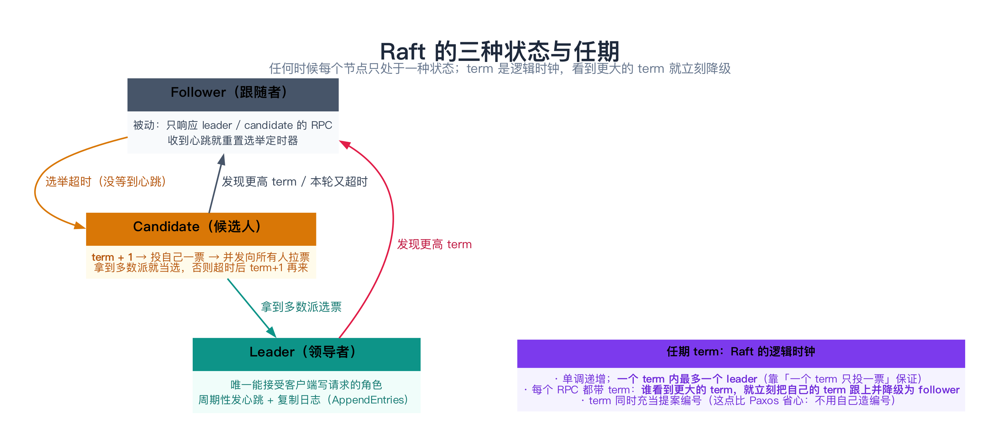
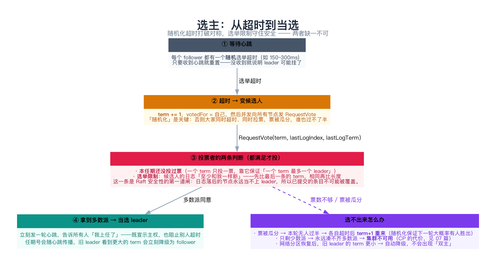
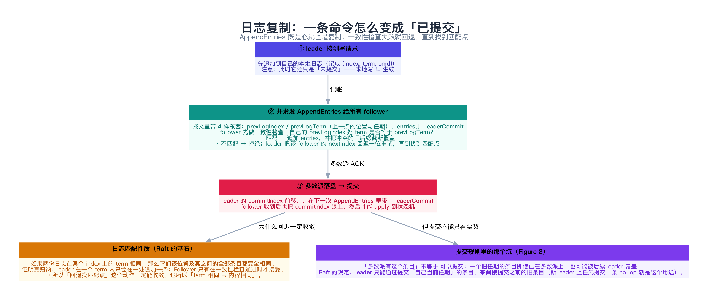
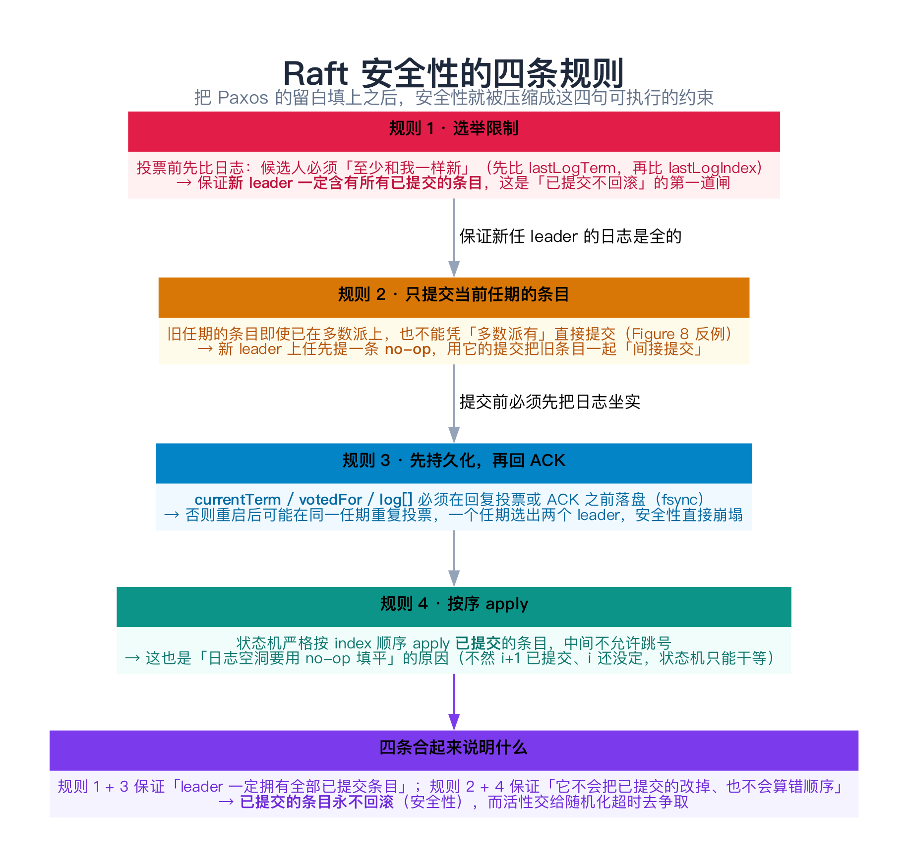
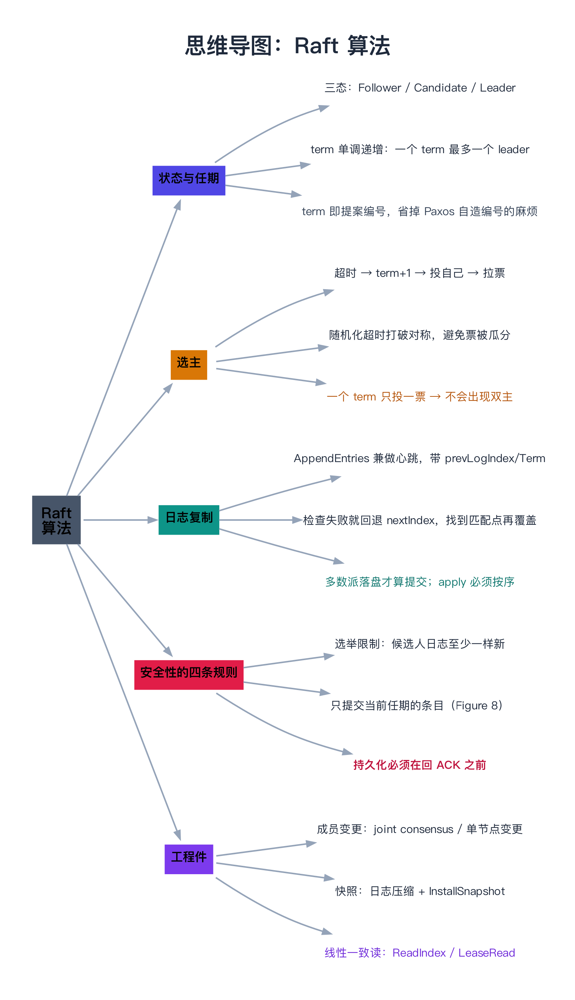

# Raft 算法

> 一句话：Raft 是「**为可理解性而重新设计**」的共识算法——它把 Multi-Paxos 里那些「论文没写、各家实现自己发挥」的部分（选主、日志对账、提交规则、成员变更）**全部变成一等公民并写成明确规则**。核心只有两块：**选主**（谁说了算）与**日志复制**（怎么把命令安全地复制出去），再由**四条安全性规则**兜住底线。

---

## 目录

1. [设计目标：把 Paxos 的留白填上](#1-设计目标把-paxos-的留白填上)
   - [1.1 三个子问题](#11-三个子问题)
   - [1.2 任期 term：Raft 的逻辑时钟](#12-任期-termraft-的逻辑时钟)
   - [1.3 三种状态与两类 RPC](#13-三种状态与两类-rpc)
2. [选主](#2-选主)
   - [2.1 超时 → 候选人 → 拉票](#21-超时-候选人-拉票)
   - [2.2 随机化：打破对称](#22-随机化打破对称)
   - [2.3 选举限制：安全性的第一道闸](#23-选举限制安全性的第一道闸)
3. [日志复制](#3-日志复制)
   - [3.1 AppendEntries：心跳兼复制](#31-appendentries心跳兼复制)
   - [3.2 一致性检查与 nextIndex 回退](#32-一致性检查与-nextindex-回退)
   - [3.3 日志匹配性质](#33-日志匹配性质)
   - [3.4 什么算「已提交」](#34-什么算已提交)
4. [安全性：四条规则](#4-安全性四条规则)
5. [动手：3 节点的 Raft 模拟（C++）](#5-动手3-节点的-raft-模拟c)
   - [5.1 代码](#51-代码)
   - [5.2 运行结果与解读](#52-运行结果与解读)
6. [两块工程件：成员变更与快照](#6-两块工程件成员变更与快照)
7. [与 Paxos 的逐条对照](#7-与-paxos-的逐条对照)
8. [常见误解与坑](#8-常见误解与坑)
9. [总结](#9-总结)
10. [延伸阅读](#10-延伸阅读)
11. [思维导图总结](#11-思维导图总结)

---

## 1. 设计目标：把 Paxos 的留白填上

上一篇（[08 Paxos](../02-共识算法/08-Paxos算法.md)）结尾那句话是理解 Raft 的钥匙：

> Paxos 难不在算法，而在**留白**——选主、日志空洞、成员变更、快照这些「论文没写」的部分，才是工程量的 90%。

Raft 的作者（Diego Ongaro 与 John Ousterhout）做的事很直接：**把留白全部填上，并且按「可理解性」重新组织**。论文标题就叫 *In Search of an Understandable Consensus Algorithm*。

### 1.1 三个子问题

Raft 把共识拆成三个相对独立、各自能讲清楚的子问题：

| 子问题 | 解决的问题 | 对应本文 |
|--------|-----------|----------|
| **Leader Election（选主）** | 谁来接收写请求、推动日志复制 | 第 2 节 |
| **Log Replication（日志复制）** | 怎么把命令安全地复制到多数派 | 第 3 节 |
| **Safety（安全性）** | 上面两件事在换主、分区、崩溃时为什么不会错 | 第 4 节 |

这种**分解**本身就是 Raft 最大的贡献：你不必一次性理解整个算法，可以先把选主搞懂，再看日志，最后看安全约束。

### 1.2 任期 term：Raft 的逻辑时钟

Raft 用一个**单调递增的整数 term** 把时间切成"届"：



```text
term:  1        2        3        4
       ├────────┼────────┼────────┤
       选举     选举      选举      选举
       └ leader └ 无主     └ leader  ...
```

三条规则：

1. **每个 term 最多一个 leader**（靠"一个 term 只投一票"保证）；
2. **每个 RPC 都带 term**：谁看到更大的 term，就立刻把自己的 term 跟上去，**并降级为 follower**；
3. **term 同时充当提案编号**——这一点比 Paxos 省心得多，Paxos 里还要自己想办法造一个全局唯一且单调递增的编号，而 Raft 直接拿 term 用。

> **类比**：term 就像**公司的届次**。第 3 届选出的 CEO 发出的命令，第 4 届的董事会一律不认；任何员工看到"第 4 届"的文件，立刻知道自己该改口了。

### 1.3 三种状态与两类 RPC

| 状态 | 行为 |
|------|------|
| **Follower** | 被动：响应 leader / candidate 的 RPC，收到合法心跳就重置选举定时器 |
| **Candidate** | 竞选：`term+1`、投自己、并发拉票 |
| **Leader** | 唯一能接受客户端写请求的角色，周期性发心跳 + 复制日志 |

**只有两类 RPC**，这也是 Raft 简单的关键：

| RPC | 方向 | 关键字段 |
|-----|------|----------|
| `RequestVote` | Candidate → 所有人 | `term`、`candidateId`、`lastLogIndex`、`lastLogTerm` |
| `AppendEntries` | Leader → 所有人 | `term`、`prevLogIndex`、`prevLogTerm`、`entries[]`、`leaderCommit` |

`AppendEntries` **既复制日志也当心跳**（`entries[]` 为空时就是心跳）——一鱼两吃，少一套 RPC，也少一类 bug。

---

## 2. 选主



### 2.1 超时 → 候选人 → 拉票

每个 follower 维护一个**选举超时定时器**，收到心跳就重置。流程：

```text
① follower 等心跳 → 超时（比如 150~300ms 内没等到）
② term += 1，votedFor = 自己，状态变 Candidate
③ 并发向所有节点发 RequestVote(term, lastLogIndex, lastLogTerm)
④ 拿到多数派（含自己那一票）→ 变 Leader → 立刻发一轮心跳宣示主权
```

**第 ④ 步的"立刻发心跳"很重要**：不光是宣示，更是**阻止其他节点超时**——否则刚选出来的 leader 会在别人发起的新一轮选举里被立刻推翻。

### 2.2 随机化：打破对称

选举超时必须是**随机**的（典型 150~300ms 均匀分布）。原因：

```text
❌ 所有节点固定 200ms 超时：
   大家一起超时 → 一起变候选人 → 各自投自己 → 票被瓜分 → 谁都没过半
   然后 term+1 再重复一遍……永远选不出来

✅ 随机 150~300ms：
   最快的那个先超时 → 先拉票 → 大概率在别人超时之前就拿到多数派
   万一还是瓜分了，下一轮随机值又不同，几轮内几乎必然选出
```

> **随机化不是"优化"，而是活性（liveness）的必要条件**——和 Paxos 的随机退避是同一个道理（见 08 篇第 4 节）。

### 2.3 选举限制：安全性的第一道闸

投票者在决定投不投时，除了"本任期还没投过票"，还有一条**极关键**的检查：

> **选举限制（Election Restriction）**：只有候选人的日志「**至少和我一样新**」时才投票。
>
> 「一样新」的比较方式：先比**最后一条日志的 term**，term 相同再比**日志长度**（谁长谁新）。

它的作用一句话就能说清：

```text
如果候选人的日志比某个投票者旧，那么它一定缺少某些「已被提交」的条目
→ 让它当选，就可能把已提交的条目覆盖掉（安全性崩塌）
→ 所以干脆不给它投票
```

**这条规则保证了：新选出的 leader 一定含有所有已提交的条目。** 这也是 Raft 安全性证明的第一块基石（第 4 节还会再用到它）。

---

## 3. 日志复制



### 3.1 AppendEntries：心跳兼复制

Leader 收到写请求后：

1. 把命令追加到**自己的本地日志**，记成 `(index, term, cmd)`；
2. 并发向所有 follower 发 `AppendEntries`，带上：
   - `prevLogIndex` / `prevLogTerm`：**上一条**的位置与任期（用于一致性检查）；
   - `entries[]`：本次要复制的条目；
   - `leaderCommit`：leader 当前的提交位置。

### 3.2 一致性检查与 nextIndex 回退

Follower 收到 `AppendEntries` 后，先做检查：

```text
自己的日志里，prevLogIndex 这一条的 term 是不是 prevLogTerm？
├── 是 → 通过：追加 entries[]；如果新条目与本地已有条目冲突（同一 index 不同 term），
│        就把本地从该位置起的旧后缀【全部截断覆盖】
└── 否 → 拒绝
```

被拒绝后，leader 把该 follower 的 `nextIndex` **回退一位**重试，如此往复，**直到找到第一个匹配点**，然后把之后的全部内容覆盖过去。

> **注意**：这是"**以 leader 为准**"的强制对齐——不是协商、不是合并。新 leader 的日志就是标准答案。

### 3.3 日志匹配性质

Raft 有一条足以支撑整个正确性证明的性质：

> **Log Matching Property**：如果两份日志在某个 index 上的 **term 相同**，那么该位置**及其之前的全部条目都完全相同**。

为什么成立？靠两条归纳：

1. **Leader 在一个 term 内、对同一个 index 只会追加一条**（日志只追加，不覆盖）；
2. **Follower 只有一致性检查通过才会接受**——所以"同 term"意味着"同一个 leader 在同一位置写的"，往前递归即得整段相同。

这条性质直接保证了：**"回退找匹配点"这个动作一定能收敛**（不会出现"永远找不到匹配"的死循环）。

### 3.4 什么算「已提交」

**多数派把条目写进本地日志** → leader 把 `commitIndex` 前移 → 在**下一次** `AppendEntries` 里带上 `leaderCommit` → follower 收到后也把 `commitIndex` 跟上来，这时才能 **apply 到状态机**。

两个容易踩的点：

- **Follower 的提交是"跟着 leader 走"的**：它自己数不了票（不知道哪些节点收到了），只能等 leader 告诉它；
- **提交规则有个反直觉的例外**，见下面 4.2 节的 Figure 8。

---

## 4. 安全性：四条规则



Raft 全篇的安全性可以压缩成四句话。**这四条也是面试和排障时最常被追问的地方**：

### 4.1 规则一 · 选举限制

见 2.3 节。**保证新 leader 拥有全部已提交条目。**

### 4.2 规则二 · 只提交「当前任期」的条目（Figure 8 问题）

这一条最反直觉，也是 Raft 论文里最著名的坑：

> **「多数派有这个条目」不等于「可以提交」。**

反例（论文 Figure 8 的场景）：某个**旧任期**的条目虽然已经复制到了多数派，但它仍可能被后续的 leader 覆盖——因为"多数派"是可以换人的：旧多数派里的节点，可能在新一轮选举后变成少数派。

Raft 的解决方式很干脆：

> **Leader 只能通过提交「自己当前任期」的条目，来间接提交之前的旧条目。**

所以新 leader 上任后通常会**先提交一条 no-op（空操作）**——它没有任何业务含义，唯一的作用就是"占一个当前任期的位置"，让之前所有旧条目跟着它一起被安全地间接提交。

### 4.3 规则三 · 先持久化，再回 ACK

`currentTerm`、`votedFor`、`log[]` **必须在回复投票或 ACK 之前落盘（fsync）**。

不这么做的后果非常直接：节点崩溃重启后"忘记自己投过谁"，可能**在同一任期里给两个候选人投票** → 一个任期选出两个 leader → 双主 → 安全性直接破。注意顺序是"**先落盘、后回复**"，反过来就等于没做。

### 4.4 规则四 · 按序 apply

状态机严格按 index 顺序 apply **已提交**的条目，中间不能跳号。这也是「日志空洞（gap）必须填平」的原因：如果 index 2 还没定下来，即使 index 3 已提交，状态机也只能干等——或者用一条 no-op 把 index 2 填上。

---

## 5. 动手：3 节点的 Raft 模拟（C++）

下面这个程序把 2~4 节的关键机制跑一遍：**选主 → 提交 → 分区下的"未提交" → 选举限制拒票 → 新 leader 与旧 leader 对账截断**。

### 5.1 代码

```cpp
// Raft 核心机制的最小模拟（确定性、单线程）：3 个节点，覆盖四件事：
//   ① 选主：任期 term + votedFor + 拉票
//   ② 选举限制：日志落后的候选人拿不到票（安全性的第一道闸）
//   ③ 提交：多数派落盘才算提交，未提交的条目可能被截断
//   ④ 日志一致性检查：新 leader 与旧 leader 的日志对账，不一致的后缀一律截断
// 编译：g++ -std=c++11 -Wall -Wextra -O2 -o raft_demo raft_demo.cpp
#include <iostream>
#include <algorithm>
#include <string>
#include <utility>
#include <vector>

struct Entry {
    int term;
    std::string cmd;
};

struct Node {
    std::string name;
    int term;                 // 当前任期（Raft 的「逻辑时钟」）
    std::string votedFor;     // 本任期把票投给了谁（空 = 还没投）
    bool up;                  // 是否在线（模拟宕机/分区）
    std::vector<Entry> log;   // 日志
    int commitIndex;          // 已提交位置：>= 0 表示前 commitIndex+1 条已提交

    explicit Node(std::string n) : name(std::move(n)), term(0), up(true), commitIndex(-1) {}
};

class Cluster {
public:
    Cluster(std::initializer_list<std::string> names) {
        for (const auto& n : names) nodes_.emplace_back(n);
    }

    std::size_t quorum() const { return nodes_.size() / 2 + 1; }

    void down(const std::string& n) { get(n).up = false; std::cout << "  [" << n << " 下线]\n"; }
    void up(const std::string& n) { get(n).up = true; std::cout << "  [" << n << " 上线]\n"; }

    // 候选人拉票。返回是否当选
    bool runElection(const std::string& candName) {
        Node& cand = get(candName);
        cand.term += 1;
        cand.votedFor = cand.name;
        std::cout << "  " << cand.name << " 选举超时 → 变候选人，term=" << cand.term
                  << "，先投自己一票（我的日志 lastIndex=" << lastIndex(cand)
                  << "/lastTerm=" << lastTerm(cand) << "）\n";
        int votes = 1;
        for (auto& v : nodes_) {
            if (v.name == cand.name || !v.up) continue;
            if (v.term < cand.term) { v.term = cand.term; v.votedFor = ""; }
            const bool fresh = upToDate(cand, v);                      // Raft 的「选举限制」
            const bool free = v.votedFor.empty() || v.votedFor == cand.name;
            const bool grant = free && fresh;
            std::cout << "    " << v.name << (grant ? " 同意投票" : " 拒绝投票")
                      << "（我的日志 lastIndex=" << lastIndex(v) << "/lastTerm=" << lastTerm(v)
                      << (fresh ? "" : "，比候选人旧") << "）\n";
            if (grant) { v.votedFor = cand.name; ++votes; }
        }
        const bool win = static_cast<std::size_t>(votes) >= quorum();
        std::cout << "  → 得票 " << votes << "/" << nodes_.size() << "（需要 " << quorum() << "）"
                  << (win ? "，当选 leader\n" : "，选举失败，集群暂时不可用\n");
        return win;
    }

    // leader 追加一条命令并复制给所有在线节点
    void append(const std::string& leaderName, const std::string& cmd) {
        Node& L = get(leaderName);
        Entry e{L.term, cmd};
        L.log.push_back(e);
        std::size_t acks = 1;
        for (auto& n : nodes_) {
            if (n.name == L.name || !n.up) continue;
            n.log.push_back(e);                    // 简化：假设日志前缀已一致
            ++acks;
        }
        const int index = static_cast<int>(L.log.size()) - 1;
        std::cout << "  leader " << L.name << " 追加 \"" << cmd << "\"（index=" << index
                  << ", term=" << L.term << "）→ " << acks << "/" << nodes_.size() << " 个节点落盘";
        if (acks >= quorum()) {
            for (auto& n : nodes_)
                if (n.up && n.log.size() == L.log.size()) n.commitIndex = index;
            std::cout << " → ✓ 达到多数派，提交（commitIndex=" << index << "）\n";
        } else {
            std::cout << " → ✗ 不足多数派，【未提交】\n";
        }
    }

    // 新 leader 与某个节点对账：找最后一个 term 相同的位置，之后一律截断重放
    void reconcile(const std::string& leaderName, const std::string& followerName) {
        Node& L = get(leaderName);
        Node& F = get(followerName);
        if (L.term > F.term) F.term = L.term;                    // 见到更高任期就跟上
        int match = std::min(lastIndex(L), lastIndex(F));
        while (match >= 0 && L.log[match].term != F.log[match].term) --match;
        if (match < lastIndex(F)) {
            std::cout << "  " << F.name << " 的第 " << match + 2 << " 条与 leader 冲突（leader 只有 "
                      << lastIndex(L) + 1 << " 条）→ 截断本地日志\n";
            F.log.resize(match + 1);
        }
        while (lastIndex(F) < lastIndex(L)) F.log.push_back(L.log[F.log.size()]);
        F.commitIndex = std::max(F.commitIndex, std::min(L.commitIndex, lastIndex(F)));
        F.votedFor.clear();
        std::cout << "  " << F.name << " 对账完成，日志 " << F.log.size()
                  << " 条（commitIndex=" << F.commitIndex << "）\n";
    }

    void dump(const std::string& title) const {
        std::cout << "  " << title << "\n";
        for (const auto& n : nodes_) {
            std::cout << "    " << n.name << "（term=" << n.term << (n.up ? "" : ", 离线") << "）[";
            for (std::size_t i = 0; i < n.log.size(); ++i) {
                if (i) std::cout << " | ";
                std::cout << i << ":term" << n.log[i].term << " " << n.log[i].cmd
                          << (static_cast<int>(i) <= n.commitIndex ? "(已提交)" : "(未提交)");
            }
            std::cout << "]\n";
        }
    }

private:
    Node& get(const std::string& n) {
        for (auto& x : nodes_) if (x.name == n) return x;
        return nodes_[0];   // 不会发生：调用方保证名字存在
    }
    int lastIndex(const Node& n) const { return static_cast<int>(n.log.size()) - 1; }
    int lastTerm(const Node& n) const { return n.log.empty() ? 0 : n.log.back().term; }

    // 选举限制：候选人日志必须「至少一样新」——先比最后一个条目的 term，再比长度
    bool upToDate(const Node& cand, const Node& voter) const {
        if (lastTerm(cand) != lastTerm(voter)) return lastTerm(cand) > lastTerm(voter);
        return lastIndex(cand) >= lastIndex(voter);
    }

    std::vector<Node> nodes_;
};

int main() {
    Cluster c({"A", "B", "C"});
    std::cout << "3 个节点，多数派 = " << c.quorum() << "\n\n";

    std::cout << "① A 选举超时，发起选举\n";
    c.runElection("A");

    std::cout << "\n② A 作为 leader 提交第一条命令\n";
    c.append("A", "set x = 1");
    c.dump("此刻各节点日志：");

    std::cout << "\n③ C 下线，A 继续提交第二条命令（A + B = 2/3，仍是多数派）\n";
    c.down("C");
    c.append("A", "set y = 2");

    std::cout << "\n④ B 也下线，A 再提一条 —— 这次只有 A 自己落盘\n";
    c.down("B");
    c.append("A", "set z = 999");
    c.dump("此刻各节点日志（注意 A 上那条未提交的 999）：");

    std::cout << "\n⑤ A 下线，B、C 恢复。C 先超时发起选举（它的日志最短）\n";
    c.down("A");
    c.up("B");
    c.up("C");
    c.runElection("C");

    std::cout << "\n⑥ B 接着发起选举（它的日志比 C 新）\n";
    c.runElection("B");

    std::cout << "\n⑦ A 恢复上线，新 leader B 与它逐条对账\n";
    c.up("A");
    c.reconcile("B", "A");
    c.reconcile("B", "C");
    c.dump("最终各节点日志：");

    std::cout << "\n结论：已提交的 x、y 从未丢失；A 本地那条从未提交的 999 被截断；\n";
    std::cout << "      而 C 因为日志最旧，在 ⑤ 里被 B 以「选举限制」拒票，根本当不上 leader。\n";
    return 0;
}
```

### 5.2 运行结果与解读

```text
3 个节点，多数派 = 2

① A 选举超时，发起选举
  A 选举超时 → 变候选人，term=1，先投自己一票（我的日志 lastIndex=-1/lastTerm=0）
    B 同意投票（我的日志 lastIndex=-1/lastTerm=0）
    C 同意投票（我的日志 lastIndex=-1/lastTerm=0）
  → 得票 3/3（需要 2），当选 leader

② A 作为 leader 提交第一条命令
  leader A 追加 "set x = 1"（index=0, term=1）→ 3/3 个节点落盘 → ✓ 达到多数派，提交（commitIndex=0）
  此刻各节点日志：
    A（term=1）[0:term1 set x = 1(已提交)]
    B（term=1）[0:term1 set x = 1(已提交)]
    C（term=1）[0:term1 set x = 1(已提交)]

③ C 下线，A 继续提交第二条命令（A + B = 2/3，仍是多数派）
  [C 下线]
  leader A 追加 "set y = 2"（index=1, term=1）→ 2/3 个节点落盘 → ✓ 达到多数派，提交（commitIndex=1）

④ B 也下线，A 再提一条 —— 这次只有 A 自己落盘
  [B 下线]
  leader A 追加 "set z = 999"（index=2, term=1）→ 1/3 个节点落盘 → ✗ 不足多数派，【未提交】
  此刻各节点日志（注意 A 上那条未提交的 999）：
    A（term=1）[0:term1 set x = 1(已提交) | 1:term1 set y = 2(已提交) | 2:term1 set z = 999(未提交)]
    B（term=1, 离线）[0:term1 set x = 1(已提交) | 1:term1 set y = 2(已提交)]
    C（term=1, 离线）[0:term1 set x = 1(已提交)]

⑤ A 下线，B、C 恢复。C 先超时发起选举（它的日志最短）
  [A 下线]
  [B 上线]
  [C 上线]
  C 选举超时 → 变候选人，term=2，先投自己一票（我的日志 lastIndex=0/lastTerm=1）
    B 拒绝投票（我的日志 lastIndex=1/lastTerm=1，比候选人旧）
  → 得票 1/3（需要 2），选举失败，集群暂时不可用

⑥ B 接着发起选举（它的日志比 C 新）
  B 选举超时 → 变候选人，term=3，先投自己一票（我的日志 lastIndex=1/lastTerm=1）
    C 同意投票（我的日志 lastIndex=0/lastTerm=1）
  → 得票 2/3（需要 2），当选 leader

⑦ A 恢复上线，新 leader B 与它逐条对账
  [A 上线]
  A 的第 3 条与 leader 冲突（leader 只有 2 条）→ 截断本地日志
  A 对账完成，日志 2 条（commitIndex=1）
  C 对账完成，日志 2 条（commitIndex=1）
  最终各节点日志：
    A（term=3）[0:term1 set x = 1(已提交) | 1:term1 set y = 2(已提交)]
    B（term=3）[0:term1 set x = 1(已提交) | 1:term1 set y = 2(已提交)]
    C（term=3）[0:term1 set x = 1(已提交) | 1:term1 set y = 2(已提交)]

结论：已提交的 x、y 从未丢失；A 本地那条从未提交的 999 被截断；
      而 C 因为日志最旧，在 ⑤ 里被 B 以「选举限制」拒票，根本当不上 leader。
```

逐条对照原理：

| 输出片段 | 印证了什么 |
|----------|-----------|
| ② `3/3 落盘 → 提交` | 多数派提交（这时是"全票"，当然包含多数派） |
| ③ `2/3 落盘 → 提交` | **多数派不需要全员**：C 离线不影响可用性 |
| ④ `1/3 落盘 → 【未提交】` | **少数派不能提交**——这正是 CP 系统在分区时的表现 |
| ⑤ `B 拒绝投票（…比候选人旧）` | **选举限制**：C 的日志最短，B 直接拒票 → C 只拿到自己 1 票 |
| ⑥ `B 当选` | B 的日志最全 → 拿到 C 的票 → 2/3 过半 |
| ⑦ `A 的第 3 条与 leader 冲突 → 截断本地日志` | **未提交的条目会被覆盖**；而"已提交的 x、y 从未丢失"就是安全性的直接体现 |
| ⑦ 三个节点日志完全一致 | 一致性检查 + 回退对齐的最终结果 |

> **一个容易被忽略的细节**：⑤ 里 C 当选失败后，集群**暂时不可用**（B 也当不上，因为 A 掉线、C 会拒它的票？不——⑥ 里 C 投给了 B）。真实的 Raft 里，这种"少数派 + 日志不齐"的组合会经历**若干轮重试**，直到某个节点凑够多数派；**如果网络分区持续存在，集群就一直不可用**——这是设计使然，不是 bug。

---

## 6. 两块工程件：成员变更与快照

论文用两节讲这两件事，工程上它们往往比算法本身更容易出问题。

### 6.1 成员变更：为什么不能"直接改配置"

假设集群从 3 节点扩到 5 节点，如果每个节点**各自、异步地**切换到新配置，中间会出现这样的窗口：

```text
节点 A、B 已用新配置（3、4、5 也算成员）→ 多数派 = 3
节点 C、D、E 还用旧配置（只有 1、2、3）→ 多数派 = 2
→ 两个"多数派"可以同时存在、各自选出 leader → 双主 → 安全性崩塌
```

**Raft 论文的解法是 joint consensus（联合共识）**，分两阶段：

1. 先切到 `C_old,new`：此时任何决议**必须同时获得新旧两个配置的多数派同意**；
2. `C_old,new` 提交后，再切到 `C_new`。

工程实现（如 etcd）常用更简单的变体：**一次只增删一个节点**，并加上额外约束（例如变更必须由当前 leader 在任期内完成）。这样新旧多数派必然相交，能绕开上面那个窗口——代价是扩缩容要一个一个来。

### 6.2 快照：日志不能无限长

日志会无限增长（内存放不下、重启要重放几百万条）。做法是**每个节点独立做快照**：

```text
快照内容 = lastIncludedIndex + lastIncludedTerm + 状态机数据 + 当时的集群配置
做完快照 → 把该 index 之前的日志全部丢掉
```

配套还需要一个 `InstallSnapshot` RPC：当 leader 发现某个 follower 落后太多、需要的历史日志已经被自己丢掉了，就直接**分块传快照**给它。

两个容易搞错的地方：

- **快照是每个节点各自做的**，不是 leader 统一分发；因此不同节点的快照边界不同；
- **快照必须和日志一样"先落盘再生效"**，否则崩溃后会出现"日志已截断、快照没写完"的空洞。

### 6.3 顺带说说线性一致读

「写走一遍日志」是显然的，但**读**呢？如果 leader 直接读本地状态机，可能读到**尚未提交**的数据（甚至自己已经不是 leader 了还以为在任）。三种做法：

| 做法 | 思路 | 代价 |
|------|------|------|
| **把读也写进日志** | 读请求当成一条日志走一遍共识 | 最简单，但最慢（每读一次一次共识） |
| **ReadIndex** | leader 记下当前 commitIndex，向多数派发一轮心跳确认自己仍是 leader，等状态机 apply 到该 index 再返回 | 一轮心跳的网络开销，不落盘 |
| **Lease Read** | 靠时钟租约：leader 在租约期内假定自己仍是 leader，直接读 | 最快，但**依赖时钟漂移假设**，时钟跳变会破坏线性一致 |

这些细节在 [12 共识工程细节](../02-共识算法/12-共识工程细节（快照、成员变更、线性一致读）.md) 里会展开。

---

## 7. 与 Paxos 的逐条对照

| 维度 | Paxos / Multi-Paxos | Raft |
|------|---------------------|------|
| **选主** | 隐含在"谁跑完 Phase 1"里，规则留白 | 一等公民：term + 随机超时 + 选举限制，规则写死 |
| **提案编号** | proposer 自己造，需保证全局唯一单调 | **直接用 term**，天然单调可比 |
| **日志形状** | 每条日志一个实例，可能出现空洞 | 强 leader 顺序追加，`nextIndex` 回退补齐 |
| **提交规则** | 论文未明确讨论"旧任期条目能否直接提交" | 明确规定：**只提交当前任期的条目**（Figure 8） |
| **读的线性一致** | 论文未涉及 | ReadIndex / Lease Read / 走日志，三条路都给了 |
| **成员变更** | 论文未涉及 | joint consensus（+ 工程上的单节点变更变体） |
| **快照** | 论文未涉及 | 每个节点独立快照 + `InstallSnapshot` |
| **正确性论证** | 分散在论文各处，需要自己补 | 论文第 5 节集中给出，TLA+ 规格也已公开 |

> **一句话总结这张表**：两者解决**同一个问题**，Raft 的"简单"来自**它把所有的留白都填上了明确的规则**——代价是少了一点理论上的灵活性（比如 Raft 强依赖 leader，而 Paxos 允许无主并发提案）。

---

## 8. 常见误解与坑

**① 以为 Raft「保证一定选出 leader」**

不保证。只剩少数派时永远选不出来（⑥ 里的 B 如果也拿不到票，集群就一直不可用）；票被瓜分时也要多轮才收敛。Raft 保证的是**安全**（不会选出两个 leader、不会覆盖已提交条目），**活性要靠随机化和多数派可达去争取**——还是 FLP 那条线。

**② 以为「多数派 ACK 就能提交」**

见 4.2 节。**旧任期的条目即使已在多数派上也不能直接提交**，必须等当前任期的一条条目被提交，把它"顺带"带上去。这是 Raft 与"朴素多数派提交"最大的差别，也是新 leader 上任要发 no-op 的原因。

**③ 以为 follower 会自己知道"已提交"**

Follower 数不了票，它只能等 leader 在下一次 `AppendEntries` 里带上 `leaderCommit`。所以**follower 的 apply 天然滞后**，监控上要看 **apply lag**，而不是"日志长度是否相同"。

**④ 在 leader 上直接读本地状态机**

那可能读到未提交的数据（更糟的是，分区后的旧 leader 还以为自己是主）。要线性一致就必须走 6.3 节的三条路之一。

**⑤ 把"随机化超时"当成可选的优化**

不是优化，是**活性必需品**（2.2 节）。固定超时会导致选票被永久瓜分。

**⑥ 用「一次改多个节点」做成员变更**

会制造"两个多数派"的窗口。要么用 joint consensus，要么老老实实一次一个。

**⑦ 忘了持久化，或顺序反了**

`currentTerm`/`votedFor`/`log` 必须**先落盘再回 ACK**。这个 bug 的可怕之处在于：单机测试永远不会暴露，只有在"崩溃 + 重启 + 重新选举"的组合下才会炸出双主。

**⑧ 以为 Raft 能防恶意节点**

不能。Raft 是**崩溃容错（CFT）**算法，一个被攻陷的节点可以随意伪造日志。要防作恶得上 BFT（见 [13 拜占庭容错共识](../02-共识算法/13-拜占庭容错共识（PBFT、Tendermint、HotStuff）.md)）。

---

## 9. 总结

| 模块 | 核心内容 |
|------|----------|
| **状态与任期** | Follower / Candidate / Leader 三态；term 单调递增，看到更大 term 立刻降级 |
| **选主** | 随机超时 → `term+1` → 投自己 → 拉票 → 多数派当选 → 立刻发心跳 |
| **选举限制** | 候选人日志必须"至少和我一样新"→ 保证新 leader 含有全部已提交条目 |
| **日志复制** | `AppendEntries` 兼心跳；`prevLogIndex/Term` 做一致性检查；失败则回退 `nextIndex` |
| **日志匹配性质** | 同 index 同 term ⇒ 该位置及之前的条目全部相同（回退一定能收敛） |
| **提交** | 多数派落盘 + **只能是当前任期的条目**（或间接提交） |
| **四条安全规则** | 选举限制、只提交当前任期、先持久化再回 ACK、按序 apply |
| **工程件** | 成员变更（joint consensus / 单节点）、快照 + `InstallSnapshot`、ReadIndex / Lease Read |
| **与 Paxos 的关系** | 同一问题的另一种设计：Raft 把留白填成明确规则，可理解性优先 |

**记住三句话**：

1. **Raft = 强 leader + 任期 + 日志匹配**；把 Paxos 的留白全部变成了可执行的规则。
2. **安全性靠两条闸**：选举限制（新 leader 的日志一定最全）+ 提交规则（只提交当前任期的条目，别的靠 no-op 间接带过）。
3. **持久化顺序不能错**：`currentTerm`/`votedFor`/`log` 先落盘、再回 ACK——这是唯一能防住"一个任期两个 leader"的手段。

下一章进入 [10 ZooKeeper 与 Zab 协议](../02-共识算法/10-ZooKeeper与Zab协议.md)，看另一条路线（primary-backup + 全序广播）是怎么解决同一个问题的。

---

## 10. 延伸阅读

- **原文**（必读，写得比 Paxos 友好得多）：
  - Diego Ongaro & John Ousterhout《In Search of an Understandable Consensus Algorithm》（USENIX ATC 2014）—— Raft 论文；**第 5 节（安全性）和第 6 节（成员变更）是精华**，Figure 8 那个反例值得反复看；
  - Diego Ongaro《Consensus: Bridging Theory and Practice》（博士论文，2014）—— 论文放不下的细节都在这：Pre-Vote、ReadIndex、Lease Read、批量与流水线优化、成员变更的完整讨论。
- **可视化与动手**：
  - [raft.github.io](https://raft.github.io/) —— 官方可视化演示，调参（超时、丢包）看选举过程最直观；
  - [thesecretlivesofdata.com/raft](http://thesecretlivesofdata.com/raft/) —— 另一份动画讲解，适合第一次接触；
  - MIT 6.824 Lab 2 —— 手写 Raft（含快照与日志压缩），做完这篇的所有概念都会变成肌肉记忆。
- **工程实现**：
  - etcd 的 `raft` 库（[github.com/etcd-io/raft](https://github.com/etcd-io/raft)）—— 生产级 Raft 的参考实现，重点看 `raft.go` 的状态机与 `ReadIndex` 的实现；
  - Hashicorp Raft —— 另一份可读性很好的实现，带完整快照与成员变更示例。
- **形式化**：Ongaro 论文附录里的 **TLA+ 规格**；[jepsen.io](https://jepsen.io/) 对 etcd / Consul 的 Raft 实现做过一致性验证，可以看它们踩过哪些坑。
- **顺着往下读**：[10 ZooKeeper 与 Zab](../02-共识算法/10-ZooKeeper与Zab协议.md)（另一条路线）、[11 分布式共识的工程实现（etcd 源码）](../02-共识算法/11-分布式共识的工程实现（etcd源码）.md)（代码长什么样）、[12 共识工程细节](../02-共识算法/12-共识工程细节（快照、成员变更、线性一致读）.md)（把本文 6.3 节展开）。

---

## 11. 思维导图总结

```text
Raft 算法
├── 状态与任期
│   ├── 三态：Follower / Candidate / Leader，任意时刻只处于一种
│   ├── term 单调递增：一个 term 最多一个 leader，看到更大 term 立刻降级
│   └── term 直接当提案编号，省掉 Paxos 自造编号的麻烦
├── 选主
│   ├── 随机选举超时 → term+1 → 投自己 → 并发 RequestVote
│   ├── 随机化是活性必需品（否则选票被瓜分，永远选不出来）
│   ├── 一个 term 只投一票 → 不会出现双主
│   └── 选举限制：候选人日志「至少和我一样新」才投票
├── 日志复制
│   ├── AppendEntries 兼做心跳，带 prevLogIndex / prevLogTerm / entries / leaderCommit
│   ├── 一致性检查失败就回退 nextIndex，直到找到匹配点再覆盖
│   ├── 日志匹配性质：同 index 同 term ⇒ 之前条目全同（回退必然收敛）
│   └── 多数派落盘 → leader 提交 → 下次心跳通知 follower
├── 安全性的四条规则
│   ├── ① 选举限制：新 leader 一定含有全部已提交条目
│   ├── ② 只提交当前任期的条目（Figure 8），旧条目靠 no-op 间接提交
│   ├── ③ 先持久化再回 ACK（currentTerm / votedFor / log）
│   └── ④ 严格按 index 顺序 apply 已提交条目
└── 工程件与对照
    ├── 成员变更：joint consensus，或工程上一次只改一个节点
    ├── 快照：每节点独立做 + InstallSnapshot；线性一致读用 ReadIndex / Lease Read
    └── 与 Paxos：同一问题的另一种设计，Raft 把留白填成明确规则，可理解性优先
```


