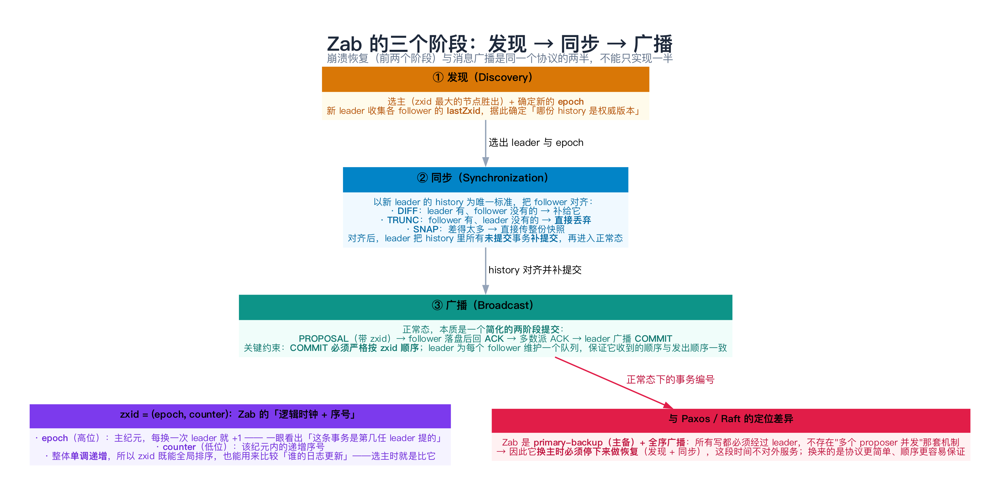
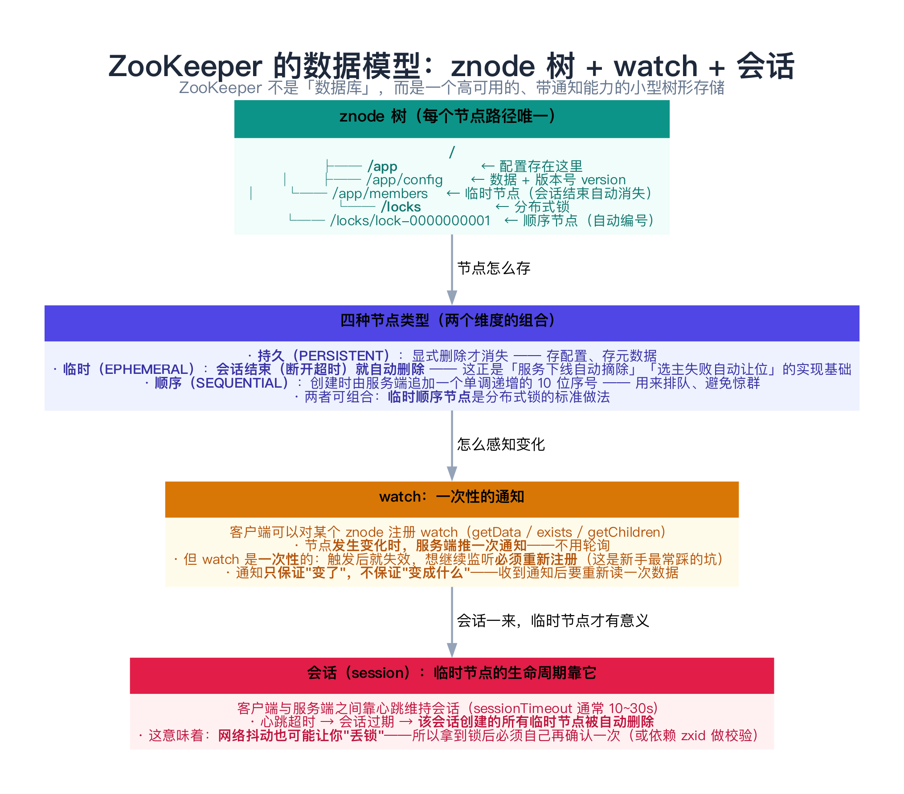
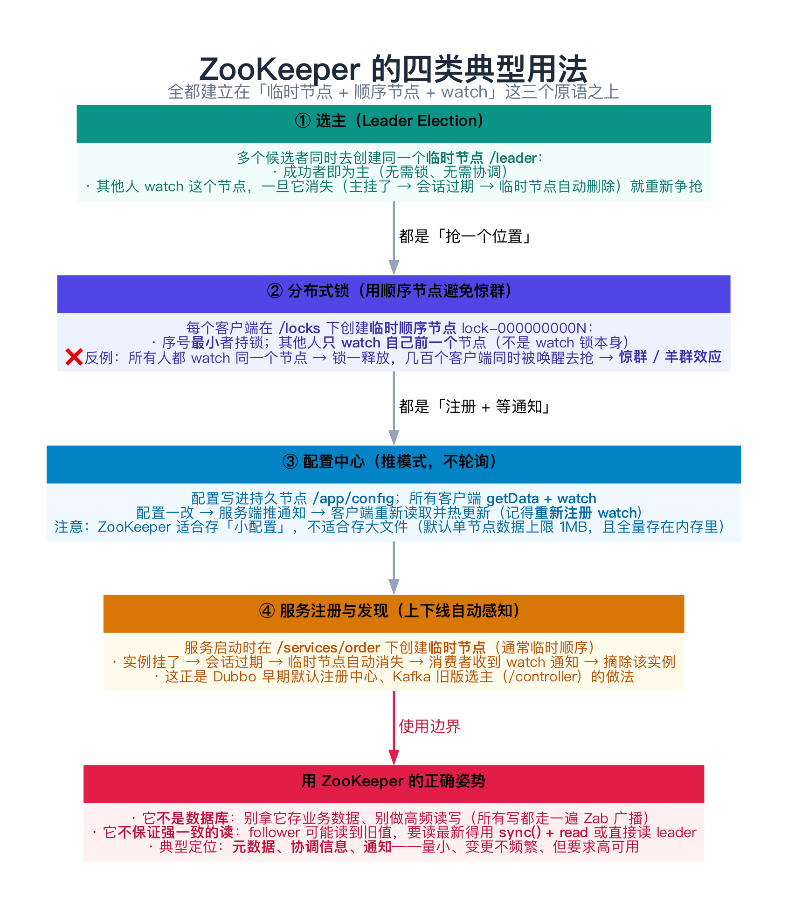
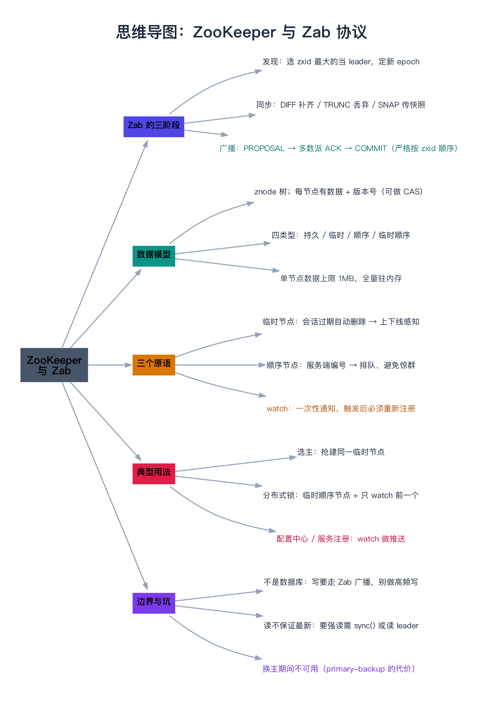

# ZooKeeper 与 Zab 协议

> 一句话：ZooKeeper 不是"数据库"，而是一个**高可用的小型树形存储 + 通知系统**——它把「元数据 + 变更通知」这件事做到了极致。支撑它的是 **Zab** 协议：一条与 Paxos/Raft **同类但不同路**的路线——**主备（primary-backup）+ 全序广播**，用 `zxid = (epoch, counter)` 保证「所有副本按同一顺序执行同一串事务」。

---

## 目录

1. [ZooKeeper 是什么（以及不是什么）](#1-zookeeper-是什么以及不是什么)
2. [Zab：主备模式的全序广播](#2-zab主备模式的全序广播)
   - [2.1 与 Paxos / Raft 的定位差异](#21-与-paxos-raft-的定位差异)
   - [2.2 zxid = (epoch, counter)](#22-zxid-epoch-counter)
   - [2.3 三个阶段：发现 → 同步 → 广播](#23-三个阶段发现-同步-广播)
   - [2.4 恢复阶段的关键规则](#24-恢复阶段的关键规则)
3. [ZooKeeper 的数据模型](#3-zookeeper-的数据模型)
   - [3.1 znode 树与四种节点类型](#31-znode-树与四种节点类型)
   - [3.2 watch：一次性通知](#32-watch一次性通知)
   - [3.3 会话：临时节点的生命周期](#33-会话临时节点的生命周期)
4. [四类典型用法](#4-四类典型用法)
   - [4.1 选主](#41-选主)
   - [4.2 分布式锁与羊群效应](#42-分布式锁与羊群效应)
   - [4.3 配置中心](#43-配置中心)
   - [4.4 服务注册与发现](#44-服务注册与发现)
5. [动手：Zab 的提交与崩溃恢复（C++）](#5-动手zab-的提交与崩溃恢复c)
   - [5.1 代码](#51-代码)
   - [5.2 运行结果与解读](#52-运行结果与解读)
6. [常见误解与坑](#6-常见误解与坑)
7. [总结](#7-总结)
8. [延伸阅读](#8-延伸阅读)
9. [思维导图总结](#9-思维导图总结)

---

## 1. ZooKeeper 是什么（以及不是什么）

ZooKeeper 的自我定位是 **「wait-free coordination for Internet-scale systems」**（论文标题），翻译过来是：**给分布式系统提供协调能力的基础设施**。典型用途就四类（第 4 节展开）：选主、分布式锁、配置中心、服务注册与发现。

先把边界划清楚，因为它经常被用错：

| ✅ 适合 | ❌ 不适合 |
|---------|-----------|
| 存**小**元数据（配置、成员列表、状态标志） | 存业务数据、大对象（**单节点数据默认上限 1MB**） |
| **低频写、高频读** | 高频写（每次写都要走一遍 Zab 广播 + 落盘） |
| 需要**变更通知**（watch） | 需要复杂查询 / 事务（没有 SQL、只有单节点原子操作 + multi） |
| 需要**强一致的写** | 需要刚写完立刻从任意节点读到最新（**读可能读到旧值**，见 6.3 节） |

**它更像"带通知能力的 etcd"**——而不是"一个小型数据库"。

---

## 2. Zab：主备模式的全序广播



### 2.1 与 Paxos / Raft 的定位差异

Zab（ZooKeeper Atomic Broadcast）解决的也是"复制状态机"问题，但走的是**主备路线**：

| | Paxos / Multi-Paxos | Raft | **Zab** |
|---|---|---|---|
| 定位 | 对称的共识算法 | 强 leader 日志复制 | **primary-backup + 全序广播** |
| 谁提提案 | 任何 proposer（可并发） | 只有 leader | **只有 leader**（primary） |
| 编号 | proposer 自造 | term | **zxid = (epoch, counter)** |
| 换主 | 无需"停顿"，靠 Phase 1 续上 | 选举 + 日志对齐 | **必须走完整的"发现 + 同步"两阶段，期间不对外服务** |
| 关键差异 | 灵活但留白多 | 规则明确、可理解 | **协议更"重"，但顺序保证更直白** |

**一句话**：Zab 放弃"任意节点都能提案"的灵活性，换来"任何时刻只有一个源头在定顺序"——于是"全序"这件事变得非常好证明。

### 2.2 zxid = (epoch, counter)

Zab 里每条事务都有一个 64 位的 **zxid**：

```text
zxid = ( epoch << 32 ) | counter
        └─ 高 32 位 ─┘   └─ 低 32 位 ─┘
       主纪元：每换一次 leader 就 +1     该纪元内的递增序号
```

两个好处：

1. **全局单调递增** → 所有副本只要按 zxid 排序执行，状态就一致（这就是"全序广播"）；
2. **能比较"谁的日志更新"** → 选主时直接比 `lastZxid`，谁大谁当 leader（这也保证了新 leader 一定含有所有已提交事务）。

> 对比一下：Raft 用 **term** 解决同样的问题，但 Raft 的 term 只保证"每个 term 一个 leader"，日志位置还要靠 `index`；而 zxid 把"纪元 + 序号"打成一个整数，比较起来更直接——这是主备路线的便利。

### 2.3 三个阶段：发现 → 同步 → 广播

Zab 的完整生命周转被分成三段，**前两段只在"换主"时走**：

| 阶段 | 干什么 | 什么时候走 |
|------|--------|-----------|
| **① 发现（Discovery）** | 选主 + 确定新 epoch + 收集各 follower 的 lastZxid，确定"哪份 history 权威" | 换主时 |
| **② 同步（Synchronization）** | 以新 leader 的 history 为准对齐所有 follower（DIFF / TRUNC / SNAP），并**补提交**未提交事务 | 换主时 |
| **③ 广播（Broadcast）** | 正常态：`PROPOSAL → 多数派 ACK → COMMIT` | 稳态 |

第 ③ 阶段本质是一个**简化的两阶段提交**，但有两条硬约束：

- **COMMIT 必须严格按 zxid 顺序**；
- leader 为每个 follower 维护一个**队列**，保证"发给它的顺序 = 它执行的顺序"（否则 follower 的状态机会乱序 apply）。

### 2.4 恢复阶段的关键规则

这是 Zab 与"朴素多数派提交"最不一样的地方，也是第 5 节代码要演示的核心：

> **新 leader 的 history 就是唯一真相：**
> - 它**有**、follower 没有的 → **DIFF** 补给它；
> - follower **有**、它没有的 → **TRUNC 直接丢弃**（哪怕那条事务的 zxid 更大）；
> - 差得太多 → **SNAP** 直接传整份快照；
> - 对齐之后，leader 把 history 里**所有未提交的事务补提交**。

第 4 条特别值得琢磨：「未提交」不等于「一定丢弃」——**关键在于它在不在新 leader 的 history 里**。

```text
某条事务只到了 A、B（多数派之外）→ 未提交
├── 后来 B 当选 leader → 它在 B 的 history 里 → 【补提交】，最终生效
└── 后来 C 当选 leader（C 没收到它）→ 不在 C 的 history 里 → 【TRUNC】，永久丢弃
```

这**不是**不确定性缺陷：无论是哪种结局，只要一条事务**已经提交过**，它就一定在 zxid 最大的那个节点的 history 里，而那个节点必定当选——所以**已提交的事务永远不会丢**（安全性）。

---

## 3. ZooKeeper 的数据模型



### 3.1 znode 树与四种节点类型

ZooKeeper 的数据组织成一棵树，每个节点叫 **znode**，用路径唯一标识（如 `/app/config`）。每个 znode 可以存一小段数据（字节数组）和一个**版本号**（可用于 CAS：`setData(path, data, version)`，版本不匹配就失败）。

四种类型是两个维度的组合：

| 类型 | 生命周期 | 典型用途 |
|------|----------|----------|
| **持久（PERSISTENT）** | 显式删除才消失 | 配置、元数据 |
| **临时（EPHEMERAL）** | **会话结束（心跳超时）自动删除** | 服务上下线感知、选主 |
| **顺序（SEQUENTIAL）** | 创建时服务端追加 10 位递增序号 | 排队、避免惊群 |
| **临时顺序** | 上面两者结合 | **分布式锁的标准做法** |

> **临时节点是 ZooKeeper 最有价值的原语**：它把"进程还活着"这件事变成了"存储系统里的一个事实"。进程崩溃 → 心跳停 → 会话过期 → 临时节点消失 → 其他人收到通知。**不需要任何心跳检测代码，也不需要租约续期逻辑**。

### 3.2 watch：一次性通知

客户端可以对 znode 注册 watch（`getData` / `exists` / `getChildren`），节点变化时服务端**推一次**通知。三个必须记住的点：

1. **watch 是一次性的**：触发后就失效，想继续监听**必须重新注册**（新手最常踩的坑）；
2. **通知只保证"变了"，不保证"变成什么"**：收到通知后要**重新读一次数据**；
3. **watch 的触发是"先通知、后失效"的语义**：在"收到通知"和"重新注册"之间发生的变更，你可能会错过——所以注册完要**立刻再读一次**做兜底。

### 3.3 会话：临时节点的生命周期

客户端与服务端靠**心跳**维持会话（`sessionTimeout` 通常 10~30 秒，受 `tickTime` 约束）。会话过期 → 该会话创建的所有临时节点被删除。

这带来一个反直觉的风险：

> **网络抖动也可能让你"丢锁"**：你的进程还在跑，但因为 GC 停顿或网络抖动导致心跳超时，ZooKeeper 认为你死了、把锁释放了，别人可能已经拿到锁——而你还以为自己持有。

所以严格的锁实现（如 Curator 的 `InterProcessMutex`）会在拿到锁后**再做一次校验**（读回自己创建的节点是否还在），或者用 fencing token 让下游拒绝过期持有者的请求。

---

## 4. 四类典型用法



### 4.1 选主

所有候选者同时去创建**同一个临时节点** `/leader`：

- 创建成功者即为主（ZooKeeper 保证只有一个能成功）；
- 其他人 `exists(..., watch=true)` 等通知，节点消失（主挂了 → 会话过期 → 临时节点自动删除）就重新争抢。

**不需要锁、不需要协调**——这就是 ZooKeeper 的"wait-free"味道。

### 4.2 分布式锁与羊群效应

**❌ 错误做法**：所有人 watch 同一个节点（比如锁节点本身）。锁一释放，几百个客户端同时被唤醒去抢 → **惊群 / 羊群效应（herd effect）**，ZooKeeper 瞬间被打爆。

**✅ 正确做法**（ZooKeeper 官方 recipe）：

```text
① 每个客户端在 /locks 下创建【临时顺序节点】lock-0000000001、lock-0000000002 ...
② 拿到子节点列表，如果自己的序号最小 → 持锁
③ 否则：只 watch【序号比自己小一位】的那个节点（不是 watch 锁本身）
④ 被通知后回到 ②（注意此时你已经是最小的了）
```

这样每次锁释放**只唤醒一个**客户端，而且顺序天然公平（先到先得）。

### 4.3 配置中心

配置写进持久节点 `/app/config`，所有客户端 `getData + watch`。配置一改 → 推送通知 → 客户端重新读取并热更新。

**注意**：ZooKeeper 存配置适合"小而关键"（开关、路由表、限流阈值），不适合几百 KB 的大配置——单节点 1MB 上限，而且**整个数据树常驻内存**。

### 4.4 服务注册与发现

服务启动时在 `/services/order` 下创建**临时节点**：

- 实例挂了 → 会话过期 → 临时节点消失 → 消费者收到 watch → 摘除该实例；
- 这正是 **Dubbo** 早期默认注册中心、**Kafka 旧版**（`/controller`、`/brokers`）的做法。

> 顺带一提：Kafka 后来把元数据管理从 ZooKeeper 迁到了自己的 **KRaft**（基于 Raft）；Dubbo 3 也主推 Nacos。**不是因为 ZooKeeper 不行，而是因为"元数据规模上去了以后，ZooKeeper 的写吞吐成了瓶颈"**——它的写要过一遍 Zab 广播 + 落盘，天生不适合高频变更。

---

## 5. 动手：Zab 的提交与崩溃恢复（C++）

下面这个 5 节点模拟把 2.3 与 2.4 节跑一遍：**多数派提交、未提交事务的两种命运（补提交 vs TRUNC）**。

### 5.1 代码

```cpp
// Zab（ZooKeeper 的原子广播协议）最小模拟：5 个节点，覆盖四件事：
//   ① 事务编号 zxid = (epoch, counter)：全局单调，COMMIT 必须按 zxid 顺序
//   ② 多数派 ACK 才能 COMMIT（5 节点需要 3 票，所以 A+B 不够）
//   ③ 恢复阶段：新 leader 的 history 是唯一标准 —— 它里面有就补提交（DIFF + COMMIT）
//   ④ 它里面没有就 TRUNC 丢弃（哪怕旧 leader 上的 zxid 更大）
// 编译：g++ -std=c++11 -Wall -Wextra -O2 -o zab_demo zab_demo.cpp
#include <iostream>
#include <string>
#include <utility>
#include <vector>

struct Txn {
    int epoch;          // 主纪元（每次换 leader 递增，是 zxid 的高位）
    int counter;        // 纪元内的序号
    std::string cmd;
    bool committed;
};

struct Peer {
    std::string name;
    bool up;
    std::vector<Txn> history;   // 本地事务历史，按 zxid 有序

    explicit Peer(std::string n) : name(std::move(n)), up(true) {}
};

class Cluster {
public:
    Cluster(std::initializer_list<std::string> names) : epochCounter_(1) {
        for (const auto& n : names) peers_.emplace_back(n);
        leaderEpoch_ = 1;
        leaderName_ = "A";
        counter_ = 0;
    }

    std::size_t quorum() const { return peers_.size() / 2 + 1; }
    void down(const std::string& n) { get(n).up = false; std::cout << "  [" << n << " 下线]\n"; }
    void up(const std::string& n) { get(n).up = true; std::cout << "  [" << n << " 上线]\n"; }

    // leader 广播一条事务（PROPOSAL → 多数派 ACK → COMMIT）
    void broadcast(const std::string& leaderName, const std::string& cmd) {
        Peer& L = get(leaderName);
        Txn t{leaderEpoch_, ++counter_, cmd, false};
        L.history.push_back(t);
        std::size_t acks = 1;
        for (auto& p : peers_) {
            if (p.name == L.name || !p.up) continue;
            p.history.push_back(t);
            ++acks;
        }
        std::cout << "  leader " << L.name << " 广播 " << zxidStr(t) << " \"" << cmd << "\" → "
                  << acks << "/" << peers_.size() << " 收到 PROPOSAL";
        if (acks >= quorum()) {
            // COMMIT 阶段：leader 向所有人广播 COMMIT，大家按 zxid 顺序推进提交点
            for (auto& p : peers_)
                if (p.up) commitUpTo(p, t);
            std::cout << " → ✓ 多数派 ACK，广播 COMMIT\n";
        } else {
            std::cout << " → ✗ 不足多数派（需要 " << quorum() << "），保持【未提交】\n";
        }
    }

    // 选主：在线节点里 zxid 最大的当选（ZAB 的偏好：谁的历史最全谁当 leader）
    void electNewLeader() {
        int best = -1;
        for (std::size_t i = 0; i < peers_.size(); ++i) {
            if (!peers_[i].up) continue;
            if (best < 0 || lastZxid(peers_[i]) > lastZxid(peers_[best])) best = static_cast<int>(i);
        }
        leaderName_ = peers_[best].name;
        leaderEpoch_ = ++epochCounter_;
        counter_ = 0;
        std::cout << "  选举结果：新 leader = " << leaderName_ << "（在线节点里它的 zxid 最大："
                  << zxidStr(peers_[best]) << "），进入 epoch " << leaderEpoch_ << "\n";
    }

    // 恢复阶段：以新 leader 的 history 为准对齐所有在线节点，并补提交它里面所有未提交事务
    void recovery() {
        Peer& L = get(leaderName_);
        for (auto& p : peers_) {
            if (!p.up || p.name == L.name) continue;
            if (p.history.size() > L.history.size()) {
                std::cout << "  TRUNC " << p.name << "：" << p.history.size() << " 条 → "
                          << L.history.size() << " 条（多出来的 " << zxidStr(p.history.back())
                          << " 不在新 leader 的 history 里）\n";
                p.history.resize(L.history.size());
            }
            while (p.history.size() < L.history.size()) {
                p.history.push_back(L.history[p.history.size()]);
                std::cout << "  DIFF  " << p.name << " 补齐 " << zxidStr(p.history.back()) << "\n";
            }
        }
        for (auto& t : L.history) {
            if (!t.committed) {
                t.committed = true;
                std::cout << "  COMMIT（补提交） " << zxidStr(t) << " \"" << t.cmd
                          << "\" —— 它在新 leader 的 history 里，于是被确立为已提交\n";
            }
        }
        for (auto& p : peers_)
            for (auto& t : p.history)
                if (zxid(t) <= (L.history.empty() ? 0 : zxid(L.history.back()))) t.committed = true;
    }

    void dump(const std::string& title) const {
        std::cout << "  " << title << "\n";
        for (const auto& p : peers_) {
            std::cout << "    " << p.name << (p.up ? "" : "（离线）") << "：";
            if (p.history.empty()) { std::cout << "(空)\n"; continue; }
            for (std::size_t i = 0; i < p.history.size(); ++i) {
                if (i) std::cout << " | ";
                std::cout << zxidStr(p.history[i]) << " " << p.history[i].cmd
                          << (p.history[i].committed ? "(已提交)" : "(未提交)");
            }
            std::cout << "\n";
        }
    }

private:
    Peer& get(const std::string& n) {
        for (auto& p : peers_) if (p.name == n) return p;
        return peers_[0];
    }
    static long zxid(const Txn& t) { return static_cast<long>(t.epoch) * 1000000L + t.counter; }
    static std::string zxidStr(const Txn& t) {
        return "e" + std::to_string(t.epoch) + ".c" + std::to_string(t.counter);
    }
    static std::string zxidStr(const Peer& p) {
        return p.history.empty() ? "(空)" : zxidStr(p.history.back());
    }
    long lastZxid(const Peer& p) const { return p.history.empty() ? 0 : zxid(p.history.back()); }
    void commitUpTo(Peer& p, const Txn& upTo) {
        for (auto& t : p.history)
            if (zxid(t) <= zxid(upTo)) t.committed = true;
    }

    std::vector<Peer> peers_;
    std::string leaderName_;
    int leaderEpoch_;
    int counter_;
    int epochCounter_;
};

int main() {
    Cluster c({"A", "B", "C", "D", "E"});
    std::cout << "5 个节点，多数派 = " << c.quorum() << "，当前 leader = A（epoch 1）\n\n";

    std::cout << "① A 正常广播两条事务（全在线，5/5）\n";
    c.broadcast("A", "set x = 1");
    c.broadcast("A", "set y = 2");
    c.dump("此刻各节点 history：");

    std::cout << "\n② C、D、E 掉线；A 广播第三条 —— 只有 A、B 收到，2 < 3\n";
    c.down("C"); c.down("D"); c.down("E");
    c.broadcast("A", "set z = 9");

    std::cout << "\n③ B 也掉线；A 又广播一条 —— 这次只有 A 自己收到\n";
    c.down("B");
    c.broadcast("A", "set w = 404");

    std::cout << "\n④ A 崩溃。此刻 zxid 最高的是 A（e1.c4），但它不在任何多数派里\n";
    c.down("A");
    c.dump("崩溃瞬间：");

    std::cout << "\n⑤ 剩下 B、C、D、E 选主：B 的 zxid 最大 → B 当选，进入 epoch 2\n";
    c.up("B"); c.up("C"); c.up("D"); c.up("E");
    c.electNewLeader();

    std::cout << "\n⑥ B 执行恢复阶段：对齐 history，并补提交自己 history 里的未提交事务\n";
    c.recovery();
    c.dump("恢复之后（注意 e1.c3 被补提交，e1.c4 不见了）：");

    std::cout << "\n⑦ A 恢复上线：它比 leader 多一条 e1.c4 → 被 TRUNC 掉\n";
    c.up("A");
    c.recovery();
    c.dump("最终各节点 history：");

    std::cout << "\n结论：e1.c3 只是「未提交」，但因为它在【新 leader B 的 history】里，恢复阶段被确立为已提交；\n";
    std::cout << "      而 e1.c4 虽然 zxid 更大、只存在于崩溃的旧 leader A 上，却不在 B 的 history 里 → 被永久丢弃。\n";
    return 0;
}
```

### 5.2 运行结果与解读

```text
5 个节点，多数派 = 3，当前 leader = A（epoch 1）

① A 正常广播两条事务（全在线，5/5）
  leader A 广播 e1.c1 "set x = 1" → 5/5 收到 PROPOSAL → ✓ 多数派 ACK，广播 COMMIT
  leader A 广播 e1.c2 "set y = 2" → 5/5 收到 PROPOSAL → ✓ 多数派 ACK，广播 COMMIT
  此刻各节点 history：
    A：e1.c1 set x = 1(已提交) | e1.c2 set y = 2(已提交)
    B：e1.c1 set x = 1(已提交) | e1.c2 set y = 2(已提交)
    C：e1.c1 set x = 1(已提交) | e1.c2 set y = 2(已提交)
    D：e1.c1 set x = 1(已提交) | e1.c2 set y = 2(已提交)
    E：e1.c1 set x = 1(已提交) | e1.c2 set y = 2(已提交)

② C、D、E 掉线；A 广播第三条 —— 只有 A、B 收到，2 < 3
  [C 下线]
  [D 下线]
  [E 下线]
  leader A 广播 e1.c3 "set z = 9" → 2/5 收到 PROPOSAL → ✗ 不足多数派（需要 3），保持【未提交】

③ B 也掉线；A 又广播一条 —— 这次只有 A 自己收到
  [B 下线]
  leader A 广播 e1.c4 "set w = 404" → 1/5 收到 PROPOSAL → ✗ 不足多数派（需要 3），保持【未提交】

④ A 崩溃。此刻 zxid 最高的是 A（e1.c4），但它不在任何多数派里
  [A 下线]
  崩溃瞬间：
    A（离线）：e1.c1 set x = 1(已提交) | e1.c2 set y = 2(已提交) | e1.c3 set z = 9(未提交) | e1.c4 set w = 404(未提交)
    B（离线）：e1.c1 set x = 1(已提交) | e1.c2 set y = 2(已提交) | e1.c3 set z = 9(未提交)
    C（离线）：e1.c1 set x = 1(已提交) | e1.c2 set y = 2(已提交)
    D（离线）：e1.c1 set x = 1(已提交) | e1.c2 set y = 2(已提交)
    E（离线）：e1.c1 set x = 1(已提交) | e1.c2 set y = 2(已提交)

⑤ 剩下 B、C、D、E 选主：B 的 zxid 最大 → B 当选，进入 epoch 2
  [B 上线]
  [C 上线]
  [D 上线]
  [E 上线]
  选举结果：新 leader = B（在线节点里它的 zxid 最大：e1.c3），进入 epoch 2

⑥ B 执行恢复阶段：对齐 history，并补提交自己 history 里的未提交事务
  DIFF  C 补齐 e1.c3
  DIFF  D 补齐 e1.c3
  DIFF  E 补齐 e1.c3
  COMMIT（补提交） e1.c3 "set z = 9" —— 它在新 leader 的 history 里，于是被确立为已提交
  恢复之后（注意 e1.c3 被补提交，e1.c4 不见了）：
    A（离线）：e1.c1 set x = 1(已提交) | e1.c2 set y = 2(已提交) | e1.c3 set z = 9(已提交) | e1.c4 set w = 404(未提交)
    B：e1.c1 set x = 1(已提交) | e1.c2 set y = 2(已提交) | e1.c3 set z = 9(已提交)
    C：e1.c1 set x = 1(已提交) | e1.c2 set y = 2(已提交) | e1.c3 set z = 9(已提交)
    D：e1.c1 set x = 1(已提交) | e1.c2 set y = 2(已提交) | e1.c3 set z = 9(已提交)
    E：e1.c1 set x = 1(已提交) | e1.c2 set y = 2(已提交) | e1.c3 set z = 9(已提交)

⑦ A 恢复上线：它比 leader 多一条 e1.c4 → 被 TRUNC 掉
  [A 上线]
  TRUNC A：4 条 → 3 条（多出来的 e1.c4 不在新 leader 的 history 里）
  最终各节点 history：
    A：e1.c1 set x = 1(已提交) | e1.c2 set y = 2(已提交) | e1.c3 set z = 9(已提交)
    B：e1.c1 set x = 1(已提交) | e1.c2 set y = 2(已提交) | e1.c3 set z = 9(已提交)
    C：e1.c1 set x = 1(已提交) | e1.c2 set y = 2(已提交) | e1.c3 set z = 9(已提交)
    D：e1.c1 set x = 1(已提交) | e1.c2 set y = 2(已提交) | e1.c3 set z = 9(已提交)
    E：e1.c1 set x = 1(已提交) | e1.c2 set y = 2(已提交) | e1.c3 set z = 9(已提交)

结论：e1.c3 只是「未提交」，但因为它在【新 leader B 的 history】里，恢复阶段被确立为已提交；
      而 e1.c4 虽然 zxid 更大、只存在于崩溃的旧 leader A 上，却不在 B 的 history 里 → 被永久丢弃。
```

逐条对照原理：

| 输出片段 | 印证了什么 |
|----------|-----------|
| ① `5/5 → COMMIT` | 正常路径：PROPOSAL 落盘 → 多数派 ACK → 广播 COMMIT |
| ② `2/5 → 【未提交】` | **5 节点需要 3 票**：A+B 只是少数派（换成 3 节点就会提交——这是最容易搞错的参数） |
| ③ `1/5` | 孤家寡人，连自己的日志都不算数 |
| ④ A 的 zxid 最高（e1.c4）但无人认可 | **zxid 大 ≠ 权威**：权威由"多数派认可的 history"决定 |
| ⑤ `B 当选（它的 zxid 最大：e1.c3）` | 选主偏好：**在线节点的历史最全者当 leader** |
| ⑥ `DIFF C/D/E 补齐 e1.c3` + `COMMIT（补提交）` | **新 leader 的 history 是唯一真相**：它有的就补上、并补提交 |
| ⑦ `TRUNC A：4 条 → 3 条` | **它没有的就丢弃**，哪怕那条事务的 zxid 更大、是旧 leader 亲手写的 |
| 最终五个节点完全一致 | 全序广播的终点：**同一串事务、同一个顺序、同一个状态** |

---

## 6. 常见误解与坑

**① 把 ZooKeeper 当数据库用**

它是**协调服务**：写要走 Zab 广播 + 落盘，单节点数据上限 1MB，整棵树常驻内存。拿它存业务数据、做高频写，会很快撞墙。

**② 以为 ZooKeeper 的读是强一致的**

**写是线性一致的，读不是。** 客户端可能连到任意 follower，读到**落后于 leader** 的旧数据。要"读到自己刚写的"没问题（同一会话保证 FIFO），但要"读到全局最新"，得先 `sync()` 再读，或者把读也走 leader。这也是 [03 CAP](../01-基础理论/03-CAP定理与一致性模型.md)、[04 弱一致性](../01-基础理论/04-弱一致性模型：最终一致性、因果一致性.md) 里"顺序一致性 vs 线性一致性"的真实例子。

**③ 忘了 watch 是一次性的**

触发后就失效。正确写法是：**收到通知 → 重新注册 watch → 再读一次数据**（顺序反了会漏掉中间变更）。

**④ 用"所有人 watch 同一个节点"实现锁**

羊群效应（4.2 节）。要用**临时顺序节点 + 只 watch 前一个**。

**⑤ 忽略会话过期导致的"假死丢锁"**

GC 停顿 / 网络抖动 → 心跳超时 → 会话过期 → 临时节点被删 → 锁被释放，而你的进程还活着、还以为持有锁。严格场景要加 **fencing token**（把 zxid 当版本号传给下游，下游拒绝旧版本写入）或拿到锁后回读校验。

**⑥ 以为 `zxid` 大的节点一定能当 leader**

选主比的是**在线节点里**谁的 zxid 最大——如果 zxid 最大的节点已经崩溃，它的历史就参与不了"权威版本"的竞争（第 5 节 ④ 就是这个场景）。**"少数派手里的最新事务"是会被丢弃的**，这正是 ZAB 保证安全性的方式。

**⑦ 认为 Zab 就是 Paxos**

两者解决同类问题，但**设计出发点不同**：Zab 是 primary-backup 的全序广播，明确了"换主必须停顿做恢复"；Paxos 是对称的共识，允许并发提案。**说"同类问题的不同解法"，比说"变种"准确**。参见 ZAB 论文里专门写的 "Zab vs Paxos" 一节。

---

## 7. 总结

| 主题 | 要点 |
|------|------|
| **ZooKeeper 定位** | 高可用的小型树形存储 + 通知系统；**不是数据库**，适合元数据与协调 |
| **Zab 定位** | primary-backup + 全序广播；只有 leader 能提案 |
| **zxid** | 高 32 位是 epoch、低 32 位是 counter，全局单调；既做排序，也做「日志新旧」的比较 |
| **三阶段** | 发现（选主 + 定 epoch）→ 同步（DIFF/TRUNC/SNAP + 补提交）→ 广播（PROPOSAL → 多数派 ACK → COMMIT） |
| **恢复规则** | **新 leader 的 history 是唯一真相**：它有就补提交，它没有就丢弃 |
| **数据模型** | znode 树；持久 / 临时 / 顺序 / 临时顺序；每节点带版本号可做 CAS |
| **watch** | 一次性通知；触发后**必须重新注册**；只保证"变了"不保证"变成什么" |
| **会话** | 心跳维持；过期则临时节点自动删除 —— **假死丢锁的根源** |
| **四类用法** | 选主（抢临时节点）、分布式锁（临时顺序 + watch 前一个）、配置中心、服务注册发现 |

**记住三句话**：

1. **ZooKeeper 的价值在"临时节点 + watch"这两个原语**：它把"进程活着"变成了存储系统里可观察的事实，把"变更"变成了推送通知。
2. **Zab 的安全性是"新 leader 的 history 说了算"**：已提交的必然在新 leader 里（所以永不丢），未提交的看它在不在（在就补提交，不在就丢弃）。
3. **别拿它当数据库，也别指望强一致读**：写走 leader（线性一致），读可能读到旧值（要最新就 `sync()` 或读 leader）。

下一章进入 [11 分布式共识的工程实现（etcd 源码）](../02-共识算法/11-分布式共识的工程实现（etcd源码）.md)，看 Raft 落到真实生产代码里长什么样。

---

## 8. 延伸阅读

- **ZooKeeper 论文**：Hunt, Konar, Junqueira, Reed《ZooKeeper: Wait-free Coordination for Internet-scale Systems》（USENIX ATC 2010）—— 数据模型与保证（顺序一致、单系统镜像）的原始定义。
- **Zab 论文**：Junqueira, Reed, Serafini《Zab: High-performance broadcast for primary-backup systems》（DSN 2011）—— **必读其中 "Zab vs Paxos" 一节**，作者亲自辨析两者差异；论文还给出了恢复阶段的完整状态机。
- **官方文档与 recipe**：
  - Apache ZooKeeper 的 *Programmer's Guide*（watch 语义、会话、保证等级）与 **Recipes and Solutions** 页 —— 分布式锁、选主、两阶段提交的标准写法，本文第 4 节基本来自这里；
  - 注意文档里对 **herd effect** 的明确警告，以及"锁要用顺序节点"的理由。
- **工程实现**：Apache Curator（`InterProcessMutex`、`LeaderLatch`、`LeaderSelector`）—— 生产级用法参考，重点看它怎么处理会话过期与重试；Kafka 的 KRaft（KIP-500）—— 看 Kafka 为什么把元数据从 ZooKeeper 迁到 Raft。
- **对比阅读**：[09 Raft 算法](../02-共识算法/09-Raft算法.md)（强 leader 日志复制）、[12 共识工程细节](../02-共识算法/12-共识工程细节（快照、成员变更、线性一致读）.md)（换主期间的读一致性）。
- **顺着往下读**：[13 分布式锁](../03-协调、事务与一致性/15-分布式锁.md)（ZooKeeper / Redis / etcd 三种实现的对比与 fencing token）。

---

## 9. 思维导图总结

```text
ZooKeeper 与 Zab 协议
├── 定位
│   ├── 高可用的小型树形存储 + 通知系统，不是数据库
│   ├── 适合：小元数据、低频写、需要 watch 通知
│   └── 不适合：业务数据、高频写、大对象（单节点 1MB 上限）
├── Zab 协议
│   ├── primary-backup + 全序广播：只有 leader 能提案
│   ├── zxid = (epoch, counter)：全局单调，既排序也比新旧
│   ├── 三阶段：发现（选主定 epoch）→ 同步（DIFF/TRUNC/SNAP）→ 广播
│   ├── 广播：PROPOSAL → 多数派 ACK → COMMIT，严格按 zxid 顺序
│   └── 恢复规则：新 leader 的 history 是唯一真相（有则补提交，无则丢弃）
├── 数据模型
│   ├── znode 树；每节点带数据 + 版本号（可做 CAS）
│   ├── 四类型：持久 / 临时 / 顺序 / 临时顺序
│   ├── watch：一次性通知，触发后必须重新注册
│   └── 会话：心跳维持，过期则临时节点自动删除
├── 四类用法
│   ├── 选主：抢建同一个临时节点
│   ├── 分布式锁：临时顺序节点 + 只 watch 前一个（避免羊群效应）
│   ├── 配置中心：getData + watch 做推送
│   └── 服务注册发现：临时节点 + watch 感知上下线
└── 边界与坑
    ├── 读不保证最新：要强读需 sync() 或读 leader
    ├── 会话过期会「假死丢锁」→ 需要 fencing token
    ├── 写吞吐受限于 Zab 广播 + 落盘
    └── 换主期间不对外服务（primary-backup 的代价）
```


