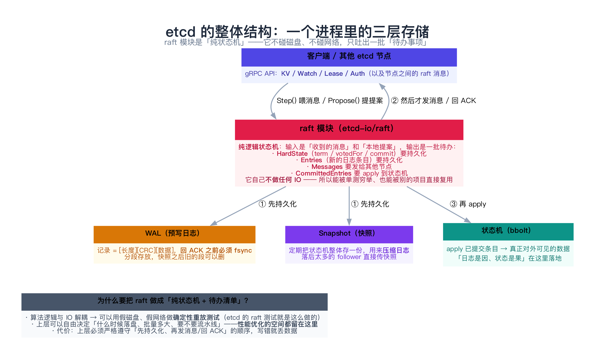
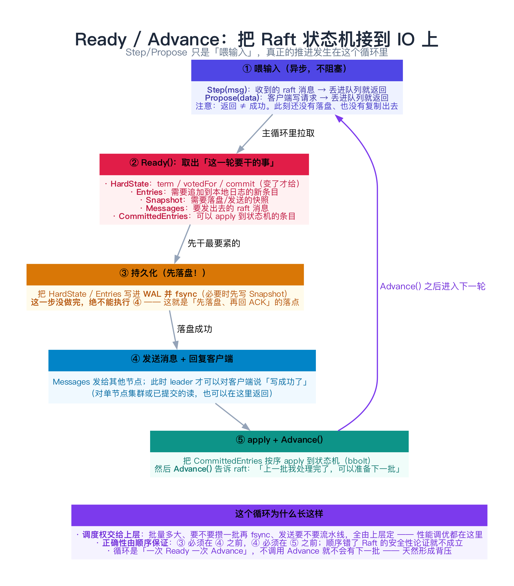
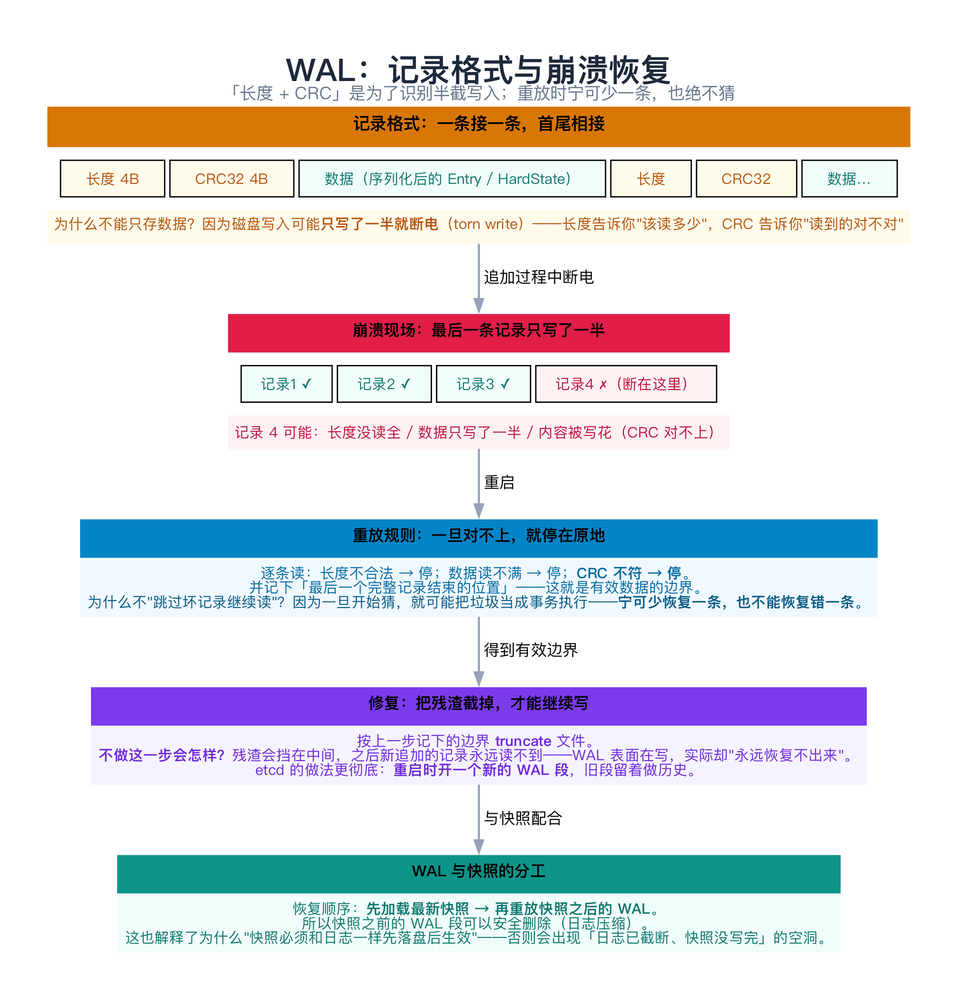
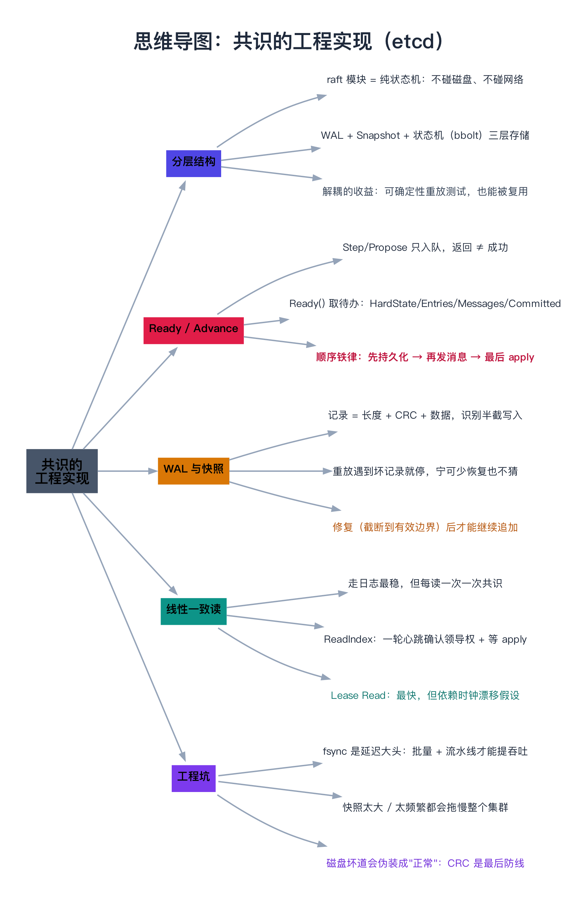

# 分布式共识的工程实现（etcd 源码）

> 一句话：把 Raft 从论文搬进生产，**难点不在算法，而在这四件事**——① raft 模块必须做成「纯状态机」（不碰磁盘、不碰网络）；② 所有 IO 走 `Ready/Advance` 循环，**顺序不能错**；③ WAL 的格式与恢复规则要对（长度 + CRC + 修复）；④ 连读也要保证线性一致。etcd 是这四件事的标准答案。

---

## 目录

1. [论文写完，只走了一半](#1-论文写完只走了一半)
2. [etcd 的整体结构](#2-etcd-的整体结构)
   - [2.1 raft 模块是个纯状态机](#21-raft-模块是个纯状态机)
   - [2.2 Ready / Advance：把状态机接到 IO 上](#22-ready-advance把状态机接到-io-上)
   - [2.3 三层存储：WAL / Snapshot / 状态机](#23-三层存储wal-snapshot-状态机)
3. [落盘顺序：正确性的核心](#3-落盘顺序正确性的核心)
   - [3.1 WAL 的记录格式](#31-wal-的记录格式)
   - [3.2 崩溃恢复：重放与修复](#32-崩溃恢复重放与修复)
   - [3.3 快照与 WAL 的分工](#33-快照与-wal-的分工)
4. [线性一致读：三条路](#4-线性一致读三条路)
5. [动手：写一个自己的 WAL（C++）](#5-动手写一个自己的-walc)
   - [5.1 代码](#51-代码)
   - [5.2 运行结果与解读](#52-运行结果与解读)
6. [工程上的常见坑](#6-工程上的常见坑)
7. [总结](#7-总结)
8. [延伸阅读](#8-延伸阅读)
9. [思维导图总结](#9-思维导图总结)

---

## 1. 论文写完，只走了一半

[09 Raft](../02-共识算法/09-Raft算法.md) 讲了算法，[12 共识工程细节](../02-共识算法/12-共识工程细节（快照、成员变更、线性一致读）.md) 会讲几个专题。但真实系统里还有一类问题**论文根本不提**：

```text
论文说：「收到多数派 ACK 就提交」
工程问：ACK 之前要不要 fsync？不 fsync 崩了怎么办？
论文说：「把日志复制给 follower」
工程问：日志无限长怎么办？磁盘写一半断电怎么办？
论文说：「leader 处理读请求」
工程问：leader 分区后还以为自己是主，读出来的是不是脏数据？
论文说：「节点收到消息后更新状态」
工程问：谁在什么线程里调用它？IO 和状态机怎么串起来？
```

这一篇就回答这些问题——**以 etcd 的实现为蓝本**（它是被研究得最透、被复用最多的生产级 Raft）。

> **先记住一句话**：论文里那些"显然"的动作，在工程里都要额外回答三个问题——**谁来做、什么时候做、失败了怎么办**。

---

## 2. etcd 的整体结构



### 2.1 raft 模块是个纯状态机

etcd 把 Raft 实现成一个**独立的库**（`go.etcd.io/raft/v3`），它有个非常关键的约束：

> **这个库不做任何 IO**——不读磁盘、不写磁盘、不发网络包。

它的输入只有两样：

| 输入 | 说明 |
|------|------|
| `Step(msg)` | 收到别的节点发来的 raft 消息 |
| `Propose(data)` | 本地要提案的业务数据（客户端写请求） |

输出则是一批**待办事项**（通过 `Ready()` 取出，见下一节）。这么设计换来三个好处：

1. **可测试**：可以用"假磁盘、假网络"重放整个执行历史，做确定性测试——etcd 的 raft 测试就是这么干的（它能把一个跑了几十万步的随机场景精确重放）；
2. **可复用**：TiKV、CockroachDB 等都用过这套库（或它的变体）；
3. **调度自由**：什么时候落盘、攒多大一批、要不要流水线，全留给上层——**性能优化的空间都在这里**。

代价是：**上层必须自己保证顺序**（下一节）。

### 2.2 Ready / Advance：把状态机接到 IO 上



整个驱动逻辑就是一个循环，每一轮做五件事，**顺序绝对不能变**：

```text
① Step(msg) / Propose(data)      ← 只是入队，返回 ≠ 成功
② ready := node.Ready()          ← 取出这一轮要干的事
③ 持久化：WAL（HardState/Entries）+ 必要时 Snapshot，并 fsync
④ 发送 Messages（给其他节点）；此时才可以回复客户端「写成功」
⑤ apply CommittedEntries 到状态机，然后 node.Advance()
```

三个容易看漏的点：

- **① 的返回不是成功**：`Propose` 只是把请求塞进队列，此时既没落盘也没复制出去。客户端拿到响应必须等到 ④；
- **③ 必须在 ④ 之前**：如果先发消息再落盘，本节点崩溃重启后会"忘记"自己投过票/发过日志，Raft 的安全性论证就不成立了。这就是 [09 篇 4.3 节](../02-共识算法/09-Raft算法.md) 那条规则的代码形态；
- **`Advance()` 形成背压**：不调用它，`Ready()` 就不会给出下一批——天然限流，不需要额外的队列管理。

> **类比**：`Ready()` 像**厨师长给学徒的一张备料单**："这些先切好放冰箱（③），切完再端出去（④），最后把做好的菜上桌（⑤）"。**先切后端**是铁律——反过来就是"菜还没做就端给客人"。

### 2.3 三层存储：WAL / Snapshot / 状态机

| 层 | 存什么 | 作用 | 什么时候写 |
|----|--------|------|-----------|
| **WAL** | HardState + 原始日志条目 | **崩溃恢复的唯一依据** | 每条日志（批量 + fsync） |
| **Snapshot** | 状态机在某个 index 的完整快照 | **压缩日志**；给落后太多的 follower 同步 | 每 N 条已 apply 的日志（etcd 默认 10 万条） |
| **状态机（bbolt）** | 业务数据的当前值 | 对外提供读 | apply 已提交条目时 |

三者的关系是**"因 → 果 → 果的快照"**：

```text
WAL（因）── apply ──▶ 状态机（果）
                        │
                        └── 定期打包 ──▶ Snapshot（果的快照）
```

**恢复时的顺序**：先加载最新快照，再重放快照之后的 WAL。所以**快照之前的 WAL 段可以安全删除**——这就是"日志压缩"，也是 WAL 必须分段存放的原因。

---

## 3. 落盘顺序：正确性的核心



### 3.1 WAL 的记录格式

每条记录长这样：

```text
[ 长度（8 字节）][ CRC32（4 字节）][ 数据（protobuf 序列化后的 Entry / HardState）] …按 8 字节对齐
```

**为什么不能只存数据？** 因为磁盘写入可能**只写了一半就断电**（torn write，也叫 partial write）。两个字段各司其职：

- **长度**：告诉恢复程序"这条记录该读多少字节"；
- **CRC32**：告诉恢复程序"读到的这些字节到底对不对"。

> 顺带一提：`fsync` 本身也**不保证**整个文件的完整性——它保证"已经返回成功的那部分"在崩溃后可见，但写到一半的那次写入可能留下任何前缀。所以**任何写日志的系统都必须能识别半截记录**。

### 3.2 崩溃恢复：重放与修复

恢复规则只有一句：**一旦对不上，就停在原地**。

```text
逐条读记录：
  长度不合法（0 或过大） → 停
  数据读不满            → 停
  CRC 不符              → 停
并记下「最后一个完整记录结束的位置」= 有效数据边界
```

**为什么不"跳过坏记录继续读"？** 因为一旦开始猜，就可能把磁盘上的垃圾当成事务执行——**宁可少恢复一条，也不能恢复错一条**。

然后必须做**修复**：把文件 `truncate` 到刚才记下的边界。不做这一步的后果很隐蔽：

> 残渣会挡在中间，之后新追加的记录**永远读不到**——WAL 表面在写，实际却"永远恢复不出来"。

第 5 节的代码会把这一点跑出来（这正是 etcd 为什么有 `wal.Repair()`；它更彻底的做法是**重启时直接开一个新的 WAL 段**）。

### 3.3 快照与 WAL 的分工

| 问题 | 靠什么解决 |
|------|-----------|
| 日志无限增长、重启重放太慢 | **快照**：把状态机打包，截断旧日志 |
| 落后太多的 follower（需要的日志已被删） | **InstallSnapshot**：直接传快照（分块） |
| 快照太大拖慢主循环 | etcd 的做法：**快照在独立流程里做**，不完全阻塞 raft 主循环；并可用 `--snapshot-count` 调节频率 |

**一个常见的错误顺序**：先删日志、再写快照。中间崩溃就会出现"日志没了、快照也没写成"的空洞。正确顺序永远是**先把快照落盘、再截断日志**。

---

## 4. 线性一致读：三条路

写的线性一致由共识保证；**读**呢？如果 leader 直接读本地状态机，可能读到**尚未提交**的数据，甚至在自己已经不是 leader 时还以为在任。三条路：

| 方案 | 做法 | 代价 | 何时用 |
|------|------|------|--------|
| **走日志** | 读请求也写成一条日志，走一遍共识 | 最稳，但每读一次一次共识，吞吐最差 | 极少用，教学/兜底 |
| **ReadIndex**（etcd 默认） | leader 记下当前 `commitIndex` → 向多数派发一轮心跳确认自己仍是 leader → 等状态机 apply 到该 index → 返回 | 一轮心跳的网络 RTT，不落盘 | **生产默认** |
| **Lease Read** | 靠时钟租约：leader 在租约期内直接读，不问多数派 | 最快（无额外网络往返），但**依赖时钟漂移假设** | 对延迟极敏感、且能接受时钟风险时 |

**ReadIndex 的关键在"确认领导权"这一步**：一个被分区出来的旧 leader，本地 `commitIndex` 看着很新，但它写的东西已经不可能被大多数节点接受了——所以必须先问多数派"我还是 leader 吗"。

> **注意区分两个"Lease"**：etcd 的 **Lease 功能**（TTL 键、租约绑定）和 **Lease Read**（一种读优化）是两回事，只是名字撞了。

---

## 5. 动手：写一个自己的 WAL（C++）

下面这个 120 行的程序实现了上面讲的 WAL：**长度 + CRC + 重放 + 修复**，并**真的模拟一次"写到一半断电"**。

### 5.1 代码

```cpp
// 模拟 etcd 的 WAL（Write-Ahead Log）：每条记录 = [长度 4B][CRC32 4B][数据]
// 演示三件事：
//   ① 追加记录必须先落盘（fsync）再回 ACK，否则崩溃就丢
//   ② 崩溃后重放：遇到「残缺记录」或「CRC 不符」就停在那里，把尾巴安全丢弃
//   ③ 被截断的 WAL 仍可继续追加使用（这正是 torn write 的恢复方式）
// 编译：g++ -std=c++11 -Wall -Wextra -O2 -o wal_demo wal_demo.cpp
#include <cstdint>
#include <cstdio>
#include <cstring>
#include <iostream>
#include <string>
#include <sys/stat.h>
#include <unistd.h>
#include <vector>

static uint32_t crc32(const void* data, std::size_t n) {
    static uint32_t table[256];
    static bool init = false;
    if (!init) {
        for (uint32_t i = 0; i < 256; ++i) {
            uint32_t c = i;
            for (int k = 0; k < 8; ++k) c = (c & 1u) ? (0xEDB88320u ^ (c >> 1)) : (c >> 1);
            table[i] = c;
        }
        init = true;
    }
    const unsigned char* p = static_cast<const unsigned char*>(data);
    uint32_t c = 0xFFFFFFFFu;
    for (std::size_t i = 0; i < n; ++i) c = table[(c ^ p[i]) & 0xFFu] ^ (c >> 8);
    return c ^ 0xFFFFFFFFu;
}

// 追加一条记录，写完立刻 fsync —— 顺序不能反：先落盘、再回 ACK
static void appendRecord(const char* path, const std::string& payload) {
    std::FILE* f = std::fopen(path, "ab");
    const uint32_t len = static_cast<uint32_t>(payload.size());
    const uint32_t crc = crc32(payload.data(), payload.size());
    std::fwrite(&len, 4, 1, f);
    std::fwrite(&crc, 4, 1, f);
    std::fwrite(payload.data(), 1, len, f);
    std::fflush(f);
    fsync(fileno(f));          // 关键一步
    std::fclose(f);
}

// 重放：逐条读取，遇到残缺或 CRC 不符就停下（丢弃尾部），绝不"猜"
// validEnd 回传「最后一个完整记录结束的位置」—— 修复 WAL 时要用它把残渣截掉
static std::vector<std::string> replay(const char* path, long* validEnd = nullptr) {
    std::vector<std::string> out;
    std::FILE* f = std::fopen(path, "rb");
    if (!f) { if (validEnd) *validEnd = 0; return out; }
    long consumed = 0;
    for (;;) {
        uint32_t len = 0, crc = 0;
        if (std::fread(&len, 4, 1, f) != 1) break;                 // 连长度都没读全
        if (std::fread(&crc, 4, 1, f) != 1) break;
        if (len == 0 || len > (1u << 20)) break;                   // 长度明显不合法
        std::string payload(len, '\0');
        if (std::fread(&payload[0], 1, len, f) != len) break;      // 数据只写了一半
        if (crc32(payload.data(), payload.size()) != crc) break;   // CRC 不符
        out.push_back(payload);
        consumed += 8 + static_cast<long>(len);
    }
    std::fclose(f);
    if (validEnd) *validEnd = consumed;
    return out;
}

static long fileSize(const char* path) {
    struct stat st;
    return (stat(path, &st) == 0) ? static_cast<long>(st.st_size) : -1;
}

static void show(const std::vector<std::string>& v) {
    std::cout << "[";
    for (std::size_t i = 0; i < v.size(); ++i) std::cout << (i ? " | " : "") << v[i];
    std::cout << "]";
}

int main() {
    const char* path = "/tmp/etcd_wal_demo.log";
    std::remove(path);

    std::cout << "① 依次追加 5 条记录（每条写完立刻 fsync）\n";
    for (int i = 1; i <= 5; ++i) {
        const std::string rec = "PUT key" + std::to_string(i) + " = value" + std::to_string(i);
        appendRecord(path, rec);
        std::cout << "   append: " << rec << "\n";
    }
    std::vector<std::string> a = replay(path);
    std::cout << "② 正常重放 → 恢复 " << a.size() << " 条：";
    show(a);
    std::cout << "\n";

    std::cout << "\n③ 模拟「写到一半断电」：把文件截到最后一条记录的中间\n";
    const long truncated = fileSize(path) - 17;      // 最后一条记录的数据区被砍掉 17 字节
    truncate(path, truncated);
    std::cout << "   文件大小 " << fileSize(path) << " 字节（原本 " << truncated + 17 << "）\n";
    long validEnd = 0;
    std::vector<std::string> b = replay(path, &validEnd);
    std::cout << "   重放 → 恢复 " << b.size() << " 条（残缺的那条被安全丢弃，程序没有报错）：";
    show(b);
    std::cout << "\n";

    std::cout << "\n④ 修复 WAL：把文件截到最后一个完整记录的边界（" << validEnd << " 字节）\n";
    truncate(path, validEnd);
    std::cout << "   现在文件里没有残渣了 —— 否则新追加的记录会被残渣挡在后面，永远读不到\n";

    std::cout << "\n⑤ 继续往后追加，并确认新记录可见\n";
    appendRecord(path, "PUT key6 = value6");
    std::vector<std::string> c = replay(path);
    std::cout << "   重放 → " << c.size() << " 条，最后一条是 " << c.back() << "\n";

    std::cout << "\n结论：WAL 的每条记录都要带「长度 + CRC」，重放时一旦对不上就【停在原地】——\n";
    std::cout << "      这样半截写入不会污染状态机；再按「最后一个完整记录的位置」修复文件，就能继续往后写。\n";
    std::remove(path);
    return 0;
}
```

### 5.2 运行结果与解读

```text
① 依次追加 5 条记录（每条写完立刻 fsync）
   append: PUT key1 = value1
   append: PUT key2 = value2
   append: PUT key3 = value3
   append: PUT key4 = value4
   append: PUT key5 = value5
② 正常重放 → 恢复 5 条：[PUT key1 = value1 | PUT key2 = value2 | PUT key3 = value3 | PUT key4 = value4 | PUT key5 = value5]

③ 模拟「写到一半断电」：把文件截到最后一条记录的中间
   文件大小 108 字节（原本 125）
   重放 → 恢复 4 条（残缺的那条被安全丢弃，程序没有报错）：[PUT key1 = value1 | PUT key2 = value2 | PUT key3 = value3 | PUT key4 = value4]

④ 修复 WAL：把文件截到最后一个完整记录的边界（100 字节）
   现在文件里没有残渣了 —— 否则新追加的记录会被残渣挡在后面，永远读不到

⑤ 继续往后追加，并确认新记录可见
   重放 → 5 条，最后一条是 PUT key6 = value6

结论：WAL 的每条记录都要带「长度 + CRC」，重放时一旦对不上就【停在原地】——
      这样半截写入不会污染状态机；再按「最后一个完整记录的位置」修复文件，就能继续往后写。
```

逐条对照：

| 输出片段 | 印证了什么 |
|----------|-----------|
| ① 每条 `append` 都 `fsync` | **回 ACK 之前必须落盘**；批量 fsync 是性能优化，但不能省掉 |
| ② `恢复 5 条` | 正常路径：按记录边界逐条重放 |
| ③ `文件大小 108 字节（原本 125）` | 模拟掉电：最后一条记录只写了一半 |
| ③ `恢复 4 条…程序没有报错` | **重放在坏记录处停下**——不猜、不跳过 |
| ④ `修复 WAL：截到 100 字节` | 真实 WAL 必须有这一步，否则残渣会挡住后面的写入 |
| ⑤ `恢复 5 条，最后一条是 PUT key6` | 修复之后 WAL 才能继续正常使用 |

> 这段代码刻意保留了"先不修复会怎样"的隐患：你可以注释掉第 ④ 步再跑一次，会看到第 ⑤ 步的新记录**永远恢复不出来**——这就是很多自研 WAL 的翻车点。

---

## 6. 工程上的常见坑

**① 忘了 fsync，或 fsync 的位置不对**

`write()` 返回只说明数据进了**页缓存**，没进磁盘。断电后这部分全丢——而 Raft 的安全性正是建立在"落盘之后才回 ACK"上的。

**② 新文件创建后忘了 fsync 目录**

创建一个新 WAL/Snapshot 文件后，**文件内容 fsync 了，但目录项可能还没落盘**——崩溃后文件可能"存在但为空"或者"根本不存在"。正确做法是对目录 fd 也 `fsync`。这个坑极其隐蔽，很多自研实现都栽过。

**③ 批量与延迟的取舍没做**

每条日志一次 fsync，延迟就是磁盘的 fsync 延迟（机械盘可达几十毫秒）。生产实现都做**批量**：攒一小批一起 fsync，一次刷多条——**吞吐上去了，代价是尾部延迟变长**。

**④ 把 WAL 和快照放在同一块慢盘上**

快照写入会挤占 WAL 的 IO；WAL 一慢，心跳就慢，心跳一慢就可能触发重新选举——**磁盘抖动 → 选主 → 更抖**，这是生产上最常见的"雪崩"链条之一。etcd 的官方建议就是**给 WAL 配独立的高 IOPS 盘**。

**⑤ 快照长期不释放内存**

etcd 在生成快照前会保留一段时间的历史版本，快照太稀疏会导致内存里堆积大量旧版本（`--snapshot-count` 太大就是这个问题）。反之太频繁又会拖慢 IO。**这是个需要按业务调的参数**。

**⑥ 以为"多数派 ACK 就能提交"**

再提醒一次 [09 篇 4.2 节](../02-共识算法/09-Raft算法.md) 的 Figure 8：**旧任期的条目不能凭"多数派有"直接提交**，必须靠当前任期的一条条目间接带上。etcd 里对应的实现是"新 leader 上任先推进一条空条目"。

---

## 7. 总结

| 主题 | 要点 |
|------|------|
| **分层** | raft 模块 = 纯状态机（无 IO）；上层负责 WAL / Snapshot / 状态机 |
| **驱动模型** | `Step/Propose` 喂输入 → `Ready()` 取待办 → **持久化 → 发送 → apply** → `Advance()` |
| **顺序铁律** | **先落盘、再发消息、最后 apply**；`Propose` 返回不代表成功 |
| **WAL 格式** | `[长度][CRC][数据]` —— 长度识别半截写入，CRC 识别内容损坏 |
| **恢复规则** | 遇到坏记录**停在原地**，记下有效边界，**修复（truncate）后**才能继续写 |
| **快照** | 压缩日志 + 同步落后节点；顺序是**先落快照、再截断日志** |
| **线性一致读** | 走日志（最稳）/ **ReadIndex（默认）** / Lease Read（最快但有风险） |
| **性能与可靠** | fsync 是延迟大头 → 批量 + 流水线；WAL 要独立高 IOPS 盘，否则会引发选主雪崩 |

**记住三句话**：

1. **Raft 的库应该是个纯状态机**：把 IO 留给上层，换来可测试与可优化。
2. **正确性 = 顺序**：`先持久化 → 再发送 → 最后 apply`，这个顺序写错，算法再对也不安全。
3. **WAL 的核心是"能识别半截写入并安全停下"**：长度 + CRC + 修复，一个都不能少。

下一章进入 [12 共识工程细节（快照、成员变更、线性一致读）](../02-共识算法/12-共识工程细节（快照、成员变更、线性一致读）.md)，把本篇提到的几个专题逐个拆开。

---

## 8. 延伸阅读

- **源码**（对着读收益最大）：
  - [etcd-io/raft](https://github.com/etcd-io/raft) 的 `raft.go`（状态机）、`node.go`（`Ready/Advance` 的定义）、`rafttest/`（确定性测试框架）；
  - `wal/wal.go` 与 `wal/repair.go` —— **本文第 3、5 节讲的格式与修复就是这里**，重点看 `encoder.encode`（长度 + CRC + 对齐）与 `Repair`；
  - `etcdserver/server.go` 的主循环 —— 看 `Ready()` 之后那几步的真实实现顺序。
- **设计文档**：
  - etcd 官方 *Documentation / Learning / Why etcd*、*Tuning*（尤其 **"给 WAL 配独立磁盘"** 那条建议）；
  - `--snapshot-count`、`--max-wals`、`--backend-batch-interval` 等参数的调优说明。
- **同源阅读**：Ongaro 的博士论文《Consensus: Bridging Theory and Practice》第 4 章（成员变更）与第 5 章（日志压缩与快照）；TiKV / CockroachDB 的 Raft 实现博客（另一套工程取舍）。
- **对比**：[10 ZooKeeper 与 Zab](../02-共识算法/10-ZooKeeper与Zab协议.md) —— ZooKeeper 把"事务日志 + 快照"做在同一套机制里，可以对照看两种工程风格。
- **顺着往下读**：[12 共识工程细节](../02-共识算法/12-共识工程细节（快照、成员变更、线性一致读）.md)（专题展开）、[54 一致性验证](../08-可观测性与工程保障/54-一致性验证（Jepsen与线性一致性测试）.md)（怎么证明上面这些真的做对了）。

---

## 9. 思维导图总结

```text
共识的工程实现（etcd）
├── 分层结构
│   ├── raft 模块 = 纯状态机：不碰磁盘、不碰网络
│   ├── 三层存储：WAL（因）/ 状态机 bbolt（果）/ Snapshot（果的快照）
│   └── 解耦的收益：可确定性重放测试，也能被其他项目复用
├── Ready / Advance 循环
│   ├── Step/Propose 只入队，返回 ≠ 成功
│   ├── Ready() 取出待办：HardState / Entries / Snapshot / Messages / CommittedEntries
│   ├── 顺序铁律：先持久化 → 再发消息 → 最后 apply
│   └── Advance() 形成天然背压
├── WAL 与快照
│   ├── 记录 = 长度 + CRC + 数据：识别半截写入
│   ├── 重放遇到坏记录就停，宁可少恢复也不猜
│   ├── 修复：截断到有效边界后才能继续追加
│   └── 顺序：先落快照、再截断日志（反过来会留下空洞）
├── 线性一致读
│   ├── 走日志：最稳、最慢
│   ├── ReadIndex（默认）：一轮心跳确认领导权 + 等 apply
│   └── Lease Read：最快，但依赖时钟漂移假设
└── 工程坑
    ├── 忘 fsync / 忘 fsync 目录
    ├── 批量与延迟的取舍没做（fsync 是延迟大头）
    ├── WAL 与快照抢同一块慢盘 → 选主雪崩
    └── 快照频率没调好：太稀内存涨，太密 IO 抖
```


