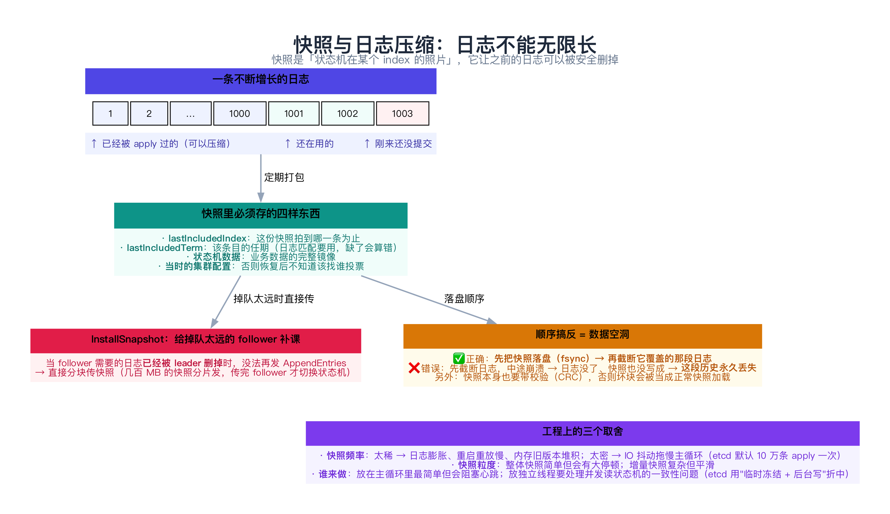
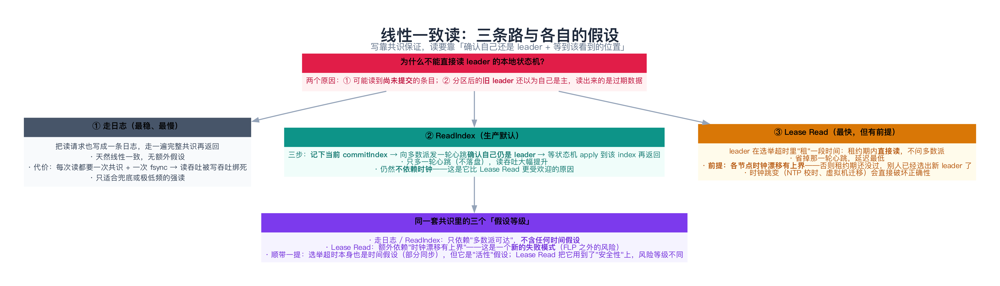
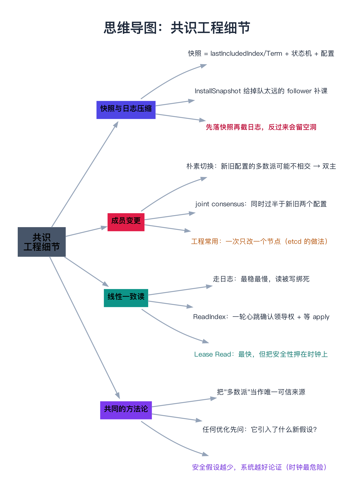

# 共识工程细节（快照、成员变更、线性一致读）

> 一句话：这三件事都有同一个特征——**论文里一句话带过，工程里却是事故高发区**。快照要在"不阻塞共识"和"内存不爆"之间取舍；成员变更稍有不慎就能造出**两个不相交的多数派**；线性一致读则要求你在"快"和"依赖时钟"之间选一个。它们的共同方法论是：**任何优化都先问一句「它引入了什么新假设」。**

---

## 目录

1. [为什么值得单开一篇](#1-为什么值得单开一篇)
2. [快照与日志压缩](#2-快照与日志压缩)
   - [2.1 快照里必须有什么](#21-快照里必须有什么)
   - [2.2 InstallSnapshot：给掉队太远的 follower 补课](#22-installsnapshot给掉队太远的-follower-补课)
   - [2.3 顺序与三个取舍](#23-顺序与三个取舍)
3. [成员变更](#3-成员变更)
   - [3.1 直接改配置为什么危险](#31-直接改配置为什么危险)
   - [3.2 joint consensus](#32-joint-consensus)
   - [3.3 单节点变更：工程上的常用解](#33-单节点变更工程上的常用解)
   - [3.4 三个容易踩的点](#34-三个容易踩的点)
4. [线性一致读](#4-线性一致读)
   - [4.1 为什么不能直接读本地状态机](#41-为什么不能直接读本地状态机)
   - [4.2 三条路](#42-三条路)
   - [4.3 假设的等级：时钟为什么最危险](#43-假设的等级时钟为什么最危险)
5. [动手：把「双多数派」枚举出来看（C++）](#5-动手把双多数派枚举出来看c)
   - [5.1 代码](#51-代码)
   - [5.2 运行结果与解读](#52-运行结果与解读)
6. [常见坑](#6-常见坑)
7. [总结](#7-总结)
8. [延伸阅读](#8-延伸阅读)
9. [思维导图总结](#9-思维导图总结)

---

## 1. 为什么值得单开一篇

[09 Raft](../02-共识算法/09-Raft算法.md) 讲清了算法，[11 etcd 实现](../02-共识算法/11-分布式共识的工程实现（etcd源码）.md) 讲清了 IO 顺序。剩下三件事经常被"顺便提一句"，但它们各自都能独立造成线上事故：

| 主题 | 论文里的篇幅 | 工程里的真相 |
|------|-------------|-------------|
| **快照** | Raft 论文第 7 节，约 1 页 | 快照频率、内存水位、IO 抖动、传快照时的限流——全是调参和事故 |
| **成员变更** | Raft 论文第 6 节，约 2 页 | 实现复杂度极高，etcd 至今只用"一次一个节点"的简化版 |
| **线性一致读** | Paxos 论文基本不提 | 读占业务流量的 90%，读怎么保证一致直接决定吞吐 |

它们还共享一个思维工具，**本文会反复用**：

> **任何优化，先问它引入了什么新假设。**

- 快照引入的假设：**"先落盘再截断"** 这个顺序必须成立；
- joint consensus 引入的代价：**两阶段提交式的复杂度**；
- Lease Read 引入的假设：**时钟漂移有上界**——这是 FLP 之外的一个全新失败模式。

---

## 2. 快照与日志压缩



### 2.1 快照里必须有什么

日志不能无限长，原因很朴素：**内存放不下、重启重放要几百万条**。解决办法是定期给状态机拍张照：

| 字段 | 为什么必须有 |
|------|-------------|
| **lastIncludedIndex** | 这份快照拍到哪一条为止；截断日志、判断"谁落后了"都靠它 |
| **lastIncludedTerm** | 日志匹配用；**少存这个字段，一致性检查就会算错**（Raft 的 `prevLogTerm` 比较依赖任期） |
| **状态机数据** | 业务数据的完整镜像（通常按 key 范围分块存） |
| **当时的集群配置** | 否则恢复后不知道该找谁投票——一个只有数据、没有配置的快照是"孤儿" |

### 2.2 InstallSnapshot：给掉队太远的 follower 补课

当某个 follower 落后太多，**它需要的日志已经被 leader 压缩掉了**——此时没法再用 `AppendEntries` 补，只能直接传快照：

```text
leader 发现 follower 的 nextIndex 已经小于自己日志的起点
  → 分块传快照（每块带 offset）
  → follower 收齐后：先落盘快照 → 再用快照重建状态机 → 通知 leader
```

**分块传输是必须的**：快照可能有几百 MB，一次发完会撑爆内存和网络。

### 2.3 顺序与三个取舍

**顺序只有一条，但错了就是数据空洞：**

> ✅ **先把快照落盘（fsync）→ 再截断它覆盖的那段日志**
> ❌ 先截断日志 → 中途崩溃 → 日志没了、快照也没写成 → **这段历史永久丢失**

另外快照本身**也要带校验（CRC）**：磁盘坏块会被当成"正常快照"加载进来，比丢数据更糟——它会让你基于错误的状态继续跑。

三个工程取舍：

| 取舍 | 太保守的后果 | 太激进的后果 |
|------|-------------|-------------|
| **频率** | 日志膨胀、重启重放慢、内存里旧版本堆积 | 快照 IO 挤占主循环 → 心跳延迟 → 触发重新选举 |
| **粒度** | 整体快照简单，但会有一次长停顿 | 增量快照平滑，但实现复杂度上一个台阶 |
| **执行位置** | 放主循环里最简单，但会阻塞心跳 | 放独立线程要解决"读状态机时数据还在变"的一致性问题 |

etcd 的折中：默认**每 10 万条已 apply 条目做一次快照**，并且快照过程尽量不长时间阻塞主循环。

---

## 3. 成员变更


### 3.1 直接改配置为什么危险

假设集群从 3 节点 `{A,B,C}` 扩到 5 节点 `{A,B,C,D,E}`。如果每个节点**各自、异步地**切换到新配置，中间必然出现这样的窗口：

```text
C、D、E 还在按【旧配置】数票 → 多数派 = 2 → {A,B} 就能选出 leader
A、B   已按【新配置】数票   → 多数派 = 3 → {C,D,E} 就能选出 leader
                                            ↑ 两组 {A,B} 与 {C,D,E} 不相交！
```

**两个 leader 各自发号施令 → 数据分裂。** 注意这不是"配置写错了"，而是**两个配置的多数派可以不相交**——这是纯粹的数学问题。第 5 节的代码会把所有这样的组合枚举出来（一共 3 组）。

### 3.2 joint consensus

Raft 论文给的解法是**两阶段切换**：

```text
阶段一：切到 C_old,new
        任何决议必须【同时】取得 旧配置的多数派 和 新配置的多数派
阶段二：C_old,new 这条配置变更被提交后，再切到 C_new
```

**为什么这样就安全？** 因为两个 joint 多数派都必须"在旧配置 {A,B,C} 里也过半"——而 **3 个节点里凑不出两组各占 2 个的不相交集合**，所以必然相交（第 5 节的程序会验证：找不到任何不相交的组合）。

### 3.3 单节点变更：工程上的常用解

joint consensus 的正确性很漂亮，但实现起来是**两阶段提交式**的复杂度：要同时维护两套配置的计数、要处理"阶段一提交了但阶段二没提交"的中间态……

所以工程实现（**etcd**）选了另一条路：

> **一次只增删一个节点**：`{A,B,C}` → `{A,B,C,D}` → `{A,B,C,D,E}`。

**为什么安全？** 相邻两个配置的多数派必然相交（4 节点要 3 票、3 节点要 2 票，交集至少 1 个），只要保证"**上一次变更已提交，才开始下一次**"，就永远没有双主窗口。

代价也很明确：**必须一个一个来**——从 3 扩到 7 要走 4 轮，变更期间每一步都要等提交。

### 3.4 三个容易踩的点

1. **配置本身也要走日志**：变更必须作为**一条日志条目**被复制、提交，不能"本地改一下就生效"——否则各节点的配置视图会不一致，又回到 3.1 的窗口；
2. **新节点要先追日志再加进来**：一个空日志的新节点加入会拉低整体可用性（它可能成为决定多数派的那一票却什么都不知道）。常见做法是让它先以**学习者（learner / non-voting）** 身份同步；
3. **旧 leader 可能不在新配置里**：变更提交后，leader 若发现自己已被移除，要**主动退位**——否则它会继续发心跳，干扰新配置的选举。

---

## 4. 线性一致读



### 4.1 为什么不能直接读本地状态机

两个原因，都很致命：

1. **可能读到未提交的数据**：leader 本地日志里有条目，但还没被多数派确认——此时它不算"已提交"，读了就是脏读；
2. **旧 leader 的幻觉**：网络分区后，一个被隔离的旧 leader 完全不知道新 leader 已经选出来了，它会**自信地**用本地状态机回答读请求——读出来的是过期数据，而且它还认为自己是权威。

### 4.2 三条路

| 方案 | 做法 | 多出来的开销 | 依赖的假设 |
|------|------|-------------|-----------|
| **走日志** | 读也写成一条日志，走一遍共识 | 一次共识 + 一次 fsync | 无（最稳） |
| **ReadIndex**（生产默认） | 记下 `commitIndex` → 向多数派发一轮心跳**确认自己仍是 leader** → 等 apply 到该 index 再返回 | 一轮心跳（不落盘） | 多数派可达 |
| **Lease Read** | leader 在选举超时内"租"一段时间，租约期内直接读 | 几乎没有 | **时钟漂移有上界** |

**ReadIndex 的精髓在"确认领导权"这一步**：它用一轮心跳换回了"我确实还是 leader"这个事实，然后才敢用本地的 `commitIndex` 作为读的下界。它**不落盘、不依赖时钟**，所以成为 etcd 的默认选择。

### 4.3 假设的等级：时钟为什么最危险

把三种方案放在"假设阶梯"上看，会非常清楚：

```text
走日志 < ReadIndex < Lease Read
（只依赖多数派可达）  （+ 一轮心跳）  （+ 时钟漂移上界）
```

**为什么"依赖时钟"值得单独警惕？** 因为共识算法（含 Raft 的选举超时）本来就假设了"部分同步"——但这个假设是拿来保证**活性**的（迟早选出 leader）。而 Lease Read 把时间假设用在了**安全性**上：一旦时钟跳变（NTP 校时、虚拟机迁移、容器被挂起），租约期还没过，别人可能已经选出新 leader 并提交了新数据——**两个 leader 同时对外服务**。

> 一句话：**时间假设用来保活性可以容忍，用来保安全性就是定时炸弹。**

---

## 5. 动手：把「双多数派」枚举出来看（C++）

下面这个程序把 3.1 节的危险**穷举验证**一遍：在 5 个节点的所有子集里，找出"一组是旧配置的多数派、另一组是新配置的多数派、且两者不相交"的组合。

### 5.1 代码

```cpp
// 成员变更的安全性演示：把「谁可能同时当选」枚举出来看
//   场景：3 节点集群 {A,B,C} 要扩到 5 节点 {A,B,C,D,E}
//   ① 朴素做法（节点各自异步切换配置）→ 存在两个【不相交】的多数派 → 可能双主
//   ② joint consensus（要求同时拿到新旧两个配置的多数派）→ 任意两个多数派必相交
// 编译：g++ -std=c++11 -Wall -Wextra -O2 -o membership_demo membership_demo.cpp
#include <iostream>
#include <string>

static const char* kAll[5] = {"A", "B", "C", "D", "E"};

static int popcount(int m) { int c = 0; while (m) { c += m & 1; m >>= 1; } return c; }

// 旧配置 {A,B,C} 的多数派：A、B、C 里占 >= 2
static bool majorityOfOld(int mask) {
    int c = 0;
    for (int i = 0; i < 3; ++i) if ((mask >> i) & 1) ++c;
    return c >= 2;
}
// 新配置 {A,B,C,D,E} 的多数派：5 个里占 >= 3
static bool majorityOfNew(int mask) { return popcount(mask) >= 3; }
// joint consensus：必须【同时】是旧配置和新配置的多数派
static bool majorityOfJoint(int mask) { return majorityOfOld(mask) && majorityOfNew(mask); }

static std::string names(int mask) {
    std::string s = "{";
    for (int i = 0; i < 5; ++i) if ((mask >> i) & 1) { if (s.size() > 1) s += ","; s += kAll[i]; }
    return s + "}";
}

// 跨配置搜索：找 X（满足 predA）与 Y（满足 predB），且 X ∩ Y = ∅
static void findDisjoint(bool (*predA)(int), bool (*predB)(int),
                         const std::string& labelA, const std::string& labelB) {
    int found = 0;
    for (int x = 1; x < 32 && found < 3; ++x) {
        if (!predA(x)) continue;
        for (int y = 1; y < 32; ++y) {
            if (!predB(y)) continue;
            if (x & y) continue;                     // 只关心不相交的组合
            std::cout << "    ⚠ " << names(x) << "（" << labelA << "）+ "
                      << names(y) << "（" << labelB << "）→ 两组不相交，"
                      << "可以各自选出 leader\n";
            ++found;
            if (found >= 3) break;
        }
    }
    if (!found) std::cout << "    ✓ 找不到不相交的组合：任意两组决策都必然相交\n";
    std::cout << "\n";
}

int main() {
    std::cout << "集群从 {A,B,C}（多数派 = 2）扩到 {A,B,C,D,E}（多数派 = 3）\n\n";

    std::cout << "① 朴素做法：节点异步切换配置 —— 一侧还在按旧配置数票，另一侧已按新配置数票\n";
    findDisjoint(majorityOfOld, majorityOfNew, "旧配置多数派", "新配置多数派");

    std::cout << "② joint consensus：任何决议都必须【同时】取得新旧两个配置的多数派\n";
    findDisjoint(majorityOfJoint, majorityOfJoint, "joint 多数派", "joint 多数派");

    std::cout << "结论：朴素切换的危险不在「配置写错」，而在于【两个配置的多数派可以不相交】——\n";
    std::cout << "      于是同一时刻可能存在两个自认合法的 leader。joint consensus 用「双重多数派」\n";
    std::cout << "      强制任意两组决策都相交，从而彻底消除这个窗口。\n";
    return 0;
}
```

### 5.2 运行结果与解读

```text
集群从 {A,B,C}（多数派 = 2）扩到 {A,B,C,D,E}（多数派 = 3）

① 朴素做法：节点异步切换配置 —— 一侧还在按旧配置数票，另一侧已按新配置数票
    ⚠ {A,B}（旧配置多数派）+ {C,D,E}（新配置多数派）→ 两组不相交，可以各自选出 leader
    ⚠ {A,C}（旧配置多数派）+ {B,D,E}（新配置多数派）→ 两组不相交，可以各自选出 leader
    ⚠ {B,C}（旧配置多数派）+ {A,D,E}（新配置多数派）→ 两组不相交，可以各自选出 leader

② joint consensus：任何决议都必须【同时】取得新旧两个配置的多数派
    ✓ 找不到不相交的组合：任意两组决策都必然相交

结论：朴素切换的危险不在「配置写错」，而在于【两个配置的多数派可以不相交】——
      于是同一时刻可能存在两个自认合法的 leader。joint consensus 用「双重多数派」
      强制任意两组决策都相交，从而彻底消除这个窗口。
```

逐条对照：

| 输出片段 | 印证了什么 |
|----------|-----------|
| ① `{A,B}（旧配置多数派）+ {C,D,E}（新配置多数派）` | **危险窗口真实存在**：2 个节点就能在旧配置下当选，另外 3 个在新配置下也能当选，互不知情 |
| ① 一共列出 3 组 | 穷举的结果：`{A,B}`/`{C,D,E}`、`{A,C}`/`{B,D,E}`、`{B,C}`/`{A,D,E}` —— 三组都会造成双主 |
| ② `✓ 找不到不相交的组合` | **joint consensus 把窗口彻底堵死**：两个 joint 多数派都必须"在 {A,B,C} 里过半"，3 个节点凑不出两组各 2 个的不相交集合 |
| 组合数量为 0 | 这就是"安全性"——**不是概率变小，而是数学上不可能** |

> 顺带说一句：这段代码顺便演示了一个很实用的方法——**当你不确定一个协议安不安全时，先穷举小规模场景**。5 个节点的子集只有 32 个，穷举成本几乎为零，但能给出确定的结论。

---

## 6. 常见坑

**① 先截断日志，再写快照**

见 2.3 节。中间崩溃就是永久数据空洞。正确顺序：**快照落盘 → 截断日志**。

**② 快照里忘了存 `lastIncludedTerm` 或集群配置**

- 少了 term：日志匹配算错，follower 可能被要求"从错误的位置开始对齐"；
- 少了配置：恢复后不知道该找谁投票，节点变成"孤儿"。

**③ 成员变更"本地生效"**

配置变更必须走日志、走共识。任何"我本地先改一下"的做法都会制造配置视图不一致。

**④ 一次变更多个节点**

会造出 3.1 节那三组不相交多数派中的至少一组。要么 joint consensus，要么一次一个。

**⑤ 在 leader 上直接读本地状态机**

见 4.1 节。分区后的旧 leader 会给你一份"自信而错误"的答案。

**⑥ 打开 Lease Read 却没管时钟**

容器被挂起（CPU 限流）、虚拟机迁移、NTP 大步校时——任何一个都能让租约"比实际时间长"。要用地话必须：**限制时钟漂移 + 监测时钟跳变 + 保守设置租约时长**。

**⑦ 新节点直接以投票成员加入**

空日志的新节点会成为"关键一票"，让集群在它同步完成前更脆弱。先让它做 learner。

---

## 7. 总结

| 主题 | 关键点 |
|------|--------|
| **快照内容** | `lastIncludedIndex` + `lastIncludedTerm` + 状态机数据 + 当时的集群配置，一个都不能少 |
| **快照顺序** | **先落盘快照、再截断日志**；快照本身要有 CRC |
| **InstallSnapshot** | 需要的日志已被压缩时，直接分块传快照 |
| **快照取舍** | 频率（内存 vs IO）、粒度（简单 vs 平滑）、执行位置（阻塞 vs 并发） |
| **成员变更危险** | 新旧配置的**多数派可能不相交** → 同一时刻两个 leader |
| **两种解法** | joint consensus（同时过半于新旧配置，论文方案）/ 一次改一个节点（etcd 的工程解） |
| **变更注意点** | 变更走日志、新节点先做 learner、被移除的 leader 要主动退位 |
| **线性一致读** | 走日志（最稳）/ ReadIndex（默认，一轮心跳确认领导权）/ Lease Read（最快，押注时钟） |
| **方法论** | 任何优化先问：**它引入了什么新假设？** 时间假设只配保活性，不配保安全 |

**记住三句话**：

1. **快照解决"日志无限长"，但它的顺序不能错**：先落快照、再截断日志，快照要带 CRC、term 和配置。
2. **成员变更的危险是数学性的**：两个配置的多数派可能不相交；要么双重多数派（joint consensus），要么一次只动一个节点。
3. **读的一致性是成本问题**：ReadIndex 用一轮心跳买回"我还是 leader"这个事实；Lease Read 用时钟换延迟——而时钟是最不该被信任的东西。

下一章进入 [13 拜占庭容错共识（PBFT、Tendermint、HotStuff）](../02-共识算法/13-拜占庭容错共识（PBFT、Tendermint、HotStuff）.md)，看"节点会撒谎"时，这些机制要怎么重做一遍。

---

## 8. 延伸阅读

- **Raft 论文的两节**：Ongaro & Ousterhout《In Search of an Understandable Consensus Algorithm》第 6 节（成员变更，含 joint consensus 的完整推导与那个"服务器不知道自己被移除"的边界情况）与第 7 节（日志压缩）；
- **博士论文的展开**：Ongaro《Consensus: Bridging Theory and Practice》第 4、5 章 —— 论文放不下的实现细节（快照并发、成员变更的工程取舍）都在这里，**etcd 的实现基本照着它写的**。
- **Lease Read 与 ReadIndex**：Raft 博士论文第 6.4 节（Read-only queries）系统比较了三种读，并明确给出了 Lease Read 的时钟假设；etcd 文档里的 `--experimental-...` 读相关参数可以对照看。
- **工程实现**：etcd 的 `raft.ReadOnlyOption`（`ReadOnlySafe` / `ReadOnlyLeaseBased`）与 `etcdserver` 里的 `linearizableReadLoop`；TiKV 关于 Lease Read 与 ReadIndex 的取舍博客。
- **时钟风险的实证**：Jepsen 关于 etcd / Consul 的报告里对时间假设的讨论（见 [54 一致性验证](../08-可观测性与工程保障/54-一致性验证（Jepsen与线性一致性测试）.md)）；以及分布式中"时钟回拨"导致事故的公开复盘。
- **顺着往下读**：[11 共识的工程实现](../02-共识算法/11-分布式共识的工程实现（etcd源码）.md)（WAL 与 Ready/Advance）、[13 BFT 共识](../02-共识算法/13-拜占庭容错共识（PBFT、Tendermint、HotStuff）.md)（把 3f+1 那一套讲透）。

---

## 9. 思维导图总结

```text
共识工程细节
├── 快照与日志压缩
│   ├── 快照 = lastIncludedIndex + lastIncludedTerm + 状态机数据 + 当时的配置
│   ├── InstallSnapshot：需要的日志已被压缩时，分块传快照
│   ├── 铁律：先落快照（fsync）再截断日志，反过来会留永久空洞
│   └── 三个取舍：频率（内存 vs IO）、粒度、执行位置（阻塞 vs 并发）
├── 成员变更
│   ├── 危险本质：新旧配置的多数派可能【不相交】→ 双主窗口
│   ├── joint consensus：任何决议同时过半于新旧两个配置（数学上堵死窗口）
│   ├── 工程常用：一次只改一个节点（相邻配置多数派必相交）
│   └── 注意：变更走日志、新节点先做 learner、被移除的 leader 主动退位
├── 线性一致读
│   ├── 不能直接读本地：可能读到未提交数据；旧 leader 会自信地给过期数据
│   ├── 走日志：最稳最慢；ReadIndex：一轮心跳确认领导权（默认）
│   ├── Lease Read：最快，但把安全性押在「时钟漂移有上界」上
│   └── 假设阶梯：多数派可达 ⊂ +心跳 ⊂ +时钟；时间假设只配保活性
└── 方法论
    ├── 任何优化先问：它引入了什么新假设？
    ├── 不确定协议安不安全？先穷举小规模场景（5 节点只有 32 个子集）
    └── 顺序、假设、边界情况——工程事故九成出在这三处
```


