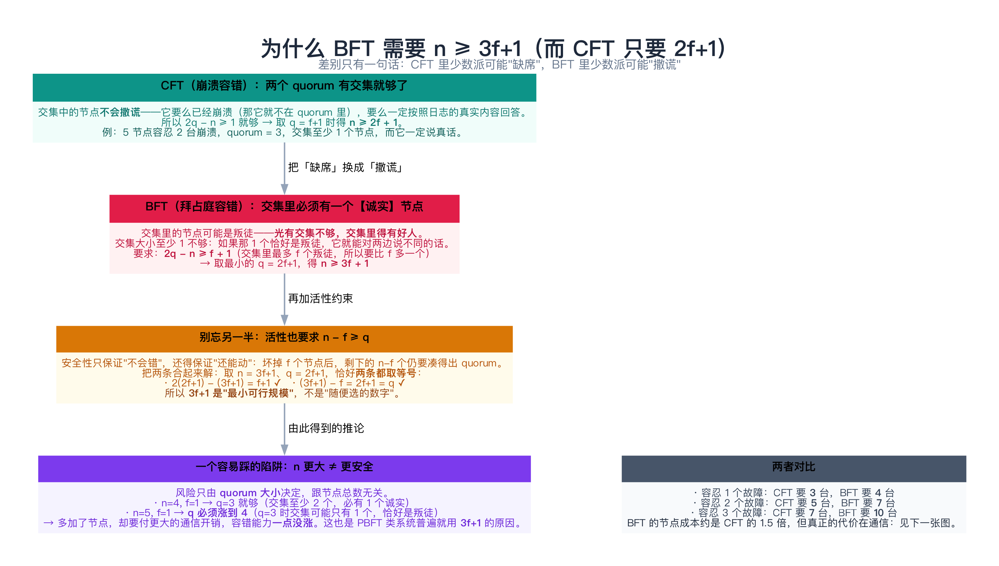
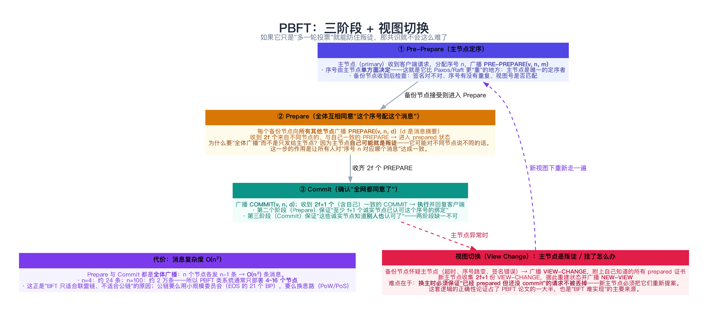
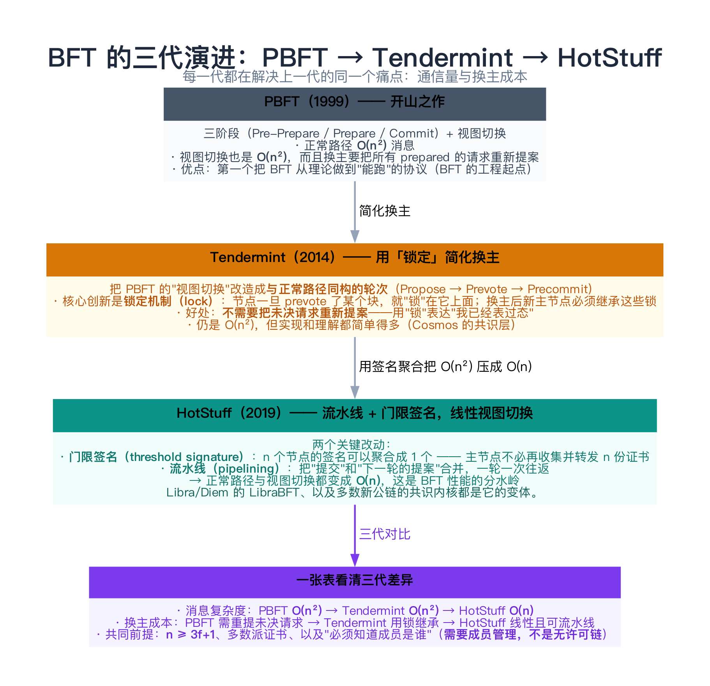
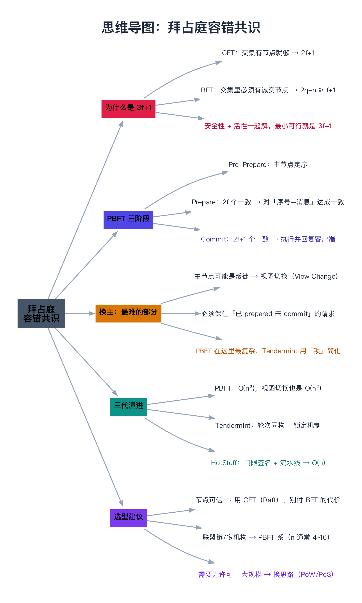

# 拜占庭容错共识（PBFT、Tendermint、HotStuff）

> 一句话：CFT 假设节点「要么正确、要么闭嘴」，BFT 假设节点**会撒谎**——就这一个差别，让节点成本从 `2f+1` 涨到 `3f+1`，让消息复杂度从 `O(n)` 涨到 `O(n²)`，也让"换主"从一件小事变成整个协议最难的部分。这一篇讲清三件事：**为什么是 3f+1、PBFT 的三阶段到底在防什么、以及三代 BFT 协议各自解决了什么**。

---

## 目录

1. [从 CFT 到 BFT：多出来的那一倍是为什么](#1-从-cft-到-bft多出来的那一倍是为什么)
   - [1.1 一句话差别：缺席 vs 撒谎](#11-一句话差别缺席-vs-撒谎)
   - [1.2 安全性：交集里必须有诚实节点](#12-安全性交集里必须有诚实节点)
   - [1.3 活性：别忘了一半](#13-活性别忘了一半)
   - [1.4 一个陷阱：n 更大 ≠ 更安全](#14-一个陷阱n-更大-更安全)
2. [PBFT：三阶段在防什么](#2-pbft三阶段在防什么)
   - [2.1 Pre-Prepare：主节点定序](#21-pre-prepare主节点定序)
   - [2.2 Prepare：对「序号 ↔ 消息」达成一致](#22-prepare对序号-消息达成一致)
   - [2.3 Commit：确认「全网都同意了」](#23-commit确认全网都同意了)
   - [2.4 为什么两轮投票缺一不可](#24-为什么两轮投票缺一不可)
3. [换主：BFT 最难的部分](#3-换主bft-最难的部分)
4. [三代演进：PBFT → Tendermint → HotStuff](#4-三代演进pbft-tendermint-hotstuff)
5. [动手：把 3f+1 算出来（C++）](#5-动手把-3f1-算出来c)
   - [5.1 代码](#51-代码)
   - [5.2 运行结果与解读](#52-运行结果与解读)
6. [常见误解与坑](#6-常见误解与坑)
7. [总结](#7-总结)
8. [延伸阅读](#8-延伸阅读)
9. [思维导图总结](#9-思维导图总结)

---

## 1. 从 CFT 到 BFT：多出来的那一倍是为什么

[06 篇](../01-基础理论/06-分布式系统理论基础（FLP与拜占庭将军）.md) 讲过拜占庭将军问题的结论是 `n ≥ 3f+1`，但"为什么"往往一带而过。这里把它彻底算一遍——**这个推导是所有 BFT 协议的共同地基**。



### 1.1 一句话差别：缺席 vs 撒谎

| | CFT（崩溃容错） | BFT（拜占庭容错） |
|---|---|---|
| 故障节点会做什么 | 崩溃、停止响应（**诚实但缺席**） | 任意行为：撒谎、伪造、对不同的节点说不同的话 |
| 典型算法 | Paxos / Raft / Zab | PBFT / Tendermint / HotStuff |
| 节点成本 | **n = 2f + 1** | **n = 3f + 1** |
| 消息复杂度 | O(n)（leader 广播 + ACK） | O(n²)（prepare/commit 全体广播） |

### 1.2 安全性：交集里必须有诚实节点

共识的安全性靠**多数派交集**（[07 篇 3.1 节](../02-共识算法/07-共识问题与复制状态机.md)）。两类故障对交集的要求**完全不同**：

```text
CFT：两个 quorum 只要有交集就够了
     —— 交集中的节点不会撒谎：它要么已经崩溃（那就不会出现在 quorum 里），
        要么一定按日志的真实内容回答。所以交集大小 ≥ 1 即可。

BFT：交集里必须有一个【诚实】节点
     —— 交集里的节点可能是叛徒。如果交集只有 1 个节点而它恰好是叛徒，
        它就能对两边说不同的话，让两个 quorum 各以为自己的决定是合法的。
        所以交集里要比叛徒多一个：交集大小 ≥ f + 1。
```

写成公式（设 quorum 大小为 q）：

```text
两个 quorum 的交集大小至少是 2q - n（鸽巢原理）
要求：2q - n ≥ f + 1
取最小的 q = 2f + 1 代入：2(2f+1) - n ≥ f + 1  →  n ≥ 3f + 1
```

### 1.3 活性：别忘了一半

安全性只保证"不会错"，还得保证"还能动"：

> 坏掉（或叛变）f 个节点后，剩下的 `n - f` 个节点仍要凑得出一个 quorum：**n - f ≥ q**。

把两条约束放在一起，取 `n = 3f + 1`、`q = 2f + 1`，**恰好两条都取等号**：

```text
安全性：2(2f+1) - (3f+1) = f + 1 ✓
活性　：(3f+1) - f = 2f + 1 = q ✓
```

> **所以 3f+1 不是"经验数字"，而是"最小可行规模"**——两条约束同时取等号的唯一解。

### 1.4 一个陷阱：n 更大 ≠ 更安全

第 5 节的程序会跑出一个反直觉的结果：

| 配置 | 最小可用 quorum | 结论 |
|------|----------------|------|
| n=4, f=1 | **3** | ✓ 可行（这正是 3f+1） |
| n=5, f=1 | **4**（不是 3！） | ✓ 可行，但 quorum 要涨 |
| n=3, f=1 | 3 | ✗ 活性不满足（n-f = 2 < 3） |
| n=7, f=2 | **5** | ✓ 可行（这正是 3f+1） |
| n=6, f=2 | 5 | ✗ 活性不满足（n-f = 4 < 5） |

**风险只由 quorum 大小决定，跟节点总数无关。** n=5、f=1 时若沿用 q=3，两个 quorum 的交集可能只有 1 个节点——恰好是那个叛徒。所以多加了节点，**必须同步放大 quorum**，否则容错能力反而下降。

这也是 PBFT 系系统普遍就用 `3f+1` 的原因：**多出来的节点不但不增加容错，还要付更大的通信开销**。

---

## 2. PBFT：三阶段在防什么



PBFT 的定位是**状态机复制**（和 Raft 一样），但它必须回答一个 Raft 不用回答的问题：**如果 leader（primary）自己是叛徒怎么办？**

### 2.1 Pre-Prepare：主节点定序

主节点收到客户端请求后，分配序号 `n`，广播 `PRE-PREPARE(v, n, m)`（v 是视图号，m 是请求内容）。

**注意这一步的性质**：序号由主节点**单方面决定**。在 Raft 里这没问题（leader 不会撒谎），但在 BFT 里——**一个叛徒主节点完全可以给不同节点发不同的序号/内容**。所以必须有下一步来兜底。

### 2.2 Prepare：对「序号 ↔ 消息」达成一致

每个备份节点收到 PRE-PREPARE 并校验通过后，向**所有其他节点**广播 `PREPARE(v, n, d)`（d 是消息摘要），并等待：

> 收到 **2f 个**（来自不同节点、与自己一致的）PREPARE → 进入 **prepared** 状态。

两个关键点：

- **为什么是"全体广播"而不是只发给主节点？** 因为主节点可能就是叛徒。全体广播让"n 对应哪个消息"这件事被**所有人共同见证**；
- **为什么是 2f 而不是 2f+1？** 因为此时还要加上"主节点的 PRE-PREPARE 已经算一票"——算上自己一共是 2f+1 个节点的认可。

### 2.3 Commit：确认「全网都同意了」

进入 prepared 后，节点广播 `COMMIT(v, n, d)`，并等待：

> 收到 **2f+1 个**（含自己）一致的 COMMIT → **执行**该请求并回复客户端。

### 2.4 为什么两轮投票缺一不可

这是初学者最容易跳过的一步。用一个**反例**就能说明白：

```text
假设只有 Prepare 一轮：
  节点 A 在视图 v 里收到了 2f 个 PREPARE → 它 prepared 了，准备执行
  但此时网络分区，其他节点**不知道** A 已经 prepared
  主节点超时，视图切换到 v+1，新主节点对这个序号提出了**另一个请求**
  → A 还按老请求执行，其他人按新请求执行 → 不一致
```

**Commit 阶段的作用就是让"我已经准备好了"这件事被多数派知晓**：

- **Prepare 保证**：至少有 f+1 个诚实节点把"序号 n ↔ 消息 m"绑定了；
- **Commit 保证**：至少有 f+1 个诚实节点知道"**别人也**绑定了这件事"——于是换主时新主节点一定能从 ≥ f+1 个节点那里问到真相，从而**不丢掉任何已 prepared 的请求**。

> 一句话：**Prepare 是"我知道了"，Commit 是"我知道大家知道了"。** BFT 里这两件事必须分开，因为"知道"这件事也可能被人撒谎。

---

## 3. 换主：BFT 最难的部分

备份节点怀疑主节点（超时、序号跳变、签名不对）时，触发**视图切换（View Change）**：

```text
① 备份节点广播 VIEW-CHANGE(v+1, n, C)
   —— C 是它手上所有「已 prepared 但未 commit」请求的证书
② 新主节点（primary of v+1）收集 2f+1 份 VIEW-CHANGE
③ 新主节点据此重建状态，广播 NEW-VIEW，把那些未决请求**重新提案**
④ 进入新的正常路径
```

**难在哪？** 就在于第 ③ 步：新主节点必须保证**"已经在某个诚实节点上 prepared 的请求，一个都不能丢"**。因为那些请求可能已经对客户端产生了影响（甚至是"已经执行、只是回复丢了"），丢掉就会造成状态不一致。

PBFT 的解法是让 VIEW-CHANGE 里携带**证书（certificate）**——2f+1 个节点签名的证明。这套逻辑的正确性论证占了 PBFT 论文相当大篇幅，也是 **"BFT 难实现"的主要来源**（相比之下 Raft 的换主只是"日志谁更全"）。

---

## 4. 三代演进：PBFT → Tendermint → HotStuff



| | **PBFT**（1999） | **Tendermint**（2014） | **HotStuff**（2019） |
|---|---|---|---|
| 正常路径消息 | O(n²) | O(n²) | **O(n)** |
| 换主成本 | O(n²)，且要重新提案未决请求 | O(n²)，但用**锁**继承状态 | **O(n)**，且可流水线 |
| 核心创新 | 第一个可用的 BFT 协议 | **锁定机制**：把换主变成与正常路径同构的轮次 | **门限签名 + 流水线** |
| 代表系统 | Hyperledger Fabric（早期） | Cosmos / Tendermint Core | Diem/LibraBFT、新公链 |

**Tendermint 的"锁"**值得单独说一句：它把"我已经对某个块表过态"这件事用一个 `lock` 变量记在本地，换主后新主节点**必须继承这些锁**（不能提案与锁冲突的块）。这样就不用像 PBFT 那样"把未决请求重新提案"——用状态表达承诺，比用证书简单得多。

**HotStuff 的"门限签名"**是性能分水岭：n 个节点的签名可以聚合成 1 个，于是主节点不必再收集并转发 n 份证书，消息量从 O(n²) 掉到 O(n)。

> **共同前提**：这三者都要求 `n ≥ 3f+1`，都**必须知道成员是谁**（需要成员管理），所以它们适合**联盟链/许可链**，而不是无许可公链——公链面对的是"成员随时进出 + 规模上万"，那是 PoW/PoS 的战场。

---

## 5. 动手：把 3f+1 算出来（C++）

下面这个程序**穷举所有 quorum 组合**，把 1.2 与 1.3 的两条约束都算出来，然后逐个 (n, f) 组合判定可行性。

### 5.1 代码

```cpp
// 拜占庭容错到底需要多少节点：把「法定人数（quorum）」的两条约束算清楚
//   安全性：任意两个 quorum 的交集里至少要有一个【诚实】节点
//          → 交集大小 >= f+1（交集里最多 f 个叛徒）
//          → 2q - n >= f+1  →  q >= ceil((n + f + 1) / 2)
//   活性　：坏掉 f 个节点后，剩下的仍要能凑出一个 quorum
//          → n - f >= q
// 两条合起来，最小的可行配置正是 n = 3f+1（此时 q = 2f+1，且两条都取等号）
// 编译：g++ -std=c++11 -Wall -Wextra -O2 -o bft_quorum_demo bft_quorum_demo.cpp
#include <iostream>
#include <string>

static int popcount(int m) { int c = 0; while (m) { c += m & 1; m >>= 1; } return c; }

static std::string names(int mask, int n) {
    std::string s = "{";
    for (int i = 0; i < n; ++i)
        if ((mask >> i) & 1) { if (s.size() > 1) s += ","; s += static_cast<char>('A' + i); }
    return s + "}";
}

// 在 n 个节点里，quorum 大小为 q 时，任意两个 quorum 的最小交集是多少（穷举）
static int minIntersection(int n, int q) {
    const int full = 1 << n;
    int worst = 99, wa = -1, wb = -1;
    for (int a = 0; a < full; ++a) {
        if (popcount(a) != q) continue;
        for (int b = a + 1; b < full; ++b) {
            if (popcount(b) != q) continue;
            const int inter = popcount(a & b);
            if (inter < worst) { worst = inter; wa = a; wb = b; }
        }
    }
    if (q > n) return -1;
    if (worst == 99) { std::cout << "\n      （n=" << n << " 只有一个大小为 " << q << " 的子集）\n"; return q; }
    if (worst < 2 && wa >= 0)
        std::cout << "\n      最坏组合：" << names(wa, n) << " 与 " << names(wb, n);
    return worst;
}

static void analyze(int n, int f) {
    // 满足安全性所需的最小 quorum
    int q = (n + f + 1 + 1) / 2;              // ceil((n+f+1)/2)
    std::cout << "n=" << n << ", f=" << f << "：安全性要求 q >= ceil((n+f+1)/2) = " << q << "\n";
    if (q > n) { std::cout << "  ✗ quorum 比节点数还大，无解\n\n"; return; }
    const int inter = minIntersection(n, q);
    std::cout << "      任意两个 quorum 的最小交集 = " << inter << "（需要 >= f+1 = " << f + 1 << "）"
              << (inter >= f + 1 ? " ✓" : " ✗") << "\n";
    const bool live = (n - f >= q);
    std::cout << "      活性：n - f = " << n - f << " 个存活节点 >= q = " << q
              << " ? " << (live ? "✓ 可以继续服务" : "✗ 凑不齐 quorum，集群停摆") << "\n";
    std::cout << "      → " << ((inter >= f + 1 && live) ? "【可行】" : "【不可行】")
              << "，最小可用 quorum = " << q << "\n\n";
}

int main() {
    std::cout << "先看几个具体组合（quorum 由安全性算出，再用活性剔除不可行的）：\n\n";
    analyze(3, 1);      // 经典错误配置：3 个节点抗 1 个叛徒
    analyze(4, 1);      // 最小值：n = 3f+1
    analyze(5, 1);      // 更多节点，但 quorum 要更大
    analyze(6, 2);      // 不够
    analyze(7, 2);      // 最小值：n = 3f+1
    analyze(10, 3);     // 最小值：n = 3f+1

    std::cout << "把两条约束合起来解：\n";
    std::cout << "  · 安全性：2q - n >= f + 1\n";
    std::cout << "  · 活性　：n - f >= q\n";
    std::cout << "  取 n = 3f + 1 时，q = 2f + 1 恰好让两条都取等号：\n";
    std::cout << "    2(2f+1) - (3f+1) = f + 1 ✓      (3f+1) - f = 2f + 1 = q ✓\n";
    std::cout << "  所以：<最小> 能容忍 f 个拜占庭节点的集群规模就是 n = 3f + 1。\n";
    std::cout << "  注意 n 再大也没用 —— 反而必须同步放大 quorum（比如 n=5、f=1 时 quorum 要到 4），\n";
    std::cout << "  因为\"叛徒可能恰好落在两个 quorum 的交集里\"这个风险只由 quorum 大小决定。\n";
    std::cout << "\n对比 CFT（崩溃容错）：两个 quorum 只要有交集就够了（交集中的节点不会撒谎，\n";
    std::cout << "只是可能已经崩溃，但只要它没崩就一定会说真话）→ n = 2f + 1 就够。\n";
    return 0;
}
```

### 5.2 运行结果与解读

```text
先看几个具体组合（quorum 由安全性算出，再用活性剔除不可行的）：

n=3, f=1：安全性要求 q >= ceil((n+f+1)/2) = 3

      （n=3 只有一个大小为 3 的子集）
      任意两个 quorum 的最小交集 = 3（需要 >= f+1 = 2） ✓
      活性：n - f = 2 个存活节点 >= q = 3 ? ✗ 凑不齐 quorum，集群停摆
      → 【不可行】，最小可用 quorum = 3

n=4, f=1：安全性要求 q >= ceil((n+f+1)/2) = 3
      任意两个 quorum 的最小交集 = 2（需要 >= f+1 = 2） ✓
      活性：n - f = 3 个存活节点 >= q = 3 ? ✓ 可以继续服务
      → 【可行】，最小可用 quorum = 3

n=5, f=1：安全性要求 q >= ceil((n+f+1)/2) = 4
      任意两个 quorum 的最小交集 = 3（需要 >= f+1 = 2） ✓
      活性：n - f = 4 个存活节点 >= q = 4 ? ✓ 可以继续服务
      → 【可行】，最小可用 quorum = 4

n=6, f=2：安全性要求 q >= ceil((n+f+1)/2) = 5
      任意两个 quorum 的最小交集 = 4（需要 >= f+1 = 3） ✓
      活性：n - f = 4 个存活节点 >= q = 5 ? ✗ 凑不齐 quorum，集群停摆
      → 【不可行】，最小可用 quorum = 5

n=7, f=2：安全性要求 q >= ceil((n+f+1)/2) = 5
      任意两个 quorum 的最小交集 = 3（需要 >= f+1 = 3） ✓
      活性：n - f = 5 个存活节点 >= q = 5 ? ✓ 可以继续服务
      → 【可行】，最小可用 quorum = 5

n=10, f=3：安全性要求 q >= ceil((n+f+1)/2) = 7
      任意两个 quorum 的最小交集 = 4（需要 >= f+1 = 4） ✓
      活性：n - f = 7 个存活节点 >= q = 7 ? ✓ 可以继续服务
      → 【可行】，最小可用 quorum = 7

把两条约束合起来解：
  · 安全性：2q - n >= f + 1
  · 活性　：n - f >= q
  取 n = 3f + 1 时，q = 2f + 1 恰好让两条都取等号：
    2(2f+1) - (3f+1) = f + 1 ✓      (3f+1) - f = 2f + 1 = q ✓
  所以：<最小> 能容忍 f 个拜占庭节点的集群规模就是 n = 3f + 1。
  注意 n 再大也没用 —— 反而必须同步放大 quorum（比如 n=5、f=1 时 quorum 要到 4），
  因为"叛徒可能恰好落在两个 quorum 的交集里"这个风险只由 quorum 大小决定。

对比 CFT（崩溃容错）：两个 quorum 只要有交集就够了（交集中的节点不会撒谎，
只是可能已经崩溃，但只要它没崩就一定会说真话）→ n = 2f + 1 就够。
```

逐条对照：

| 输出片段 | 印证了什么 |
|----------|-----------|
| `n=3, f=1` → 安全性 ✓ 但活性 ✗ | **3 个节点抗不住 1 个叛徒**：坏掉 1 个就只剩 2 个，凑不齐 quorum 3 |
| `n=4, f=1` → q=3，交集最小 2 ≥ f+1 ✓，活性 3 ≥ 3 ✓ | **3f+1 的最小可行配置**（PBFT 的标准部署规模） |
| `n=5, f=1` → **q 涨到 4** | 1.4 节的陷阱：多加节点反而要更大的 quorum，否则交集可能只有 1 个节点 |
| `n=6, f=2` → 活性 ✗；`n=7, f=2` → q=5 ✓ | 又是一组「3f+1 可行、3f 不可行」 |
| `n=10, f=3` → q=7 ✓ | 3f+1 = 10，规律成立 |
| 结尾的推导 | 两条约束在 `n=3f+1, q=2f+1` 处同时取等号——**这就是"最小"的含义** |

> 顺便说一句方法论：**不确定一个协议参数该怎么取时，先穷举小规模场景**。5 个节点的子集只有 32 个，穷举成本几乎为零，但结论是确定的——这一招在 [12 篇](../02-共识算法/12-共识工程细节（快照、成员变更、线性一致读）.md) 验证成员变更时也用过。

---

## 6. 常见误解与坑

**① 以为「BFT 比 CFT 更安全，所以都用 BFT」**

BFT 防的是**恶意节点**，代价是：节点数 ×1.5、消息量从 O(n) 涨到 O(n²)、实现复杂度高一个数量级。**内部可信环境用 BFT 是纯粹的成本浪费**——Raft 出 bug 的概率远低于自研 BFT 出 bug 的概率。

**② 以为「3f+1 就是节点越多越安全」**

见 1.4 节：**风险由 quorum 大小决定**。n 变大而不放大 quorum，容错能力反而可能下降。要么严格用 3f+1，要么按公式重算 quorum。

**③ 只做一轮投票**

见 2.4 节的反例：没有 Commit 阶段，"我已经 prepared" 这件事无法被多数派知晓，换主时必然丢请求。**两轮投票不是冗余，是必需的。**

**④ 以为 PBFT 的消息复杂度是 O(n)**

Prepare 和 Commit 都是**全体广播**，正常路径就是 O(n²)。这也是为什么 PBFT 类系统通常只部署 4~16 个节点——n=100 时一轮共识要几万条消息。

**⑤ 把「拜占庭将军问题」当成「BFT 共识算法」**

[06 篇](../01-基础理论/06-分布式系统理论基础（FLP与拜占庭将军）.md) 讲的是**问题与不可能性结论**（3f+1 从哪来），本文讲的是**可用算法**（PBFT/Tendermint/HotStuff）。前者是"边界在哪"，后者是"怎么在边界内做出东西"。

**⑥ 用 BFT 去做"高吞吐公链"**

BFT 的前提是"成员已知"，且通信量与节点数平方相关。上万节点的公链用 BFT 是不现实的——那是 PoW/PoS + 最终性 gadgets 的领域。

**⑦ 忽略"客户端也要防伪"**

BFT 保护的是**节点之间**的一致性。如果客户端不校验回复的签名/证书，一个叛徒节点完全可以伪造"交易成功"骗过客户端。

---

## 7. 总结

| 主题 | 关键点 |
|------|--------|
| **CFT vs BFT** | 缺席 vs 撒谎；`2f+1` vs `3f+1`；`O(n)` vs `O(n²)` |
| **3f+1 的推导** | 安全性 `2q-n ≥ f+1` + 活性 `n-f ≥ q`，在 `n=3f+1, q=2f+1` 处同时取等号 |
| **quorum 陷阱** | 风险只由 quorum 大小决定；n 变大必须同步放大 q（n=5, f=1 时 q 要 4） |
| **PBFT 三阶段** | Pre-Prepare（主节点定序）→ Prepare（2f 个，绑定"序号↔消息"）→ Commit（2f+1 个，确认"大家也知道"） |
| **两轮投票的必要性** | Prepare 是"我知道了"，Commit 是"我知道大家知道了"——后者才能扛住换主 |
| **换主（View Change）** | 最难的部分：必须保住"已 prepared 未 commit"的请求；PBFT 靠证书，Tendermint 靠锁 |
| **三代演进** | 消息复杂度 O(n²) → O(n²) → **O(n)**；核心创新分别是可用性、锁定机制、门限签名+流水线 |
| **选型** | 节点可信 → CFT；多机构互不信任 → BFT（节点数 4~16）；无许可大规模 → PoW/PoS |

**记住三句话**：

1. **3f+1 是算出来的，不是规定**：CFT 只要求交集非空，BFT 要求交集里**有诚实节点**，于是 `2q-n ≥ f+1`，再叠加活性约束，最小值恰好是 `n = 3f+1`。
2. **PBFT 的两轮投票各司其职**：Prepare 让"序号↔消息"被绑定，Commit 让"已经绑定"这件事被多数派知晓——少一轮，换主就会丢请求。
3. **BFT 的真正代价在通信与换主**：节点数 ×1.5 只是入场费，`O(n²)` 的消息量和复杂的视图切换才是它只适合小规模许可网络的根本原因。

下一章进入 [14 领导者选举、心跳与租约](../03-协调、事务与一致性/14-领导者选举、心跳与租约.md)，把"选主"这件在 Raft / Zab / BFT 里都出现过的事单独拆开讲。

---

## 8. 延伸阅读

- **原始论文**：
  - Castro & Liskov《Practical Byzantine Fault Tolerance》（OSDI 1999）与《PBFT Revisited》（2002）—— 后一篇修掉了前一篇的一个活性缺陷，**两篇都要看**；
  - Buchman 等《Tendermint: Byzantine Fault Tolerance in the Age of Blockchains》（2016）—— 锁定机制的完整描述；
  - Yin 等《HotStuff: BFT Consensus with Linearity and Responsiveness》（PODC 2019）—— 门限签名 + 流水线的原始论文；
  - Lamport 等《The Byzantine Generals Problem》（1982）—— 问题本身（[06 篇](../01-基础理论/06-分布式系统理论基础（FLP与拜占庭将军）.md) 的出处）。
- **教材**：Cachin, Guerraoui & Rodrigues《Introduction to Reliable and Secure Distributed Programming》第 5 章 —— 把 3f+1 的推导、PBFT 的正确性论证体系化地讲了一遍，**比论文更好读**。
- **对比与综述**：Cachin & Vukolić《Blockchain Consensus Protocols in the Wild》（2017）—— 把 BFT 与区块链共识的关系讲得很清楚；Hyperledger Fabric / Cosmos SDK 的共识文档可以看工程实现。
- **动手**：[PBFT 的参考实现](https://github.com/bft-smart/library)（BFT-SMaRt，Java，可读性极好）；Tendermint Core 源码（Go）。
- **顺着往下读**：[06 FLP 与拜占庭将军](../01-基础理论/06-分布式系统理论基础（FLP与拜占庭将军）.md)（问题与不可能性）、[09 Raft](../02-共识算法/09-Raft算法.md)（CFT 的对照）、[19 Quorum 与仲裁机制](../03-协调、事务与一致性/19-Quorum与仲裁机制（NWR与Dynamo式读写）.md)（把 quorum 这个工具用到数据复制上）。

---

## 9. 思维导图总结

```text
拜占庭容错共识（PBFT、Tendermint、HotStuff）
├── 为什么是 3f+1
│   ├── CFT：交集非空即可（缺席节点不会撒谎）→ 2f+1
│   ├── BFT：交集里必须【有诚实节点】→ 交集 ≥ f+1 → 2q-n ≥ f+1
│   ├── 再叠加活性 n-f ≥ q，在 n=3f+1、q=2f+1 处两条同时取等号
│   └── 陷阱：风险只由 quorum 大小决定（n=5,f=1 时 q 必须涨到 4）
├── PBFT 三阶段
│   ├── Pre-Prepare：主节点单方面定序（所以它可能是叛徒）
│   ├── Prepare：广播给所有人，收齐 2f 个 → 绑定「序号 ↔ 消息」
│   ├── Commit：收齐 2f+1 个 → 执行并回复客户端
│   └── 两轮的必要性：Prepare 是「我知道」，Commit 是「我知道大家知道」
├── 换主（View Change）
│   ├── 触发：超时 / 序号跳变 / 签名错误（主节点也可能是叛徒）
│   ├── 核心难点：必须保住「已 prepared 未 commit」的请求
│   └── 解法：PBFT 用证书重新提案，Tendermint 用锁继承状态
├── 三代演进
│   ├── PBFT：O(n²)，换主也复杂，但第一个能跑
│   ├── Tendermint：轮次同构 + 锁定机制，实现更简单
│   └── HotStuff：门限签名 + 流水线 → O(n)，BFT 性能分水岭
└── 选型
    ├── 节点可信 → CFT（Raft），别付 BFT 的代价
    ├── 多机构互不信任 → BFT，节点数通常 4~16
    └── 无许可 + 大规模 → 换思路（PoW / PoS）
```


