# 副本、共识与 Raft

订单已经返回创建成功，主节点马上宕机。新主还能找到这笔订单吗？

[上一篇：一致性与 CAP](../02-%E4%B8%80%E8%87%B4%E6%80%A7%E4%B8%8E%20CAP/%E4%B8%80%E8%87%B4%E6%80%A7%E4%B8%8E%20CAP.md) · [返回目录](../README.md) · [下一篇：RPC、超时与重试](../04-RPC%E3%80%81%E8%B6%85%E6%97%B6%E4%B8%8E%E9%87%8D%E8%AF%95/RPC%E3%80%81%E8%B6%85%E6%97%B6%E4%B8%8E%E9%87%8D%E8%AF%95.md)

上一篇用收货地址说明了读写承诺。本篇从复制过程出发，解释系统怎样在节点切换时保住已经确认的数据。

**阅读准备：** 先读上一篇的主线案例；本文涉及的 C++ 实验需要理解函数、容器与基本线程同步。

**快速阅读：**先读“区分收到、提交和应用”，再读“面试表达”和 Q&A；遇到说不清原因的结论，回到对应原理小节。

**深入学习：**按正文顺序推演每一步，运行文内完整示例，修改故障发生位置并核对结果。模拟程序只验证写明的假设；真实网络、磁盘和组件行为需按文中的验证步骤另行测试。

<details>
<summary>本文目录</summary>

- [区分收到、提交和应用](#section-01)
- [副本确认](#section-02)
- [任期与日志提交](#section-03)
- [切换与追赶](#section-04)
- [三节点失联怎么推演](#section-05)
- [多数派读写怎样计算](#section-06)
- [单轮 Paxos 的推导：P1 → P2c](#section-07)
- [两阶段协议](#section-08)
- [选主](#section-09)
- [日志复制](#section-10)
- [安全性：四条规则](#section-11)
- [动手：3 节点的 Raft 模拟（C++）](#section-12)
- [Zab：主备模式的全序广播](#section-13)
- [etcd 的整体结构](#section-14)
- [快照与日志压缩](#section-15)
- [成员变更](#section-16)
- [线性一致读](#section-17)
- [从 CFT 到 BFT：多出来的那一倍是为什么](#section-18)
- [PBFT：三阶段在防什么](#section-19)
- [主从延迟怎样定位和处理](#section-20)
- [单主、多主与无主，分别把冲突放在哪里](#section-21)
- [从 matchIndex 推导提交，再推导安全读取](#section-22)
- [面试表达](#section-23)
- [Q&A（常见问题与解答）](#section-24)
- [进一步阅读](#section-25)
- [思维导图总结](#section-26)

</details>

<a id="section-01"></a>

## 区分收到、提交和应用

考虑 A、B、C 三个副本，A 是当前任期的主。客户端请求把库存从 10 减到 9。

1. A 将“库存减 1”写入日志。此时只是本地收到，A 单独故障就可能让这条记录丢失。
2. B 按日志索引和前一条日志的任期检查后接收记录。当前任期条目达到多数派时，A 可按规则推进提交位置。
3. A 按提交顺序把条目应用到状态机，得到库存 9，再向客户端返回结果。B、C 也按各自已知的提交位置依次应用。

现在断开 A。B 带着新日志参选，C 可以投给 B。若 C 先参选，B 会比较候选者日志的新旧并拒绝投票。这个限制把多数派交集和日志保留联系起来。多数派里即使有人见过新条目，也要靠投票规则阻止历史较旧的候选者接管。

若客户端没收到 A 的成功回复，条目仍可能已经提交。新主需要能从业务请求编号识别重试。只读请求也要确认领导权，并等本地状态机应用到相应位置，才能提供线性一致读取。

<a id="section-02"></a>

## 副本确认

如果主节点本地写完就回复，副本还没收到，切换后这笔写入可能丢失。等待副本确认可以缩小丢失窗口，但要付出网络等待的代价。三个节点中的多数派需要两个，任意两个多数派至少重叠一个节点。交集提供了传递历史的机会，协议仍要规定这个节点怎样投票。

<a id="section-03"></a>

## 任期与日志提交

Raft 把操作写入带任期和索引的日志。候选者要获得多数票，并通过日志新旧检查。主节点复制日志，按提交规则确认已提交位置，再按顺序应用到状态机。Raft 用当前任期的条目直接按多数派确认，之前任期的条目随提交位置推进。单独数某条旧任期记录有几份副本，无法替代整套规则。

<a id="section-04"></a>

## 切换与追赶

旧主失联后可能一时还认为自己是主。没有多数派，它无法提交新日志。读请求也要验证领导权，不能只看自己曾经当选。落后副本可用快照追赶，成员变更则要遵守协议的过渡规则。Paxos、Zab 和拜占庭容错协议可以围绕同一问题比较，但要分别说明各自的故障假设。

<a id="section-05"></a>

## 三节点失联怎么推演

A 是主，写入复制到 A、B 并提交，C 没收到。A 失联后，B 和 C 仍能构成多数派。C 日志落后，无法靠 B 的投票当选。若 A 和 B 同时不可用，仅存的 C 无法形成多数派，写入要等可用节点恢复。


<a id="section-06"></a>

## 多数派读写怎样计算

三个副本中写入等两份确认，读取查两份，读写集合至少相交一个。读取方仍需要识别哪份是更新的版本，并处理并发写、失败写和成员变化。弱一致系统可能用读修复修补读到的旧副本，用反熵任务在后台比较并同步差异。只看交集无法推出线性一致性。

<a id="section-07"></a>

## 单轮 Paxos 的推导：P1 → P2c

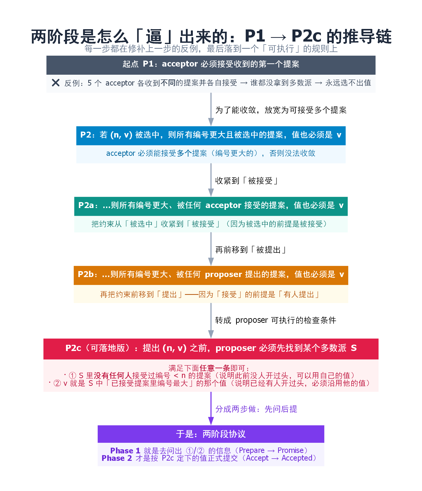

### P1 与它的反例

最开始的想法（Lamport 称之为 **P1**）：

> **P1：一个 acceptor 必须接受它收到的第一个提案。**

这条规则保证"只要有人提，就一定有值被接受"。但它有个立刻能看出的反例：

```text
5 个 acceptor，两个 proposer 几乎同时提案（值不同）：
  A 接受了提案 (1, "X")
  B 接受了提案 (1, "X")
  C 接受了提案 (1, "Y")
  D 接受了提案 (1, "Y")
  E 接受了提案 (1, "Z")
→ 没有任何一个值拿到 3 票 → 谁都没被选中
```

**根因**：acceptor 只能接受一个提案（编号相同就更没法区分），大家各投各的，收不了口。

### P2 → P2a → P2b：一步步收紧约束

修反例的方向是：**允许 acceptor 接受多个提案**（用编号区分），于是有了编号单调的玩法。但这立刻带来新风险——**会不会两个不同的值先后都被选中？** 于是有了目标性质 **P2**：

> **P2**：如果一个值为 v 的提案被选中，那么**所有编号更大且被选中**的提案，值也必须是 v。

P2 保证了「选中的值唯一」。但它不好直接执行（"被选中"是个结果，不是某个节点的动作）。于是往下钻两层：

> **P2a**：如果一个值为 v 的提案被选中，那么**所有编号更大、被任何 acceptor 接受**的提案，值也必须是 v。
>
> （因为"被选中"的前提是"被接受"，所以约束"被接受"就够强了。）

> **P2b**：如果一个值为 v 的提案被选中，那么**所有编号更大、被任何 proposer 提出**的提案，值也必须是 v。
>
> （同理，约束"被提出"更强——毕竟"接受"之前一定有人"提出"。）

**P2b 已经变成了对 proposer 的要求**：你提新提案前，得先确认"不会覆盖掉一个已经被选中的值"。

### P2c：终于变成一个可执行的规则

怎么确认？P2b 太强、太模糊。Lamport 把它收紧成一个**可检查的条件**：

> **P2c**：对于一个要提出的提案 `(n, v)`，必须存在一个**多数派集合 S**，使得下面**任意一条**成立：
>
> - **①** S 中**没有任何 acceptor** 接受过编号小于 n 的提案；**或**
> - **②** v 是 S 中所有「编号小于 n 的、已被接受的提案」里**编号最大的那个**的**值**。

翻译成人话：

| 条件 | 含义 | proposer 该怎么办 |
|------|------|------------------|
| ① | 大家手里都是空的，之前没人开过头 | **可以用自己的值** |
| ② | 已经有人接受过某个值了 | **必须沿用那个值**（编号最大的那个） |

**这就是 Paxos 安全性的全部秘密**：如果你要提的编号 n 覆盖到了某个可能已被选中的值，那么"多数派的交集"保证你的 S 里一定有人见过它，而 P2c 强制你**沿用**它，于是**已选中的值永远不会被改掉**。

<a id="section-08"></a>

## 两阶段协议

把 P2c 落地，就需要**先问一遍、再提一次**——这就是两阶段。

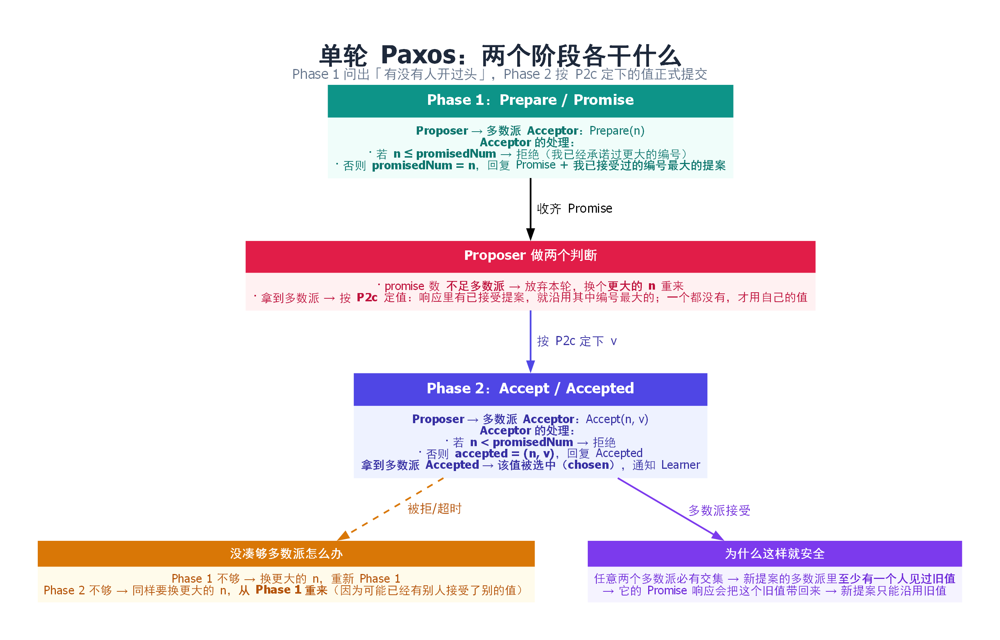

### Phase 1：Prepare / Promise

```text
Proposer                              Acceptor
   │  ── Prepare(n) ──────────────▶   │
   │                                   │  若 n ≤ promisedNum → 拒绝（我承诺过更大的）
   │                                   │  否则 promisedNum = n（做出承诺）
   │  ◀── Promise(n) ───────────────   │
   │      + 我已接受过的编号最大的提案   │
```

两个细节别漏：

- **Prepare 的判定是 `n > promisedNum` 才答应**（严格大于）。这样编号相同、来自不同 proposer 的重复 Prepare 会被拒绝，避免"两个提案共用同一编号"的歧义。
- **Promise 的响应里必须带上「我已接受过的编号最大的提案」**——这正是 P2c 需要的输入。少了这个字段，协议就不安全（后面的 Paxos 模拟实验的反例会演示）。

### Phase 2：Accept / Accepted

```text
Proposer                              Acceptor
   │  拿到多数派 Promise 后，按 P2c 定下 v
   │  ── Accept(n, v) ────────────▶   │
   │                                   │  若 n < promisedNum → 拒绝
   │                                   │  否则 accepted = (n, v)
   │  ◀── Accepted(n, v) ───────────   │
   │  拿到多数派 Accepted → v 被选中（chosen）→ 通知 Learner
```

失败重试的规则也要记准：

| 卡在哪 | 怎么办 |
|--------|--------|
| Promise 不够多数派 | 换一个**更大的编号** n，重新走 Phase 1 |
| Accept 不够多数派 | 同样要换更大的编号**从 Phase 1 重来**——不能直接重发 Accept，因为中途可能有别人接受了别的值 |

### 完整走一遍

假设 5 个 acceptor，多数派 = 3：

```text
① Proposer P1 用编号 1 提 "X"
   Phase 1：Prepare(1) → A~E 全部承诺（此前没人接受过任何提案）
   Phase 2：Accept(1, "X") → A、B、C 接受 → 拿到 3 票 = 多数派 → ✅ "X" 被选中
   （D、E 的 Accepted 还没到，但不影响结论）

② 此时 Proposer P2 想提 "Y"，用编号 2
   Phase 1：Prepare(2) → A~E 全部承诺，并汇报：
              A、B、C 说「我已接受过 (1, "X")」
   → P2 读到了 (1, "X")，按 P2c 规则②，它【必须】改提 "X"（不能用 "Y"！）
   Phase 2：Accept(2, "X") → 多数派接受 → ✅ 选中的仍然是 "X"

③ 结果：换人、换更大的编号，"X" 依然没被覆盖 —— 这就是 Paxos 的安全性
```

**注意第 ② 步**：P2 自己的意愿是 "Y"，但协议要求它放弃自己的值。这是 Paxos 最反直觉、也最关键的一点——**proposer 的"想法"不重要，协议要求它先读后写**。

### 为什么这样就安全

把 3.3 的推理抽象一下，安全性的证明其实只有三句话：

1. 一个值要被选中，必须被**多数派**接受；
2. 任意两个多数派**必有交集**（两个过半集合必有交集）；
3. 所以任何更大编号的提案，在 Phase 1 的多数派里**至少会碰到一个见过旧值的 acceptor**，P2c 强制它沿用旧值。

> 反过来记更清楚：**Paxos 的安全性依赖 proposer 遵守 P2c，而不是依赖 acceptor 拒绝。** acceptor 只看编号大小，它根本不关心值是什么。这一条在 Paxos 模拟实验会被一个反例亲手验证。

<a id="section-09"></a>

## 选主

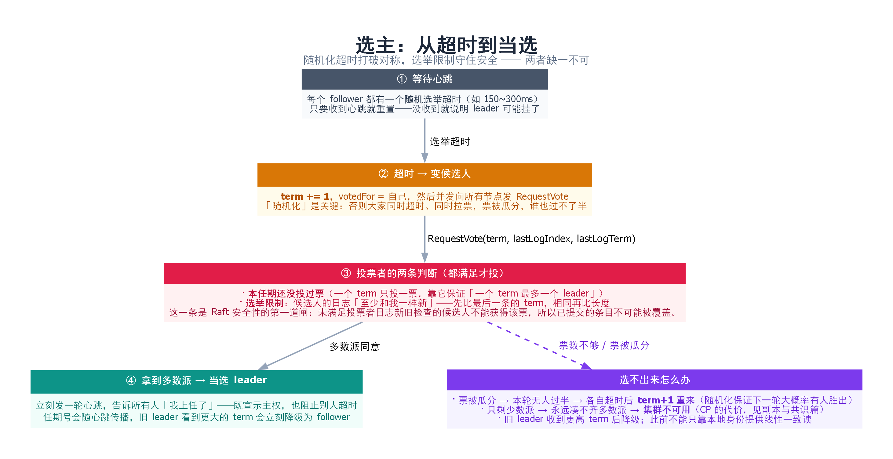

### 超时 → 候选人 → 拉票

每个 follower 维护一个**选举超时定时器**，收到心跳就重置。流程：

```text
① follower 等心跳 → 超时（比如 150~300ms 内没等到）
② term += 1，votedFor = 自己，状态变 Candidate
③ 并发向所有节点发 RequestVote(term, lastLogIndex, lastLogTerm)
④ 拿到多数派（含自己那一票）→ 变 Leader → 立刻发一轮心跳宣示主权
```

**第 ④ 步的"立刻发心跳"很重要**：不光是宣示，更是**阻止其他节点超时**——否则刚选出来的 leader 会在别人发起的新一轮选举里被立刻推翻。

### 随机化：打破对称

选举超时必须是**随机**的（典型 150~300ms 均匀分布）。原因：

```text
❌ 所有节点固定 200ms 超时：
   大家一起超时 → 一起变候选人 → 各自投自己 → 票被瓜分 → 谁都没过半
   然后 term+1 再重复一遍……永远选不出来

✅ 随机 150~300ms：
   最快的那个先超时 → 先拉票 → 大概率在别人超时之前就拿到多数派
   万一还是瓜分了，下一轮随机值又不同，几轮内几乎必然选出
```

> Raft 使用随机选举超时减少反复分票。能否持续推进还依赖多数节点可通信，以及网络和处理速度满足足够稳定的时间条件；不能把随机化当成所有共识协议的必要条件。

### 选举限制：安全性的第一道闸

投票者在决定投不投时，除了"本任期还没投过票"，还有一条**极关键**的检查：

> **选举限制（Election Restriction）**：只有候选人的日志「**至少和我一样新**」时才投票。
>
> 「一样新」的比较方式：先比**最后一条日志的 term**，term 相同再比**日志长度**（谁长谁新）。

它的作用一句话就能说清：

```text
如果候选人的日志比某个投票者旧，那么它一定缺少某些「已被提交」的条目
→ 让它当选，就可能把已提交的条目覆盖掉（安全性崩塌）
→ 所以干脆不给它投票
```

**这条规则保证了：新选出的 leader 一定含有所有已提交的条目。** 这也是 Raft 安全性证明的第一块基石（后文安全性部分会继续解释）。

<a id="section-10"></a>

## 日志复制

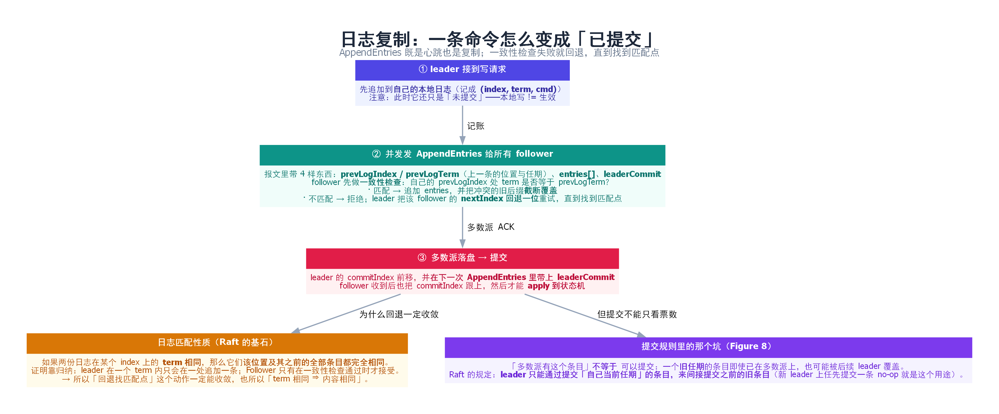

### AppendEntries：心跳兼复制

Leader 收到写请求后：

1. 把命令追加到**自己的本地日志**，记成 `(index, term, cmd)`；
2. 并发向所有 follower 发 `AppendEntries`，带上：
   - `prevLogIndex` / `prevLogTerm`：**上一条**的位置与任期（用于一致性检查）；
   - `entries[]`：本次要复制的条目；
   - `leaderCommit`：leader 当前的提交位置。

### 一致性检查与 nextIndex 回退

Follower 收到 `AppendEntries` 后，先做检查：

```text
自己的日志里，prevLogIndex 这一条的 term 是不是 prevLogTerm？
├── 是 → 通过：追加 entries[]；如果新条目与本地已有条目冲突（同一 index 不同 term），
│        就把本地从该位置起的旧后缀【全部截断覆盖】
└── 否 → 拒绝
```

被拒绝后，leader 把该 follower 的 `nextIndex` **回退一位**重试，如此往复，**直到找到第一个匹配点**，然后把之后的全部内容覆盖过去。

> **注意**：这是"**以 leader 为准**"的强制对齐——不是协商、不是合并。新 leader 的日志就是标准答案。

### 日志匹配性质

Raft 有一条足以支撑整个正确性证明的性质：

> **Log Matching Property**：如果两份日志在某个 index 上的 **term 相同**，那么该位置**及其之前的全部条目都完全相同**。

为什么成立？靠两条归纳：

1. **Leader 在一个 term 内、对同一个 index 只会追加一条**（日志只追加，不覆盖）；
2. **Follower 只有一致性检查通过才会接受**——所以"同 term"意味着"同一个 leader 在同一位置写的"，往前递归即得整段相同。

这条性质直接保证了：**"回退找匹配点"这个动作一定能收敛**（不会出现"永远找不到匹配"的死循环）。

### 什么算「已提交」

**多数派把条目写进本地日志** → leader 把 `commitIndex` 前移 → 在**下一次** `AppendEntries` 里带上 `leaderCommit` → follower 收到后也把 `commitIndex` 跟上来，这时才能 **apply 到状态机**。

两个容易踩的点：

- **Follower 的提交是"跟着 leader 走"的**：它自己数不了票（不知道哪些节点收到了），只能等 leader 告诉它；
- **提交规则有个反直觉的例外**，见下面 Figure 8 的讨论。

<a id="section-11"></a>

## 安全性：四条规则

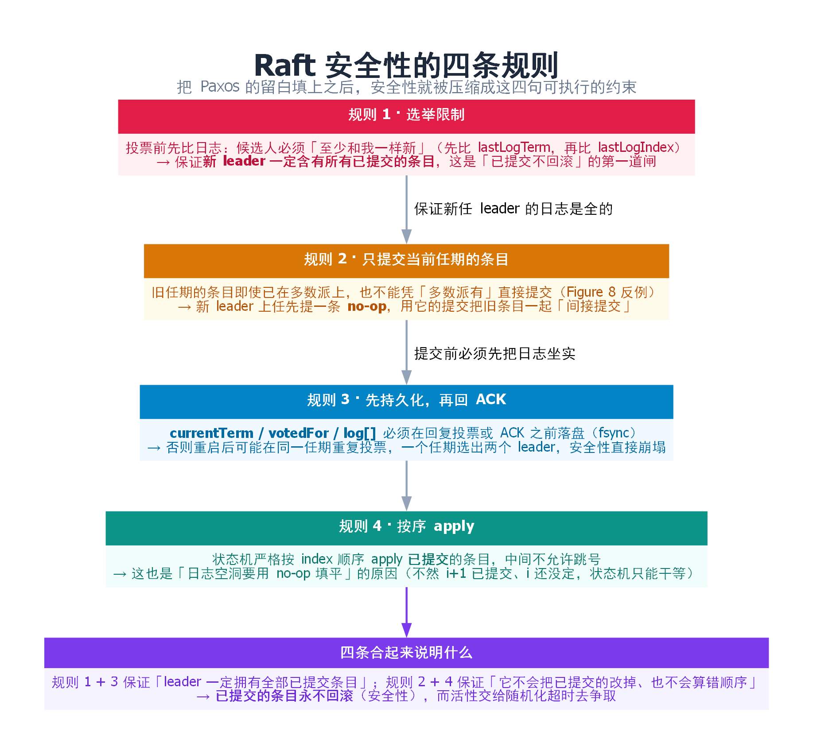

Raft 全篇的安全性可以压缩成四句话。**这四条也是面试和排障时最常被追问的地方**：

### 规则一 · 选举限制

根据前面的日志新旧比较规则，**保证新 leader 拥有全部已提交条目。**

### 规则二 · 只提交「当前任期」的条目（Figure 8 问题）

这一条最反直觉，也是 Raft 论文里最著名的坑：

> **「多数派有这个条目」不等于「可以提交」。**

反例（论文 Figure 8）：任期 2 的条目已复制到多数派，但后来的候选者 S5 末条日志任期为 3。投票时先比较末日志任期，再比较索引，因此 S2、S3 仍可能给 S5 投票。S5 当选后可覆盖那个未提交的任期 2 条目。问题不是多数派没有交集，而是交集成员允许投给末日志任期更新的候选者。若把“多数派有旧条目”当作已提交，就会错误地承诺一个之后可能被覆盖的结果；当前任期条目的提交才能把此前前缀一并确定下来。[Raft Figure 8 与 5.4.2](https://raft.github.io/raft.pdf)

Raft 的解决方式很干脆：

> **Leader 只能通过提交「自己当前任期」的条目，来间接提交之前的旧条目。**

所以新 leader 上任后通常会**先提交一条 no-op（空操作）**——它没有任何业务含义，唯一的作用就是"占一个当前任期的位置"，让之前所有旧条目跟着它一起被安全地间接提交。

### 规则三 · 先持久化，再回 ACK

`currentTerm`、`votedFor`、`log[]` **必须在回复投票或 ACK 之前落盘（fsync）**。

不这么做的后果非常直接：节点崩溃重启后"忘记自己投过谁"，可能**在同一任期里给两个候选人投票** → 一个任期选出两个 leader → 双主 → 安全性直接破。注意顺序是"**先落盘、后回复**"，反过来就等于没做。

### 规则四 · 按序 apply

状态机严格按 index 顺序 apply **已提交**的条目，中间不能跳号。这也是「日志空洞（gap）必须填平」的原因：如果 index 2 还没定下来，即使 index 3 已提交，状态机也只能干等——或者用一条 no-op 把 index 2 填上。

<a id="section-12"></a>

## 动手：3 节点的 Raft 模拟（C++）

这是单进程、单线程的确定性模拟。代码中的“落盘”由内存日志代替，没有执行磁盘同步，也没有网络传输。它只能展示投票、复制和切换的状态变化，不能用于验证进程重启、掉电持久化或完整 Raft 实现。生产实现还需持久化任期和投票、处理日志冲突、快照、成员变更以及异步 I/O 的顺序。

下面这个程序把 2~4 节的关键机制跑一遍：**选主 → 提交 → 分区下的"未提交" → 选举限制拒票 → 新 leader 与旧 leader 对账截断**。

### 代码

```cpp
// Raft 核心机制的最小模拟（确定性、单线程）：3 个节点，覆盖四件事：
//   ① 选主：任期 term + votedFor + 拉票
//   ② 选举限制：日志落后的候选人拿不到票（安全性的第一道闸）
//   ③ 提交：多数派落盘才算提交，未提交的条目可能被截断
//   ④ 日志一致性检查：新 leader 与旧 leader 的日志对账，不一致的后缀一律截断
// 编译：g++ -std=c++11 -Wall -Wextra -O2 -o raft_demo raft_demo.cpp
#include <iostream>
#include <algorithm>
#include <string>
#include <utility>
#include <vector>

struct Entry {
    int term;
    std::string cmd;
};

struct Node {
    std::string name;
    int term;                 // 当前任期（Raft 的「逻辑时钟」）
    std::string votedFor;     // 本任期把票投给了谁（空 = 还没投）
    bool up;                  // 是否在线（模拟宕机/分区）
    std::vector<Entry> log;   // 日志
    int commitIndex;          // 已提交位置：>= 0 表示前 commitIndex+1 条已提交

    explicit Node(std::string n) : name(std::move(n)), term(0), up(true), commitIndex(-1) {}
};

class Cluster {
public:
    Cluster(std::initializer_list<std::string> names) {
        for (const auto& n : names) nodes_.emplace_back(n);
    }

    std::size_t quorum() const { return nodes_.size() / 2 + 1; }

    void down(const std::string& n) { get(n).up = false; std::cout << "  [" << n << " 下线]\n"; }
    void up(const std::string& n) { get(n).up = true; std::cout << "  [" << n << " 上线]\n"; }

    // 候选人拉票。返回是否当选
    bool runElection(const std::string& candName) {
        Node& cand = get(candName);
        cand.term += 1;
        cand.votedFor = cand.name;
        std::cout << "  " << cand.name << " 选举超时 → 变候选人，term=" << cand.term
                  << "，先投自己一票（我的日志 lastIndex=" << lastIndex(cand)
                  << "/lastTerm=" << lastTerm(cand) << "）\n";
        int votes = 1;
        for (auto& v : nodes_) {
            if (v.name == cand.name || !v.up) continue;
            if (v.term < cand.term) { v.term = cand.term; v.votedFor = ""; }
            const bool fresh = upToDate(cand, v);                      // Raft 的「选举限制」
            const bool free = v.votedFor.empty() || v.votedFor == cand.name;
            const bool grant = cand.term == v.term && free && fresh; // 不给旧任期候选者投票
            std::cout << "    " << v.name << (grant ? " 同意投票" : " 拒绝投票")
                      << "（我的日志 lastIndex=" << lastIndex(v) << "/lastTerm=" << lastTerm(v)
                      << (fresh ? "" : "，比候选人新") << "）\n";
            if (grant) { v.votedFor = cand.name; ++votes; }
        }
        const bool win = static_cast<std::size_t>(votes) >= quorum();
        std::cout << "  → 得票 " << votes << "/" << nodes_.size() << "（需要 " << quorum() << "）"
                  << (win ? "，当选 leader\n" : "，选举失败，集群暂时不可用\n");
        return win;
    }

    // leader 追加一条命令并复制给所有在线节点
    void append(const std::string& leaderName, const std::string& cmd) {
        Node& L = get(leaderName);
        Entry e{L.term, cmd};
        L.log.push_back(e);
        std::size_t acks = 1;
        for (auto& n : nodes_) {
            if (n.name == L.name || !n.up) continue;
            n.log.push_back(e);                    // 简化：假设日志前缀已一致
            ++acks;
        }
        const int index = static_cast<int>(L.log.size()) - 1;
        std::cout << "  leader " << L.name << " 追加 \"" << cmd << "\"（index=" << index
                  << ", term=" << L.term << "）→ " << acks << "/" << nodes_.size() << " 个节点落盘";
        if (acks >= quorum()) {
            for (auto& n : nodes_)
                if (n.up && n.log.size() == L.log.size()) n.commitIndex = index;
            std::cout << " → ✓ 达到多数派，提交（commitIndex=" << index << "）\n";
        } else {
            std::cout << " → ✗ 不足多数派，【未提交】\n";
        }
    }

    // 新 leader 与某个节点对账：找最后一个 term 相同的位置，之后一律截断重放
    void reconcile(const std::string& leaderName, const std::string& followerName) {
        Node& L = get(leaderName);
        Node& F = get(followerName);
        if (L.term < F.term) return; // 旧 leader 不能修改更高任期节点的日志
        if (L.term > F.term) { F.term = L.term; F.votedFor.clear(); }
        int match = std::min(lastIndex(L), lastIndex(F));
        while (match >= 0 && L.log[match].term != F.log[match].term) --match;
        if (match < lastIndex(F)) {
            std::cout << "  " << F.name << " 的第 " << match + 2 << " 条与 leader 冲突（leader 只有 "
                      << lastIndex(L) + 1 << " 条）→ 截断本地日志\n";
            F.log.resize(match + 1);
        }
        while (lastIndex(F) < lastIndex(L)) F.log.push_back(L.log[F.log.size()]);
        F.commitIndex = std::max(F.commitIndex, std::min(L.commitIndex, lastIndex(F)));
        // 同任期对账不能清空投票，否则可能在一个任期投给两人。
        std::cout << "  " << F.name << " 对账完成，日志 " << F.log.size()
                  << " 条（commitIndex=" << F.commitIndex << "）\n";
    }

    void dump(const std::string& title) const {
        std::cout << "  " << title << "\n";
        for (const auto& n : nodes_) {
            std::cout << "    " << n.name << "（term=" << n.term << (n.up ? "" : ", 离线") << "）[";
            for (std::size_t i = 0; i < n.log.size(); ++i) {
                if (i) std::cout << " | ";
                std::cout << i << ":term" << n.log[i].term << " " << n.log[i].cmd
                          << (static_cast<int>(i) <= n.commitIndex ? "(已提交)" : "(未提交)");
            }
            std::cout << "]\n";
        }
    }

private:
    Node& get(const std::string& n) {
        for (auto& x : nodes_) if (x.name == n) return x;
        return nodes_[0];   // 不会发生：调用方保证名字存在
    }
    int lastIndex(const Node& n) const { return static_cast<int>(n.log.size()) - 1; }
    int lastTerm(const Node& n) const { return n.log.empty() ? 0 : n.log.back().term; }

    // 选举限制：候选人日志必须「至少一样新」——先比最后一个条目的 term，再比长度
    bool upToDate(const Node& cand, const Node& voter) const {
        if (lastTerm(cand) != lastTerm(voter)) return lastTerm(cand) > lastTerm(voter);
        return lastIndex(cand) >= lastIndex(voter);
    }

    std::vector<Node> nodes_;
};

int main() {
    Cluster c({"A", "B", "C"});
    std::cout << "3 个节点，多数派 = " << c.quorum() << "\n\n";

    std::cout << "① A 选举超时，发起选举\n";
    c.runElection("A");

    std::cout << "\n② A 作为 leader 提交第一条命令\n";
    c.append("A", "set x = 1");
    c.dump("此刻各节点日志：");

    std::cout << "\n③ C 下线，A 继续提交第二条命令（A + B = 2/3，仍是多数派）\n";
    c.down("C");
    c.append("A", "set y = 2");

    std::cout << "\n④ B 也下线，A 再提一条 —— 这次只有 A 自己落盘\n";
    c.down("B");
    c.append("A", "set z = 999");
    c.dump("此刻各节点日志（注意 A 上那条未提交的 999）：");

    std::cout << "\n⑤ A 下线，B、C 恢复。C 先超时发起选举（它的日志最短）\n";
    c.down("A");
    c.up("B");
    c.up("C");
    c.runElection("C");

    std::cout << "\n⑥ B 接着发起选举（它的日志比 C 新）\n";
    c.runElection("B");

    std::cout << "\n⑦ A 恢复上线，新 leader B 与它逐条对账\n";
    c.up("A");
    c.reconcile("B", "A");
    c.reconcile("B", "C");
    c.dump("最终各节点日志：");

    std::cout << "\n结论：已提交的 x、y 从未丢失；A 本地那条从未提交的 999 被截断；\n";
    std::cout << "      而 C 因为日志最旧，在 ⑤ 里被 B 以「选举限制」拒票，根本当不上 leader。\n";
    return 0;
}
```

### 运行结果与解读

```text
3 个节点，多数派 = 2

① A 选举超时，发起选举
  A 选举超时 → 变候选人，term=1，先投自己一票（我的日志 lastIndex=-1/lastTerm=0）
    B 同意投票（我的日志 lastIndex=-1/lastTerm=0）
    C 同意投票（我的日志 lastIndex=-1/lastTerm=0）
  → 得票 3/3（需要 2），当选 leader

② A 作为 leader 提交第一条命令
  leader A 追加 "set x = 1"（index=0, term=1）→ 3/3 个节点落盘 → ✓ 达到多数派，提交（commitIndex=0）
  此刻各节点日志：
    A（term=1）[0:term1 set x = 1(已提交)]
    B（term=1）[0:term1 set x = 1(已提交)]
    C（term=1）[0:term1 set x = 1(已提交)]

③ C 下线，A 继续提交第二条命令（A + B = 2/3，仍是多数派）
  [C 下线]
  leader A 追加 "set y = 2"（index=1, term=1）→ 2/3 个节点落盘 → ✓ 达到多数派，提交（commitIndex=1）

④ B 也下线，A 再提一条 —— 这次只有 A 自己落盘
  [B 下线]
  leader A 追加 "set z = 999"（index=2, term=1）→ 1/3 个节点落盘 → ✗ 不足多数派，【未提交】
  此刻各节点日志（注意 A 上那条未提交的 999）：
    A（term=1）[0:term1 set x = 1(已提交) | 1:term1 set y = 2(已提交) | 2:term1 set z = 999(未提交)]
    B（term=1, 离线）[0:term1 set x = 1(已提交) | 1:term1 set y = 2(已提交)]
    C（term=1, 离线）[0:term1 set x = 1(已提交)]

⑤ A 下线，B、C 恢复。C 先超时发起选举（它的日志最短）
  [A 下线]
  [B 上线]
  [C 上线]
  C 选举超时 → 变候选人，term=2，先投自己一票（我的日志 lastIndex=0/lastTerm=1）
    B 拒绝投票（我的日志 lastIndex=1/lastTerm=1，比候选人新）
  → 得票 1/3（需要 2），选举失败，集群暂时不可用

⑥ B 接着发起选举（它的日志比 C 新）
  B 选举超时 → 变候选人，term=3，先投自己一票（我的日志 lastIndex=1/lastTerm=1）
    C 同意投票（我的日志 lastIndex=0/lastTerm=1）
  → 得票 2/3（需要 2），当选 leader

⑦ A 恢复上线，新 leader B 与它逐条对账
  [A 上线]
  A 的第 3 条与 leader 冲突（leader 只有 2 条）→ 截断本地日志
  A 对账完成，日志 2 条（commitIndex=1）
  C 对账完成，日志 2 条（commitIndex=1）
  最终各节点日志：
    A（term=3）[0:term1 set x = 1(已提交) | 1:term1 set y = 2(已提交)]
    B（term=3）[0:term1 set x = 1(已提交) | 1:term1 set y = 2(已提交)]
    C（term=3）[0:term1 set x = 1(已提交) | 1:term1 set y = 2(已提交)]

结论：已提交的 x、y 从未丢失；A 本地那条从未提交的 999 被截断；
      而 C 因为日志最旧，在 ⑤ 里被 B 以「选举限制」拒票，根本当不上 leader。
```

逐条对照原理：

| 输出片段 | 印证了什么 |
|----------|-----------|
| ② `3/3 落盘 → 提交` | 多数派提交（这时是"全票"，当然包含多数派） |
| ③ `2/3 落盘 → 提交` | **多数派不需要全员**：C 离线不影响可用性 |
| ④ `1/3 落盘 → 【未提交】` | **少数派不能提交**——这正是 CP 系统在分区时的表现 |
| ⑤ `B 拒绝投票（…比候选人新）` | **选举限制**：C 的日志最短，B 直接拒票 → C 只拿到自己 1 票 |
| ⑥ `B 当选` | B 的日志最全 → 拿到 C 的票 → 2/3 过半 |
| ⑦ `A 的第 3 条与 leader 冲突 → 截断本地日志` | **未提交的条目会被覆盖**；而"已提交的 x、y 从未丢失"就是安全性的直接体现 |
| ⑦ 三个节点日志完全一致 | 一致性检查 + 回退对齐的最终结果 |

> C 本轮竞选失败后，B 可以在后续任期当选。能否推进取决于通信正常的节点能否形成多数派并满足选举限制；网络分区并不必然使整个集群停写。

<a id="section-13"></a>

## Zab：主备模式的全序广播

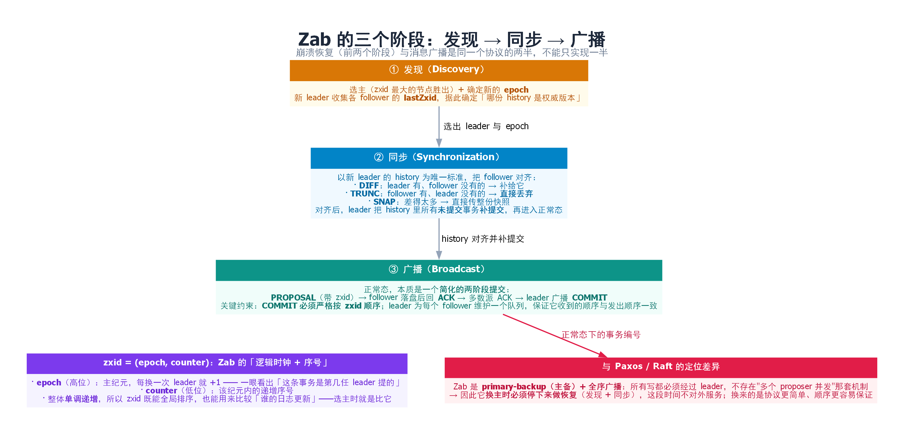

### 与 Paxos / Raft 的定位差异

Zab（ZooKeeper Atomic Broadcast）解决的也是"复制状态机"问题，但走的是**主备路线**：

| | Paxos / Multi-Paxos | Raft | **Zab** |
|---|---|---|---|
| 定位 | 对称的共识算法 | 强 leader 日志复制 | **primary-backup + 全序广播** |
| 谁提提案 | 任何 proposer（可并发） | 只有 leader | **只有 leader**（primary） |
| 编号 | proposer 自造 | term | **zxid = (epoch, counter)** |
| 换主 | 无需"停顿"，靠 Phase 1 续上 | 选举 + 日志对齐 | **必须走完整的"发现 + 同步"两阶段，期间不对外服务** |
| 关键差异 | 灵活但留白多 | 规则明确、可理解 | **协议更"重"，但顺序保证更直白** |

**一句话**：Zab 放弃"任意节点都能提案"的灵活性，换来"任何时刻只有一个源头在定顺序"——于是"全序"这件事变得非常好证明。

### zxid = (epoch, counter)

Zab 里每条事务都有一个 64 位的 **zxid**：

```text
zxid = ( epoch << 32 ) | counter
        └─ 高 32 位 ─┘   └─ 低 32 位 ─┘
       主纪元：每换一次 leader 就 +1     该纪元内的递增序号
```

两个好处：

1. **全局单调递增** → 所有副本只要按 zxid 排序执行，状态就一致（这就是"全序广播"）；
2. **能比较"谁的日志更新"** → 选主时直接比 `lastZxid`，谁大谁当 leader（这也保证了新 leader 一定含有所有已提交事务）。

> 对比一下：Raft 用 **term** 解决同样的问题，但 Raft 的 term 只保证"每个 term 一个 leader"，日志位置还要靠 `index`；而 zxid 把"纪元 + 序号"打成一个整数，比较起来更直接——这是主备路线的便利。

### 三个阶段：发现 → 同步 → 广播

Zab 的完整生命周转被分成三段，**前两段只在"换主"时走**：

| 阶段 | 干什么 | 什么时候走 |
|------|--------|-----------|
| **① 发现（Discovery）** | 选主 + 确定新 epoch + 收集各 follower 的 lastZxid，确定"哪份 history 权威" | 换主时 |
| **② 同步（Synchronization）** | 以新 leader 的 history 为准对齐所有 follower（DIFF / TRUNC / SNAP），并**补提交**未提交事务 | 换主时 |
| **③ 广播（Broadcast）** | 正常态：`PROPOSAL → 多数派 ACK → COMMIT` | 稳态 |

第 ③ 阶段本质是一个**简化的两阶段提交**，但有两条硬约束：

- **COMMIT 必须严格按 zxid 顺序**；
- leader 为每个 follower 维护一个**队列**，保证"发给它的顺序 = 它执行的顺序"（否则 follower 的状态机会乱序 apply）。

### 恢复阶段的关键规则

这是 Zab 与"朴素多数派提交"最不一样的地方，需要重点检查的恢复边界：

> **新 leader 的 history 就是唯一真相：**
> - 它**有**、follower 没有的 → **DIFF** 补给它；
> - follower **有**、它没有的 → **TRUNC 直接丢弃**（哪怕那条事务的 zxid 更大）；
> - 差得太多 → **SNAP** 直接传整份快照；
> - 对齐之后，leader 把 history 里**所有未提交的事务补提交**。

第 4 条特别值得琢磨：「未提交」不等于「一定丢弃」——**关键在于它在不在新 leader 的 history 里**。

```text
某条事务只到了 A、B（多数派之外）→ 未提交
├── 后来 B 当选 leader → 它在 B 的 history 里 → 【补提交】，最终生效
└── 后来 C 当选 leader（C 没收到它）→ 不在 C 的 history 里 → 【TRUNC】，永久丢弃
```

这**不是**不确定性缺陷：无论是哪种结局，只要一条事务**已经提交过**，它就一定在 zxid 最大的那个节点的 history 里，但不要求全体节点中 zxid 最大的节点必定当选；它可能离线。安全性来自选举参与集合、历史选择与同步协议共同保留已提交前缀，随后才激活 leader，不能仅凭一个最大编号证明。[ZooKeeper 3.8 内部机制](https://zookeeper.apache.org/doc/r3.8.4/zookeeperInternals.html)

<a id="section-14"></a>

## etcd 的整体结构

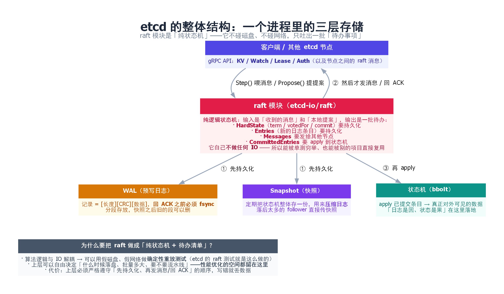

### raft 模块是个纯状态机

etcd 把 Raft 实现成一个**独立的库**（`go.etcd.io/raft/v3`），它有个非常关键的约束：

> **这个库不做任何 IO**——不读磁盘、不写磁盘、不发网络包。

它的输入只有两样：

| 输入 | 说明 |
|------|------|
| `Step(msg)` | 收到别的节点发来的 raft 消息 |
| `Propose(data)` | 本地要提案的业务数据（客户端写请求） |

输出则是一批**待办事项**（通过 `Ready()` 取出，见下一节）。这么设计换来三个好处：

1. **可测试**：可以用"假磁盘、假网络"重放整个执行历史，做确定性测试——etcd 的 raft 测试就是这么干的（它能把一个跑了几十万步的随机场景精确重放）；
2. **可复用**：TiKV、CockroachDB 等都用过这套库（或它的变体）；
3. **调度自由**：什么时候落盘、攒多大一批、要不要流水线，全留给上层——**性能优化的空间都在这里**。

代价是：**上层必须自己保证顺序**（下一节）。

### Ready / Advance：把状态机接到 IO 上


整个驱动逻辑就是一个循环，每一轮做五件事，**顺序绝对不能变**：

```text
① Step(msg) / Propose(data)      ← 只是入队，返回 ≠ 成功
② ready := node.Ready()          ← 取出这一轮要干的事
③ 持久化：WAL（HardState/Entries）+ 必要时 Snapshot，并 fsync
④ 按 Ready 的持久化顺序约束发送 Messages；发送不代表提交，不能据此回写成功
⑤ 处理已提交的 CommittedEntries，应用到状态机并完成对应业务请求；按驱动契约调用 Advance
   本次发送的提案通常在后续 Ready 才成为 CommittedEntries
```

三个容易看漏的点：

- **① 的返回不是成功**：`Propose` 只是把请求塞进队列，此时既没落盘也没复制出去。本例业务成功响应要等提案提交并应用，不能只等消息发送；
- **持久化顺序按库契约执行**：最新 HardState 与先前 Ready 的 Entries 需按规定持久化；同批 Entries 的持久化与发送在满足条件时可并行。本文采用先持久化再发送的保守流程，但不能将其说成所有实现唯一合法的顺序。[etcd-io/raft 驱动说明](https://github.com/etcd-io/raft)
- **`Advance()` 管理处理进度**：传统同步 Ready/Advance 驱动由它确认批次处理进展，但这不等于整个服务自动有界。提案入口、网络发送与状态机应用仍要限量并监控积压；异步存储模式需另按对应版本契约驱动。

> **类比**：`Ready()` 像**厨师长给学徒的一张备料单**："这些先切好放冰箱（③），切完再端出去（④），最后把做好的菜上桌（⑤）"。这个类比只描述本文保守顺序；真实库允许哪些并行，要以持久化与消息类型的契约为准，不能用类比代替协议。

### WAL 损坏时为什么不能直接截断继续跑

长度和校验和能帮助发现不完整或损坏的记录，但 CRC 不匹配并不证明“这条没提交”。如果损坏发生在已确认的日志中间，简单截断后继续服务可能把已承诺的数据悄悄丢掉。应停止正常恢复并保留损坏文件，按组件支持的恢复流程从可靠副本或备份重建。

只有实现能够判定为可丢弃的未完成尾部，并满足协议的修复前提时，才按其恢复工具处理尾部。校验和也不是抵御恶意篡改的认证机制。下图描述恢复决策，不声称某个固定长度/CRC 布局就是所有版本 etcd 的磁盘格式。

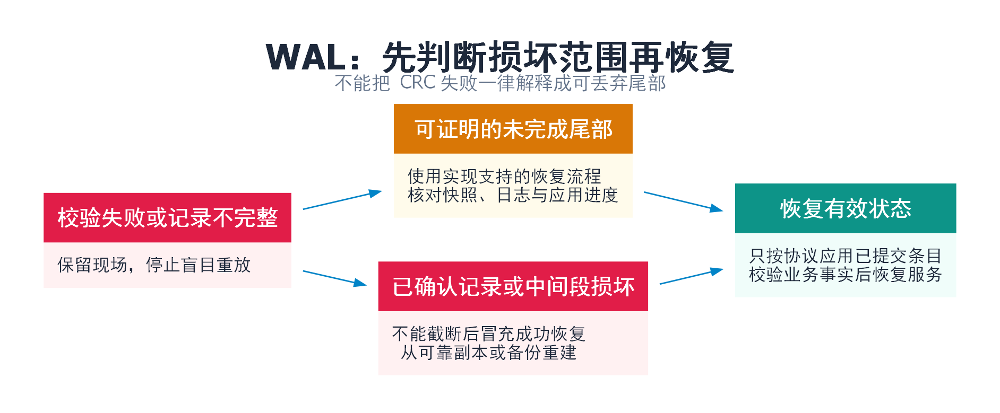

### 三层存储：WAL / Snapshot / 状态机

| 层 | 存什么 | 作用 | 什么时候写 |
|----|--------|------|-----------|
| **WAL** | HardState + 原始日志条目 | 与快照、应用进度共同构成恢复依据 | 每条日志（批量 + fsync） |
| **Snapshot** | 状态机在某个 index 的完整快照 | **压缩日志**；给落后太多的 follower 同步 | 按实现的快照触发配置；默认值随版本核对 |
| **状态机（bbolt）** | 业务数据的当前值 | 对外提供读 | apply 已提交条目时 |

三者的关系是**"因 → 果 → 果的快照"**：

```text
WAL（因）── apply ──▶ 状态机（果）
                        │
                        └── 定期打包 ──▶ Snapshot（果的快照）
```

**恢复时先验证匹配关系**：选择完整有效的快照及其索引、任期和应用进度，再恢复对应日志后缀。快照可靠持久化、恢复元数据一致且满足日志保留要求后，才清理可删除的旧段。WAL 中可能有未提交条目，不能把读出的每条记录都当已提交业务直接执行。分段便于回收，但不是所有 WAL 必须采用的唯一布局。

<a id="section-15"></a>

## 快照与日志压缩

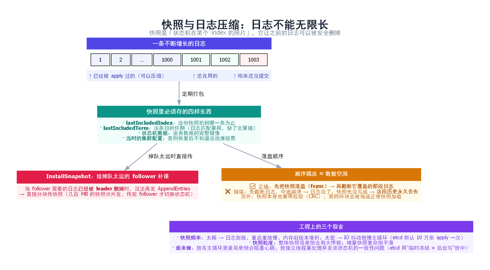

### 快照里必须有什么

日志不能无限长，原因很朴素：**内存放不下、重启重放要几百万条**。解决办法是定期给状态机拍张照：

| 字段 | 为什么必须有 |
|------|-------------|
| **lastIncludedIndex** | 这份快照拍到哪一条为止；截断日志、判断"谁落后了"都靠它 |
| **lastIncludedTerm** | 日志匹配用；**少存这个字段，一致性检查就会算错**（Raft 的 `prevLogTerm` 比较依赖任期） |
| **状态机数据** | 业务数据的完整镜像（通常按 key 范围分块存） |
| **当时的集群配置** | 否则恢复后不知道该找谁投票——一个只有数据、没有配置的快照是"孤儿" |

### InstallSnapshot：给掉队太远的 follower 补课

当某个 follower 落后太多，**它需要的日志已经被 leader 压缩掉了**——此时没法再用 `AppendEntries` 补，只能直接传快照：

```text
leader 发现 follower 的 nextIndex 已经小于自己日志的起点
  → 分块传快照（每块带 offset）
  → follower 收齐后：先落盘快照 → 再用快照重建状态机 → 通知 leader
```

**分块传输是必须的**：快照可能有几百 MB，一次发完会撑爆内存和网络。

### 顺序与三个取舍

**顺序只有一条，但错了就是数据空洞：**

> ✅ **先把快照落盘（fsync）→ 再截断它覆盖的那段日志**
> ❌ 先截断日志 → 中途崩溃 → 日志没了、快照也没写成 → **这段历史永久丢失**

另外快照本身**也要带校验（CRC）**：磁盘坏块会被当成"正常快照"加载进来，比丢数据更糟——它会让你基于错误的状态继续跑。

三个工程取舍：

| 取舍 | 太保守的后果 | 太激进的后果 |
|------|-------------|-------------|
| **频率** | 日志膨胀、重启重放慢、内存里旧版本堆积 | 快照 IO 挤占主循环 → 心跳延迟 → 触发重新选举 |
| **粒度** | 整体快照简单，但会有一次长停顿 | 增量快照平滑，但实现复杂度上一个台阶 |
| **执行位置** | 放主循环里最简单，但会阻塞心跳 | 放独立线程要解决"读状态机时数据还在变"的一致性问题 |

etcd 的折中：默认**每 10 万条已 apply 条目做一次快照**，并且快照过程尽量不长时间阻塞主循环。

<a id="section-16"></a>

## 成员变更

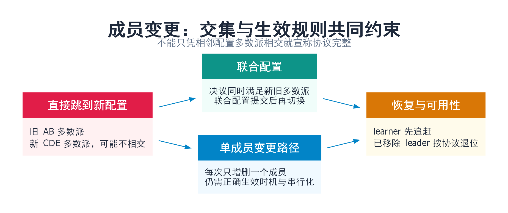

### 直接改配置为什么危险

假设集群从 3 节点 `{A,B,C}` 扩到 5 节点 `{A,B,C,D,E}`。如果每个节点**各自、异步地**切换到新配置，中间必然出现这样的窗口：

```text
A、B   仍按【旧配置 {A,B,C}】数票 → 多数派 = 2 → {A,B} 可选出 leader
C、D、E 已按【新配置 {A,B,C,D,E}】数票 → 多数派 = 3 → {C,D,E} 可选出 leader
                                            ↑ 两组 {A,B} 与 {C,D,E} 不相交！
```

**两个 leader 各自发号施令 → 数据分裂。** 注意这不是"配置写错了"，而是**两个配置的多数派可以不相交**——这是纯粹的数学问题。可以直接比较新旧投票集合，寻找不相交的两个多数派。

### joint consensus

Raft 论文给的解法是**两阶段切换**：

```text
阶段一：切到 C_old,new
        任何决议必须【同时】取得 旧配置的多数派 和 新配置的多数派
阶段二：C_old,new 这条配置变更被提交后，再切到 C_new
```

**为什么这样就安全？** 因为两个 joint 多数派都必须"在旧配置 {A,B,C} 里也过半"——而 **3 个节点里凑不出两组各占 2 个的不相交集合**，所以必然相交。

### 单节点变更：工程上的常用解

joint consensus 的正确性很漂亮，但实现起来是**两阶段提交式**的复杂度：要同时维护两套配置的计数、要处理"阶段一提交了但阶段二没提交"的中间态……

某些实现和接口采用一次一个成员变更的路径；具体版本还可能支持联合配置，不能把一种路径当作 etcd Raft 的全部能力：

> **一次只增删一个节点**：`{A,B,C}` → `{A,B,C,D}` → `{A,B,C,D,E}`。

**为什么安全？** 相邻两个配置的多数派必然相交（4 节点要 3 票、3 节点要 2 票，交集至少 1 个），还必须按具体协议的配置生效时机、领导者状态和变更串行化规则执行。仅证明相邻集合有交集，不构成完整成员变更安全性证明。

代价也很明确：**必须一个一个来**——从 3 扩到 7 要走 4 轮，变更期间每一步都要等提交。

### 三个容易踩的点

1. **配置本身也要走日志**：变更必须作为**一条日志条目**被复制、提交，不能"本地改一下就生效"——否则各节点的配置视图会不一致，又回到前述不相交多数派的危险窗口；
2. **新节点要先追日志再加进来**：一个空日志的新节点加入会拉低整体可用性（它可能成为决定多数派的那一票却什么都不知道）。常见做法是让它先以**学习者（learner / non-voting）** 身份同步；
3. **旧 leader 可能不在新配置里**：变更提交后，leader 若发现自己已被移除，要**主动退位**——否则它会继续发心跳，干扰新配置的选举。

<a id="section-17"></a>

## 线性一致读

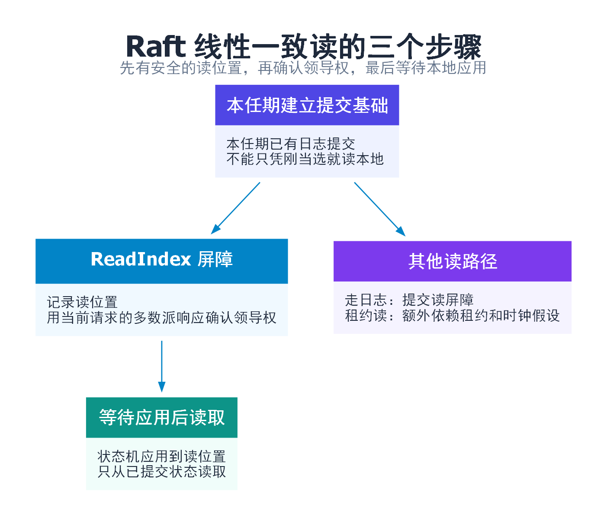

### 为什么不能直接读本地状态机

两个原因，都很致命：

1. **本地应用进度可能落后**：正确的状态机只应用已提交日志，但已提交的条目可能还没执行到状态机；因此直接读取可能仍返回旧值。若直接读未提交日志，则是另一种实现错误；
2. **旧 leader 的幻觉**：网络分区后，一个被隔离的旧 leader 完全不知道新 leader 已经选出来了，它会**自信地**用本地状态机回答读请求——读出来的是过期数据，而且它还认为自己是权威。

### 三条路

| 方案 | 做法 | 多出来的开销 | 依赖的假设 |
|------|------|-------------|-----------|
| **走日志** | 将读屏障按日志顺序提交，应用到该位置后读 | 共识与必要持久化，可批处理 | 标准 Raft 的持久化、多数派与协议假设 |
| **ReadIndex** | 先确认本任期已有条目提交，再记录读位置并向多数派确认当前领导权，等应用到读位置后返回 | 通信确认，可合并请求，不必每次为读写日志 | 正确关联本次读屏障、多数派可达 |
| **Lease Read** | 在协议保证有效的领导者租约内，应用满足读要求后读取 | 可减少每次读的通信 | 租约协议、时钟漂移与暂停处理假设，不能简单等同选举超时 |

**ReadIndex 的精髓在"确认领导权"这一步**：它用一轮心跳换回了"我确实还是 leader"这个事实，然后才敢用本地的 `commitIndex` 作为读的下界。它**不落盘、不依赖时钟**，具体库还需核对读模式和配置。[etcd Raft 库说明](https://github.com/etcd-io/raft/blob/main/README.md)

### 假设的等级：时钟为什么最危险

把三种方案放在"假设阶梯"上看，会非常清楚：

```text
走日志 < ReadIndex < Lease Read
（只依赖多数派可达）  （+ 一轮心跳）  （+ 时钟漂移上界）
```

**为什么"依赖时钟"值得单独警惕？** 因为共识算法（含 Raft 的选举超时）本来就假设了"部分同步"——但这个假设是拿来保证**活性**的（迟早选出 leader）。而 Lease Read 把时间假设用在了**安全性**上：一旦时钟跳变（NTP 校时、虚拟机迁移、容器被挂起），租约期还没过，别人可能已经选出新 leader 并提交了新数据——**两个 leader 同时对外服务**。

> 一句话：**时间假设用来保活性可以容忍，用来保安全性就是定时炸弹。**

<a id="section-18"></a>

## 从 CFT 到 BFT：多出来的那一倍是为什么

[基础概念与故障模型](../01-%E5%9F%BA%E7%A1%80%E6%A6%82%E5%BF%B5%E4%B8%8E%E6%95%85%E9%9A%9C%E6%A8%A1%E5%9E%8B/%E5%9F%BA%E7%A1%80%E6%A6%82%E5%BF%B5%E4%B8%8E%E6%95%85%E9%9A%9C%E6%A8%A1%E5%9E%8B.md) 讲过拜占庭将军问题的结论是 `n ≥ 3f+1`，但"为什么"往往一带而过。这里把它彻底算一遍——**下面讨论 PBFT 一类、依靠法定人数交集的协议模型；同步性、签名或可信硬件假设不同的协议不能直接套用此下界**。

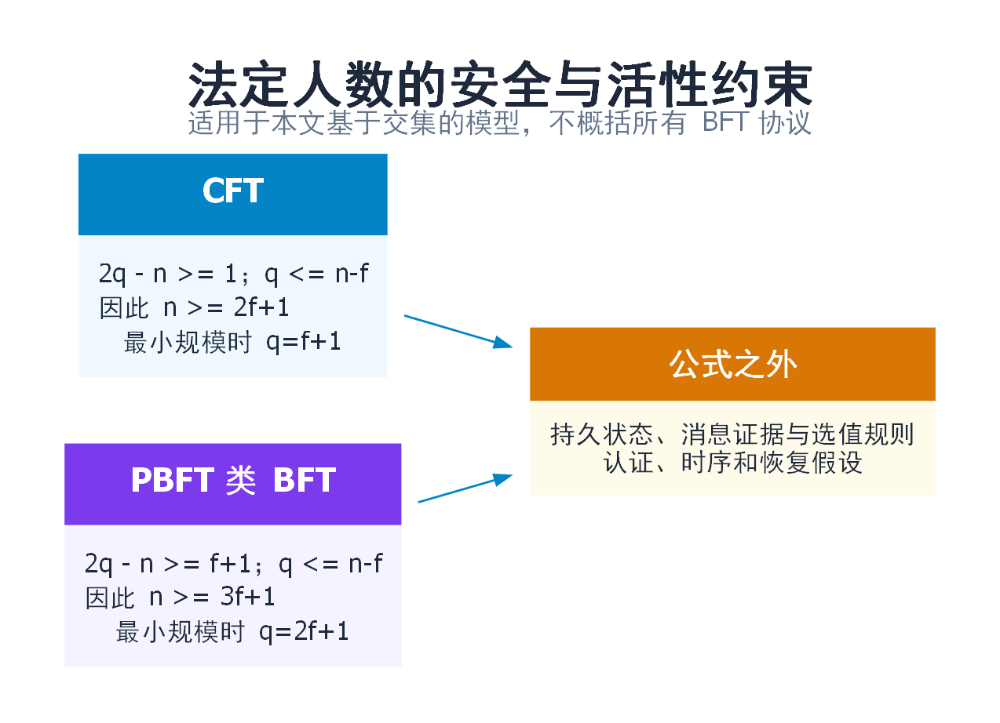

### 一句话差别：缺席 vs 撒谎

| | CFT（崩溃容错） | BFT（拜占庭容错） |
|---|---|---|
| 故障节点会做什么 | 崩溃、停止响应（**诚实但缺席**） | 任意行为：撒谎、伪造、对不同的节点说不同的话 |
| 典型算法 | Paxos / Raft / Zab | PBFT / Tendermint / HotStuff |
| 节点成本 | **n = 2f + 1** | **n = 3f + 1** |
| 正常路径消息复杂度示例 | 稳定主节点的 Raft 可为 O(n) | 原始 PBFT 全体广播为 O(n²)，不代表所有 BFT 协议 |

### 安全性：交集里必须有诚实节点

多数派交集是安全性证明的一部分，还需要投票与选值规则。两类故障对交集的要求**完全不同**：

```text
CFT：集合层面要求两个 quorum 有交集，协议还要保证持久化与正确选值
     —— 交集中的节点不会撒谎：节点可能在确认后才崩溃，所以历史 quorum 仍可能包含它。
        恢复时必须保留已确认的状态；交集加持久化、投票和选值规则才构成安全论证。

BFT：交集里必须有一个【诚实】节点
     —— 交集里的节点可能是叛徒。如果交集只有 1 个节点而它恰好是叛徒，
        它就能对两边说不同的话，让两个 quorum 各以为自己的决定是合法的。
        所以交集里要比叛徒多一个：交集大小 ≥ f + 1。
```

写成公式（设 quorum 大小为 q）：

```text
两个 quorum 的交集大小至少是 2q - n（鸽巢原理）
要求：2q - n ≥ f + 1
另有活性条件 q ≤ n - f。两式合并：
(n + f + 1) / 2 ≤ q ≤ n - f  →  n ≥ 3f + 1
当 n = 3f + 1 时，取 q = 2f + 1。
```

### 活性：别忘了一半

安全性只保证"不会错"，还得保证"还能动"：

> 坏掉（或叛变）f 个节点后，剩下的 `n - f` 个节点仍要凑得出一个 quorum：**n - f ≥ q**。

把两条约束放在一起，取 `n = 3f + 1`、`q = 2f + 1`，**恰好两条都取等号**：

```text
安全性：2(2f+1) - (3f+1) = f + 1 ✓
活性　：(3f+1) - f = 2f + 1 = q ✓
```

> **所以 3f+1 不是"经验数字"，而是"最小可行规模"**——两条约束同时取等号的唯一解。

### 一个陷阱：n 更大 ≠ 更安全

把上面两条不等式代入，可以逐项核对：

| 配置 | 最小可用 quorum | 结论 |
|------|----------------|------|
| n=4, f=1 | **3** | ✓ 可行（这正是 3f+1） |
| n=5, f=1 | **4**（不是 3！） | ✓ 可行，但 quorum 要涨 |
| n=3, f=1 | 3 | ✗ 活性不满足（n-f = 2 < 3） |
| n=7, f=2 | **5** | ✓ 可行（这正是 3f+1） |
| n=6, f=2 | 5 | ✗ 活性不满足（n-f = 4 < 5） |

**安全交集由 n、f、q 共同决定。** n=5、f=1 时若沿用 q=3，两个 quorum 的交集可能只有 1 个节点——恰好是那个叛徒。所以多加了节点，**必须同步放大 quorum**，否则容错能力反而下降。

这也是 PBFT 系系统普遍就用 `3f+1` 的原因：固定 f 时，增加节点还需要重新计算 quorum，并承担通信成本；如果也提高容错目标 f，则要重新满足全部条件。

<a id="section-19"></a>

## PBFT：三阶段在防什么

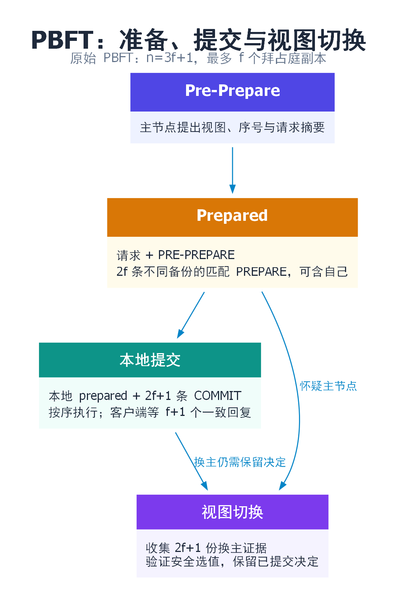

PBFT 的定位是**状态机复制**（和 Raft 一样），但它必须回答一个 Raft 不用回答的问题：**如果 leader（primary）自己是叛徒怎么办？**

### Pre-Prepare：主节点定序

主节点收到客户端请求后，分配序号 `n`，广播 `PRE-PREPARE(v, n, m)`（v 是视图号，m 是请求内容）。

**注意这一步的性质**：序号由主节点**单方面决定**。在 Raft 里这没问题（leader 不会撒谎），但在 BFT 里——**一个叛徒主节点完全可以给不同节点发不同的序号/内容**。所以必须有下一步来兜底。

### Prepare：对「序号 ↔ 消息」达成一致

每个备份节点收到 PRE-PREPARE 并校验通过后，向**所有其他节点**广播 `PREPARE(v, n, d)`（d 是消息摘要），并等待：

> 收到 **2f 个**（来自不同节点、与自己一致的）PREPARE → 进入 **prepared** 状态。

两个关键点：

- **为什么是"全体广播"而不是只发给主节点？** 因为主节点可能就是叛徒。全体广播让"n 对应哪个消息"这件事被**所有人共同见证**；
- **为什么是 2f 而不是 2f+1？** 因为此时还要加上"主节点的 PRE-PREPARE 已经算一票"——算上自己一共是 2f+1 个节点的认可。

### Commit：确认足够多副本已准备好

进入 prepared 后，节点广播 `COMMIT(v, n, d)`，并等待：

> 本地已 prepared，且收到 **2f+1 个**（含自己）同视图、同序号、同摘要的 COMMIT → 达到本地提交条件。等较小序号的请求都已执行，再执行并回复客户端。

### 两轮投票与换主怎样衔接

原始 PBFT 在 `n=3f+1` 个副本、最多 f 个拜占庭副本的假设下工作。prepared 需要本地具备请求、对应的 PRE-PREPARE，以及来自不同备份副本的 2f 条匹配 PREPARE（可以包含自己）。这里不能把主节点的 PRE-PREPARE 和自己的 PREPARE 再重复计票。

某节点收到 2f+1 条 COMMIT，意味着其中至少 f+1 个诚实副本已经 prepared。之后收集 2f+1 份换主消息时，集合必然碰到这些诚实副本中的至少一个。新主必须按视图切换规则检查准备证据、选择安全的请求，其他副本也要验证新视图。**交集、证据和选值规则共同保护已经提交的请求**，仅有人数公式不够。

prepared 是单个副本的本地判断，并不等于全网同意，也不表示每个仅在本地 prepared 的值都必须最终执行。Commit 要解决的是跨视图保存已提交决定的问题。客户端还需从不同副本收到 f+1 个一致回复，才可据此接受结果。以上对应原始 PBFT，不应直接套用到所有 BFT 协议。[PBFT 原论文](https://pdos.csail.mit.edu/6.5840/papers/castro-practicalbft.pdf)


<a id="section-20"></a>

## 主从延迟怎样定位和处理

设主库刚提交订单，返回位置 120。从库已收到 120，但只执行到 117。此时读从库仍可能读不到订单。复制有三个不同进度：主库提交、从库接收、从库应用。接收落后先查网络与发送积压，应用落后先查长事务、磁盘与回放线程。不同日志世代的位置不能仅凭数字比较。

| 读取办法 | 当从库只应用到 117 时 | 代价 |
| --- | --- | --- |
| 允许读旧值 | 直接读从库 | 用户可能刚下单就看不到订单 |
| 读己之写 | 把位置 120 随请求传给读路径，等从库应用到该位置再读 | 增加等待，必须有截止时间 |
| 回主库 | 等待预算耗尽后改到确认有该提交的主库 | 主库读负载增加 |
| 线性一致读 | 在共识系统里确认当前领导权和读屏障，再等状态机应用 | 额外协调，覆盖其他客户端已经完成的写 |

监控时同时看积压条目与最旧未应用条目的年龄。测试时暂停回放，提交一笔带编号的订单，分别走允许陈旧、等待追赶和回主库三条路径。异步复制切主可能丢失尚未复制的提交，此时单纯等进度也找不回数据。多主写入还需要定义冲突如何解决，例如两个机房各卖掉最后一件库存，事后按时间选一个值无法撤回已经承诺的两次销售。


<a id="section-21"></a>

## 单主、多主与无主，分别把冲突放在哪里

两个机房同时修改同一订单时，首先要决定“谁有权接收写入”。单主把写入集中到一个主节点；多主允许多处写入，之后交换修改；无主让客户端或协调层直接访问多个副本。它们与“有几个副本”是不同问题。

| 组织方式 | 一次写入怎样走 | 必须解决的问题 |
| --- | --- | --- |
| 单主 | 主节点确定顺序，再复制到其他副本 | 切主、旧主隔离、异步复制丢失窗口 |
| 多主 | 各主先处理本地写，再互相传播 | 同一个字段被并发修改时如何合并 |
| 无主 | 写入指定副本集合，按协议收集确认 | 版本比较、并发版本、失败写与副本修复 |

多主不是把两个单主数据库互相同步就结束了。例如 A、B 都把最后一件商品卖出，即使事后用时间戳挑选一个库存值，两次已承诺的销售仍然存在。可以预先把可销售额度分到各机房，或让扣减集中到同一协调范围。冲突策略必须维护业务约束。

无主复制常用读修复和反熵补齐旧副本。读修复在读取时发现不同版本并传播较新状态；反熵在后台比较数据摘要，把存在差异的范围再细分、同步。若版本并发，先合并再传播，不能凭某个节点墙上时钟较大就认定业务上正确。`R+W>N` 只给出集合交集，失败写、版本选择和成员变化仍需协议规定。

验证时断开一个副本，写入后重新连接，检查它能否追赶；再让两个位置并发修改同一字段，核对合并是否丢失业务意图。这与 Raft 的验证目标不同：Raft 通过同一提交日志确定顺序，并不把冲突留给任意的事后合并。


<a id="section-22"></a>

## 从 matchIndex 推导提交，再推导安全读取

leader 发送日志之后，需要保存每个 follower 已确认复制到哪里。这个位置叫 `matchIndex`，与“下一次尝试从哪里发送”的 `nextIndex` 不同。失败或超时不能把 matchIndex 猜大；否则 leader 会把尚未存在的副本算进多数派。

在固定成员配置中，leader 找到满足以下条件的最大 N，才能用副本计数推进 commitIndex：

```text
N > commitIndex
至少 floor(节点数 / 2) + 1 个节点的 matchIndex >= N（包括 leader 自己）
log[N].term == currentTerm
```

例如五节点 matchIndex 为 12、12、11、9、8，第三大值是 11，所以位置 11 已在多数派。但若 11 的日志任期不是当前任期，还不能仅凭这个计数提交它。把当前任期的后续条目复制到多数派后，该条目之前的前缀一起成为已提交。联合配置期间要分别取得新旧配置多数派，不能直接对全部节点套一次排序公式。

**Leader Completeness（领导者完整性）**要求后续任期的 leader 包含此前已提交条目。证明主线是：提交多数派与选举多数派有交集；交集节点的投票受日志新旧规则限制；结合日志匹配和当前任期提交规则，排除缺少已提交前缀的候选者当选。不能只说“多数派有交集所以安全”，Figure 8 已表明单靠交集不够。

**State Machine Safety（状态机安全）**要求：一个节点在某索引应用了某命令后，其他节点不能在同索引应用另一条命令。领导者完整性确保已提交前缀不被后任覆盖；节点只按顺序应用已提交条目，才把日志保证传给业务状态。[Raft Figure 2、5.4](https://raft.github.io/raft.pdf)

### follower 怎样提供线性一致读

让 follower 直接读本地状态，只能得到它已经应用的版本。要提供线性一致读，可以采用由 leader 协助的读屏障流程：

1. follower 把读请求交给当前 leader 获取安全读取位置 R。
2. leader 在提交过当前任期条目的前提下，以 ReadIndex 等机制确认自己仍有领导权，取得读屏障。
3. follower 等待自己的 appliedIndex 至少达到 R，再执行本地读取。

等待超时应返回无法满足该读取承诺，或转发到能满足条件的节点，不能默默返回旧数据。读己之写只需要覆盖本客户端已知写入；线性一致还要覆盖其他客户端在读取开始前已经完成的写入，所以两者不是一回事。

Lease Read 减少反复确认的通信，但必须有具体的租约协议：多数派确认怎样建立有效期、其他节点何时允许投票、使用哪种不会随校时回拨的计时、漂移与长暂停如何界定。有效读租约要保守地短于其他节点可能选出新主的时间，扣除通信与时钟误差余量；不能把任意选举超时直接当安全租约。假设无法成立时回到需要协调的读路径。配置生效时机也以所用实现为准；例如 etcd-io/raft 在应用配置变更时生效，并限制并发成员变更。[库契约](https://github.com/etcd-io/raft)


<a id="section-23"></a>

## 面试表达

复制解决主节点故障后如何保住已确认状态。Raft 用任期、选举限制和日志匹配组织复制，leader 只有在多数派确认且满足当前任期提交条件后才推进提交，业务再按序应用。读也要确认领导权和应用进度，不能直接信任旧主。代价是多数派不可达时停止推进，快照、成员变更和恢复还需严格的持久化顺序；仅有一份能选主的模拟程序不等于实现完整 Raft。

<a id="section-24"></a>

## Q&A（常见问题与解答）

### CRC 不匹配能直接截断 WAL 吗？

不能。需要先区分可修复的未完成尾部与已确认数据损坏。后者若截断后继续服务，会丢掉已承诺的状态，应停止并从可靠副本或备份恢复。

### matchIndex 与 nextIndex 能互换吗？

不能。前者是已确认进度，后者是下一次发送位置。把猜测的发送位置当确认，会错误地算出多数派。

### 为什么提交公式要检查当前任期？

旧条目即使在多数派，也可能被末日志任期更高的候选者覆盖。当前任期条目提交后才能借日志前缀关系确定之前条目。

### follower 等到自己的 appliedIndex 变大就能线性一致读吗？

还需取得正确的读屏障，确认截至本次读取应该覆盖到哪里。只等待任意一个旧位置，不能覆盖其他客户端已完成的写。

### 同任期接收心跳能清空 votedFor 吗？

不能。清空后可能给同任期另一候选者投票。转入更高任期时才按协议更新并持久化投票状态。

**复制到多数派就一定可以立即读本地吗？**

还要检查提交规则、当前领导权与本地应用进度。日志已收到但状态机尚未执行时，直接读状态仍会得到旧值。

**旧主收到新请求后把日志写到本地，可以回复成功吗？**

只写到本地还未达到提交条件。失去多数派的旧主无法提交该请求，回复成功会让客户端误以为操作已被保留。

**三节点失去两个，还能安全提交新写入吗？**

通常不能，因为只剩一个节点，凑不齐多数派。应将停止接受写入与已提交数据是否仍安全分开判断。

[延伸阅读](https://raft.github.io/raft.pdf)

<a id="section-25"></a>

## 进一步阅读

- [Raft 原论文](https://raft.github.io/raft.pdf)：核对正文中的模型、状态和失败边界。
- [etcd-io/raft 驱动契约](https://github.com/etcd-io/raft)：核对正文中的模型、状态和失败边界。
- [Paxos Made Simple](https://lamport.azurewebsites.net/pubs/paxos-simple.pdf)：核对正文中的模型、状态和失败边界。
- [PBFT 原论文](https://pdos.csail.mit.edu/6.5840/papers/castro-practicalbft.pdf)：核对正文中的模型、状态和失败边界。

关联笔记：[一致性与 CAP](../02-%E4%B8%80%E8%87%B4%E6%80%A7%E4%B8%8E%20CAP/%E4%B8%80%E8%87%B4%E6%80%A7%E4%B8%8E%20CAP.md)、[分布式锁、租约与 ID](../05-%E5%88%86%E5%B8%83%E5%BC%8F%E9%94%81%E3%80%81%E7%A7%9F%E7%BA%A6%E4%B8%8E%20ID/%E5%88%86%E5%B8%83%E5%BC%8F%E9%94%81%E3%80%81%E7%A7%9F%E7%BA%A6%E4%B8%8E%20ID.md)、[可观测性与故障验证](../11-%E5%8F%AF%E8%A7%82%E6%B5%8B%E6%80%A7%E4%B8%8E%E6%95%85%E9%9A%9C%E9%AA%8C%E8%AF%81/%E5%8F%AF%E8%A7%82%E6%B5%8B%E6%80%A7%E4%B8%8E%E6%95%85%E9%9A%9C%E9%AA%8C%E8%AF%81.md)。

下一篇要回答的问题是：支付已扣款，但响应在途中丢失。调用方超时后怎样重试？

<a id="section-26"></a>

## 思维导图总结

```text
副本、共识与 Raft
├── 复制组织
│   ├── 单主、多主、无主；同步与异步
│   └── 确认、提交、应用是不同进度
├── Paxos 与 Raft
│   ├── 多数派交集加选值规则才保证安全
│   └── 任期、投票限制、日志匹配与当前任期提交
├── 恢复与读取
│   ├── 持久化、快照与日志匹配；损坏分类恢复
│   └── ReadIndex 与应用进度；租约依赖时钟假设
├── Zab 与 PBFT
│   ├── Zab 发现、同步、广播
│   └── PBFT 准备、提交、换主证据；n/f/q 联合约束
├── 验证
│   ├── 切主后检查已确认日志
│   └── 暂停副本回放，比较不同读取策略
└── 提交与读屏障
    ├── matchIndex 多数派加当前任期条件
    └── follower 等待安全读位置；租约需具体假设
```

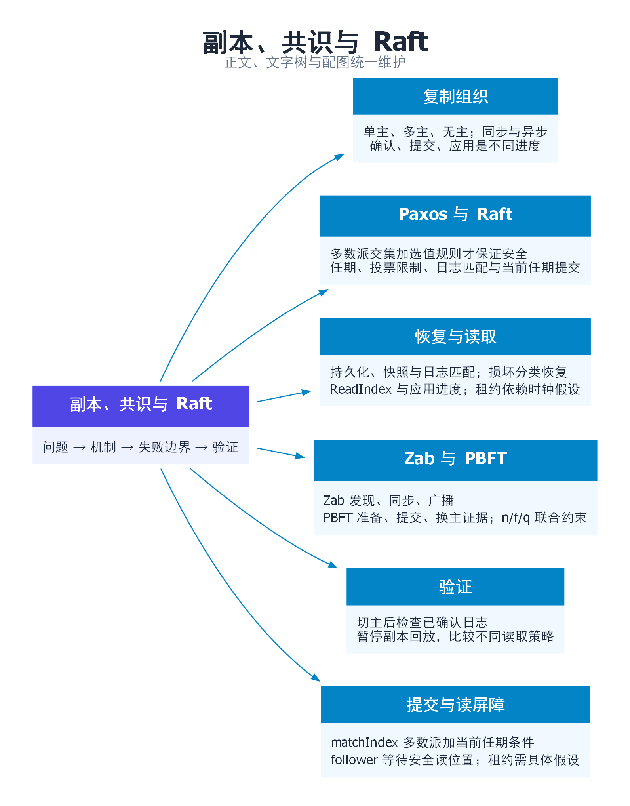
