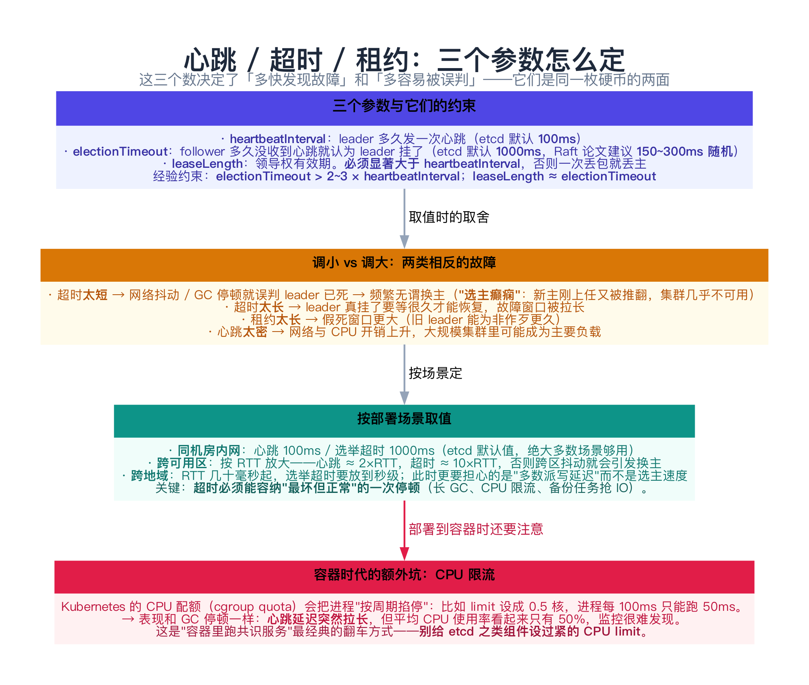
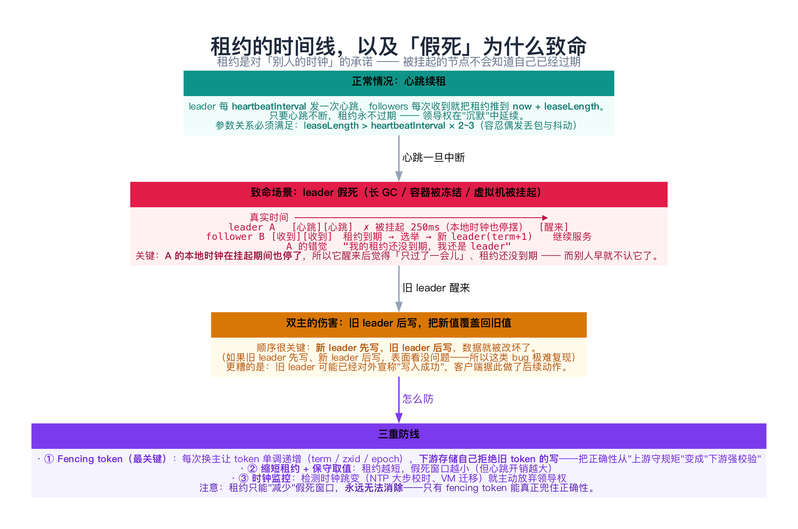
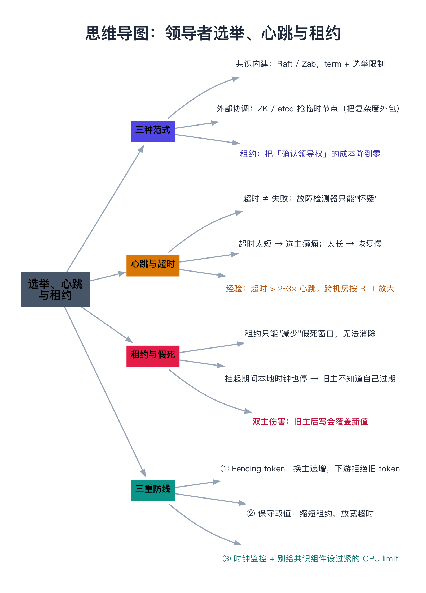

# 领导者选举、心跳与租约

> 一句话：「选出一个主」这件事在 Raft、Zab、ZooKeeper、Kubernetes 里都出现过，实现范式只有三种——**共识内建、外部协调、租约**。而它们共同的软肋是同一个：**超时 ≠ 失败**。租约把这个软肋变成了一个具体而危险的场景——**假死**：进程被挂起时，它既不知道时间在流逝，也不知道自己已经被取代。

---

## 目录

1. [为什么把「选主」单独拎出来讲](#1-为什么把选主单独拎出来讲)
2. [三种实现范式](#2-三种实现范式)
   - [2.1 共识内建](#21-共识内建)
   - [2.2 外部协调](#22-外部协调)
   - [2.3 租约](#23-租约)
   - [2.4 怎么选](#24-怎么选)
3. [心跳与超时：故障检测器的本质](#3-心跳与超时故障检测器的本质)
   - [3.1 超时 ≠ 失败](#31-超时-失败)
   - [3.2 参数怎么定](#32-参数怎么定)
4. [租约与「假死」](#4-租约与假死)
   - [4.1 租约的本质](#41-租约的本质)
   - [4.2 假死现场的完整时间线](#42-假死现场的完整时间线)
   - [4.3 为什么伤害是"旧主后写"](#43-为什么伤害是旧主后写)
5. [动手：复现一次「假死双主」并修好它（C++）](#5-动手复现一次假死双主并修好它c)
   - [5.1 代码](#51-代码)
   - [5.2 运行结果与解读](#52-运行结果与解读)
6. [常见坑](#6-常见坑)
7. [总结](#7-总结)
8. [延伸阅读](#8-延伸阅读)
9. [思维导图总结](#9-思维导图总结)

---

## 1. 为什么把「选主」单独拎出来讲

「选主」在前面几篇里反复出现，但每次都是"顺带一提"：

| 出现的地方 | 选主是怎么做的 |
|-----------|---------------|
| [09 Raft](../02-共识算法/09-Raft算法.md) | 随机超时 + 拉票 + 选举限制 |
| [10 Zab](../02-共识算法/10-ZooKeeper与Zab协议.md) | 比 zxid，最大的当选 |
| [12 工程细节](../02-共识算法/12-共识工程细节（快照、成员变更、线性一致读）.md) | 被移除的 leader 要主动退位 |
| [13 BFT](../02-共识算法/13-拜占庭容错共识（PBFT、Tendermint、HotStuff）.md) | 视图切换（View Change） |

**共性很明显**，值得单独成一个主题：

- 都要解决同一个问题：**在没有任何人"宣布"的情况下，一群人怎么自己达成"谁是主"的共识**；
- 都依赖同一个机制：**心跳 + 超时**；
- 都怕同一件事：**旧的"主"不知道自己已经不是主了**。

最后一件事在分布式系统里有专门的名字：**脑裂（split-brain）/ 双主**。这一篇会把它的成因、危害和防线讲透——因为它是线上事故里最常见、也最难排查的一类。

---

## 2. 三种实现范式


### 2.1 共识内建

**Raft / Zab** 把选主做成了算法的一部分：

```text
超时（没收到心跳）→ term+1 → 投自己 → 拉票 → 拿到多数派 → 当选
```

- **安全性来源**：**任期（term）+ 选举限制**。任期保证同一个 term 内只会有一个 leader（一个 term 只投一票）；选举限制保证"日志最全的人才能当选"；
- **优点**：不依赖任何外部组件，选主与日志复制天然一体；
- **缺点**：只能在自己的集群内选，选出来的"主"也只在集群内有意义。

### 2.2 外部协调

**ZooKeeper / etcd** 的思路是：**别自己实现共识，去抢一个临时节点**。

```text
所有候选者同时创建 /leader（临时节点）
→ 只有一个能成功（协调服务内部用 Zab/Raft 保证了这一点）
→ 成功者即为主；其他人 watch 这个节点，等它消失再抢
```

- **优点**：业务代码极简单；而且**"全局唯一"是跨系统的**——几十个异构服务可以一起竞争同一个主；
- **缺点**：多了一个**必须高可用的外部依赖**；并且因为有"会话"这个概念，会引出 [10 篇 3.3 节](../02-共识算法/10-ZooKeeper与Zab协议.md) 讲的**假死丢锁**问题；
- **本质**：这是**把方案 ① 外包出去**——协调服务自己就是个共识系统。

### 2.3 租约

前面两种都是"选一次，直到下次故障"。**租约**换了思路：

> **不是"我是主"，而是"在 T 时刻之前，我说话算数"。**

好处很直接：**把"确认领导权"的成本从一轮网络往返降到零**。[12 篇 4.2 节](../02-共识算法/12-共识工程细节（快照、成员变更、线性一致读）.md) 讲的 **Lease Read** 就是这么来的——leader 在租约期内直接读本地状态机，不用问多数派。

但租约有个关键区分，很多人没分清：

| 租约的来源 | 安全性 | 说明 |
|-----------|--------|------|
| **从共识推导** | ✅ 安全 | "多数派已经承诺在我租约期内不选别人"——比如 Raft 的 ReadIndex + 心跳确认 |
| **从本地时钟推导** | ⚠️ 有风险 | "我算了一下，我的租约还没到期"——依赖各节点时钟漂移有上界 |

**第 4 节要讲的"假死"，专门打的就是第二种。**

### 2.4 怎么选

| 场景 | 推荐 | 理由 |
|------|------|------|
| 你自己就是一个共识集群（数据库、消息队列） | **① 共识内建** | 别引入外部依赖，多一个组件多一个故障点 |
| 一堆异构组件要选一个全局主（定时任务、分片调度） | **② 外部协调** | 把复杂度外包给 ZooKeeper/etcd，业务代码只有几行 |
| 只是想让读请求别每次都确认领导权 | **③ 租约** | 但必须想清楚时钟风险（见第 4 节） |

---

## 3. 心跳与超时：故障检测器的本质



### 3.1 超时 ≠ 失败

理论上，"靠超时判断对方挂了"这件事有个正式名字——**故障检测器（failure detector）**。Chandra 与 Toueg 在 1996 年给了它一个漂亮的分类（见 [06 篇](../01-基础理论/06-分布式系统理论基础（FLP与拜占庭将军）.md) 的延伸阅读）：

| 类型 | 保证 | 现实对应 |
|------|------|----------|
| **完美检测器（P）** | 挂了的一定被怀疑、没挂的一定不被怀疑 | **异步系统里做不到**（就是 FLP 的那个"无法区分挂了还是慢"） |
| **最终完美检测器（◇P）** | 上面两条**最终**成立（可能误判一段时间） | ✅ 现实系统能做到——**"超时 + 随机化"就是它的实现** |

所以心跳机制的本质是：**我们承认自己会误判，只要求"误判不会永远持续"**。这也解释了两件事：

- 为什么超时必须**随机化**（[09 篇 2.2 节](../02-共识算法/09-Raft算法.md)）：避免所有人同时误判、票被瓜分；
- 为什么超时**不能太短**：误判的代价是"无谓换主"，而换主比等一会儿贵得多。

### 3.2 参数怎么定

三个参数的关系（etcd 默认值可作起点）：

```text
heartbeatInterval  = 100ms          ← leader 多久发一次心跳
electionTimeout    = 1000ms         ← follower 多久没收到就认为 leader 挂了
leaseLength        ≈ electionTimeout ← 领导权有效期
约束：electionTimeout > 2~3 × heartbeatInterval
```

**两个方向都会出问题**：

| 调小 | 调大 |
|------|------|
| 网络抖动/GC 停顿就误判 → **选主癫痫**（新主刚上任又被推翻，集群几乎不可用） | 真挂了要等很久才恢复，故障窗口被拉长 |
| 租约短 → 假死窗口小（好），但心跳开销大 | 租约长 → 假死窗口大（危险） |

**按场景取值**：

- **同机房内网**：etcd 默认值（心跳 100ms / 超时 1000ms）基本够用；
- **跨可用区**：按 RTT 放大——心跳 ≈ 2×RTT，超时 ≈ 10×RTT。否则跨区抖动就会引发换主；
- **跨地域**：超时要放到秒级，此时瓶颈其实是"多数派写延迟"而不是选主速度。

> **一条经验**：**超时必须能容纳"最坏但正常"的一次停顿**——长 GC、CPU 限流、备份任务抢 IO。如果超时只比平均心跳间隔大一点点，那它检测的不是故障，而是抖动。

---

## 4. 租约与「假死」



### 4.1 租约的本质

租约是一句**带时间戳的承诺**：

> "在 T 时刻之前，我（leader）说话算数；T 之后你们可以选别人。"

关键在于**这句话是对谁说的**：

- 对 **followers** 说："T 之前别选举"——它们用自己的时钟计时；
- 对 **leader 自己**说："T 之前你还是主"——**它用自己的时钟计时**。

**危险就藏在这两个时钟之间。** 如果 leader 的时钟走得比 followers 慢（或者它干脆停摆了），它会以为自己还有时间，而别人已经不认它了。

### 4.2 假死现场的完整时间线

```text
真实时间 ──────────────────────────────────────────────▶
leader A    [心跳][心跳]       ✗ 被挂起 250ms（本地时钟也停摆）      [醒来]
follower B  [收到][收到]   租约到期 → 选举 → 成为新 leader(term+1)     继续服务
A 的错觉    "我的租约还没到期，我还是 leader" ─────────────────┘
```

**"被挂起"在现实里有三种常见形态**：

1. **长时间 GC**（Stop-The-World）：JVM/Go 都可能出现；
2. **容器被冻结**：CPU 配额（cgroup quota）把进程"按周期掐停"，或者被 `SIGSTOP`；
3. **虚拟机被挂起**：宿主机迁移、快照、休眠。

这三者的共同点：**进程不运行，但网络连接还在**（所以别人不会立刻认为它"断线"）；更关键的是，**它的本地时钟也停了**（对进程来说"只过了一瞬间"）。

### 4.3 为什么伤害是"旧主后写"

双主本身不是问题，"两个主都以为自己合法"才是。真正的数据损坏有一个**特定的顺序条件**：

```text
✅ 看起来没事的顺序：旧主 A 先写 → 新主 B 后写
   （B 覆盖了 A，最终值是新主的，看不出异常）

❌ 真正出事的顺序：新主 B 先写 → 旧主 A 后写
   （A 用一个过期的值覆盖了 B 的正确值 —— 数据被"写回过去"）
```

**这正是这类 bug 极难复现的原因**：它依赖两个主写操作的**相对顺序**，而那个顺序又取决于网络延迟、调度时机。压测时常年不出，线上一抖就出。

而且伤害还不止数据面：**旧主可能已经对客户端宣称"写入成功"**，客户端据此做了后续动作（发消息、扣库存）——错误就此扩散。

---

## 5. 动手：复现一次「假死双主」并修好它（C++）

下面这个程序把 4.2 与 4.3 节完整跑一遍：**A 被挂起 → B、C 选出新主 → A 醒来仍自认为主 → 旧主后写把数据写坏 → 加上 fencing token 后写被拒**。

### 5.1 代码

```cpp
// 租约与「假死」：为什么「我是主」不能只靠本地时钟
// 场景：3 节点 A/B/C，A 是 leader，靠心跳 + 租约维持领导权（租约 100ms，心跳 30ms）
//   ① 正常续期：A 一直是 leader
//   ② A 遭遇 250ms 的 GC 停顿（进程被挂起，本地时钟也停摆）
//      → 在 B、C 眼里 A 的租约早就过期了 → 它们在停顿期间就选出新 leader B（term 2）
//   ③ A 醒来后本地时钟"只过了很短时间"，它【仍以为自己是 leader】→ 双主
//   ④ 旧 leader 后写：没有 fencing 时，它会把新 leader 的写覆盖回旧值
//   ⑤ 加上 fencing token（单调递增的 term）：存储层拒绝过期 leader → 安全性恢复
// 编译：g++ -std=c++11 -Wall -Wextra -O2 -o lease_demo lease_demo.cpp
#include <algorithm>
#include <iostream>
#include <string>
#include <vector>

struct Node {
    std::string name;
    int term = 0;              // 任期（同时用作 fencing token）
    bool leader = false;
    bool paused = false;       // 进程是否被挂起（挂起时本地时钟停摆）
    int localClock = 0;        // 本地时钟
    int leaseExpire = -1;      // 本地认为的「领导权有效期」截止时刻（按本地时钟计）
    explicit Node(std::string n) : name(std::move(n)) {}
};

class World {
public:
    static const int kLeaseMs = 100;

    World() : nodes_{Node("A"), Node("B"), Node("C")} {}
    int now() const { return now_; }

    void advance(int ms) {
        for (int i = 0; i < ms; ++i) {
            ++now_;
            for (auto& n : nodes_) if (!n.paused) ++n.localClock;
        }
    }

    void beginPause(const std::string& name, int ms) {
        Node& n = get(name);
        n.paused = true;
        pauseeName_ = name;
        pauseLeft_ = ms;
        std::cout << "  [" << now_ << "ms] " << name << " 进程被挂起（模拟长 GC / 容器冻结），计划停 "
                  << ms << "ms —— 期间它既不发心跳、也不看表\n";
    }
    // 分段推进停顿，便于在中间观察其他节点的行为
    void pauseFor(int ms) {
        const int step = std::min(ms, pauseLeft_);
        advance(step);
        pauseLeft_ -= step;
        if (pauseLeft_ == 0) {
            Node& n = get(pauseeName_);
            n.paused = false;
            std::cout << "  [" << now_ << "ms] " << pauseeName_ << " 恢复运行，但它的本地时钟只走到 "
                      << n.localClock << "ms（比真实时间慢 " << (now_ - n.localClock) << "ms）\n";
        }
    }

    // leader 发一轮心跳：自己续租，其他在线节点也跟着续租
    void heartbeat(const std::string& leaderName) {
        Node& L = get(leaderName);
        L.leaseExpire = L.localClock + kLeaseMs;
        for (auto& n : nodes_)
            if (n.name != leaderName && !n.paused) n.leaseExpire = now_ + kLeaseMs;
        std::cout << "  [" << now_ << "ms] " << leaderName << " 发心跳 → 在线节点把租约续到 "
                  << (now_ + kLeaseMs) << "ms\n";
    }

    void elect(const std::string& name) {
        for (auto& n : nodes_) n.leader = false;
        Node& w = get(name);
        w.leader = true;
        w.term = ++maxTerm_;
        w.leaseExpire = w.localClock + kLeaseMs;
        std::cout << "  [" << now_ << "ms] " << name << " 当选新 leader，term=" << w.term
                  << "（fencing token 前进）\n";
        for (auto& n : nodes_)
            if (n.name != name && !n.paused) n.leaseExpire = now_ + kLeaseMs;
    }

    // 检查在线 follower 的租约是否过期；过期就发起选举
    void checkLeaseExpiry() {
        for (auto& n : nodes_) {
            if (n.leader || n.paused || n.leaseExpire < 0) continue;
            if (now_ > n.leaseExpire) {
                std::cout << "  [" << now_ << "ms] " << n.name << " 发现 leader 的租约已过期（"
                          << n.leaseExpire << "ms 到期）→ 发起选举\n";
                elect(n.name);
                return;
            }
        }
    }

    // 存储层：useFencing = true 时，只接受 term >= 已见过的最大 term 的写
    bool write(const std::string& name, const std::string& kv, bool useFencing) {
        Node& w = get(name);
        std::cout << "  [" << now_ << "ms] " << name << " 写 " << kv << "（携带 term=" << w.term
                  << "）";
        if (useFencing && w.term < maxTermSeenByStorage_) {
            std::cout << "\n      ✗ 被存储层拒绝：term=" << w.term << " < 已知最大 term="
                      << maxTermSeenByStorage_ << "（它是个过期 leader）\n";
            return false;
        }
        maxTermSeenByStorage_ = std::max(maxTermSeenByStorage_, w.term);
        std::cout << " → ✓ 写入成功（存储层记录 term=" << maxTermSeenByStorage_ << "）\n";
        return true;
    }

    void status(const std::string& title) const {
        std::cout << "      【" << title << "】\n";
        for (const auto& n : nodes_)
            std::cout << "        " << n.name << "：term=" << n.term
                      << (n.leader ? "（自认为 leader）" : "")
                      << "，本地时钟=" << n.localClock << "ms，本地租约到 " << n.leaseExpire << "ms\n";
        std::cout << "        存储层已知最大 term = " << maxTermSeenByStorage_ << "\n";
    }

private:
    Node& get(const std::string& n) {
        for (auto& x : nodes_) if (x.name == n) return x;
        return nodes_[0];
    }
    std::vector<Node> nodes_;
    int now_ = 0;
    int maxTerm_ = 0;
    int maxTermSeenByStorage_ = 0;
    int pauseLeft_ = 0;
    std::string pauseeName_;
};

int main() {
    World w;
    std::cout << "3 节点，租约 = 100ms，心跳间隔 = 30ms，A 为初始 leader\n\n";

    std::cout << "① 正常情况下 A 靠心跳维持领导权\n";
    w.elect("A");
    for (int i = 0; i < 3; ++i) { w.heartbeat("A"); w.advance(30); }

    std::cout << "\n② A 遭遇 250ms 的 GC 停顿\n";
    w.beginPause("A", 250);
    w.pauseFor(80);                        // 走到 170ms：B、C 的租约（160ms）已过期
    w.checkLeaseExpiry();                  // 停顿期间，B、C 就选出了新 leader
    w.heartbeat("B");
    w.pauseFor(170);                       // 把剩下的停顿走完
    w.status("A 刚醒来时的状态");

    std::cout << "\n③ 关键：A 的本地时钟只走到 90ms，而它记的租约到期时刻是 160ms —— 90 < 160，它【仍以为自己是 leader】\n";

    std::cout << "\n④ 先看【没有 fencing】会怎样：新 leader B 先写，旧 leader A 后写\n";
    w.write("B", "x = 2", /*useFencing=*/false);
    w.write("A", "x = 1", /*useFencing=*/false);
    std::cout << "      ⚠ A 的写把 B 的值覆盖回了 1 —— 数据被一个已经过期的 leader 改坏了\n";

    std::cout << "\n⑤ 换成【带 fencing token】的存储层，同样的顺序再来一遍\n";
    w.write("B", "x = 2", /*useFencing=*/true);
    w.write("A", "x = 1", /*useFencing=*/true);
    w.status("最终状态");

    std::cout << "\n结论：租约把「我是主」变成有时间保证的事实，但这个保证只对【别人的时钟】有效 ——\n";
    std::cout << "      被挂起的节点不会知道自己已经过期。所以防双主不能只靠租约，\n";
    std::cout << "      还要靠单调递增的 fencing token，让下游自己拒绝过期 leader（第 15 篇细讲）。\n";
    return 0;
}
```

### 5.2 运行结果与解读

```text
3 节点，租约 = 100ms，心跳间隔 = 30ms，A 为初始 leader

① 正常情况下 A 靠心跳维持领导权
  [0ms] A 当选新 leader，term=1（fencing token 前进）
  [0ms] A 发心跳 → 在线节点把租约续到 100ms
  [30ms] A 发心跳 → 在线节点把租约续到 130ms
  [60ms] A 发心跳 → 在线节点把租约续到 160ms

② A 遭遇 250ms 的 GC 停顿
  [90ms] A 进程被挂起（模拟长 GC / 容器冻结），计划停 250ms —— 期间它既不发心跳、也不看表
  [170ms] B 发现 leader 的租约已过期（160ms 到期）→ 发起选举
  [170ms] B 当选新 leader，term=2（fencing token 前进）
  [170ms] B 发心跳 → 在线节点把租约续到 270ms
  [340ms] A 恢复运行，但它的本地时钟只走到 90ms（比真实时间慢 250ms）
      【A 刚醒来时的状态】
        A：term=1，本地时钟=90ms，本地租约到 160ms
        B：term=2（自认为 leader），本地时钟=340ms，本地租约到 270ms
        C：term=0，本地时钟=340ms，本地租约到 270ms
        存储层已知最大 term = 0

③ 关键：A 的本地时钟只走到 90ms，而它记的租约到期时刻是 160ms —— 90 < 160，它【仍以为自己是 leader】

④ 先看【没有 fencing】会怎样：新 leader B 先写，旧 leader A 后写
  [340ms] B 写 x = 2（携带 term=2） → ✓ 写入成功（存储层记录 term=2）
  [340ms] A 写 x = 1（携带 term=1） → ✓ 写入成功（存储层记录 term=2）
      ⚠ A 的写把 B 的值覆盖回了 1 —— 数据被一个已经过期的 leader 改坏了

⑤ 换成【带 fencing token】的存储层，同样的顺序再来一遍
  [340ms] B 写 x = 2（携带 term=2） → ✓ 写入成功（存储层记录 term=2）
  [340ms] A 写 x = 1（携带 term=1）
      ✗ 被存储层拒绝：term=1 < 已知最大 term=2（它是个过期 leader）
      【最终状态】
        A：term=1，本地时钟=90ms，本地租约到 160ms
        B：term=2（自认为 leader），本地时钟=340ms，本地租约到 270ms
        C：term=0，本地时钟=340ms，本地租约到 270ms
        存储层已知最大 term = 2

结论：租约把「我是主」变成有时间保证的事实，但这个保证只对【别人的时钟】有效 ——
      被挂起的节点不会知道自己已经过期。所以防双主不能只靠租约，
      还要靠单调递增的 fencing token，让下游自己拒绝过期 leader（第 15 篇细讲）。
```

逐条对照：

| 输出片段 | 印证了什么 |
|----------|-----------|
| ① `A 发心跳 → 在线节点把租约续到 160ms` | 正常路径：心跳不断，租约永不过期 |
| ② `[170ms] B 发现 leader 的租约已过期 → 发起选举` | **选举发生在 A 停顿期间**——A 全程不知情 |
| ② `A 恢复运行，但它的本地时钟只走到 90ms` | 挂起期间**本地时钟也停摆**——这是"假死"的物理基础 |
| ② `A：本地租约到 160ms`（而本地时钟才 90ms） | **90 < 160** → A 认为租约还有效 → 它仍是"自认为的 leader" |
| ④ `B 写 x = 2 → ✓`，`A 写 x = 1 → ✓` | **没有 fencing 时，旧主的写畅通无阻**，把新值覆盖回旧值 |
| ⑤ `A 的写被拒绝：term=1 < 已知最大 term=2` | **fencing token 把正确性从"上游守规矩"变成"下游强校验"** |
| ⑤ `B 的写成功` | 合法 leader 不受影响——防线只拦过期的那个 |

> **这段代码最值得记住的一行是第 ⑤ 步的拒绝**：注意它拦下 A 的写**不是靠 A 自己醒悟**（A 永远不会醒悟），而是靠**存储层主动校验**。这就是防御性设计的精髓：**不要指望出错的一方自己发现错误**。

---

## 6. 常见坑

**① 以为「超时了就是挂了」**

超时只是"怀疑"。异步系统里无法区分"挂了"和"很慢"（FLP，见 [06 篇](../01-基础理论/06-分布式系统理论基础（FLP与拜占庭将军）.md)）。所以协议设计必须容忍误判——这也是"最终完美检测器"的含义。

**② 超时设得太短**

短超时 + 高抖动 = **选主癫痫**：新主刚发出第一轮心跳，别人已经超时发起新一轮选举。集群在这种状态下几乎不可用（每个请求都可能因为换主而重试）。生产上常见的原因是"照抄了论文里的 150ms，但自己的机器有 200ms 的 GC 停顿"。

**③ 只靠租约防双主**

见第 4 节：**租约只能"减少"假死窗口，永远无法消除**。真正的防线是 fencing token。

**④ 下游不校验 token**

fencing token 的威力**完全取决于下游是否校验**。如果存储层是"来者不拒"的（比如一个裸文件系统、一个不检查版本的 KV），那 token 就是摆设。这是"设计一个分布式系统"和"把分布式系统接上现有存储"之间最常见的落差。

**⑤ 给共识组件设过紧的 CPU limit**

Kubernetes 里给 etcd 设 `limits.cpu: 500m`：进程每 100ms 只能跑 50ms，**平均使用率看起来只有 50%，但心跳延迟会周期性拉长**——和 GC 停顿一模一样的症状，却极难从监控上看出来。**共识组件要么不设 CPU limit，要么给足**。

**⑥ 换了主却没让旧的主动退位**

[12 篇 3.4 节](../02-共识算法/12-共识工程细节（快照、成员变更、线性一致读）.md) 提过：成员变更后，被移除的 leader 必须**主动退位**。同理会话过期、租约失效时，也要有"主动放弃领导权"的代码路径——虽然它不可靠（假死时根本跑不到），但能覆盖绝大多数正常故障。

**⑦ 在"主"上做不可回滚的副作用**

如果一个"主"会去做发邮件、调用外部支付这类**不可回滚**的动作，那双主的伤害就不再是"数据被覆盖"这么简单了。**正确做法**：主只负责产生决策并写入带 fencing 的存储，副作用由"读存储"的一方去做，天然去重。

---

## 7. 总结

| 主题 | 要点 |
|------|------|
| **三种范式** | 共识内建（Raft/Zab）/ 外部协调（ZK/etcd 抢临时节点）/ 租约（有时间保证的领导权） |
| **选型** | 自己有共识引擎 → 内建；跨异构系统 → 外部协调；只想省一轮往返 → 租约 |
| **心跳与超时** | 本质是**最终完美故障检测器**；超时 ≠ 失败，误判必须可恢复 |
| **参数关系** | `electionTimeout > 2~3 × heartbeatInterval`；跨机房按 RTT 放大；etcd 默认 100ms/1000ms |
| **调小的风险** | 选主癫痫（抖动被当成故障） |
| **租约的本质** | 对**别人的时钟**的承诺；leader 自己那份承诺用的是它自己的时钟 |
| **假死** | 长 GC / 容器冻结 / VM 挂起：进程停摆、本地时钟也停 → 旧主不知道自己已过期 |
| **双主的伤害** | **旧主后写**会把新值覆盖回旧值；顺序相关 → 极难复现 |
| **三重防线** | ① **fencing token（最关键）** ② 保守参数 ③ 时钟监控 + 别设过紧 CPU limit |

**记住三句话**：

1. **超时 ≠ 失败**：心跳机制天生会误判，协议的价值在于"误判了也不会错"——这靠的是任期、选举限制和 fencing token，不是靠超时本身准确。
2. **租约是对别人时钟的承诺，但 leader 用的是自己的时钟**：两者一旦不一致（尤其进程被挂起时），旧主就会"活在自己的世界里"。
3. **防双主的终极手段是 fencing**：让持有数据的下游自己拒绝过期 leader，而不是指望上游守规矩——**这是分布式系统里最值得反复使用的一个设计原则**。

下一章进入 [15 分布式锁](../03-协调、事务与一致性/15-分布式锁.md)，看 fencing token 在"锁"这个具体场景里怎么落地（以及 Redlock 的争议）。

---

## 8. 延伸阅读

- **故障检测器的理论**：Chandra & Toueg《Unreliable Failure Detectors for Reliable Distributed Systems》（JACM 1996）—— 完美/最终完美检测器的分类与"◇P 足以解共识"的结论，是本文 3.1 节的出处；
- **Dwork, Lynch, Stockmeyer《Consensus in the Presence of Partial Synchrony》（1988）** —— 部分同步模型与 GST，解释了"超时最终会准确"这一假设的地位。
- **租约机制**：Gray & Cheriton《Leases: An Efficient Fault-Tolerant Mechanism for Distributed File Cache Consistency》（SOSP 1989）—— 租约这个概念的原始论文；Chubby 论文（Burrows, OSDI 2006）第 2.3 节讲了工程上的租约实现与时钟假设。
- **假死与时钟**：Raft 博士论文第 6.4 节（Lease Read 的时钟假设与"保守时钟"的做法）；Go runtime 的 STW 停顿文档、Kubernetes 的 [CPU 限流与节流（throttling）说明](https://kubernetes.io/docs/concepts/configuration/manage-resources-containers/)。
- **工程实现**：etcd 的 `--heartbeat-interval` / `--election-timeout` 调优文档（官方的 *Tuning* 页专门讲"跨地域部署怎么取值"）；ZooKeeper 的 `tickTime` 与 `sessionTimeout` 关系。
- **顺着往下读**：[15 分布式锁](../03-协调、事务与一致性/15-分布式锁.md)（fencing token 的落地与 Redlock 争议）、[12 共识工程细节](../02-共识算法/12-共识工程细节（快照、成员变更、线性一致读）.md)（Lease Read 与假设阶梯）。

---

## 9. 思维导图总结

```text
领导者选举、心跳与租约
├── 三种实现范式
│   ├── 共识内建：Raft / Zab，靠 term + 选举限制
│   ├── 外部协调：ZK / etcd 抢同一个临时节点（把共识外包）
│   └── 租约：不是「我是主」，而是「T 之前我说话算数」
├── 心跳与超时
│   ├── 本质是「最终完美故障检测器」：会误判，但不会永远误判
│   ├── 超时 ≠ 失败（FLP）；随机化是为了避免票被瓜分
│   └── 参数：electionTimeout > 2~3 × heartbeatInterval；跨机房按 RTT 放大
├── 租约与假死
│   ├── 租约是对「别人的时钟」的承诺，leader 自己那份用自己的时钟
│   ├── 假死三形态：长 GC / 容器 CPU 限流 / VM 挂起 —— 进程停、时钟也停
│   └── 双主伤害：新主先写、旧主后写 → 新值被覆盖回旧值（顺序相关，极难复现）
└── 三重防线
    ├── ① Fencing token：换主递增，下游存储自己拒绝旧 token（最关键）
    ├── ② 保守参数：超时要容纳最坏但正常的停顿；租约别太长
    └── ③ 时钟监控 + 不给共识组件设过紧的 CPU limit；不可回滚的副作用挪到读侧
```


