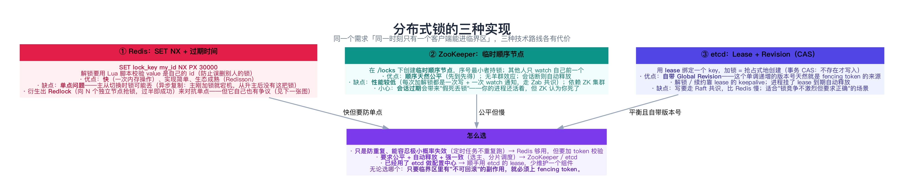
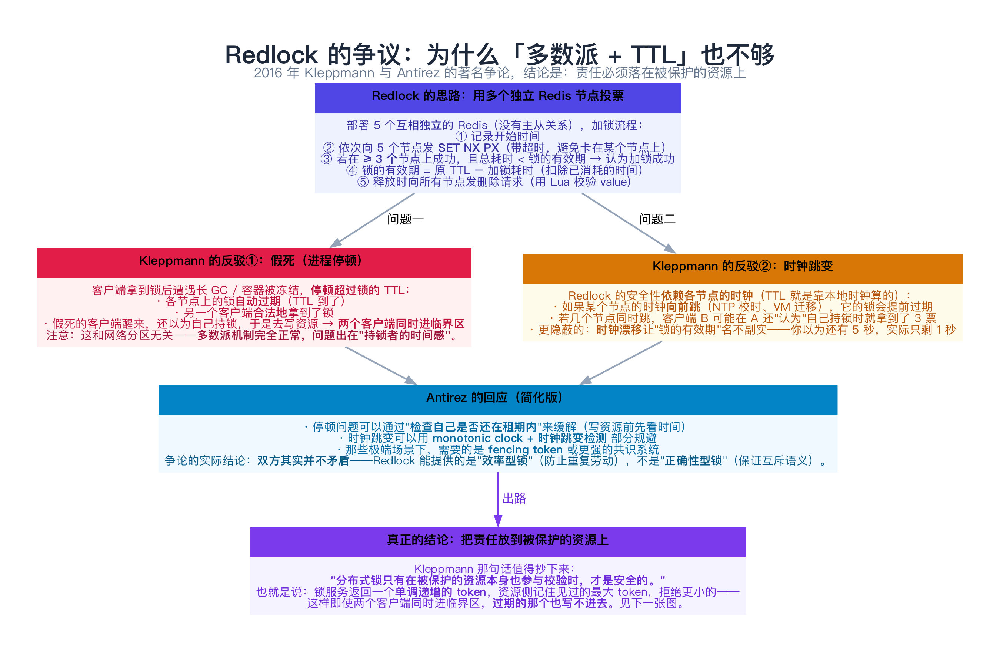
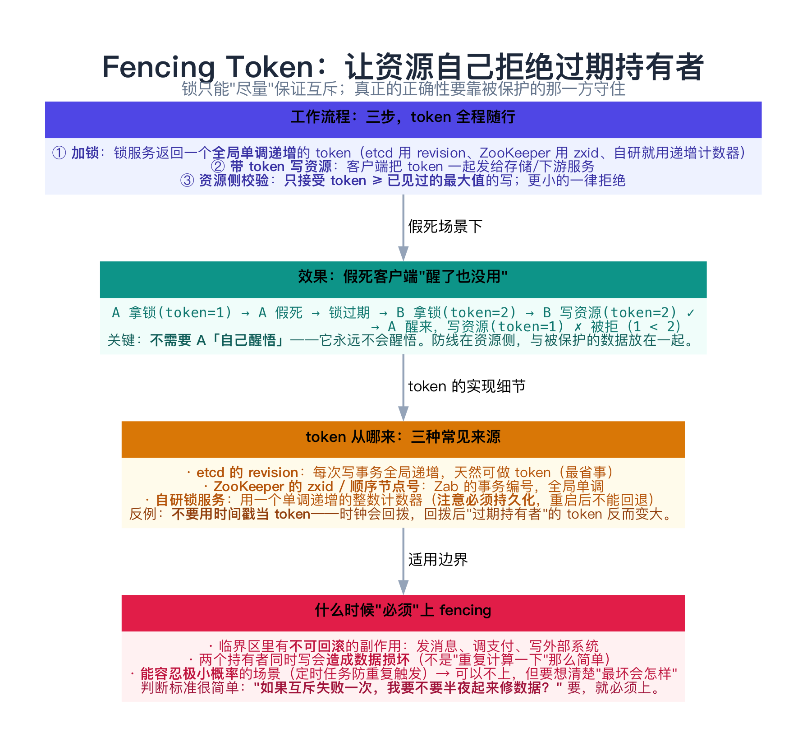
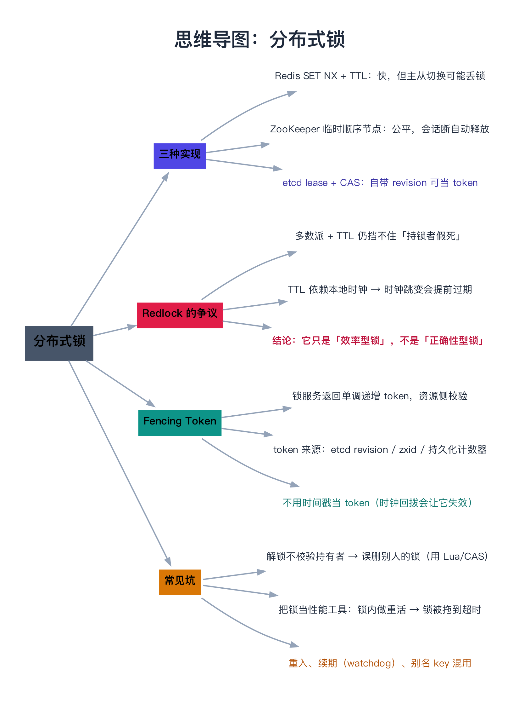

# 分布式锁

> 一句话：分布式锁要解决的是「同一时刻只有一个客户端能进临界区」，但**锁本身无法保证这件事**——因为持锁者可能"假死"（长 GC、容器被冻结），醒来后它仍然会去写。所以工业界的共识是：**锁只能提供"效率"（避免重复劳动），真正的"正确性"必须由被保护的资源自己用 fencing token 守住。**

---

## 目录

1. [先想清楚：锁到底要保证什么](#1-先想清楚锁到底要保证什么)
2. [三种实现](#2-三种实现)
   - [2.1 Redis：SET NX + TTL](#21-redisset-nx-ttl)
   - [2.2 ZooKeeper：临时顺序节点](#22-zookeeper临时顺序节点)
   - [2.3 etcd：Lease + CAS](#23-etcdlease-cas)
   - [2.4 对比与选型](#24-对比与选型)
3. [Redlock 的争议](#3-redlock-的争议)
   - [3.1 Redlock 的思路](#31-redlock-的思路)
   - [3.2 反驳一：假死](#32-反驳一假死)
   - [3.3 反驳二：时钟跳变](#33-反驳二时钟跳变)
   - [3.4 争论的结论](#34-争论的结论)
4. [Fencing Token：真正的兜底](#4-fencing-token真正的兜底)
5. [动手：多节点锁也挡不住的假死（C++）](#5-动手多节点锁也挡不住的假死c)
   - [5.1 代码](#51-代码)
   - [5.2 运行结果与解读](#52-运行结果与解读)
6. [常见坑](#6-常见坑)
7. [总结](#7-总结)
8. [延伸阅读](#8-延伸阅读)
9. [思维导图总结](#9-思维导图总结)

---

## 1. 先想清楚：锁到底要保证什么

在写代码之前，先把需求分成两类——**这个区分决定了你要不要上 fencing**：

| 需求类型 | 例子 | 互斥失败一次的后果 | 要不要 fencing |
|----------|------|-------------------|----------------|
| **效率型** | 定时任务防重复触发、缓存重建去重 | 多跑一次，浪费点资源 | 通常不用 |
| **正确性型** | 扣库存、转账、写外部系统 | **数据损坏 / 用户看到错账** | **必须** |

大部分"分布式锁"的讨论之所以吵起来，就是因为双方在说不同的类型：

> [14 篇](../03-协调、事务与一致性/14-领导者选举、心跳与租约.md) 讲的"假死"在效率型场景下**只是浪费**，在正确性场景下**就是事故**。

另外还有一个经常被忽略的前提：**能用数据库事务/唯一索引/乐观锁解决的，就别用分布式锁**。数据库的 `UPDATE ... WHERE version = ?` 就是天然的、带 fencing 的互斥——比引入一个锁服务简单得多。

---

## 2. 三种实现



### 2.1 Redis：SET NX + TTL

```text
加锁：SET lock_key <my_id> NX PX 30000     ← NX = 不存在才设置；PX = 30 秒自动过期
解锁：用 Lua 脚本原子地「比对 value 是否是自己，是才删除」
```

两个必须做对的细节：

1. **解锁必须校验 value**：否则 A 的锁过期、B 拿到锁之后，A 的解锁请求会把 **B 的锁**删掉。所以要用 Lua 保证"比对 + 删除"的原子性；
2. **TTL 必须有**：否则客户端崩溃后锁永远不会释放。

**它最大的问题是单点**：Redis 主从是**异步复制**的——主节点刚写入锁就宕机，从节点升主后没有这把锁，另一个客户端就能拿到。这就是 Redlock 想解决的问题。

### 2.2 ZooKeeper：临时顺序节点

```text
① 在 /locks 下创建【临时顺序节点】lock-0000000001、lock-0000000002 ……
② 拿到子节点列表，自己序号最小 → 持锁
③ 否则只 watch【序号比自己小一位】的那个节点（不是 watch 锁本身！）
④ 被通知后回到 ②
```

- **顺序天然公平**：先到先得，不需要额外协调；
- **无羊群效应**：每次释放只唤醒一个客户端（[10 篇 4.2 节](../02-共识算法/10-ZooKeeper与Zab协议.md)）；
- **会话断则自动释放**：进程崩溃 → 心跳停 → 会话过期 → 临时节点消失。

代价是**每次加解锁都要走一遍 Zab 共识**（写日志 + 落盘），吞吐远低于 Redis。

### 2.3 etcd：Lease + CAS

```text
加锁：用事务 CAS —— 若 lock_key 不存在则创建，并绑定一个 lease（TTL）
解锁：删除 key（或 revoke lease）；进程挂了 lease 到期自动删除
```

**etcd 的独特优势**：它有一个**全局单调递增的 Revision**——每次写事务都会让整个集群的 revision 前进。这个 revision **天然就是 fencing token**，不需要额外设计。

### 2.4 对比与选型

| | Redis | ZooKeeper | etcd |
|---|---|---|---|
| 加锁延迟 | **最低**（内存操作） | 中（走共识） | 中（走共识） |
| 公平性 | 无（要靠客户端排队） | **天然公平**（顺序节点） | 无 |
| 崩溃自动释放 | TTL 到期 | 会话过期 | lease 到期 |
| 主从切换会丢锁吗 | **可能**（异步复制） | 不会（Zab） | 不会（Raft） |
| 自带 fencing token | ❌（要自己造） | ✅ zxid / 顺序号 | ✅ **revision** |
| 适合 | 高频、能容忍极小概率 | 需要公平 + 强一致 | 已用 etcd 的团队 |

**选型口诀**：**能容忍"极小概率失效"就用 Redis；要保证绝不双持有就用 ZooKeeper/etcd。**

---

## 3. Redlock 的争议



### 3.1 Redlock 的思路

Redis 作者 Antirez 为了对抗"单点丢锁"，提出了 **Redlock**：

```text
① 部署 5 个【互相独立】的 Redis（没有主从关系）
② 记录开始时间，依次向 5 个节点发 SET NX PX（每个都带短超时）
③ 若在 ≥ 3 个节点上成功，且总耗时 < 锁的有效期 → 加锁成功
④ 锁的有效期 = 原 TTL − 加锁耗时（扣除已消耗的时间）
```

看起来很像共识算法的多数派逻辑。但 2016 年，Kleppmann 写了一篇著名的[《How to do distributed locking》](https://martin.kleppmann.com/2016/02/08/how-to-do-distributed-locking.html)提出反驳，Antirez 也做了[回应](http://antirez.com/news/101)。

### 3.2 反驳一：假死

**这是最致命的一击，而且和网络分区无关：**

```text
A 拿到锁（3/5 节点）→ A 遭遇长 GC，停顿超过 TTL
                     → 各节点上的锁【自动过期】
                     → B 合法地拿到锁（3/5 节点）
                     → A 醒来，仍以为自己持锁，去写资源
                     → 两个客户端同时进临界区
```

**多数派机制全程正常**——问题出在"持锁者的时间感"。**多节点投票防的是"节点宕机"，防不了"客户端停顿"。**

### 3.3 反驳二：时钟跳变

Redlock 的安全性还**依赖各节点的时钟**（TTL 就是本地时钟算的）：

- 如果某个节点的时钟**向前跳**（NTP 校时、虚拟机迁移），它的锁会**提前过期**；
- 若几个节点同时跳，客户端 B 可能在 A 还"认为"自己持锁时就拿到了 3 票；
- 更隐蔽的是**时钟漂移**：你以为还有 5 秒，实际只剩 1 秒。

### 3.4 争论的结论

Antirez 的回应大意是：停顿可以通过"写资源前检查自己是否还在租期内"来缓解，时钟问题可以用 monotonic clock 规避。

**但双方其实并不矛盾**，只是定义了不同强度的"锁"：

| | 效率型锁 | 正确性型锁 |
|---|---|---|
| 目标 | 避免重复劳动 | 保证互斥语义 |
| Redlock / Redis 锁 | ✅ 够用 | ❌ 不够 |
| ZooKeeper / etcd | ✅ | 仍然**需要 fencing** |

Kleppmann 那句话值得抄下来：

> **"分布式锁只有在被保护的资源本身也参与校验时，才是安全的。"**

---

## 4. Fencing Token：真正的兜底



思路只有三步：

```text
① 加锁时，锁服务返回一个【全局单调递增】的 token
② 写资源时，把 token 一起带上
③ 资源侧记住见过的最大 token，只接受 >= 它的写
```

效果：

```text
A 拿锁(token=1) → A 假死 → 锁过期 → B 拿锁(token=2) → B 写资源(token=2) ✓
                                  → A 醒来，写资源(token=1) ✗ 被拒绝
```

**关键在于：不需要 A"自己醒悟"**（它永远不会醒悟）。防线在**资源侧**，和被保护的数据放在一起——这也是为什么它叫"fencing"（栅栏）：**把过期持有者挡在数据外面**。

**token 从哪来？**

| 来源 | 说明 |
|------|------|
| **etcd 的 revision** | 最省事，全局单调递增 |
| **ZooKeeper 的 zxid / 顺序节点号** | Zab 的事务编号，天然单调 |
| **自研计数器** | 必须**持久化**，重启后不能回退 |

**反例：不要用时间戳当 token**——时钟可能回拨，回拨之后"过期持有者"的 token 反而更大，栅栏就失效了。

---

## 5. 动手：多节点锁也挡不住的假死（C++）

下面这个程序模仿 Redlock：**5 个锁节点、quorum=3、TTL 自动过期**，然后让持锁者假死一次，看会发生什么。

### 5.1 代码

```cpp
// 分布式锁的「假死」问题：多节点 quorum 加锁也救不了它
// 场景：模仿 Redlock —— 5 个独立节点，客户端要在 >= 3 个节点上抢到锁才算加锁成功，
//       锁带 TTL（自动过期），客户端拿到锁后有一段"持锁时间"。
//   ① 客户端 A 在 5 个节点里的 3 个上抢到锁 → 认为自己持锁成功
//   ② A 遭遇长时间 GC（超过 TTL）→ 各节点的锁自动过期
//   ③ 客户端 B 在另外 3 个节点上抢到锁 → 也认为自己持锁成功
//   ④ 两个客户端同时进入临界区，且 A 后写 → 把 B 的结果覆盖掉
//   ⑤ 加上 fencing token（锁服务返回单调递增的序号，资源侧校验）→ A 的写被拒
// 编译：g++ -std=c++11 -Wall -Wextra -O2 -o lock_demo lock_demo.cpp
#include <algorithm>
#include <iostream>
#include <string>
#include <vector>

struct LockNode {
    std::string name;
    std::string owner;      // 当前持有者（空 = 空闲）
    int expireAt = -1;      // 过期时刻（节点自己的时钟）
    int token = 0;          // 这个节点发出过的最大 token（单调递增）
    explicit LockNode(std::string n) : name(std::move(n)) {}
};

class LockService {
public:
    static const int kTtlMs = 100;

    LockService() : nodes_{LockNode("R1"), LockNode("R2"), LockNode("R3"),
                           LockNode("R4"), LockNode("R5")} {}

    int now() const { return now_; }
    void advance(int ms) {
        for (int i = 0; i < ms; ++i) {
            ++now_;
            for (auto& n : nodes_) if (n.expireAt >= 0 && now_ >= n.expireAt) n.owner.clear();
        }
    }
    std::size_t quorum() const { return nodes_.size() / 2 + 1; }   // 5 节点需要 3

    // 尝试加锁：给每个空闲节点写 owner + TTL，成功数 >= quorum 才算加锁成功
    // 成功时返回 fencing token（取所有节点里最大的 token + 1），失败返回 0
    int tryLock(const std::string& who, const std::vector<std::string>& chosen) {
        int got = 0, maxToken = 0;
        for (const auto& name : chosen) {
            LockNode& n = get(name);
            if (!n.owner.empty()) continue;           // 已被别人持有
            ++got;
            maxToken = std::max(maxToken, n.token);
        }
        if (static_cast<std::size_t>(got) < quorum()) {
            std::cout << "  [" << now_ << "ms] " << who << " 只在 " << got << "/" << nodes_.size()
                      << " 个节点上抢到 → 加锁失败（需要 " << quorum() << "）\n";
            return 0;
        }
        const int myToken = maxToken + 1;
        for (const auto& name : chosen) {
            LockNode& n = get(name);
            if (!n.owner.empty()) continue;
            n.owner = who;
            n.expireAt = now_ + kTtlMs;
            n.token = myToken;
        }
        std::cout << "  [" << now_ << "ms] " << who << " 在 " << got << "/" << nodes_.size()
                  << " 个节点上加锁成功，TTL=" << kTtlMs << "ms，fencing token=" << myToken << "\n";
        return myToken;
    }

    void show() const {
        std::cout << "      节点状态：";
        for (const auto& n : nodes_) {
            std::cout << n.name << "[" << (n.owner.empty() ? "空闲" : n.owner)
                      << ",token=" << n.token << "] ";
        }
        std::cout << "\n";
    }

private:
    LockNode& get(const std::string& n) {
        for (auto& x : nodes_) if (x.name == n) return x;
        return nodes_[0];
    }
    std::vector<LockNode> nodes_;
    int now_ = 0;
};

// 被保护的资源：useFencing = true 时，只接受 token >= 已见过的最大 token 的写
class Resource {
public:
    bool write(const std::string& who, int token, int value, bool useFencing) {
        std::cout << "  [" << who << "] 写 value=" << value << "（携带 token=" << token << "）";
        if (useFencing && token < maxToken_) {
            std::cout << "\n      ✗ 资源侧拒绝：token=" << token << " < 已见过的 " << maxToken_
                      << " —— 这是一个「已被取代的锁持有者」\n";
            return false;
        }
        maxToken_ = std::max(maxToken_, token);
        value_ = value;
        std::cout << " → ✓ 写入成功，资源当前值 = " << value_ << "\n";
        return true;
    }
    int value() const { return value_; }

private:
    int value_ = 0;
    int maxToken_ = 0;
};

int main() {
    LockService svc;
    Resource res;
    const std::vector<std::string> all{"R1", "R2", "R3", "R4", "R5"};

    std::cout << "5 个锁节点，quorum = " << svc.quorum() << "，TTL = " << LockService::kTtlMs << "ms\n\n";

    std::cout << "① 客户端 A 加锁（在 5 个节点上尝试）\n";
    const int tokenA = svc.tryLock("A", all);
    svc.show();

    std::cout << "\n② A 遭遇 250ms 的 GC 停顿：它手上的锁在节点侧陆续过期\n";
    svc.advance(250);
    std::cout << "  （真实时间推进 250ms，A 的锁已过期被自动释放）\n";
    svc.show();

    std::cout << "\n③ 客户端 B 此时来加锁\n";
    const int tokenB = svc.tryLock("B", all);
    svc.show();

    std::cout << "\n④ A 醒来，仍然以为自己持有锁，于是去写资源（此时 B 也在写）\n";
    std::cout << "   —— 先看【资源侧不校验 token】会怎样：\n";
    res.write("B", tokenB, 222, /*useFencing=*/false);
    res.write("A", tokenA, 111, /*useFencing=*/false);
    std::cout << "      ⚠ A 的写覆盖了 B 的写：临界区被两个客户端同时进入了\n";

    std::cout << "\n⑤ 换成【资源侧校验 token】\n";
    res.write("B", tokenB, 333, /*useFencing=*/true);
    res.write("A", tokenA, 111, /*useFencing=*/true);
    std::cout << "      最终资源值 = " << res.value() << "（来自合法持有者 B）\n";

    std::cout << "\n结论：靠 TTL 自动过期 + 多数派加锁，解决的是「节点宕机」这类故障；\n";
    std::cout << "      但解决不了「持锁者假死」——它在锁过期后仍然会去写。\n";
    std::cout << "      唯一可靠的兜底是：让被保护的资源自己校验单调递增的 fencing token。\n";
    return 0;
}
```

### 5.2 运行结果与解读

```text
5 个锁节点，quorum = 3，TTL = 100ms

① 客户端 A 加锁（在 5 个节点上尝试）
  [0ms] A 在 5/5 个节点上加锁成功，TTL=100ms，fencing token=1
      节点状态：R1[A,token=1] R2[A,token=1] R3[A,token=1] R4[A,token=1] R5[A,token=1] 

② A 遭遇 250ms 的 GC 停顿：它手上的锁在节点侧陆续过期
  （真实时间推进 250ms，A 的锁已过期被自动释放）
      节点状态：R1[空闲,token=1] R2[空闲,token=1] R3[空闲,token=1] R4[空闲,token=1] R5[空闲,token=1] 

③ 客户端 B 此时来加锁
  [250ms] B 在 5/5 个节点上加锁成功，TTL=100ms，fencing token=2
      节点状态：R1[B,token=2] R2[B,token=2] R3[B,token=2] R4[B,token=2] R5[B,token=2] 

④ A 醒来，仍然以为自己持有锁，于是去写资源（此时 B 也在写）
   —— 先看【资源侧不校验 token】会怎样：
  [B] 写 value=222（携带 token=2） → ✓ 写入成功，资源当前值 = 222
  [A] 写 value=111（携带 token=1） → ✓ 写入成功，资源当前值 = 111
      ⚠ A 的写覆盖了 B 的写：临界区被两个客户端同时进入了

⑤ 换成【资源侧校验 token】
  [B] 写 value=333（携带 token=2） → ✓ 写入成功，资源当前值 = 333
  [A] 写 value=111（携带 token=1）
      ✗ 资源侧拒绝：token=1 < 已见过的 2 —— 这是一个「已被取代的锁持有者」
      最终资源值 = 333（来自合法持有者 B）

结论：靠 TTL 自动过期 + 多数派加锁，解决的是「节点宕机」这类故障；
      但解决不了「持锁者假死」——它在锁过期后仍然会去写。
      唯一可靠的兜底是：让被保护的资源自己校验单调递增的 fencing token。
```

逐条对照：

| 输出片段 | 印证了什么 |
|----------|-----------|
| ① `A 在 5/5 个节点上加锁成功，fencing token=1` | Redlock 式加锁：多节点投票 + TTL |
| ② `A 的锁已过期被自动释放`（节点状态全变空闲） | **TTL 到期，锁自动释放**——这是防"客户端崩溃"的设计 |
| ③ `B 在 5/5 个节点上加锁成功，token=2` | **B 完全合法**：它不知道 A 只是假死 |
| ④ `B 写 → ✓`，`A 写 → ✓` | **资源侧不校验 token 时，假死客户端照样写得进去**——多数派毫无帮助 |
| ⑤ `A 的写被拒绝：token=1 < 已见过的 2` | **fencing 让资源自己挡住过期持有者**，不依赖 A 醒悟 |
| ⑤ `最终资源值 = 333`（B 的值） | 合法持有者的写不受影响 |

> 注意第 ④ 步里 **A 和 B 都在"合法"地执行**：A 认为自己的锁还没过期，B 手里的锁是刚抢到的。**锁服务在这一刻无法裁决谁对**——只有资源侧能做这个判断。

---

## 6. 常见坑

**① 解锁不校验持有者**

`DEL lock_key` 直接删——如果此时你的锁已经过期、别人刚拿到锁，你就把**别人的锁**删了。必须用 Lua（Redis）或 CAS（etcd/zk）保证"校验 + 删除"原子。

**② 把 TTL 当"业务超时"**

很多人把锁 TTL 设成"业务大概要跑多久"，然后指望它在业务超时后自动兜底。实际上：**TTL 应该设成"业务最坏耗时 + 余量"**，并且要有看门狗（watchdog）续期的机制（Redisson 的 `lockWatchdogTimeout` 就是干这个）。

**③ 锁内做重活**

锁是个**串行点**。在锁里做几百毫秒的 RPC 或大文件处理，会把所有竞争者都卡住——而且容易把锁拖到超时。**锁内只做"判断 + 写标记"，重活挪出去。**

**④ 用时间戳做 token**

见第 4 节。时钟回拨会让 fencing 失效，而且这种 bug 只在特定时刻出现，极难排查。

**⑤ 忽略"假死"这一整类风险**

很多团队只考虑了"客户端崩溃"（TTL 能兜住），完全没考虑"客户端还活着但不干活了"（TTL 兜不住）。**GC、CPU 限流、VM 挂起**在容器时代都是常态，不是极端情况。

**⑥ 在正确的场景用了错误的锁**

| 场景 | 该用什么 |
|------|----------|
| 单机内多线程互斥 | `std::mutex` / 进程内的锁 |
| 多副本（K8s Pod）同一份数据 | 分布式锁 + fencing |
| 数据库行的互斥更新 | **数据库乐观锁（version 列）**——最省事 |
| 防定时任务重复触发 | 分布式锁（效率型够用）或数据库唯一键 |

最后一行值得强调：**数据库唯一索引**常常是比分布式锁更可靠的"互斥"手段——它就是天然的、带持久化的 fencing。

---

## 7. 总结

| 主题 | 要点 |
|------|------|
| **需求分类** | 效率型（怕重复劳动）/ 正确性型（怕数据损坏）——后者必须 fencing |
| **Redis 锁** | `SET NX PX` + Lua 校验删除；快，但主从异步复制可能丢锁 |
| **ZooKeeper** | 临时顺序节点：公平、无羊群效应、会话断自动释放；慢（走共识） |
| **etcd** | lease + CAS；**revision 天然可当 fencing token** |
| **Redlock** | 5 节点多数派 + TTL；防住了"节点宕机"，**防不住"客户端假死"** |
| **Redlock 争议** | 假死 + 时钟跳变；结论：它是**效率型锁**，不是正确性型锁 |
| **Fencing token** | 锁服务发单调递增 token，**资源侧校验并拒绝更小的**——唯一的正确性兜底 |
| **token 来源** | etcd revision / zxid / 持久化计数器；**绝不用时间戳** |

**记住三句话**：

1. **锁不是"谁持有"的问题，而是"谁有权写"的问题**：把裁决权交给被保护的资源，而不是交给锁服务。
2. **TTL 只能救"崩溃"，救不了"假死"**：崩溃的客户端不会再写，假死的会——所以正确性场景必须有 fencing。
3. **先问能不能不用锁**：数据库乐观锁、唯一索引、单点串行化，往往比引入一个分布式锁服务更简单也更可靠。

下一章进入 [16 分布式事务（2PC、3PC、TCC、Saga）](../03-协调、事务与一致性/16-分布式事务（2PC、3PC、TCC、Saga）.md)，看"跨多个资源的一致性"怎么在工程上落地。

---

## 8. 延伸阅读

- **争论原文（强烈建议两篇都读）**：
  - Martin Kleppmann《[How to do distributed locking](https://martin.kleppmann.com/2016/02/08/how-to-do-distributed-locking.html)》（2016）—— 对 Redlock 的两条反驳，以及"fencing token"的提出；
  - Salvatore Sanfilippo（Antirez）《[Is Redlock safe?](http://antirez.com/news/101)》—— 作者的回应；两篇对照读能看清"效率型锁 vs 正确性型锁"的分界。
- **Redis 官方**：[Distributed Locks with Redis](https://redis.io/docs/manual/patterns/distributed-locks/) —— Redlock 的规范描述与各语言实现列表；同时注意它开头那句"如果你只关心效率，单实例锁就够了"。
- **实现参考**：Redisson（看门狗续期）、Apache Curator 的 `InterProcessMutex`（临时顺序节点）、etcd 的 `concurrency` 包（`clientv3/concurrency` 里的 `Mutex` 直接用了 revision 做 token）。
- **同类问题**：Chubby 论文（Burrows, OSDI 2006）第 2.3 节的租约与序列号设计；Google 的《[Fencing in the Cloud](https://cloud.google.com/blog/products/storage-data-transfer/fencing-in-the-cloud)》类文章。
- **顺着往下读**：[14 领导者选举、心跳与租约](../03-协调、事务与一致性/14-领导者选举、心跳与租约.md)（假死的完整时间线）、[16 分布式事务](../03-协调、事务与一致性/16-分布式事务（2PC、3PC、TCC、Saga）.md)（跨资源的原子性）。

---

## 9. 思维导图总结

```text
分布式锁
├── 先分类需求
│   ├── 效率型：防重复劳动（定时任务），互斥失败只是浪费 → 可不加 fencing
│   └── 正确性型：扣库存/转账/写外部系统 → 【必须】fencing
├── 三种实现
│   ├── Redis：SET NX PX + Lua 校验删除；快，但主从异步复制可能丢锁
│   ├── ZooKeeper：临时顺序节点；天然公平、无羊群效应、会话断自动释放
│   └── etcd：lease + CAS；revision 天然就是 fencing token
├── Redlock 的争议
│   ├── 思路：5 个独立节点，≥3 个成功且耗时 < TTL 才算加锁
│   ├── 反驳①：假死——持锁者停顿超过 TTL，锁自动过期，它醒来照样写
│   ├── 反驳②：时钟跳变——TTL 依赖本地时钟，跳变会让锁提前失效
│   └── 结论：它提供的是「效率型锁」，不是「正确性型锁」
├── Fencing Token（唯一可靠的兜底）
│   ├── 三步：锁服务发单调递增 token → 写时带上 → 资源侧拒绝更小的
│   ├── 来源：etcd revision / zxid / 持久化计数器（绝不用时间戳）
│   └── 精髓：不指望过期持有者醒悟，把栅栏放在数据旁边
└── 常见坑
    ├── 解锁不校验持有者 → 误删别人的锁
    ├── TTL 当业务超时用、锁内做重活
    └── 忘了「先问能不能不用锁」：数据库乐观锁/唯一索引往往更好
```


