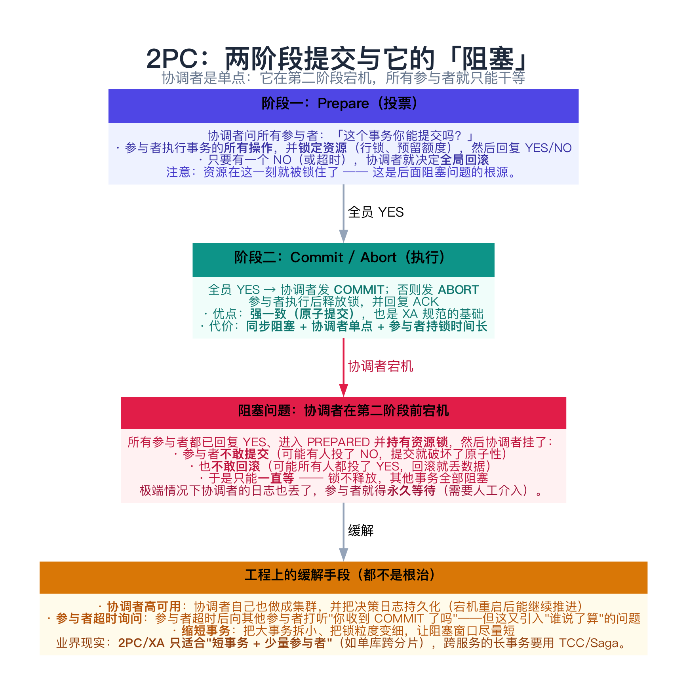
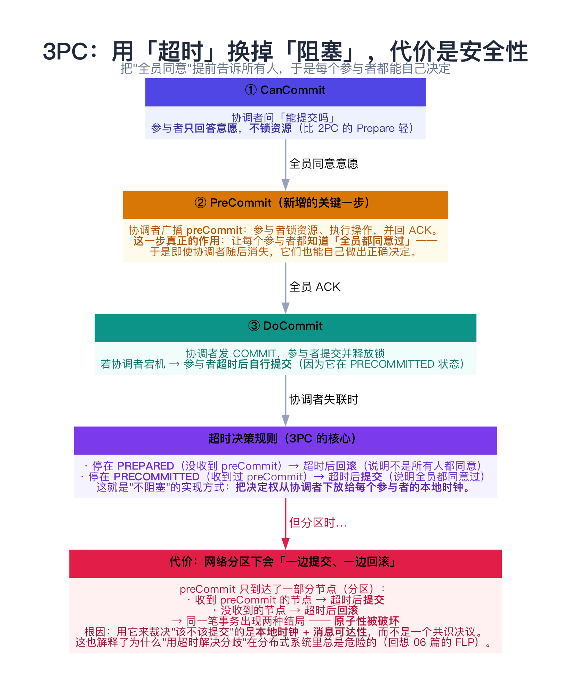
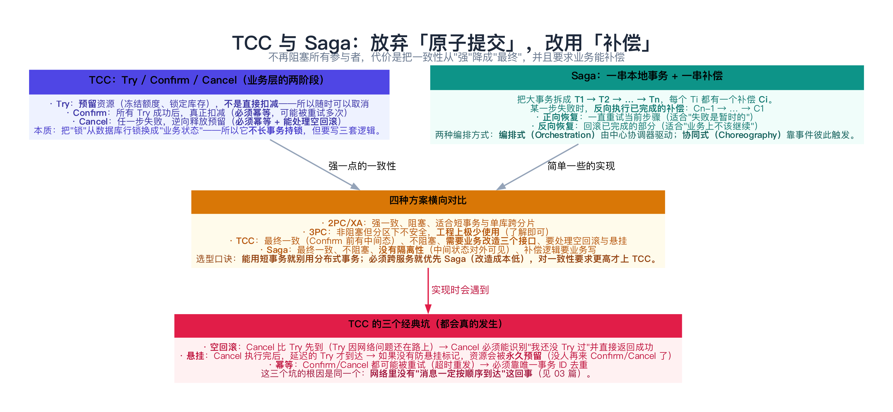
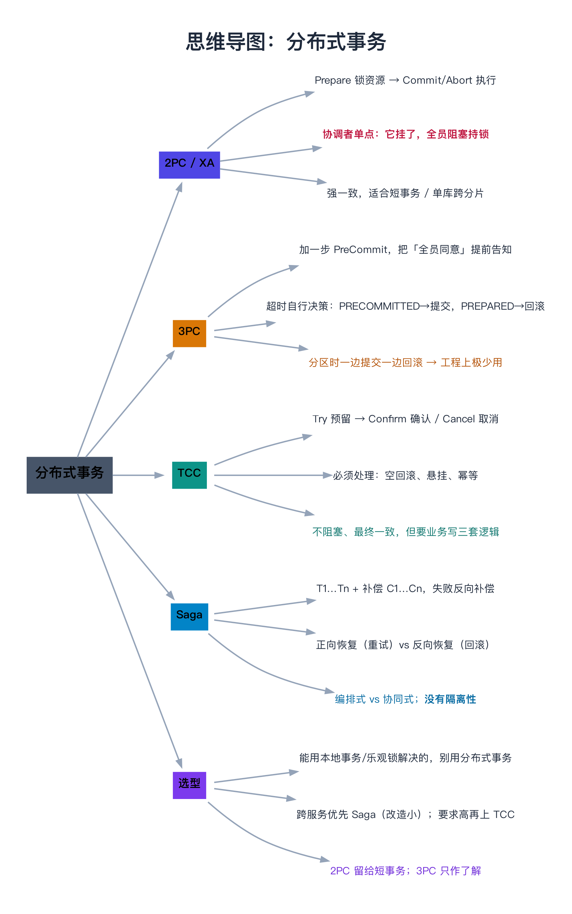

# 分布式事务（2PC、3PC、TCC、Saga）

> 一句话：分布式事务有两条完全不同的路线——**追求原子提交**（2PC/3PC：要么全成功要么全失败，代价是阻塞或安全性）与**追求最终一致**（TCC/Saga：先做、错了再补偿，代价是业务必须能补偿、且没有隔离性）。**工程上绝大多数场景选后者**，因为前者要么慢、要么不安全。

---

## 目录

1. [先问：你到底需不需要分布式事务](#1-先问你到底需不需要分布式事务)
2. [2PC：原子提交的代价](#2-2pc原子提交的代价)
   - [2.1 两个阶段](#21-两个阶段)
   - [2.2 阻塞问题](#22-阻塞问题)
   - [2.3 工程上的缓解手段](#23-工程上的缓解手段)
3. [3PC：用超时换掉阻塞，代价是安全性](#3-3pc用超时换掉阻塞代价是安全性)
4. [TCC：业务层的两阶段](#4-tcc业务层的两阶段)
   - [4.1 Try / Confirm / Cancel](#41-try-confirm-cancel)
   - [4.2 三个经典坑：空回滚、悬挂、幂等](#42-三个经典坑空回滚悬挂幂等)
5. [Saga：一串本地事务 + 一串补偿](#5-saga一串本地事务-一串补偿)
6. [动手：三个场景看清 2PC / 3PC 的取舍（C++）](#6-动手三个场景看清-2pc-3pc-的取舍c)
   - [6.1 代码](#61-代码)
   - [6.2 运行结果与解读](#62-运行结果与解读)
7. [常见坑](#7-常见坑)
8. [总结](#8-总结)
9. [延伸阅读](#9-延伸阅读)
10. [思维导图总结](#10-思维导图总结)

---

## 1. 先问：你到底需不需要分布式事务

分布式事务是**成本最高**的一致性手段之一。在动手之前，先按顺序问自己三个问题：

| 顺序 | 问题 | 如果是"是" |
|------|------|-----------|
| 1 | 这几步操作能不能**放在一个本地事务**里？ | 那就用数据库事务，别折腾 |
| 2 | 能不能用**乐观锁 / 唯一索引 / 状态机**解决？ | 用它们——它们天然带 fencing（见 [15 篇](../03-协调、事务与一致性/15-分布式锁.md)） |
| 3 | 能不能**接受最终一致**（中间态可见、稍后补偿）？ | 用 **TCC / Saga / 本地消息表**（[17 篇](../03-协调、事务与一致性/17-分布式事务的最终一致方案.md)） |
| 4 | 都不行，且必须原子 | 才考虑 **2PC/XA**，并且要接受它的阻塞与性能代价 |

**真正的难点在于"隔离性"**，而不是"原子性"：

> 2PC 能给你原子性（要么全提交要么全回滚），但它给不了**跨服务的隔离性**——中间状态（A 已提交、B 还没提交）对其他人是**可见**的。Saga 更彻底：**它连原子性都不保证**，只保证"最终会补偿回去"。

---

## 2. 2PC：原子提交的代价



### 2.1 两个阶段

```text
阶段一（Prepare / 投票）：
  协调者 → 所有参与者：这个事务你能提交吗？
  参与者：执行所有操作 + 锁定资源（行锁、预留额度）→ 回复 YES / NO

阶段二（Commit / Abort）：
  全员 YES → 协调者发 COMMIT；否则发 ABORT
  参与者：执行后释放锁，回复 ACK
```

它其实就是 **XA 规范** 描述的东西（数据库的 `XA START / XA END / XA PREPARE / XA COMMIT`）。**优点很明确：强一致的原子提交。代价也很明确：同步阻塞 + 协调者单点 + 持锁时间长。**

### 2.2 阻塞问题

**场景：所有参与者都回复了 YES、进入 PREPARED 并持有资源锁，然后协调者在发 COMMIT 之前宕机了。**

此时参与者的处境是：

- **不敢提交**：万一有人投了 NO，提交就破坏了原子性；
- **不敢回滚**：万一所有人都投了 YES，回滚就丢了本该成功的数据；
- **只能等**：锁一直不放，**其他事务全部被阻塞**。

这就是 2PC 的**阻塞问题**。极端情况下（协调者的决策日志也丢了），参与者需要**永久等待**，只能人工介入。

> **类比**：像一场"所有人都举了手但主持人突然晕倒"的表决——举手的人不敢放下（可能已经通过了），也不敢继续（可能还没通过），只能僵在那里，而且手里还攥着资源不放。

### 2.3 工程上的缓解手段

| 手段 | 做法 | 局限 |
|------|------|------|
| **协调者高可用** | 协调者本身做成集群，决策日志持久化，重启后继续推进 | 只是把单点变小，阻塞窗口仍然存在 |
| **参与者超时询问** | 超时后向其他参与者打听"你收到 COMMIT 了吗" | 又引入"谁说了算"的问题（可能问到的都是 PREPARED） |
| **缩短事务** | 拆小事务、细化锁粒度 | 治标 |
| **最终一致替代** | 换成 TCC / Saga | 放弃原子性 |

**现实结论**：2PC/XA 适合**短事务 + 少量参与者**（典型是单库跨分片、或者同机房的两三个资源），跨服务的长事务一定要换路线。

---

## 3. 3PC：用超时换掉阻塞，代价是安全性



3PC 的思路是：**把"全员同意"这件事提前告诉所有人**，这样即使协调者消失，参与者也能自己决定。

```text
① CanCommit：问意愿（不锁资源）
② PreCommit：广播「全员都同意了」 → 参与者锁资源、执行操作、回 ACK
③ DoCommit ：执行提交
```

**关键在超时规则**：

| 参与者停在哪个状态 | 超时后怎么办 | 为什么安全 |
|-------------------|-------------|-----------|
| **PREPARED**（没收到 preCommit） | **回滚** | 说明不是所有人都同意 |
| **PRECOMMITTED**（收到过 preCommit） | **提交** | 说明全员都同意过 |

于是协调者在第 ③ 步宕机也不阻塞——参与者超时后自行提交。

**但代价是安全性**。经典反例（第 6 节的场景三会跑出来）：

```text
preCommit 只到达了一部分节点（网络分区）：
  收到 preCommit 的节点 → 超时后【提交】
  没收到的节点       → 超时后【回滚】
→ 同一笔事务出现两种结局，原子性被破坏
```

**根因**：用它来裁决"该不该提交"的是**本地时钟 + 消息可达性**，而不是一个共识决议。这也是为什么 3PC 在工程上**极少被真正使用**——它用安全性换来了非阻塞，而这个交易并不划算（对比 [14 篇](../03-协调、事务与一致性/14-领导者选举、心跳与租约.md)：我们连"谁是主"都不愿意交给本地时钟裁决）。

> **一句话**：**2PC 的问题是"停不下来"，3PC 的问题是"可能走岔"**——而后者更致命，所以工业界宁愿选前者 + 缩短事务，或者干脆换路线。

---

## 4. TCC：业务层的两阶段



### 4.1 Try / Confirm / Cancel

TCC 把 2PC 的"数据库行锁"换成了**业务层的资源预留**：

| 阶段 | 做什么 | 注意 |
|------|--------|------|
| **Try** | **预留**资源（冻结额度、锁定库存、生成待确认订单）——**不是直接扣减** | 预留要设置**有效期**，否则会永久占住 |
| **Confirm** | 所有 Try 都成功后，真正扣减 | **必须幂等**（可能被重试多次） |
| **Cancel** | 任何一步失败，逆向释放预留 | **必须幂等**，且要能处理**空回滚** |

**它的本质**：把"锁"从数据库层搬到了业务状态里。好处是**持锁时间短**（Try 只是打标记），坏处是**业务要写三套逻辑**，而且中间态（已 Try 未 Confirm）对外是可见的——**TCC 没有隔离性**。

### 4.2 三个经典坑：空回滚、悬挂、幂等

这三个坑都会真的发生，而且根因是同一个：**网络里没有"消息一定按顺序到达"这回事**。

| 坑 | 场景 | 解法 |
|----|------|------|
| **空回滚** | Cancel 比 Try 先到（Try 的请求还在路上/超时重发） | Cancel 执行时先查"我 Try 过吗"，没 Try 过就直接返回成功 |
| **悬挂** | Cancel 已经执行完了，延迟的 Try 才到达 → 资源被**永久预留** | 记录"这个事务已经 Cancel 过"，之后到达的 Try **直接拒绝** |
| **幂等** | Confirm/Cancel 因为超时被重试多次 | 用**全局唯一事务 ID** 去重（一张事务状态表） |

> **注意"悬挂"的后果**：它不会报错，只会让资源**永远卡在预留状态**——库存被冻结但永远不会释放，几周后才发现少了一批货。这类"沉默的数据损坏"比抛异常难查得多。

---

## 5. Saga：一串本地事务 + 一串补偿

Saga 的思路最朴素：

```text
把大事务拆成 T1 → T2 → … → Tn
每个 Ti 都对应一个补偿 Ci
某一步失败 → 反向执行已完成的补偿：C(n-1) → … → C1
```

**两种恢复策略**（选择取决于"失败是不是暂时的"）：

| 策略 | 做法 | 适用 |
|------|------|------|
| **正向恢复** | 一直重试当前步骤，直到成功 | 失败是暂时的（网络抖动、下游超时） |
| **反向恢复** | 回滚已完成的部分 | 业务上不该继续（库存不足、风控拒绝） |

**两种编排方式**：

| 方式 | 做法 | 优缺点 |
|------|------|--------|
| **编排式（Orchestration）** | 一个中心协调器依次调用各服务，失败则调补偿 | 逻辑集中、易调试；但协调器是新的复杂度中心 |
| **协同式（Choreography）** | 各服务监听事件、自己决定下一步 | 无中心、松耦合；但**流程散落各处，难追踪** |

**Saga 最大的局限：没有隔离性。** 中间状态对外可见：用户可能看到"订单已创建但库存未扣"的瞬间，甚至看到"已扣款但订单被补偿取消"。常见的缓解手段是**语义锁**（把中间状态标记成"处理中"，让其他事务等待或拒绝）。

---

## 6. 动手：三个场景看清 2PC / 3PC 的取舍（C++）

下面这个程序把第 2、3 节的关键场景都跑一遍。

### 6.1 代码

```cpp
// 分布式事务的三个关键场景：2PC 的阻塞、3PC 的超时决策、3PC 在分区下的失效
//   场景一：2PC 中协调者在发出 COMMIT 之前宕机 → 参与者只能干等（阻塞），且一直持有锁
//   场景二：3PC 把"能否提交"提前到 preCommit 阶段 → 参与者超时后可以自行 commit，不再阻塞
//   场景三：3PC 遇到网络分区仍会不一致 —— 一半人没收到 preCommit（超时后 abort），
//           另一半收到并超时（自行 commit）→ 同一笔事务出现两种结局
// 编译：g++ -std=c++11 -Wall -Wextra -O2 -o tx_demo tx_demo.cpp
#include <iostream>
#include <string>
#include <vector>

enum class St { INIT, PREPARED, PRECOMMITTED, COMMITTED, ABORTED };

static const char* stName(St s) {
    switch (s) {
        case St::INIT:          return "INIT";
        case St::PREPARED:      return "PREPARED";
        case St::PRECOMMITTED:  return "PRECOMMITTED";
        case St::COMMITTED:     return "COMMITTED";
        case St::ABORTED:       return "ABORTED";
    }
    return "?";
}

struct Participant {
    std::string name;
    St state = St::INIT;
    bool reachable = true;      // 是否与协调者连通（模拟网络分区）
    explicit Participant(std::string n) : name(std::move(n)) {}
};

// 场景一：2PC
static void twoPhaseCommitCrash() {
    std::cout << "【场景一】2PC：协调者在第二阶段开始前宕机\n";
    std::vector<Participant> ps{Participant("库存服务"), Participant("订单服务"), Participant("账户服务")};

    std::cout << "  阶段 1（Prepare）：协调者问所有参与者「能提交吗？」\n";
    for (auto& p : ps) {
        p.state = St::PREPARED;
        std::cout << "    " << p.name << " 回复 YES → PREPARED（已锁定资源：库存额度 / 订单状态 / 账户余额）\n";
    }
    std::cout << "  阶段 2（Commit）：协调者正准备发 COMMIT …… ✗ 宕机了\n";
    std::cout << "  结果：";
    for (const auto& p : ps) std::cout << p.name << "＝" << stName(p.state) << "；";
    std::cout << "\n  ⚠ 三个参与者都不知道该提交还是回滚，只能【一直等】协调者恢复 ——\n";
    std::cout << "    期间它们持有的资源锁无法释放，其他事务全部被阻塞。这就是 2PC 的「阻塞问题」。\n\n";
}

// 场景二：3PC，协调者在最后一步宕机
static void threePhaseCommitTimeout() {
    std::cout << "【场景二】3PC：把「全员同意」提前到 preCommit，协调者最后一步宕机\n";
    std::vector<Participant> ps{Participant("库存服务"), Participant("订单服务"), Participant("账户服务")};

    std::cout << "  阶段 1（CanCommit）：所有人回复 YES\n";
    for (auto& p : ps) p.state = St::PREPARED;
    std::cout << "  阶段 2（PreCommit）：协调者广播 preCommit，所有人确认 —— 此时大家已经知道「全员都同意」\n";
    for (auto& p : ps) {
        p.state = St::PRECOMMITTED;
        std::cout << "    " << p.name << " → PRECOMMITTED（此时它已知「全员都同意」）\n";
    }
    std::cout << "  阶段 3（DoCommit）：协调者准备发 COMMIT …… ✗ 宕机了\n";
    std::cout << "  参与者等待超时后【自行决定】：\n";
    for (auto& p : ps) {
        p.state = St::COMMITTED;
        std::cout << "    " << p.name << " 超时 → 我处于 PRECOMMITTED，说明全员都同意过 → 自行 COMMIT\n";
    }
    std::cout << "  ✓ 没有阻塞：协调者挂了也不影响事务推进（这是 3PC 相对 2PC 的核心改进）\n\n";
}

// 场景三：3PC 在网络分区下的经典反例
static void threePhaseCommitPartition() {
    std::cout << "【场景三】3PC 遇到网络分区：同一笔事务出现两种结局\n";
    std::vector<Participant> ps{Participant("节点1"), Participant("节点2"), Participant("节点3")};

    std::cout << "  阶段 1（CanCommit）：三人全部回复 YES → 都进入 PREPARED\n";
    for (auto& p : ps) p.state = St::PREPARED;

    std::cout << "  阶段 2（PreCommit）：preCommit 消息只有【节点3】收到，节点1、2 被分区隔离\n";
    ps[2].state = St::PRECOMMITTED;
    ps[0].reachable = false;
    ps[1].reachable = false;
    std::cout << "    节点3 → PRECOMMITTED（已知全员同意）\n";
    std::cout << "    节点1、2 → 收不到任何消息，停在 PREPARED\n";

    std::cout << "  各自等待超时后按 3PC 规则自行决策：\n";
    ps[2].state = St::COMMITTED;
    std::cout << "    节点3：我在 PRECOMMITTED → 超时后【提交】\n";
    ps[0].state = St::ABORTED;
    ps[1].state = St::ABORTED;
    std::cout << "    节点1、2：我在 PREPARED（没收到 preCommit）→ 超时后【回滚】\n";

    std::cout << "  最终状态：";
    for (const auto& p : ps) std::cout << p.name << "＝" << stName(p.state) << "；";
    std::cout << "\n  ⚠ 同一笔事务，一边提交、一边回滚 —— 3PC 用「超时」换来了不阻塞，\n";
    std::cout << "    但代价是把这个决定交给了本地时钟，分区时就会做出互相矛盾的判断。\n\n";
}

int main() {
    std::cout << "三个场景，看清 2PC / 3PC 的取舍（参与者 = 库存 / 订单 / 账户）\n\n";
    twoPhaseCommitCrash();
    threePhaseCommitTimeout();
    threePhaseCommitPartition();
    std::cout << "结论：\n";
    std::cout << "  · 2PC 的问题是【阻塞】：协调者一挂，参与者既不敢提交也不敢回滚，锁一直不放。\n";
    std::cout << "  · 3PC 用【超时自行决策】消除阻塞，但把「该不该提交」押在了本地时钟与消息可达性上，\n";
    std::cout << "    网络分区时仍可能一边提交一边回滚（安全性被破坏）。\n";
    std::cout << "  · 所以工程上更常用的是【不追求强一致的原子提交】的方案：TCC 与 Saga ——\n";
    std::cout << "    它们放弃「阻塞所有参与者」，改为「先做、错了再补偿」（见 16 篇 4、5 节）。\n";
    return 0;
}
```

### 6.2 运行结果与解读

```text
三个场景，看清 2PC / 3PC 的取舍（参与者 = 库存 / 订单 / 账户）

【场景一】2PC：协调者在第二阶段开始前宕机
  阶段 1（Prepare）：协调者问所有参与者「能提交吗？」
    库存服务 回复 YES → PREPARED（已锁定资源：库存额度 / 订单状态 / 账户余额）
    订单服务 回复 YES → PREPARED（已锁定资源：库存额度 / 订单状态 / 账户余额）
    账户服务 回复 YES → PREPARED（已锁定资源：库存额度 / 订单状态 / 账户余额）
  阶段 2（Commit）：协调者正准备发 COMMIT …… ✗ 宕机了
  结果：库存服务＝PREPARED；订单服务＝PREPARED；账户服务＝PREPARED；
  ⚠ 三个参与者都不知道该提交还是回滚，只能【一直等】协调者恢复 ——
    期间它们持有的资源锁无法释放，其他事务全部被阻塞。这就是 2PC 的「阻塞问题」。

【场景二】3PC：把「全员同意」提前到 preCommit，协调者最后一步宕机
  阶段 1（CanCommit）：所有人回复 YES
  阶段 2（PreCommit）：协调者广播 preCommit，所有人确认 —— 此时大家已经知道「全员都同意」
    库存服务 → PRECOMMITTED（此时它已知「全员都同意」）
    订单服务 → PRECOMMITTED（此时它已知「全员都同意」）
    账户服务 → PRECOMMITTED（此时它已知「全员都同意」）
  阶段 3（DoCommit）：协调者准备发 COMMIT …… ✗ 宕机了
  参与者等待超时后【自行决定】：
    库存服务 超时 → 我处于 PRECOMMITTED，说明全员都同意过 → 自行 COMMIT
    订单服务 超时 → 我处于 PRECOMMITTED，说明全员都同意过 → 自行 COMMIT
    账户服务 超时 → 我处于 PRECOMMITTED，说明全员都同意过 → 自行 COMMIT
  ✓ 没有阻塞：协调者挂了也不影响事务推进（这是 3PC 相对 2PC 的核心改进）

【场景三】3PC 遇到网络分区：同一笔事务出现两种结局
  阶段 1（CanCommit）：三人全部回复 YES → 都进入 PREPARED
  阶段 2（PreCommit）：preCommit 消息只有【节点3】收到，节点1、2 被分区隔离
    节点3 → PRECOMMITTED（已知全员同意）
    节点1、2 → 收不到任何消息，停在 PREPARED
  各自等待超时后按 3PC 规则自行决策：
    节点3：我在 PRECOMMITTED → 超时后【提交】
    节点1、2：我在 PREPARED（没收到 preCommit）→ 超时后【回滚】
  最终状态：节点1＝ABORTED；节点2＝ABORTED；节点3＝COMMITTED；
  ⚠ 同一笔事务，一边提交、一边回滚 —— 3PC 用「超时」换来了不阻塞，
    但代价是把这个决定交给了本地时钟，分区时就会做出互相矛盾的判断。

结论：
  · 2PC 的问题是【阻塞】：协调者一挂，参与者既不敢提交也不敢回滚，锁一直不放。
  · 3PC 用【超时自行决策】消除阻塞，但把「该不该提交」押在了本地时钟与消息可达性上，
    网络分区时仍可能一边提交一边回滚（安全性被破坏）。
  · 所以工程上更常用的是【不追求强一致的原子提交】的方案：TCC 与 Saga ——
    它们放弃「阻塞所有参与者」，改为「先做、错了再补偿」（见 16 篇 4、5 节）。
```

逐条对照：

| 输出片段 | 印证了什么 |
|----------|-----------|
| 场景一 `结果：库存服务＝PREPARED；订单服务＝PREPARED；账户服务＝PREPARED` | **2PC 的阻塞**：协调者挂了，三个参与者都卡在 PREPARED，**资源锁一直不放** |
| 场景二 `超时 → 我处于 PRECOMMITTED → 自行 COMMIT` | **3PC 的非阻塞**：因为 preCommit 已经告知"全员同意"，参与者可以自己决定 |
| 场景三 `节点1＝ABORTED；节点2＝ABORTED；节点3＝COMMITTED` | **3PC 的不一致**：同一笔事务，一边提交一边回滚——**原子性被破坏** |
| 场景三里那条分界线 | "收到 preCommit 与否"决定了结局——**决定权交给了消息可达性**，而不是共识 |

> **这三段输出的对比非常值得记住**：2PC 的问题是**所有人都停着**（可用性差但不会错），3PC 的问题是**有人走有人留**（不会停但会错）。**分布式系统的第一原则是"宁可停，不能错"**——所以工程上选 2PC 系（短事务）或干脆换路线，而不是 3PC。

---

## 7. 常见坑

**① 以为 2PC 能解决"跨服务一致性"**

2PC 给的是**原子性**，不是**隔离性**。中间状态（A 已提交、B 未提交）对其他人可见，可能出现"读到一半的数据"。要隔离性只能靠业务层设计（如语义锁）。

**② 在跨服务的长事务里用 XA**

XA 的锁由数据库持有，长事务会让连接池和行锁全部被占满——**一个慢服务能拖垮整条链路**。这是"2PC 只适合短事务"的工程原因。

**③ TCC 的 Cancel 不做空回滚判断**

见 4.2 节。Cancel 先到时如果直接报错，整个事务会陷入"永远补偿不掉"的状态。

**④ 没防悬挂**

Try 迟到 → 资源永久预留。**必须在 Cancel 时留下标记，让迟到的 Try 主动失败。**

**⑤ Saga 没有补偿，只有"重试"**

很多团队把 Saga 实现成"一直重试直到成功"——那它在业务性失败（库存不足）时就会**永远重试**。每个正向操作都必须配一个真正可执行的补偿。

**⑥ 补偿逻辑里做"不可逆"的事**

比如 Saga 的正向步骤里发了短信、调了支付——补偿时**发出去的短信收不回来**。所以要把不可逆的动作尽量后置，或者用"待确认"状态先占位。

**⑦ 忽略事务状态表的持久化**

TCC/Saga 都依赖一张"事务状态表"来做到幂等与防悬挂。这张表**必须和业务数据在同一个本地事务里更新**——否则一次崩溃就会让状态与数据脱节。

---

## 8. 总结

| 方案 | 一致性 | 阻塞 | 隔离性 | 实现成本 | 适用 |
|------|--------|------|--------|----------|------|
| **2PC / XA** | 强（原子） | **会阻塞**（协调者单点） | 无（中间态可见） | 低（数据库支持） | 短事务、单库跨分片 |
| **3PC** | 强（理论） | 不阻塞 | 无 | 中 | **工程上极少用**（分区下不安全） |
| **TCC** | 最终一致 | 不阻塞 | 无（需语义锁缓解） | **高**（三套接口 + 三个坑） | 资金、库存等强业务约束 |
| **Saga** | 最终一致 | 不阻塞 | 无 | 中（每个正向配一个补偿） | 长流程编排（订单、履约） |
| **本地消息表** | 最终一致 | 不阻塞 | — | 低 | 单库 + MQ 的场景（见 17 篇） |

**记住三句话**：

1. **先问"能不能不用"**：本地事务 > 乐观锁/唯一索引 > 最终一致方案 > 2PC。**每一步都在用复杂度换一致性，而大多数业务并不需要那么强。**
2. **2PC 的病是"停"，3PC 的病是"错"**：前者可用性差但不会算错，后者不阻塞却可能一边提交一边回滚——所以分布式系统的铁律"宁可停，不能错"直接判了 3PC 出局。
3. **TCC/Saga 的本质是"把一致性责任交给业务"**：补偿逻辑、幂等、防悬挂、状态表，一样都少不了——**这就是它们便宜（不用改数据库）但昂贵（要改业务）的原因**。

下一章进入 [17 分布式事务的最终一致方案](../03-协调、事务与一致性/17-分布式事务的最终一致方案.md)，看**本地消息表、事务消息、最大努力通知**这三件"不引入分布式事务框架也能做到最终一致"的武器。

---

## 9. 延伸阅读

- **2PC/3PC 原始论文**：
  - Gray & Lamport《Consensus on Transaction Commit》（2004）—— 把 2PC 与共识的关系讲透，并指出"2PC 在协调者宕机时就是不安全/阻塞的"，**这篇是理解"为什么 3PC 救不了"的关键**；
  - Skeen《Nonblocking Commit Protocols》（1981）—— 3PC 的原始论文。
- **教材**：Cachin, Guerraoui & Rodrigues《Introduction to Reliable and Secure Distributed Programming》第 6 章（原子提交）；《数据密集型应用系统设计》（DDIA）第 7 章（事务）与第 9 章（一致性与共识）对 2PC 的失败模式讲得很清楚。
- **工程实现**：
  - XA 规范与各数据库的 XA 支持（MySQL 的 `XA START`），以及 **Seata** 的 AT/TCC/Saga 三种模式（AT 模式用 undo log 自动生成补偿，是很实用的折中）；
  - Saga 原始论文：Garcia-Molina & Salem《Sagas》（SIGMOD 1987）。
- **TCC 的三个坑**：Seata 官方文档的"空回滚/悬挂/幂等"章节；蚂蚁金服的 TCC 实践文章（DTX/服务化事务）。
- **顺着往下读**：[17 最终一致方案](../03-协调、事务与一致性/17-分布式事务的最终一致方案.md)（本地消息表与事务消息）、[15 分布式锁](../03-协调、事务与一致性/15-分布式锁.md)（fencing 与幂等）、[28 数据多副本与故障恢复](../04-数据与存储/28-数据多副本与故障恢复.md)。

---

## 10. 思维导图总结

```text
分布式事务（2PC、3PC、TCC、Saga）
├── 先问要不要用
│   ├── 能放一个本地事务 → 直接用数据库事务
│   ├── 能用乐观锁/唯一索引 → 用它们（天然带 fencing）
│   └── 能接受最终一致 → 走 TCC/Saga/本地消息表
├── 2PC / XA：原子提交
│   ├── Prepare（投票 + 锁资源）→ Commit/Abort（执行 + 释放锁）
│   ├── 病根：协调者单点。它挂了 → 参与者既不敢提交也不敢回滚 → 阻塞持锁
│   ├── 缓解：协调者高可用、缩短事务、参与者超时询问（都不根治）
│   └── 定位：强一致，适合短事务 / 单库跨分片
├── 3PC：用超时换非阻塞
│   ├── CanCommit → PreCommit（关键：让所有人知道"全员同意"）→ DoCommit
│   ├── 超时规则：PREPARED→回滚；PRECOMMITTED→提交
│   └── 病根：分区时一边提交一边回滚 → 原子性破裂，工程上极少用
├── TCC：业务层两阶段
│   ├── Try 预留（不是扣减）→ Confirm 确认 / Cancel 取消
│   ├── 三个坑：空回滚、悬挂、幂等（根因都是"消息可能乱序/重发"）
│   └── 代价：业务写三套逻辑；没有隔离性（要语义锁缓解）
├── Saga：正向链 + 补偿链
│   ├── T1…Tn + C1…Cn；失败反向补偿
│   ├── 正向恢复（重试）vs 反向恢复（回滚）；编排式 vs 协同式
│   └── 最大局限：没有隔离性，中间态对外可见
└── 选型
    ├── 优先本地事务与乐观锁；跨服务长流程优先 Saga
    ├── 对业务约束强（资金、库存）再上 TCC
    └── 2PC 只留给短事务；3PC 仅作了解
```


