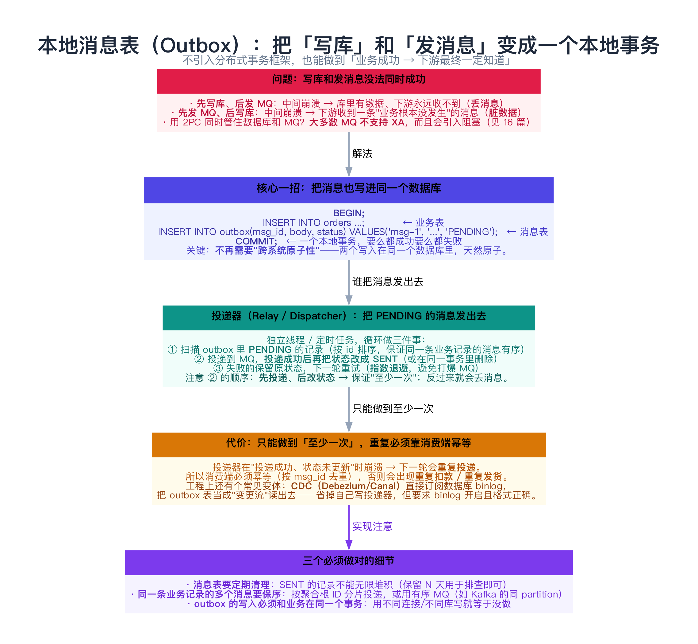
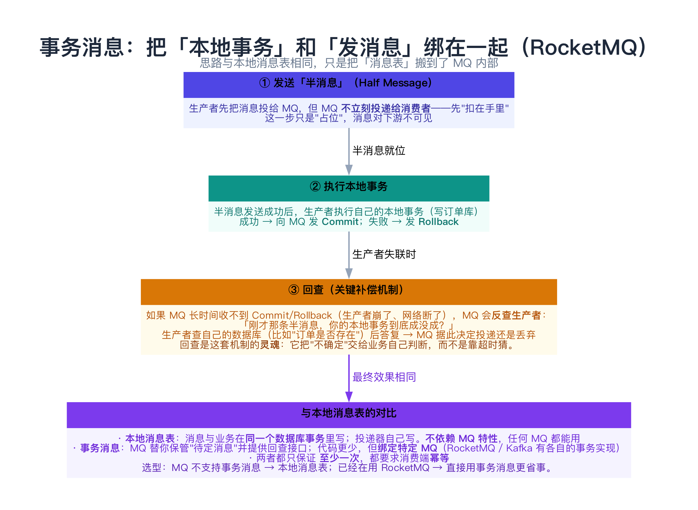
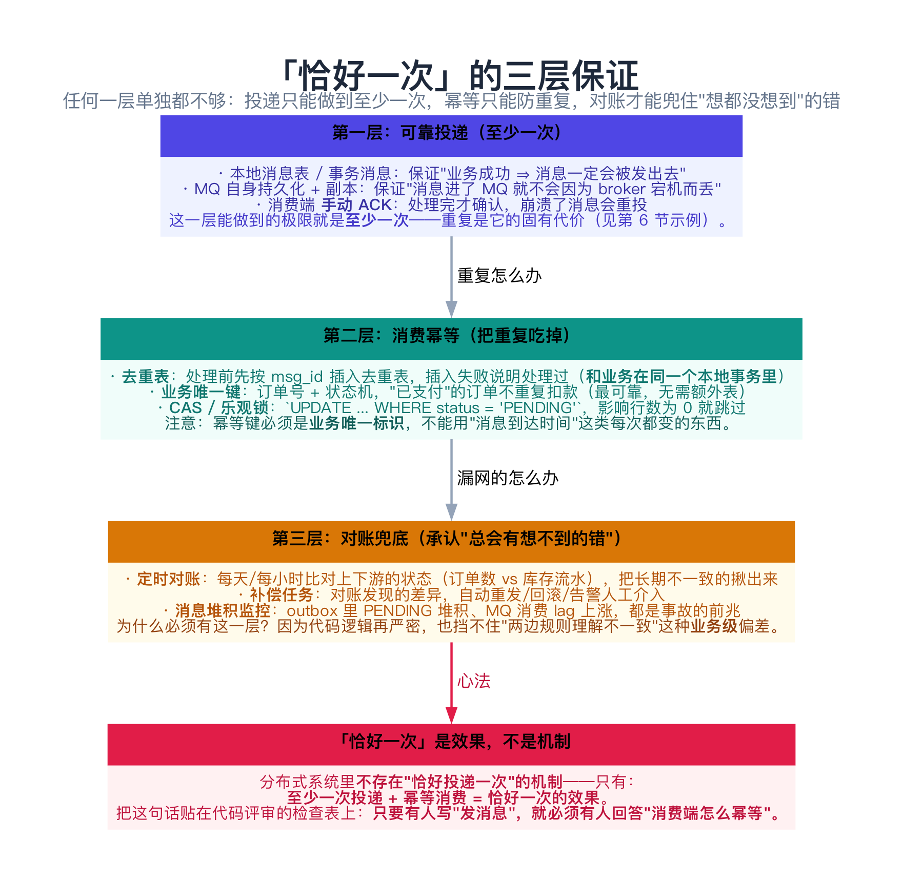
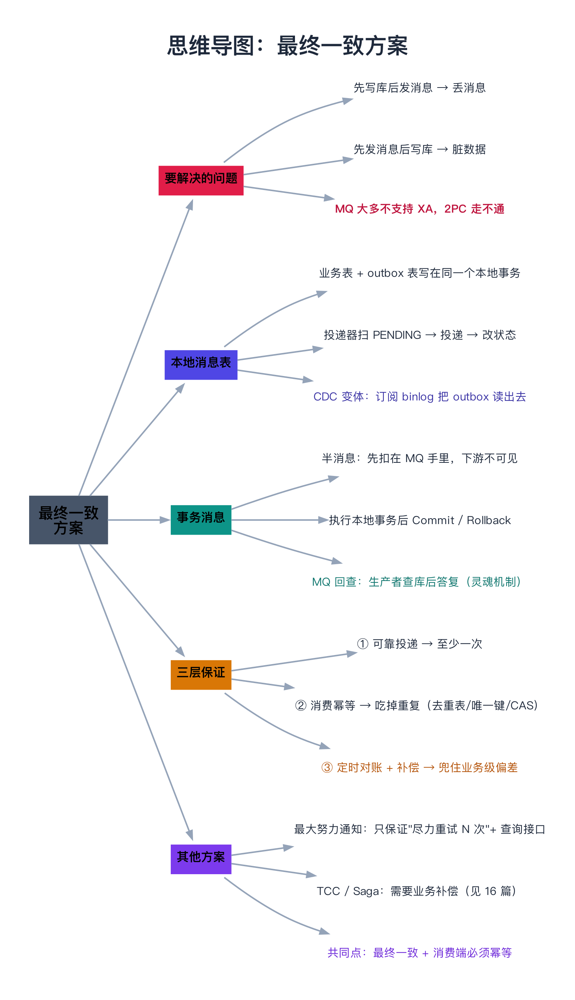

# 分布式事务的最终一致方案

> 一句话：既然 2PC 会阻塞、3PC 会出错（[16 篇](../03-协调、事务与一致性/16-分布式事务（2PC、3PC、TCC、Saga）.md)），那就换一条路——**不追求原子提交，只追求"最终一定一致"**。这条路上有三件武器：**本地消息表（Outbox）、事务消息、最大努力通知**。它们的共同心法是：**至少一次投递 + 消费端幂等 + 定时对账 = 「恰好一次」的效果**。

---

## 目录

1. [问题的本质：两个写操作，无法同时成功](#1-问题的本质两个写操作无法同时成功)
2. [武器一：本地消息表（Outbox）](#2-武器一本地消息表outbox)
   - [2.1 核心一招](#21-核心一招)
   - [2.2 投递器的三个细节](#22-投递器的三个细节)
   - [2.3 CDC 变体](#23-cdc-变体)
3. [武器二：事务消息](#3-武器二事务消息)
4. [武器三：最大努力通知](#4-武器三最大努力通知)
5. [「恰好一次」的三层保证](#5-恰好一次的三层保证)
6. [动手：四种写法 + 崩溃，看清差别（C++）](#6-动手四种写法-崩溃看清差别c)
   - [6.1 代码](#61-代码)
   - [6.2 运行结果与解读](#62-运行结果与解读)
7. [常见坑](#7-常见坑)
8. [总结](#8-总结)
9. [延伸阅读](#9-延伸阅读)
10. [思维导图总结](#10-思维导图总结)

---

## 1. 问题的本质：两个写操作，无法同时成功

最终一致方案要解决的核心场景，几乎每个业务系统都有：

```text
用户下单：
  ① 写订单库（本地事务，成功）
  ② 通知下游：扣库存 / 发短信 / 加积分（跨系统）

问题：① 和 ② 无法在一次本地事务里完成
```

两种朴素的写法都不安全：

| 写法 | 崩溃点 | 后果 |
|------|--------|------|
| **先写库，后发 MQ** | 写库成功、发 MQ 之前崩溃 | 业务有数据、下游永远不知道 → **丢消息** |
| **先发 MQ，后写库** | 发 MQ 成功、写库之前崩溃 | 下游处理了一个"根本不存在"的业务 → **脏数据** |

**能不能用 2PC/XA 一起管住数据库和 MQ？** 理论上可以，但：

- **大多数 MQ 不支持 XA**（Kafka、RabbitMQ 都没有真正可用的 XA 实现）；
- 即使支持，也会引入 [16 篇](../03-协调、事务与一致性/16-分布式事务（2PC、3PC、TCC、Saga）.md) 讲的阻塞与协调者单点问题。

所以工程上的答案是：**别追求"两个写操作同时成功"，而是接受"其中一个可能失败"，再用补偿与重试把它补齐。**

---

## 2. 武器一：本地消息表（Outbox）



### 2.1 核心一招

**把"要发的消息"也写进同一个数据库**，用一个本地事务保证它和业务数据同时落盘：

```sql
BEGIN;
  INSERT INTO orders (id, ...) VALUES ('order-1', ...);          -- 业务表
  INSERT INTO outbox (msg_id, body, status)                      -- 消息表
    VALUES ('msg-1', 'order-1 created', 'PENDING');
COMMIT;
```

**为什么这样就安全？** 因为"两个写入"变成了"一个本地事务"——数据库自己保证原子性，**不需要跨系统协调，也不需要 2PC**。

之后的投递由**独立的投递器**完成：

```text
循环：
  ① 扫描 outbox 里 status = PENDING 的记录
  ② 投递到 MQ
  ③ 投递成功 → 把状态改成 SENT（或删除）
  ④ 失败 → 保持 PENDING，下一轮重试（指数退避）
```

### 2.2 投递器的三个细节

| 细节 | 为什么 |
|------|--------|
| **必须先投递、再改状态** | 反过来（先改状态再投递）会在中间崩溃时**丢消息**；而"先投递后改状态"最坏只是**重复投递**——重复可以用幂等消化，丢失不行 |
| **同一条业务记录的消息要保序** | 按聚合根 ID 分片投递（Kafka 用同一个 partition key），否则"创建"和"更新"可能乱序 |
| **outbox 表要定期清理** | SENT 的记录保留 N 天用于排查即可，否则表会无限膨胀 |

> 注意第 ① 条与 [16 篇](../03-协调、事务与一致性/16-分布式事务（2PC、3PC、TCC、Saga）.md) 的 TCC 是同一个思路：**把"不确定"变成"重复"，再靠幂等吃掉重复**。这是分布式系统里最常用的一个转换。

### 2.3 CDC 变体

自己写投递器是最直观的做法，但也可以用 **CDC（Change Data Capture）**：

```text
Debezium / Canal 订阅数据库 binlog
  → 把 outbox 表的变更当成"变更流"读出来，直接投给 MQ
```

好处是**不用自己写扫描与重试逻辑**；代价是多了一个组件，而且要求 binlog 格式正确（`ROW` 模式）并长期保留。

---

## 3. 武器二：事务消息



**事务消息**把"消息表"搬到了 MQ 内部，思路和 Outbox 完全一样，只是少写一张表：

```text
① 生产者发送【半消息】→ MQ 收下但不投递给消费者（对下游不可见）
② 生产者执行本地事务 → 成功则发 Commit，失败则发 Rollback
③ 若 MQ 长时间收不到 Commit/Rollback（生产者崩了）→ MQ 主动【回查】生产者：
     "刚才那条半消息，你的本地事务到底成没成？"
   生产者查自己的数据库后答复，MQ 据此决定投递还是丢弃
```

**第 ③ 步的"回查"是这套机制的灵魂**：它不靠超时猜，而是**把"不确定"交回给业务自己判断**（业务最清楚"这个订单到底建了没"）。

| | 本地消息表 | 事务消息 |
|---|---|---|
| 消息存哪 | 自己的数据库 | MQ 内部 |
| 依赖 MQ 特性 | 不依赖（任何 MQ 都行） | **依赖**（RocketMQ 原生支持） |
| 代码量 | 要自己写投递器 | 少（实现回查接口即可） |
| 一致性 | 至少一次 | 至少一次 |

---

## 4. 武器三：最大努力通知

最"轻"的方案，适合**对一致性要求最低**的场景（比如"通知用户已发货"这种丢了也不致命的消息）：

```text
① 业务方处理完，尽力调用对方接口通知（失败就重试 N 次，指数退避）
② 对方如果一直没收到 → 提供一个【查询接口】，让它自己定时来拉
③ 双方约定一个对账周期，过期不再补偿
```

它的诚实之处在于：**明确声明"我只尽力，不保证"**。适合"通知类"消息，不适合"资金类"操作。

---

## 5. 「恰好一次」的三层保证



这是本文最该记住的一张图。**分布式系统里不存在"恰好投递一次"的机制**，只有：

> **至少一次投递 + 幂等消费 = 恰好一次的效果**

| 层 | 手段 | 解决的问题 | 做不到的 |
|----|------|-----------|---------|
| **① 可靠投递** | 本地消息表 / 事务消息 + MQ 持久化 + 手动 ACK | 消息不丢 | 无法避免重复 |
| **② 消费幂等** | 去重表 / 业务唯一键 / CAS | 重复不产生副作用 | 无法发现"逻辑性不一致" |
| **③ 定时对账** | 比对上下游状态 + 自动补偿 + 告警 | 业务级偏差（规则理解不同、手工改数据） | 需要人设计对账规则 |

**幂等的三种实现**（都是"用业务唯一标识去重"）：

```sql
-- ① 去重表（和业务在同一个本地事务里）
INSERT INTO processed(msg_id) VALUES ('msg-1');   -- 唯一索引，插入失败即已处理
UPDATE inventory SET ... WHERE ...;

-- ② 业务唯一键 + 状态机（最可靠，不需要额外表）
UPDATE orders SET status='PAID' WHERE id='order-1' AND status='PENDING';
-- 影响行数为 0 → 说明已支付过，直接返回成功

-- ③ 乐观锁 / CAS
UPDATE account SET balance = balance - 100, version = version + 1
  WHERE id = 1 AND version = 7;
```

> **反例**：用"消息到达时间"做幂等键——它每次都不同，等于没做幂等。

---

## 6. 动手：四种写法 + 崩溃，看清差别（C++）

下面这个程序把第 1、2、5 节的场景全部跑一遍：**丢消息 → 脏数据 → 本地消息表救回来 → 重复投递被幂等挡住 → 不做幂等的代价**。

### 6.1 代码

```cpp
// 最终一致方案的核心：本地消息表（Outbox）+ 投递器 + 消费端幂等
// 四个场景递进，看清"业务写成功"和"下游知道"为什么难以同时保证：
//   ① 先写业务库、再发 MQ —— 中间崩溃 → 消息永久丢失（下游永远不知道）
//   ② 先发 MQ、再写业务库 —— 中间崩溃 → 下游收到一条"业务根本没发生"的消息（脏数据）
//   ③ 本地消息表：业务与消息在同一个本地事务里写入 → 崩溃后由投递器补发（至少一次）
//   ④ 投递器也可能重复投递 → 消费端靠消息 ID 幂等去重 → 最终"恰好一次"的效果
// 编译：g++ -std=c++11 -Wall -Wextra -O2 -o outbox_demo outbox_demo.cpp
#include <iostream>
#include <map>
#include <set>
#include <string>
#include <vector>

struct Db {
    std::map<std::string, std::string> biz;        // 业务表
    std::map<std::string, std::string> outbox;     // 本地消息表：msgId -> 内容（已投递的会被删掉）
};

struct Mq {
    std::vector<std::pair<std::string, std::string> > inbox;   // (msgId, 内容)
    void publish(const std::string& id, const std::string& body) {
        inbox.push_back(std::make_pair(id, body));
        std::cout << "      → MQ 收到消息 " << id << "（" << body << "）\n";
    }
};

struct Downstream {
    std::set<std::string> processed;   // 已处理过的 msgId（幂等表）
    std::vector<std::string> applied;  // 实际生效的业务效果
    void consume(const std::string& id, const std::string& body, bool idempotent) {
        if (idempotent && processed.count(id)) {
            std::cout << "      ⇢ 下游收到重复消息 " << id << " → 幂等表里已有，直接忽略\n";
            return;
        }
        processed.insert(id);
        applied.push_back(body);
        std::cout << "      ⇢ 下游处理消息 " << id << " → 生效：" << body << "\n";
    }
};

// 投递器：扫描本地消息表并投递（投递成功才删除）
static void deliverOnce(Db& db, Mq& mq, Downstream& down, bool idempotent, bool crashBeforeDelete) {
    std::cout << "  [投递器] 扫描本地消息表……\n";
    std::vector<std::string> ids;
    for (std::map<std::string, std::string>::iterator it = db.outbox.begin(); it != db.outbox.end(); ++it)
        ids.push_back(it->first);
    for (std::size_t i = 0; i < ids.size(); ++i) {
        const std::string id = ids[i], body = db.outbox[id];
        mq.publish(id, body);
        down.consume(id, body, idempotent);
        if (crashBeforeDelete) {
            std::cout << "      ✗ 投递器在删除消息表记录之前崩溃 → 这条消息下次还会被投递\n";
            return;                    // 不删除，模拟"投递成功但状态未更新"
        }
        db.outbox.erase(id);
    }
}

int main() {
    std::cout << "场景：用户下单成功（写业务库）后，要通知下游（发 MQ）\n";

    // ---------- ① 先写库、再发 MQ ----------
    std::cout << "\n① 先写业务库，再发 MQ —— 中间崩溃\n";
    {
        Db db; Mq mq; Downstream down;
        db.biz["order-1"] = "订单已创建";
        std::cout << "      业务库写入 order-1 ✓\n";
        std::cout << "      ✗ 还没来得及发 MQ，进程崩溃\n";
        std::cout << "      结果：业务库有订单，但 MQ 里 0 条消息，下游永远不知道 → 【消息丢失】\n";
    }

    // ---------- ② 先发 MQ、再写库 ----------
    std::cout << "\n② 先发 MQ，再写业务库 —— 中间崩溃\n";
    {
        Db db; Mq mq; Downstream down;
        mq.publish("msg-1", "订单已创建: order-1");
        std::cout << "      ✗ 还没写业务库，进程崩溃\n";
        down.consume("msg-1", "订单已创建: order-1", true);
        std::cout << "      结果：下游按消息扣了库存，但业务库里根本没有这笔订单 → 【脏数据】\n";
    }

    // ---------- ③ 本地消息表 ----------
    std::cout << "\n③ 本地消息表：业务与消息在同一个本地事务里写入\n";
    {
        Db db; Mq mq; Downstream down;
        // 一个本地事务：同时写业务表和消息表
        db.biz["order-2"] = "订单已创建";
        db.outbox["msg-2"] = "订单已创建: order-2";
        std::cout << "      本地事务提交：业务表 + 消息表 一起落盘 ✓\n";
        std::cout << "      ✗ 事务刚提交，进程崩溃（还没投递）\n";
        std::cout << "      —— 消息没有丢：它在本地消息表里躺着，等投递器来取\n";
        deliverOnce(db, mq, down, true, false);
        std::cout << "      结果：下游最终收到了消息 → 【至少一次投递】\n";
    }

    // ---------- ④ 重复投递 + 消费端幂等 ----------
    std::cout << "\n④ 投递器在「投递成功、状态未更新」时崩溃 → 重复投递\n";
    {
        Db db; Mq mq; Downstream down;
        db.biz["order-3"] = "订单已创建";
        db.outbox["msg-3"] = "订单已创建: order-3";
        std::cout << "      第一轮投递（故意在删除记录前崩溃）：\n";
        deliverOnce(db, mq, down, true, true);
        std::cout << "      投递器重启，再次扫描（消息表里还有 msg-3）：\n";
        deliverOnce(db, mq, down, true, false);
        std::cout << "      结果：下游收到 2 次，但幂等表挡住了第 2 次 → 【幂等消费】\n";
        std::cout << "      下游实际生效次数 = " << down.applied.size() << " 次\n";
    }

    std::cout << "\n⑤ 反例：消费端【不做幂等】会怎样\n";
    {
        Db db; Mq mq; Downstream down;   // 同一个下游，但这次不幂等
        db.biz["order-4"] = "订单已创建";
        db.outbox["msg-4"] = "订单已创建: order-4";
        deliverOnce(db, mq, down, false, true);   // 投递成功但没删记录
        deliverOnce(db, mq, down, false, false);  // 重复投递，且不做幂等
        std::cout << "      下游实际生效次数 = " << down.applied.size()
                  << " 次 → 【重复扣减/重复发货】\n";
    }

    std::cout << "\n结论：\n";
    std::cout << "  · \"写业务库\"和\"通知下游\"无法用一个本地事务覆盖 → 必须有【本地消息表】这种落地手段。\n";
    std::cout << "  · 投递器保证【至少一次】，重复不可避免 → 消费端必须【幂等】才能真正做到\"恰好一次的效果\"。\n";
    std::cout << "  · 还差最后一道：定期【对账】，把长期不一致的脏数据人工/自动修回来（见 17 篇第 6 节）。\n";
    return 0;
}
```

### 6.2 运行结果与解读

```text
场景：用户下单成功（写业务库）后，要通知下游（发 MQ）

① 先写业务库，再发 MQ —— 中间崩溃
      业务库写入 order-1 ✓
      ✗ 还没来得及发 MQ，进程崩溃
      结果：业务库有订单，但 MQ 里 0 条消息，下游永远不知道 → 【消息丢失】

② 先发 MQ，再写业务库 —— 中间崩溃
      → MQ 收到消息 msg-1（订单已创建: order-1）
      ✗ 还没写业务库，进程崩溃
      ⇢ 下游处理消息 msg-1 → 生效：订单已创建: order-1
      结果：下游按消息扣了库存，但业务库里根本没有这笔订单 → 【脏数据】

③ 本地消息表：业务与消息在同一个本地事务里写入
      本地事务提交：业务表 + 消息表 一起落盘 ✓
      ✗ 事务刚提交，进程崩溃（还没投递）
      —— 消息没有丢：它在本地消息表里躺着，等投递器来取
  [投递器] 扫描本地消息表……
      → MQ 收到消息 msg-2（订单已创建: order-2）
      ⇢ 下游处理消息 msg-2 → 生效：订单已创建: order-2
      结果：下游最终收到了消息 → 【至少一次投递】

④ 投递器在「投递成功、状态未更新」时崩溃 → 重复投递
      第一轮投递（故意在删除记录前崩溃）：
  [投递器] 扫描本地消息表……
      → MQ 收到消息 msg-3（订单已创建: order-3）
      ⇢ 下游处理消息 msg-3 → 生效：订单已创建: order-3
      ✗ 投递器在删除消息表记录之前崩溃 → 这条消息下次还会被投递
      投递器重启，再次扫描（消息表里还有 msg-3）：
  [投递器] 扫描本地消息表……
      → MQ 收到消息 msg-3（订单已创建: order-3）
      ⇢ 下游收到重复消息 msg-3 → 幂等表里已有，直接忽略
      结果：下游收到 2 次，但幂等表挡住了第 2 次 → 【幂等消费】
      下游实际生效次数 = 1 次

⑤ 反例：消费端【不做幂等】会怎样
  [投递器] 扫描本地消息表……
      → MQ 收到消息 msg-4（订单已创建: order-4）
      ⇢ 下游处理消息 msg-4 → 生效：订单已创建: order-4
      ✗ 投递器在删除消息表记录之前崩溃 → 这条消息下次还会被投递
  [投递器] 扫描本地消息表……
      → MQ 收到消息 msg-4（订单已创建: order-4）
      ⇢ 下游处理消息 msg-4 → 生效：订单已创建: order-4
      下游实际生效次数 = 2 次 → 【重复扣减/重复发货】

结论：
  · "写业务库"和"通知下游"无法用一个本地事务覆盖 → 必须有【本地消息表】这种落地手段。
  · 投递器保证【至少一次】，重复不可避免 → 消费端必须【幂等】才能真正做到"恰好一次的效果"。
  · 还差最后一道：定期【对账】，把长期不一致的脏数据人工/自动修回来（见 17 篇第 6 节）。
```

逐条对照：

| 输出片段 | 印证了什么 |
|----------|-----------|
| ① `业务库写入 order-1 ✓` 然后 `还没来得及发 MQ，进程崩溃` | **先写库后发消息 → 丢消息**（下游永远不知道） |
| ② `MQ 收到消息 msg-1` 然后 `还没写业务库，进程崩溃` | **先发消息后写库 → 脏数据**（下游扣了不存在的订单） |
| ③ `本地事务提交：业务表 + 消息表 一起落盘 ✓` → `投递器` 补发 | **本地消息表的关键**：崩溃不影响，消息在表里等着被投递 |
| ④ `下游收到 2 次，但幂等表挡住了第 2 次` → `实际生效次数 = 1` | **至少一次 + 幂等 = 恰好一次的效果** |
| ⑤ `下游实际生效次数 = 2 次 → 重复扣减/重复发货` | **不做幂等的代价**：同一笔业务被执行两次 |
| ④ 里 `投递器在删除消息表记录之前崩溃` | **重复的来源**：投递器本身也会崩，所以"恰好一次投递"根本不存在 |

> 第 ⑤ 个场景特别值得留意：**它和第 ④ 个场景的投递行为完全一样，唯一的区别是消费端有没有幂等表**。也就是说——**正确性取决于消费端，而不是投递端**。这和 [15 篇](../03-协调、事务与一致性/15-分布式锁.md) 的 fencing token 是同一个哲学：**把正确性的责任放在离数据最近的地方**。

---

## 7. 常见坑

**① 投递器先改状态、再投递**

中间崩溃 → **消息永久丢失**。正确顺序永远是"**先投递、后改状态**"：最坏重复，不会丢。

**② 消费端不做幂等**

见第 6 节场景 ⑤。而且这个 bug 有个恶劣特性：**压测和测试环境几乎不会出现**（重复投递依赖崩溃/超时），只有线上抖动时才暴露，且表现为"数据莫名多了一笔"。

**③ 幂等键选错**

用"消息到达时间""随机 ID"做幂等键等于没做。必须用**业务唯一标识**（订单号、支付流水号、`msg_id`）。

**④ 去重表和业务不在同一个事务里**

"先插去重表、再改业务数据"，中间崩溃 → 消息被标记为已处理但业务没执行 → **消息被静默丢弃**。去重表的写入必须和业务在**同一个本地事务**。

**⑤ 忽略消息顺序**

同一条业务记录的多条消息（创建 → 更新 → 删除）如果走不同 partition，可能乱序到达。要么按聚合根 ID 分片，要么在消费端按版本号丢弃旧消息。

**⑥ outbox 表无限膨胀**

PENDING 一直重试失败（比如 MQ 地址配错了），表会涨到几千万行。要**监控 PENDING 的数量与最老记录的时间**，并设告警。

**⑦ 以为用了 MQ 就"自动可靠"**

MQ 只保证"进了 MQ 的消息不容易丢"。**"业务成功 → 消息进 MQ"这一段**才是真正容易出问题的地方——这正是本地消息表/事务消息要解决的。

**⑧ 忘了对账**

代码层面做到"看起来完美"，也挡不住业务规则理解不一致、人工改数据这类偏差。**对账是最后一道防线，不是可选项**。

---

## 8. 总结

| 方案 | 一致性 | 复杂度 | 依赖 | 适用 |
|------|--------|--------|------|------|
| **本地消息表（Outbox）** | 最终一致（至少一次） | 中（要写投递器） | 无特殊依赖 | **通用首选** |
| **事务消息** | 最终一致（至少一次） | 低（少写一张表） | 特定 MQ（RocketMQ） | 已用该 MQ 时 |
| **CDC 订阅 binlog** | 最终一致 | 中（多一个组件） | 需开 binlog | 已有 CDC 基建 |
| **最大努力通知** | 尽力而为 | 低 | 无 | 通知类、丢了不致命 |
| **TCC / Saga** | 最终一致（带补偿） | 高（业务改造） | 无 | 需要业务级回滚（见 16 篇） |

**记住三句话**：

1. **别追求"两个写操作同时成功"**：把消息写进同一个数据库（本地消息表），或交给支持事务消息的 MQ——**用"一个本地事务"替代"跨系统协调"**。
2. **投递只能做到"至少一次"**：所以顺序必须是"**先投递、后改状态**"，最坏重复、绝不丢失。
3. **「恰好一次」= 至少一次投递 + 幂等消费 + 定时对账**：前两层是代码能保证的，第三层是承认"总会有想不到的错"——**对账不是可选项，是最后一道防线**。

下一章进入 [18 CRDT 与无冲突复制数据类型](../03-协调、事务与一致性/18-CRDT与无冲突复制数据类型.md)，看不靠"协调"、靠"数据结构本身"实现最终一致的第三条路。

---

## 9. 延伸阅读

- **模式命名**：Chris Richardson 的 *Microservices Patterns* 第 4 章（Saga）与 **Transactional Outbox** 模式（[microservices.io/patterns/data/transactional-outbox.html](https://microservices.io/patterns/data/transactional-outbox.html)）—— 本文第 2 节的正式名字与取舍讨论。
- **事务消息实现**：Apache RocketMQ 官方文档的 *Transaction Message* 一节（半消息、回查机制的完整流程与限制）；Kafka 的 `Transactions`（`read_committed` 隔离级）与本篇的区别（Kafka 事务保证的是"多条消息 + offset 的原子"，不等于跨系统事务）。
- **CDC**：Debezium 官方文档的 *Outbox Event Router*（SMT）—— 直接把 outbox 表转成事件流；Canal 的 binlog 订阅。
- **幂等与去重**：Stripe 的 [Idempotency Keys](https://stripe.com/docs/api/idempotent_requests) 设计（把幂等键做成 HTTP 语义）；《数据密集型应用系统设计》第 11 章（流处理里的"恰好一次"讨论）。
- **对账**：支付行业的对账体系（日切、轧账、长款短款），可搜索"支付对账系统设计"；这是把工程一致性延伸到业务一致性的关键一环。
- **顺着往下读**：[16 分布式事务](../03-协调、事务与一致性/16-分布式事务（2PC、3PC、TCC、Saga）.md)（TCC 与 Saga）、[33 消息可靠性](../05-通信与流量/32-消息可靠性：丢消息、重复消费、顺序消息.md)（MQ 侧的丢/重/序问题）。

---

## 10. 思维导图总结

```text
分布式事务的最终一致方案
├── 要解决的问题
│   ├── 「写业务库」与「通知下游」无法用一个本地事务覆盖
│   ├── 先写库后发消息 → 丢消息；先发消息后写库 → 脏数据
│   └── MQ 大多不支持 XA，2PC 这条路走不通
├── 武器一：本地消息表（Outbox）
│   ├── 核心：业务表 + 消息表在同一个本地事务里写（用本地事务替代跨系统协调）
│   ├── 投递器：扫 PENDING → 投递 → 改状态（顺序不能反：最坏重复，绝不丢失）
│   ├── 细节：同聚合根保序、定期清理、按 id 分片
│   └── 变体：CDC 订阅 binlog（Debezium / Canal）
├── 武器二：事务消息
│   ├── 半消息（对下游不可见）→ 执行本地事务 → Commit / Rollback
│   ├── 灵魂机制：MQ 回查生产者「你的本地事务到底成没成」
│   └── 与本地消息表同源，差别只在「消息存在哪」
├── 武器三：最大努力通知
│   └── 尽力重试 N 次 + 提供查询接口 + 约定对账周期（诚实声明"不保证"）
├── 三层保证（「恰好一次」是效果，不是机制）
│   ├── ① 可靠投递 → 至少一次（消息不丢，但会重复）
│   ├── ② 消费幂等 → 吃掉重复（去重表/业务唯一键/CAS，且要与业务同事务）
│   └── ③ 定时对账 + 补偿 → 兜住业务级偏差（不是可选项）
└── 心法
    ├── 把「不确定」转换成「重复」，再用幂等消化
    └── 正确性放在离数据最近的地方（消费端/资源侧），而不是投递端
```


